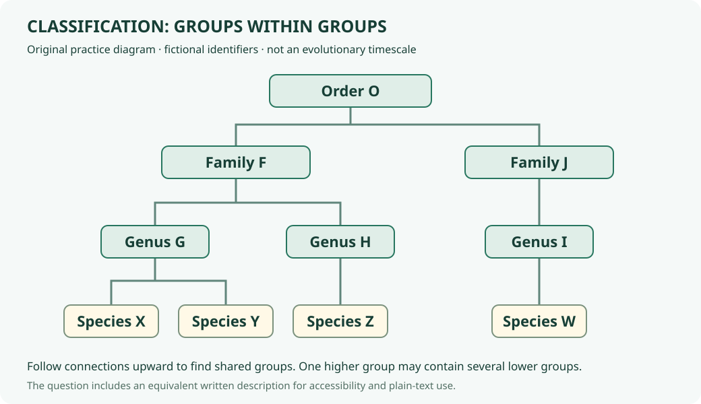

# ১ম অধ্যায়: জীবন পাঠ

> উত্তরসহ পর্যালোচনাধীন খসড়া; সংখ্যাগত লক্ষ্য অপূর্ণ।
> মূল বই ও বিষয়বিশেষজ্ঞের পূর্ণ যাচাই বাকি। বোর্ড/স্কুল/সাল দাবি নেই।

## mcq.json

### MCQ 1

জীববিজ্ঞান নামের Biology শব্দে গ্রিক bios কোন অর্থ প্রকাশ করে?

A. জীবন
B. পরিমাপ
C. শিলা
D. আলো

উত্তর: A — জীবন
bios অর্থ জীবন; logos অর্থ জ্ঞান বা আলোচনা।

### MCQ 2

জীবের বৈশিষ্ট্য বোঝাতে পদার্থবিজ্ঞান ও রসায়নের জ্ঞান কেন কাজে লাগে?

A. জীবদেহে কোনো রাসায়নিক পদার্থ নেই
B. জীবদেহের প্রক্রিয়াতেও ভৌত ও রাসায়নিক নিয়ম কাজ করে
C. জীবের সব বৈশিষ্ট্য শুধু বাহ্যিক রঙ দিয়ে বোঝা যায়
D. জীববিজ্ঞানে পর্যবেক্ষণের প্রয়োজন নেই

উত্তর: B — জীবদেহের প্রক্রিয়াতেও ভৌত ও রাসায়নিক নিয়ম কাজ করে
জীবদেহের গঠন ও কার্যক্রমের ভৌত-রাসায়নিক ভিত্তি আছে; তবু জীবের জটিল সংগঠন আলাদাভাবে অধ্যয়ন প্রয়োজন।

### MCQ 3

শুধু উদ্ভিদবিজ্ঞান ও প্রাণিবিজ্ঞান দিয়ে বর্তমান জীববিজ্ঞানের সব বিষয় ভাগ করা যথেষ্ট নয় কেন?

A. সব ব্যাকটেরিয়াই প্রাণী
B. ছত্রাকের সব বৈশিষ্ট্য সবুজ উদ্ভিদের মতো
C. ব্যাকটেরিয়া ও ছত্রাকের মতো পৃথক গোষ্ঠী এবং আন্তঃবিষয়ক গবেষণা রয়েছে
D. জীববিজ্ঞান কেবল বড় আকারের জীব নিয়ে আলোচনা করে

উত্তর: C — ব্যাকটেরিয়া ও ছত্রাকের মতো পৃথক গোষ্ঠী এবং আন্তঃবিষয়ক গবেষণা রয়েছে
আধুনিক জীববিজ্ঞানে জীবগোষ্ঠীর পাশাপাশি কোষ, বংশগতি ও পরিবেশের মতো সাধারণ বিষয়ভিত্তিক শাখাও প্রয়োজন।

### MCQ 4

ধানের পাতার বাহ্যিক আকারের বর্ণনা জীববিজ্ঞানের কোন শাখার সঙ্গে সরাসরি সম্পর্কিত?

A. শারীরবিদ্যা
B. বংশগতিবিদ্যা
C. জীবপরিসংখ্যান
D. অঙ্গসংস্থান

উত্তর: D — অঙ্গসংস্থান
অঙ্গসংস্থান জীবের দৈহিক গঠন নিয়ে আলোচনা করে; এখানে পাতার বাহ্যিক গঠন বর্ণনা করা হচ্ছে।

### MCQ 5

নমুনা জীবকে শনাক্ত করে তার শ্রেণিবিন্যাস নির্ধারণের গবেষণায় কোন শাখাটি সবচেয়ে সরাসরি প্রয়োজন?

A. ট্যাক্সোনমি
B. ভ্রূণবিদ্যা
C. হরমোনবিদ্যা
D. মৎস্যবিজ্ঞান

উত্তর: A — ট্যাক্সোনমি
ট্যাক্সোনমি বা শ্রেণিবিন্যাসবিদ্যা জীবের পরিচয়, নামকরণ ও শ্রেণিবিন্যাসের রীতির সঙ্গে সম্পর্কিত।

### MCQ 6

একটি পাতায় সালোকসংশ্লেষণ কীভাবে ঘটে—এই কার্যপ্রক্রিয়া অধ্যয়নের প্রধান শাখা কোনটি?

A. অঙ্গসংস্থান
B. শারীরবিদ্যা
C. জীবভূগোল
D. বনবিজ্ঞান

উত্তর: B — শারীরবিদ্যা
শারীরবিদ্যা জীবদেহের কার্যপ্রক্রিয়া আলোচনা করে; সালোকসংশ্লেষণ তার উদাহরণ।

### MCQ 7

একই অঙ্গের বিভিন্ন টিস্যুর গঠন ও বিন্যাস তুলনা করতে কোন শাখার জ্ঞান লাগবে?

A. ভ্রূণবিদ্যা
B. জীবভূগোল
C. হিস্টোলজি
D. কীটতত্ত্ব

উত্তর: C — হিস্টোলজি
হিস্টোলজি টিস্যুর গঠন, বিন্যাস ও কার্যাবলি নিয়ে আলোচনা করে।

### MCQ 8

নিষিক্ত জাইগোট থেকে ভ্রূণের বিকাশ নিয়ে অধ্যয়ন কোন শাখার বিষয়?

A. বাস্তুবিদ্যা
B. বনবিজ্ঞান
C. শ্রেণিবিন্যাসবিদ্যা
D. ভ্রূণবিদ্যা

উত্তর: D — ভ্রূণবিদ্যা
ভ্রূণবিদ্যায় জাইগোট থেকে ভ্রূণের গঠন ও বিকাশ অধ্যয়ন করা হয়।

### MCQ 9

কোষের গঠন ও বিভাজন পর্যবেক্ষণ কোন শাখার অন্তর্ভুক্ত?

A. কোষবিদ্যা
B. মৎস্যবিজ্ঞান
C. জীবভূগোল
D. ফার্মেসি

উত্তর: A — কোষবিদ্যা
কোষবিদ্যা বা Cytology-তে কোষের গঠন, কাজ ও বিভাজন আলোচনা করা হয়।

### MCQ 10

পিতা-মাতা থেকে সন্তানে বৈশিষ্ট্য সঞ্চারের জিনগত ভিত্তি কোন শাখায় অধ্যয়ন করা হয়?

A. অঙ্গসংস্থান
B. বংশগতিবিদ্যা
C. কীটতত্ত্ব
D. বনবিজ্ঞান

উত্তর: B — বংশগতিবিদ্যা
বংশগতিবিদ্যা বা Genetics জিন ও বংশগতির ধারা নিয়ে আলোচনা করে।

### MCQ 11

পুকুরের জীবসমষ্টি ও পানির পরিবেশের পারস্পরিক সম্পর্ক নিয়ে অধ্যয়ন কোন শাখার বিষয়?

A. কোষবিদ্যা
B. ভ্রূণবিদ্যা
C. বাস্তুবিদ্যা
D. ফার্মেসি

উত্তর: C — বাস্তুবিদ্যা
বাস্তুবিদ্যা জীবের সঙ্গে অন্য জীব ও পরিবেশের আন্তঃসম্পর্ক অধ্যয়ন করে।

### MCQ 12

হরমোন কীভাবে জীবদেহের কার্যক্রমে প্রভাব ফেলে—এই প্রশ্নটি কোন শাখার সঙ্গে সবচেয়ে সরাসরি সম্পর্কিত?

A. শ্রেণিবিন্যাসবিদ্যা
B. বনবিজ্ঞান
C. অঙ্গসংস্থান
D. এন্ডোক্রাইনোলজি

উত্তর: D — এন্ডোক্রাইনোলজি
এন্ডোক্রাইনোলজি হরমোন ও অন্তঃক্ষরা ব্যবস্থার কার্যকারিতা নিয়ে আলোচনা করে।

### MCQ 13

কোনো উদ্ভিদ পৃথিবীর কোন কোন অঞ্চলে বিস্তৃত—এ প্রশ্নের প্রধান আলোচ্য শাখা কোনটি?

A. জীবভূগোল
B. হিস্টোলজি
C. কোষবিদ্যা
D. ভ্রূণবিদ্যা

উত্তর: A — জীবভূগোল
জীবভূগোল ভৌগোলিক অঞ্চলে জীবের বিস্তৃতি ও তার সঙ্গে সংশ্লিষ্ট বিষয় আলোচনা করে।

### MCQ 14

ফসলের ক্ষতিকর ও উপকারী পতঙ্গ শনাক্তকরণ কোন শাখার সঙ্গে সরাসরি সম্পর্কিত?

A. ভ্রূণবিদ্যা
B. কীটতত্ত্ব
C. হিস্টোলজি
D. জীবভূগোল

উত্তর: B — কীটতত্ত্ব
কীটতত্ত্ব বা Entomology কীটপতঙ্গের জীবন, উপকারিতা ও ক্ষতিকর প্রভাব নিয়ে আলোচনা করে।

### MCQ 15

কম্পিউটারের সাহায্যে বিপুল জীববৈজ্ঞানিক তথ্য বিশ্লেষণের সঙ্গে কোন শাখাটি সবচেয়ে সরাসরি যুক্ত?

A. অঙ্গসংস্থান
B. বনবিজ্ঞান
C. বায়োইনফরমেটিকস
D. কীটতত্ত্ব

উত্তর: C — বায়োইনফরমেটিকস
বায়োইনফরমেটিকস জীববিজ্ঞানের তথ্য সংরক্ষণ ও বিশ্লেষণে কম্পিউটারভিত্তিক পদ্ধতি ব্যবহার করে।

### MCQ 16

অনেক ধরনের জীবকে সুশৃঙ্খলভাবে শ্রেণিবিন্যাস করার একটি প্রধান সুবিধা কী?

A. সব জীবের বৈশিষ্ট্য একই করে দেওয়া
B. পর্যবেক্ষণ ছাড়াই যেকোনো জীবের নাম দেওয়া
C. জীববৈচিত্র্য মুছে ফেলা
D. জীবের পরিচয় ও পারস্পরিক সাদৃশ্য সংগঠিতভাবে বোঝা

উত্তর: D — জীবের পরিচয় ও পারস্পরিক সাদৃশ্য সংগঠিতভাবে বোঝা
শ্রেণিবিন্যাস বৈচিত্র্যময় জীবকে দল ও উপদলে সাজিয়ে অধ্যয়ন ও শনাক্তকরণ সহজ করে।

### MCQ 17

পাঠ্য পাঁচ-রাজ্য শ্রেণিবিন্যাসে কোন জীবটি মনেরার উদাহরণ?

A. ব্যাকটেরিয়া
B. অ্যামিবা
C. মাশরুম
D. ধানগাছ

উত্তর: A — ব্যাকটেরিয়া
এই ঐতিহাসিক পাঠ্যমডেলে আদিকোষী ব্যাকটেরিয়া মনেরায় রাখা হয়; এটি আধুনিক সব শ্রেণিবিন্যাসের একমাত্র পদ্ধতি নয়।

### MCQ 18

সাধারণ ব্যাকটেরিয়াকোষে কোন বৈশিষ্ট্যটি পাওয়া যায়?

A. নিউক্লিয়ার পর্দায় ঘেরা নিউক্লিয়াস আছে
B. নিউক্লিয়ার পর্দাবেষ্টিত নিউক্লিয়াস নেই
C. সুগঠিত ক্লোরোপ্লাস্ট থাকে
D. মাইটোকন্ড্রিয়ায় সব শ্বসন ঘটে

উত্তর: B — নিউক্লিয়ার পর্দাবেষ্টিত নিউক্লিয়াস নেই
ব্যাকটেরিয়া আদিকোষী; তার বংশগতীয় বস্তু থাকে কিন্তু তা নিউক্লিয়ার পর্দায় ঘেরা নয়।

### MCQ 19

পাঠ্য পাঁচ-রাজ্য পদ্ধতিতে অ্যামিবাকে কোন রাজ্যে রাখা হয়?

A. ফানজাই
B. প্লানটি
C. প্রোটিস্টা
D. মনেরা

উত্তর: C — প্রোটিস্টা
অ্যামিবা প্রকৃত নিউক্লিয়াসযুক্ত এককোষী জীব এবং পাঠ্য পাঁচ-রাজ্য পদ্ধতিতে প্রোটিস্টার উদাহরণ।

### MCQ 20

ক্লোরোপ্লাস্টহীন, কাইটিনযুক্ত কোষপ্রাচীরবিশিষ্ট মাশরুম পাঠ্য পাঁচ-রাজ্য পদ্ধতিতে কোন রাজ্যের?

A. প্লানটি
B. মনেরা
C. অ্যানিমেলিয়া
D. ফানজাই

উত্তর: D — ফানজাই
ছত্রাকের কোষে প্রকৃত নিউক্লিয়াস থাকে; মাশরুমে কাইটিনযুক্ত কোষপ্রাচীর ও শোষণনির্ভর পুষ্টি ফানজাইয়ের বৈশিষ্ট্য।

### MCQ 21

সব ছত্রাক বহুকোষী—দাবিটির বিরুদ্ধে কোন উদাহরণটি প্রাসঙ্গিক?

A. এককোষী ইস্ট
B. বহুকোষী ধানগাছ
C. এককোষী ব্যাকটেরিয়া
D. বহুকোষী মানুষ

উত্তর: A — এককোষী ইস্ট
ইস্ট এককোষী ছত্রাক; তাই সব ছত্রাককে বহুকোষী বলা যায় না।

### MCQ 22

পাঠ্য পাঁচ-রাজ্য মডেলে ধানের মতো উন্নত সবুজ উদ্ভিদ কোন রাজ্যের উদাহরণ?

A. প্রোটিস্টা
B. প্লানটি
C. ফানজাই
D. মনেরা

উত্তর: B — প্লানটি
ধান প্রকৃত নিউক্লিয়াসযুক্ত বহুকোষী সবুজ উদ্ভিদ এবং প্লানটির উদাহরণ।

### MCQ 23

মানুষকে মাশরুম থেকে আলাদা করতে কোন কোষীয় বৈশিষ্ট্যটি কাজে লাগে?

A. মানুষের কোষে কোনো DNA থাকে না
B. মানুষ আদিকোষী
C. মানুষের কোষে কোষপ্রাচীর অনুপস্থিত
D. মাশরুমে নিউক্লিয়াস থাকে না

উত্তর: C — মানুষের কোষে কোষপ্রাচীর অনুপস্থিত
মানুষ ও মাশরুম উভয়ই প্রকৃতকোষী, কিন্তু মানুষের কোষে ছত্রাকের মতো কোষপ্রাচীর নেই।

### MCQ 24

একটি বৈজ্ঞানিক নামের প্রথম পদ কোন শ্রেণিবিন্যাসিক ধাপ নির্দেশ করে?

A. গোত্র
B. বর্গ
C. রাজ্য
D. গণ

উত্তর: D — গণ
দ্বিপদ বৈজ্ঞানিক নামের প্রথম পদ গণের নাম; দ্বিতীয়টি প্রজাতিক পদ। সম্পূর্ণ দুই পদ মিলে প্রজাতির নাম চিহ্নিত করে।

### MCQ 25

সাতটি প্রধান পাঠ্য ধাপে গোত্রের ঠিক নিচের ধাপ কোনটি?

A. গণ
B. রাজ্য
C. শ্রেণি
D. বর্গ

উত্তর: A — গণ
রাজ্য → পর্ব/বিভাগ → শ্রেণি → বর্গ → গোত্র → গণ → প্রজাতি—এই ক্রমে গোত্রের নিচে গণ।

### MCQ 26

দ্বিপদ নাম Homo sapiens-এ sapiens-কে সবচেয়ে নির্ভুলভাবে কী বলা যায়?

A. গণ নাম
B. প্রজাতিক পদ
C. গোত্র নাম
D. সম্পূর্ণ দ্বিপদ নাম

উত্তর: B — প্রজাতিক পদ
sapiens একা সম্পূর্ণ বৈজ্ঞানিক নাম নয়; Homo sapiens দুই পদ মিলেই মানুষের প্রজাতির নাম।

### MCQ 27

ইটালিক বা আন্ডারলাইন এখানে বিবেচনা না করে, আমের কোন লেবেলে দুই পদের ক্রম, পৃথক লেখা ও অক্ষরবিন্যাস ঠিক আছে?

A. Mangifera
B. indica Mangifera
C. Mangifera indica
D. MangiferaIndica

উত্তর: C — Mangifera indica
গণের প্রথম অক্ষর বড় এবং প্রজাতিক পদ ছোট অক্ষরে লেখা হয়। ছাপায় ইটালিক ও হাতে দুই পদের পৃথক আন্ডারলাইন করার নিয়মও রয়েছে।

### MCQ 28

হাতে দ্বিপদ বৈজ্ঞানিক নাম লেখার সময় আন্ডারলাইন কীভাবে দিতে হয়?

A. শুধু প্রথম অক্ষরের নিচে
B. দুই পদ ঘিরে একটি বৃত্ত দিয়ে
C. দুই পদের মাঝে আন্ডারলাইন দিয়ে
D. দুই পদের নিচে পৃথকভাবে

উত্তর: D — দুই পদের নিচে পৃথকভাবে
হাতে লেখার সময় গণ ও প্রজাতিক পদের নিচে পৃথক আন্ডারলাইন দেওয়া হয়; মুদ্রণে সাধারণত ইটালিক ব্যবহার করা হয়।

### MCQ 29

ধানের প্রচলিত বৈজ্ঞানিক নাম কোনটি?

A. Oryza sativa
B. Mangifera indica
C. Homo sapiens
D. Panthera tigris

উত্তর: A — Oryza sativa
Oryza sativa ধানের বৈজ্ঞানিক নাম; অপর নামগুলো যথাক্রমে আম, মানুষ ও বাঘের।

### MCQ 30

এক অঞ্চলে একই জীবের একাধিক স্থানীয় নাম থাকলে দ্বিপদ নামকরণ কীভাবে সাহায্য করে?

A. সব স্থানীয় ভাষা নিষিদ্ধ করে
B. স্বীকৃত বৈজ্ঞানিক নাম দিয়ে পরিচয়ের বিভ্রান্তি কমায়
C. পর্যবেক্ষণ ছাড়াই নতুন প্রজাতি তৈরি করে
D. জীবের গঠন বদলে দেয়

উত্তর: B — স্বীকৃত বৈজ্ঞানিক নাম দিয়ে পরিচয়ের বিভ্রান্তি কমায়
স্বীকৃত বৈজ্ঞানিক নাম বিভিন্ন অঞ্চলের গবেষণা ও তথ্য বিনিময়ে সুনির্দিষ্ট পরিচয় দেয়; নতুন প্রমাণে শ্রেণিবিন্যাস ও স্বীকৃত নাম সংশোধিতও হতে পারে।

## cq.json

### CQ 1

দুই শিক্ষার্থী একই পাতার ওপর কাজ করছে। মিতা পাতার বাহ্যিক আকার ও শিরার বিন্যাস নথিভুক্ত করে। নাবিল পাতায় খাদ্য তৈরির কার্যপ্রক্রিয়া নিয়ে তথ্য সংগ্রহ করে। পরে তারা পোকায় ক্ষতিগ্রস্ত পাতার উদাহরণ নিয়ে কৃষিক্ষেত্রে জ্ঞানের প্রয়োগ আলোচনা করে।

ক. জীববিজ্ঞান কী? [1]
জীব ও জীবন-সংশ্লিষ্ট গঠন, কার্যাবলি এবং পারস্পরিক সম্পর্কের বৈজ্ঞানিক অধ্যয়ন জীববিজ্ঞান।

খ. গঠন ও কার্যপ্রক্রিয়ার অধ্যয়ন এক বিষয় নয় কেন? [2]
গঠন অধ্যয়নে অঙ্গের আকার ও বিন্যাস বর্ণনা করা হয়; কার্যপ্রক্রিয়ায় অঙ্গ কীভাবে কাজ করে তা ব্যাখ্যা করা হয়। যেমন পাতার শিরার বিন্যাস ও খাদ্য তৈরির প্রক্রিয়া ভিন্ন আলোচ্য বিষয়।

গ. মিতা ও নাবিলের কাজকে উপযুক্ত শাখার সঙ্গে যুক্ত করে ব্যাখ্যা করো। [3]
মিতার কাজ অঙ্গসংস্থানের, কারণ সে পাতার বাহ্যিক গঠন বর্ণনা করছে। নাবিলের কাজ শারীরবিদ্যার, কারণ সে পাতার খাদ্য তৈরির কার্যপ্রক্রিয়া নিয়ে কাজ করছে। একই অঙ্গকে দুই দিক থেকে অধ্যয়ন করা হচ্ছে।

ঘ. পাতার ক্ষতির সমস্যা বোঝাতে মৌলিক ও ফলিত জ্ঞান একসঙ্গে প্রয়োজন—বিশ্লেষণ করো। [4]
অঙ্গসংস্থান স্বাভাবিক ও ক্ষতিগ্রস্ত পাতার গঠন তুলনা করতে এবং শারীরবিদ্যা কার্যগত প্রভাব বুঝতে সাহায্য করে। কীটতত্ত্ব ক্ষতির সঙ্গে সংশ্লিষ্ট পতঙ্গ শনাক্ত করতে এবং কৃষিবিজ্ঞান বাস্তব ব্যবস্থাপনায় সাহায্য করতে পারে। শুধু পাতার বাহ্যিক ক্ষত দেখে কারণ বা প্রতিকার নিশ্চিত করা যায় না; পর্যবেক্ষণ ও প্রমাণ মিলিয়ে প্রয়োগ করতে হয়।

### CQ 2

বিদ্যালয়ের প্রদত্ত তথ্যকার্ডে P-কে নিউক্লিয়ার পর্দাবিহীন বংশগতীয় বস্তুবিশিষ্ট ব্যাকটেরিয়া বলা হয়েছে। Q একটি অ্যামিবা, যার সুগঠিত নিউক্লিয়াস আছে। আলোচনায় কেবল পাঠ্য পাঁচ-রাজ্য শ্রেণিবিন্যাস ব্যবহার করতে বলা হলো।

ক. ট্যাক্সোনমি কী? [1]
জীবের পরিচয়, নামকরণ ও শ্রেণিবিন্যাসের রীতিনীতি-সংশ্লিষ্ট শাখা ট্যাক্সোনমি।

খ. নিউক্লিয়ার পর্দা না থাকা মানে DNA না থাকা নয় কেন? [2]
DNA বংশগতীয় বস্তু; তাকে ঘিরে নিউক্লিয়ার পর্দা আছে কি না তা পৃথক বৈশিষ্ট্য। ব্যাকটেরিয়ায় DNA থাকলেও তা নিউক্লিয়ার পর্দায় আবদ্ধ নয়।

গ. P ও Q-কে প্রদত্ত শ্রেণিবিন্যাসের উপযুক্ত রাজ্যে স্থাপন করো। [3]
পাঁচ-রাজ্য পাঠ্যমডেলে ব্যাকটেরিয়া P মনেরার অন্তর্ভুক্ত, কারণ তা আদিকোষী। অ্যামিবা Q প্রোটিস্টার অন্তর্ভুক্ত; এটি প্রকৃত নিউক্লিয়াসযুক্ত এককোষী জীব।

ঘ. P ও Q উভয়ই এককোষী বলে একই রাজ্যের—দাবিটি মূল্যায়ন করো। [4]
দাবিটি যথেষ্ট নয়। এককোষী হওয়া উভয়ের মিল হলেও নিউক্লিয়ার সংগঠনে মৌলিক পার্থক্য রয়েছে। শ্রেণিবিন্যাসে কোষের সংখ্যা ছাড়াও কোষীয় গঠন ও পুষ্টিসহ একাধিক বৈশিষ্ট্য বিবেচিত হয়। তাই প্রদত্ত মডেলে এরা পৃথক রাজ্যে থাকবে; অন্য আধুনিক মডেলের সঙ্গে এই সিদ্ধান্ত নির্বিচারে এক করে দেখা যাবে না।

### CQ 3

শিক্ষক ধানগাছ ও মাশরুমের তথ্য দিলেন। ধানে সবুজ সালোকসংশ্লেষণকারী অংশ আছে। মাশরুমে ক্লোরোপ্লাস্ট নেই, কোষপ্রাচীরে কাইটিন থাকে এবং পুষ্টি শোষণের মাধ্যমে গ্রহণ করে। রবি বলল, উভয়ই মাটিতে স্থির থাকে বলে একই রাজ্যের। এখানে পাঠ্য পাঁচ-রাজ্য পদ্ধতি ব্যবহার করতে হবে।

ক. ক্লোরোপ্লাস্ট কী? [1]
সালোকসংশ্লেষণে অংশগ্রহণকারী ক্লোরোফিলযুক্ত প্লাস্টিড হলো ক্লোরোপ্লাস্ট।

খ. মাশরুমের পুষ্টিকে সালোকসংশ্লেষণ বলা যায় না কেন? [2]
প্রদত্ত মাশরুমে ক্লোরোপ্লাস্ট নেই এবং তা পরিবেশের জৈব পুষ্টি শোষণ করে। আলো ব্যবহার করে কার্বন ডাই-অক্সাইড থেকে খাদ্য তৈরির প্রক্রিয়ার সঙ্গে এটি এক নয়।

গ. তথ্যগুলোর ভিত্তিতে ধান ও মাশরুমের রাজ্য নির্ণয় করো। [3]
ধান প্রকৃতকোষী বহুকোষী সবুজ উদ্ভিদ এবং প্লানটি রাজ্যের উদাহরণ। মাশরুমের কাইটিনযুক্ত কোষপ্রাচীর, ক্লোরোপ্লাস্টহীনতা ও শোষণনির্ভর পুষ্টি তাকে ফানজাইয়ে স্থাপন করে।

ঘ. রবির যুক্তির সীমাবদ্ধতা বিচার করে আরও নির্ভরযোগ্য সিদ্ধান্তপদ্ধতি লেখো। [4]
শুধু চলাচল না করাকে রাজ্য নির্ধারণের একমাত্র মানদণ্ড করা যায় না। কোষপ্রাচীরের প্রকৃতি, নিউক্লিয়ার সংগঠন, পুষ্টি ও দেহসংগঠন একসঙ্গে তুলনা করতে হবে। প্রদত্ত বৈশিষ্ট্যগুলোতে ধান ও মাশরুমের গুরুত্বপূর্ণ পার্থক্য থাকায় একই রাজ্যে রাখার দাবি সমর্থিত নয়। স্থির থাকা তাদের মিল, একই রাজ্যের যথেষ্ট প্রমাণ নয়।

### CQ 4

একটি প্রদর্শনীর খসড়া লেবেলে আমের নাম লেখা হলো mangifera Indica। অন্য লেবেলে মানুষের নাম Homo sapiens, তবে শুধু sapiens-কেই পূর্ণ বৈজ্ঞানিক নাম বলা হয়েছে। শিক্ষক নামের অক্ষরবিন্যাস ও দুই পদের পরিচয় সংশোধন করতে বললেন।

ক. দ্বিপদ নামকরণ কী? [1]
গণ নাম ও প্রজাতিক পদ—এই দুই পদ মিলিয়ে প্রজাতির বৈজ্ঞানিক নাম দেওয়ার পদ্ধতি দ্বিপদ নামকরণ।

খ. শুধু sapiens বললে পূর্ণ বৈজ্ঞানিক নাম হয় না কেন? [2]
sapiens প্রজাতিক পদ; Homo গণ নামের সঙ্গে মিলেই পূর্ণ নাম Homo sapiens গঠিত হয়। দ্বিতীয় পদ একা গণের পরিচয় দেয় না।

গ. দুই লেবেলের ভুল সংশোধন করে লেখার নিয়ম বোঝাও। [3]
আমের নাম হবে Mangifera indica: গণের প্রথম অক্ষর বড় এবং দ্বিতীয় পদ ছোট অক্ষরে। মানুষের পূর্ণ বৈজ্ঞানিক নাম Homo sapiens, শুধু sapiens নয়। ছাপায় দুই পদ ইটালিক এবং হাতে পৃথক আন্ডারলাইন করা হয়।

ঘ. স্থানীয় নামের পাশাপাশি বৈজ্ঞানিক নাম ব্যবহারের প্রয়োজনীয়তা বিশ্লেষণ করো। [4]
এক জীবের বিভিন্ন অঞ্চলে ভিন্ন স্থানীয় নাম এবং এক স্থানীয় নামের একাধিক প্রয়োগ থাকতে পারে। স্বীকৃত বৈজ্ঞানিক নাম গবেষণা ও সংরক্ষণে সুনির্দিষ্ট পরিচয় বিনিময় সহজ করে। তবে কেবল নাম দেখে নমুনার পরিচয় প্রমাণিত হয় না; বৈশিষ্ট্যও যাচাই করতে হয়। নতুন প্রমাণে স্বীকৃত নাম সংশোধিত হতে পারে, তাই তথ্যের হালনাগাদ অবস্থাও দেখতে হয়।

### CQ 5

কাল্পনিক শ্রেণিবিন্যাস-অনুশীলনে A ও B একই গণের কিন্তু পৃথক প্রজাতির। C একই গোত্রের অন্য গণে রাখা হয়েছে। তিনটি কার্ডেই সাতটি প্রধান পাঠ্য ধাপ ব্যবহার করা হয়েছে; এটি কোনো বাস্তব প্রজাতির নতুন বৈজ্ঞানিক নাম প্রস্তাব নয়।

ক. পাঠ্য শ্রেণিবিন্যাসের মৌলিক একক কী? [1]
প্রজাতি পাঠ্য শ্রেণিবিন্যাসের মৌলিক একক।

খ. গণ ও গোত্র ধাপের সম্পর্ক কী? [2]
সাতটি প্রধান পাঠ্য ধাপে গোত্র গণের উপরের ধাপ। একটি গোত্রে সম্পর্কযুক্ত এক বা একাধিক গণ থাকতে পারে।

গ. A, B ও C-এর গোত্র ও গণগত সম্পর্ক প্রদত্ত তথ্য দিয়ে ব্যাখ্যা করো। [3]
A ও B একই গণের হওয়ায় প্রদত্ত বিন্যাসে একই গোত্রেও অন্তর্ভুক্ত। C ওই একই গোত্রে থাকলেও অন্য গণের। ফলে তিনটি একই গোত্রের, কিন্তু তিনটি একই গণের নয়।

ঘ. একই গোত্রের সব জীব একই প্রজাতির—দাবিটি ধাপক্রমের আলোকে মূল্যায়ন করো। [4]
ধাপক্রম রাজ্য → পর্ব/বিভাগ → শ্রেণি → বর্গ → গোত্র → গণ → প্রজাতি। একটি উপরের দলে একাধিক নিম্নদল থাকতে পারে। A ও B-ই একই গণে থেকেও পৃথক প্রজাতি, আবার C ভিন্ন গণে। তাই একই গোত্র থেকে একই প্রজাতি হওয়া অবধারিত নয়। শ্রেণিবিন্যাসের ধাপকে শারীরিক শ্রেষ্ঠত্বের র‍্যাঙ্ক হিসেবেও ব্যাখ্যা করা যাবে না।

## sq.json

### SQ 1

জীববিজ্ঞান অধ্যয়নে ভৌত ও রাসায়নিক জ্ঞানের প্রয়োজন কেন? দুটি দিক লেখো।

নমুনা উত্তর: জীবদেহ পদার্থ দিয়ে গঠিত এবং তার বিপাকীয় প্রক্রিয়ায় রাসায়নিক বিক্রিয়া ঘটে। পরিবহণ, শক্তির রূপান্তরসহ নানা কাজ ভৌত নিয়ম মেনে চলে। এ ভিত্তিগুলো জানলে জীবের জটিল সংগঠন ও কার্যক্রম বোঝা সহজ হয়।

### SQ 2

অঙ্গসংস্থান ও শারীরবিদ্যার আলোচ্য বিষয়ের পার্থক্য একটি উদাহরণসহ লেখো।

নমুনা উত্তর: অঙ্গসংস্থান জীবের গঠন আলোচনা করে, যেমন পাতার আকার। শারীরবিদ্যা জীবদেহের কার্যপ্রক্রিয়া আলোচনা করে, যেমন পাতায় সালোকসংশ্লেষণ। গঠন ও কাজ সম্পর্কিত হলেও প্রশ্নের কেন্দ্র আলাদা।

### SQ 3

কোষবিদ্যা ও হিস্টোলজি কীভাবে পৃথক? দুটি আলোচ্য বিষয় উল্লেখ করো।

নমুনা উত্তর: কোষবিদ্যায় কোষের গঠন, কাজ ও বিভাজন অধ্যয়ন করা হয়। হিস্টোলজিতে টিস্যুর গঠন, বিন্যাস ও কার্যাবলি অধ্যয়ন করা হয়; টিস্যু বহু কোষের সংগঠিত সমষ্টি হতে পারে।

### SQ 4

ভৌত বা মৌলিক ও ফলিত জীববিজ্ঞানের পার্থক্য উদাহরণসহ বোঝাও।

নমুনা উত্তর: মৌলিক শাখায় তাত্ত্বিক ভিত্তি বোঝা প্রধান, যেমন বংশগতিবিদ্যায় বৈশিষ্ট্য সঞ্চার অধ্যয়ন। ফলিত কাজে সেই জ্ঞান ব্যবহার করে বাস্তব সমস্যা সমাধান করা হয়, যেমন কৃষিতে উন্নত ফসল উৎপাদনে জ্ঞানের প্রয়োগ। দুই ক্ষেত্র একে অপরকে সহায়তা করে।

### SQ 5

জীবের শ্রেণিবিন্যাসের দুটি প্রয়োজন লেখো।

নমুনা উত্তর: সাদৃশ্য ও বৈসাদৃশ্য অনুযায়ী দলবিন্যাস বিপুল জীববৈচিত্র্যকে সুশৃঙ্খলভাবে জানতে সাহায্য করে। নির্ভুল শনাক্তকরণ ও নামকরণ গবেষণা, তথ্য সংরক্ষণ এবং সংরক্ষণমূলক কাজে বিভ্রান্তি কমায়।

### SQ 6

পাঠ্য পাঁচ-রাজ্য মডেলকে সব জীবের চিরস্থায়ী ও একমাত্র শ্রেণিবিন্যাস বলা ঠিক নয় কেন?

নমুনা উত্তর: পাঁচ-রাজ্য পদ্ধতি একটি ঐতিহাসিক পাঠ্যমডেল। কোষীয় ও আণবিক নতুন তথ্য এবং গবেষণার উদ্দেশ্য অনুসারে অন্য শ্রেণিবিন্যাসও ব্যবহৃত হয়; তাই মডেলটির প্রসঙ্গ উল্লেখ করা প্রয়োজন।

### SQ 7

ব্যাকটেরিয়ার বংশগতীয় বস্তু থাকলেও তাকে আদিকোষী বলা হয় কেন?

নমুনা উত্তর: ব্যাকটেরিয়ায় DNA থাকে, কিন্তু তা সুগঠিত নিউক্লিয়ার পর্দায় আবদ্ধ নয়। তাই DNA থাকার বিষয়টি অস্বীকার না করেই তাকে আদিকোষী বলা হয়।

### SQ 8

মাশরুমকে শুধু স্থির থাকার কারণে সবুজ উদ্ভিদের দলে রাখা ঠিক নয় কেন?

নমুনা উত্তর: মাশরুমে ক্লোরোপ্লাস্ট নেই এবং পুষ্টি শোষণনির্ভর; তার কোষপ্রাচীরে কাইটিন থাকে। কেবল চলাচল না করা নয়, কোষীয় গঠন ও পুষ্টির মতো একাধিক বৈশিষ্ট্য ধরে শ্রেণিবিন্যাস করতে হয়।

### SQ 9

Homo sapiens লেখার দুটি নিয়ম এবং দুই পদের অর্থ লেখো।

নমুনা উত্তর: Homo গণ নাম, sapiens প্রজাতিক পদ; দুই পদ মিলে মানুষের বৈজ্ঞানিক নাম। গণের প্রথম অক্ষর বড়, দ্বিতীয় পদ ছোট অক্ষরে লিখতে হয়। ছাপায় ইটালিক অথবা হাতে দুই পদের নিচে পৃথক আন্ডারলাইন ব্যবহার করা হয়।

### SQ 10

শ্রেণিবিন্যাসের সাতটি প্রধান পাঠ্য ধাপ বড় থেকে ছোট ক্রমে লেখো।

নমুনা উত্তর: রাজ্য → পর্ব/বিভাগ → শ্রেণি → বর্গ → গোত্র → গণ → প্রজাতি। এটি মূল ধাপগুলোর পাঠ্যক্রম; বাস্তব শ্রেণিবিন্যাসে অতিরিক্ত উপধাপ থাকতে পারে।

## chapter-work-mcq.json

### MCQ 1

Biology শব্দের logos অংশ কোন অর্থের সঙ্গে যুক্ত?

A. জীবন
B. জ্ঞান বা আলোচনা
C. দেহের মাপ
D. খাদ্য

উত্তর: B — জ্ঞান বা আলোচনা
bios জীবন এবং logos জ্ঞান বা আলোচনার ধারণা প্রকাশ করে।

### MCQ 2

জীবদেহের সব রাসায়নিক উপাদানের তালিকা জানলেও সমন্বিত আচরণ পুরো জানা নাও যেতে পারে কেন?

A. সংগঠনের কোনো ভূমিকা নেই
B. জীবদেহে রাসায়নিক নিয়ম চলে না
C. একটি উপাদানই সব জীবের সব কাজ নির্ধারণ করে
D. উপাদানগুলোর বিন্যাস ও মিথস্ক্রিয়াও গুরুত্বপূর্ণ

উত্তর: D — উপাদানগুলোর বিন্যাস ও মিথস্ক্রিয়াও গুরুত্বপূর্ণ
অংশের পরিচয়ের পাশাপাশি তাদের সংগঠিত ব্যবস্থার বৈশিষ্ট্য বুঝতে হয়।

### MCQ 3

মৌলিক গবেষণা থেকে তাৎক্ষণিক পণ্য পাওয়া না গেলে কোন মূল্যায়নটি যথার্থ?

A. ভবিষ্যৎ প্রয়োগের ভিত্তি হিসেবে জ্ঞানটির মূল্য থাকতে পারে
B. গবেষণাটি অবশ্যই অকার্যকর
C. জ্ঞানটি পরীক্ষার অযোগ্য
D. সব গবেষণাকে সরাসরি চিকিৎসা দিতে হবে

উত্তর: A — ভবিষ্যৎ প্রয়োগের ভিত্তি হিসেবে জ্ঞানটির মূল্য থাকতে পারে
তাত্ত্বিক ব্যাখ্যা ও ব্যবহারিক পণ্য তৈরির সময় এক না-ও হতে পারে।

### MCQ 4

শিল্পে একটি জীবীয় পদ্ধতি ব্যর্থ হওয়ায় তার কোষীয় প্রক্রিয়া নতুন করে পরীক্ষা করা হলো। এটি কী দেখায়?

A. মৌলিক গবেষণায় তথ্য লাগে না
B. ফলিত জ্ঞানের সঙ্গে তত্ত্বের কোনো সম্পর্ক নেই
C. ব্যর্থ প্রয়োগের সব তথ্য বাদ দেওয়া উচিত
D. প্রয়োগ থেকেও মৌলিক গবেষণার প্রশ্ন আসতে পারে

উত্তর: D — প্রয়োগ থেকেও মৌলিক গবেষণার প্রশ্ন আসতে পারে
মৌলিক ও ফলিত গবেষণা পরস্পরকে প্রশ্ন ও তথ্য দিতে পারে।

### MCQ 5

শুধু মানুষের উপকার-অপকার দিয়ে জীবের স্থায়ী শ্রেণিপরিচয় নির্ধারণের সমস্যা কী?

A. ব্যবহারিক প্রভাব সবসময় অপরিবর্তনীয়
B. একই জীবের প্রভাব প্রসঙ্গভেদে বদলাতে পারে
C. সব উপকারী জীব একই প্রজাতি
D. ক্ষতিকর জীবের কোষ থাকে না

উত্তর: B — একই জীবের প্রভাব প্রসঙ্গভেদে বদলাতে পারে
ব্যবহারিক মূল্যায়ন শ্রেণিগত গঠন ও সম্পর্কের বিকল্প নয়।

### MCQ 6

প্রাচীন জীবের অবশেষ ও ছাপ তুলনার প্রধান বিশেষ ক্ষেত্র কোনটি?

A. এন্ডোক্রাইনোলজি
B. জীবভূগোল
C. হিস্টোলজি
D. জীবাশ্মবিজ্ঞান

উত্তর: D — জীবাশ্মবিজ্ঞান
জীবাশ্মবিজ্ঞান প্রাগৈতিহাসিক জীবের অবশেষ ও সাক্ষ্য বিশ্লেষণ করে।

### MCQ 7

জীবীয় উপাত্তে নমুনার গড় ও অনুমানের অনিশ্চয়তা বিশ্লেষণের ক্ষেত্র কোনটি?

A. জীবপরিসংখ্যান
B. বহিঃঅঙ্গসংস্থান
C. ভ্রূণবিদ্যা
D. কীটতত্ত্ব

উত্তর: A — জীবপরিসংখ্যান
জীবপরিসংখ্যান জীববৈজ্ঞানিক তথ্যের পরিমাণগত বিশ্লেষণে ব্যবহৃত হয়।

### MCQ 8

পোষকদেহে পরজীবীর জীবনচক্র ও প্রভাব বিশেষভাবে কোন শাখায় আলোচনা হয়?

A. বনবিজ্ঞান
B. জীবাশ্মবিজ্ঞান
C. কোষবিদ্যা
D. পরজীবীবিদ্যা

উত্তর: D — পরজীবীবিদ্যা
কোষবিদ্যাও সহায়ক হতে পারে, তবে প্রশ্নটির সরাসরি বিষয় পোষক-পরজীবী সম্পর্ক।

### MCQ 9

পুকুরের মাছের উৎপাদন, আহরণ ও সম্পদ সংরক্ষণের সরাসরি ক্ষেত্র কোনটি?

A. ভ্রূণবিদ্যা
B. হিস্টোলজি
C. মৎস্যবিজ্ঞান
D. এন্ডোক্রাইনোলজি

উত্তর: C — মৎস্যবিজ্ঞান
মৎস্যবিজ্ঞান মাছের উৎপাদন ও সম্পদ ব্যবস্থাপনার প্রয়োগ নিয়ে কাজ করে।

### MCQ 10

ব্যাকটেরিয়া ও আণুবীক্ষণিক ছত্রাকের বৈশিষ্ট্য একত্রে আলোচনার ক্ষেত্র কোনটি?

A. অণুজীববিজ্ঞান
B. বন্যপ্রাণী ব্যবস্থাপনা
C. বহিঃঅঙ্গসংস্থান
D. বনবিজ্ঞান

উত্তর: A — অণুজীববিজ্ঞান
অণুজীববিজ্ঞান বিভিন্ন ক্ষুদ্র জৈব সত্তার জীবন ও কাজ বিশ্লেষণ করে।

### MCQ 11

ফসলের চাষপদ্ধতি ও উৎপাদন উন্নয়নের সরাসরি প্রয়োগক্ষেত্র কোনটি?

A. কৃষিবিজ্ঞান
B. ভ্রূণবিদ্যা
C. জীবাশ্মবিজ্ঞান
D. জীবভূগোল

উত্তর: A — কৃষিবিজ্ঞান
কৃষিবিজ্ঞান উদ্ভিদ, মাটি ও চাষব্যবস্থার জ্ঞান প্রয়োগ করে।

### MCQ 12

মানবদেহের রোগ নির্ণয় ও চিকিৎসার প্রধান প্রয়োগক্ষেত্র কোনটি?

A. প্রাগৈতিহাসিক জীবাশ্ম গবেষণা
B. চিকিৎসাবিজ্ঞান
C. বনবিজ্ঞান
D. মৎস্যবিজ্ঞান

উত্তর: B — চিকিৎসাবিজ্ঞান
চিকিৎসাবিজ্ঞানে দেহ, রোগ ও চিকিৎসার বৈজ্ঞানিক প্রয়োগ আলোচিত হয়।

### MCQ 13

জীবের DNA পরিকল্পিতভাবে পরিবর্তনের বিশেষ প্রযুক্তিগত ক্ষেত্র কোনটি?

A. অঙ্গসংস্থান
B. জিন প্রকৌশল
C. জীবভূগোল
D. হিস্টোলজি

উত্তর: B — জিন প্রকৌশল
জিন প্রকৌশলে বংশগতীয় উপাদানে পরিকল্পিত পরিবর্তন আনা হয়; সব জীবপ্রযুক্তিতে এ পরিবর্তন দরকার নেই।

### MCQ 14

জীবদেহের এনজাইম ও বিপাকের রাসায়নিক ভিত্তি বিশ্লেষণের ক্ষেত্র কোনটি?

A. বন্যপ্রাণী গণনা
B. বহিঃঅঙ্গসংস্থান
C. প্রাণরসায়ন
D. বনবিজ্ঞান

উত্তর: C — প্রাণরসায়ন
প্রাণরসায়ন জীবের রাসায়নিক অণু ও বিক্রিয়ার ভিত্তি নিয়ে কাজ করে।

### MCQ 15

বনসম্পদের পুনরুৎপাদন, আহরণ ও সংরক্ষণের সরাসরি ক্ষেত্র কোনটি?

A. ভ্রূণবিদ্যা
B. কীটতত্ত্ব
C. বনবিজ্ঞান
D. ফার্মেসি

উত্তর: C — বনবিজ্ঞান
পতঙ্গসহ অন্য তথ্য সহায়ক হলেও সমগ্র বনসম্পদ ব্যবস্থাপনা বনবিজ্ঞানের সরাসরি বিষয়।

### MCQ 16

জীব বা জৈব প্রক্রিয়া কাজে লাগিয়ে প্রয়োজনীয় পণ্য তৈরির বৃহত্তর ক্ষেত্র কোনটি?

A. কেবল নামের বানানরীতি
B. কেবল বহিঃঅঙ্গসংস্থান
C. কেবল জীবাশ্মের বর্ণনা
D. জীবপ্রযুক্তি

উত্তর: D — জীবপ্রযুক্তি
জীবপ্রযুক্তি জৈব ব্যবস্থার ব্যবহার; জিন প্রকৌশল তার একটি বিশেষ পদ্ধতি হতে পারে।

### MCQ 17

ওষুধ প্রস্তুত, মান নিয়ন্ত্রণ ও সংশ্লিষ্ট প্রযুক্তির ক্ষেত্র কোনটি?

A. হিস্টোলজি
B. বনবিজ্ঞান
C. ফার্মেসি
D. জীবভূগোল

উত্তর: C — ফার্মেসি
ফার্মেসি ওষুধশিল্প ও প্রযুক্তির সঙ্গে সরাসরি যুক্ত।

### MCQ 18

প্রাকৃতিক আবাসে বন্যপ্রাণীর অবস্থা ও সংরক্ষণে সরাসরি কাজের ক্ষেত্র কোনটি?

A. ওষুধ প্রস্তুত প্রযুক্তি
B. কেবল ভ্রূণবিদ্যা
C. বন্যপ্রাণিবিদ্যা
D. কেবল উদ্ভিদের বহিঃগঠন

উত্তর: C — বন্যপ্রাণিবিদ্যা
বন্যপ্রাণীর জীবন ও ব্যবস্থাপনা এ ক্ষেত্রের মূল বিষয়।

### MCQ 19

সমুদ্রের জীবসমাজকে কেন্দ্র করে গবেষণার নির্ভুল পরিচয় কোনটি?

A. শুধু আবহাওয়াবিদ্যা
B. সামুদ্রিক জীববিজ্ঞান
C. শুধু খনিজবিদ্যা
D. শুধু ভৌত সমুদ্রবিদ্যা

উত্তর: B — সামুদ্রিক জীববিজ্ঞান
সমুদ্রবিদ্যা বিস্তৃত ক্ষেত্র; সামুদ্রিক জীববিজ্ঞান বিশেষভাবে তার জীবসংশ্লিষ্ট অধ্যয়ন।

### MCQ 20

বংশপরম্পরায় জীবগোষ্ঠীর পরিবর্তনের ইতিহাস অধ্যয়নের শাখা কোনটি?

A. শুধু ভ্রূণবিদ্যা
B. বিবর্তনবিদ্যা
C. শুধু হরমোনবিদ্যা
D. শুধু অঙ্গসংস্থান

উত্তর: B — বিবর্তনবিদ্যা
গোষ্ঠীর প্রজন্মগত পরিবর্তন ও ব্যক্তির ভ্রূণবিকাশ আলাদা অনুসন্ধান।

### MCQ 21

সায়ানোব্যাকটেরিয়া সালোকসংশ্লেষণ করলেও পাঠ্য মনেরায় থাকে কেন?

A. এতে কোনো বংশগতীয় উপাদান নেই
B. এটি বহুকোষী প্রাণী
C. এতে সুগঠিত ক্লোরোপ্লাস্ট আছে
D. এর কোষ আদিকোষী

উত্তর: D — এর কোষ আদিকোষী
পুষ্টির একটি ক্ষমতার চেয়ে নিউক্লিয়ার সংগঠন এ বিভাজনে বেশি নির্ণায়ক।

### MCQ 22

সব প্রোটিস্টা একইভাবে খাদ্য গ্রহণ করে—দাবিটি কেন অনির্ভুল?

A. পাঠ্য বিস্তৃত গোষ্ঠীতে আলোকসংশ্লেষণকারী ও পরভোজী উভয় ধরন আছে
B. সব সদস্য ফুলধারী
C. প্রোটিস্টায় প্রকৃত নিউক্লিয়াস থাকে না
D. সব সদস্যই কেবল মাশরুম

উত্তর: A — পাঠ্য বিস্তৃত গোষ্ঠীতে আলোকসংশ্লেষণকারী ও পরভোজী উভয় ধরন আছে
ঐতিহাসিক প্রোটিস্টা মডেলে পুষ্টি ও দেহীয় সংগঠনের বৈচিত্র্য রয়েছে।

### MCQ 23

ফার্নকে শুধু ফুল না থাকার কারণে উদ্ভিদরাজ্য থেকে বাদ দেওয়া কেন ভুল?

A. ফার্নের কোষ আদিকোষী
B. সব উদ্ভিদ সপুষ্পক নয়
C. ফুল ছাড়া কোনো কোষ জীবিত থাকে না
D. উদ্ভিদরাজ্যে কেবল ধান থাকে

উত্তর: B — সব উদ্ভিদ সপুষ্পক নয়
ফুল একটি নির্দিষ্ট উদ্ভিদগোষ্ঠীর বৈশিষ্ট্য, সব উদ্ভিদের বাধ্যতামূলক লক্ষণ নয়।

### MCQ 24

একসঙ্গে সারিবদ্ধ ব্যাকটেরিয়ার ফিলামেন্টকে প্রাণীর টিস্যুর সমার্থক বলা যায় না কেন?

A. দলবদ্ধতা ও বিশেষায়িত টিস্যু সংগঠন এক বিষয় নয়
B. সব প্রাণী আদিকোষী
C. সব ফিলামেন্টই ফুলের পাপড়ি
D. সারিবদ্ধ হলে কোষ আর থাকে না

উত্তর: A — দলবদ্ধতা ও বিশেষায়িত টিস্যু সংগঠন এক বিষয় নয়
কোষীয় সংগঠন ও বিশেষায়নও বিবেচনা করতে হয়; শুধু সারিবদ্ধতা যথেষ্ট নয়।

### MCQ 25

একই গোত্রের কিন্তু ভিন্ন গণের দুটি নমুনা কোন ধাপে নিশ্চিতভাবে এক নয়?

A. শ্রেণি
B. বর্গ
C. প্রজাতি
D. পর্ব

উত্তর: C — প্রজাতি
প্রধান নেস্টেড ধারায় একই প্রজাতি একই গণের অধীন; গণ ভিন্ন হলে প্রজাতিও এক নয়।

### MCQ 26

দুটি জীব একই শ্রেণির হলে কোন উচ্চতর প্রধান ধাপের মিল নিশ্চিত?

A. গণ
B. প্রজাতি
C. পর্ব
D. সবসময় গোত্র

উত্তর: C — পর্ব
শ্রেণি পর্বের অধীন; উচ্চধাপের মিল নিচের প্রতিটি ধাপের মিল বোঝায় না।

### MCQ 27

শ্রেণিবিন্যাসের ধাপ ও ওই ধাপের নির্দিষ্ট দলের সঠিক উদাহরণ কোনটি?

A. Homo একটি ধাপ, গণ এক ব্যক্তি
B. প্রজাতি একটি বয়স, Homo একটি অঙ্গ
C. গণ একটি ধাপ, Homo একটি গণের নাম
D. গোত্র একটি নমুনা, Mammalia গণ

উত্তর: C — গণ একটি ধাপ, Homo একটি গণের নাম
ধাপ হলো rank, আর ওই স্তরের নির্দিষ্ট দল হলো taxon।

### MCQ 28

মানুষের লোম ও দুগ্ধগ্রন্থি কোন ধাপের যুক্তিতে বেশি নির্দিষ্টভাবে কাজে লাগে?

A. Mammalia শ্রেণি
B. সব Chordata-র একমাত্র বৈশিষ্ট্য
C. Monera রাজ্য
D. সব Animalia-র অভিন্ন বৈশিষ্ট্য

উত্তর: A — Mammalia শ্রেণি
এগুলো স্তন্যপায়ীর বৈশিষ্ট্য; সব প্রাণী বা সব কর্ডেটে নেই।

### MCQ 29

একটি প্রজাতির দশটি নমুনায় আকার আলাদা পাওয়া গেলে কী সিদ্ধান্ত উপযুক্ত?

A. প্রতিটি নমুনাই অবশ্যই আলাদা রাজ্য
B. আকার দিয়ে কখনও কোনো তুলনা চলে না
C. ব্যক্তিগত বৈচিত্র্যও বিবেচনা করতে হবে
D. প্রজাতি মানেই একটিমাত্র ব্যক্তি

উত্তর: C — ব্যক্তিগত বৈচিত্র্যও বিবেচনা করতে হবে
বয়স, পরিবেশ ও বংশগতীয় পার্থক্যে একই প্রজাতির ব্যক্তিরা ভিন্ন হতে পারে।

### MCQ 30

শ্রেণিবিন্যাসের তালিকায় উচ্চধাপের লক্ষণ নিচের ধাপে আবার না লিখলে কী বোঝাতে পারে?

A. সব লক্ষণ হারিয়েছে
B. ধাপগুলোর মধ্যে সম্পর্ক নেই
C. নিচের ধাপ সব উচ্চধাপের বাইরে
D. পুনরাবৃত্তি এড়াতে উত্তরাধিকারসূত্রে প্রযোজ্য লক্ষণ উহ্য

উত্তর: D — পুনরাবৃত্তি এড়াতে উত্তরাধিকারসূত্রে প্রযোজ্য লক্ষণ উহ্য
নেস্টেড কাঠামোয় উচ্চধাপের অন্তর্ভুক্তি প্রতিবার পুনরুক্ত না-ও হয়।

### MCQ 31

Species plantarum-এর 1753 সালের প্রকাশনা পাঠ্যে কোন প্রসঙ্গে গুরুত্বপূর্ণ?

A. মাইটোকন্ড্রিয়ায় ATP তৈরির আবিষ্কার
B. পাঁচ-রাজ্য মডেলের প্রস্তাব
C. উদ্ভিদের দ্বিপদ নামকরণের ইতিহাস
D. জীবাশ্মের বয়স মাপার যন্ত্র

উত্তর: C — উদ্ভিদের দ্বিপদ নামকরণের ইতিহাস
লিনিয়াসের এ গ্রন্থ দ্বিপদ নামকরণের ইতিহাসে গুরুত্বপূর্ণ; এটি আধুনিক সব নিয়মের অপরিবর্তনীয় সংস্করণ নয়।

### MCQ 32

বৈজ্ঞানিক নাম ল্যাটিনীকৃত হতে পারে—এ কথার অর্থ কোনটি?

A. যেকোনো দীর্ঘ বাক্যই দ্বিপদ
B. অন্য উৎসের শব্দও নির্ধারিত রূপে নাম হতে পারে
C. নাম কেবল প্রাচীন ব্যক্তিদের জন্য
D. কেবল ইতালিতে জন্মানো জীবের নাম দেওয়া যায়

উত্তর: B — অন্য উৎসের শব্দও নির্ধারিত রূপে নাম হতে পারে
নামের ভাষাগত রীতি জীবের ভৌগোলিক উৎপত্তিকে সীমাবদ্ধ করে না।

### MCQ 33

দুটি গণের প্রথম অক্ষর একই হলে সংক্ষিপ্ত গণ-নামের ঝুঁকি কী?

A. কোন গণ বোঝানো হচ্ছে তা অস্পষ্ট হতে পারে
B. সব প্রজাতিক পদ বাতিল হয়
C. দুটি গণ স্বয়ংক্রিয়ভাবে একই হয়
D. প্রতিটি নাম নতুন রাজ্য হয়

উত্তর: A — কোন গণ বোঝানো হচ্ছে তা অস্পষ্ট হতে পারে
প্রয়োজনে পূর্ণ গণ নাম দিয়ে দ্ব্যর্থতা এড়াতে হয়।

### MCQ 34

মূল দ্বিপদের পরে লেখকের সংক্ষিপ্ত নাম যোগ হলে তার ভূমিকা কী?

A. নতুন গণ
B. দ্বিপদের তৃতীয় প্রজাতিক পদ
C. নমুনার বয়স
D. নামকরণের লেখক-উল্লেখ

উত্তর: D — নামকরণের লেখক-উল্লেখ
গণ ও প্রজাতিক পদ মিলে দ্বিপদ; লেখক-উল্লেখ অতিরিক্ত ঐতিহাসিক তথ্য।

### MCQ 35

শুধু দুই শব্দ ঠিকভাবে লিখলেই নতুন প্রজাতির নাম বৈধভাবে প্রতিষ্ঠিত হয় না কেন?

A. স্থানীয় নাম থাকলেই তুলনা লাগে না
B. নামের সঙ্গে কোনো নিয়মের সম্পর্ক নেই
C. সব দুই শব্দের নাম নিষিদ্ধ
D. প্রযোজ্য নিয়মে প্রকাশনা ও পরিচয়সংক্রান্ত আরও শর্ত থাকে

উত্তর: D — প্রযোজ্য নিয়মে প্রকাশনা ও পরিচয়সংক্রান্ত আরও শর্ত থাকে
নাম লেখার রীতি এবং নতুন বৈজ্ঞানিক নাম আনুষ্ঠানিকভাবে প্রতিষ্ঠা করা আলাদা কাজ।

### MCQ 36

একই প্রজাতির পুরোনো ও বর্তমান নামকে দুই প্রজাতি ধরে গুনলে কী ভুল হতে পারে?

A. প্রজাতির বৈশিষ্ট্য বদলে যাওয়া
B. বৈচিত্র্যের দ্বিগণনা
C. ব্যক্তিসংখ্যা নিশ্চয় শূন্য
D. সব নাম একই ভাষার হওয়া

উত্তর: B — বৈচিত্র্যের দ্বিগণনা
যাচাইকৃত সমার্থক নামের সংযোগ রাখলে একই প্রজাতি বারবার গণনা এড়ানো যায়।

### MCQ 37

একটি অচেনা নমুনা পাওয়াই নতুন প্রজাতি আবিষ্কারের প্রমাণ নয় কেন?

A. নমুনাটি গবেষকের অজানা হলেও আগে বর্ণিত হতে পারে
B. নতুনত্ব যাচাইয়ের দরকার নেই
C. অচেনা জীবের কখনও বৈশিষ্ট্য থাকে না
D. ছবি তুললেই সব আনুষ্ঠানিক শর্ত পূরণ

উত্তর: A — নমুনাটি গবেষকের অজানা হলেও আগে বর্ণিত হতে পারে
বিদ্যমান বিবরণ ও নির্ণায়ক বৈশিষ্ট্যের সঙ্গে তুলনা প্রয়োজন।

### MCQ 38

নামের বানান ভুলকে নিছক সাজসজ্জার বিষয় বলা যায় না কেন?

A. সঠিক বানানই নিরাপদ ওষুধের ডোজ
B. তথ্যভান্ডারে একই জীবের রেকর্ড আলাদা হয়ে যেতে পারে
C. ভুল বানান নতুন প্রজাতি তৈরি করে
D. বানান বদলালে জীবের সব জিন বদলায়

উত্তর: B — তথ্যভান্ডারে একই জীবের রেকর্ড আলাদা হয়ে যেতে পারে
নির্ভুল নাম ও সমার্থক নামের রেকর্ড তথ্য উদ্ধারে সাহায্য করে।

### MCQ 39

Hibiscus rosa-sinensis-এ হাইফেনযুক্ত দ্বিতীয় অংশটিকে কীভাবে গণনা করা হয়?

A. একটি প্রজাতিক পদ
B. দুটি আলাদা রাজ্য
C. দুটি আলাদা গণ
D. একটি লেখক-উল্লেখ

উত্তর: A — একটি প্রজাতিক পদ
যৌগিক হাইফেনযুক্ত প্রজাতিক পদও এক পদ হিসেবে দ্বিপদে ব্যবহৃত হতে পারে।

### MCQ 40

একটি ওষুধি গাছের নির্ভুল বৈজ্ঞানিক পরিচয় পাওয়া মানেই ব্যবহার সম্পূর্ণ নিরাপদ নয় কেন?

A. বৈজ্ঞানিক নাম নিজেই চিকিৎসার অনুমোদন
B. সব একই রঙের উদ্ভিদ সমান নিরাপদ
C. পরিচয় জানলে আর কোনো তথ্য লাগে না
D. বিষাক্ততা, প্রস্তুতি ও মাত্রার তথ্যও প্রয়োজন

উত্তর: D — বিষাক্ততা, প্রস্তুতি ও মাত্রার তথ্যও প্রয়োজন
সঠিক শনাক্তকরণ প্রয়োজনীয় ভিত্তি, কিন্তু নিরাপত্তার একমাত্র শর্ত নয়।

### MCQ 41

জীববিজ্ঞানের ভৌত শাখা বলতে এখানে কী বোঝানো হয়?

A. শুধু জড় পাথরের অধ্যয়ন
B. জীবনের মৌলিক তত্ত্ব ও প্রক্রিয়ার অধ্যয়ন
C. শুধু যন্ত্র নির্মাণ
D. শুধু বাণিজ্যিক উৎপাদন

উত্তর: B — জীবনের মৌলিক তত্ত্ব ও প্রক্রিয়ার অধ্যয়ন
এখানে ভৌত অর্থ মৌলিক বা তাত্ত্বিক; কেবল পদার্থবিদ্যা নয়।

### MCQ 42

রক্তের হরমোনের পরিবর্তনের সঙ্গে দেহের সাড়ার সম্পর্ক কোন বিশেষ শাখার বিষয়?

A. ট্যাক্সোনমি
B. এন্ডোক্রাইনোলজি
C. জীবভূগোল
D. প্যালিওন্টোলজি

উত্তর: B — এন্ডোক্রাইনোলজি
এন্ডোক্রাইনোলজি হরমোন ও অন্তঃক্ষরা নিয়ন্ত্রণ নিয়ে কাজ করে।

### MCQ 43

গাছের কাণ্ড কেটে ভেতরের অংশের বিন্যাস দেখা কোন অনুসন্ধান?

A. কেবল জীবভূগোল
B. কেবল নামকরণ
C. অন্তঃঅঙ্গসংস্থান
D. কেবল বহিঃঅঙ্গসংস্থান

উত্তর: C — অন্তঃঅঙ্গসংস্থান
বাহিরের আকৃতির বদলে অভ্যন্তরীণ গঠন দেখা হচ্ছে।

### MCQ 44

গঠনবিদ্যার পর্যবেক্ষণ কোন বাক্যে প্রকাশ পেয়েছে?

A. শ্বসনে শক্তি রূপান্তর হয়
B. হরমোন বৃদ্ধিতে প্রভাব ফেলে
C. পাতা আলোতে খাদ্য তৈরি করে
D. পাতার কিনারা খাঁজকাটা

উত্তর: D — পাতার কিনারা খাঁজকাটা
প্রথমটি গঠনের বর্ণনা; অন্যগুলো কাজের বিবরণ।

### MCQ 45

নিচের কোন কাজটি হিস্টোলজিক্যাল নমুনা তৈরির সঙ্গে সবচেয়ে ঘনিষ্ঠ?

A. টিস্যুর পাতলা ছেদ প্রস্তুত করা
B. দেশভিত্তিক বিস্তৃতির মানচিত্র করা
C. বৈজ্ঞানিক নামের বানান ঠিক করা
D. জীবাশ্মের সংগ্রহসালার তালিকা করা

উত্তর: A — টিস্যুর পাতলা ছেদ প্রস্তুত করা
টিস্যুর সূক্ষ্ম বিন্যাস দেখতে পাতলা ছেদ কাজে লাগে।

### MCQ 46

বীজে ভ্রূণের বিভিন্ন বিকাশপর্যায়ের তুলনা কোন জ্ঞান বাড়ায়?

A. শুধু নামকরণের রীতির
B. শুধু আঞ্চলিক বিস্তৃতির
C. শুধু বনসম্পদের বাজারমূল্যের
D. ভ্রূণবিদ্যার

উত্তর: D — ভ্রূণবিদ্যার
বিকাশপর্যায় ভ্রূণবিদ্যার সরাসরি আলোচ্য।

### MCQ 47

একই প্রজাতির দুই বংশের বৈশিষ্ট্য সঞ্চারের ধারা তুলনায় প্রধান প্রশ্ন কোনটি?

A. কোন দেশে জাদুঘর আছে
B. বৈশিষ্ট্য কীভাবে উত্তরাধিকার পায়
C. পাতার আকারের বাজারদর কত
D. নামের নিচে কয়টি দাগ হবে

উত্তর: B — বৈশিষ্ট্য কীভাবে উত্তরাধিকার পায়
বংশগতিবিদ্যায় প্রজন্মে বৈশিষ্ট্য সঞ্চার অনুসন্ধান করা হয়।

### MCQ 48

একটি জনপদের জীববৈচিত্র্যের নথিতে কোন কাজটি ট্যাক্সোনমির আগে তথ্য দেয়?

A. প্রমাণ ছাড়াই নাম বানানো
B. নমুনার নির্ণায়ক বৈশিষ্ট্য নথিভুক্ত করা
C. সব নমুনাকে একটি সাধারণ নামে মেলানো
D. সব স্থানীয় তথ্য মুছে ফেলা

উত্তর: B — নমুনার নির্ণায়ক বৈশিষ্ট্য নথিভুক্ত করা
শনাক্ত ও শ্রেণিবিন্যাসে পর্যবেক্ষণযোগ্য বৈশিষ্ট্য প্রয়োজন।

### MCQ 49

বাস্তুবিদ্যার উপযোগী গবেষণা-প্রশ্ন কোনটি?

A. এই গণের বানান কী
B. এই বই কোন বছরে ছাপা
C. নামের প্রথম অক্ষর কীভাবে লিখব
D. পানির লবণাক্ততা বদলালে জীবসমাজ কেমন বদলায়

উত্তর: D — পানির লবণাক্ততা বদলালে জীবসমাজ কেমন বদলায়
জীব ও পরিবেশের সম্পর্ক বাস্তুবিদ্যার কেন্দ্র।

### MCQ 50

জীবভূগোলের মানচিত্রে সবচেয়ে সরাসরি কোন তথ্য থাকবে?

A. শুধু কোষের অভ্যন্তরের রেখাচিত্র
B. শুধু হরমোনের রাসায়নিক সংকেত
C. জীবগোষ্ঠীর ভৌগোলিক বিস্তৃতি
D. শুধু নামের মুদ্রণরীতি

উত্তর: C — জীবগোষ্ঠীর ভৌগোলিক বিস্তৃতি
বিস্তার কোন অঞ্চলে তা জীবভূগোলের বিষয়।

### MCQ 51

প্রজন্ম ধরে জীবগোষ্ঠীর বৈশিষ্ট্যের পরিবর্তনকে ব্যক্তির দৈনিক বৃদ্ধির সঙ্গে গুলিয়ে ফেলা কেন ভুল?

A. বৃদ্ধিতে কোনো কোষ থাকে না
B. দুটি প্রক্রিয়ার সময় ও স্তর সবসময় অভিন্ন
C. প্রথমটি গোষ্ঠীগত ইতিহাস, দ্বিতীয়টি ব্যক্তিগত পরিবর্তন
D. বিবর্তন কেবল নামের পরিবর্তন

উত্তর: C — প্রথমটি গোষ্ঠীগত ইতিহাস, দ্বিতীয়টি ব্যক্তিগত পরিবর্তন
বিবর্তন ও ব্যক্তির বিকাশ পৃথক স্তরের ঘটনা।

### MCQ 52

কোষবিদ্যার পরীক্ষায় কোন পর্যবেক্ষণটি সবচেয়ে প্রাসঙ্গিক?

A. বনের কাঠের মূল্য
B. মাছের বাজারে সরবরাহ
C. কোষে নিউক্লিয়াসের অবস্থান
D. এক প্রজাতির দেশের তালিকা

উত্তর: C — কোষে নিউক্লিয়াসের অবস্থান
কোষের সংগঠন কোষবিদ্যার সরাসরি বিষয়।

### MCQ 53

শারীরবিদ্যার ফল কোন বাক্যে আছে?

A. পাতার কিনারা মসৃণ
B. ফুলের পাপড়ি পাঁচটি
C. তাপমাত্রা বদলালে শ্বাসক্রিয়ার হার বদলায়
D. কাণ্ডের বাইরের রং বাদামি

উত্তর: C — তাপমাত্রা বদলালে শ্বাসক্রিয়ার হার বদলায়
কার্যক্রমের হার শারীরবিদ্যাগত তথ্য।

### MCQ 54

একটি গবেষণায় অণুজীব শনাক্তের পর শিল্পে তার প্রয়োগ করা হলো। সঠিক সম্পর্ক কোনটি?

A. পরিচয় ও প্রয়োগ কখনও সম্পর্কিত নয়
B. সব শনাক্তকরণই চিকিৎসা
C. মৌলিক পরিচয়জ্ঞান প্রয়োগে সাহায্য করেছে
D. শিল্পে গেলে জীববিজ্ঞান আর লাগে না

উত্তর: C — মৌলিক পরিচয়জ্ঞান প্রয়োগে সাহায্য করেছে
একই কাজে মৌলিক ও ফলিত জ্ঞান সহযোগিতা করতে পারে।

### MCQ 55

বায়োইনফরমেটিকসে কম্পিউটারের প্রধান ভূমিকা কোনটি?

A. সব জীবকে একই প্রজাতি বানানো
B. বিপুল জীবীয় তথ্য সংরক্ষণ ও বিশ্লেষণ
C. পর্যবেক্ষণ ছাড়াই সব সত্য ঘোষণা
D. নামের ভাষা স্বয়ংক্রিয়ভাবে বৈধ করা

উত্তর: B — বিপুল জীবীয় তথ্য সংরক্ষণ ও বিশ্লেষণ
গণনাপদ্ধতি তথ্য বিশ্লেষণ করে; প্রমাণের বিকল্প নয়।

### MCQ 56

পতঙ্গবিষয়ক গবেষণার ক্ষেত্র নির্ধারণে কোন শর্ত প্রয়োজন নেই?

A. পর্যবেক্ষণ নথিভুক্ত করা
B. জীবটি পতঙ্গ কি না যাচাই
C. পরিচয় নির্ণয়
D. পতঙ্গটি অবশ্যই ক্ষতিকর হতে হবে

উত্তর: D — পতঙ্গটি অবশ্যই ক্ষতিকর হতে হবে
কীটতত্ত্ব উপকারী ও ক্ষতিকর উভয় পতঙ্গ নিয়ে কাজ করে।

### MCQ 57

পরজীবীবিদ্যার গবেষণায় পোষক বলতে কী বোঝায়?

A. যার সঙ্গে নির্ভরশীলভাবে পরজীবী বাস করে
B. যে সবসময় পরজীবীকে মেরে ফেলে
C. শুধু প্রাণীর বৈজ্ঞানিক নাম
D. শুধু গবেষণার কাচের পাত্র

উত্তর: A — যার সঙ্গে নির্ভরশীলভাবে পরজীবী বাস করে
পোষক-পরজীবী সম্পর্ক জীবদেহনির্ভর, কেবল পাত্র নয়।

### MCQ 58

ওষুধের নমুনার পরিচয় ঠিক রেখে উৎপাদনের মান তুলনা কোন প্রয়োগে জরুরি?

A. শুধু নামের অক্ষরবিন্যাস
B. ফার্মেসি
C. শুধু জীবাশ্মবিদ্যা
D. শুধু বহিঃগঠন অঙ্কন

উত্তর: B — ফার্মেসি
ওষুধের প্রস্তুতি ও মান নিয়ন্ত্রণ ফার্মেসির অংশ।

### MCQ 59

বনায়নে কোন তথ্যটি বনবিজ্ঞান ও বাস্তুবিদ্যা উভয়ের কাজে লাগে?

A. শুধু নামের অক্ষরের সংখ্যা
B. স্থানীয় প্রজাতির সঙ্গে পরিবেশের সম্পর্ক
C. শুধু বইয়ের দাম
D. শুধু গবেষকের স্বাক্ষর

উত্তর: B — স্থানীয় প্রজাতির সঙ্গে পরিবেশের সম্পর্ক
টেকসই বন ব্যবস্থাপনায় পরিবেশগত সম্পর্ক জানা দরকার।

### MCQ 60

মৎস্যসম্পদ ব্যবস্থাপনায় শুধু বড় মাছের নমুনা নিলে কী সমস্যা?

A. সব মাছ আদিকোষী হয়ে যাবে
B. ছোট মাছের অবস্থা অপ্রতিনিধিত্বশীল থাকতে পারে
C. নমুনা নিলেই প্রজাতি বদলায়
D. বড় মাছের কোনো তথ্য নেই

উত্তর: B — ছোট মাছের অবস্থা অপ্রতিনিধিত্বশীল থাকতে পারে
নমুনা নির্বাচনের পক্ষপাত পুরো সম্পদের অনুমানকে প্রভাবিত করে।

### MCQ 61

বন্যপ্রাণী সংরক্ষণে নামের পাশাপাশি কোনটি প্রয়োজন?

A. শুধু প্রাণীর ছবি সাজানো
B. শুধু নামের মুদ্রণফন্ট
C. আবাস ও হুমকির তথ্য
D. শুধু স্থানীয় নাম বাদ দেওয়া

উত্তর: C — আবাস ও হুমকির তথ্য
পরিচয় জানার পর আবাস ও চাপ বুঝে ব্যবস্থা নিতে হয়।

### MCQ 62

প্রাণরসায়ন ও শারীরবিদ্যার সহযোগিতার উদাহরণ কোনটি?

A. জীবাশ্ম বাক্সে নম্বর দেওয়া
B. মানচিত্রের কাগজ কেনা
C. নামের আন্ডারলাইন গোনা
D. বিপাকীয় বিক্রিয়ার সঙ্গে অঙ্গের কাজের সম্পর্ক দেখা

উত্তর: D — বিপাকীয় বিক্রিয়ার সঙ্গে অঙ্গের কাজের সম্পর্ক দেখা
রাসায়নিক প্রক্রিয়া জীবীয় কাজের ভিত্তি হতে পারে।

### MCQ 63

অণুজীববিজ্ঞানকে শুধু ব্যাকটেরিয়ার অধ্যয়ন বলা অসম্পূর্ণ কেন?

A. অন্যান্য আণুবীক্ষণিক জীবও এর আলোচ্য
B. অণুজীবের কোষ থাকে না
C. সব অণুজীব প্রাণী
D. ব্যাকটেরিয়াই সব ছত্রাক

উত্তর: A — অন্যান্য আণুবীক্ষণিক জীবও এর আলোচ্য
ক্ষুদ্রজীবের বৈচিত্র্য শুধু ব্যাকটেরিয়ায় সীমিত নয়।

### MCQ 64

চাষে সঠিক জাত ও রোগমুক্ত বীজ বেছে নেওয়া কোন জ্ঞানের ব্যবহার?

A. জীববিজ্ঞানের সম্পূর্ণ অনুপস্থিতি
B. শুধু খনিজের বর্ণনা
C. কৃষিবিজ্ঞানে জীববৈজ্ঞানিক জ্ঞান
D. শুধু জীবাশ্মের নাম

উত্তর: C — কৃষিবিজ্ঞানে জীববৈজ্ঞানিক জ্ঞান
জীবের বৈশিষ্ট্য ও স্বাস্থ্য ফসল উৎপাদনে প্রয়োগ হয়।

### MCQ 65

কেবল সমুদ্রের স্রোতের গতি মাপাকে সামুদ্রিক জীববিজ্ঞানের পূর্ণ গবেষণা বলা যায় না কেন?

A. এতে সরাসরি জীববিষয়ক প্রশ্ন নাও থাকতে পারে
B. সব সমুদ্রবিদ্যা শুধু উদ্ভিদবিদ্যা
C. স্রোতের সঙ্গে জীবের সম্পর্ক অসম্ভব
D. সমুদ্রে কোনো জীব নেই

উত্তর: A — এতে সরাসরি জীববিষয়ক প্রশ্ন নাও থাকতে পারে
স্রোত ভৌত বিষয়; জীবের সঙ্গে যুক্ত প্রশ্ন আলাদাভাবে নির্ধারণ করতে হয়।

### MCQ 66

জীবাশ্ম অনুপস্থিত মানেই অতীতে ওই অঞ্চলে জীব ছিল না—এ সিদ্ধান্তের দুর্বলতা কী?

A. সব জীব সমানভাবে জীবাশ্ম হয় না
B. জীবাশ্ম বর্তমান জীবের গণনা
C. প্রাচীন জীবন নিয়ে কোনো প্রমাণই নেই
D. সব জীব সবসময় জীবাশ্ম হয়

উত্তর: A — সব জীব সমানভাবে জীবাশ্ম হয় না
সংরক্ষণ ও আবিষ্কারের সীমা ঋণাত্মক প্রমাণকে সীমিত করে।

### MCQ 67

চিকিৎসাবিজ্ঞান ও জীববিজ্ঞানের সম্পর্ক সম্পর্কে সঠিক বক্তব্য কোনটি?

A. সব জীববিজ্ঞান শুধু মানুষের রোগ
B. চিকিৎসায় জীবের কাজের জ্ঞান অপ্রাসঙ্গিক
C. জীবদেহের মৌলিক জ্ঞান রোগ বোঝায় সহায়তা করে
D. রোগের নামই চিকিৎসার সব তথ্য

উত্তর: C — জীবদেহের মৌলিক জ্ঞান রোগ বোঝায় সহায়তা করে
চিকিৎসা প্রয়োগক্ষেত্র; জীববিজ্ঞানের পরিধি আরও বিস্তৃত।

### MCQ 68

জীবের গঠনের বর্ণনা থেকে কাজ সম্পর্কে অনুমান করার পর কী করা ভালো?

A. উপযুক্ত প্রমাণ দিয়ে অনুমান যাচাই
B. বিপরীত ফল বাদ দেওয়া
C. অনুমানকেই চূড়ান্ত তথ্য ধরা
D. সব গঠন এক কাজ করে ধরা

উত্তর: A — উপযুক্ত প্রমাণ দিয়ে অনুমান যাচাই
গঠন-কার্য সম্পর্ক প্রমাণভিত্তিকভাবে পরীক্ষা করা উচিত।

### MCQ 69

পরিসংখ্যান বিশ্লেষণ ভালো হলেও ভুলভাবে চিহ্নিত নমুনায় কী সমস্যা থাকে?

A. সব নমুনা একটি প্রজাতি হয়ে যায়
B. বিশ্লেষণ ভুল জীবের তথ্যকে উপস্থাপন করতে পারে
C. সঠিক গণনা পরিচয়ও স্বয়ংক্রিয় ঠিক করে
D. সংখ্যা থাকলে উৎস দরকার নেই

উত্তর: B — বিশ্লেষণ ভুল জীবের তথ্যকে উপস্থাপন করতে পারে
পরিচয়ের মান ও বিশ্লেষণের মান দুইটিই জরুরি।

### MCQ 70

কোন কাজটি গঠন, কাজ ও প্রয়োগ—তিন স্তরকে যুক্ত করেছে?

A. পাতার রন্ধ্র দেখা, বাষ্পমোচন মাপা, সেচে ফল ব্যবহার
B. শুধু ফন্ট পাল্টানো
C. শুধু নমুনার বাক্স গোনা
D. শুধু গাছের নাম কপি করা

উত্তর: A — পাতার রন্ধ্র দেখা, বাষ্পমোচন মাপা, সেচে ফল ব্যবহার
গঠন পর্যবেক্ষণ, কার্যপরীক্ষা ও কৃষিতে প্রয়োগ আলাদা কিন্তু সম্পর্কিত ধাপ।

### MCQ 71

লিনিয়াসের দুই-রাজ্য ব্যবস্থার রাজ্যজোড়া কোনটি?

A. Protista ও Monera
B. Monera ও Fungi
C. Fungi ও Protista
D. Plantae ও Animalia

উত্তর: D — Plantae ও Animalia
ঐতিহাসিক দুই-রাজ্য ব্যবস্থায় উদ্ভিদ ও প্রাণী প্রধান বিভাগ ছিল।

### MCQ 72

পাঠ্য সংশোধিত পাঁচ-রাজ্য ছকে কোন সুপারকিংডমে মনেরাকে রাখা হয়?

A. Prokaryotae
B. Animalia
C. Eukaryota
D. Fungi

উত্তর: A — Prokaryotae
মনেরা আদিকোষী; অন্য চার রাজ্য প্রকৃতকোষীদের অন্তর্ভুক্ত।

### MCQ 73

পাঠ্য সংশোধিত পাঁচ-রাজ্য ছকে Eukaryota-র অধীনে কয়টি রাজ্য রয়েছে?

A. একটি
B. পাঁচটি
C. দুটি
D. চারটি

উত্তর: D — চারটি
প্রোটিস্টা, ফানজাই, প্লানটি ও অ্যানিমেলিয়া প্রকৃতকোষী চার রাজ্য।

### MCQ 74

হুইটেকারের পাঁচ-রাজ্য প্রস্তাবের সাল কোনটি?

A. 1969
B. 1953
C. 1866
D. 1753

উত্তর: A — 1969
পাঠ্য ঐতিহাসিক পাঁচ-রাজ্য প্রস্তাব 1969 সালের।

### MCQ 75

পাঁচ-রাজ্য ব্যবস্থায় ছত্রাক আলাদা করার যুক্তিতে কোনটি গুরুত্বপূর্ণ?

A. সব সদস্যের ফুল থাকা
B. শোষণভিত্তিক পরভোজী পুষ্টি ও কোষীয় বৈশিষ্ট্য
C. শুধু চলতে না পারা
D. সব কোষে নিউক্লিয়াস না থাকা

উত্তর: B — শোষণভিত্তিক পরভোজী পুষ্টি ও কোষীয় বৈশিষ্ট্য
পুষ্টি ও গঠন মিলিয়ে ছত্রাকের স্বাতন্ত্র্য বোঝা হয়।

### MCQ 76

শ্রেণিবিন্যাসে কোষের ধরন বলতে কোন পার্থক্যটি সরাসরি প্রাসঙ্গিক?

A. উপকারী না ক্ষতিকর
B. আদিকোষী না প্রকৃতকোষী
C. নামের দৈর্ঘ্য বেশি না কম
D. বাজারে দাম বেশি না কম

উত্তর: B — আদিকোষী না প্রকৃতকোষী
নিউক্লিয়ার সংগঠন মৌলিক কোষীয় বৈশিষ্ট্য।

### MCQ 77

প্রকৃতকোষী ও পরভোজী হওয়া—শুধু এ দুই তথ্য দিয়ে কোনটি নিশ্চিত নয়?

A. জীবটি আদিকোষী নয়
B. জীবটির সুগঠিত নিউক্লিয়াস আছে
C. জীবটি অবশ্যই Animalia-র
D. আরও বৈশিষ্ট্য পরীক্ষা উপযোগী

উত্তর: C — জীবটি অবশ্যই Animalia-র
ছত্রাক ও কিছু প্রোটিস্টও প্রকৃতকোষী পরভোজী।

### MCQ 78

ক্লোরোপ্লাস্ট থাকার তথ্য কোন প্রাথমিক সিদ্ধান্তে সাহায্য করে?

A. কোষটি অবশ্যই ব্যাকটেরিয়া
B. জীবটি অবশ্যই প্রাণী
C. জীবটি অবশ্যই সপুষ্পক
D. সালোকসংশ্লেষণের সংগঠিত অঙ্গাণু আছে

উত্তর: D — সালোকসংশ্লেষণের সংগঠিত অঙ্গাণু আছে
ক্লোরোপ্লাস্ট থাকলেই ফুল থাকা বা নির্দিষ্ট উদ্ভিদ হওয়া প্রমাণিত নয়।

### MCQ 79

পাঁচ-রাজ্য তুলনায় মনেরা ও প্রোটিস্টার সবচেয়ে সরাসরি বিভেদ কোনটি?

A. নিউক্লিয়ার পর্দার উপস্থিতি
B. উভয়ের খাদ্যের একই উৎস
C. উভয়ের সব সদস্যের ফুল
D. উভয়ের একই গণ

উত্তর: A — নিউক্লিয়ার পর্দার উপস্থিতি
প্রোটিস্টা প্রকৃতকোষী; মনেরা আদিকোষী।

### MCQ 80

মাশরুম ও অ্যামিবার মধ্যে কোন মিলটি সঠিক?

A. উভয়ের কাইটিনের প্রাচীর আছে
B. উভয়েই আদিকোষী
C. উভয়েই ফুলধারী
D. উভয়েই প্রকৃতকোষী

উত্তর: D — উভয়েই প্রকৃতকোষী
পাঁচ-রাজ্যে রাজ্য ভিন্ন হলেও উভয়ের প্রকৃত নিউক্লিয়াস আছে।

### MCQ 81

ধান ও মানুষের কোষীয় তুলনায় কোন বক্তব্য ঠিক?

A. উভয়ের কাইটিনের কোষপ্রাচীর
B. উভয়েই মনেরা
C. উভয়েই এককোষী
D. উভয়ের প্রকৃত নিউক্লিয়াসবিশিষ্ট কোষ আছে

উত্তর: D — উভয়ের প্রকৃত নিউক্লিয়াসবিশিষ্ট কোষ আছে
উদ্ভিদ ও প্রাণী প্রকৃতকোষী হলেও অন্যান্য গঠন আলাদা।

### MCQ 82

কোষপ্রাচীর আছে বলেই ব্যাকটেরিয়া ও মাশরুম একই রাজ্য—ভুলটি কোথায়?

A. উভয়েই অবশ্যই প্রাণী
B. প্রাচীরের পাশাপাশি কোষের ধরনও ভিন্ন
C. সব কোষপ্রাচীর একই পদার্থের
D. দুটির কোনোটিতেই কোষ নেই

উত্তর: B — প্রাচীরের পাশাপাশি কোষের ধরনও ভিন্ন
একটি সাধারণ লক্ষণ দিয়ে অন্য নির্ণায়ক পার্থক্য উপেক্ষা করা যায় না।

### MCQ 83

ঐতিহাসিক পাঁচ-রাজ্য ছকে ভাইরাসকে জোর করে মনেরায় রাখা অনুচিত কেন?

A. সব ভাইরাস বহুকোষী
B. ভাইরাসই সব ব্যাকটেরিয়া
C. ভাইরাস অকোষীয়; ছকের কোষীয় মানদণ্ড সরাসরি খাটে না
D. ভাইরাসের ফুল আছে

উত্তর: C — ভাইরাস অকোষীয়; ছকের কোষীয় মানদণ্ড সরাসরি খাটে না
ভাইরাসকে ব্যাকটেরিয়ার সমার্থক ধরা ভুল।

### MCQ 84

ইস্ট সম্পর্কে কোন যুগলটি যথার্থ?

A. অকোষীয়—মনেরা
B. এককোষী—ছত্রাক
C. আদিকোষী—প্রাণী
D. সপুষ্পক—উদ্ভিদ

উত্তর: B — এককোষী—ছত্রাক
ইস্ট এককোষী ছত্রাকের পরিচিত উদাহরণ।

### MCQ 85

কোন বৈশিষ্ট্যটি সব উদ্ভিদের জন্য বাধ্যতামূলক নয়?

A. কোষীয় সংগঠন
B. ফুল সৃষ্টি
C. বিপাকীয় কার্যক্রম
D. বংশগতীয় উপাদান

উত্তর: B — ফুল সৃষ্টি
ফার্নের মতো অপুষ্পক উদ্ভিদও আছে।

### MCQ 86

জীবের চলনকে রাজ্য নির্ধারণের একমাত্র মানদণ্ড করলে সমস্যা কী?

A. চলনক্ষমতা ও রাজ্যের পরিচয় এক-এক সম্পর্ক নয়
B. সব প্রাণী সবসময় স্থান পরিবর্তন করে
C. সব সচল জীব একই প্রজাতি
D. সব স্থির জীবের কোষ নেই

উত্তর: A — চলনক্ষমতা ও রাজ্যের পরিচয় এক-এক সম্পর্ক নয়
অন্যান্য কোষীয় ও পুষ্টিগত বৈশিষ্ট্যও বিবেচ্য।

### MCQ 87

নতুন অণুবীক্ষণযন্ত্রের তথ্য পুরোনো শ্রেণিবিন্যাস বদলাতে পারে কেন?

A. আগে অদেখা নির্ণায়ক বৈশিষ্ট্য প্রকাশ পেতে পারে
B. সব পুরোনো পর্যবেক্ষণ মুছে যায়
C. যন্ত্রের ব্র্যান্ডই রাজ্য নির্ধারণ করে
D. তথ্য বদলালেই জীব তৈরি হয়

উত্তর: A — আগে অদেখা নির্ণায়ক বৈশিষ্ট্য প্রকাশ পেতে পারে
নতুন প্রমাণের আলোকে বৈজ্ঞানিক বিন্যাস সংশোধনযোগ্য।

### MCQ 88

স্বভোজী বলতে এখানে কী বোঝায়?

A. অজৈব উৎস থেকে জৈব খাদ্য তৈরি করতে সক্ষম
B. যে কোনো শক্তি ব্যবহার করে না
C. যে কেবল অন্য জীব গিলে খায়
D. যার বংশগতীয় বস্তু নেই

উত্তর: A — অজৈব উৎস থেকে জৈব খাদ্য তৈরি করতে সক্ষম
পুষ্টির উৎস দিয়ে স্বভোজিতা বোঝানো হয়; সব স্বভোজীর কোষধরন এক নয়।

### MCQ 89

খাদ্য শোষণ ও খাদ্য গলাধঃকরণের মধ্যে সঠিক পার্থক্য কোনটি?

A. গলাধঃকরণ মানেই আদিকোষিতা
B. গ্রহণের পদ্ধতি ভিন্ন, উভয়ই পরভোজিতায় থাকতে পারে
C. দুটি শব্দ সবসময় একই প্রক্রিয়া
D. শোষণ মানেই সালোকসংশ্লেষণ

উত্তর: B — গ্রহণের পদ্ধতি ভিন্ন, উভয়ই পরভোজিতায় থাকতে পারে
পাঠ্য মডেলে ছত্রাকের শোষণ ও প্রাণীর খাদ্যগ্রহণ পৃথক পুষ্টিলক্ষণ।

### MCQ 90

সমজাতীয় কোষের কলোনিকে একক বিশেষায়িত বহুকোষী দেহ বলার আগে কী দরকার?

A. কোষগুলোর সংগঠন ও কাজের বিভাজন দেখা
B. শুধু নামের দুই পদ গোনা
C. শুধু নমুনার রং দেখা
D. শুধু মোট ভর মাপা

উত্তর: A — কোষগুলোর সংগঠন ও কাজের বিভাজন দেখা
একত্র থাকা এবং সমন্বিত বহুকোষিতা একই নয়।

### MCQ 91

শ্রেণিবিন্যাসের জন্য বংশগতীয় তথ্য যোগ করার উদ্দেশ্য কী?

A. সব নাম একই করা
B. শুধু জীবের দাম নির্ধারণ
C. সব দৃশ্যমান লক্ষণ অকার্যকর ঘোষণা
D. গঠনগত তথ্যের সঙ্গে সম্পর্কের আরও প্রমাণ মেলানো

উত্তর: D — গঠনগত তথ্যের সঙ্গে সম্পর্কের আরও প্রমাণ মেলানো
বিভিন্ন ধরনের প্রমাণ পরস্পর যাচাইয়ে সহায়তা করে।

### MCQ 92

একই জলাশয়ে থাকা দুটি জীব সম্পর্কে কোন সিদ্ধান্তটি গ্রহণযোগ্য?

A. একই আবাস মানেই একই রাজ্য নয়
B. তারা অবশ্যই একই গণ
C. তাদের কোষধরন অবশ্যই এক
D. তারা অবশ্যই একই প্রজাতি

উত্তর: A — একই আবাস মানেই একই রাজ্য নয়
এক আবাসে ব্যাকটেরিয়া, উদ্ভিদ ও প্রাণীসহ ভিন্ন দল থাকতে পারে।

### MCQ 93

পাতার মতো সবুজ রং দেখেই ক্লোরোপ্লাস্ট নিশ্চিত করা যায় না কেন?

A. সব সবুজ জীব প্রাণী
B. সব রঞ্জকই নিউক্লিয়াস
C. কোনো সবুজ জীব সালোকসংশ্লেষণ করে না
D. রঞ্জক থাকলেও তার কোষীয় অবস্থান আলাদা হতে পারে

উত্তর: D — রঞ্জক থাকলেও তার কোষীয় অবস্থান আলাদা হতে পারে
সায়ানোব্যাকটেরিয়ায় রঞ্জক আছে কিন্তু ক্লোরোপ্লাস্ট নেই।

### MCQ 94

একটি নমুনায় সুগঠিত নিউক্লিয়াস পাওয়া গেলে কোন রাজ্যটি বাদ যায়, পাঠ্য পাঁচ-রাজ্যে?

A. Fungi
B. Animalia
C. Protista
D. Monera

উত্তর: D — Monera
প্রকৃত নিউক্লিয়াস মনেরার আদিকোষী পরিচয়ের সঙ্গে মেলে না।

### MCQ 95

কাইটিন প্রাচীর, ক্লোরোপ্লাস্টের অনুপস্থিতি ও শোষণ—এই তথ্যের সমন্বয় কোন রাজ্যকে সমর্থন করে?

A. Animalia
B. Fungi
C. Monera
D. Plantae

উত্তর: B — Fungi
একাধিক বৈশিষ্ট্য একত্রে ছত্রাক পরিচয়ের ভিত্তি।

### MCQ 96

কোন বিবৃতিটি পাঠ্য পাঁচ-রাজ্য মডেলের প্রয়োগে সতর্ক?

A. এটাই সব কালের অপরিবর্তনীয় একমাত্র ব্যবস্থা
B. প্রশ্নে ব্যবহৃত মডেল স্পষ্ট করতে হবে
C. সব ছত্রাক বহুকোষী
D. সব প্রোটিস্টের পুষ্টি অভিন্ন

উত্তর: B — প্রশ্নে ব্যবহৃত মডেল স্পষ্ট করতে হবে
ঐতিহাসিক মডেলের সীমা ও প্রেক্ষাপট জানাতে হয়।

### MCQ 97

শ্রেণিবিন্যাসের পুনর্বিন্যাসে জীবের প্রকৃত দেহ সঙ্গে সঙ্গে বদলে যায় কি?

A. হ্যাঁ; সব কোষ লোপ পায়
B. হ্যাঁ; DNA অবশ্যই সম্পূর্ণ বদলায়
C. হ্যাঁ; সব জীব নতুন ব্যক্তি হয়
D. না; মানুষের শ্রেণিগত ব্যাখ্যা বদলাতে পারে

উত্তর: D — না; মানুষের শ্রেণিগত ব্যাখ্যা বদলাতে পারে
পরিচয়ব্যবস্থার সংশোধন ও জৈব পরিবর্তন পৃথক ঘটনা।

### MCQ 98

জীব শনাক্তের চাবিতে প্রথমে সহজে দেখা যায় এমন বৈশিষ্ট্য ব্যবহার করার সুবিধা কী?

A. প্রাথমিক বিকল্পগুলো দ্রুত আলাদা করা যায়
B. আর কোনো যাচাই দরকার হয় না
C. চাবি ব্যবহার করলেই নতুন নাম বৈধ হয়
D. প্রথম বৈশিষ্ট্যই সবসময় সম্পূর্ণ পরিচয়

উত্তর: A — প্রাথমিক বিকল্পগুলো দ্রুত আলাদা করা যায়
চাবি ধাপে ধাপে সম্ভাবনা কমায়; চূড়ান্ত মিল যাচাই প্রয়োজন।

### MCQ 99

একটি প্রাণীর কোষে প্রাচীর অনুপস্থিত বলেই কোন দাবি করা যায় না?

A. ওই কোষে কঠিন কোষপ্রাচীর নেই
B. উদ্ভিদকোষের সঙ্গে পার্থক্য আছে
C. আরও বৈশিষ্ট্য দেখা যেতে পারে
D. সব প্রাচীরহীন জীব প্রাণী

উত্তর: D — সব প্রাচীরহীন জীব প্রাণী
একটি লক্ষণের বিপরীত প্রয়োগে অবৈধ সাধারণীকরণ হতে পারে।

### MCQ 100

শ্রেণিবিন্যাসের ইতিহাসে ছত্রাককে উদ্ভিদ থেকে পৃথক করা কী নির্দেশ করে?

A. সব ছত্রাক হঠাৎ নতুন জীব হয়েছে
B. ছত্রাকের আর কোষ থাকে না
C. উদ্ভিদ কখনও স্বভোজী নয়
D. স্থিরতা ছাড়াও পুষ্টি ও গঠনের গুরুত্ব

উত্তর: D — স্থিরতা ছাড়াও পুষ্টি ও গঠনের গুরুত্ব
শ্রেণিবিন্যাসে বৈশিষ্ট্যের গুরুত্ব পুনর্মূল্যায়ন হয়েছে।

### MCQ 101

সাত প্রধান ধাপে রাজ্যের ঠিক নিচে কোন ধাপ?

A. প্রজাতি
B. গোত্র
C. গণ
D. পর্ব বা উদ্ভিদের ক্ষেত্রে বিভাগ

উত্তর: D — পর্ব বা উদ্ভিদের ক্ষেত্রে বিভাগ
প্রধান ক্রম রাজ্য, পর্ব/বিভাগ, শ্রেণি, বর্গ, গোত্র, গণ, প্রজাতি।

### MCQ 102

বর্গের ঠিক উপরের প্রধান ধাপ কোনটি?

A. গোত্র
B. শ্রেণি
C. প্রজাতি
D. গণ

উত্তর: B — শ্রেণি
বর্গ শ্রেণির অন্তর্গত এবং গোত্রের ঊর্ধ্বে।

### MCQ 103

শ্রেণি → গোত্র → বর্গ → গণ ক্রমে কোন সংশোধন প্রয়োজন?

A. গোত্র মুছে রাজ্য বসানো
B. গণের পরে শ্রেণি বসানো
C. বর্গ ও গোত্রের স্থান অদলবদল
D. শ্রেণি ও গণের স্থান অদলবদল

উত্তর: C — বর্গ ও গোত্রের স্থান অদলবদল
সঠিক ক্রম শ্রেণি → বর্গ → গোত্র → গণ।

### MCQ 104

সাত প্রধান ধাপে পর্ব থেকে গণে নামতে মধ্যবর্তী কয়টি প্রধান ধাপ পেরোতে হয়?

A. পাঁচটি
B. তিনটি
C. দুটি
D. একটি

উত্তর: B — তিনটি
পর্বের পরে শ্রেণি, বর্গ ও গোত্র পেরিয়ে গণ আসে।

### MCQ 105

এক কার্ডে বর্গের সরাসরি নিচে গণ লেখা আছে। সাত প্রধান ধাপ পূর্ণ করতে কোনটি মাঝখানে বসবে?

A. রাজ্য
B. গোত্র
C. প্রজাতি
D. পর্ব

উত্তর: B — গোত্র
প্রধান ধারায় বর্গ → গোত্র → গণ।

### MCQ 106

নিচের কোন ক্রমটি ছোট দল থেকে বড় দলের দিকে?

A. রাজ্য → পর্ব → শ্রেণি
B. বর্গ → গোত্র → গণ
C. গণ → প্রজাতি → রাজ্য
D. প্রজাতি → গণ → গোত্র

উত্তর: D — প্রজাতি → গণ → গোত্র
প্রজাতি গণে এবং গণ গোত্রে অন্তর্ভুক্ত।

### MCQ 107

পাঠ্য প্রধান ধাপে সবচেয়ে বিস্তৃত দল কোন স্তরে?

A. রাজ্য
B. প্রজাতি
C. গণ
D. গোত্র

উত্তর: A — রাজ্য
এখানে তুলনা সাতটি প্রধান ধাপের মধ্যে; রাজ্য সবচেয়ে বিস্তৃত।

### MCQ 108

দুটি জীব একই প্রজাতির হলে কোন ধাপের মিল অবশ্যই থাকবে?

A. গণ
B. কেবল একই রং
C. কেবল একই বয়স
D. কেবল একই আবাস

উত্তর: A — গণ
নেস্টেড ধারায় একই প্রজাতি একই গণের অধীন।

### MCQ 109

দুটি জীবের গণ আলাদা কিন্তু গোত্র একই। কোনটি নিশ্চিত?

A. প্রজাতি একই
B. কোষসংখ্যা একই
C. বর্গ একই
D. গণও একই

উত্তর: C — বর্গ একই
গোত্রের সব সদস্য উচ্চতর একই বর্গে অন্তর্ভুক্ত।

### MCQ 110

একটি গোত্রকে দুই বর্গে একই সঙ্গে বসানো হয়েছে একই সরল পাঠ্য তালিকায়। ত্রুটি কী?

A. একই দলের উচ্চতর অন্তর্ভুক্তি অসংগত
B. গোত্র কখনও জীব নিয়ে গঠিত হয় না
C. বর্গ প্রজাতির নিচে
D. গণ রাজ্যের উপরে

উত্তর: A — একই দলের উচ্চতর অন্তর্ভুক্তি অসংগত
একই মডেলে একটি নির্দিষ্ট গোত্রের নির্দিষ্ট উচ্চতর স্থান থাকে।

### MCQ 111

প্রজাতি ও ব্যক্তির মধ্যে সঠিক সম্পর্ক কোনটি?

A. প্রজাতি কেবল একটি মৃত নমুনা
B. একই প্রজাতির সব ব্যক্তি সমবয়সী
C. এক ব্যক্তি মানেই একটি রাজ্য
D. এক প্রজাতিতে বহু ব্যক্তি থাকতে পারে

উত্তর: D — এক প্রজাতিতে বহু ব্যক্তি থাকতে পারে
প্রজাতি গোষ্ঠী, ব্যক্তি তার সদস্য।

### MCQ 112

Chordata মানুষের শ্রেণিবিন্যাসে কোন ধাপের দল?

A. গোত্র
B. শ্রেণি
C. পর্ব
D. গণ

উত্তর: C — পর্ব
মানুষ কর্ডাটা পর্বের অন্তর্ভুক্ত।

### MCQ 113

মানুষের Primates পরিচয় কোন স্তরের?

A. বর্গ
B. গণ
C. রাজ্য
D. প্রজাতি

উত্তর: A — বর্গ
Primates বর্গ; Mammalia শ্রেণির অধীন।

### MCQ 114

মানুষের শ্রেণিবিন্যাসে Animalia কী?

A. রাজ্যের নাম
B. প্রজাতিক পদ
C. গোত্রের নাম
D. গণের নাম

উত্তর: A — রাজ্যের নাম
Animalia হলো প্রাণীর রাজ্য।

### MCQ 115

Hominidae ও Mammalia তুলনায় কোনটি সঠিক?

A. দুটি একই ধাপ
B. Hominidae রাজ্য
C. Hominidae অপেক্ষাকৃত নিচের ধাপের দল
D. Mammalia একটি গণ

উত্তর: C — Hominidae অপেক্ষাকৃত নিচের ধাপের দল
গোত্র শ্রেণির নিচে, মাঝখানে বর্গ থাকে।

### MCQ 116

কাল্পনিক তালিকায় এক গোত্রে ৩ গণ, প্রতি গণে ২ পৃথক প্রজাতি। মোট প্রজাতি কত?

A. ৩
B. ৫
C. ৬
D. ২

উত্তর: C — ৬
এই প্রদত্ত বিন্যাসে ৩×২=৬ প্রজাতি; এটি সর্বজনীন সংখ্যা নয়।

### MCQ 117

দুটি জীব একই পর্বের হলেও একই শ্রেণির নাও হতে পারে কেন?

A. এক পর্বে কেবল এক ব্যক্তি থাকে
B. এক পর্বে একাধিক শ্রেণি থাকে
C. শ্রেণি রাজ্যের উপরে
D. পর্বে কখনও জীব থাকে না

উত্তর: B — এক পর্বে একাধিক শ্রেণি থাকে
উচ্চতর দল একাধিক নিম্নতর দল ধারণ করতে পারে।

### MCQ 118

দুটি গোত্র ভিন্ন হলে তাদের গণ সম্পর্কিত কোন সিদ্ধান্ত সঠিক, একই পাঠ্য বিন্যাসে?

A. গণের কোনো স্থান নেই
B. অবশ্যই একই প্রজাতি
C. অবশ্যই একই গণ
D. একই গণ হতে পারে না

উত্তর: D — একই গণ হতে পারে না
একটি গণ একই বিন্যাসে একটি গোত্রের অধীন।

### MCQ 119

বিস্তৃত ধাপ থেকে নির্দিষ্ট ধাপে গেলে সাধারণত কী ঘটে?

A. সব জীব অদৃশ্য হয়
B. সদস্যসংখ্যা সবসময় দ্বিগুণ হয়
C. অন্তর্ভুক্ত দল সংকুচিত ও সাদৃশ্য বেশি নির্দিষ্ট হয়
D. প্রতিটি ধাপ একটি বয়স বোঝায়

উত্তর: C — অন্তর্ভুক্ত দল সংকুচিত ও সাদৃশ্য বেশি নির্দিষ্ট হয়
নিম্নধাপ উচ্চধাপের উপদল; নির্দিষ্ট যৌথ বৈশিষ্ট্য বাড়ে।

### MCQ 120

পাঠ্য ধারায় Family-এর বাংলা প্রতিশব্দ কোনটি?

A. বর্গ
B. শ্রেণি
C. গোত্র
D. পর্ব

উত্তর: C — গোত্র
Family গোত্র, Order বর্গ, Class শ্রেণি।

### MCQ 121

Division শব্দটি উদ্ভিদের ক্ষেত্রে কোন প্রধান স্তরের সমতুল্য ব্যবহৃত হয়?

A. পর্ব
B. গোত্র
C. প্রজাতি
D. গণ

উত্তর: A — পর্ব
বিভাগ ও পর্ব এখানে সমতুল্য প্রধান অবস্থান বোঝায়।

### MCQ 122

এক গণের দুই প্রজাতিকে এক প্রজাতি বলার যুক্তি হিসেবে কোনটি অপর্যাপ্ত?

A. যাচাইকৃত পরিচয়রেকর্ড
B. প্রাসঙ্গিক প্রজাতিবিবরণ পরীক্ষা
C. তাদের গণ নাম এক
D. নির্ণায়ক বৈশিষ্ট্যের তুলনা

উত্তর: C — তাদের গণ নাম এক
এক গণে একাধিক প্রজাতি থাকে, তাই গণের মিল একা যথেষ্ট নয়।

### MCQ 123

ধাপের সঠিক ইংরেজি-বাংলা জোড়া কোনটি?

A. Species—গোত্র
B. Genus—রাজ্য
C. Class—প্রজাতি
D. Order—বর্গ

উত্তর: D — Order—বর্গ
প্রধান ধাপের পরিভাষা আলাদা রাখতে হবে।

### MCQ 124

সরল নেস্টেড ছকে একই বর্গের সদস্যদের কোন নিচের ধাপ পৃথক হতে পারে?

A. গোত্র
B. শ্রেণি
C. পর্ব
D. রাজ্য

উত্তর: A — গোত্র
বর্গ একই হলে উচ্চধাপ একই, কিন্তু একাধিক গোত্র থাকতে পারে।

### MCQ 125

একই প্রজাতির একটি চারা ও পূর্ণবয়স্ক গাছের পৃথক চেহারা কী বোঝায়?

A. চারা আলাদা রাজ্য
B. বিকাশের পার্থক্যকে প্রজাতিভেদ বলে ধরা যাবে না
C. বয়সই গণ নির্ধারণ করে
D. পূর্ণবয়স্ক হলে প্রজাতি থাকে না

উত্তর: B — বিকাশের পার্থক্যকে প্রজাতিভেদ বলে ধরা যাবে না
বয়সজনিত বৈচিত্র্য শনাক্তকরণে বিবেচনা করতে হয়।

### MCQ 126

একটি দ্বিপদে গণ নাম সম্পূর্ণ ছোট অক্ষরে ছাপা হলে কোন সংশোধন দরকার?

A. গণ মুছে ফেলা
B. দুই পদ জোড়া লাগানো
C. প্রজাতিক পদ বড় করা
D. গণের প্রথম অক্ষর বড় করা

উত্তর: D — গণের প্রথম অক্ষর বড় করা
গণের প্রথম অক্ষর বড় এবং প্রজাতিক পদ ছোট অক্ষরে লেখা হয়।

### MCQ 127

প্রজাতিক পদকে একা ব্যবহার করলে সাধারণত পূর্ণ পরিচয় পাওয়া যায় না কেন?

A. নামের দ্বিতীয় অংশ কেবল বয়স
B. ভিন্ন গণে একই প্রজাতিক পদ থাকতে পারে
C. সব গণ একই জীব
D. প্রজাতিক পদ কখনও ব্যবহৃত হয় না

উত্তর: B — ভিন্ন গণে একই প্রজাতিক পদ থাকতে পারে
পূর্ণ প্রজাতিনামে গণসহ প্রজাতিক পদ লাগে।

### MCQ 128

Mangifera indica-র কোন অংশটি গণ নাম?

A. কোনোটিই নয়
B. দুটি মিলে গোত্র
C. Mangifera
D. indica

উত্তর: C — Mangifera
প্রথম পদ গণ নির্দেশ করে।

### MCQ 129

মুদ্রিত বৈজ্ঞানিক দ্বিপদের প্রচলিত অক্ষরশৈলী কী?

A. শুধু দ্বিতীয় পদ সব বড় অক্ষর
B. প্রথম পদ বাদ
C. দুই পদ উদ্ধৃতিচিহ্নে একত্র
D. উভয় পদ ইটালিক

উত্তর: D — উভয় পদ ইটালিক
মুদ্রণে ইটালিক দ্বিপদকে আলাদা করে দেখায়।

### MCQ 130

হাতে লিখে Homo sapiens-এর নিচে একটানা দাগ টানা হয়েছে। সঠিক পাঠ্য রীতি কী?

A. কেবল ফাঁকা স্থানে দাগ
B. দুটি পদের নিচে পৃথক দাগ
C. সব অক্ষর বড় করা
D. দুটি পদ এক করা

উত্তর: B — দুটি পদের নিচে পৃথক দাগ
হাতের লেখায় গণ ও প্রজাতিক পদ পৃথকভাবে আন্ডারলাইন করা হয়।

### MCQ 131

Oryza sativa নামের sativa কোনটি?

A. প্রজাতিক পদ
B. লেখক
C. গণ
D. রাজ্য

উত্তর: A — প্রজাতিক পদ
গণ Oryza এবং প্রজাতিক পদ sativa।

### MCQ 132

দ্বিপদ নামকরণের সঙ্গে পাঠ্যে প্রধানত কার নাম যুক্ত?

A. রবার্ট কোপল্যান্ড
B. রবার্ট হুইটেকার
C. ক্যারোলাস লিনিয়াস
D. আর্নস্ট হেকেল

উত্তর: C — ক্যারোলাস লিনিয়াস
লিনিয়াস দ্বিপদ পদ্ধতির প্রতিষ্ঠা ও প্রচলনের ইতিহাসে কেন্দ্রীয় ব্যক্তিত্ব।

### MCQ 133

ইংরেজি সাধারণ নাম ও বৈজ্ঞানিক নামের পার্থক্য কী?

A. সব ইংরেজি নামই দ্বিপদ
B. দুটির লেখার নিয়ম সর্বদা অভিন্ন
C. শুধু ইংরেজি নামেই গণ থাকে
D. ইংরেজি নামও সাধারণ নাম হতে পারে

উত্তর: D — ইংরেজি নামও সাধারণ নাম হতে পারে
কেবল ইংরেজিতে লেখা মানে বৈজ্ঞানিক নাম নয়।

### MCQ 134

Homo Sapiens লেখায় কোন অক্ষরবিন্যাস ঠিক করতে হবে?

A. Homo-এর H ছোট করতে হবে
B. সব অক্ষর বড় করতে হবে
C. Sapiens-এর s ছোট করতে হবে
D. ফাঁকা স্থান মুছতে হবে

উত্তর: C — Sapiens-এর s ছোট করতে হবে
প্রজাতিক পদ ছোট অক্ষরে শুরু হয়।

### MCQ 135

oryza sativa-তে অক্ষরবিন্যাস সংশোধনের উপায় কোনটি?

A. দুই পদের প্রথম অক্ষরই বড় করতে হবে
B. প্রজাতিক পদের প্রথম s বড় করতে হবে
C. শুধু গণের প্রথম o বড় করে O লিখতে হবে
D. উভয় পদের সব অক্ষর বড় করতে হবে

উত্তর: C — শুধু গণের প্রথম o বড় করে O লিখতে হবে
শুদ্ধ রূপ Oryza sativa; গণের প্রথম অক্ষর বড়, প্রজাতিক পদ ছোট।

### MCQ 136

Mangiferaindica-তে ফাঁক না রাখার সমস্যা কী?

A. এটি তিনটি পদ হয়ে যায়
B. দ্বিপদের দুই পদ পৃথক বোঝা যায় না
C. এটি লেখকের নাম
D. এতে গণ রাজ্য হয়ে যায়

উত্তর: B — দ্বিপদের দুই পদ পৃথক বোঝা যায় না
দুই পদ আলাদা লেখা দ্বিপদের গঠন বজায় রাখে।

### MCQ 137

এক লেখায় আগে পূর্ণ Oryza sativa দেওয়া আছে। দ্ব্যর্থতা না থাকলে পরে কোন সংক্ষেপ চলতে পারে?

A. O sativa indica
B. s. Oryza
C. Oryza s.
D. O. sativa

উত্তর: D — O. sativa
গণের আদ্যক্ষরের পরে পূর্ণ প্রজাতিক পদ রাখা হয়।

### MCQ 138

দ্বিপদ নাম অনুবাদ করে গণ-প্রজাতির স্থলে বাংলা বর্ণনা বসালে কী ক্ষতি হতে পারে?

A. আন্তর্জাতিক নির্দিষ্ট লেবেলের সামঞ্জস্য হারায়
B. জীবের DNA বদলায়
C. কোষ বিভাজন বন্ধ হয়
D. নতুন জীব সৃষ্টি হয়

উত্তর: A — আন্তর্জাতিক নির্দিষ্ট লেবেলের সামঞ্জস্য হারায়
ব্যাখ্যা বাংলায় দেওয়া যায়, কিন্তু স্বীকৃত নাম নির্ভুলভাবে রাখা দরকার।

### MCQ 139

জবা ফুলের প্রচলিত দ্বিপদ কোনটি?

A. Mangifera indica
B. Oryza sativa
C. Hibiscus rosa-sinensis
D. Hibiscus indica

উত্তর: C — Hibiscus rosa-sinensis
জবার নামের দ্বিতীয় পদ যৌগিক ও হাইফেনযুক্ত।

### MCQ 140

মানুষের নামের গণ ও পূর্ণ দ্বিপদের সঠিক জোড়া কোনটি?

A. Hominidae—sapiens
B. Homo—Homo sapiens
C. Mammalia—Homo
D. sapiens—Homo

উত্তর: B — Homo—Homo sapiens
Homo গণ; Homo sapiens পূর্ণ প্রজাতিনাম।

### MCQ 141

পাঠ্য নামকরণের নিয়মে গণ নামের পরে দ্বিতীয় পদটির কাজ কী?

A. জীবের বয়স জানানো
B. রাজ্য নির্ধারণ ছাড়াই সব বৈশিষ্ট্য বলা
C. পরিবারের সব প্রজাতি মুছে ফেলা
D. গণের মধ্যে নির্দিষ্ট প্রজাতিকে চিহ্নিত করতে সাহায্য করা

উত্তর: D — গণের মধ্যে নির্দিষ্ট প্রজাতিকে চিহ্নিত করতে সাহায্য করা
দুই পদ একত্রে প্রজাতির লেবেল গঠন করে।

### MCQ 142

স্থানীয় নামের প্রধান সীমাবদ্ধতার উদাহরণ কোনটি?

A. সব স্থানীয় নাম এক অক্ষরের
B. স্থানীয় নাম সবসময় ল্যাটিন
C. কোনো স্থানীয় নাম মানুষের কাজে লাগে না
D. একই নাম ভিন্ন এলাকায় ভিন্ন জীব বোঝাতে পারে

উত্তর: D — একই নাম ভিন্ন এলাকায় ভিন্ন জীব বোঝাতে পারে
নামের আঞ্চলিক দ্ব্যর্থতা নির্ভুল পরিচয়কে বাধাগ্রস্ত করতে পারে।

### MCQ 143

সাদা বা দেশি পাটের পরিচিত বৈজ্ঞানিক নাম কোনটি?

A. Artocarpus heterophyllus
B. Oryza sativa
C. Corchorus capsularis
D. Nymphaea nouchali

উত্তর: C — Corchorus capsularis
Corchorus capsularis সাদা পাট; সব চাষকৃত পাট একই প্রজাতি নয়।

### MCQ 144

কোন লেবেলটি ধানের নাম উল্টো ক্রমে দিয়েছে?

A. O. sativa
B. Oryza sativa
C. ধান—Oryza sativa
D. sativa Oryza

উত্তর: D — sativa Oryza
গণ আগে, প্রজাতিক পদ পরে লেখা হয়।

### MCQ 145

বৈজ্ঞানিক নামের ইটালিক না থাকলে শুধু অক্ষরবিন্যাস দেখে কোনটি তবুও পরীক্ষা করা যায়?

A. গণ ও প্রজাতিক পদের বড়-ছোট অক্ষর
B. সকল আনুষ্ঠানিক নামপ্রতিষ্ঠার শর্ত
C. জীবের বিষাক্ততার মাত্রা
D. জীবের সব বিপাক

উত্তর: A — গণ ও প্রজাতিক পদের বড়-ছোট অক্ষর
বিন্যাসের পৃথক নিয়মগুলো আলাদাভাবে যাচাই করা যায়।

### MCQ 146

Artocarpus heterophyllus কোন ফলগাছের পরিচিত দ্বিপদ?

A. কাঁঠাল
B. জবা
C. ধান
D. আম

উত্তর: A — কাঁঠাল
কাঁঠাল Artocarpus গণের; প্রজাতিক পদ heterophyllus।

### MCQ 147

শুধু genera বা গণের তালিকা দিয়ে প্রজাতিবৈচিত্র্য পুরো জানা যায় না কেন?

A. সব গণে ঠিক এক প্রজাতি
B. গণ কখনও জীব ধারণ করে না
C. প্রজাতি গণের উপরে
D. প্রতি গণে প্রজাতির সংখ্যা ভিন্ন হতে পারে

উত্তর: D — প্রতি গণে প্রজাতির সংখ্যা ভিন্ন হতে পারে
গণসংখ্যা ও প্রজাতিসংখ্যা পৃথক পরিমাপ।

### MCQ 148

পাঠ্য নামতালিকায় শাপলার দ্বিপদ কোনটি?

A. Nymphaea nouchali
B. Hibiscus rosa-sinensis
C. Corchorus capsularis
D. Mangifera indica

উত্তর: A — Nymphaea nouchali
পাঠ্য উদাহরণে শাপলা Nymphaea nouchali; কেবল সাধারণ নামের ভিত্তিতে সব শাপলা শনাক্ত করা যাবে না।

### MCQ 149

প্রজাতিক পদের বানান একই, গণ আলাদা। কোনটি সঠিক?

A. অবশ্যই একই প্রজাতি
B. দুই নামই অবশ্যই অবৈধ
C. পূর্ণ দ্বিপদ আলাদা
D. অবশ্যই একই গোত্র

উত্তর: C — পূর্ণ দ্বিপদ আলাদা
পূর্ণ নামের দুই পদ একসঙ্গে তুলনা করতে হয়।

### MCQ 150

সাধারণ নামের পরে বন্ধনীতে বৈজ্ঞানিক নাম দেওয়ার সুবিধা কী?

A. সব প্রজাতি একই হয়ে যায়
B. পাঠকের পরিচিতি ও নির্ভুল পরিচয় একসঙ্গে থাকে
C. স্থানীয় জ্ঞান সব মুছে যায়
D. নামের নিয়মের দরকার থাকে না

উত্তর: B — পাঠকের পরিচিতি ও নির্ভুল পরিচয় একসঙ্গে থাকে
দুটি ধরনের নাম পরিপূরকভাবে ব্যবহার করা যায়।

### MCQ 151

গণ নাম কেবল আদ্যক্ষরে দেওয়া থাকলে অজানা তালিকায় প্রথম কাজ কী?

A. পূর্ণ গণ কোনটি তা প্রসঙ্গ থেকে যাচাই
B. সব সংক্ষিপ্ত নাম একই ধরা
C. নতুন রাজ্য ঘোষণা
D. দ্বিতীয় পদকেই গণ ধরা

উত্তর: A — পূর্ণ গণ কোনটি তা প্রসঙ্গ থেকে যাচাই
অস্পষ্ট সংক্ষেপ থেকে নিশ্চিত পরিচয় দেওয়া যায় না।

### MCQ 152

একই জীবের নাম দুটি বইয়ে আলাদা দেখা গেলে কী যাচাই করা উচিত?

A. শুধু বইয়ের প্রচ্ছদের রং
B. সমার্থক নাম ও হালনাগাদ পরিচয়ের রেকর্ড
C. পুরোনো বইয়ের সব তথ্য বাতিল
D. যে নাম ছোট সেটিই ঠিক

উত্তর: B — সমার্থক নাম ও হালনাগাদ পরিচয়ের রেকর্ড
পরিবর্তন, সমার্থকতা বা ভুল—কারণ পৃথক হতে পারে।

### MCQ 153

বৈজ্ঞানিক নামের নিয়মিত ব্যবহার কোন কাজটি সহজ করে?

A. ভিন্ন ভাষার গবেষণার রেকর্ড মিলানো
B. সব নামের পরিবর্তন চিরতরে বন্ধ করা
C. সব গবেষণার ফল অভিন্ন করা
D. সব জীবের একই আবাস করা

উত্তর: A — ভিন্ন ভাষার গবেষণার রেকর্ড মিলানো
মান্য লেবেল তথ্য সংযোগে সহায়ক, ফলের অভিন্নতার নিশ্চয়তা নয়।

### MCQ 154

নমুনার পরিচয় অনিশ্চিত হলে কোন রিপোর্টিং সৎ?

A. গণ নাম ইচ্ছেমতো পূরণ
B. পরিচয়ের অনিশ্চয়তা স্পষ্ট রাখা
C. অনিশ্চয়তা সব লুকানো
D. নিশ্চিত নতুন প্রজাতি লিখে দেওয়া

উত্তর: B — পরিচয়ের অনিশ্চয়তা স্পষ্ট রাখা
রেকর্ডে প্রমাণের সীমা প্রকাশ করা উচিত।

### MCQ 155

ম্যালেরিয়ার একটি পরিচিত পরজীবীর দ্বিপদ কোনটি?

A. Plasmodium vivax
B. Tenualosa ilisha
C. Vibrio cholerae
D. Periplaneta americana

উত্তর: A — Plasmodium vivax
Plasmodium vivax ম্যালেরিয়ার একটি পরজীবী; ম্যালেরিয়ার সব কারণকে এই এক প্রজাতি বলা হচ্ছে না।

### MCQ 156

জীবের একটি স্থানীয় নামকে সরাসরি Latin অক্ষরে লিখলেই বৈজ্ঞানিক নাম হয় না কেন?

A. সব স্থানীয় নাম দুই রাজ্য
B. অক্ষর বদলালেই নতুন প্রজাতি হয়
C. লিপ্যন্তর ও নিয়মমাফিক দ্বিপদ আলাদা
D. Latin অক্ষরে কোনো শব্দ লেখা যায় না

উত্তর: C — লিপ্যন্তর ও নিয়মমাফিক দ্বিপদ আলাদা
নামকরণের কাঠামো ও যাচাইকৃত পরিচয় প্রয়োজন।

### MCQ 157

Periplaneta americana পাঠ্যে কোন পতঙ্গের উদাহরণ?

A. মৌমাছি
B. ফড়িং
C. প্রজাপতি
D. আরশোলা

উত্তর: D — আরশোলা
এটি আরশোলার একটি প্রজাতির দ্বিপদ; সব আরশোলা একই প্রজাতি নয়।

### MCQ 158

একটি স্কুল তালিকায় সাধারণ নামকে scientific name কলামে রাখা হয়েছে। ভালো সংশোধন কী?

A. ইচ্ছেমতো দুই শব্দ লেখা
B. শুধু বড় অক্ষর ব্যবহার
C. যাচাইকৃত দ্বিপদ যোগ করে সাধারণ নাম আলাদা রাখা
D. সাধারণ নাম চিরতরে নিষিদ্ধ করা

উত্তর: C — যাচাইকৃত দ্বিপদ যোগ করে সাধারণ নাম আলাদা রাখা
কলামের অর্থ ঠিক রাখা এবং পরিচয় যাচাই দুটোই দরকার।

### MCQ 159

নামকরণ ও শ্রেণিবিন্যাসের সঠিক সম্পর্ক কোনটি?

A. একটি নাম দেয়, অন্যটি সম্পর্কিত দলে বিন্যস্ত করে
B. দুটির কোনো যোগাযোগ নেই
C. নাম দিলেই সব উচ্চধাপ প্রমাণিত
D. দুটিই শুধু বানানের কাজ

উত্তর: A — একটি নাম দেয়, অন্যটি সম্পর্কিত দলে বিন্যস্ত করে
সম্পর্কিত হলেও পরিচয়দান ও দলবিন্যাস পৃথক কাজ।

### MCQ 160

ইলিশের পরিচিত বৈজ্ঞানিক নাম কোনটি?

A. Panthera tigris
B. Tenualosa ilisha
C. Labeo rohita
D. Copsychus saularis

উত্তর: B — Tenualosa ilisha
Tenualosa ilisha ইলিশ; Labeo rohita রুই।

### MCQ 161

প্রজাতির সংখ্যা গণনার আগে একই প্রজাতির ভিন্ন বানান মিলিয়ে নেওয়া কেন প্রয়োজন?

A. সব ব্যক্তিকে এক করতে
B. সব বৈচিত্র্য বাদ দিতে
C. কৃত্রিমভাবে বেশি সংখ্যা দেখানো ঠেকাতে
D. গণ ও রাজ্য বদলাতে

উত্তর: C — কৃত্রিমভাবে বেশি সংখ্যা দেখানো ঠেকাতে
বানানভেদকে জৈব বৈচিত্র্য ধরে গণনা করা ভুল।

### MCQ 162

নামের প্রথম পদ ও শ্রেণিবিন্যাসের কোন কলাম সরাসরি মিলিয়ে দেখা যায়?

A. শ্রেণি
B. গণ
C. বর্গ
D. গোত্র

উত্তর: B — গণ
দ্বিপদের প্রথম পদ গণ নাম।

### MCQ 163

দ্বিপদের দুই পদের মাঝে অযথা অন্য শব্দ বসালে কী সমস্যা?

A. প্রজাতি স্বয়ংক্রিয় নতুন হয়
B. কোষ বদলে যায়
C. মান্য পূর্ণ নামের গঠন অস্পষ্ট হয়
D. রাজ্য নিশ্চিত হয়

উত্তর: C — মান্য পূর্ণ নামের গঠন অস্পষ্ট হয়
ব্যাখ্যা ও নামের অংশ আলাদা রাখতে হয়।

### MCQ 164

একটি স্থানীয় নামের সঙ্গে দুটি দ্বিপদ পাওয়া গেলে কোন সিদ্ধান্তটি আগে নেওয়া উচিত নয়?

A. সমার্থকতা পরীক্ষা করা যায়
B. অঞ্চলভেদে অর্থ বদলাতে পারে
C. দুটি নাম অবশ্যই একই প্রজাতির
D. নামের উৎস যাচাই দরকার

উত্তর: C — দুটি নাম অবশ্যই একই প্রজাতির
এক সাধারণ নাম বিভিন্ন জীব বোঝাতেও পারে; যাচাই প্রয়োজন।

### MCQ 165

Copsychus saularis নামটি কোন পাখির?

A. চড়ুই
B. দোয়েল
C. কাক
D. ময়না

উত্তর: B — দোয়েল
দোয়েলের পরিচিত দ্বিপদ Copsychus saularis।

### MCQ 166

পেঁয়াজের Allium cepa নামের দ্বিতীয় পদ কোনটি?

A. Allium cepa সম্পূর্ণটিই গণ
B. Allium
C. Plantae
D. cepa

উত্তর: D — cepa
Allium গণ, cepa প্রজাতিক পদ।

### MCQ 167

আলুর Solanum tuberosum নামের সঠিক বিশ্লেষণ কোনটি?

A. Solanum গোত্র ও tuberosum বর্গ
B. Solanum গণ ও tuberosum প্রজাতিক পদ
C. tuberosum গণ ও Solanum প্রজাতিক পদ
D. দুটিই রাজ্য

উত্তর: B — Solanum গণ ও tuberosum প্রজাতিক পদ
দ্বিপদের প্রথম পদ গণ এবং দ্বিতীয়টি প্রজাতিক পদ।

### MCQ 168

রুই মাছের Labeo rohita নামে গণ কোনটি?

A. Labeo rohita সম্পূর্ণটিই গণ
B. rohita
C. Animalia
D. Labeo

উত্তর: D — Labeo
Labeo গণ, rohita প্রজাতিক পদ।

### MCQ 169

Panthera leo ও Panthera tigris-এর তুলনায় কী বলা যায়?

A. গণ এক, প্রজাতি ভিন্ন
B. প্রজাতি এক
C. গোত্র অবশ্যই ভিন্ন
D. রাজ্য আলাদা

উত্তর: A — গণ এক, প্রজাতি ভিন্ন
গণ নাম Panthera একই হলেও দুই পূর্ণ দ্বিপদ পৃথক।

### MCQ 170

কলেরার জীবাণুর সঠিক পাঠ্য দ্বিপদ কোনটি?

A. Oryza sativa
B. Plasmodium vivax
C. Vibrio cholerae
D. Homo sapiens

উত্তর: C — Vibrio cholerae
Vibrio cholerae ব্যাকটেরিয়া; Plasmodium vivax ম্যালেরিয়ার একটি পরজীবী।

## chapter-work-cq.json

### CQ 1

এক গবেষক জীবকোষের সব রাসায়নিক উপাদানের তালিকা দিলেন। অন্য গবেষক একই উপাদানগুলো কীভাবে বিন্যস্ত ও নিয়ন্ত্রিত হয়ে কোষের কাজ সম্পন্ন করে তা পরীক্ষা করলেন। শিক্ষার্থী বলল, প্রথম তালিকাই জীবের সব কাজের পূর্ণ ব্যাখ্যা।

ক. জীববিজ্ঞান কী? [1]
জীব ও জীবনসংক্রান্ত বৈজ্ঞানিক অধ্যয়ন জীববিজ্ঞান।

খ. জীবদেহে ভৌতবিজ্ঞানের নিয়ম প্রযোজ্য কেন? [2]
জীবদেহ পদার্থ দিয়ে গঠিত এবং তার রাসায়নিক বিক্রিয়া ও শক্তি রূপান্তর ভৌত-রাসায়নিক নিয়ম মেনে চলে। জীবন মানে ওই নিয়মের বাইরে থাকা নয়।

গ. দ্বিতীয় গবেষকের অনুসন্ধানের প্রয়োজন ব্যাখ্যা করো। [3]
কোন অংশ আছে জানার পাশাপাশি তারা কীভাবে সংযুক্ত, মিথস্ক্রিয়াশীল ও নিয়ন্ত্রিত তা জানতে হয়। সংগঠিত ব্যবস্থার বৈশিষ্ট্য বিচ্ছিন্ন উপাদানের তালিকায় পুরো ধরা পড়ে না। দ্বিতীয় গবেষণা সেই সম্পর্ক বিশ্লেষণ করছে।

ঘ. শিক্ষার্থীর দাবি মূল্যায়ন করো। [4]
উপাদানতালিকা প্রয়োজনীয় ভিত্তি, কিন্তু সব জীবনকাজের পর্যাপ্ত ব্যাখ্যা নয়। একই ধরনের উপাদান ভিন্ন বিন্যাসে ভিন্ন আচরণ দিতে পারে। তাই রসায়ন ও পদার্থবিজ্ঞানের জ্ঞান ব্যবহার করেও সংগঠিত জীবব্যবস্থা নিয়ে আলাদা অনুসন্ধান দরকার।

### CQ 2

জলাভূমির মাছ কমেছে বলে অভিযোগ উঠল। A দল মাছের প্রজনন ও আহরণ, B দল পানির গুণ ও খাদ্যসম্পর্ক, C দল নমুনা থেকে মোট সংখ্যা ও অনিশ্চয়তা বিশ্লেষণ করে। শুধু একটি সফল মাছ ধরার ছবি দেখে এক ব্যক্তি সমস্যা নেই বললেন।

ক. জীবপরিসংখ্যান কী? [1]
জীববৈজ্ঞানিক উপাত্ত বিশ্লেষণে পরিসংখ্যানপদ্ধতির প্রয়োগ জীবপরিসংখ্যান।

খ. এক দিনের ছবি পুরো জলাভূমির অবস্থার যথেষ্ট প্রমাণ নয় কেন? [2]
ছবিটি সীমিত স্থান ও সময়ের নির্বাচিত ঘটনা দেখায়। নমুনা প্রতিনিধিত্বশীল কি না এবং তুলনীয় আগের তথ্য আছে কি না জানা প্রয়োজন।

গ. তিন দলের কাজ সংশ্লিষ্ট শাখায় বিন্যস্ত করো। [3]
A-এর কাজ মৎস্যবিজ্ঞান, B-এর কাজ বাস্তুবিদ্যা ও পরিবেশবিজ্ঞান এবং C-এর কাজ জীবপরিসংখ্যানের সঙ্গে সরাসরি সম্পর্কিত। একই সমস্যার ভিন্ন দিক তারা দেখছে।

ঘ. সমাধানের জন্য তিন দলের তথ্য একত্র করা কতটা প্রয়োজন মূল্যায়ন করো। [4]
সংখ্যা সমস্যার মাত্রা জানাতে পারে, কিন্তু কারণ একা জানায় না। পরিবেশ ও প্রজননের তথ্য কারণ এবং উপযুক্ত ব্যবস্থাপনা বুঝতে সাহায্য করে। আবার ব্যবস্থা নেওয়ার ফল যাচাইয়ে পরিমাণগত তুলনা লাগে। তাই আলাদা শাখার ফল সমন্বয় এক ছবির সিদ্ধান্তের চেয়ে নির্ভরযোগ্য।

### CQ 3

একটি কীটবাহিত পরজীবীর সংক্রমণ নিয়ে কাজ চলছে। P দল বাহক পতঙ্গের পরিচয় ও প্রজননস্থল, Q দল পরজীবীর পোষকনির্ভর জীবনচক্র এবং R দল কম্পিউটারে সংগৃহীত বংশগতীয় ক্রম তুলনা করে।

ক. কীটতত্ত্ব কী? [1]
কীটপতঙ্গের বৈজ্ঞানিক অধ্যয়ন কীটতত্ত্ব।

খ. বাহক ও পরজীবীর পরিচয় পৃথক রাখা জরুরি কেন? [2]
বাহক সংক্রমণ ছড়াতে সাহায্য করতে পারে, কিন্তু রোগসৃষ্টিকারী পরজীবীটি আলাদা জীব হতে পারে। ভূমিকা গুলিয়ে ফেললে জীবনচক্রের ব্যাখ্যা ভুল হয়।

গ. P, Q ও R-এর গবেষণার প্রাসঙ্গিক ক্ষেত্র লেখো। [3]
P কীটতত্ত্বের, Q পরজীবীবিদ্যার এবং R বায়োইনফরমেটিকস ও বংশগতীয় তথ্য বিশ্লেষণের কাজ করছে। নমুনা শনাক্তে ট্যাক্সোনমিও সহায়ক হতে পারে।

ঘ. শুধু বাহকের নাম জানলেই পরজীবীর সম্পূর্ণ জীবনচক্র জানা যায়—দাবি বিচার করো। [4]
বাহকের পরিচয় প্রয়োজনীয় হলেও পরজীবীর পৃথক পর্যায়, পোষক ও সংক্রমণপথের তথ্য দেয় না। একই বাহকের সঙ্গে বিভিন্ন জীবের সম্পর্কও থাকতে পারে। তাই নাম, প্রকৃত ভূমিকা ও প্রত্যক্ষ জীবনচক্রের তথ্য মিলিয়ে সিদ্ধান্ত নিতে হবে।

### CQ 4

এক কারখানা জীবন্ত অণুজীবের প্রাকৃতিক গাঁজন ব্যবহার করে পণ্য তৈরি করে। অন্য গবেষণাগারে নির্দিষ্ট DNA পরিবর্তন করে নতুন বৈশিষ্ট্য পরীক্ষা হয়। উভয় ক্ষেত্রে উৎপাদ, কার্যকারিতা ও নিরাপত্তার তথ্য আলাদা করে মাপা হয়।

ক. জীবপ্রযুক্তি কী? [1]
জীব, কোষ বা জৈব প্রক্রিয়া কাজে লাগিয়ে প্রয়োজনীয় পণ্য বা সেবা তৈরির প্রযুক্তি জীবপ্রযুক্তি।

খ. জিন প্রকৌশল সব জীবপ্রযুক্তির সমার্থক নয় কেন? [2]
জিন প্রকৌশলে বংশগতীয় উপাদান পরিকল্পিতভাবে পরিবর্তন হয়। জীবপ্রযুক্তির অনেক প্রক্রিয়া এমন পরিবর্তন ছাড়াও জীবের স্বাভাবিক কাজ ব্যবহার করে।

গ. দুটি কাজের সম্পর্ক ও পার্থক্য ব্যাখ্যা করো। [3]
প্রথমটি প্রচলিত জৈব প্রক্রিয়ার ব্যবহার এবং জীবপ্রযুক্তি। দ্বিতীয়টিতে পরিকল্পিত DNA পরিবর্তন হওয়ায় জিন প্রকৌশল আছে। উভয় ক্ষেত্র জীববিজ্ঞানের ব্যবহার হলেও প্রত্যক্ষ পদ্ধতি এক নয়।

ঘ. পদ্ধতির নাম শুনেই উপকার ও নিরাপত্তা নিশ্চিত করার সীমা বিশ্লেষণ করো। [4]
জীবপ্রযুক্তি বা জিন প্রকৌশল বলা কেবল পদ্ধতির শ্রেণি জানায়। নির্দিষ্ট জীব, পরিবর্তন, উৎপাদ ও ব্যবহারের প্রসঙ্গে ফল যাচাই প্রয়োজন। তাই উপকার বা ক্ষতির সার্বজনীন দাবি না করে বাস্তব প্রমাণ ও নিয়ন্ত্রিত পরীক্ষার ভিত্তিতে মূল্যায়ন করতে হয়।

### CQ 5

একটি চার্টে লেখা: সব ছত্রাক বহুকোষী, সব উদ্ভিদ ফুল ধরে এবং সব এককোষী জীব মনেরা। শিক্ষক যথাক্রমে ইস্ট, ফার্ন ও অ্যামিবার তথ্য দিলেন। আলোচনায় ঐতিহাসিক পাঠ্য পাঁচ-রাজ্য মডেল ব্যবহার করা হচ্ছে।

ক. প্রকৃতকোষী জীব কী? [1]
যে জীবের কোষে বংশগতীয় পদার্থ পর্দাবেষ্টিত সুগঠিত নিউক্লিয়াসে সংগঠিত থাকে, তা প্রকৃতকোষী জীব।

খ. একটি সত্য ব্যতিক্রম সার্বজনীন দাবি খণ্ডন করতে পারে কেন? [2]
সব সদস্য সম্পর্কে দাবি করা হলে একটি প্রকৃত ব্যতিক্রম দেখায় যে দাবিটি সব সদস্যের জন্য প্রযোজ্য নয়। এতে গোষ্ঠীর সাধারণ প্রবণতা পুরো অস্বীকার করা হয় না।

গ. তিন উদাহরণ দিয়ে চার্টটি সংশোধন করো। [3]
ইস্ট এককোষী ছত্রাক, তাই সব ছত্রাক বহুকোষী নয়। ফার্ন ফুলবিহীন উদ্ভিদ, তাই সব উদ্ভিদ সপুষ্পক নয়। অ্যামিবা এককোষী প্রকৃতকোষী এবং এ মডেলে প্রোটিস্টা, তাই সব এককোষী মনেরা নয়।

ঘ. রাজ্য নির্ধারণে একটি বাহ্যিক বৈশিষ্ট্যকে চূড়ান্ত ধরার সীমা মূল্যায়ন করো। [4]
কোষসংখ্যা, নিউক্লিয়াসের সংগঠন, প্রাচীর ও পুষ্টিপদ্ধতি মিলিয়ে বিচার করতে হয়। একটি মিল অন্য নির্ণায়ক পার্থক্য মুছে দেয় না। একই সঙ্গে কোন শ্রেণিবিন্যাস মডেল ব্যবহৃত হচ্ছে তা স্পষ্ট রাখতে হয়; পুরোনো ও নতুন মডেলের সীমানা মেশানো উচিত নয়।

### CQ 6

শ্রেণিবিন্যাসের নিজস্ব অনুশীলনী চিত্রটি দেখো:  লিখিত সমতুল্য: বর্গ O-তে গোত্র F ও J। F-এ গণ G ও H; G-তে প্রজাতি X ও Y, H-তে Z। J-তে গণ I এবং তার প্রজাতি W। অক্ষরগুলো কাল্পনিক দলের পরিচয়, বৈধ নতুন বৈজ্ঞানিক নাম নয়।

ক. গোত্রের ঠিক নিচের প্রধান ধাপ কী? [1]
গোত্রের ঠিক নিচের প্রধান ধাপ গণ।

খ. X ও Z একই গোত্রের হলেও একই গণের নয় কেন? [2]
চিত্রে X গণ G-এর এবং Z গণ H-এর। G ও H উভয়ই গোত্র F-এর অধীন। তাই গোত্র মিললেও গণ আলাদা।

গ. X, Y, Z ও W-এর নিশ্চিত সাধারণ প্রধান ধাপ নির্ণয় করো। [3]
প্রদত্ত ধাপগুলোর মধ্যে চারটির সাধারণ ধাপ বর্গ O। X, Y ও Z গোত্র F-এর, কিন্তু W গোত্র J-এর। X ও Y আবার একই গণ G-এর পৃথক প্রজাতি।

ঘ. G-তে নতুন নমুনা V রাখা হলো কিন্তু তার প্রজাতি অশনাক্ত। V-কে X বলার দাবি বিচার করো। [4]
গণ G-তে অন্তত X ও Y দুটি প্রজাতি আছে, তাই গণ জানা মানেই প্রজাতি X নিশ্চিত নয়। V-এর নির্ণায়ক তুলনা প্রয়োজন। তবে প্রধান নেস্টেড বিন্যাসে তার গোত্র F ও বর্গ O জানা যায়। চিত্র আংশিক পরিচয় থেকে কোন সিদ্ধান্ত নিশ্চিত আর কোনটি নয় তা দেখায়।

### CQ 7

একই স্থানীয় নামে বিক্রি হওয়া দুটি গাছের নমুনা পরীক্ষা করে আলাদা প্রজাতি পাওয়া গেল। দোকানি বললেন, নাম এক হওয়ায় দুটির খাদ্য ও ওষুধ হিসেবে ব্যবহারও একই হবে। গবেষক স্থানীয় নাম, যাচাইকৃত বৈজ্ঞানিক পরিচয় ও সংগ্রহস্থান একসঙ্গে লিখলেন।

ক. স্থানীয় নাম কী? [1]
কোনো ভাষা বা অঞ্চলে প্রচলিত জীবের নাম স্থানীয় নাম।

খ. এক স্থানীয় নাম এক প্রজাতির নিশ্চয়তা দেয় না কেন? [2]
একই শব্দ বিভিন্ন অঞ্চলে বা ব্যবহারে ভিন্ন জীব বোঝাতে পারে। তাই শব্দের মিলের সঙ্গে নমুনার পরিচয় মিলানো প্রয়োজন।

গ. গবেষকের রেকর্ডের সুবিধা ব্যাখ্যা করো। [3]
স্থানীয় নাম ব্যবহারকারীর পরিচিত তথ্য ধরে রাখে, বৈজ্ঞানিক পরিচয় নির্দিষ্ট জীবের তথ্য যুক্ত করে এবং স্থান প্রসঙ্গ জানায়। একসঙ্গে রাখলে তুলনা, তথ্য উদ্ধার ও বিভ্রান্তি কমানো সহজ হয়।

ঘ. দোকানির ব্যবহারের দাবিটি মূল্যায়ন করো। [4]
ভিন্ন প্রজাতির রাসায়নিক উপাদান ও নিরাপত্তা ভিন্ন হতে পারে। স্থানীয় নামের মিল ব্যবহারসমতা প্রমাণ করে না। আবার নির্ভুল বৈজ্ঞানিক নামও মাত্রা, প্রস্তুতি বা ব্যক্তিগত নিরাপত্তা একা জানায় না। খাদ্য বা চিকিৎসায় ব্যবহারের জন্য যথাযথ আলাদা প্রমাণ দরকার।

### CQ 8

এক শিক্ষার্থী অচেনা একটি পতঙ্গের ছবি অনলাইনে দিয়ে নতুন প্রজাতি আবিষ্কারের ঘোষণা করল। পরে সংগ্রহশালায় অনুরূপ পুরোনো নমুনা পাওয়া গেল। ছবিতে বয়স, লিঙ্গ ও কয়েকটি নির্ণায়ক অংশ স্পষ্ট নয়।

ক. শনাক্তকরণ কী? [1]
পর্যবেক্ষণ ও নির্ভরযোগ্য তুলনার মাধ্যমে নমুনার পরিচয় নির্ণয় শনাক্তকরণ।

খ. অচেনা এবং বিজ্ঞানে নতুন এক নয় কেন? [2]
কোনো ব্যক্তির অজানা জীব আগে বর্ণিত হতে পারে। নতুনত্ব বিদ্যমান বৈজ্ঞানিক জ্ঞানের সঙ্গে তুলনা করে বিচার করতে হয়।

গ. পরবর্তী পরিচয় নির্ধারণে প্রয়োজনীয় কাজগুলো ব্যাখ্যা করো। [3]
নির্ণায়ক গঠন ও বয়স-লিঙ্গের তথ্য নথিবদ্ধ করে পুরোনো বিবরণ ও নির্ভরযোগ্য নমুনার সঙ্গে তুলনা করতে হবে। প্রয়োজন হলে বিশেষজ্ঞের সাহায্য নিতে হবে। অস্পষ্ট ছবির বাইরে পর্যাপ্ত তথ্য দরকার।

ঘ. শুধু সঠিক দুই শব্দের নাম লিখলেই তার ঘোষণা প্রতিষ্ঠিত হবে কি না বিচার করো। [4]
দুই শব্দ ও অক্ষরবিন্যাস নাম উপস্থাপনের রীতি মাত্র। পৃথক প্রজাতির প্রমাণ এবং প্রযোজ্য নামকরণবিধির আনুষ্ঠানিক শর্তও দরকার। তাই আপাতত অশনাক্ত নমুনা বলা যুক্তিযুক্ত; অপ্রমাণিত নতুন প্রজাতি হিসেবে প্রচার করা নয়।

### CQ 9

সংরক্ষণদলের তালিকায় একটি প্রজাতি তার পুরোনো ও বর্তমান গণসহ দুই নামে আছে। তারা এন্ট্রি দুটিকে দুই প্রজাতি গুনেছে। আরও দশটি নমুনা একই প্রজাতির হলেও প্রতিটিকে আলাদা প্রজাতি ধরেছে।

ক. প্রজাতিবৈচিত্র্যের আলোচ্য কী? [1]
কোনো স্থানে বিভিন্ন প্রজাতির উপস্থিতি ও বৈচিত্র্য প্রজাতিবৈচিত্র্যের আলোচ্য।

খ. গণ পুনর্বিন্যাস মানে নতুন জীব সৃষ্টি নয় কেন? [2]
নতুন প্রমাণে শ্রেণিগত সম্পর্কের ব্যাখ্যা বদলাতে পারে। নাম বদলালেও আগের নমুনা নতুন করে জন্মায় না।

গ. তালিকার দুই ধরনের গণনাভুল বিশ্লেষণ করো। [3]
একই প্রজাতির পুরোনো ও বর্তমান নামকে পৃথক ধরে দ্বিগণনা হয়েছে। আবার একই প্রজাতির ব্যক্তিদের আলাদা প্রজাতি ধরে ব্যক্তি ও প্রজাতিসংখ্যা গুলিয়েছে। উভয় ক্ষেত্রে যাচাইকৃত পরিচয় মিলিয়ে সংশোধন দরকার।

ঘ. শুধু পুরোনো নাম মুছে ফেলা ভালো সমাধান কি না মূল্যায়ন করো। [4]
পুরোনো নামের সংযোগ রাখা বেশি উপযোগী, কারণ পুরোনো গবেষণা ও লেবেল উদ্ধার করা যায়। বর্তমান গ্রহণযোগ্য পরিচয়ের সঙ্গে পুরোনো নাম যুক্ত করে একবার প্রজাতি গণনা করতে হবে। নমুনার পৃথক রেকর্ড রাখা যায়, কিন্তু প্রতিটি রেকর্ড নতুন প্রজাতি নয়।

### CQ 10

এক প্রবন্ধে প্রথমে পূর্ণ দুটি গণ নাম দেওয়া হলো, যাদের আদ্যক্ষর একই। পরে উভয়ের নাম শুধু আদ্যক্ষরে সংক্ষেপ করা হয়েছে। কিছু নামের পরে লেখকের সংক্ষিপ্ত উল্লেখ আছে। সম্পাদক সেগুলোকে দ্বিপদের তৃতীয় পদ বললেন।

ক. দ্বিপদে প্রজাতিক পদ কোনটি? [1]
দ্বিপদ নামের দ্বিতীয় অংশ প্রজাতিক পদ।

খ. একই আদ্যক্ষরে গণ সংক্ষেপ বিভ্রান্তিকর হতে পারে কেন? [2]
পাঠক কোন গণ বোঝানো হয়েছে তা নিশ্চিত নাও হতে পারেন। প্রজাতিক পদ বা প্রসঙ্গ যথেষ্ট না হলে পূর্ণ গণ নাম প্রয়োজন।

গ. লেখক-উল্লেখ ও মূল নামের গঠন পৃথক করো। [3]
মূল দ্বিপদ গণ নাম ও প্রজাতিক পদ নিয়ে গঠিত। পরের লেখক-উল্লেখ নামকরণের ইতিহাসের অতিরিক্ত তথ্য, তৃতীয় সমমানের প্রজাতিক পদ নয়। সাধারণ ব্যবহারে তা বাদ দিয়েও পূর্ণ দ্বিপদ থাকতে পারে।

ঘ. সম্পাদকের জন্য নির্ভুল উপস্থাপনার নীতি প্রস্তাব করো। [4]
প্রথম উল্লেখে পূর্ণ পরিচয় এবং পরে কেবল দ্ব্যর্থহীন স্থানে সংক্ষেপ রাখতে হবে। লেখক-উল্লেখকে নামের দুটি পদ থেকে পৃথক তথ্য হিসেবে উপস্থাপন করতে হবে। সংক্ষেপ ও অতিরিক্ত তথ্যের উদ্দেশ্য যোগাযোগ সহজ করা, পরিচয় আড়াল বা নামের কাঠামো ভুল বোঝানো নয়।

### CQ 11

খরায় টিকে থাকা ফসল নিয়ে তিন দল কাজ করে। প্রথম দল পাতার রন্ধ্রের বিন্যাস, দ্বিতীয় দল পানিহানির হার এবং তৃতীয় দল মাঠে সেচের পরিমাণ ও ফলন তুলনা করে। একই জাতের গাছেও পরিবেশভেদে ফল আলাদা হয়।

ক. শারীরবিদ্যা কী? [1]
জীবদেহের বিভিন্ন কাজ ও কার্যপ্রক্রিয়ার অধ্যয়ন শারীরবিদ্যা।

খ. একই জীব নিয়ে একাধিক শাখার কাজ হয় কেন? [2]
জীবের গঠন, কাজ ও প্রয়োগ আলাদা অনুসন্ধান হলেও পরস্পর সম্পর্কিত। তাই একই জীব বহু শাখার বিষয় হতে পারে।

গ. তিন দলের কাজ শাখাভিত্তিক ব্যাখ্যা করো। [3]
প্রথম দল অঙ্গসংস্থানগত গঠন, দ্বিতীয় দল শারীরবিদ্যাগত কাজ এবং তৃতীয় দল কৃষিবিজ্ঞানের প্রয়োগ পরীক্ষা করে। রন্ধ্রের তথ্য পানিহানির ব্যাখ্যায় ও সেচের তথ্য চাষে সিদ্ধান্ত নিতে কাজে লাগে।

ঘ. একটি সফল গাছের ফল দিয়ে সব পরিবেশের জন্য সেচনীতি নির্ধারণের দাবি মূল্যায়ন করো। [4]
একটি গাছ সীমিত নমুনা। মাটি ও আবহাওয়ায় পানির চাহিদা বদলায়। তাই তুলনীয় পরিবেশে প্রতিনিধিত্বশীল পুনরাবৃত্ত পরীক্ষা দরকার। গঠন ও কার্যগত তথ্য যুক্ত করে ফলনের সঙ্গে পানিব্যবহারের সামঞ্জস্য বিচার করা উচিত।

### CQ 12

এক গবেষণাগারে বীজের ভ্রূণের ক্রমিক নমুনা রাখা হয়েছে। অন্য কক্ষে বহু প্রজন্মের উদ্ভিদগোষ্ঠীর বৈশিষ্ট্যের রেকর্ড রয়েছে। দর্শনার্থী বললেন, প্রথম কক্ষের কয়েক দিনের ছবিতেই দ্বিতীয় কক্ষের পুরো ইতিহাস পাওয়া যায়।

ক. ভ্রূণবিদ্যা কী? [1]
জীবের ভ্রূণ গঠন ও বিকাশের অধ্যয়ন ভ্রূণবিদ্যা।

খ. বিকাশের ছবিগুলোতে সময় উল্লেখ দরকার কেন? [2]
ক্রম ও পরিবর্তনের হার বুঝতে প্রতিটি নমুনা কোন পর্যায়ের তা জানা প্রয়োজন। সময় ছাড়া পর্যায়গুলো ভুলভাবে সাজানো হতে পারে।

গ. দুই কক্ষের অনুসন্ধানের স্তর পৃথক করো। [3]
প্রথমটি ব্যক্তিজীবের ভ্রূণবিকাশ এবং ভ্রূণবিদ্যার বিষয়। দ্বিতীয়টি গোষ্ঠীর প্রজন্মগত পরিবর্তনের তথ্য, যা বিবর্তনবিদ্যায় কাজে লাগে। উভয়ে পরিবর্তন দেখে, কিন্তু একক ও সময়মাত্রা ভিন্ন।

ঘ. দর্শনার্থীর বক্তব্যের বৈজ্ঞানিক সীমা বিশ্লেষণ করো। [4]
ব্যক্তির বিকাশ গোষ্ঠীর সম্পূর্ণ ইতিহাসের হুবহু পুনরাবৃত্তি নয়। কয়েকটি ছবি দীর্ঘ প্রজন্মের পরিবর্তনের বিকল্প প্রমাণ নয়। দুই উৎসের তথ্য সম্পর্কের সূত্র দিতে পারে, তবে প্রত্যেকটির স্বতন্ত্র প্রমাণ প্রয়োজন। তাই বিকাশ ও বিবর্তনকে অভিন্ন বলা যাবে না।

### CQ 13

হাসপাতালের একটি প্রকল্পে রোগীর অঙ্গের কাজের পরিবর্তন মাপা হয়, রক্তে রাসায়নিক পরিবর্তন দেখা হয় এবং চিকিৎসার ফল নথিভুক্ত করা হয়। একজন বললেন, শুধু রোগের নাম লিখলেই তিনটি কাজ শেষ।

ক. প্রাণরসায়ন কী? [1]
জীবদেহের রাসায়নিক উপাদান ও বিক্রিয়ার অধ্যয়ন প্রাণরসায়ন।

খ. রোগের নাম ও রোগপ্রক্রিয়া আলাদা তথ্য কেন? [2]
নাম রোগকে চিহ্নিত করে, কিন্তু দেহের কোন কাজ কীভাবে বদলেছে তা পুরো বলে না। প্রক্রিয়া বুঝতে পর্যবেক্ষণ ও পরীক্ষা লাগে।

গ. তিন ধরনের কাজের শাখাগত ভূমিকা ব্যাখ্যা করো। [3]
অঙ্গের কার্যপরিবর্তন শারীরবিদ্যা, রাসায়নিক পরিবর্তন প্রাণরসায়ন এবং চিকিৎসার প্রয়োগ ও ফল চিকিৎসাবিজ্ঞানের সঙ্গে সম্পর্কিত। সমন্বিত তথ্য রোগের কারণ ও হস্তক্ষেপের ফল বুঝতে সাহায্য করে।

ঘ. শুধু পরিচয়লেবেল দিয়ে চিকিৎসার সফলতা নিশ্চিত করার দাবিটি বিচার করো। [4]
সঠিক রোগপরিচয় ভিত্তি হলেও রোগীর অবস্থা ও চিকিৎসার প্রতিক্রিয়া পৃথক তথ্য। কার্যগত ও রাসায়নিক পরিমাপ ফল যাচাই করে। মাত্রা ও নিরাপত্তার তথ্যও দরকার। তাই নাম লিখে পরীক্ষা ও ফলমূল্যায়নের কাজ শেষ হয় না।

### CQ 14

বিদ্যালয়ের বিজ্ঞানমেলায় মধু উৎপাদনের প্রকল্পে পতঙ্গের পরিচয়, ফুলের সঙ্গে তার সম্পর্ক এবং উৎপাদনপদ্ধতি নিয়ে কাজ করা হলো। এক শিক্ষার্থী কীটতত্ত্বকে শুধু ক্ষতিকর পতঙ্গ দমনের বিষয় বলে পোস্টার বানাল।

ক. কীটতত্ত্বের ইংরেজি নাম কী? [1]
কীটতত্ত্বের ইংরেজি নাম Entomology।

খ. উপকারী ও ক্ষতিকর পরিচয় প্রসঙ্গনির্ভর কেন? [2]
এক জীবের প্রভাব পরিবেশ ও মানবিক উদ্দেশ্যভেদে আলাদা হতে পারে। এ মূল্যায়ন জীবের স্থায়ী শ্রেণিপরিচয়ের সমার্থক নয়।

গ. প্রকল্পে কীটতত্ত্ব ও বাস্তুবিদ্যার ভূমিকা প্রয়োগ করো। [3]
পতঙ্গের গঠন ও পরিচয় জানতে কীটতত্ত্ব, ফুলের সঙ্গে সম্পর্ক বুঝতে বাস্তুবিদ্যা লাগে। উৎপাদনের জন্য ওই জীবের চাহিদা ও পরিবেশ সম্পর্কে তথ্য প্রয়োগ করা হয়।

ঘ. পোস্টারের সংজ্ঞা সংশোধন করে প্রকল্পের গুরুত্ব মূল্যায়ন করো। [4]
কীটতত্ত্ব সব পতঙ্গের অধ্যয়ন; কেবল দমন নয়। মৌমাছির মতো উপকারী পতঙ্গও আলোচ্য। সম্পর্ক না বুঝে দমন করলে উপকারী ভূমিকা ক্ষতিগ্রস্ত হতে পারে। তাই পরিচয়, পরিবেশগত ভূমিকা ও ব্যবহারিক প্রভাব মিলিয়ে সিদ্ধান্ত নেওয়া দরকার।

### CQ 15

বন বিভাগের তালিকায় গাছের নাম আছে, কিন্তু নতুন সড়কের কারণে আবাস বিভক্ত হওয়ার তথ্য নেই। নতুন প্রকল্পে বিস্তৃতির মানচিত্র, জীবসমাজের সম্পর্ক ও সম্পদ আহরণের পরিকল্পনা আলাদা দলকে দেওয়া হলো।

ক. জীবভূগোল কী? [1]
জীবের ভৌগোলিক বিস্তৃতির অধ্যয়ন জীবভূগোল।

খ. কেবল নামতালিকা আবাসের অবস্থা জানায় না কেন? [2]
তালিকা পরিচয় দেয়, কিন্তু বর্তমান অবস্থান, পরিমাণ বা পরিবেশগত চাপের সব তথ্য দেয় না। স্থানভিত্তিক পর্যবেক্ষণ আলাদা প্রয়োজন।

গ. নতুন তিন কাজের উপযুক্ত ক্ষেত্র নির্ধারণ করো। [3]
বিস্তৃতির মানচিত্র জীবভূগোলের, পারস্পরিক সম্পর্ক বাস্তুবিদ্যার এবং সম্পদ আহরণ ও পুনরুৎপাদন পরিকল্পনা বনবিজ্ঞানের সরাসরি ক্ষেত্র। তথ্যগুলো সমন্বয়যোগ্য।

ঘ. সড়কের প্রভাব না দেখে শুধু নামতালিকা দিয়ে সংরক্ষণ সফল দাবি করা কতটা যৌক্তিক? [4]
পরিচয়তালিকা প্রাথমিক ভিত্তি মাত্র। আবাসের সংযোগ, সংখ্যা ও চলাচলের পরিবর্তন না দেখলে হুমকি বোঝা যায় না। পুরোনো ও নতুন তুলনীয় তথ্য দরকার। তাই সংরক্ষণের ফলকে পরিমাপযোগ্য পরিবেশগত প্রমাণে যাচাই করতে হবে।

### CQ 16

একটি জলাভূমির গবেষণায় কেবল ঘাটের কাছে দিনের বেলায় নমুনা নেওয়া হয়। কম্পিউটার সেই তথ্য থেকে পুরো জলাভূমির তালিকা তৈরি করে। রাতে সক্রিয় ও দূরের জীবের পরিচয় যাচাই করা হয়নি।

ক. জীবপরিসংখ্যান কী কাজে ব্যবহৃত হয়? [1]
জীবীয় উপাত্তের পরিমাণগত বিশ্লেষণ ও অনুমান মূল্যায়নে জীবপরিসংখ্যান ব্যবহৃত হয়।

খ. তথ্য বিশ্লেষণে নমুনার উৎস জানা জরুরি কেন? [2]
উৎস ও নির্বাচনপদ্ধতি জানলে কোন জীব বা এলাকা বাদ পড়েছে বোঝা যায়। উৎসহীন সংখ্যা থেকে প্রতিনিধিত্ব যাচাই কঠিন।

গ. গবেষণার দুটি তথ্যগত দুর্বলতা শনাক্ত করে সংশোধন দাও। [3]
স্থান ও সময় সীমিত হওয়ায় নমুনায় পক্ষপাত আছে; পরিচয় যাচাইও অসম্পূর্ণ। বিভিন্ন স্থান-সময় ধরে পরিকল্পিত নমুনা নিতে হবে এবং নির্ণায়ক বৈশিষ্ট্য দিয়ে পরিচয় নিশ্চিত করতে হবে।

ঘ. কম্পিউটারে বিশ্লেষণ হয়েছে বলেই তালিকা পূর্ণ—দাবি মূল্যায়ন করো। [4]
কম্পিউটার প্রদত্ত তথ্যই প্রক্রিয়াকরণ করে। বাদ পড়া নমুনা নিজে থেকে পূরণ বা ভুল পরিচয় নিশ্চিত সংশোধন করে না। পদ্ধতির সীমা ও অনিশ্চয়তা প্রকাশ জরুরি। তাই তথ্যসংগ্রহ, শ্রেণিবিন্যাস ও বিশ্লেষণ সব ধাপে মান দরকার।

### CQ 17

জাদুঘরে একটি পাতার পাথুরে ছাপ আছে। A গবেষক তার গঠন তুলনা করেন, B গবেষক পুরোনো বিস্তৃতির সম্ভাবনা আলোচনা করেন। ফলকে নিশ্চিত তথ্য ও অনুমান আলাদা না করে লেখা হলো, এই গাছের সব আচরণ জানা গেছে।

ক. জীবাশ্ম কী? [1]
অতীতের জীবের সংরক্ষিত অবশেষ, ছাপ বা প্রত্যক্ষ জৈবিক চিহ্ন জীবাশ্ম।

খ. একটি ছাপে সব অঙ্গের তথ্য থাকে না কেন? [2]
জীবের সব অংশ সমানভাবে সংরক্ষিত হয় না। ছাপে সীমিত পৃষ্ঠ বা অংশের সাক্ষ্য থাকতে পারে।

গ. A ও B-এর অনুসন্ধান সংশ্লিষ্ট শাখার সঙ্গে যুক্ত করো। [3]
A-এর গঠন তুলনায় অঙ্গসংস্থান ও জীবাশ্মবিজ্ঞান লাগে। B-এর স্থানগত ব্যাখ্যায় জীবভূগোল এবং জীবাশ্মের স্থান-প্রেক্ষাপট লাগে। দুই ফলের নিশ্চয়তার মাত্রা আলাদা হতে পারে।

ঘ. ফলকের বক্তব্যের গ্রহণযোগ্যতা বিচার করো। [4]
পাতার ছাপ গঠন সম্পর্কে সাক্ষ্য দেয়, সব আচরণ সম্পর্কে নয়। অন্যান্য অঙ্গ ও পরিবেশের প্রমাণ অনুপস্থিত থাকতে পারে। অনুমানকে নিশ্চিত তথ্য হিসেবে লেখা অনুচিত। সংরক্ষিত বৈশিষ্ট্য, তুলনামূলক যুক্তি ও অজানা সীমা পৃথক করে ফলক সংশোধন করতে হবে।

### CQ 18

একটি ওষুধ কারখানায় উদ্ভিদ নমুনার পরিচয় ঠিক আছে। কিন্তু সংরক্ষণ ও প্রস্তুতির অবস্থায় ভিন্নতা থাকায় দুই ব্যাচের মান আলাদা। উৎপাদক বললেন, বৈজ্ঞানিক নাম একই বলে আর কোনো পরীক্ষা লাগে না।

ক. ফার্মেসি কীসের সঙ্গে সম্পর্কিত? [1]
ওষুধ প্রস্তুত, মান নিয়ন্ত্রণ ও সংশ্লিষ্ট প্রযুক্তির সঙ্গে ফার্মেসি সম্পর্কিত।

খ. এক প্রজাতির পরিচয় সব নমুনার গুণমান সমান করে না কেন? [2]
বয়স, পরিবেশ, সংরক্ষণ ও প্রস্তুতপ্রক্রিয়া উপাদান ও মানকে প্রভাবিত করতে পারে। পরিচয় প্রক্রিয়ার সব তথ্য নয়।

গ. প্রকল্পে ট্যাক্সোনমি ও ফার্মেসির পৃথক দায়িত্ব বোঝাও। [3]
ট্যাক্সোনমি উৎস উদ্ভিদের নির্ভুল পরিচয় ও শ্রেণিগত স্থান যাচাই করে। ফার্মেসিতে প্রস্তুতি ও ব্যাচের মান পরীক্ষা হয়। একটির সফলতা অন্যটির পরীক্ষার বিকল্প নয়।

ঘ. উৎপাদকের সিদ্ধান্ত মূল্যায়ন করো। [4]
নাম এক হওয়া সঠিক উৎসের ভিত্তি হতে পারে। কিন্তু দূষণ, উপাদানের পরিমাণ ও প্রক্রিয়াজনিত পরিবর্তন আলাদা করে দেখতে হয়। তাই মান ও নিরাপত্তা যাচাই চলমান প্রয়োজন। পরিচয়কে পরীক্ষার সব শর্তের সমান ধরে নেওয়া ভুল।

### CQ 19

সমুদ্র অভিযানে একটি দল স্রোত ও লবণাক্ততা মাপে। আরেক দল প্ল্যাঙ্কটনের পরিচয় ও সংখ্যা দেখে এবং সেই পরিবেশের সঙ্গে সম্পর্ক পরীক্ষা করে। প্রতিবেদনে সমুদ্রের সব গবেষণাকেই কেবল জীববিজ্ঞান বলা হয়েছে।

ক. সামুদ্রিক জীববিজ্ঞানের আলোচ্য কী? [1]
সমুদ্রের জীব ও তাদের জীবনসম্পর্কিত বিষয় সামুদ্রিক জীববিজ্ঞানের আলোচ্য।

খ. সমুদ্রবিদ্যার পরিধি বেশি বিস্তৃত কেন? [2]
এতে সমুদ্রের ভৌত, রাসায়নিক ও ভূতাত্ত্বিক বিষয়ও থাকে। জীববিষয়ক অধ্যয়ন তার একটি সংশ্লিষ্ট ক্ষেত্র।

গ. দুই দলের তথ্য পরস্পরকে কীভাবে সাহায্য করে? [3]
প্রথম দল পরিবেশের পরিমাপ দেয়। দ্বিতীয় দল জীবের অবস্থা জানায়। স্থান-সময় মিলিয়ে তথ্য তুলনা করলে পরিবেশ ও জীবসমাজের সম্পর্ক নিয়ে প্রশ্ন পরীক্ষা করা যায়।

ঘ. প্রতিবেদনের শ্রেণিবিন্যাস সংশোধন করো। [4]
শুধু স্রোত মাপা মূলত ভৌত সমুদ্রবিদ্যার কাজ হতে পারে। জীবের পরিচয় ও অবস্থা সামুদ্রিক জীববিজ্ঞানের বিষয়। উভয়ের সম্পর্ক বিশ্লেষণ আন্তঃবিষয়ক কাজ। তাই সমগ্র সমুদ্রবিদ্যাকে কেবল জীববিজ্ঞানের সমার্থক না লিখে কাজের প্রশ্ন অনুযায়ী ক্ষেত্র দেখাতে হবে।

### CQ 20

বিজ্ঞান ক্লাবে প্রথমে গাছের বংশগত বৈশিষ্ট্য নিয়ে ব্যবহারিক লক্ষ্যহীন অনুসন্ধান হয়। কয়েক বছর পর সেই ফল চাষে ব্যবহৃত হয়। মাঠের অপ্রত্যাশিত ফল থেকে আবার নতুন জিনগত প্রশ্ন আসে।

ক. বংশগতিবিদ্যা কী? [1]
জিন, বংশগতি ও বৈশিষ্ট্য সঞ্চারের অধ্যয়ন বংশগতিবিদ্যা।

খ. প্রথম কাজকে তাৎক্ষণিক পণ্য না থাকায় ব্যর্থ বলা যায় না কেন? [2]
তার উদ্দেশ্য মৌলিক জ্ঞান সৃষ্টি। ওই জ্ঞান পরে প্রয়োগের ভিত্তি হতে পারে, যদিও তাৎক্ষণিক পণ্য নিশ্চিত নয়।

গ. ঘটনাক্রমে মৌলিক ও ফলিত কাজ চিহ্নিত করো। [3]
প্রথম জিনগত অনুসন্ধান মৌলিক কাজ। চাষে ফল ব্যবহার কৃষিবিজ্ঞানের ফলিত কাজ। মাঠের ফল থেকে জিনগত প্রশ্ন তৈরি হওয়া প্রয়োগ থেকে মৌলিক অনুসন্ধানে প্রত্যাবর্তন।

ঘ. কেবল প্রয়োগযোগ্য গবেষণাই রাখা উচিত—মতটির সীমা বিশ্লেষণ করো। [4]
প্রয়োগ সমাজে গুরুত্বপূর্ণ হলেও তার ভিত্তি অনেক সময় পূর্বের মৌলিক জ্ঞান। ভবিষ্যৎ প্রয়োগ সবসময় আগে থেকে জানা যায় না। আবার প্রয়োগের সমস্যাও নতুন তত্ত্বের প্রয়োজন দেখায়। তাই দুই ধারার অবদান ও সংযোগ বিচার না করে একটিকে অপ্রয়োজনীয় বলা অনুচিত।

### CQ 21

ঐতিহাসিক অনুশীলনে দেওয়া হলো: P আদিকোষী; Q প্রকৃতকোষী এককোষী অ্যামিবা; R প্রকৃতকোষী কাইটিনপ্রাচীরযুক্ত শোষণকারী। শিক্ষার্থী শুধু কোষসংখ্যা ধরে P ও Q-কে একই রাজ্যে রাখল।

ক. প্রকৃতকোষী বলতে কী বোঝায়? [1]
যে কোষে নিউক্লিয়ার পর্দায় ঘেরা সুগঠিত নিউক্লিয়াস আছে তাকে প্রকৃতকোষী বলে।

খ. কোষসংখ্যা এক হলেও রাজ্য পৃথক হতে পারে কেন? [2]
কোষের ধরন ও পুষ্টির মতো অন্য নির্ণায়ক লক্ষণ ভিন্ন হতে পারে। এককোষিতা একা রাজ্য নির্ধারণ করে না।

গ. পাঠ্য পাঁচ-রাজ্যে P, Q ও R-এর স্থান ব্যাখ্যা করো। [3]
P-এর আদিকোষী লক্ষণ মনেরাকে সমর্থন করে। Q অ্যামিবা প্রোটিস্টার। R-এর প্রকৃতকোষিতা, কাইটিন প্রাচীর ও শোষণ ছত্রাক রাজ্যকে সমর্থন করে।

ঘ. শিক্ষার্থীর একমাত্র মানদণ্ডের পরিবর্তে যুক্তিসংগত পদ্ধতি দাও। [4]
প্রথমে নিউক্লিয়ার সংগঠন যাচাই করে আদিকোষী ও প্রকৃতকোষী আলাদা করতে হবে। পরে কোষসংখ্যা, প্রাচীর, পুষ্টি ও দেহসংগঠন তুলনা করতে হবে। একাধিক লক্ষণের সমর্থন রেকর্ড করা প্রয়োজন। এভাবে এককোষিতার ভ্রান্ত সাধারণীকরণ এড়ানো যায়।

### CQ 22

পুরোনো আলমারিতে স্থির জীবের দুটি নমুনা একই বাক্সে আছে। S-এ সেলুলোজ প্রাচীর ও ক্লোরোপ্লাস্ট, T-তে কাইটিন প্রাচীর ও বাহ্যিক জৈব পুষ্টি শোষণ দেখা গেল। বাক্সে লেখা আছে, যা স্থির তাই উদ্ভিদ।

ক. স্বভোজিতা কী? [1]
অজৈব উৎস থেকে নিজের জৈব খাদ্য তৈরির ক্ষমতাকে স্বভোজিতা বলা হয়।

খ. দুটি নমুনার প্রাচীর থাকা কি সম্পূর্ণ গঠনগত অভিন্নতা বোঝায়? [2]
না; প্রাচীরের উপাদান ও অন্যান্য অঙ্গাণু আলাদা। একটি মিল সব পার্থক্য দূর করে না।

গ. দেওয়া তথ্য দিয়ে S ও T-এর পৃথক পুষ্টিগত পরিচয় বোঝাও। [3]
S-এর ক্লোরোপ্লাস্ট সালোকসংশ্লেষণের সামর্থ্যকে সমর্থন করে। T বাইরের জৈব উৎস থেকে পুষ্টি শোষণ করে এবং ছত্রাকের লক্ষণ বহন করে। তাই পুষ্টির উৎস ও পদ্ধতি ভিন্ন।

ঘ. বাক্সের লেবেল সংশোধনে কোন বৈজ্ঞানিক যুক্তি ব্যবহার করবে? [4]
স্থিরতা একমাত্র মানদণ্ড নয়। কোষীয় সংগঠন, প্রাচীরের উপাদান ও পুষ্টি মিলিয়ে দল চিহ্নিত করতে হবে। T-র ছত্রাক বৈশিষ্ট্যকে উদ্ভিদের সঙ্গে মিশিয়ে দেওয়া যাবে না। S-এর ক্ষেত্রেও সম্পূর্ণ পরিচয়ের জন্য নির্ণায়ক তথ্য রেখে সঠিক লেবেল দিতে হবে।

### CQ 23

জলাশয়ের সবুজ নমুনা A-তে ক্লোরোপ্লাস্ট আছে। সবুজ নমুনা B হলো সায়ানোব্যাকটেরিয়া, যাতে নিউক্লিয়ার পর্দা ও ক্লোরোপ্লাস্ট নেই। দুটিই আলোর সাহায্যে খাদ্য তৈরি করতে পারে।

ক. আদিকোষী কোষের নিউক্লিয়াসসংক্রান্ত লক্ষণ কী? [1]
আদিকোষী কোষে নিউক্লিয়ার পর্দায় ঘেরা সুগঠিত নিউক্লিয়াস থাকে না।

খ. রং ও সালোকসংশ্লেষণ একই হলেও কোষধরন ভিন্ন হতে পারে কেন? [2]
সালোকসংশ্লেষক রঞ্জক ভিন্ন কোষীয় সংগঠনে থাকতে পারে। ক্লোরোপ্লাস্ট ছাড়াও আদিকোষীতে সালোকসংশ্লেষণ ঘটে।

গ. B-এর ঐতিহাসিক নীলাভ সবুজ শৈবাল নামের সীমা ব্যাখ্যা করো। [3]
নামটি রং ও পুরোনো ধারণা প্রকাশ করে। কিন্তু B আদিকোষী সায়ানোব্যাকটেরিয়া এবং পাঠ্য মনেরায় অন্তর্ভুক্ত। নামের শৈবাল অংশ থেকে প্রকৃতকোষী ক্লোরোপ্লাস্ট অনুমান করা যাবে না।

ঘ. A-কে শুধু B-এর মতো সবুজ বলে মনেরায় রাখার সিদ্ধান্ত মূল্যায়ন করো। [4]
A-তে ক্লোরোপ্লাস্ট আছে, যা প্রকৃতকোষী সংগঠন নির্দেশ করে। B-তে ওই অঙ্গাণু ও নিউক্লিয়ার পর্দা নেই। সবুজ রং মৌলিক পার্থক্য মুছে দেয় না। তাই A-র নির্দিষ্ট রাজ্য জানতে আরও লক্ষণ প্রয়োজন হলেও তাকে B-এর মতো আদিকোষী বলা ভুল।

### CQ 24

ক্লাসে পাঁচ-রাজ্যের তিনটি মডেল কার্ড রাখা হলো: এককোষী ইস্ট, বহুকোষী মাশরুম এবং ফুলহীন ফার্ন। একজন দেহের কোষসংখ্যা ও ফুল দিয়ে একাই রাজ্য ঠিক করতে চাইল।

ক. ইস্ট কোন রাজ্যের জীব? [1]
পাঠ্য পাঁচ-রাজ্যে ইস্ট ছত্রাক বা Fungi রাজ্যের জীব।

খ. এক রাজ্যে এককোষী ও বহুকোষী উদাহরণ থাকা সম্ভব কেন? [2]
রাজ্য নির্ধারণে কোষসংখ্যার পাশাপাশি মৌলিক সংগঠন ও পুষ্টির মতো লক্ষণ আছে। তাই কোষসংখ্যার ভিন্নতা একাই রাজ্যভেদ নয়।

গ. ইস্ট ও মাশরুমের পরিচয়ের মিল প্রয়োগ করে বোঝাও। [3]
ইস্ট এককোষী ও মাশরুম বহুকোষী হলেও উভয় ছত্রাক। প্রকৃতকোষিতা, ক্লোরোপ্লাস্টের অনুপস্থিতি ও শোষণভিত্তিক পুষ্টির মতো বৈশিষ্ট্য তাদের সম্পর্ক বোঝায়।

ঘ. ফুল ও কোষসংখ্যা দিয়ে বানানো একমাত্র চাবির দুর্বলতা বিচার করো। [4]
ফুলহীন ফার্নও উদ্ভিদ, ফলে ফুল না থাকলেই উদ্ভিদ বাদ যায় না। ইস্ট ও মাশরুমে কোষসংখ্যা আলাদা হলেও রাজ্য এক। তাই সীমিত দুটি লক্ষণের বদলে প্রাচীর, অঙ্গাণু, পুষ্টি ও সংগঠন সমন্বয় করতে হবে। চাবির সীমাও স্পষ্ট করতে হবে।

### CQ 25

তথ্যকার্ডে U সুগঠিত নিউক্লিয়াসবিশিষ্ট এককোষী খাদ্যগ্রহণকারী অ্যামিবা, V বহুকোষী প্রাচীরহীন পরভোজী প্রাণী। ছাত্র বলল, দুটিই খাবার গ্রহণ করে বলে একই রাজ্য।

ক. পরভোজী কী? [1]
যে জীব জৈব খাদ্যের জন্য অন্য জীব বা জৈব উৎসের ওপর নির্ভর করে তাকে পরভোজী বলে।

খ. পরভোজিতা শুধু প্রাণীর একান্ত লক্ষণ নয় কেন? [2]
ছত্রাক ও কিছু প্রোটিস্টও পরভোজী। খাদ্যের উৎস এক হলেও গ্রহণপদ্ধতি ও সংগঠন ভিন্ন হতে পারে।

গ. U ও V-কে পাঠ্য মডেলে বিন্যস্ত করো। [3]
U অ্যামিবা হওয়ায় Protista-র অন্তর্ভুক্ত। V-এর প্রদত্ত বহুকোষী প্রাণীপরিচয় Animalia-র সঙ্গে মেলে। প্রকৃতকোষী পরভোজিতা দুই দলে সাধারণ হলেও দেহসংগঠন এক নয়।

ঘ. ছাত্রের যুক্তির যৌক্তিক ত্রুটি বিশ্লেষণ করো। [4]
একটি যৌথ বৈশিষ্ট্য থেকে সব বৈশিষ্ট্যের অভিন্নতা অনুমান করা হয়েছে। পুষ্টির পাশাপাশি কোষসংখ্যা ও দেহসংগঠনও জরুরি। উদ্দীপকেই এই পার্থক্য দেওয়া আছে। তাই পরভোজিতাকে প্রয়োজনীয় তুলনাতথ্য হিসেবে রেখে একমাত্র রাজ্যনির্ণায়ক না করতে হবে।

### CQ 26

বিজ্ঞানক্লাব একটি ভাইরাস ও একটি ব্যাকটেরিয়ার তথ্য দেখে। প্রথমটি অকোষীয় ও পোষককোষনির্ভর; দ্বিতীয়টি আদিকোষী কোষ। রোগের সঙ্গে সম্পর্ক আছে বলে তাদের একই পাঁচ-রাজ্য ঘরে রাখা হয়।

ক. মনেরার কোষধরন কী? [1]
পাঠ্য পাঁচ-রাজ্যে মনেরার কোষধরন আদিকোষী।

খ. রোগসৃষ্টির ক্ষমতা একা শ্রেণিবিন্যাসের ভিত্তি নয় কেন? [2]
ভিন্ন গঠন ও সম্পর্কের জীব রোগ সৃষ্টি করতে পারে। প্রভাবের মিল মৌলিক কোষীয় সংগঠন এক করে না।

গ. দুটি সত্তার কোষীয় পার্থক্য প্রয়োগ করে ব্যাখ্যা করো। [3]
ব্যাকটেরিয়ার নিজস্ব আদিকোষী কোষসংগঠন আছে। ভাইরাস অকোষীয় এবং প্রতিলিপি তৈরিতে পোষককোষ ব্যবহার করে। তাই ভাইরাসকে ব্যাকটেরিয়ার কোষীয় সমার্থক ধরা যায় না।

ঘ. পাঁচ-রাজ্য ছকে তাদের স্থান দেওয়ার পরিকল্পনা সংশোধন করো। [4]
ব্যাকটেরিয়াকে মনেরায় রাখা যায়। ভাইরাসকে এই কোষীয় ছকে জোর করে মনেরায় ঢোকানো যাবে না; অকোষীয় হিসেবে আলাদাভাবে উল্লেখ করা প্রয়োজন। আলোচিত মডেলের সীমা লিখতে হবে। ক্ষুদ্রতা বা রোগের মিলের পরিবর্তে সংগঠনকে ভিত্তি করতে হবে।

### CQ 27

ইতিহাস প্রদর্শনীতে প্রথম প্যানেলে Plantae ও Animalia, দ্বিতীয় প্যানেলে হুইটেকারের 1969 সালের পাঁচ রাজ্য এবং তৃতীয় প্যানেলে নতুন কোষীয় তথ্য লেখা আছে। দর্শক মনে করলেন, নতুন প্যানেল এলে পুরোনো সময়ের জীবগুলো বদলে গিয়েছিল।

ক. হুইটেকার কয় রাজ্যের প্রস্তাব দেন? [1]
হুইটেকার পাঁচ রাজ্যের শ্রেণিবিন্যাস প্রস্তাব করেন।

খ. শ্রেণিবিন্যাসের ইতিহাস জানা উপযোগী কেন? [2]
এতে কোন প্রমাণ ও সীমার ভিত্তিতে মডেল তৈরি হয়েছিল বোঝা যায়। বর্তমান জ্ঞানকে আগের সব ধারণার সঙ্গে গুলিয়ে ফেলা কমে।

গ. দুই-রাজ্য থেকে পাঁচ-রাজ্য তুলনায় গুরুত্বপূর্ণ মানদণ্ড উল্লেখ করো। [3]
কোষের ধরন, কোষসংখ্যা, দেহসংগঠন ও পুষ্টিপদ্ধতি পৃথক দল চেনাতে সাহায্য করে। বিশেষভাবে আদিকোষী ও প্রকৃতকোষী পার্থক্য এবং ছত্রাকের স্বাতন্ত্র্য স্পষ্ট হয়।

ঘ. দর্শকের ধারণা মূল্যায়ন করো। [4]
মানুষের ব্যাখ্যা বদলানো আর জীবের হঠাৎ বদলানো এক নয়। নতুন তথ্য আগে অদেখা সম্পর্ক বা পার্থক্য প্রকাশ করতে পারে। তাই দলবিন্যাস সংশোধিত হয়। পুরোনো জীবের দেহ স্বয়ংক্রিয় বদলায় না এবং ঐতিহাসিক মডেলকে চিরস্থায়ীও বলা যায় না।

### CQ 28

এক ছকে শীর্ষে Prokaryotae ও Eukaryota লেখা আছে। নিচে Monera, Protista, Fungi, Plantae ও Animalia-র কার্ড এলোমেলো। একটি কার্ডে ইস্টকে আদিকোষী বলা হয়েছে শুধু ছোট বলে। এটি পাঠ্য সংশোধিত পাঁচ-রাজ্য অনুশীলন।

ক. ইউক্যারিওটা বলতে কী বোঝায়? [1]
এখানে ইউক্যারিওটা প্রকৃতকোষী জীবের সুপারকিংডম বোঝায়।

খ. ইস্টের ছোট আকার আদিকোষিতার প্রমাণ নয় কেন? [2]
কোষের আকার ও নিউক্লিয়ার সংগঠন আলাদা বৈশিষ্ট্য। ইস্টের সুগঠিত নিউক্লিয়াস আছে।

গ. পাঁচ কার্ডকে দুটি শীর্ষ দলের অধীনে সাজাও। [3]
Monera-কে Prokaryotae-র নিচে রাখতে হবে। Protista, Fungi, Plantae ও Animalia-কে Eukaryota-র নিচে রাখতে হবে। ইস্ট Fungi-তে, তাই দ্বিতীয় শীর্ষ দলের অন্তর্ভুক্ত।

ঘ. কার্ড সংশোধনের পদ্ধতি ও মডেলের সীমা বিচার করো। [4]
ইস্টের কোষীয় তথ্য দিয়ে ভুল পরিচয় সংশোধন করতে হবে, আকার দিয়ে নয়। প্রতিটি অবস্থানের নির্ণায়ক বৈশিষ্ট্য লিখতে হবে। এটিকে পাঠ্য ঐতিহাসিক ছক হিসেবে চিহ্নিত করা দরকার। সব আধুনিক শ্রেণিবিন্যাসের একমাত্র অপরিবর্তনীয় রূপ বলে উপস্থাপন করা যাবে না।

### CQ 29

একটি জলাশয়ে মাছ, শৈবাল, ব্যাকটেরিয়া ও ছত্রাকের উপস্থিতি পাওয়া গেল। জরিপকারী সবাইকে জলজ নামের এক রাজ্যে রাখলেন। তবে তার খাতায় কোষধরন ও পুষ্টির পৃথক তথ্যও আছে।

ক. বাস্তুবিদ্যায় আবাস কী বোঝায়? [1]
জীব যেখানে বাস করে সেই প্রাকৃতিক স্থান বা পরিবেশকে আবাস বলা হয়।

খ. একই আবাসে থাকা ঘনিষ্ঠ শ্রেণিগত সম্পর্কের যথেষ্ট প্রমাণ নয় কেন? [2]
এক পরিবেশে ভিন্ন গঠন ও পুষ্টিসম্পন্ন বহু জীব থাকে। পরিবেশ ভাগ করা এবং একই বংশগত দল হওয়া আলাদা বিষয়।

গ. দেওয়া উদাহরণে অন্তত তিনটি আলাদা পাঠ্য রাজ্য চিহ্নিত করো। [3]
মাছ Animalia, ব্যাকটেরিয়া Monera এবং ছত্রাক Fungi-র উদাহরণ। শৈবালের ক্ষেত্রে ব্যবহৃত পাঠ্য মডেল ও কোষীয় সংগঠনের তথ্য দেখে স্থান দিতে হবে।

ঘ. জরিপের তথ্য ব্যবহার করে তালিকা পুনর্গঠনের পরিকল্পনা দাও। [4]
জলজ পরিচয় আবাসের ঘরে রাখতে হবে, রাজ্যের ঘরে নয়। কোষধরন, পুষ্টি ও দেহসংগঠন মিলিয়ে দল নির্ধারণ করতে হবে। প্রতিটি নমুনার পরিচয় ও প্রমাণ সংযুক্ত রাখতে হবে। এভাবে পরিবেশগত সম্পর্ক ও শ্রেণিগত পরিচয় উভয়ই সংরক্ষিত থাকবে।

### CQ 30

এক অনুশীলনী খাতায় মানুষের জন্য লেখা হলো: Animalia—রাজ্য, Chordata—শ্রেণি, Mammalia—পর্ব, Primates—বর্গ, Hominidae—গণ, Homo—গোত্র। প্রজাতিনাম Homo sapiens ঠিক আছে।

ক. Taxonomic rank কী? [1]
শ্রেণিবিন্যাসের স্তর বা ধাপকে taxonomic rank বলে।

খ. দলের নাম ও ধাপের নাম পৃথক রাখা দরকার কেন? [2]
ধাপ সাধারণ স্তর জানায়, দলের নাম ওই স্তরের নির্দিষ্ট গোষ্ঠী জানায়। উল্টো হলে অন্তর্ভুক্তির সম্পর্ক ভুল বোঝায়।

গ. খাতার ভুল ধাপগুলো সংশোধন করো। [3]
Chordata পর্ব ও Mammalia শ্রেণি হবে। Hominidae গোত্র ও Homo গণ হবে। Animalia রাজ্য, Primates বর্গ এবং Homo sapiens প্রজাতির পূর্ণ নাম হিসেবে সঠিক আছে।

ঘ. একটি নাম ঠিক থাকলেই পুরো শ্রেণিবিন্যাস ঠিক—দাবি বিচার করো। [4]
প্রজাতিনাম ঠিক হলেও মাঝের ধাপ ও দলের জোড়া ভুল হতে পারে। সাতটি প্রধান স্তরের ক্রম ও প্রতিটি দলের উচ্চতর অন্তর্ভুক্তি পরীক্ষা দরকার। গঠনগত কারণও মিলতে হবে। তাই এক লেবেলের শুদ্ধতা পুরো তালিকার শুদ্ধতার যথেষ্ট প্রমাণ নয়।

### CQ 31

কাল্পনিক গোত্র F-এ গণ G ও H আছে। G-তে দুটি পৃথক প্রজাতি, H-তে তিনটি পৃথক প্রজাতি। প্রতিটি প্রজাতি থেকে চারটি করে ব্যক্তি সংগ্রহ করা হয়েছে। অক্ষরগুলো অনুশীলনের পরিচায়ক, বৈধ নতুন নাম নয়।

ক. গণের ঠিক নিচের প্রধান ধাপ কী? [1]
গণের ঠিক নিচের প্রধান ধাপ প্রজাতি।

খ. গণসংখ্যা ও প্রজাতিসংখ্যা এক নয় কেন? [2]
এক গণে একাধিক প্রজাতি থাকতে পারে। তাই গণ গুনে সরাসরি মোট প্রজাতি পাওয়া যায় না।

গ. উদ্দীপকের গণ, প্রজাতি ও ব্যক্তিসংখ্যা নির্ণয় করো। [3]
গণ ২টি, প্রজাতি ২+৩=৫টি। প্রতি প্রজাতিতে চার ব্যক্তি হলে মোট ব্যক্তি ৫×৪=২০টি। সংখ্যাগুলো কেবল প্রদত্ত সংগ্রহের।

ঘ. ২০টি নমুনাকে ২০টি প্রজাতি বলার প্রভাব বিশ্লেষণ করো। [4]
এতে ব্যক্তিসংখ্যা ও প্রজাতিসংখ্যা মিশে যায়। প্রকৃত পাঁচ প্রজাতির বদলে বৈচিত্র্য অতিরিক্ত দেখায়। ফলে তুলনা ও সংরক্ষণ অগ্রাধিকার ভুল হতে পারে। প্রতিটি নমুনার পৃথক নম্বর রেখে যাচাইকৃত প্রজাতিনামের ভিত্তিতে প্রজাতি গণনা করতে হবে।

### CQ 32

কাল্পনিক কার্ড A ও B একই শ্রেণির কিন্তু ভিন্ন বর্গের। C ও D একই গোত্রের কিন্তু ভিন্ন গণের। শিক্ষক শুধু সাত প্রধান ধাপের একই নেস্টেড বিন্যাস ধরে সম্পর্ক বের করতে বললেন।

ক. গোত্রের ইংরেজি প্রতিশব্দ কী? [1]
গোত্রের ইংরেজি প্রতিশব্দ Family।

খ. উচ্চধাপের মিল নিচের সব ধাপের মিল নয় কেন? [2]
একটি উচ্চধাপে একাধিক নিম্নধাপের দল থাকতে পারে। তাই বিস্তৃত অন্তর্ভুক্তির মিল আরও নির্দিষ্ট পরিচয় নিশ্চিত করে না।

গ. A-B ও C-D জোড়ার নিশ্চিত উচ্চধাপের মিল লেখো। [3]
A ও B-র শ্রেণি, পর্ব ও রাজ্য এক। C ও D-র গোত্র, বর্গ, শ্রেণি, পর্ব ও রাজ্য এক। প্রদত্ত ভিন্ন বর্গ বা গণের তথ্যের নিচে অভিন্ন প্রজাতি ধরা যাবে না।

ঘ. একই পর্বের দুটি জীব সম্পর্কে কতদূর সিদ্ধান্ত নেওয়া যায় বিচার করো। [4]
তাদের পর্ব ও রাজ্য এক বলা যায়। কিন্তু একই শ্রেণি, বর্গ, গোত্র, গণ বা প্রজাতি নিশ্চিত নয়। নির্দিষ্ট স্থান জানতে নিচের ধাপের তথ্য প্রয়োজন। নেস্টেড সম্পর্কের দিক না মানলে অনাবশ্যক মিল আরোপ হয়।

### CQ 33

মানুষের তথ্যকার্ডে জীবনের এক পর্যায়ে নটোকর্ড, লোম ও দুগ্ধগ্রন্থির উল্লেখ আছে। দর্শক বললেন, মানুষে বৈশিষ্ট্যগুলো পাওয়া যায় বলে সব Animalia-তেই সবগুলো থাকবে।

ক. মানুষের শ্রেণির নাম কী? [1]
মানুষের শ্রেণির নাম Mammalia।

খ. নিচের দলের বিশেষ লক্ষণ সব উচ্চদলের সদস্যে থাকে না কেন? [2]
উচ্চদল বেশি বিস্তৃত ও একাধিক উপদল ধারণ করে। একটি উপদলের নির্দিষ্ট লক্ষণ অন্য সব উপদলে থাকা বাধ্যতামূলক নয়।

গ. তথ্যকার্ডের লক্ষণ দুটি প্রধান ধাপে প্রয়োগ করো। [3]
নটোকর্ডের প্রসঙ্গ Chordata পর্বকে সমর্থন করে। লোম ও দুগ্ধগ্রন্থি Mammalia শ্রেণির লক্ষণ। Mammalia কর্ডাটা এবং বৃহত্তর অ্যানিমেলিয়ার অন্তর্ভুক্ত।

ঘ. দর্শকের সাধারণীকরণ মূল্যায়ন করো। [4]
এক নিম্নদলের লক্ষণকে সব উচ্চদলে উল্টো আরোপ করা হয়েছে। সব প্রাণী কর্ডেট নয় এবং সব কর্ডেট স্তন্যপায়ী নয়। মানবকার্ড একটি নির্দিষ্ট অন্তর্ভুক্তির উদাহরণ। তাই প্রতিটি বৈশিষ্ট্য কোন স্তরের তা আলাদা করে বলতে হবে।

### CQ 34

একটি উদ্ভিদ প্রদর্শনীর ক্রম হলো রাজ্য → পর্ব → বিভাগ → শ্রেণি → বর্গ → গোত্র → গণ → প্রজাতি। আরেক পোস্টারে ছোট থেকে বড় ক্রম চাইলে রাজ্য দিয়ে শুরু করা হয়েছে।

ক. নেস্টেড হায়ারার্কি কী? [1]
বড় দলের অধীনে ধাপে ধাপে উপদল বিন্যাসকে নেস্টেড হায়ারার্কি বলে।

খ. পর্ব ও বিভাগকে এখানে পরপর দুটি প্রধান ধাপ রাখা ভুল কেন? [2]
উদ্ভিদের ক্ষেত্রে বিভাগ প্রধানত পর্বের সমতুল্য স্তর বোঝাতে ব্যবহৃত হয়। একই প্রধান ধারায় অতিরিক্ত পৃথক স্তর হিসেবে দুটিকে বসানো অনুচিত।

গ. বড় থেকে ছোট সঠিক সাত প্রধান ধাপ লিখে প্রদর্শনী ঠিক করো। [3]
রাজ্য → পর্ব বা বিভাগ → শ্রেণি → বর্গ → গোত্র → গণ → প্রজাতি। এখানে পর্ব/বিভাগ এক প্রধান অবস্থান, তাই ধাপ সাতটি।

ঘ. দ্বিতীয় পোস্টারের দিক সংশোধন করে অন্তর্ভুক্তির যুক্তি বোঝাও। [4]
ছোট থেকে বড় হবে প্রজাতি → গণ → গোত্র → বর্গ → শ্রেণি → পর্ব/বিভাগ → রাজ্য। প্রজাতি গণের এবং গণ গোত্রের অন্তর্গত। এভাবে ছোট উপদল বড় দলের দিকে যায়। ক্রমের দিক বদলালে অন্তর্ভুক্তির ব্যাখ্যাও সে অনুযায়ী বলতে হবে।

### CQ 35

এক গোত্রের পুরোনো তালিকায় গণ G-তে প্রজাতি S রাখা ছিল। নতুন যাচাইকৃত বিন্যাসে S-কে গণ H-তে নেওয়া হয়েছে। নমুনার সংগ্রহ নম্বর ও সংগ্রহের তারিখ একই রয়ে গেছে। এটি কাল্পনিক রেকর্ড অনুশীলন।

ক. প্রজাতিনামের প্রথম পদ কোন ধাপ নির্দেশ করে? [1]
প্রজাতিনামের প্রথম পদ গণ নির্দেশ করে।

খ. গণ পরিবর্তনে পূর্ণ দ্বিপদের প্রথম অংশ বদলাতে পারে কেন? [2]
প্রথম পদে গণ পরিচয় থাকে। নতুন বিন্যাসে গণ পাল্টালে নামের সেই অংশ নিয়মমাফিক সংশোধিত হতে পারে।

গ. রেকর্ডে কোন তথ্য বদলাবে ও কোনটি অকারণে বদলানো যাবে না? [3]
নতুন গণ ও প্রযোজ্য পূর্ণ নাম হালনাগাদ হবে। পুরোনো পরিচয়ের সংযোগ রাখতে হবে। সংগ্রহ নম্বর, প্রকৃত সংগ্রহতারিখ ও মূল পর্যবেক্ষণ অকারণে বদলানো যাবে না।

ঘ. পরিবর্তিত নামের রেকর্ডকে নতুন সংগৃহীত ব্যক্তি বলা কেন অনুচিত বিশ্লেষণ করো। [4]
একই নমুনার ব্যাখ্যা বদলেছে, সংগ্রহের ঘটনা নয়। নতুন এন্ট্রিকে আলাদা ব্যক্তি ধরলে সংখ্যা দ্বিগুণ হতে পারে। স্থায়ী নম্বর পুরোনো ও নতুন পরিচয় যুক্ত রাখে। তাই নামের ইতিহাস এবং ব্যক্তি বা সংগ্রহের ইতিহাস পৃথকভাবে সংরক্ষণ করতে হবে।

### CQ 36

দুটি অপরিচিত চারা দেখতে আলাদা। সংগ্রহকারী উচ্চতা বেশি বলে একটিকে উচ্চ রাজ্য এবং ছোটটিকে নিম্ন রাজ্য লিখলেন। পরবর্তী যাচাইয়ে তারা একই প্রজাতির ভিন্ন বয়সের নমুনা হলো।

ক. শ্রেণিবিন্যাসে প্রজাতি কী ধরনের একক? [1]
প্রজাতি প্রধান পাঠ্য শ্রেণিবিন্যাসের মৌলিক একক।

খ. ধাপের উচ্চতা দেহের উচ্চতা নয় কেন? [2]
ধাপ বিস্তৃত বা নির্দিষ্ট দলগত অন্তর্ভুক্তি বোঝায়। দেহের উচ্চতা বয়স ও পরিবেশে বদলাতে পারে।

গ. যাচাইয়ের আলোকে নমুনা দুটির শ্রেণিগত সম্পর্ক ব্যাখ্যা করো। [3]
দুটি একই প্রজাতির হওয়ায় একই গণ, গোত্র ও সব উচ্চপ্রধান ধাপের সদস্য। বয়সের কারণে চেহারা আলাদা হলেও স্বয়ংক্রিয়ভাবে পৃথক রাজ্য হয় না।

ঘ. দৃশ্যমান পার্থক্য ব্যবহারে একটি যুক্তিসংগত সতর্কতা দাও। [4]
আকার নথিভুক্ত করা দরকার, কিন্তু বয়স, লিঙ্গ ও পরিবেশের প্রভাবও দেখতে হবে। নির্ণায়ক স্থিতিশীল বৈশিষ্ট্য ও পরিচয়বিবরণ মিলিয়ে সিদ্ধান্ত নিতে হবে। কোনো এক পার্থক্যকে নতুন দল ঘোষণার যথেষ্ট প্রমাণ ধরা যাবে না। অজানা থাকলে অনিশ্চয়তা লিখতে হবে।

### CQ 37

কাল্পনিক শ্রেণিবিন্যাসে একই গণ G-কে তালিকা A-তে গোত্র F এবং তালিকা B-তে গোত্র J-তে দেখানো হয়েছে। দুই তালিকার সাল ও উৎস নেই। সম্পাদক বেশি সুন্দরভাবে ছাপা তালিকাকেই সঠিক ধরলেন।

ক. ট্যাক্সোনমির একটি প্রধান কাজ কী? [1]
জীব শনাক্ত ও সম্পর্কিত দল-উপদলে বিন্যস্ত করা ট্যাক্সোনমির প্রধান কাজ।

খ. ছাপার সৌন্দর্য বৈজ্ঞানিক শুদ্ধতার মানদণ্ড নয় কেন? [2]
উপস্থাপনা ভালো হলেও তথ্যের উৎস বা পরিচয় ভুল হতে পারে। শুদ্ধতা যাচাই প্রমাণ ও প্রযোজ্য মডেলের ওপর নির্ভর করে।

গ. দুই তালিকা মেলাতে প্রয়োজনীয় তিন ধরনের তথ্য লেখো। [3]
একই গণ বোঝানো হচ্ছে কি না জানতে নাম ও নমুনা যাচাই দরকার। কোন মডেল ও সময়ের বিন্যাস তা জানতে সাল-উৎস দরকার। নির্ণায়ক বৈশিষ্ট্য ও সংশোধনের ভিত্তিও মিলিয়ে দেখতে হবে।

ঘ. সম্পাদকের সিদ্ধান্তের বদলে গ্রহণযোগ্য যাচাইপদ্ধতি দাও। [4]
বিশ্বস্ত উৎসে বর্তমান প্রযোজ্য স্থান যাচাই করতে হবে। ভিন্ন সময়ের বিন্যাস হলে পরিবর্তনের ইতিহাস লিখতে হবে। ভুল কপি হলে সংশোধনসহ মূল রেকর্ড রাখতে হবে। অনিশ্চয়তা থাকলে তা প্রকাশ করে এক মডেলে অসংগত দ্বৈত স্থান না রাখতে হবে।

### CQ 38

স্কুলের বাগানের চার লেবেল: mangifera Indica, Oryza Sativa, hibiscus rosa-sinensis ও Homo sapiens। এগুলোতে ইটালিক দেওয়া নেই। শিক্ষক পরিচয় না বদলে লেখার নিয়ম ঠিক করতে বললেন।

ক. দ্বিপদ নামকরণ কী? [1]
গণ নাম ও প্রজাতিক পদ মিলিয়ে জীবের দুই-পদবিশিষ্ট বৈজ্ঞানিক নাম দেওয়ার পদ্ধতি দ্বিপদ নামকরণ।

খ. লেখার রীতি ঠিক করা আর নতুন নাম প্রতিষ্ঠা এক নয় কেন? [2]
রীতি সংশোধন বিদ্যমান লেবেল শুদ্ধ করে। নতুন নাম প্রতিষ্ঠায় পরিচয়, বিবরণ ও প্রযোজ্য প্রকাশনাবিধির অতিরিক্ত শর্ত থাকে।

গ. চার লেবেলের অক্ষরবিন্যাস সংশোধন করো। [3]
Mangifera indica, Oryza sativa, Hibiscus rosa-sinensis এবং Homo sapiens হবে। গণের প্রথম অক্ষর বড় ও প্রজাতিক পদ ছোট। জবার হাইফেনযুক্ত অংশ এক প্রজাতিক পদ থাকবে।

ঘ. মুদ্রণ ও হাতের লেখা দুই মাধ্যমে লেবেল তৈরির নির্দেশ দাও। [4]
মুদ্রণে প্রতিটি দ্বিপদের উভয় পদ ইটালিক করতে হবে। হাতে লিখলে দুটি পদের নিচে পৃথক দাগ দিতে হবে। পদগুলোর মাঝে ফাঁক ও সঠিক বানান রাখতে হবে। লেখক-উল্লেখ থাকলে তাকে দ্বিপদের তৃতীয় অংশ বানানো যাবে না।

### CQ 39

এক তালিকায় Panthera leo ও Panthera tigris আছে। অন্য একটি নমুনার প্রজাতিক পদও leo, কিন্তু পূর্ণ গণ নাম দেওয়া হয়নি। সম্পাদক কেবল দ্বিতীয় শব্দ দেখে তিনটিকে এক প্রজাতি ধরলেন।

ক. গণ কী? [1]
প্রধান নেস্টেড বিন্যাসে সম্পর্কিত প্রজাতিসমূহ ধারণকারী গোত্রের নিচের ধাপ গণ।

খ. একই গণের নাম থাকলেও প্রজাতি আলাদা হতে পারে কেন? [2]
এক গণে একাধিক পৃথক প্রজাতি থাকতে পারে। দ্বিতীয় পদসহ পূর্ণ দ্বিপদ তাদের আলাদা করে।

গ. প্রথম দুটি নামের গণ ও প্রজাতিগত সম্পর্ক নির্ণয় করো। [3]
উভয়ের গণ Panthera। পূর্ণ নাম ও প্রজাতিক পদ leo ও tigris আলাদা বলে প্রজাতি ভিন্ন। একই পাঠ্য বিন্যাসে তারা একই গোত্র ও উচ্চতর দলে থাকবে।

ঘ. তৃতীয় নমুনাসহ সম্পাদকের গণনা মূল্যায়ন করো। [4]
তৃতীয়টির গণ অনুপস্থিত, তাই পূর্ণ পরিচয় অসম্পূর্ণ। ভিন্ন গণে একই প্রজাতিক পদ থাকতে পারে। প্রথম দুটিও দ্বিতীয় পদে ভিন্ন। তাই পূর্ণ নাম যাচাই ছাড়া তিনটি এক করে গণনা করা যাবে না; অনিশ্চিত রেকর্ড আলাদা রাখতে হবে।

### CQ 40

একটি সংগ্রহশালায় দশ নমুনার জন্য একই প্রজাতিনাম লেখা আছে। প্রতিটির আলাদা নম্বর আছে, কিন্তু নতুন কর্মী মনে করলেন নামই যথেষ্ট বলে নম্বর ও স্থান-তারিখ মুছে ফেলবেন।

ক. বৈজ্ঞানিক দ্বিপদ প্রধানত কোন পরিচয় দেয়? [1]
বৈজ্ঞানিক দ্বিপদ প্রজাতিগত পরিচয় দেয়।

খ. একই দ্বিপদ থাকা মানে একই ব্যক্তি নয় কেন? [2]
একটি প্রজাতির বহু ব্যক্তি থাকে। নাম তাদের গোষ্ঠীগত পরিচয় জানায়, প্রতিটি সংগ্রহকে আলাদা করে না।

গ. নাম, নম্বর ও স্থান-তারিখের পৃথক ভূমিকা প্রয়োগ করো। [3]
নাম প্রজাতি জানায়। নম্বর নির্দিষ্ট নমুনাকে পর্যবেক্ষণের সঙ্গে যুক্ত করে। স্থান-তারিখ কোথায় ও কখন পাওয়া গেছে জানায়, যা বিস্তৃতি ও সময়গত তুলনায় প্রয়োজন।

ঘ. কর্মীর পরিকল্পনার গবেষণাগত প্রভাব বিশ্লেষণ করো। [4]
নম্বর মুছলে কোন পর্যবেক্ষণ কোন নমুনার তা হারাতে পারে। স্থান-তারিখ বাদ দিলে বিস্তৃতি বা পরিবর্তনের বিশ্লেষণ দুর্বল হয়। নাম এক থাকলেও ব্যক্তি ও সংগ্রহঘটনা আলাদা। তাই মূল তথ্য সংরক্ষণ করে নতুন ঘরে সংশোধন যোগ করতে হবে, নির্বিচারে মুছতে নয়।

### CQ 41

পুরোনো বইয়ে একটি জীবের জন্য নাম A ও নতুন তালিকায় নাম B আছে। একটি নিয়মমাফিক পুনর্বিন্যাসে তারা একই প্রজাতির সমার্থক পরিচয় হিসেবে যুক্ত। জরিপে A-তে ৫ ও B-তে ৭টি ভিন্ন নমুনা লেখা হয়েছে; কোনো ব্যক্তি দুইবার নেই।

ক. সমার্থক নাম এখানে কী বোঝায়? [1]
একই প্রজাতির সঙ্গে যুক্ত ভিন্ন বৈজ্ঞানিক নামকে এখানে সমার্থক নাম বলা হয়েছে।

খ. সমার্থক নাম মিলিয়ে নেওয়া দরকার কেন? [2]
পুরোনো ও নতুন তথ্য সংযোগ এবং একই প্রজাতির দ্বিগণনা এড়াতে দরকার। নামভেদ জৈব বৈচিত্র্যভেদ নাও হতে পারে।

গ. উদ্দীপকের প্রজাতি ও ব্যক্তিসংখ্যা নির্ণয় করো। [3]
প্রজাতি একটি, কারণ A ও B একই প্রজাতির নাম। ভিন্ন ব্যক্তির নমুনা মোট ৫+৭=১২টি। ব্যক্তি ও প্রজাতিসংখ্যা পৃথক রাখতে হবে।

ঘ. পুরোনো বইয়ের সব পর্যবেক্ষণ বাতিল করা উচিত কি না বিচার করো। [4]
নাম বদলালেই পর্যবেক্ষণ মিথ্যা হয় না। পরিচয়, নমুনা ও পদ্ধতির নির্ভরযোগ্যতা যাচাই করতে হবে। সমার্থক নামের সংযোগ রেখে তথ্য ব্যবহার করা যায়। ভুল পরিচয় থাকলে সংশোধন আলাদা বিষয়, কিন্তু শুধু নামের বয়সের কারণে সব তথ্য বাতিল করা অনুচিত।

### CQ 42

একটি রচনা প্রথমে Homo sapiens ও Hibiscus rosa-sinensis লিখে পরে উভয়কে H. দিয়ে সংক্ষেপ করে। একটি অনুচ্ছেদে শুধু H. ও প্রজাতিক পদের কিছু অংশ আছে। পাঠক কোন জীব বোঝানো হয়েছে বুঝতে পারছেন না।

ক. প্রজাতিক পদ কী? [1]
দ্বিপদের দ্বিতীয় অংশকে প্রজাতিক পদ বলে।

খ. গণ সংক্ষেপ করার আগে পূর্ণ নাম দেওয়া উপযোগী কেন? [2]
তাতে কোন গণের আদ্যক্ষর ব্যবহৃত হচ্ছে পাঠক জানতে পারেন। তবে একই আদ্যক্ষরের বহু গণ থাকলে তবুও দ্ব্যর্থতা থাকতে পারে।

গ. দুটি নামের পদ চিহ্নিত করে সমস্যাযুক্ত অনুচ্ছেদ সংশোধনের উপায় দাও। [3]
Homo ও Hibiscus গণ; sapiens ও rosa-sinensis প্রজাতিক পদ। দ্ব্যর্থতা থাকায় অনুচ্ছেদে পূর্ণ গণ নাম ও সম্পূর্ণ প্রজাতিক পদ পুনরায় লিখতে হবে।

ঘ. সংক্ষেপের সুবিধা ও নির্ভুলতার মধ্যে সম্পাদক কীভাবে ভারসাম্য রাখবেন? [4]
স্পষ্ট প্রসঙ্গে পূর্ণ পরিচয়ের পরে সংক্ষেপ ব্যবহার করা যায়। একই আদ্যক্ষরে বিভ্রান্তি হলে পূর্ণ নাম রাখতে হবে। প্রজাতিক পদ খণ্ডিত করা যাবে না। বানান ও প্রসঙ্গ যাচাই করে পাঠক যে নির্দিষ্ট জীবটি চিনতে পারেন সেটিই অগ্রাধিকার দিতে হবে।

### CQ 43

বিজ্ঞানমেলায় একটি পতঙ্গের জন্য শিক্ষার্থী ল্যাটিনীকৃত দুই শব্দ বেছে নেয় এবং প্রিয় শিক্ষকের সম্মান যুক্ত করে। সে দাবি করে, ঠিকভাবে দুই শব্দ লিখলেই আন্তর্জাতিকভাবে নতুন প্রজাতি প্রতিষ্ঠিত হয়ে গেছে।

ক. ল্যাটিনীকৃত নাম বলতে কী বোঝায়? [1]
অন্য ভাষার উৎসের শব্দকেও নামকরণের উপযোগী ল্যাটিনধর্মী রূপে উপস্থাপন করা বোঝায়।

খ. সম্মানসূচক নাম বেছে নেওয়াই নতুনত্বের প্রমাণ নয় কেন? [2]
নাম নির্বাচন জীবটির আগে বর্ণিত হওয়ার সম্ভাবনা দূর করে না। নমুনা ও পূর্ববিবরণের তুলনা প্রয়োজন।

গ. শিক্ষার্থীর প্রস্তাবকে অনুশীলন হিসেবে উপস্থাপনের রীতি দাও। [3]
গণ ও প্রজাতিক পদের ক্রম, ফাঁক এবং অক্ষরবিন্যাস মেনে লিখবে। এটিকে কাল্পনিক নামকরণ অনুশীলন বলবে। কোনো বাস্তব নতুন প্রজাতি বা আনুষ্ঠানিক স্বীকৃতির দাবি করবে না।

ঘ. বাস্তব নতুন প্রজাতি প্রতিষ্ঠার দাবিতে আর কী ধরনের যাচাই দরকার বিশ্লেষণ করো। [4]
বিদ্যমান প্রজাতির সঙ্গে নির্ণায়ক তুলনায় নতুনত্ব যাচাই দরকার। উপযুক্ত বিবরণ ও নমুনার তথ্য প্রয়োজন। প্রযোজ্য আন্তর্জাতিক বিধিতে প্রকাশনা ও অন্যান্য শর্ত মানতে হয়। তাই লেখার রীতি সঠিক হওয়া প্রয়োজনীয় হলেও পূর্ণ আনুষ্ঠানিক প্রক্রিয়ার বিকল্প নয়।

### CQ 44

বাগানের ডিজিটাল তালিকায় সাধারণ নাম, গণ ও পূর্ণ দ্বিপদের আলাদা ঘর আছে। এক রেকর্ডে পূর্ণ নাম Oryza sativa, কিন্তু গণ ঘরে Mangifera। আরেক রেকর্ডে স্থানীয় নামটি Latin অক্ষরে লিখেই বৈজ্ঞানিক নাম বলা হয়েছে।

ক. ধানের গণের নাম কী? [1]
ধানের গণের নাম Oryza।

খ. লিপ্যন্তর ও বৈজ্ঞানিক নামকরণ এক নয় কেন? [2]
লিপ্যন্তর শুধু এক লিপির শব্দ অন্য লিপিতে লেখে। বৈজ্ঞানিক নামের নির্দিষ্ট গঠন ও যাচাইকৃত পরিচয় আছে।

গ. দুটি রেকর্ডের অসংগতি সংশোধনের পথ দেখাও। [3]
প্রথমটির গণ Oryza হবে, যদি ধানের পরিচয় যাচাইকৃত থাকে। দ্বিতীয়টির সাধারণ নাম আলাদা রেখে নির্ভরযোগ্য শনাক্তকরণ থেকে পূর্ণ দ্বিপদ যোগ করতে হবে; ইচ্ছেমতো দুই শব্দ নয়।

ঘ. তথ্যভান্ডারে নির্ভুলতা বজায় রাখার চারটি ব্যবস্থা প্রস্তাব করো। [4]
পূর্ণ দ্বিপদ ও গণের সামঞ্জস্য পরীক্ষা করতে হবে। বানান ও অক্ষরবিন্যাস যাচাই করতে হবে। পরিচয়ের উৎস ও সংশোধনের ইতিহাস রাখতে হবে। স্থানীয় নাম ও নমুনার স্থান-তারিখ আলাদা ঘরে সংরক্ষণ করতে হবে, যাতে পরিচয় ও প্রাসঙ্গিক তথ্য দুটোই পাওয়া যায়।

### CQ 45

এক নামকরণ কর্মশালায় পুরোনো ও নতুন দুটি প্রকাশনার নাম নিয়ে মতভেদ হলো। একজন কেবল সবচেয়ে পুরোনো শব্দ বেছে নিলেন; অন্যজন বললেন, প্রযোজ্য বিধিতে নাম প্রতিষ্ঠিত হয়েছে কি না দেখতে হবে। নামের পরে L. দেখে কেউ সেটিকে তৃতীয় পদ বললেন।

ক. Species plantarum প্রকাশের পাঠ্য সাল কত? [1]
Species plantarum প্রকাশের পাঠ্য সাল 1753।

খ. নামের পরে লেখক-উল্লেখের উদ্দেশ্য কী? [2]
এটি নামকরণের ইতিহাসে সংশ্লিষ্ট লেখককে চিহ্নিত করে। গণ ও প্রজাতিক পদের বাইরে এটি অতিরিক্ত তথ্য।

গ. L.-কে তৃতীয় পদ ধরার ভুল সংশোধন করো। [3]
দ্বিপদে গণ নাম ও প্রজাতিক পদ থাকে। প্রাসঙ্গিক উদাহরণে L. লিনিয়াসের সংক্ষিপ্ত লেখক-উল্লেখ, নতুন প্রজাতিক পদ নয়। দৈনন্দিন লেবেলে লেখক না থাকলেও পূর্ণ দ্বিপদ দেওয়া যায়।

ঘ. অগ্রাধিকার নীতি প্রয়োগে দ্বিতীয় ব্যক্তির সতর্কতার মূল্য বিচার করো। [4]
শুধু শব্দের বয়স যথেষ্ট নয়; প্রযোজ্য বিধিতে নাম প্রতিষ্ঠার শর্তও দেখতে হবে। একই জীব বোঝানো হয়েছে কি না যাচাই প্রয়োজন। ব্যতিক্রম ও সংরক্ষিত নামের ব্যবস্থাও প্রযোজ্য হতে পারে। তাই উৎস, পরিচয় ও বিধি মিলিয়ে সিদ্ধান্ত নেওয়া শুধু সবচেয়ে পুরোনো শব্দ বাছার চেয়ে যুক্তিসংগত।

## chapter-work-sq.json

### SQ 1

জীববিজ্ঞানের ভৌত শাখার পাঁচটি উদাহরণ ও প্রতিটির আলোচ্য বিষয় সংক্ষেপে লেখো।

নমুনা উত্তর: অঙ্গসংস্থান জীবের গঠন, শারীরবিদ্যা জীবীয় কাজ, কোষবিদ্যা কোষ, হিস্টোলজি টিস্যু এবং বংশগতিবিদ্যা জিন ও বংশগতির ধারা নিয়ে আলোচনা করে। এগুলো তাত্ত্বিক ভিত্তি অন্বেষণে ব্যবহৃত হয়; বাস্তব সমস্যায় এ জ্ঞান প্রয়োগও করা যায়।

### SQ 2

জীববিজ্ঞানের ফলিত ক্ষেত্রের পাঁচটি উদাহরণ দিয়ে তাদের প্রয়োগের দিক লেখো।

নমুনা উত্তর: কৃষিবিজ্ঞান ফসল উৎপাদন, মৎস্যবিজ্ঞান মাছ ও মৎস্যসম্পদ, বনবিজ্ঞান বন ব্যবস্থাপনা, ফার্মেসি ওষুধ প্রযুক্তি এবং জীবপ্রযুক্তি প্রয়োজনীয় জৈব পণ্য তৈরিতে জ্ঞান প্রয়োগ করে। একই সমস্যায় মৌলিক শাখার সহযোগিতাও প্রয়োজন হতে পারে।

### SQ 3

মৌলিক গবেষণা ও প্রয়োগের সম্পর্ককে একমুখী বলা যায় না কেন?

নমুনা উত্তর: মৌলিক জ্ঞান প্রয়োগের ভিত্তি হতে পারে। আবার প্রয়োগের অপ্রত্যাশিত ফল বা ব্যর্থতা কোনো প্রক্রিয়া নিয়ে নতুন মৌলিক প্রশ্ন তৈরি করতে পারে। তাই দুই ক্ষেত্র একে অন্যকে তথ্য ও প্রশ্ন দেয়।

### SQ 4

একটি কীটবাহিত পরজীবীর রোগ গবেষণায় কীটতত্ত্ব ও পরজীবীবিদ্যা আলাদা ভূমিকা রাখে কীভাবে?

নমুনা উত্তর: কীটতত্ত্বে বাহক পতঙ্গের পরিচয় ও জীবন নিয়ে কাজ হয়। পরজীবীবিদ্যায় পোষকের সঙ্গে পরজীবীর সম্পর্ক ও জীবনচক্র বিশ্লেষিত হয়। বাহক ও রোগসৃষ্টিকারী পরজীবীকে একই জীব হিসেবে ধরা যাবে না।

### SQ 5

জীবাশ্ম থেকে প্রাচীন জীবের সব আচরণ নিশ্চিত বলা যায় না কেন?

নমুনা উত্তর: জীবাশ্মে কিছু দেহাংশ বা ছাপ সংরক্ষিত হয়, সব অঙ্গ ও আচরণ নয়। গঠন থেকে কিছু যুক্তিসম্মত অনুমান করা যায়, কিন্তু প্রত্যক্ষ সাক্ষ্য ও অনুমান আলাদা রাখতে হয়। অসম্পূর্ণতা প্রকাশ করাও বৈজ্ঞানিক কাজের অংশ।

### SQ 6

একই জীব নিয়ে জীবভূগোল ও বাস্তুবিদ্যার প্রশ্ন কীভাবে ভিন্ন হতে পারে?

নমুনা উত্তর: জীবভূগোল জানতে চাইতে পারে কোন অঞ্চলে জীবটি বিস্তৃত। বাস্তুবিদ্যা জানতে পারে সেখানে অন্য জীব ও পরিবেশের সঙ্গে তার সম্পর্ক কী। দুটি ক্ষেত্র সম্পর্কিত হলেও প্রশ্নের কেন্দ্র এক নয়।

### SQ 7

সব জীবপ্রযুক্তিতে জিন পরিবর্তন হয় না—একটি ব্যাখ্যা দাও।

নমুনা উত্তর: জীবপ্রযুক্তিতে জীব, কোষ বা জৈব প্রক্রিয়া ব্যবহার করা হয়। প্রচলিত গাঁজনেও জীবকে কাজে লাগানো হয়, কিন্তু পরিকল্পিত DNA পরিবর্তন বাধ্যতামূলক নয়। জিন প্রকৌশল জীবপ্রযুক্তির একটি বিশেষ পদ্ধতি।

### SQ 8

ক্ষুদ্রজীবের প্রজাতি শনাক্তকরণ ও তার তথ্যের অনিশ্চয়তা বিশ্লেষণে কোন ক্ষেত্রগুলো সহযোগিতা করতে পারে?

নমুনা উত্তর: পরিচয় নির্ধারণে ট্যাক্সোনমি, ক্ষুদ্রজীবের বৈশিষ্ট্যে অণুজীববিজ্ঞান এবং পরিমাণগত ফলের অনিশ্চয়তায় জীবপরিসংখ্যান কাজে আসতে পারে। বৃহৎ ক্রমতথ্য থাকলে বায়োইনফরমেটিকসও সহায়ক।

### SQ 9

সায়ানোব্যাকটেরিয়ার পুরোনো নীলাভ সবুজ শৈবাল নাম থেকে প্রকৃতকোষী পরিচয় অনুমান করা ভুল কেন?

নমুনা উত্তর: ঐতিহাসিক সাধারণ নাম সবসময় কোষীয় সংগঠন প্রকাশ করে না। সায়ানোব্যাকটেরিয়া সালোকসংশ্লেষণ করলেও আদিকোষী এবং ক্লোরোপ্লাস্টবিহীন। তাই নাম বা রং নয়, নির্ণায়ক গঠন দেখতে হয়।

### SQ 10

পাঠ্য প্রোটিস্টার সব সদস্যকে এক রকম পুষ্টিপদ্ধতির জীব বলা যায় না কেন?

নমুনা উত্তর: ঐতিহাসিক বিস্তৃত প্রোটিস্টা মডেলে আলোকসংশ্লেষণকারী, খাদ্যগ্রহণকারী ও অন্য পুষ্টিধরনের জীব আছে। একটি পরিচিত উদাহরণ থেকে সব সদস্যের পুষ্টি অভিন্ন ধরে নেওয়া অনুচিত।

### SQ 11

শ্রেণিবিন্যাসে প্রজাতি ধাপকে দেহের আকারের শ্রেণি বলা যায় না কেন?

নমুনা উত্তর: ধাপ হলো গোষ্ঠীগত অন্তর্ভুক্তির স্তর, দেহের দৈর্ঘ্য বা ভর নয়। একই প্রজাতিতে বয়সভেদে আকার বদলায়। ছোট ও বড় জীব একই উচ্চধাপে থাকতে পারে, তাই ধাপের উচ্চতা আকারের ক্রম নয়।

### SQ 12

একই বর্গের দুই জীবকে একই গোত্রের বলা যায় না কেন?

নমুনা উত্তর: একটি বর্গে একাধিক গোত্র থাকতে পারে। তাই উচ্চতর ধাপের মিল নিচের সব ধাপের মিল নিশ্চিত করে না। গোত্রের পরিচয় আলাদাভাবে দেখতে হবে।

### SQ 13

মানুষের Mammalia, Hominidae ও Homo পরিচয় কোন তিনটি পৃথক স্তর নির্দেশ করে?

নমুনা উত্তর: Mammalia শ্রেণি, Hominidae গোত্র এবং Homo গণ নির্দেশ করে। ধাপের নাম ও ওই ধাপের নির্দিষ্ট দলের নাম আলাদা। Homo sapiens হলো মানুষের পূর্ণ প্রজাতিনাম।

### SQ 14

সমার্থক পুরোনো বৈজ্ঞানিক নামের সঙ্গে বর্তমান নামের সংযোগ রাখা কেন দরকার?

নমুনা উত্তর: পুরোনো গবেষণা বা নমুনায় আগের নাম ব্যবহৃত হতে পারে। সংযোগ রাখলে তথ্য উদ্ধার এবং একই প্রজাতির দ্বিগণনা এড়ানো যায়। নামের পরিবর্তন মানে আগের সব পর্যবেক্ষণ অকার্যকর নয়।

### SQ 15

বৈজ্ঞানিক নামের পরে লেখকের সংক্ষিপ্ত নামকে তৃতীয় পদ বলা অনুচিত কেন?

নমুনা উত্তর: দ্বিপদ গঠিত হয় গণ নাম ও প্রজাতিক পদ দিয়ে। লেখক-উল্লেখ নামকরণের ইতিহাসের অতিরিক্ত তথ্য। সাধারণ পাঠ্য লেবেলে লেখক অনুল্লিখিত হলেও পূর্ণ দ্বিপদ দেওয়া যায়।

### SQ 16

একই আদ্যক্ষরের দুটি গণ নিয়ে লেখায় সংক্ষিপ্ত নাম ব্যবহার করলে কী সতর্কতা দরকার?

নমুনা উত্তর: কোন গণ বোঝানো হচ্ছে তা দ্ব্যর্থহীন হতে হবে। একই অক্ষরে বিভ্রান্তি হলে পূর্ণ গণ নাম লিখতে হবে। সংক্ষেপের সুবিধা নির্ভুল পরিচয়ের বিকল্প নয়।

### SQ 17

একটি অচেনা জীবের ছবি পেলেই নতুন প্রজাতি ঘোষণা করা ঠিক নয় কেন?

নমুনা উত্তর: জীবটি আগে বর্ণিত প্রজাতিও হতে পারে এবং ছবিতে প্রয়োজনীয় নির্ণায়ক অনুপস্থিত থাকতে পারে। বিদ্যমান বিবরণ ও নমুনার সঙ্গে তুলনা এবং প্রযোজ্য আনুষ্ঠানিক শর্ত পূরণ দরকার।

### SQ 18

স্থানীয় নাম সংরক্ষণ ও বৈজ্ঞানিক পরিচয় যোগ করা পরস্পরবিরোধী নয় কেন?

নমুনা উত্তর: স্থানীয় নাম ভাষা, ব্যবহার ও ঐতিহ্যের তথ্য রাখে। তার সঙ্গে যাচাইকৃত বৈজ্ঞানিক পরিচয় যুক্ত করলে স্থানীয় জ্ঞান ও আন্তর্জাতিক তথ্যের সংযোগ হয়। বৈজ্ঞানিক নাম থাকা মানেই স্থানীয় নাম বাদ দিতে হবে নয়।

### SQ 19

জীবের সংখ্যার তালিকায় সংগ্রহস্থান ও তারিখ না থাকলে গবেষণার কী সীমা হয়?

নমুনা উত্তর: পরিচয় জানা গেলেও কোথায় ও কখন জীবটি ছিল বোঝা যায় না। বিস্তৃতি বা সময়ের সঙ্গে পরিবর্তন বিচার করতে স্থান, তারিখ ও জরিপপদ্ধতি লাগে। তাই পরিচয়তালিকা একাই জনসংখ্যা পরিবর্তনের পূর্ণ প্রমাণ নয়।

### SQ 20

একই প্রজাতির দশটি নমুনা ও দশটি প্রজাতির একটি করে নমুনার হিসাব কেন আলাদা?

নমুনা উত্তর: দুই ক্ষেত্রেই মোট ব্যক্তি দশ হতে পারে। প্রথমটিতে প্রজাতিসংখ্যা এক, দ্বিতীয়টিতে দশ। ব্যক্তিসংখ্যা ও প্রজাতিবৈচিত্র্য পৃথক পরিমাপ, তাই রেকর্ডে আলাদা রাখতে হয়।

### SQ 21

জীববিজ্ঞানকে কেবল মানবদেহের বিজ্ঞান বলা অসম্পূর্ণ কেন?

নমুনা উত্তর: জীববিজ্ঞান সব ধরনের জীব ও জীবনপ্রক্রিয়ার অধ্যয়ন। মানবদেহ এর একটি অংশ; উদ্ভিদ, অন্যান্য প্রাণী ও অণুজীবের গঠন, কাজ, সম্পর্ক এবং পরিবর্তনও এর বিষয়।

### SQ 22

জীববিজ্ঞানে গঠন ও কার্যপ্রক্রিয়া একত্রে জানার সুবিধা কী?

নমুনা উত্তর: গঠন কোনো কাজ কীভাবে সম্ভব হয় তার ভিত্তি জানায়, আর কার্যপ্রক্রিয়া সেই গঠন বাস্তবে কী করে বোঝায়। যেমন পাতার রন্ধ্রের বিন্যাস ও বাষ্পমোচনের সম্পর্ক। গঠন দেখে অনুমান করলে তা কার্যগত তথ্য দিয়ে যাচাই করতে হয়।

### SQ 23

ফসল গবেষণায় বংশগতিবিদ্যা ও কৃষিবিজ্ঞান কীভাবে পরস্পরকে সহায়তা করে?

নমুনা উত্তর: বংশগতিবিদ্যা বৈশিষ্ট্য সঞ্চারের ধারা ব্যাখ্যা করে। কৃষিবিজ্ঞান সেই জ্ঞান জাত নির্বাচন ও চাষে ব্যবহার করতে পারে। মাঠের ফল আবার বৈশিষ্ট্যের প্রকাশ নিয়ে নতুন মৌলিক প্রশ্ন দিতে পারে।

### SQ 24

বনের জীবের পরিচয়তালিকা তৈরি করেই সংরক্ষণ পরিকল্পনা সম্পূর্ণ হয় না কেন?

নমুনা উত্তর: তালিকা কোন জীব আছে জানায়। সংরক্ষণে তাদের সংখ্যা, আবাস, প্রজনন ও হুমকির তথ্যও লাগে। পরিচয়ের সঙ্গে পরিবেশগত ও ব্যবস্থাপনাগত তথ্য যুক্ত করতে হয়।

### SQ 25

অণুজীবের শিল্পপ্রয়োগে শনাক্তকরণ ও মান নিয়ন্ত্রণ আলাদা ধাপ কেন?

নমুনা উত্তর: শনাক্তকরণ কোন জীব ব্যবহার হচ্ছে জানায়। মান নিয়ন্ত্রণে পণ্যের উপযোগিতা, দূষণ ও নির্ধারিত মান যাচাই করা হয়। সঠিক পরিচয় থাকলেও উৎপাদনপ্রক্রিয়ার সব ব্যর্থতা দূর হয় না।

### SQ 26

ভ্রূণবিদ্যা ও বিবর্তনবিদ্যায় সময়ভিত্তিক পরিবর্তন থাকলেও তাদের অনুসন্ধান আলাদা কীভাবে?

নমুনা উত্তর: ভ্রূণবিদ্যা একটি জীবের প্রাথমিক বিকাশ দেখে। বিবর্তনবিদ্যা জীবগোষ্ঠীর বংশপরম্পরাগত পরিবর্তন ও সম্পর্ক দেখে। ব্যক্তির বিকাশকে সরাসরি প্রজাতির ইতিহাসের সমার্থক বলা যায় না।

### SQ 27

অন্তঃঅঙ্গসংস্থান ও বহিঃঅঙ্গসংস্থানের জন্য পর্যবেক্ষণপদ্ধতি আলাদা হতে পারে কেন?

নমুনা উত্তর: বাইরের আকৃতি সরাসরি দেখা যায়। ভেতরের বিন্যাস জানতে ছেদ, ব্যবচ্ছেদ বা উপযুক্ত চিত্রায়ন লাগতে পারে। দুই পর্যবেক্ষণ গঠনের ভিন্ন স্তরের তথ্য দেয়।

### SQ 28

চিকিৎসাবিজ্ঞান, প্রাণরসায়ন ও শারীরবিদ্যা একটি রোগ গবেষণায় কীভাবে যুক্ত হতে পারে?

নমুনা উত্তর: চিকিৎসাবিজ্ঞান রোগ নির্ণয় ও চিকিৎসার প্রশ্ন তোলে। শারীরবিদ্যা দেহের কাজের পরিবর্তন এবং প্রাণরসায়ন তার রাসায়নিক ভিত্তি বিশ্লেষণ করে। ফল সমন্বয় করলে রোগপ্রক্রিয়া ভালো বোঝা যায়।

### SQ 29

বায়োইনফরমেটিকসের ফল ব্যাখ্যায় জীববিজ্ঞানের জ্ঞান প্রয়োজন কেন?

নমুনা উত্তর: কম্পিউটার তথ্যের মিল, পার্থক্য বা ধারা দেখাতে পারে। তার জীবীয় অর্থ নির্ধারণে নমুনার পরিচয়, তথ্যের মান ও প্রক্রিয়ার জ্ঞান লাগে। ভুল তথ্য বিশ্লেষণ করলেও নির্ভরযোগ্য জীবীয় সিদ্ধান্ত নাও আসতে পারে।

### SQ 30

জীবপরিসংখ্যানে বেশি নমুনা থাকলেই নির্বাচনজনিত ভুল দূর হয় না কেন?

নমুনা উত্তর: একই পক্ষপাতযুক্ত পদ্ধতিতে অনেক নমুনা নিলেও কিছু গোষ্ঠী বাদ পড়তে পারে। প্রতিনিধিত্বশীল নির্বাচন ও সঠিক পরিচয় প্রয়োজন। বড় সংখ্যা একা গবেষণার মান নিশ্চিত করে না।

### SQ 31

জীব শনাক্তকরণ, নামকরণ ও শ্রেণিবিন্যাসের কাজ তিনটি আলাদা করে লেখো।

নমুনা উত্তর: শনাক্তকরণে নমুনার পরিচয় নির্ধারণ করা হয়। নামকরণে নিয়মমাফিক নাম প্রয়োগ করা হয়। শ্রেণিবিন্যাসে সাদৃশ্য ও সম্পর্ক অনুসারে দল-উপদলে বিন্যস্ত করা হয়। কাজগুলো পরস্পর সম্পর্কিত।

### SQ 32

দুই-রাজ্য ব্যবস্থায় ছত্রাককে উদ্ভিদের সঙ্গে রাখার সীমা কী ছিল?

নমুনা উত্তর: স্থির থাকা ও প্রাচীর থাকা কিছু মিল দেখায়। কিন্তু ছত্রাক ক্লোরোপ্লাস্টবিহীন, শোষণভিত্তিক পরভোজী এবং প্রাচীরে কাইটিন থাকে। এসব মৌলিক পার্থক্য পৃথক গোষ্ঠী চেনার যুক্তি দেয়।

### SQ 33

পাঠ্য পাঁচ-রাজ্য ব্যবস্থায় কোষসংখ্যা ও পুষ্টিপদ্ধতি একসঙ্গে দেখা প্রয়োজন কেন?

নমুনা উত্তর: এককোষী হওয়া একা মনেরা নির্ধারণ করে না, কারণ প্রকৃতকোষী এককোষীও আছে। আবার পরভোজিতা ছত্রাক ও প্রাণী উভয় দলে আছে। কোষধরনসহ একাধিক বৈশিষ্ট্য মিলিয়ে শ্রেণি স্থাপন করতে হয়।

### SQ 34

প্রোক্যারিওটা ও ইউক্যারিওটা পার্থক্য করতে শুধু কোষের আকার যথেষ্ট নয় কেন?

নমুনা উত্তর: আকারে বিভিন্ন দলের মধ্যে সীমা মিলে যেতে পারে। নির্ণায়ক হলো নিউক্লিয়ার পর্দা দিয়ে বংশগতীয় উপাদান ঘেরা কি না এবং সংশ্লিষ্ট কোষীয় সংগঠন। তাই ছোট মানেই আদিকোষী বলা যায় না।

### SQ 35

পাঠ্য সংশোধিত ব্যবস্থায় পাঁচ রাজ্যকে দুই সুপারকিংডমে সাজিয়ে দেখাও।

নমুনা উত্তর: Prokaryotae-র অধীনে Monera। Eukaryota-র অধীনে Protista, Fungi, Plantae ও Animalia। এটি আলোচিত ঐতিহাসিক ছকের বিন্যাস, সব আধুনিক ব্যবস্থার একমাত্র রূপ নয়।

### SQ 36

ভাইরাসকে ব্যাকটেরিয়ার সঙ্গে একই কোষীয় শ্রেণিতে রাখা যায় না কেন?

নমুনা উত্তর: ব্যাকটেরিয়া কোষীয় জীব এবং আদিকোষী সংগঠন আছে। ভাইরাস অকোষীয় এবং পোষককোষনির্ভর প্রতিলিপি তৈরি করে। তাই ক্ষুদ্র বা রোগসৃষ্টিকারী হলেই দুটিকে একই দল বলা যায় না।

### SQ 37

কোষপ্রাচীরের উপস্থিতি এবং তার উপাদানের তথ্য কীভাবে আলাদা কাজে লাগে?

নমুনা উত্তর: উপস্থিতি কোষের একটি গঠনগত লক্ষণ জানায়। উপাদান প্রাচীরবিশিষ্ট দলগুলোর পার্থক্য বোঝায়, যেমন ছত্রাকের কাইটিন ও উদ্ভিদের সেলুলোজ। শুধু প্রাচীর আছে বলে সব দল এক করা যাবে না।

### SQ 38

স্থলজ বা জলজ পরিচয়কে রাজ্য নির্ধারণের একমাত্র ভিত্তি করা যায় না কেন?

নমুনা উত্তর: বহু ভিন্ন রাজ্যের জীব একই জলাশয়ে বা স্থলে থাকতে পারে। আবাস ও কোষধরন এক বিষয় নয়। তাই কোষীয় সংগঠন, পুষ্টি ও অন্যান্য নির্ণায়ক লক্ষণ পরীক্ষা করতে হবে।

### SQ 39

সব ছত্রাককে মৃতজীবী বলা ঠিক নয় কেন?

নমুনা উত্তর: অনেক ছত্রাক মৃত জৈব বস্তু থেকে পুষ্টি পেলেও কিছু পরজীবী বা সহাবস্থানকারী। একটি পরিচিত পুষ্টিপদ্ধতি সব সদস্যে চাপানো ভুল। ছত্রাক পরিচয়ে একাধিক গঠন ও পুষ্টিলক্ষণ দেখা হয়।

### SQ 40

প্রোটিস্টা ও অ্যানিমেলিয়া আলাদা করতে শুধু পরভোজিতা কেন অপর্যাপ্ত?

নমুনা উত্তর: কিছু প্রোটিস্টও খাদ্য গ্রহণ করে। প্রাণীর বহুকোষী সংগঠনসহ অন্য বৈশিষ্ট্যও বিবেচ্য। পুষ্টির মিল একা একই রাজ্য প্রমাণ করে না।

### SQ 41

নেস্টেড হায়ারার্কিতে একটি গণকে একই তালিকায় দুই ভিন্ন গোত্রে দেখালে কী পরীক্ষা করবে?

নমুনা উত্তর: প্রথমে একই মডেল ও একই গণ বোঝানো হয়েছে কি না দেখব। তারপর উৎস ও হালনাগাদ শ্রেণিগত স্থান মিলিয়ে ভুল শনাক্ত করব। একটি নির্দিষ্ট সরল বিন্যাসে গণের উচ্চতর অন্তর্ভুক্তি অসংগত রাখা যায় না।

### SQ 42

মানুষের শ্রেণিবিন্যাসে Animalia থেকে Homo পর্যন্ত প্রধান দলগুলোর নাম লেখো।

নমুনা উত্তর: Animalia রাজ্য → Chordata পর্ব → Mammalia শ্রেণি → Primates বর্গ → Hominidae গোত্র → Homo গণ। মানুষের পূর্ণ প্রজাতিনাম Homo sapiens। এখানে ধাপ ও নির্দিষ্ট দলের নাম পৃথক রাখা হয়েছে।

### SQ 43

Chordata ও Mammalia-র বৈশিষ্ট্য মানুষে কীভাবে ভিন্ন স্তরের পরিচয় দেয়?

নমুনা উত্তর: জীবনের কোনো পর্যায়ে নটোকর্ড থাকা কর্ডেট পরিচয়ের ভিত্তি। লোম ও দুগ্ধগ্রন্থি স্তন্যপায়ী পরিচয়ের লক্ষণ। দ্বিতীয় দল প্রথমটির অন্তর্গত হলেও সব কর্ডেট স্তন্যপায়ী নয়।

### SQ 44

একই গণের দুটি পৃথক প্রজাতির মিল থাকলেও তাদের এক করে ফেলা ঠিক নয় কেন?

নমুনা উত্তর: এক গণে সম্পর্কিত একাধিক প্রজাতি থাকতে পারে। প্রজাতিভেদে নির্ণায়ক পার্থক্য রয়েছে। তাই উচ্চধাপের মিলকে পূর্ণ প্রজাতিগত অভিন্নতা ধরা যাবে না।

### SQ 45

সাত প্রধান ধাপ শেখার সময় পর্ব ও বিভাগ শব্দের সম্পর্ক কীভাবে বুঝবে?

নমুনা উত্তর: প্রাণীর প্রধান ধারায় পর্ব বা Phylum ব্যবহৃত হয়। উদ্ভিদের ক্ষেত্রে সমতুল্য প্রধান স্তরে বিভাগ বা Division ব্যবহৃত হতে পারে। এগুলোকে একই ধারায় পরপর দুটি অতিরিক্ত ধাপ হিসেবে বসানো যাবে না।

### SQ 46

একটি গোত্রে একটিমাত্র গণ দেখানো থাকলে সব গোত্রে একটি গণই থাকে বলা যায় না কেন?

নমুনা উত্তর: উদাহরণে বর্তমান তথ্য কেবল ওই গোত্রের। অন্য গোত্রে একাধিক গণ থাকতে পারে। ধাপ অন্তর্ভুক্তির সম্পর্ক নির্ধারণ করে, প্রতিটি ধাপে সমান সংখ্যক উপদল বাধ্যতামূলক করে না।

### SQ 47

জীবের শ্রেণিবিন্যাসকে বেশি উন্নত থেকে কম উন্নত জীবের সরল সিঁড়ি বলা অনুচিত কেন?

নমুনা উত্তর: শ্রেণিবিন্যাস বৈশিষ্ট্য ও সম্পর্কভিত্তিক দলবিন্যাস। উচ্চধাপ মানে বিস্তৃত দল, শ্রেষ্ঠত্ব নয়। ভিন্ন জীব নিজ নিজ পরিবেশে অভিযোজিত; ধাপের অবস্থানকে মূল্যবিচার করা যাবে না।

### SQ 48

প্রজাতির জৈবিক ধারণায় উর্বর সন্তান উৎপাদনের প্রসঙ্গ থাকলেও সব জীবের পরিচয়ে তা একমাত্র ব্যবহারিক পরীক্ষা নয় কেন?

নমুনা উত্তর: যৌনপ্রজননকারী গোষ্ঠীতে ধারণাটি উপযোগী। অযৌন জীব, জীবাশ্ম বা বিচ্ছিন্ন নমুনায় সরাসরি প্রজনন পরীক্ষা করা সম্ভব নয়। সেখানে অন্য নির্ণায়ক তথ্য ও প্রযোজ্য ধারণা কাজে লাগে।

### SQ 49

রুইয়ের Labeo rohita ও মানুষের Homo sapiens লিখে চারটি পদের ভূমিকা বোঝাও।

নমুনা উত্তর: Labeo ও Homo পৃথক গণ নাম। rohita ও sapiens সংশ্লিষ্ট প্রজাতিক পদ। প্রতিটি গণের সঙ্গে তার প্রজাতিক পদ মিলে একটি পূর্ণ প্রজাতিনাম হয়; একা দ্বিতীয় পদ পূর্ণ নাম নয়।

### SQ 50

ছাপা নামের ইটালিক ও হাতের লেখার আন্ডারলাইনের উদ্দেশ্য ও পার্থক্য লেখো।

নমুনা উত্তর: উভয় রীতি নামের দুই পদকে সাধারণ লেখা থেকে আলাদা চেনাতে সাহায্য করে। মুদ্রণে দুই পদ ইটালিক; হাতে লিখলে প্রতিটি পদের নিচে আলাদা দাগ দেওয়া হয়। বড়-ছোট অক্ষরের নিয়মও বজায় থাকে।

### SQ 51

Panthera leo ও Panthera tigris থেকে গণ ও প্রজাতিগত সম্পর্ক ব্যাখ্যা করো।

নমুনা উত্তর: দুটির গণ Panthera, তাই গণস্তরের মিল আছে। প্রজাতিক পদ ও পূর্ণ দ্বিপদ আলাদা হওয়ায় প্রজাতি পৃথক। একই গণ মানেই একই প্রজাতি নয়।

### SQ 52

বৈজ্ঞানিক নাম স্থিতিশীল রাখার চেষ্টা ও নতুন প্রমাণে নাম পরিবর্তন—দুটি লক্ষ্য কীভাবে সামঞ্জস্যপূর্ণ?

নমুনা উত্তর: স্থিতিশীল নাম তথ্য বিনিময় সহজ করে। তবে পরিচয় বা সম্পর্কের নতুন প্রমাণে নিয়মমাফিক সংশোধন প্রয়োজন হতে পারে। পুরোনো নামের সংযোগ ও পরিবর্তনের ভিত্তি নথিভুক্ত করলে তথ্যের ধারাবাহিকতা থাকে।

### SQ 53

প্রাণী ও উদ্ভিদের নামকরণে আন্তর্জাতিক নিয়মবিধির প্রয়োজন কী?

নমুনা উত্তর: ব্যক্তিগত ইচ্ছার বদলে নাম প্রতিষ্ঠা, ব্যবহার ও দ্বন্দ্ব নিরসনের মান্য নিয়ম পাওয়া যায়। এতে আন্তর্জাতিক যোগাযোগে সামঞ্জস্য বাড়ে। পাঠ্য বানানরীতি জানা এবং পূর্ণ নিয়মবিধি মেনে নতুন নাম প্রতিষ্ঠা এক কাজ নয়।

### SQ 54

অগ্রাধিকার নীতিকে শুধু সবচেয়ে পুরোনো লেখা শব্দই চূড়ান্ত নাম বলা যায় না কেন?

নমুনা উত্তর: নীতিতে প্রযোজ্য বিধি অনুযায়ী প্রতিষ্ঠিত নামের অগ্রাধিকার বিবেচিত হয়। ভুল পরিচয়, অবৈধ প্রকাশনা বা সংরক্ষিত নামের মতো বিষয়েও নিয়ম থাকে। তাই কেবল তারিখ দেখে অনিয়ন্ত্রিত সিদ্ধান্ত নয়, সংশ্লিষ্ট বিধি যাচাই দরকার।

### SQ 55

দুটি নমুনার প্রজাতিক পদ একই হলেও পূর্ণ পরিচয় কেন তুলনা করতে হয়?

নমুনা উত্তর: ভিন্ন গণে একই প্রজাতিক পদ ব্যবহৃত হতে পারে। গণ ও প্রজাতিক পদ মিলেই পূর্ণ দ্বিপদ। তাই শুধু দ্বিতীয় শব্দ মিলিয়ে রেকর্ড এক করা যাবে না।

### SQ 56

নমুনা সংগ্রহে প্রজাতিনাম ও সংগ্রহ নম্বরের কাজের পার্থক্য কী?

নমুনা উত্তর: প্রজাতিনাম জীবটি কোন প্রজাতির তা নির্দেশ করে। সংগ্রহ নম্বর নির্দিষ্ট নমুনা বা সংগ্রহকে শনাক্ত করে। একই প্রজাতির ভিন্ন নমুনায় আলাদা নম্বর থাকলে তাদের স্থান-তারিখ ও পর্যবেক্ষণ পৃথক রাখা যায়।

### SQ 57

একটি খাদ্যপণ্যের সাধারণ নাম থেকে তার জীবীয় উৎস নিশ্চিত করা ঝুঁকিপূর্ণ কেন?

নমুনা উত্তর: এক সাধারণ নামে বিভিন্ন অঞ্চলে ভিন্ন প্রজাতি বা মিশ্র পণ্য বোঝাতে পারে। যাচাইকৃত উৎসপরিচয় দরকার। একই সঙ্গে পরিচয় থাকলেও দূষণ ও নিরাপত্তা আলাদা করে পরীক্ষা করতে হয়।

### SQ 58

নামকরণে কারও সম্মানে বা কোনো স্থানের ভিত্তিতে শব্দ তৈরি করা গেলেও কী সতর্কতা প্রয়োজন?

নমুনা উত্তর: শব্দকে প্রযোজ্য রীতি অনুযায়ী ল্যাটিনীকৃত ও নিয়মসম্মত করতে হয়। পাশাপাশি জীবের নতুনত্ব, বিবরণ ও প্রকাশনার শর্ত যাচাই দরকার। একটি সম্মানসূচক শব্দ বেছে নেওয়াই নামের আনুষ্ঠানিক প্রতিষ্ঠা নয়।

### SQ 59

একটি ডিজিটাল তালিকায় বাংলা সাধারণ নাম, পূর্ণ দ্বিপদ ও গণ আলাদা ঘরে রাখার সুবিধা কী?

নমুনা উত্তর: স্থানীয় পাঠক সাধারণ নাম দিয়ে খুঁজতে পারেন। পূর্ণ দ্বিপদ আন্তর্জাতিক রেকর্ড মিলাতে সাহায্য করে। গণের ঘর দিয়ে উচ্চতর মিল যাচাই ও শ্রেণিবিন্যাসের অসংগতি খুঁজে পাওয়া যায়।

### SQ 60

জীববিজ্ঞান শিক্ষা দৈনন্দিন সিদ্ধান্তে কীভাবে সাহায্য করে? দুটি ক্ষেত্রসহ লেখো।

নমুনা উত্তর: খাদ্য, স্বাস্থ্য ও পরিবেশসম্পর্কিত দাবিতে প্রমাণ ও জীবের সঠিক পরিচয় বিচার করতে সাহায্য করে। কৃষিতে জাত ও রোগ সম্পর্কে এবং সংরক্ষণে আবাস ও বৈচিত্র্য সম্পর্কে সিদ্ধান্তে সহায়ক। মৌলিক জ্ঞান প্রয়োগে প্রসঙ্গ ও সীমা বিবেচনা জরুরি।
