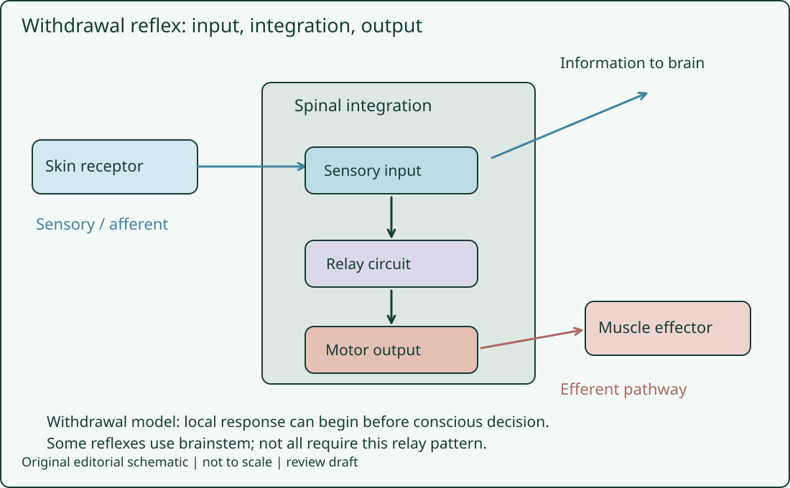
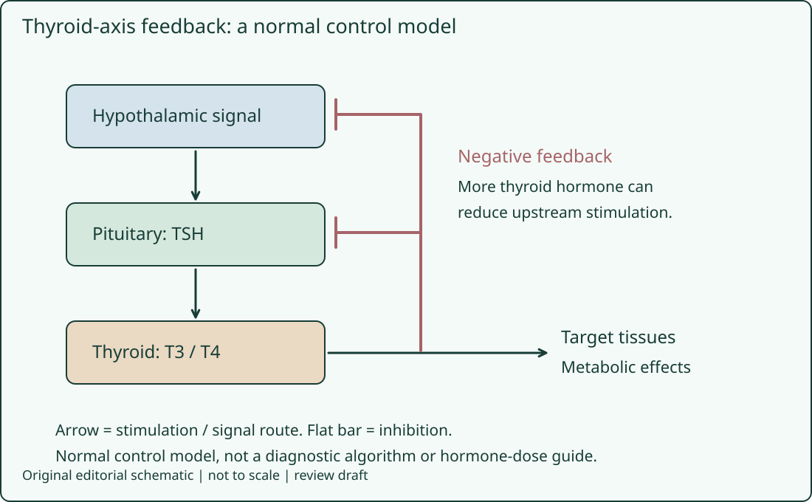
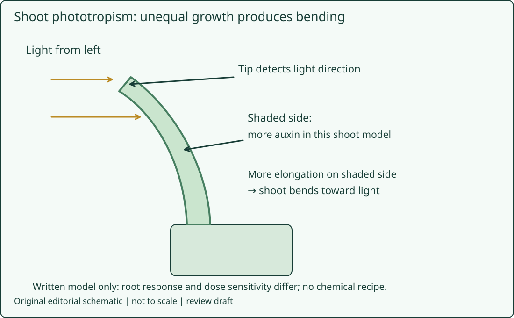
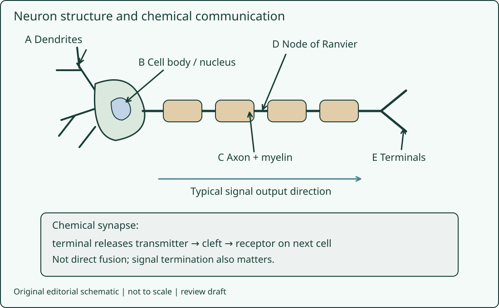
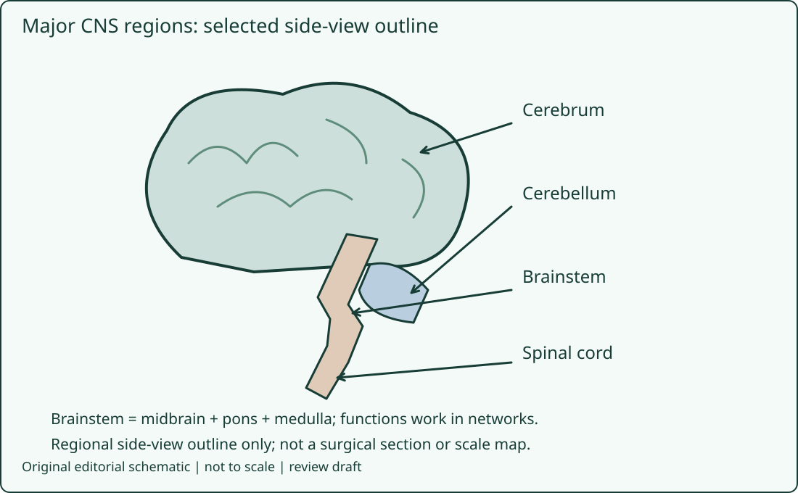

# ১০ম অধ্যায়: সমন্বয়

> উত্তরসহ পর্যালোচনাধীন খসড়া; নির্ধারিত সংখ্যার উত্তরসহ খসড়া সম্পূর্ণ; বিষয়বস্তু পর্যালোচনা বাকি।
> মূল বই ও বিষয়বিশেষজ্ঞের পূর্ণ যাচাই বাকি। বোর্ড/স্কুল/সাল দাবি নেই।

## rebuild-mcq.json

### MCQ 1

প্রতিবর্তী ক্রিয়ার উপযুক্ত বৈশিষ্ট্য কোনটি?

A. সবসময় সমগ্র দেহের স্থানত্যাগ
B. নির্দিষ্ট উদ্দীপকে দ্রুত স্বয়ংক্রিয় সাড়া
C. কেবল হরমোনে মাসব্যাপী বৃদ্ধি
D. শুধু ইচ্ছা করে দীর্ঘ চিন্তার পর সাড়া

উত্তর: B — নির্দিষ্ট উদ্দীপকে দ্রুত স্বয়ংক্রিয় সাড়া
Reflex-এর জন্য আগে সচেতন সিদ্ধান্ত নেওয়া আবশ্যক নয়।

### MCQ 2

হাত সরানোর spinal reflex arc-এর সরল ক্রম কোনটি?

A. গ্রাহক→সংবেদী→রিলে→motor→পেশি
B. রক্ত→লিগামেন্ট→মজ্জা
C. পেশি→motor→আলো→গ্রাহক
D. সেরিবেলাম→থাইরয়েড→অস্থি

উত্তর: A — গ্রাহক→সংবেদী→রিলে→motor→পেশি
এটি withdrawal-এর সরল মডেল; সব reflex-এ রিলে বাধ্যতামূলক নয়।

### MCQ 3

‘প্রতিটি reflex শুধু spinal cord-এ হয়’ দাবির ব্যতিক্রম কী?

A. অক্সিনে মূল গজানো
B. মস্তিষ্ককাণ্ড-সম্পৃক্ত pupillary reflex
C. হরমোনে ফল পাকা
D. খাদ্যরস নিছক diffusion

উত্তর: B — মস্তিষ্ককাণ্ড-সম্পৃক্ত pupillary reflex
Brainstem reflex-ও আছে; spinal উদাহরণ দিয়ে সব reflex সংজ্ঞায়িত নয়।

### MCQ 4

গরম বস্তু থেকে হাত সরলেও পরে সচেতন ব্যথাবোধ হয় কেন?

A. ত্বকে হরমোন রক্ত জমায়
B. পেশিই স্থায়ী স্মৃতি বানায়
C. স্নায়ুপথে মস্তিষ্কেও তথ্য যায়
D. মস্তিষ্কে কখনো তথ্য যায় না

উত্তর: C — স্নায়ুপথে মস্তিষ্কেও তথ্য যায়
Spinal response-এ সচেতন আদেশের অপেক্ষা লাগে না, কিন্তু brain বিচ্ছিন্ন নয়।

### MCQ 5

একটি withdrawal model-এ সংবেদী পথ বিচ্ছিন্ন হলে কী বাধাগ্রস্ত হবে?

A. শুধু চুলের রং
B. সব রক্তসংবহন অবশ্যই
C. কেন্দ্রে উদ্দীপকের তথ্য পৌঁছানো
D. motor পেশির নিজস্ব প্রোটিনমাত্র

উত্তর: C — কেন্দ্রে উদ্দীপকের তথ্য পৌঁছানো
এটি একটি পথের কার্যবিশ্লেষণ, বাস্তব আঘাতের পরীক্ষা নয়।

### MCQ 6

একই model-এ motor পথ অকার্যকর হলে কী হতে পারে?

A. সমস্ত receptor অবশ্যই নষ্ট
B. সব neuron দ্বিগুণ
C. CNS-এ আর কোষদেহ থাকবে না
D. সংবেদন থেকেও নির্দিষ্ট পেশিসাড়া না-হওয়া

উত্তর: D — সংবেদন থেকেও নির্দিষ্ট পেশিসাড়া না-হওয়া
Afferent input ও efferent output আলাদা ধাপ।

### MCQ 7

পিউপিল বা চোখের তারা আসলে কী?

A. আলোয় সাদা হওয়া পেশি
B. একটি endocrine gland
C. কর্নিয়ার হাড়
D. আইরিসের মধ্যের ছিদ্র

উত্তর: D — আইরিসের মধ্যের ছিদ্র
আইরিসের পেশি ছিদ্রের আকার বদলায়।

### MCQ 8

উজ্জ্বলতায় চোখের তারা ছোট হলে কোন পেশিকাজ গুরুত্বপূর্ণ?

A. চোখের লেন্স ফেটে যাওয়া
B. চোখের সাদা অংশের অস্থি সংকোচন
C. সব retinal neuron মৃত্যু
D. আইরিসের বৃত্তাকার পেশির সংকোচন

উত্তর: D — আইরিসের বৃত্তাকার পেশির সংকোচন
Pupillary constriction ও চোখের পাতা বন্ধ হওয়া একই প্রতিক্রিয়া নয়।

### MCQ 9

আলোতে pupil সংকোচনের নিরাপদ পাঠপদ্ধতি কী?

A. সহপাঠীর চোখে শক্তিশালী আলো দীর্ঘক্ষণ
B. প্রস্তুত ভিডিও বা চিত্র বিশ্লেষণ
C. চোখে রাসায়নিক দেওয়া
D. অন্ধকারে হঠাৎ লেজার তাক করা

উত্তর: B — প্রস্তুত ভিডিও বা চিত্র বিশ্লেষণ
বাস্তব অঙ্গে ক্ষতিকর stimulus দিয়ে reflex শেখার প্রয়োজন নেই।

### MCQ 10

রুলার ধরার reaction-time কাজকে বিশুদ্ধ একক spinal reflex বলা যায় না কেন?

A. দেখা ও সিদ্ধান্তসহ বহু ধাপ আছে
B. রুলারে কোনো দূরত্ব নেই
C. পেশি কাজ করে না
D. সবসময় শুধু endocrine

উত্তর: A — দেখা ও সিদ্ধান্তসহ বহু ধাপ আছে
Voluntary reaction ও simple reflex এক মাপ নয়।

### MCQ 11

প্রস্তুত ডেটায় 1.2 m পথ, গতি 60 m/s হলে শুধু সঞ্চালন সময় কত?

A. 0.02 s
B. 72 s
C. 50 s
D. 0.2 m/s

উত্তর: A — 0.02 s
সময়=দূরত্ব/গতি=1.2/60; synaptic/processing সময় এখানে বাদ।

### MCQ 12

একই 1 m পথে A-র গতি 50 m/s, B-র 100 m/s। সময়ের তুলনা কী?

A. B-এর সময় A-এর দ্বিগুণ
B. A-এর সময় B-এর দ্বিগুণ
C. সময় সমান অবশ্যই
D. দুই সময়ের যোগ শূন্য

উত্তর: B — A-এর সময় B-এর দ্বিগুণ
সময় ব্যস্তানুপাতিক; সব স্নায়ুর গতি একই নয়।

### MCQ 13

মানুষের স্নায়ুতাড়নার বেগকে সবসময় 100 m/s ধরা ভুল কেন?

A. তাড়নায় সময় লাগে না
B. গতি কেবল দেহের নামনির্ভর
C. তন্তুর ব্যাস ও মায়েলিনসহ ভেদ আছে
D. সব স্নায়ু আলোর বেগে চলে

উত্তর: C — তন্তুর ব্যাস ও মায়েলিনসহ ভেদ আছে
পাঠের আনুমানিক সংখ্যা কোনো universal constant নয়।

### MCQ 14

স্বায়ত্ত স্নায়ুতন্ত্রের উপযুক্ত লক্ষ্য কোনটি?

A. শুধু বাহিরের বাতাস
B. হৃদপেশি, মসৃণ পেশি ও গ্রন্থি
C. শুধু করোটির খনিজ
D. শুধু নখের মৃত অংশ

উত্তর: B — হৃদপেশি, মসৃণ পেশি ও গ্রন্থি
Autonomic control দেহের বহু visceral কাজ নিয়ন্ত্রণ করে।

### MCQ 15

স্বায়ত্ত স্নায়ুতন্ত্র ‘স্বয়ংক্রিয়’ হলেও কী সত্য?

A. সব অঙ্গ ইচ্ছামতো চলে
B. CNS-এর নিয়ন্ত্রণ ও সমন্বয় থাকে
C. মস্তিষ্ক-মেরুরজ্জুর সঙ্গে কোনো যোগ নেই
D. কোনো স্নায়ুই লাগে না

উত্তর: B — CNS-এর নিয়ন্ত্রণ ও সমন্বয় থাকে
Hypothalamus ও brainstem-সহ কেন্দ্রীয় নিয়ন্ত্রণ গুরুত্বপূর্ণ।

### MCQ 16

Sympathetic উত্তেজনায় কোন পরিবর্তন উপযুক্ত উদাহরণ?

A. হৃদস্পন্দন বাড়া
B. সব অঙ্গের পচন
C. হাতের অস্থি বৃদ্ধি তাৎক্ষণিক
D. সবসময় সম্পূর্ণ হৃদস্পন্দন বন্ধ

উত্তর: A — হৃদস্পন্দন বাড়া
Fight-or-flight-এ শরীরের প্রস্তুতি বদলায়; সব টিস্যুতে একই দিক নয়।

### MCQ 17

Parasympathetic প্রভাবের পরিচিত উদাহরণ কোনটি?

A. পত্ররন্ধ্র বন্ধ
B. সবসময় হৃদস্পন্দন বাড়ানো
C. প্রতিটি পেশির স্থায়ী পক্ষাঘাত
D. বিশ্রামে পরিপাক-কার্যে সহায়তা

উত্তর: D — বিশ্রামে পরিপাক-কার্যে সহায়তা
Rest-and-digest একটি উপযোগী সারাংশ, সব অঙ্গের সম্পূর্ণ ব্যাখ্যা নয়।

### MCQ 18

স্নায়ু ও hormone-নিয়ন্ত্রণের সাধারণ তুলনা কোনটি?

A. স্নায়ু সাধারণত দ্রুত নির্দিষ্ট পথে, hormone রক্তে লক্ষ্যকোষে
B. সব hormone সবসময় ধীরই
C. হরমোনে receptor লাগে না
D. স্নায়ু শুধু বৃদ্ধিকাজ করে

উত্তর: A — স্নায়ু সাধারণত দ্রুত নির্দিষ্ট পথে, hormone রক্তে লক্ষ্যকোষে
গতি-স্থায়িত্বের প্রবণতা আছে, কিন্তু ব্যতিক্রমসহ সমন্বিত ব্যবস্থা।

### MCQ 19

পিপড়ার বাইরে রাখা রাসায়নিক trail কী ধরনের সংকেত?

A. লালার পাচক এনজাইমমাত্র
B. ফেরোমোন
C. রক্তবাহী অন্তঃক্ষরা hormone
D. কোষের মায়েলিন

উত্তর: B — ফেরোমোন
একই প্রজাতির অন্য ব্যক্তিতে কাজ করা বাহ্যিক সংকেতকে endocrine hormone-এর সঙ্গে গুলানো নয়।

### MCQ 20

ফেরোমোন ফাঁদের ফলকে সব পোকা সম্পূর্ণ দূর হবে বলা যায় না কেন?

A. লক্ষ্যপ্রজাতি ও অন্যান্য ব্যবস্থাপনা গুরুত্বপূর্ণ
B. যেকোনো গন্ধ একই ফল দেয়
C. পোকার কোনো receptor নেই
D. সব pheromone মানুষের insulin

উত্তর: A — লক্ষ্যপ্রজাতি ও অন্যান্য ব্যবস্থাপনা গুরুত্বপূর্ণ
প্রজাতিনির্দিষ্ট সংকেতভিত্তিক পদ্ধতিতে সীমা থাকে; নিরাপদ প্রোটোকল দরকার।

### MCQ 21

অন্তঃক্ষরা গ্রন্থি নালিবিহীন বলা হয় কেন?

A. ক্ষরণ রক্ত/কলা তরলে দেয়, পৃথক বহির্গামী নালি নয়
B. হরমোন তৈরি করে না
C. সবসময় মুখে খুলে যায়
D. কোনো রক্ত সরবরাহ নেই

উত্তর: A — ক্ষরণ রক্ত/কলা তরলে দেয়, পৃথক বহির্গামী নালি নয়
Ductless মানে রক্তনালিহীন নয়।

### MCQ 22

লালাগ্রন্থি ও endocrine gland-এর পথগত পার্থক্য কী?

A. উভয়ের রক্ত লাগে না
B. লালা শুধু রক্তে hormone
C. অন্তঃক্ষরা ক্ষরণ কেবল নালিতে
D. লালা নালি দিয়ে নির্দিষ্ট পৃষ্ঠে যায়

উত্তর: D — লালা নালি দিয়ে নির্দিষ্ট পৃষ্ঠে যায়
Exocrine ও endocrine ক্ষরণের গন্তব্য আলাদা।

### MCQ 23

রক্তে ঘুরেও hormone সব কোষে একই কাজ করে না কেন?

A. receptor কেবল উদ্ভিদে থাকে
B. রক্ত প্রতিটি কোষে আলাদা মৌল
C. শুধু বড় কোষ কাজ করে
D. উপযুক্ত receptor ও কোষীয় ব্যবস্থা দরকার

উত্তর: D — উপযুক্ত receptor ও কোষীয় ব্যবস্থা দরকার
Target specificity-তে receptor গুরুত্বপূর্ণ।

### MCQ 24

একই hormone দুই কলায় ভিন্ন ফল দিতে পারে কেন?

A. সব কোষে একই enzyme বাধ্যতামূলক
B. receptor/ভেতরের প্রতিক্রিয়াপথ ভিন্ন হতে পারে
C. হরমোন রক্তে নাম বদলায় মাত্র
D. এক কলায় DNA নেই

উত্তর: B — receptor/ভেতরের প্রতিক্রিয়াপথ ভিন্ন হতে পারে
সংকেতের অর্থ কোষের সাড়াদানের যন্ত্রের ওপরও নির্ভর করে।

### MCQ 25

ঋণাত্মক feedback-এর অর্থ কী?

A. একবার hormone হলে আর নিয়ন্ত্রণ নেই
B. ফল বৃদ্ধি পেলে উৎপাদক উদ্দীপনা কমতে পারে
C. সবসময় ক্ষতিকর ফল
D. সব গ্রন্থির মৃত্যু

উত্তর: B — ফল বৃদ্ধি পেলে উৎপাদক উদ্দীপনা কমতে পারে
প্রাথমিক বিচ্যুতি কমানোর প্রবণতা homeostasis-এ সহায়ক।

### MCQ 26

হরমোনের মাত্রা সবসময় অপরিবর্তিত থাকা জরুরি কি?

A. না, যত বেশি তত সুস্থ
B. হ্যাঁ, প্রতিক্ষণে একই সংখ্যা
C. হ্যাঁ, ঘুমে সব hormone শূন্য
D. না, চাহিদা ও ছন্দে ওঠানামা স্বাভাবিক

উত্তর: D — না, চাহিদা ও ছন্দে ওঠানামা স্বাভাবিক
সময়, খাবার, বয়স ও feedback-এ ক্ষরণ বদলায়।

### MCQ 27

পিটুইটারি সাধারণত কোথায় থাকে?

A. মস্তিষ্কের নিচে হাইপোথ্যালামাসের সঙ্গে যুক্ত
B. দুই বৃক্কের মাঝে
C. শ্বাসনালির ভেতর
D. হৃদপিণ্ডের গহ্বরে

উত্তর: A — মস্তিষ্কের নিচে হাইপোথ্যালামাসের সঙ্গে যুক্ত
এটি neuroendocrine যোগাযোগের গুরুত্বপূর্ণ অঙ্গ।

### MCQ 28

পিটুইটারিকে master gland বলা হলেও কোন সীমা মনে রাখতে হয়?

A. অগ্ন্যাশয় কখনো স্বাধীন সংকেত পায় না
B. এটিও hypothalamus ও feedback দ্বারা নিয়ন্ত্রিত
C. এটি সব hormone নিজে বানায়
D. এটি সকল গ্রন্থির চেয়ে আকারে বড়

উত্তর: B — এটিও hypothalamus ও feedback দ্বারা নিয়ন্ত্রিত
শব্দটি প্রভাব বোঝায়, একচ্ছত্র সর্বনিয়ন্ত্রক নয়।

### MCQ 29

Growth hormone-এর প্রধান উৎস কোনটি?

A. অগ্র পিটুইটারি
B. থাইরয়েডের follicle
C. অগ্ন্যাশয়ের alpha cell
D. অ্যাডরেনাল মেডুলা

উত্তর: A — অগ্র পিটুইটারি
GH বৃদ্ধি ও বিপাকীয় কাজে প্রভাব ফেলে; শুধু উচ্চতা নয়।

### MCQ 30

TSH-এর প্রধান লক্ষ্য কোন গ্রন্থি?

A. থাইরয়েড
B. থাইমাস
C. অ্যাডরেনাল মেডুলা
D. লালাগ্রন্থি

উত্তর: A — থাইরয়েড
Thyroid-stimulating hormone thyroid hormone ক্ষরণে উদ্দীপনা দেয়।

### MCQ 31

ACTH প্রধানত কোন অংশকে উদ্দীপিত করে?

A. অ্যাডরেনাল কর্টেক্স
B. অ্যাডরেনাল মেডুলামাত্র
C. প্যারাথাইরয়েড
D. থাইরয়েডের ক্যালসিটোনিন কোষ

উত্তর: A — অ্যাডরেনাল কর্টেক্স
অগ্র পিটুইটারির ACTH ও cortical hormone-এর feedback যোগ আছে।

### MCQ 32

FSH ও LH কোন শ্রেণির pituitary hormone?

A. গোনাডোট্রপিন
B. কেবল উদ্ভিদ অক্সিন
C. রক্তজমাট প্রোটিন
D. পাচক এনজাইম

উত্তর: A — গোনাডোট্রপিন
জননগ্রন্থির কার্যকলাপে এদের ভূমিকা আছে; বিস্তারিত প্রজনন অধ্যায়ে।

### MCQ 33

ADH ও অক্সিটোসিনের সংশ্লেষ ও মুক্তির সঠিক সম্পর্ক কোনটি?

A. posterior pituitary-তেই সব সংশ্লেষ
B. থাইরয়েডে তৈরি ও লালায় মুক্তি
C. hypothalamus-এ তৈরি, posterior pituitary থেকে মুক্তি
D. শুধু কিডনিতে তৈরি

উত্তর: C — hypothalamus-এ তৈরি, posterior pituitary থেকে মুক্তি
মজুত-মুক্তির স্থান এবং তৈরির স্থান একই ধরে নেওয়া যাবে না।

### MCQ 34

থাইরয়েড গ্রন্থির অবস্থান কোনটি?

A. ডিম্বাশয়ের ভেতর
B. কটিদেশের স্নায়ুর মধ্যে
C. গলার সামনে শ্বাসনালির কাছাকাছি
D. বৃক্কের ভেতর

উত্তর: C — গলার সামনে শ্বাসনালির কাছাকাছি
এর দুই লোব ও সংযোগী isthmus পরিচিত গঠন।

### MCQ 35

থাইরক্সিন তৈরিতে কোন মৌল প্রয়োজন?

A. পারদ
B. আয়োডিন
C. সিসা
D. নিয়ন

উত্তর: B — আয়োডিন
আয়োডিন পুষ্টিতে প্রয়োজন, তবে অতিরিক্তও সমস্যা ঘটাতে পারে।

### MCQ 36

থাইরয়েড hormone-এর প্রধান কাজের ক্ষেত্র কোনটি?

A. শুধু চোখের তারা বন্ধ
B. খাদ্যনালিতে স্টার্চ সরাসরি ভাঙা
C. অস্থির সঙ্গে পেশি বাঁধা
D. বিপাক, বৃদ্ধি ও বিকাশ

উত্তর: D — বিপাক, বৃদ্ধি ও বিকাশ
হরমোন নিয়ন্ত্রক; এটি পাচক enzyme নয়।

### MCQ 37

থাইরয়েডের calcitonin সাধারণত কোন সাম্যে জড়িত?

A. শুধু নাইট্রোজেন গ্যাস
B. ক্যালসিয়াম
C. শুধু অক্সিজেন
D. শুধু উদ্ভিদের IAA

উত্তর: B — ক্যালসিয়াম
রক্তের Ca2+ কমানোর দিকে প্রভাব রাখতে পারে; প্রাপ্তবয়স্ক সাম্যের একমাত্র নিয়ন্ত্রক নয়।

### MCQ 38

Parathyroid সাধারণত কোথায় পাওয়া যায়?

A. পাকস্থলীর গহ্বরে
B. থাইরয়েডের পেছনে ছোট গ্রন্থি হিসেবে
C. প্রতি অস্থির মজ্জায়
D. মস্তিষ্কের cortex-এর বদলে

উত্তর: B — থাইরয়েডের পেছনে ছোট গ্রন্থি হিসেবে
প্রচলিত সংখ্যা চার, ব্যক্তিভেদে ভিন্নতা হতে পারে।

### MCQ 39

PTH ক্ষরণে রক্তের কম Ca2+-এর প্রতি উপযুক্ত প্রতিক্রিয়া কী?

A. থাইরয়েডকে অস্থি করা
B. সবসময় glucose শূন্য করা
C. রক্তে Ca2+ বাড়ানোর প্রক্রিয়া উদ্দীপিত
D. সব calcium বায়ুতে উড়িয়ে দেওয়া

উত্তর: C — রক্তে Ca2+ বাড়ানোর প্রক্রিয়া উদ্দীপিত
অস্থি, বৃক্ক ও ভিটামিন D-সম্পর্কিত পথে সম্মিলিত প্রভাব পড়ে।

### MCQ 40

থাইমাসের পরিচিত কাজ কোনটি?

A. পাচক পিত্ত তৈরি
B. T-লিম্ফোসাইটের পরিণতিতে সহায়তা
C. ইনসুলিন ভেঙে হজম
D. কঙ্কালের সব ক্যালসিয়াম মজুত

উত্তর: B — T-লিম্ফোসাইটের পরিণতিতে সহায়তা
শৈশবের immune development-এ গুরুত্বপূর্ণ; বয়সে ছোট হলেও নামমাত্র অকার্যকর নয়।

### MCQ 41

থাইমাসের অবস্থানের ভালো সাধারণ বর্ণনা কোনটি?

A. চোখের রেটিনায়
B. প্রতি বৃক্কের মাথায়
C. বক্ষের উপরের অংশে স্টার্নামের পেছনে
D. অগ্ন্যাশয়ের নালিতে

উত্তর: C — বক্ষের উপরের অংশে স্টার্নামের পেছনে
থাইমাসকে কেবল thyroid-এর অন্য নাম বলা ভুল।

### MCQ 42

অ্যাডরেনাল গ্রন্থি সাধারণত কোথায় থাকে?

A. প্রতি বৃক্কের ওপরের দিকে
B. প্রতি ফুসফুসের গহ্বরে
C. শুধু গলার ত্বকে
D. পিটুইটারির বদলে

উত্তর: A — প্রতি বৃক্কের ওপরের দিকে
Kidney-এর ওপর হলেও আলাদা endocrine organ।

### MCQ 43

অ্যাড্রেনালিনের প্রধান উৎস কোন অংশ?

A. অ্যাডরেনাল মেডুলা
B. অগ্র পিটুইটারি
C. প্যারাথাইরয়েড
D. অ্যাডরেনাল কর্টেক্স

উত্তর: A — অ্যাডরেনাল মেডুলা
Epinephrine তীব্র চাপের প্রস্তুতিতে sympathetic ব্যবস্থার সঙ্গে কাজ করে।

### MCQ 44

অ্যাড্রেনালিন-প্রভাবে চাপের সময় কোনটি হতে পারে?

A. সবসময় অচেতনতা
B. শুধু অস্থির সংখ্যা বাড়া
C. হৃদস্পন্দন ও শক্তি সরবরাহের প্রস্তুতি বৃদ্ধি
D. সব শরীরের কোষ তাৎক্ষণিক বিভাজন

উত্তর: C — হৃদস্পন্দন ও শক্তি সরবরাহের প্রস্তুতি বৃদ্ধি
এটি fight-or-flight response-এর অংশ; সব উদ্বেগে নির্দিষ্ট রোগ নয়।

### MCQ 45

কর্টিসল কোন গ্রন্থির বাইরের অঞ্চল থেকে আসে?

A. অ্যাডরেনাল
B. প্যারাথাইরয়েড
C. থাইরয়েড
D. থাইমাস

উত্তর: A — অ্যাডরেনাল
Cortisol একটি glucocorticoid; adrenaline-এর সঙ্গে উৎস-রাসায়নিক শ্রেণি এক নয়।

### MCQ 46

অগ্ন্যাশয়কে মিশ্র গ্রন্থি বলার কারণ কী?

A. একই সঙ্গে অস্থি ও স্নায়ু
B. শুধু endocrine কোষ আছে
C. শুধু লালা তৈরি করে
D. নালিতে পাচকরস ও রক্তে hormone দেয়

উত্তর: D — নালিতে পাচকরস ও রক্তে hormone দেয়
Exocrine acini ও endocrine islets আলাদা কাজ করে।

### MCQ 47

অগ্ন্যাশয়ের অন্তঃক্ষরা কোষগুচ্ছের নাম কী?

A. অ্যালভিওলাস
B. হ্যাভারসিয়ান তন্ত্র
C. ল্যাঙ্গারহ্যানসের দ্বীপ
D. র্যানভিয়ারের পর্ব

উত্তর: C — ল্যাঙ্গারহ্যানসের দ্বীপ
Islet-এ নানা কোষ আছে; শুধু একটি hormone নয়।

### MCQ 48

ইনসুলিন নিঃসরণকারী প্রধান islet কোষ কোনটি?

A. বিটা কোষ
B. আলফা কোষ
C. অস্টিওসাইট
D. শোয়ান কোষ

উত্তর: A — বিটা কোষ
ইনসুলিন রক্তের glucose নিয়ন্ত্রণে গুরুত্বপূর্ণ।

### MCQ 49

গ্লুকাগনের প্রধান pancreatic উৎস কী?

A. বিটা কোষ
B. গার্ড কোষ
C. প্লেটলেট
D. আলফা কোষ

উত্তর: D — আলফা কোষ
কম glucose-এ liver থেকে glucose সরবরাহ বাড়াতে সহায়ক।

### MCQ 50

খাবারের পরে insulin-এর উপযুক্ত সামগ্রিক প্রভাব কোনটি?

A. glucose ব্যবহার ও সঞ্চয় বাড়িয়ে রক্তের মাত্রা কমাতে সহায়তা
B. খাদ্যনালিতে সরাসরি starch হজম
C. সব কোষে glucose প্রবেশ বন্ধ
D. glucose-কে IAA করা

উত্তর: A — glucose ব্যবহার ও সঞ্চয় বাড়িয়ে রক্তের মাত্রা কমাতে সহায়তা
কোষভেদে uptake-এর নিয়ন্ত্রণ ভিন্ন; insulin পাচক enzyme নয়।

### MCQ 51

উপবাসের মধ্যে glucagon-এর একটি লক্ষ্যক্রিয়া কী?

A. লালায় insulin ভাঙা
B. সব glycogen সৃষ্টি বন্ধ রাখা সারাজীবন
C. যকৃৎ থেকে glucose মুক্তি বাড়ানো
D. পেশিতে সব অক্সিজেন বন্ধ

উত্তর: C — যকৃৎ থেকে glucose মুক্তি বাড়ানো
Glycogen breakdown ও glucose উৎপাদনের পথ প্রভাবিত হতে পারে।

### MCQ 52

ইনসুলিন ও গ্লুকাগনের বিপরীত প্রভাব কীতে সহায়ক?

A. দেহের সব অঙ্গে একই glucose শূন্য
B. রক্তের glucose সাম্য
C. কঙ্কালের অস্থিসংখ্যা
D. শুধু পরিপাকনালির অম্লতা

উত্তর: B — রক্তের glucose সাম্য
এটি গতিশীল নিয়ন্ত্রণ, দুই hormone একে অপরকে ধ্বংস করে না।

### MCQ 53

শুক্রাশয়ের প্রধান androgen কোনটি?

A. প্যারাথরমোন
B. ইনসুলিন
C. টেস্টোস্টেরন
D. জিবেরেলিন

উত্তর: C — টেস্টোস্টেরন
জনন ও কৈশোরের কিছু বৈশিষ্ট্যে ভূমিকা; সব ব্যক্তিগত আচরণের একমাত্র কারণ নয়।

### MCQ 54

ডিম্বাশয়ের পরিচিত hormone-জোড়া কোনটি?

A. ইনসুলিন ও গ্লুকাগন
B. ইস্ট্রোজেন ও প্রোজেস্টেরন
C. অক্সিন ও ইথিলিন
D. TSH ও ACTH

উত্তর: B — ইস্ট্রোজেন ও প্রোজেস্টেরন
জননচক্র ও বিভিন্ন কলার কার্যক্রমে ভূমিকা রাখে।

### MCQ 55

কৈশোরের বিকাশের সময় ও ধরন ব্যক্তি ভেদে ভিন্ন হওয়ার তাৎপর্য কী?

A. একটি বাইরের লক্ষণ দিয়ে hormone রোগনির্ণয় নয়
B. ধীর পরিবর্তন মানেই নিশ্চিত রোগ
C. সবাই একই দিনে বদলায়
D. নিজে hormone খাওয়া দরকার

উত্তর: A — একটি বাইরের লক্ষণ দিয়ে hormone রোগনির্ণয় নয়
স্বাভাবিক বৈচিত্র্য আছে; উদ্বেগে যোগ্য স্বাস্থ্যপরামর্শ প্রাসঙ্গিক।

### MCQ 56

দীর্ঘস্থায়ী বেশি GH-এ growth plate বন্ধের আগে কী হতে পারে?

A. সবার একই রকম গলগণ্ড
B. অস্বাভাবিক উচ্চতাবৃদ্ধি
C. কেবল glucose প্রস্রাবে না-যাওয়া
D. প্রতিটি মানুষের তাৎক্ষণিক বয়স কমা

উত্তর: B — অস্বাভাবিক উচ্চতাবৃদ্ধি
Gigantism একটি নির্দিষ্ট endocrine অবস্থা; সব লম্বা মানুষ রোগী নন।

### MCQ 57

Growth plate বন্ধের পরে GH অতিরিক্ত হলে কোন পরিবর্তন প্রাসঙ্গিক?

A. সব চুল সাদা তাৎক্ষণিক
B. সব long bone অনেক লম্বা হওয়া বাধ্যতামূলক
C. হাত-পা/চোয়ালের কিছু অংশ বড় হওয়া
D. কাণ্ডে পর্বমধ্য বাড়া

উত্তর: C — হাত-পা/চোয়ালের কিছু অংশ বড় হওয়া
Acromegaly-তে tissue ও bone thickening হয়; শ্রেণিকক্ষে চেহারা দেখে নির্ণয় নয়।

### MCQ 58

অপর্যাপ্ত thyroid hormone-এ সম্ভাব্য প্রবণতা কোনটি?

A. অবশ্যই চোখের রং বদল
B. ক্লান্তি ও ঠান্ডা সহ্য কমা
C. সবসময় অতি উঁচু জ্বরই একমাত্র লক্ষণ
D. অবশ্যই সব অস্থি ভাঙা

উত্তর: B — ক্লান্তি ও ঠান্ডা সহ্য কমা
লক্ষণ অনির্দিষ্ট; ইতিহাস ও উপযুক্ত পরীক্ষায় নির্ণয় দরকার।

### MCQ 59

গলগণ্ড শব্দের যথাযথ অর্থ কী?

A. সবসময় iodine ঘাটতির নিশ্চিত প্রমাণ
B. যেকোনো ঘাড়ব্যথা
C. থাইরয়েড বড় হওয়া
D. অ্যাডরেনাল ছোট হওয়া

উত্তর: C — থাইরয়েড বড় হওয়া
কারণ ও hormone মাত্রা ভিন্ন হতে পারে; সকল গলগণ্ডে একই চিকিৎসা নয়।

### MCQ 60

শিশুর thyroid hormone-এর দীর্ঘ গুরুতর ঘাটতি কেন গুরুত্বপূর্ণ?

A. শুধু চুলে রং ধরে
B. শুধু লালা বাড়ে
C. বৃদ্ধি ও স্নায়ুবিক বিকাশ বাধাগ্রস্ত হতে পারে
D. এতে শিক্ষা অবশ্যই অসম্ভব

উত্তর: C — বৃদ্ধি ও স্নায়ুবিক বিকাশ বাধাগ্রস্ত হতে পারে
সময়মতো শনাক্ত ও চিকিৎসা জরুরি; অবমাননাকর নাম/নিশ্চিত ভবিষ্যদ্বাণী নয়।

### MCQ 61

Iodized salt ব্যবহারে স্বাস্থ্যবার্তা কোনটি যথাযথ?

A. অজানা iodine বড়ি সবার জন্য
B. সব thyroid রোগ শুধু লবণে সারবে
C. প্রয়োজনীয় আয়োডিন নিশ্চিত করা, মোট লবণ না-বাড়ানো
D. যত বেশি লবণ তত ভালো

উত্তর: C — প্রয়োজনীয় আয়োডিন নিশ্চিত করা, মোট লবণ না-বাড়ানো
পর্যাপ্ত আয়োডিন ও অতিরিক্ত sodium এড়ানো সামঞ্জস্যপূর্ণ।

### MCQ 62

Type 1 diabetes-এর প্রধান প্রক্রিয়ার উপযুক্ত বর্ণনা কোনটি?

A. প্রত্যেক রোগীর অতিরিক্ত insulin
B. সাধারণত autoimmune beta-cell ক্ষতিতে গুরুতর insulin ঘাটতি
C. বয়স হলে সবার স্বাভাবিক অবস্থা
D. সবসময় শুধু বেশি মিষ্টি

উত্তর: B — সাধারণত autoimmune beta-cell ক্ষতিতে গুরুতর insulin ঘাটতি
এটি ছোঁয়াচে বা ব্যক্তির নৈতিক ব্যর্থতা নয়।

### MCQ 63

Type 2 diabetes-এ কোন ধারণা জরুরি?

A. কেবল জন্ম থেকেই insulin সম্পূর্ণ শূন্য
B. কেবল প্রস্রাবের জীবাণু
C. insulin resistance ও আপেক্ষিক ঘাটতি
D. মস্তিষ্কে রক্তক্ষরণই সংজ্ঞা

উত্তর: C — insulin resistance ও আপেক্ষিক ঘাটতি
ইনসুলিন থাকতে পারে, কিন্তু কার্যকারিতা/পরিমাণ যথেষ্ট নাও হতে পারে।

### MCQ 64

Diabetes-এ ইনসুলিন কেন খাবারের পাচক enzyme নয়?

A. এটি কেবল exocrine ক্ষরণ
B. এটি শুধু পিত্তরস
C. এটি সরাসরি মুখে starch ভাঙে
D. এটি glucose বিপাকের নিয়ন্ত্রক hormone

উত্তর: D — এটি glucose বিপাকের নিয়ন্ত্রক hormone
পরিপাক ও শোষণ-পরবর্তী glucose ব্যবস্থাপনা আলাদা।

### MCQ 65

বারবার প্রস্রাব-পিপাসা থাকলেই diabetes নিশ্চিত কি?

A. না, অন্য কারণও সম্ভব
B. হ্যাঁ, পরীক্ষা অপ্রয়োজনীয়
C. হ্যাঁ, বয়স 50 পেরোলেই
D. না, শিশুদের কখনো হয় না

উত্তর: A — না, অন্য কারণও সম্ভব
উপসর্গে সেবা নেওয়া দরকার, স্বনির্ণয় নয়।

### MCQ 66

Diabetes নির্ণয়ে শুধু প্রস্রাবে glucose দেখার সীমা কী?

A. রক্তভিত্তিক মানসম্মত মূল্যায়নের বিকল্প নয়
B. এটি প্রতিক্ষণের brain function মাপে
C. প্রস্রাবে glucose মানেই সবসময় নির্দিষ্ট type
D. এতে pancreas-এর ছবি পাওয়া যায়

উত্তর: A — রক্তভিত্তিক মানসম্মত মূল্যায়নের বিকল্প নয়
নির্বাচিত blood tests ও প্রসঙ্গ দরকার; urine একাই যথেষ্ট নয়।

### MCQ 67

Type 2 রোগীর insulin চিকিৎসা দরকার হলে কী বোঝায়?

A. এখন কোনো চিকিৎসা সম্ভব নয়
B. রোগটি সংক্রামক হয়েছে
C. তিনি অবশ্যই নিয়ম ভেঙেছেন
D. অবস্থা অনুযায়ী প্রয়োজন হতে পারে

উত্তর: D — অবস্থা অনুযায়ী প্রয়োজন হতে পারে
ওষুধ পরিকল্পনা রোগের অগ্রগতি ও অন্য অবস্থার ওপর নির্ভর করে।

### MCQ 68

গুরুতর hypoglycemia-তে অচেতন ব্যক্তিকে মুখে চিনির পানি কেন নয়?

A. চিনি সবসময় সিসা হয়
B. শ্বাসনালিতে ঢুকে শ্বাসরোধ হতে পারে
C. এতে শুধু দাঁত নষ্ট হয়
D. অচেতনতায় গিলতে পারা সবসময় বাড়ে

উত্তর: B — শ্বাসনালিতে ঢুকে শ্বাসরোধ হতে পারে
জরুরি সহায়তা নিতে হবে; prescribed rescue থাকলে প্রশিক্ষিত ব্যক্তি পরিকল্পনা অনুসরণ করবেন।

### MCQ 69

কম ও বেশি glucose দুটোতেই গুরুতর অসুস্থতা হতে পারে বলে কী জরুরি?

A. সবসময় মুখে তরল ঢালা
B. সব ওষুধ বন্ধ
C. চেহারা দেখে সবার একই dose
D. পরীক্ষা ও ব্যক্তিনির্দিষ্ট চিকিৎসা পরিকল্পনা

উত্তর: D — পরীক্ষা ও ব্যক্তিনির্দিষ্ট চিকিৎসা পরিকল্পনা
লক্ষণে মিল থাকলে আন্দাজে চিকিৎসা ক্ষতিকর হতে পারে।

### MCQ 70

স্ট্রোকে প্রধানত কোন অঙ্গের রক্তপ্রবাহ/রক্তক্ষরণ সমস্যা হয়?

A. মস্তিষ্ক
B. শুধু পাকস্থলী
C. শুধু যকৃৎ
D. শুধু থাইরয়েড

উত্তর: A — মস্তিষ্ক
Stroke ও heart attack একই ঘটনা নয়, যদিও ঝুঁকিতে মিল থাকতে পারে।

### MCQ 71

Ischemic stroke-এর প্রধান ঘটনা কী?

A. thyroid hormone কমা
B. শুধু synapse-এর বৃদ্ধি
C. কেবল বাহুর পেশি ছেঁড়া
D. মস্তিষ্কের রক্তনালি বন্ধ হয়ে প্রবাহ কমা

উত্তর: D — মস্তিষ্কের রক্তনালি বন্ধ হয়ে প্রবাহ কমা
অক্সিজেন-পুষ্টি না-পেলে brain tissue ক্ষতিগ্রস্ত হয়।

### MCQ 72

Hemorrhagic stroke বলতে কী বোঝায়?

A. চোখের বাইরের অশ্রুপাত
B. মস্তিষ্কে রক্তক্ষরণজনিত stroke
C. অন্ত্রে খাদ্য শোষণ কমা
D. কিডনিতে সব পাথর

উত্তর: B — মস্তিষ্কে রক্তক্ষরণজনিত stroke
রক্তক্ষরণ ও বাধাজনিত অবস্থার চিকিৎসা এক নয়।

### MCQ 73

হঠাৎ মুখ বেঁকে যাওয়া, এক বাহু দুর্বল ও কথা জড়ালে কী প্রাধান্য পাবে?

A. জোরে ঘাড় মালিশ
B. জরুরি চিকিৎসা সহায়তা ও সময় নথি
C. পরদিন পর্যন্ত ঘুমিয়ে দেখা
D. নিজে aspirin খাইয়ে অপেক্ষা

উত্তর: B — জরুরি চিকিৎসা সহায়তা ও সময় নথি
সম্ভাব্য stroke-এ বিলম্ব নয়; ধরন না-জেনে ওষুধ নয়।

### MCQ 74

কয়েক মিনিটে stroke-সদৃশ লক্ষণ সেরে গেলে কী করা উচিত?

A. সব ঝুঁকি শেষ ধরা
B. তবুও দ্রুত জরুরি মূল্যায়ন
C. মস্তিষ্কে কখনো সমস্যা হয়নি ঘোষণা
D. পরের মাসে শুধু জরিপ

উত্তর: B — তবুও দ্রুত জরুরি মূল্যায়ন
TIA-ও গুরুতর সতর্কতা; ক্ষণস্থায়িত্ব নিরাপত্তার প্রমাণ নয়।

### MCQ 75

FAST-এর T স্বাস্থ্যবার্তায় কী স্মরণ করায়?

A. কাঁপুনি থামাতে বেঁধে রাখা
B. শুধু তাপমাত্রা বাড়ানো
C. সময় নষ্ট না-করে জরুরি সাহায্য
D. চা খাওয়ানো

উত্তর: C — সময় নষ্ট না-করে জরুরি সাহায্য
Face-arm-speech লক্ষণসহ time-এর গুরুত্ব; সব stroke লক্ষণ FAST-এ ধরা পড়ে না।

### MCQ 76

স্ট্রোকের ফল সম্পর্কে কোন বক্তব্য সঠিক?

A. রক্তক্ষরণে কোনো চিকিৎসাই নেই
B. তীব্রতা, স্থান ও সময়মতো চিকিৎসায় ভিন্নতা থাকে
C. সবাই দুই মাসেই উন্নতি থামে
D. সব stroke-এ একই সময়ে মৃত্যু

উত্তর: B — তীব্রতা, স্থান ও সময়মতো চিকিৎসায় ভিন্নতা থাকে
নিশ্চিত সময়সীমা বা prognosis দেওয়া অনুচিত; rehabilitation-ও ব্যক্তিভিত্তিক।

### MCQ 77

প্যারালাইসিসের ধারণা কোনটি?

A. শুধু অস্থির দৈর্ঘ্য কমা
B. কেবল চোখের রং ফিকে
C. দেহাংশের ইচ্ছাধীন পেশিচালনার ক্ষমতা হারানো
D. সব ধরনের সাময়িক ক্লান্তি

উত্তর: C — দেহাংশের ইচ্ছাধীন পেশিচালনার ক্ষমতা হারানো
Brain, spinal cord বা peripheral pathway-তে নানা কারণে হতে পারে।

### MCQ 78

মেরুরজ্জুর আঘাতে পক্ষাঘাত কেন হতে পারে?

A. সব hormone হাওয়ায় মেশে
B. রক্তকণিকা ডেনড্রাইট হয়
C. সব পেশি সঙ্গে সঙ্গে হাড় হয়
D. নির্দেশবাহী পথ ক্ষতিগ্রস্ত হয়

উত্তর: D — নির্দেশবাহী পথ ক্ষতিগ্রস্ত হয়
স্নায়ুসংযোগ ব্যাহত হলেও পেশির সব প্রোটিন সরাসরি নষ্ট হওয়া জরুরি নয়।

### MCQ 79

Epilepsy-তে seizure-এর ভিত্তিগত ঘটনা কী?

A. অবশ্যই অশুভ শক্তি
B. অবশ্যই সংক্রামক জীবাণু
C. শুধু হাড়ের খনিজঘাটতি
D. মস্তিষ্কে অস্বাভাবিক বৈদ্যুতিক কার্যকলাপ

উত্তর: D — মস্তিষ্কে অস্বাভাবিক বৈদ্যুতিক কার্যকলাপ
Seizure নানা রকম; সব খিঁচুনির পরই epilepsy নিশ্চিত নয়।

### MCQ 80

সব seizure-এ শরীর কাঁপবেই কি?

A. হ্যাঁ, সবসময় একই কাঁপুনি
B. হ্যাঁ, সবাই জলে গেলেই
C. না, চেয়ে থাকা/সচেতনতা বদলও হতে পারে
D. না, কখনো brain জড়িত নয়

উত্তর: C — না, চেয়ে থাকা/সচেতনতা বদলও হতে পারে
প্রকাশভঙ্গি ভিন্ন; সঠিক history ও clinical মূল্যায়ন দরকার।

### MCQ 81

খিঁচুনির সময় সহায়তায় কোন কাজ নিরাপদ নীতি?

A. মুখে চামচ গুঁজে দেওয়া
B. জোরে অঙ্গ চেপে ধরা
C. পানি ঢেলে গিলতে বাধ্য করা
D. পাশের বিপজ্জনক বস্তু সরিয়ে সময় দেখা

উত্তর: D — পাশের বিপজ্জনক বস্তু সরিয়ে সময় দেখা
শ্বাসপথ/আঘাতের সুরক্ষা; বস্তু ঢোকানো বা restraint ক্ষতি করতে পারে।

### MCQ 82

খিঁচুনি পাঁচ মিনিট ছাড়ালে বা পরপর হলে কী প্রয়োজন?

A. চামড়া ঘষে অপেক্ষা
B. দাঁতের মাঝে কাঠ
C. জরুরি চিকিৎসা সহায়তা
D. প্রমাণের জন্য ভিডিওই একমাত্র কাজ

উত্তর: C — জরুরি চিকিৎসা সহায়তা
প্রথম seizure, শ্বাসকষ্ট, আঘাতসহ পরিস্থিতিতেও জরুরি মূল্যায়ন দরকার।

### MCQ 83

Parkinson’s disease-এ চলন ধীরতা কোন ব্যবস্থার পরিবর্তনের সঙ্গে যুক্ত?

A. পাতার auxin
B. শুধু muscle cell-এ dopamine দিয়ে সরাসরি স্নায়ু আদেশ
C. মস্তিষ্কের dopamine-সম্পর্কিত circuit
D. অগ্ন্যাশয়ের glucagonমাত্র

উত্তর: C — মস্তিষ্কের dopamine-সম্পর্কিত circuit
নির্দিষ্ট neuron/circuit ক্ষতি motor regulation বদলায়; সরাসরি muscle transmitter বলা ভুল।

### MCQ 84

হাত কাঁপলেই Parkinson’s নিশ্চিত বলা যায় না কেন?

A. রোগে কখনো কাঁপুনি হয় না
B. কাঁপুনির একাধিক কারণ আছে
C. বয়স হলেই একই diagnosis
D. এটি শুধু শিশুদের রোগ

উত্তর: B — কাঁপুনির একাধিক কারণ আছে
ধীর চলন, rigidity ও অন্যান্য তথ্যসহ qualified assessment দরকার।

### MCQ 85

অল্প বয়সে Parkinson’s হলে সবসময় সরাসরি বংশগতই কি?

A. না, কারণ/ঝুঁকি বহুবিধ হতে পারে
B. হ্যাঁ, সবাই একই gene বহন করে
C. হ্যাঁ, পরীক্ষা ছাড়াই নিশ্চিত
D. না, রোগটিই অসম্ভব

উত্তর: A — না, কারণ/ঝুঁকি বহুবিধ হতে পারে
Early onset-এ genetic ভূমিকা থাকতে পারে, তবে সব ক্ষেত্রে নয়।

### MCQ 86

নিকোটিনের একটি গুরুত্বপূর্ণ স্নায়বিক প্রভাব কী?

A. সম্পূর্ণ ক্ষতিহীন সুগন্ধ
B. শুধু অস্থির খনিজ
C. সবসময় স্থায়ী মনোযোগের ওষুধ
D. আসক্তি তৈরি করতে পারে

উত্তর: D — আসক্তি তৈরি করতে পারে
Reward ও receptor-সম্পর্কিত অভিযোজন পুনর্ব্যবহারের তাগিদ বাড়াতে পারে।

### MCQ 87

জর্দা/ধোঁয়াবিহীন তামাক সম্পর্কে সঠিক কথা কী?

A. সবসময় নিরাপদ খাদ্য
B. কোনো nicotine থাকে না কখনো
C. ধোঁয়া না-থাকলেও স্বাস্থ্যঝুঁকি ও আসক্তি আছে
D. এটি thyroid-এর পুষ্টি

উত্তর: C — ধোঁয়া না-থাকলেও স্বাস্থ্যঝুঁকি ও আসক্তি আছে
দহনের ধোঁয়া না-থাকা সব ক্ষতি দূর করে না।

### MCQ 88

ধূমপানে nicotine ও carbon monoxide-এর কাজের সঠিক পার্থক্য কী?

A. উভয়ই প্রধান vitamin
B. nicotine আসক্তি, CO অক্সিজেন পরিবহন ব্যাহত করতে পারে
C. nicotine-ই লোহিতকণিকার iron
D. CO-ই একমাত্র আসক্তির ভিত্তি

উত্তর: B — nicotine আসক্তি, CO অক্সিজেন পরিবহন ব্যাহত করতে পারে
একাধিক উপাদান ও অঙ্গপ্রভাব থাকে; কেবল স্নায়ুকোষ নষ্টের এক দাবি নয়।

### MCQ 89

মাদক neurotransmitter signaling বদলালে কী বিঘ্নিত হতে পারে?

A. সিদ্ধান্ত, আচরণ ও সমন্বয়
B. শুধু চুলের রং
C. সব উদ্ভিদের photoperiod
D. পৃথিবীর অভিকর্ষ

উত্তর: A — সিদ্ধান্ত, আচরণ ও সমন্বয়
ভিন্ন পদার্থের প্রভাব ভিন্ন; সবকিছুকে একই উত্তেজক বলা ভুল।

### MCQ 90

মস্তিষ্কের reward circuit-এ বারবার পরিবর্তনের ফল কী হতে পারে?

A. কখনো withdrawal নয়
B. ক্ষতি জেনেও ব্যবহারের তীব্র তাগিদ
C. সবসময় সীমাহীন ইচ্ছাশক্তি
D. কেবল ভালো স্মৃতি বৃদ্ধি

উত্তর: B — ক্ষতি জেনেও ব্যবহারের তীব্র তাগিদ
Substance-use disorder চিকিৎসাযোগ্য স্বাস্থ্যসমস্যা, নৈতিক দুর্বলতার একমাত্র ফল নয়।

### MCQ 91

ওষুধ হিসেবে opioid-এর ব্যবহার ও অনিয়ন্ত্রিত ব্যবহার আলাদা কেন?

A. নির্দেশনা, মাত্রা ও নজরদারিতে উপকার-ঝুঁকি বিচার হয়
B. সব ব্যবহারই অপরাধ
C. সব prescription মানেই আসক্তি
D. ওষুধে কখনো ঝুঁকি নেই

উত্তর: A — নির্দেশনা, মাত্রা ও নজরদারিতে উপকার-ঝুঁকি বিচার হয়
চিকিৎসার প্রয়োজনীয়তা এবং misuse risk দুটোই বিবেচনা দরকার।

### MCQ 92

Opioid overdose-এ প্রধান জীবনঝুঁকির একটি কী?

A. শ্বাস ধীর/বন্ধ হওয়া
B. সবসময় কেবল বেশি ক্ষুধা
C. শুধু দীর্ঘ অস্থি বৃদ্ধি
D. রঙিন প্রস্রাবই একমাত্র

উত্তর: A — শ্বাস ধীর/বন্ধ হওয়া
অচেতনতা ও শ্বাসকষ্টে জরুরি সাহায্য; জাগাতে মুখে তরল নয়।

### MCQ 93

আসক্তি ছাড়ার নিরাপদ নীতি কোনটি?

A. শুধু শাস্তি দিলেই নিশ্চিত সারে
B. সব substance হঠাৎ একা বন্ধই সর্বদা নিরাপদ
C. লজ্জা দিয়ে আটকে রাখা
D. যোগ্য চিকিৎসা ও সহানুভূতিপূর্ণ সহায়তা

উত্তর: D — যোগ্য চিকিৎসা ও সহানুভূতিপূর্ণ সহায়তা
কিছু withdrawal বিপজ্জনক; মূল্যায়ন ও পরিকল্পনা দরকার।

### MCQ 94

ধূমপান বন্ধে বারবার চেষ্টা লাগলে কোন বার্তা ভালো?

A. বেশি ধূমপান করে শাস্তি
B. চিকিৎসার দরকার নেই
C. পুনরায় সহায়তা নিয়ে পরিকল্পনা সংশোধন
D. ব্যক্তি চিরতরে ব্যর্থ

উত্তর: C — পুনরায় সহায়তা নিয়ে পরিকল্পনা সংশোধন
Relapse-এ হতাশ না-করে support ও evidence-based care জরুরি।

### MCQ 95

সহপাঠীর মাদকসংক্রান্ত গোপন তথ্য নিয়ে স্কুল প্রকল্পে কী করা উচিত?

A. নামসহ পোস্টার
B. গোপনে জৈব নমুনা নেওয়া
C. উপহাস করে ভিডিও
D. ব্যক্তিগত পরিচয় না-ছড়িয়ে নিরাপদ সহায়তার পথ

উত্তর: D — ব্যক্তিগত পরিচয় না-ছড়িয়ে নিরাপদ সহায়তার পথ
গোপনীয়তা, সম্মতি ও তাৎক্ষণিক বিপদে trusted adult/health help দরকার।

### MCQ 96

মাদক-প্রতিরোধী পোস্টারে কোন বক্তব্য সবচেয়ে গ্রহণযোগ্য?

A. ভালো পরিবারে কখনো হয় না
B. আক্রান্ত সবাই অপরাধী
C. ঝুঁকি বোঝো, সাহায্য নাও, কাউকে হেয় নয়
D. একবারেই সবার স্থায়ী মস্তিষ্ক ধ্বংস

উত্তর: C — ঝুঁকি বোঝো, সাহায্য নাও, কাউকে হেয় নয়
সচেতনতা তথ্যভিত্তিক ও non-stigmatizing হওয়া উচিত।

### MCQ 97

একই মানের চারা A-তে 20টির 15টি, B-তে 20টির 5টি বেঁকেছে। বেঁকে যাওয়ার হারের পার্থক্য কত?

A. 200 শতাংশ-বিন্দু
B. 3 শতাংশ-বিন্দু
C. 10 শতাংশ-বিন্দু
D. 50 শতাংশ-বিন্দু

উত্তর: D — 50 শতাংশ-বিন্দু
A=75%, B=25%; বিয়োগে 50 percentage points, আপেক্ষিক শতাংশ আলাদা।

### MCQ 98

মডেলে thyroid hormone বাড়লে TSH কমার প্রবণতা কী দেখায়?

A. কেবল synaptic cleft
B. রক্ত জমাট
C. ধনাত্মক phototropism
D. ঋণাত্মক feedback

উত্তর: D — ঋণাত্মক feedback
সুস্থ নিয়ন্ত্রণচক্রে চূড়ান্ত hormone আগের উদ্দীপনাকে কমাতে পারে; রোগে ব্যাখ্যা প্রসঙ্গভিত্তিক।

### MCQ 99

রাসায়নিক synapse-এ transmitter receptor থেকে সরে/অপসারিত হলে কী লাভ?

A. প্রতি neuron ভাগ হয়
B. সব synapse চিরতরে বন্ধ হয়
C. সংকেতের স্থায়িত্ব নিয়ন্ত্রিত হয়
D. CNS থেকে সব পানি যায়

উত্তর: C — সংকেতের স্থায়িত্ব নিয়ন্ত্রিত হয়
Reuptake, breakdown বা diffusion সংকেত শেষ করতে পারে; সব transmitter একইভাবে নয়।

### MCQ 100

একটি উপযুক্ত উদ্দীপকে threshold ছুঁলে axon-এ action potential সম্পর্কে কোনটি ঠিক?

A. পুনরুৎপাদনযোগ্য বৈদ্যুতিক ঘটনা তৈরি হয়
B. এর আকারই প্রতিটি তীব্রতার সঙ্গে সীমাহীন বাড়ে
C. এতে আয়নের ভূমিকা নেই
D. এটি রক্তের ঢেউ

উত্তর: A — পুনরুৎপাদনযোগ্য বৈদ্যুতিক ঘটনা তৈরি হয়
স্থানীয় membrane ion movement জরুরি; তথ্য শুধু একেক spike-এর উচ্চতা বাড়িয়ে নয়।

### MCQ 101

জীবদেহে সমন্বয় বলতে কী বোঝায়?

A. প্রত্যেক কোষের সম্পূর্ণ বিচ্ছিন্নতা
B. কেবল অঙ্গের আকার বৃদ্ধি
C. বিভিন্ন কাজের সামঞ্জস্যপূর্ণ নিয়ন্ত্রণ
D. সব অঙ্গের একই কাজ করা

উত্তর: C — বিভিন্ন কাজের সামঞ্জস্যপূর্ণ নিয়ন্ত্রণ
ভিন্ন কাজ উপযুক্ত সময়ে মিলেই সামগ্রিক জীবনক্রিয়া চালায়।

### MCQ 102

ফাইটোহরমোন মূলত কী হিসেবে কাজ করে?

A. অস্থির খনিজ
B. প্রধান শক্তিদায়ী খাদ্য
C. অক্সিজেন পরিবাহী রঞ্জক
D. উদ্ভিদের রাসায়নিক নিয়ন্ত্রক

উত্তর: D — উদ্ভিদের রাসায়নিক নিয়ন্ত্রক
অল্পমাত্রার সংকেত বৃদ্ধি-বিকাশসহ নানা কাজ প্রভাবিত করে।

### MCQ 103

উদ্ভিদের হরমোনের বিষয়ে সঠিক সীমা কোনটি?

A. শুধু রক্ত দিয়ে চলে
B. সবসময় প্রাণীর গ্রন্থিতে তৈরি
C. কখনো নিজের উৎপত্তিকোষে কাজ করে না
D. কাছে বা দূরের কোষে কাজ করতে পারে

উত্তর: D — কাছে বা দূরের কোষে কাজ করতে পারে
উদ্ভিদে প্রাণীর মতো রক্তসংবহন বা পৃথক অন্তঃক্ষরা গ্রন্থি নেই।

### MCQ 104

পানি-খনিজের সঙ্গে হরমোনের মৌলিক পার্থক্য কী?

A. হরমোন সংকেত দিয়ে কাজ নিয়ন্ত্রণ করে
B. হরমোনে শুধু পানি থাকে
C. খনিজ সর্বদা বিষ
D. হরমোনই সব খনিজের বিকল্প

উত্তর: A — হরমোন সংকেত দিয়ে কাজ নিয়ন্ত্রণ করে
নিয়ন্ত্রক ও প্রয়োজনীয় পুষ্টি এক নয়; যথেষ্ট পুষ্টিও দরকার।

### MCQ 105

IAA কোন শ্রেণির উদ্ভিদ হরমোন?

A. ইথিলিন
B. সাইটোকাইনিন
C. অ্যাবসিসিক অ্যাসিড
D. অক্সিন

উত্তর: D — অক্সিন
ইন্ডোল অ্যাসিটিক অ্যাসিড একটি প্রাকৃতিক অক্সিন।

### MCQ 106

অক্সিনের সুপরিচিত বৃদ্ধিগত প্রভাব কোনটি?

A. সব ক্লোরোপ্লাস্ট ধ্বংস
B. পাকা ফলকে বীজে ফেরানো
C. উপযুক্ত কাণ্ডকোষের দীর্ঘায়ন
D. কোষপ্রাচীরকে অস্থিতে রূপান্তর

উত্তর: C — উপযুক্ত কাণ্ডকোষের দীর্ঘায়ন
প্রভাব অঙ্গ ও ঘনত্বনির্ভর; সব কোষে একই নয়।

### MCQ 107

একপাশের আলোয় চারার কাণ্ড বাঁকার সাধারণ ভিত্তি কী?

A. কাণ্ডের স্থানত্যাগ
B. সব কোষের সমান মৃত্যু
C. শুধু পাতার রং বদল
D. দুই পাশের অসম দীর্ঘায়ন

উত্তর: D — দুই পাশের অসম দীর্ঘায়ন
অসম বৃদ্ধি আলোর দিকে বক্রতা ঘটাতে পারে।

### MCQ 108

কাণ্ডের ছায়াপাশে উপযুক্ত অক্সিন বেশি হলে সাধারণত কী ঘটে?

A. আলোকিত পাশই অবশ্য বেশি দীর্ঘ হয়
B. সেই পাশ বেশি দীর্ঘ হয়
C. মূলের সব কোষ ভেঙে যায়
D. উভয় পাশের বৃদ্ধি সম্পূর্ণ থামে

উত্তর: B — সেই পাশ বেশি দীর্ঘ হয়
ছায়াপাশের বেশি বৃদ্ধি কাণ্ডকে আলোকমুখী বাঁকায়।

### MCQ 109

আলোর দিকে কাণ্ডের বৃদ্ধিজনিত চলনের নাম কী?

A. ঋণাত্মক গ্র্যাভিট্রপিজমমাত্র
B. ধনাত্মক ফটোট্রপিজম
C. থিগমোন্যাস্টি
D. ধনাত্মক কেমোট্যাক্সিস

উত্তর: B — ধনাত্মক ফটোট্রপিজম
ফটোট্রপিজমে আলোর দিকের তুলনায় বৃদ্ধির দিক বিচার হয়।

### MCQ 110

ফটোট্রপিজমে ‘ঋণাত্মক’ শব্দটি কী বোঝায়?

A. অবশ্যই অস্বাস্থ্যকর বৃদ্ধি
B. আলো থেকে দূরমুখী বৃদ্ধি
C. বৃদ্ধির দৈর্ঘ্য শূন্য
D. মাটির দিকে যেকোনো চলন

উত্তর: B — আলো থেকে দূরমুখী বৃদ্ধি
চিহ্নটি উদ্দীপকের সঙ্গে দিকের সম্পর্ক, ভালো-মন্দের মূল্যায়ন নয়।

### MCQ 111

নিচের কোনটিতে উদ্দীপক অভিকর্ষ?

A. স্পর্শে পত্রক বন্ধ
B. জানালামুখী কাণ্ড
C. দিনের দৈর্ঘ্যে পুষ্পায়ন
D. মূলের সাধারণ নিম্নমুখী বৃদ্ধি

উত্তর: D — মূলের সাধারণ নিম্নমুখী বৃদ্ধি
সাধারণ মূলের ধনাত্মক গ্র্যাভিট্রপিজম এখানে প্রাসঙ্গিক।

### MCQ 112

অন্ধকারে অনুভূমিক চারা রাখলেও মূল নিচে বাঁকতে পারে কেন?

A. আলো ছাড়া কোনো বৃদ্ধি হয় না
B. বায়ু শুধু মূলকে টানে
C. অন্ধকারই সবসময় নিচের দিক
D. অভিকর্ষের সংকেত পায়

উত্তর: D — অভিকর্ষের সংকেত পায়
ফটোট্রপিজম থেকে অভিকর্ষীয় প্রতিক্রিয়া আলাদা করা যায়।

### MCQ 113

সাধারণ কাণ্ডের ঊর্ধ্বমুখী বৃদ্ধিতে অভিকর্ষের তুলনায় দিক কী?

A. ঋণাত্মক
B. দিক-স্বাধীন অবশ্যই
C. ধনাত্মক
D. সর্বদা অভিকর্ষহীন

উত্তর: A — ঋণাত্মক
সাধারণ কাণ্ড অভিকর্ষের বিপরীত দিকে বাড়ে, সব অঙ্গের আচরণ অভিন্ন নয়।

### MCQ 114

মূলটুপি-সংলগ্ন বিশেষ কোষে অভিকর্ষ বোঝার সহায়ক কী?

A. শ্বেতসারপূর্ণ স্ট্যাটোলিথ
B. মায়েলিন
C. সাইনোভিয়াল তরল
D. হিমোগ্লোবিন

উত্তর: A — শ্বেতসারপূর্ণ স্ট্যাটোলিথ
অ্যামাইলোপ্লাস্টের অবস্থান পরিবর্তন সংকেতপ্রক্রিয়ায় যুক্ত; এটি সরল চাপেই বাঁকার সম্পূর্ণ ব্যাখ্যা নয়।

### MCQ 115

একই বেশি অক্সিনে মূল ও কাণ্ডের দীর্ঘায়ন ভিন্ন হতে পারে কেন?

A. অঙ্গের সংবেদনশীলতা ভিন্ন
B. কাণ্ড সবসময় প্রাণিকোষ
C. মূলের কোষে কোনো ঝিল্লি নেই
D. অক্সিন দুই অঙ্গে সম্পূর্ণ ভিন্ন মৌল

উত্তর: A — অঙ্গের সংবেদনশীলতা ভিন্ন
মূল সাধারণত কম ঘনত্বেই সংবেদনশীল; এক অঙ্গের ফল অন্যটিতে হুবহু বসে না।

### MCQ 116

ডগা অক্ষত কিন্তু নিচের বৃদ্ধি-অঞ্চল ঢাকা; একপাশের আলোয় বাঁক দেখা গেল। কোন ধারণা সমর্থিত?

A. অনুভব ও প্রতিক্রিয়ার স্থান আলাদা হতে পারে
B. ঢাকা অংশে কোনো বৃদ্ধি হয় না
C. ডগা শুধু খাদ্য মজুত করে
D. সব আলো কেবল মূল অনুভব করে

উত্তর: A — অনুভব ও প্রতিক্রিয়ার স্থান আলাদা হতে পারে
ডগায় গৃহীত সংকেত নিচের বৃদ্ধিক্ষেত্রে কাজ করতে পারে।

### MCQ 117

ডগা কাটায় চারার বাঁক না-হওয়া একাই কী প্রমাণ করে না?

A. ডগার ভূমিকা থাকতে পারে
B. নির্দিষ্ট রাসায়নিকের পরিচয়
C. অক্ষত নিয়ন্ত্রণ দরকার
D. কাটার প্রভাব বিবেচ্য

উত্তর: B — নির্দিষ্ট রাসায়নিকের পরিচয়
এক পরীক্ষায় কাজের স্থান সম্পর্কে ইঙ্গিত মেলে, রাসায়নিক শনাক্তকরণ নয়।

### MCQ 118

অক্সিনের মেরুবাহী পরিবহনের উদাহরণ কোনটি?

A. কেবল বাষ্প হয়ে পাতা ছাড়ানো
B. কাণ্ডে শীর্ষ থেকে ভিত্তিমুখী পরিবহন
C. সব অঙ্গে শুধু ঊর্ধ্বমুখী প্রবাহ
D. রক্তের মাধ্যমে ফুসফুসে যাওয়া

উত্তর: B — কাণ্ডে শীর্ষ থেকে ভিত্তিমুখী পরিবহন
কাণ্ডের polar transport উদাহরণ; সব অঙ্গে সব অক্সিন শুধু নিচে যায় বলা ঠিক নয়।

### MCQ 119

শীর্ষমুকুল থাকলে কিছু পার্শ্বমুকুল দমিত থাকা কী?

A. ভ্রূণনাশ
B. প্যারালাইসিস
C. অগ্রস্থ প্রকটতা
D. পত্ররন্ধ্রের শ্বাস

উত্তর: C — অগ্রস্থ প্রকটতা
অক্সিনসহ একাধিক হরমোনের পারস্পরিক নিয়ন্ত্রণ এতে যুক্ত।

### MCQ 120

উপযুক্ত ছাঁটাইয়ের পরে শাখা বাড়ার সম্ভাব্য ব্যাখ্যা কী?

A. প্রতি কোষের নিউক্লিয়াস হারানো
B. অস্থিমজ্জা তৈরি
C. মূলের সব বিভাজন বন্ধ
D. শীর্ষমুকুলের দমন কমা

উত্তর: D — শীর্ষমুকুলের দমন কমা
অগ্রস্থ প্রকটতা কমলে কিছু পার্শ্বমুকুল বাড়তে পারে।

### MCQ 121

কলমে অস্থানিক মূল গজাতে কোন শ্রেণির নিয়ন্ত্রক ব্যবহৃত হতে পারে?

A. থাইরক্সিন
B. অক্সিন
C. অ্যাড্রেনালিন
D. ইনসুলিন

উত্তর: B — অক্সিন
উপযুক্ত প্রস্তুতি ও মাত্রায় অক্সিন rooting-এ কাজে লাগে; যেকোনো মাত্রা নয়।

### MCQ 122

নিষেক ছাড়াই ফল বিকাশকে কী বলে?

A. অভিস্রবণ
B. সাইটোকাইনেসিস
C. ফটোলাইসিস
D. পার্থেনোকার্পি

উত্তর: D — পার্থেনোকার্পি
কিছু ক্ষেত্রে হরমোন দিয়ে এটি প্রভাবিত করা যায়; সব বীজহীন ফলের উৎপত্তি অভিন্ন নয়।

### MCQ 123

উদ্ভিদের ক্ষতস্থানে বিভাজিত অনিয়মিত কোষগুচ্ছের নাম কী?

A. কর্পাস ক্যালোসাম
B. সারকোমিয়ার
C. সিন্যাপস
D. ক্যালাস

উত্তর: D — ক্যালাস
ক্যালাস উদ্ভিদের কলা; মস্তিষ্কের সংযোগী অংশ থেকে ভিন্ন।

### MCQ 124

জিবেরেলিনের সঙ্গে ধানের কোন ঐতিহাসিক পর্যবেক্ষণ যুক্ত?

A. অস্থির ক্যালসিয়াম ক্ষয়
B. মূলের বায়ু শোষণ
C. পাতার সবুজ রং প্রথম আবিষ্কার
D. বাকানে রোগে অস্বাভাবিক দীর্ঘায়ন

উত্তর: D — বাকানে রোগে অস্বাভাবিক দীর্ঘায়ন
ছত্রাকজনিত অতিবৃদ্ধি থেকে জিবেরেলিন গবেষণার সূত্র পাওয়া যায়।

### MCQ 125

জিবেরেলিনে কাণ্ড লম্বা হওয়ার একটি কারণ কী?

A. পর্বমধ্যের বৃদ্ধি
B. প্রত্যেক পাতার শিরা ভেঙে যাওয়া
C. সব পত্ররন্ধ্র নষ্ট হওয়া
D. প্রতিটি কোষে হাড় তৈরি

উত্তর: A — পর্বমধ্যের বৃদ্ধি
বৃদ্ধিপ্রতিক্রিয়া প্রজাতি ও অবস্থাভেদে ভিন্ন হতে পারে।

### MCQ 126

কিছু বীজের সুপ্তাবস্থা কাটাতে কোন হরমোন সহায়ক?

A. প্যারাথরমোন
B. নিকোটিন
C. জিবেরেলিন
D. থাইমোসিন

উত্তর: C — জিবেরেলিন
অনুকূল অবস্থায় germination-সংক্রান্ত কার্যক্রম উদ্দীপিত করতে পারে।

### MCQ 127

বীজে ABA ও জিবেরেলিনের সম্পর্কের যথাযথ উদাহরণ কী?

A. একটি অস্থি অন্যটি পেশি
B. সুপ্ততা বজায় রাখা বনাম অঙ্কুরোদ্গমে সহায়তা
C. উভয়েই শুধু অক্সিজেনবাহক
D. উভয়েই নালির পাচক এনজাইম

উত্তর: B — সুপ্ততা বজায় রাখা বনাম অঙ্কুরোদ্গমে সহায়তা
বিপরীতধর্মী প্রভাবের ভারসাম্য ও পরিবেশ বীজের অবস্থায় ভূমিকা রাখে।

### MCQ 128

সাইটোকাইনিনের নামের সঙ্গে কোন কাজ সরাসরি সম্পর্কিত?

A. মায়েলিন তৈরি
B. রক্তে গ্লুকোজ কমানো
C. কোষ বিভাজনে সহায়তা
D. প্রাণীর হৃদস্পন্দন

উত্তর: C — কোষ বিভাজনে সহায়তা
অক্সিনসহ উপযুক্ত অনুপাতে কোষ বিভাজন/বিকাশ প্রভাবিত হয়।

### MCQ 129

পাতার বার্ধক্য বিলম্বে পরিচিত উদ্ভিদ হরমোন কোনটি?

A. সাইটোকাইনিন
B. ইনসুলিন
C. অক্সিটোসিন
D. কর্টিসল

উত্তর: A — সাইটোকাইনিন
পাতার senescence বিলম্বিত হতে পারে; স্থায়ী অমরত্ব নয়।

### MCQ 130

কলা চাষের একই মাধ্যমে অক্সিন-সাইটোকাইনিনের অনুপাত বদলালে কী বদলাতে পারে?

A. উদ্ভিদের স্থায়ী প্রাণীতে রূপান্তর
B. মূল ও কুঁড়ি গঠনের প্রবণতা
C. আলোর বেগ
D. প্রত্যেক কোষের মৌলিক রাজ্য

উত্তর: B — মূল ও কুঁড়ি গঠনের প্রবণতা
হরমোনের আপেক্ষিক মাত্রা organogenesis প্রভাবিত করে; নিয়ম প্রজাতিনির্ভর।

### MCQ 131

বায়বীয় অবস্থায় স্বাভাবিকভাবে কাজ করা পরিচিত হরমোন কোনটি?

A. অক্সিন
B. সাইটোকাইনিন
C. জিবেরেলিন
D. ইথিলিন

উত্তর: D — ইথিলিন
ইথিলিন একটি গ্যাসীয় উদ্ভিদ হরমোন।

### MCQ 132

পাকার উপযুক্ত কিছু ফলে ইথিলিনের পরিচিত প্রভাব কী?

A. সব ফলের পানি শূন্য করা
B. ফলকে স্থায়ীভাবে ধাতু করা
C. বীজে ক্লোরোফিল বাধ্যতামূলক বাড়ানো
D. পাকা ত্বরান্বিত করা

উত্তর: D — পাকা ত্বরান্বিত করা
বিশেষত climacteric ফলের পাকার সমন্বয়ে এটি গুরুত্বপূর্ণ।

### MCQ 133

পাকা কলার পাশে কাঁচা কলার পাকা এগোনোর যৌক্তিক কারণ কী?

A. কাঁচা ফলে মস্তিষ্ক তৈরি
B. ফলের মধ্যে স্নায়ু সংযোগ
C. পাকা ফলের রক্তপ্রবাহ
D. পাকা ফলের ইথিলিন সংকেত

উত্তর: D — পাকা ফলের ইথিলিন সংকেত
তাপ-বায়ু চলাচলও ফলাফলে প্রভাব ফেলে; শুধু পাশাপাশি রাখাই নিখুঁত পরীক্ষা নয়।

### MCQ 134

ইথিলিনকে সবসময় কাণ্ড লম্বাকারী বলা কেন ঠিক নয়?

A. এটি কোনো সংকেত নয়
B. এটি কেবল খনিজ লবণ
C. অনেক চারায় দীর্ঘায়ন কমিয়ে মোটা করতে পারে
D. এটি শুধু প্রাণীর হরমোন

উত্তর: C — অনেক চারায় দীর্ঘায়ন কমিয়ে মোটা করতে পারে
প্রতিক্রিয়া পরিবেশ ও বিকাশপর্যায়নির্ভর; একটি প্রভাবকে সর্বজনীন নয়।

### MCQ 135

পাতা/ফল ঝরে পড়ার প্রক্রিয়ার নাম কী?

A. পোলারাইজেশন
B. মায়েলিনেশন
C. অ্যাবসিশন
D. সালটেটরি সঞ্চালন

উত্তর: C — অ্যাবসিশন
ইথিলিনসহ সংকেত বিচ্ছেদস্তরের কাজে প্রভাব ফেলে।

### MCQ 136

পানির ঘাটতিতে পত্ররন্ধ্র বন্ধে পরিচিত সংকেত কোনটি?

A. TSH
B. অ্যাসিটাইলকোলিনমাত্র
C. ABA
D. GH

উত্তর: C — ABA
অ্যাবসিসিক অ্যাসিড guard cell নিয়ন্ত্রণে পানি হারানো কমাতে সহায়ক।

### MCQ 137

পত্ররন্ধ্র দীর্ঘ সময় বন্ধ থাকলে কোন বিনিময়ও সীমিত হয়?

A. কেবল মায়েলিন পরিবহন
B. অস্থি থেকে ফসফেট
C. CO2 প্রবেশ
D. স্নায়ুর ডেনড্রাইট বৃদ্ধি

উত্তর: C — CO2 প্রবেশ
পানি সাশ্রয়ের সঙ্গে সালোকসংশ্লেষের জন্য গ্যাসপ্রবেশের trade-off থাকে।

### MCQ 138

বীজে সুপ্ততা বজায় রাখার সুপরিচিত হরমোন কোনটি?

A. গ্লুকাগন
B. থাইরক্সিন
C. অ্যাবসিসিক অ্যাসিড
D. অ্যাড্রেনালিন

উত্তর: C — অ্যাবসিসিক অ্যাসিড
সুপ্ততা অনুপযুক্ত সময়ে অঙ্কুরোদ্গম রোধে সহায়ক হতে পারে।

### MCQ 139

কেবল ABA নামের ভিত্তিতে সব পাতা ঝরার প্রধান কারণ বলা কেন দুর্বল?

A. সব উদ্ভিদে পাতা নেই
B. সব পাতা কেবল রাতে ঝরে
C. নাম ও সম্পূর্ণ কার্যভূমিকা এক নয়
D. নামে রাসায়নিক হয় না

উত্তর: C — নাম ও সম্পূর্ণ কার্যভূমিকা এক নয়
ইথিলিনের বড় ভূমিকা আছে; ABA-র প্রধান পরিচিত কাজ stress ও dormancy-তে।

### MCQ 140

ফটোপিরিয়ডিজম কোন বিষয়ের প্রতি প্রতিক্রিয়া?

A. এক মুহূর্তের স্পর্শ
B. শুধু আলোর দিক
C. আলো-অন্ধকারের সময়ছন্দ
D. শুধু মূলের ওজন

উত্তর: C — আলো-অন্ধকারের সময়ছন্দ
দিন-রাতের দৈর্ঘ্য ঋতুভিত্তিক পুষ্পায়নে গুরুত্বপূর্ণ সংকেত।

### MCQ 141

স্বল্পদিবসী উদ্ভিদের পুষ্পায়নে প্রায়ই কোন শর্ত গুরুত্বপূর্ণ?

A. প্রজাতিনির্দিষ্ট দীর্ঘ অবিচ্ছিন্ন রাত
B. সবসময় শূন্য আলো
C. প্রতিদিন একই 12 ঘণ্টাই সর্বজনীন
D. সর্বদা দীর্ঘতম দিন

উত্তর: A — প্রজাতিনির্দিষ্ট দীর্ঘ অবিচ্ছিন্ন রাত
Critical photoperiod ও night-break sensitivity ভিন্ন; নির্দিষ্ট বিশ্বজনীন ঘণ্টা নেই।

### MCQ 142

দীর্ঘদিবসী উদ্ভিদ বলতে সাধারণত কী বোঝায়?

A. যার প্রতিটি পাতা একদিন থাকে
B. সীমার তুলনায় দীর্ঘ দিন/ছোট রাতে পুষ্পায়ন সহায়ক
C. যে কোনো আলো ছাড়াই বাঁচে
D. যার সব ফুল শুধু দুপুরে খোলে

উত্তর: B — সীমার তুলনায় দীর্ঘ দিন/ছোট রাতে পুষ্পায়ন সহায়ক
পুষ্পায়নের সময়ছন্দ ও ফুল খোলার ক্ষণ আলাদা ধারণা।

### MCQ 143

দিবসনিরপেক্ষ পুষ্পায়ন মানে কী নয়?

A. পুষ্পায়ন নির্দিষ্ট daylength-নির্ভর নয়
B. বৃদ্ধিতে আলোর কোনো প্রয়োজন নেই
C. আলোকসংশ্লেষ প্রাসঙ্গিক হতে পারে
D. অন্য সংকেতও কাজ করে

উত্তর: B — বৃদ্ধিতে আলোর কোনো প্রয়োজন নেই
Day-neutral মানে সম্পূর্ণ আলো-নিরপেক্ষ উদ্ভিদজীবন নয়।

### MCQ 144

উপযুক্ত উদ্ভিদে শৈত্য দিয়ে পরবর্তী পুষ্পায়নের সক্ষমতা বাড়ানো কী?

A. ডিনাইট্রিফিকেশন
B. বাষ্পমোচন
C. ভার্নালাইজেশন
D. গুটেশন

উত্তর: C — ভার্নালাইজেশন
এটি নির্দিষ্ট বিকাশপর্যায় ও শৈত্যমাত্রা-সময় নির্ভর।

### MCQ 145

ভার্নালাইজেশন ও ফটোপিরিয়ডিজমে প্রধান উদ্দীপকজোড়া কী?

A. শৈত্য এবং আলো-অন্ধকারের দৈর্ঘ্য
B. স্পর্শ এবং লবণের রং
C. মায়েলিন ও নিউরোট্রান্সমিটার
D. অক্সিজেন ও রক্তচাপ

উত্তর: A — শৈত্য এবং আলো-অন্ধকারের দৈর্ঘ্য
উভয়ই বিকাশে প্রভাব ফেললেও উদ্দীপক একই নয়।

### MCQ 146

জৈবিক ঘড়ির উপযুক্ত ধারণা কোনটি?

A. দেহের অন্তর্নিহিত সময়ছন্দ
B. সূর্য ছাড়াই কেবল জড়তা
C. সব বিক্রিয়ার একই গতি
D. পাতার ভেতর ধাতব ঘড়ি

উত্তর: A — দেহের অন্তর্নিহিত সময়ছন্দ
আলো-তাপের সংকেত ছন্দকে পরিবেশের সঙ্গে মিলাতে পারে।

### MCQ 147

প্রায় 24 ঘণ্টার অন্তর্নিহিত ছন্দকে কী বলে?

A. সাইটোকাইনেসিস
B. সাইনোভিয়াল ছন্দ
C. সার্কাডিয়ান ছন্দ
D. সালটেটরি গতি

উত্তর: C — সার্কাডিয়ান ছন্দ
স্বাভাবিক আলো-অন্ধকার এই ছন্দের সময় মিলিয়ে দিতে সাহায্য করে।

### MCQ 148

লতা অবলম্বন জড়িয়ে বাড়ায় কোন উদ্দীপকের দিক গুরুত্বপূর্ণ?

A. শুধু শব্দের উচ্চতা
B. স্পর্শ
C. রক্তের গ্লুকোজ
D. কোষের হিমোগ্লোবিন

উত্তর: B — স্পর্শ
এটি থিগমোট্রপিক বৃদ্ধির পরিচিত উদাহরণ।

### MCQ 149

স্পর্শে লজ্জাবতীর পত্রক দ্রুত বন্ধে প্রধান যান্ত্রিক পরিবর্তন কী?

A. প্রতি কোষের স্থায়ী দ্বিগুণ দৈর্ঘ্য
B. পাতার সব প্রোটিন ধ্বংস
C. পালভিনাসের কোষে টারগর পরিবর্তন
D. অস্থির সন্ধি বাঁকা

উত্তর: C — পালভিনাসের কোষে টারগর পরিবর্তন
দ্রুত ন্যাস্টিক প্রতিক্রিয়া ও ধীর বৃদ্ধিজনিত বক্রতা আলাদা।

### MCQ 150

ট্রপিক ও ন্যাস্টিক চলন আলাদা করতে সবচেয়ে দরকার কী?

A. শুধু পাতার সংখ্যা
B. উদ্দীপকের দিকের সঙ্গে চলনের সম্পর্ক
C. সবসময় ফুলের রং
D. বীজের বাজারদর

উত্তর: B — উদ্দীপকের দিকের সঙ্গে চলনের সম্পর্ক
ন্যাস্টিক প্রতিক্রিয়ার দিক উদ্দীপকের আগমনের দিক নির্ধারিত নয়।

### MCQ 151

অঙ্কুরের আলোর পরীক্ষা করতে কোনটি নিয়ন্ত্রণে রাখা উচিত?

A. কাগজের অক্ষরের রং
B. পানি ও তাপমাত্রা
C. পর্যবেক্ষকের নাম
D. শুধু টবের দোকান

উত্তর: B — পানি ও তাপমাত্রা
অন্য কারণ একই না-হলে আলোর প্রভাব পৃথক করা কঠিন।

### MCQ 152

একই ধরনের অনেক চারা ব্যবহার কেন উপকারী?

A. সব চারার জিন হুবহু জানা যায়
B. স্বাভাবিক বৈচিত্র্যের প্রভাব বোঝা
C. একটিও নিয়ন্ত্রণ লাগবে না
D. ফল নিশ্চয়ই পছন্দমতো হবে

উত্তর: B — স্বাভাবিক বৈচিত্র্যের প্রভাব বোঝা
পুনরাবৃত্তি নির্ভরযোগ্যতা বাড়ায়, পক্ষপাতের নিশ্চয়তা নয়।

### MCQ 153

চারার বাঁক মাপার আগে শুরুর ছবি দরকার কেন?

A. প্রারম্ভিক অবস্থার সঙ্গে পরিবর্তন তুলতে
B. কেবল মাটির নাম জানতে
C. ফটোতে হরমোন দেখা যায়
D. সব ছবি একই কোণ করে দেয়

উত্তর: A — প্রারম্ভিক অবস্থার সঙ্গে পরিবর্তন তুলতে
শেষের বক্রতা আগে থেকেই ছিল কি না আলাদা করা যায়।

### MCQ 154

কৃত্রিম ফল-পাকানো উপাদান পরীক্ষায় বিদ্যালয়ের নিরাপদ বিকল্প কী?

A. অজানা গ্যাস নিজে তৈরি
B. অচেনা দ্রবণে ভেজানো ফল খাওয়া
C. প্রস্তুত ডেটায় তুলনা
D. কার্বাইডের সঙ্গে ভেজা ফল বদ্ধ করা

উত্তর: C — প্রস্তুত ডেটায় তুলনা
হরমোনের জ্ঞান অনিরাপদ রাসায়নিক প্রস্তুতি বা খাদ্যগ্রহণের অনুমতি নয়।

### MCQ 155

শুধু ‘বেশি হরমোন মানেই বেশি ভালো ফলন’ বলা ভুল কেন?

A. অতিরিক্ত মাত্রায় উল্টো ক্ষতি হতে পারে
B. সব হরমোন একই দ্রব্য
C. বৃদ্ধিতে পরিবেশের ভূমিকা নেই
D. হরমোনে কোনো প্রভাব নেই

উত্তর: A — অতিরিক্ত মাত্রায় উল্টো ক্ষতি হতে পারে
মাত্রা, প্রজাতি ও পর্যায় অনুযায়ী প্রতিক্রিয়া ভিন্ন।

### MCQ 156

ডারউইনদের coleoptile পর্যবেক্ষণ কোন ধারণায় ঐতিহাসিকভাবে সহায়ক?

A. সমস্ত হরমোনের একক আবিষ্কার
B. IAA অণুর সম্পূর্ণ রাসায়নিক গঠন
C. ডগায় আলোকঅনুভব ও নিচে সংকেতবাহিত প্রভাব
D. মায়েলিনের নিরোধক কাজ

উত্তর: C — ডগায় আলোকঅনুভব ও নিচে সংকেতবাহিত প্রভাব
ফটোট্রপিজমের পর্যবেক্ষণকে অক্সিন অণু একাই শনাক্ত করার দাবি নয়।

### MCQ 157

উদ্ভিদে সমন্বয় প্রাণীর থেকে কোন দিক দিয়ে আলাদা?

A. শুধু ইচ্ছা দিয়ে বৃদ্ধি
B. কখনো বৈদ্যুতিক সংকেত হয় না
C. প্রাণীর মতো নিউরন-স্নায়ুতন্ত্র নেই
D. কোনো সংকেতই নেই

উত্তর: C — প্রাণীর মতো নিউরন-স্নায়ুতন্ত্র নেই
হরমোনসহ রাসায়নিক ও বৈদ্যুতিক সংকেত থাকে, কিন্তু প্রাণীর স্নায়ুতন্ত্র নয়।

### MCQ 158

সার ও হরমোনের বোতলে একই ‘বৃদ্ধি’ লেখা থাকলেও কী দেখা জরুরি?

A. পুষ্টি না নিয়ন্ত্রক এবং প্রমাণিত প্রয়োগ
B. উভয়ই মানুষের ওষুধ
C. বোতলের রংই চূড়ান্ত
D. যত বেশি দাম তত নিরাপদ

উত্তর: A — পুষ্টি না নিয়ন্ত্রক এবং প্রমাণিত প্রয়োগ
বাজারের নাম কার্যপ্রকৃতি বা সব শস্যে নিরাপত্তার প্রমাণ নয়।

### MCQ 159

একই চারা একদিকে আলো ও অসম পানি পেলে বাঁকের একক কারণ নির্ধারণ কঠিন কেন?

A. দুটি পরিবর্তন একসঙ্গে হয়েছে
B. আলো মাপা অসম্ভব
C. অক্সিন কেবল প্রাণীতে থাকে
D. চারায় কখনো পানি লাগে না

উত্তর: A — দুটি পরিবর্তন একসঙ্গে হয়েছে
Confounding এড়াতে একটি পরিবর্তনশীল পৃথকভাবে পরীক্ষা দরকার।

### MCQ 160

একটি ফুল না-ফোটার জন্য শুধু আলোই দায়ী ধরা অনুচিত কেন?

A. ফুলে হরমোনের ভূমিকা নেই
B. সব উদ্ভিদ একই রাতে ফোটে
C. দিন-রাত সবসময় সমান
D. বয়স, তাপ ও অন্যান্য শর্তও প্রাসঙ্গিক

উত্তর: D — বয়স, তাপ ও অন্যান্য শর্তও প্রাসঙ্গিক
ফটোপিরিয়ড গুরুত্বপূর্ণ, কিন্তু সব পুষ্পায়নের একমাত্র কারণ নয়।

### MCQ 161

মানুষের স্নায়ুতন্ত্রের তথ্যবাহক প্রধান কোষ কোনটি?

A. লোহিত কণিকা
B. অ্যাডিপোসাইট
C. অস্টিওক্লাস্ট
D. নিউরন

উত্তর: D — নিউরন
নিউরন সংকেত গ্রহণ-প্রক্রিয়াকরণ-প্রেরণে বিশেষায়িত।

### MCQ 162

নিউরনের কোষদেহে সাধারণত কোনটি থাকে?

A. নিউক্লিয়াস
B. স্টোমা
C. জাইলেম নালি
D. সেলুলোজ প্রাচীর

উত্তর: A — নিউক্লিয়াস
অন্যান্য অঙ্গাণুও থাকে; neuron কেবল ফাঁপা তার নয়।

### MCQ 163

ডেনড্রাইটের শাখাবিন্যাসের একটি সুবিধা কী?

A. রক্তের অক্সিজেন বাড়ানো
B. অস্থিতে লবণ জমা
C. অক্সিন নিঃসরণ
D. বহু ইনপুট গ্রহণের ক্ষেত্র

উত্তর: D — বহু ইনপুট গ্রহণের ক্ষেত্র
বেশি শাখা বহু কোষের সঙ্গে যোগাযোগে সহায়ক হতে পারে।

### MCQ 164

একটি সাধারণ মোটর নিউরনে অ্যাক্সনের ভূমিকা কী?

A. নিউক্লিয়াস ভাগ করা
B. কেবল শর্করা হজম
C. রক্ত পরিশোধন
D. টারমিনালের দিকে সংকেত বহন

উত্তর: D — টারমিনালের দিকে সংকেত বহন
সাধারণ মডেলে কোষদেহ-অ্যাক্সন-টারমিনাল পথে output যায়।

### MCQ 165

মায়েলিন প্রধানত কী কাজ করে?

A. হরমোনের নালি তৈরি
B. নিউরনের খাদ্য হিসেবে পুড়ে
C. সিন্যাপটিক ফাঁক রক্তে ভরে
D. অ্যাক্সনকে নিরোধন দিয়ে দ্রুত সঞ্চালনে সহায়তা

উত্তর: D — অ্যাক্সনকে নিরোধন দিয়ে দ্রুত সঞ্চালনে সহায়তা
মায়েলিন glial cell-নির্মিত আবরণ; সব অ্যাক্সন মায়েলিনযুক্ত নয়।

### MCQ 166

র্যানভিয়ারের পর্ব কোথায় থাকে?

A. কেবল ডেনড্রাইটের ডগায়
B. মায়েলিন খণ্ডগুলোর মাঝের বিরতিতে
C. সন্ধির তরলে
D. নিউক্লিয়াসের মাঝখানে

উত্তর: B — মায়েলিন খণ্ডগুলোর মাঝের বিরতিতে
উন্মুক্ত axon membrane-এ সংকেত পুনরুৎপন্ন হতে পারে।

### MCQ 167

সালটেটরি সঞ্চালনের সরল অর্থ কী?

A. আয়ন বাতাসে উড়ে যাওয়া
B. নিউক্লিয়াস দৌড়ে যাওয়া
C. অ্যাক্সনের পদার্থ শেষপ্রান্তে সরে যাওয়া
D. পর্ব থেকে পর্বে সংকেত পুনরুৎপাদনের মাধ্যমে দ্রুত চলা

উত্তর: D — পর্ব থেকে পর্বে সংকেত পুনরুৎপাদনের মাধ্যমে দ্রুত চলা
মায়েলিনের নিচে স্থানীয় প্রবাহ ও পর্বে action potential যুক্ত থাকে।

### MCQ 168

স্নায়ুকলায় নিউরনের পাশাপাশি সহায়ক কোষকে কী বলা হয়?

A. স্ট্যাটোলিথ
B. গ্লিয়া
C. অ্যালভিওলাস
D. প্লেটলেট

উত্তর: B — গ্লিয়া
গ্লিয়া সমর্থন, পরিবেশ নিয়ন্ত্রণ ও নিরোধনসহ নানা কাজে যুক্ত।

### MCQ 169

PNS-এ মায়েলিন তৈরির পরিচিত কোষ কোনটি?

A. বিটা কোষ
B. গার্ড কোষ
C. শোয়ান কোষ
D. অস্টিওব্লাস্ট

উত্তর: C — শোয়ান কোষ
কেন্দ্রীয় স্নায়ুতন্ত্রে oligodendrocyte-এর ভূমিকা ভিন্ন।

### MCQ 170

একটি স্নায়ু বা nerve মূলত কী?

A. শুধু অ্যাড্রেনাল গ্রন্থি
B. রক্তনালির নাম
C. একটিমাত্র বিশাল নিউক্লিয়াস
D. স্নায়ুতন্তুর গুচ্ছ ও সহায়ক আবরণ

উত্তর: D — স্নায়ুতন্তুর গুচ্ছ ও সহায়ক আবরণ
সম্পূর্ণ neuron এবং nerve এক জিনিস নয়।

### MCQ 171

রাসায়নিক সিন্যাপসে সংকেত মধ্যস্থ করে কী?

A. টেনডন
B. শুধু ক্যালসিয়াম ফসফেট
C. নিউরোট্রান্সমিটার
D. উদ্ভিদের ক্যালাস

উত্তর: C — নিউরোট্রান্সমিটার
প্রিসাইনাপটিক মুক্তি ও postsynaptic receptor-এর প্রতিক্রিয়ায় যোগাযোগ হয়।

### MCQ 172

সিন্যাপটিক cleft বলতে কোনটি বোঝায়?

A. করোটির স্যুচার
B. একটি নিউরনের নিউক্লিয়াস
C. মেরুদণ্ডের সব ছিদ্র
D. দুই যোগাযোগী কোষঝিল্লির মাঝের ক্ষুদ্র ফাঁক

উত্তর: D — দুই যোগাযোগী কোষঝিল্লির মাঝের ক্ষুদ্র ফাঁক
সিন্যাপস পুরো junction, cleft তার ফাঁক অংশ।

### MCQ 173

সাধারণ রাসায়নিক সিন্যাপসে প্রবাহ একমুখী হওয়ার ভিত্তি কী?

A. মুক্তির যন্ত্র ও receptor-এর অসম অবস্থান
B. মাধ্যাকর্ষণ সবসময় নিচে টানে
C. রক্ত কেবল একদিকে চলে
D. সব neuron-এ valve থাকে

উত্তর: A — মুক্তির যন্ত্র ও receptor-এর অসম অবস্থান
প্রেরক-গ্রাহকের বিশেষায়ন দিক তৈরি করে; সব সিন্যাপস chemical নয়।

### MCQ 174

স্নায়ুতাড়না সঞ্চালন মানে কী নয়?

A. ঝিল্লিতে বৈদ্যুতিক পরিবর্তন ছড়ানো
B. আয়নভিত্তিক পরিবর্তন
C. একই পদার্থ কোষদেহ থেকে দৌড়ে শেষপ্রান্তে যাওয়া
D. তথ্য পরিবহন

উত্তর: C — একই পদার্থ কোষদেহ থেকে দৌড়ে শেষপ্রান্তে যাওয়া
স্থানীয় বৈদ্যুতিক সংকেত ও synaptic chemistry-কে বস্তু স্থানান্তরের সঙ্গে গুলানো নয়।

### MCQ 175

সংবেদী নিউরনের স্বাভাবিক কার্যদিক কোনটি?

A. CNS থেকে কেবল অস্থি
B. পেশি থেকে সরাসরি পরিবেশ
C. যকৃৎ থেকে কেবল পাকস্থলী
D. গ্রাহক থেকে CNS

উত্তর: D — গ্রাহক থেকে CNS
Afferent সংকেত কেন্দ্রমুখী।

### MCQ 176

আজ্ঞাবাহী নিউরন কোন পথে নির্দেশ বহন করে?

A. CNS থেকে কার্যকরী অঙ্গ
B. রক্ত থেকে কিডনি নালিতে
C. উদ্ভিদের ডগা থেকে মূল
D. ত্বক থেকে CNS মাত্র

উত্তর: A — CNS থেকে কার্যকরী অঙ্গ
Efferent output পেশি বা গ্রন্থিতে পৌঁছাতে পারে।

### MCQ 177

রিলে বা আন্তঃনিউরন প্রধানত কী যুক্ত করে?

A. দুটি ফলের বীজ
B. CNS-এর ভেতরে নিউরনসমূহের পথ
C. সরাসরি দুটি অস্থি
D. কেবল দুটি ধমনি

উত্তর: B — CNS-এর ভেতরে নিউরনসমূহের পথ
Integration-এ interneuron গুরুত্বপূর্ণ; সব reflex-এ অবশ্যই একটি থাকে না।

### MCQ 178

গ্রাহক ও কার্যকরী অঙ্গের উপযুক্ত জোড়া কোনটি?

A. পেশি ও কেবল বাহ্যিক আলো
B. করোটি ও নখ
C. জাইলেম ও ফ্লোয়েম
D. ত্বকের receptor এবং বাহুর পেশি

উত্তর: D — ত্বকের receptor এবং বাহুর পেশি
Receptor উদ্দীপক শনাক্ত করে, effector সাড়া বাস্তবায়ন করে।

### MCQ 179

মানুষের CNS কোন দুটি প্রধান অংশ নিয়ে গঠিত?

A. মস্তিষ্ক ও সুষুম্নাকাণ্ড
B. অস্থি ও তরুণাস্থি
C. পিটুইটারি ও থাইরয়েড
D. কেবল করোটিক ও ত্বকীয় স্নায়ু

উত্তর: A — মস্তিষ্ক ও সুষুম্নাকাণ্ড
Brain ও spinal cord কেন্দ্রীয় অংশ; বাইরে সংযোগ PNS।

### MCQ 180

করোটির ভেতরে মস্তিষ্কের আবরণীগুলোকে কী বলে?

A. পেরিকন্ড্রিয়াম
B. প্লুরা
C. মেনিনজেস
D. পেরিঅস্টিয়াম

উত্তর: C — মেনিনজেস
এগুলো মস্তিষ্ক ও সুষুম্নাকাণ্ডের সুরক্ষায় অংশ নেয়।

### MCQ 181

CSF-এর একটি গুরুত্বপূর্ণ ভূমিকা কী?

A. অস্থির খনিজ তৈরি
B. CNS-এ যান্ত্রিক সুরক্ষা ও উপযুক্ত পরিবেশে সহায়তা
C. পেশিতে সরাসরি অক্সিন পাঠানো
D. কেবল খাদ্য পরিপাক

উত্তর: B — CNS-এ যান্ত্রিক সুরক্ষা ও উপযুক্ত পরিবেশে সহায়তা
মস্তিষ্ককে কেবল করোটির সঙ্গে শক্তভাবে ঠেসে রাখাই সুরক্ষা নয়।

### MCQ 182

বৃহৎ cerebral hemispheres কোন অংশের বৈশিষ্ট্য?

A. সেরিব্রাম
B. সুষুম্নাকাণ্ডমাত্র
C. মেডুলামাত্র
D. অ্যাডরেনাল

উত্তর: A — সেরিব্রাম
সেরিব্রাম উচ্চতর জ্ঞানীয় ও ঐচ্ছিক কাজের নেটওয়ার্কে গুরুত্বপূর্ণ।

### MCQ 183

দুই cerebral hemisphere-এর প্রধান সংযোগী তন্তুপুঞ্জ কী?

A. ক্যালাস
B. র্যানভিয়ারের পর্ব
C. কর্পাস ক্যালোসাম
D. প্যারাথাইরয়েড

উত্তর: C — কর্পাস ক্যালোসাম
এটি মূলত axon-এর সংযোগী পথ, ফাঁক থাকার মানে কার্যগত বিচ্ছিন্নতা নয়।

### MCQ 184

সেরিব্রাল কর্টেক্সের ধূসর পদার্থে কোন উপাদান বিশেষভাবে থাকে?

A. কোষদেহ ও synaptic প্রক্রিয়াসহ স্নায়ুকলা
B. কেবল চর্বির ফোঁটা
C. শুধু খনিজ কণা
D. কেবল ধমনির রক্ত

উত্তর: A — কোষদেহ ও synaptic প্রক্রিয়াসহ স্নায়ুকলা
Grey matter একমাত্র কোষদেহ দিয়ে তৈরি নয়; গ্লিয়া ও অন্যান্য অংশও আছে।

### MCQ 185

শ্বেত পদার্থের ফ্যাকাশে রঙের সঙ্গে প্রধানত কী যুক্ত?

A. হিমোগ্লোবিন
B. ক্লোরোফিল
C. সেলুলোজ
D. মায়েলিনযুক্ত অ্যাক্সন

উত্তর: D — মায়েলিনযুক্ত অ্যাক্সন
স্নেহসমৃদ্ধ myelin রঙে ভূমিকা রাখে; এটি ফাঁকা মৃত কলা নয়।

### MCQ 186

চলনের সূক্ষ্ম সমন্বয় ও ভারসাম্যে কোন অংশ বিশেষ গুরুত্বপূর্ণ?

A. থাইরয়েড
B. মূলটুপি
C. অগ্ন্যাশয়
D. সেরিবেলাম

উত্তর: D — সেরিবেলাম
Cerebellum মোটর শেখা ও সমন্বয়ে কাজ করে, একক বুদ্ধিকেন্দ্র নয়।

### MCQ 187

মেডুলা অবলংগাটার গুরুত্বপূর্ণ কাজের উদাহরণ কোনটি?

A. শ্বাস ও হৃদক্রিয়ার স্বয়ংক্রিয় নিয়ন্ত্রণে অংশ
B. কেবল হাড়ের দৈর্ঘ্য বৃদ্ধি
C. শুধু স্মৃতির স্থায়ী ভাণ্ডার
D. সব হরমোন উৎপাদন

উত্তর: A — শ্বাস ও হৃদক্রিয়ার স্বয়ংক্রিয় নিয়ন্ত্রণে অংশ
জীবনধারণের বহু autonomic কাজ brainstem network-এ নিয়ন্ত্রিত।

### MCQ 188

মধ্যমস্তিষ্ক কোন বৃহত্তর কাঠামোর অংশ?

A. পিটুইটারি
B. অগ্ন্যাশয়
C. সেরিব্রাল কর্টেক্সমাত্র
D. ব্রেনস্টেম

উত্তর: D — ব্রেনস্টেম
Brainstem-এ midbrain, pons ও medulla থাকে।

### MCQ 189

পনসের অবস্থানের উপযুক্ত বর্ণনা কোনটি?

A. মধ্যমস্তিষ্ক ও মেডুলার মাঝামাঝি
B. কটিদেশের অস্থির মধ্যে
C. সেরিব্রামের সম্পূর্ণ বাইরে ত্বকে
D. থাইরয়েডের পেছনে

উত্তর: A — মধ্যমস্তিষ্ক ও মেডুলার মাঝামাঝি
পনস hindbrain/brainstem-এর অংশ, মধ্যমস্তিষ্কের সমার্থক নয়।

### MCQ 190

তাপমাত্রা-ক্ষুধা-তৃষ্ণা ও endocrine যোগে কোন অংশ মুখ্য?

A. হাইপোথ্যালামাস
B. কর্নিয়া
C. স্ট্যাটোলিথ
D. র্যানভিয়ার পর্ব

উত্তর: A — হাইপোথ্যালামাস
স্নায়ু ও হরমোনীয় সমন্বয়ের গুরুত্বপূর্ণ যোগসূত্র।

### MCQ 191

শ্রেণিকক্ষের লেখা শুনে লিখতে কোন ধারাটি সঠিক?

A. মাংসপেশি থেকে কানের শব্দ তৈরি মাত্র
B. শ্রবণগ্রাহক→CNS প্রক্রিয়াকরণ→হাতের পেশি
C. পেশি ছাড়া কেবল করোটি নড়ে
D. কান থেকে সরাসরি কাগজ

উত্তর: B — শ্রবণগ্রাহক→CNS প্রক্রিয়াকরণ→হাতের পেশি
সংবেদন, স্মৃতি/ব্যাখ্যা ও motor output একত্রে কাজ করে।

### MCQ 192

বাম cerebral motor pathway অনেক ক্ষেত্রে কোন পাশের চলনে প্রভাব ফেলে?

A. কেবল বাম পাশ সবসময়
B. ডান পাশ
C. শুধু দুই কানের পর্দা
D. কেবল দেহের বাইরে

উত্তর: B — ডান পাশ
পথের crossing-এর ফলে contralateral নিয়ন্ত্রণ প্রচলিত; সব কাজের সর্বজনীন নিয়ম নয়।

### MCQ 193

সুষুম্নাকাণ্ড সাধারণত কোথায় সুরক্ষিত?

A. শ্বাসনালির দেয়ালে
B. কশেরুকার কঠিন দেহের ভেতর
C. খাদ্যনালির গহ্বরে
D. মেরুদণ্ডের vertebral canal-এ

উত্তর: D — মেরুদণ্ডের vertebral canal-এ
কেন্দ্রীয় নালিপথটি পরপর vertebral foramina দিয়ে তৈরি।

### MCQ 194

সুষুম্নাকাণ্ডের ছেদে ধূসর পদার্থ কোথায় প্রধানত দেখা যায়?

A. ভেতরে প্রজাপতি-আকৃতিতে
B. একেবারেই থাকে না
C. কেবল রক্তনালিতে
D. শুধু বাইরের সাদা আবরণে

উত্তর: A — ভেতরে প্রজাপতি-আকৃতিতে
বাইরে প্রধান white matter; সরল cortical arrangement-এর উল্টো উদাহরণ।

### MCQ 195

মানুষের করোটিক স্নায়ুর প্রচলিত সংখ্যা কত জোড়া?

A. 24
B. 12
C. 31
D. 62

উত্তর: B — 12
জোড়া ও পৃথক স্নায়ু-গণনা আলাদা করে লিখতে হবে।

### MCQ 196

মানুষের spinal nerve সাধারণত কত জোড়া?

A. 43
B. 31
C. 12
D. 26

উত্তর: B — 31
মেরুরজ্জীয় স্নায়ু 31 জোড়া, অর্থাৎ জোড়ার দুই পাশ মিলে 62।

### MCQ 197

সাধারণ spinal nerve কেন মিশ্র বলা হয়?

A. রক্ত ও বায়ু একই নালি
B. উভয়ই উদ্ভিদ হরমোন
C. সংবেদী ও motor তন্তু উভয় আছে
D. অস্থি ও তরুণাস্থি একসঙ্গে আছে

উত্তর: C — সংবেদী ও motor তন্তু উভয় আছে
স্নায়ুতে ভিন্ন কার্যদিকের axon থাকতে পারে।

### MCQ 198

সব করোটিক স্নায়ু একই ধরনের কি?

A. হ্যাঁ, সব endocrine
B. না, সংবেদী/motor/মিশ্র ধরন আছে
C. হ্যাঁ, সব শুধু ঘ্রাণবাহী
D. হ্যাঁ, সব শুধু motor

উত্তর: B — না, সংবেদী/motor/মিশ্র ধরন আছে
সুনির্দিষ্ট স্নায়ুর কাজ ভিন্ন; সব এক নিয়মে ফেলা অনুচিত।

### MCQ 199

PNS-এর প্রধান সংযোগী ভূমিকা কী?

A. কেবল মস্তিষ্কের ভেতর cortex তৈরি
B. শুধু হাড়ের প্রাচীর গড়া
C. রক্তে গ্লুকোজ সরাসরি মাপা মাত্র
D. CNS-এর সঙ্গে দেহের অন্যান্য অংশ যুক্ত করা

উত্তর: D — CNS-এর সঙ্গে দেহের অন্যান্য অংশ যুক্ত করা
Cranial/spinal nerves ও সংশ্লিষ্ট ganglia peripheral ব্যবস্থায় যুক্ত।

### MCQ 200

একটি গ্রন্থি স্নায়ুসংকেত পেয়ে ক্ষরণ বাড়ালে সেটি কী ভূমিকায়?

A. কেবল অস্থিবন্ধনী
B. উদ্দীপকের আলোর উৎস
C. কার্যকরী অঙ্গ
D. নিষ্ক্রিয় খাদ্য

উত্তর: C — কার্যকরী অঙ্গ
Effector শুধু পেশিই নয়; গ্রন্থির নিঃসরণও সাড়া।

## rebuild-cq.json

### CQ 1

 লিখিত সমতুল্য: প্রস্তুত withdrawal চিত্রে ত্বক থেকে sensory পথ সুষুম্নাকাণ্ডে, relay হয়ে motor পথে বাহুর flexor-এ যায়। আরেক শাখা brain-এ তথ্য পাঠায়।

ক. দ্রুত স্বয়ংক্রিয় সাড়ার নাম কী? [1]
নির্দিষ্ট উদ্দীপকে এ দ্রুত স্বয়ংক্রিয় সাড়া প্রতিবর্তী ক্রিয়া।

খ. সচেতন সিদ্ধান্তের অপেক্ষা না-থাকা উপকারী কেন? [2]
বিপজ্জনক উদ্দীপক থেকে দ্রুত অঙ্গ সরিয়ে আঘাত কমাতে পারে।

গ. কেন্দ্র ও কার্যকরী অঙ্গের যোগ বোঝাও। [3]
সংবেদী সংকেত spinal grey circuit-এ প্রক্রিয়াকৃত হয়ে motor output দেয়। পেশির সংকোচনে হাত সরে; পাশাপাশি ascending তথ্য brain-এ গিয়ে সচেতন অনুভব সৃষ্টি করতে পারে।

ঘ. ‘হাত সরায় brain কখনোই যুক্ত নয়’—বিচার করো। [4]
শুরুতে সচেতন আদেশের অপেক্ষা না-থাকা ও brain-এ তথ্য না-যাওয়া এক নয়। Brain পরে সচেতন অনুভব ও modulation-এ যুক্ত, আর কিছু reflex brainstem-এ সংগঠিত। Spinal উদাহরণকে universal definition নয়।

### CQ 2

এক অজীব circuit-কার্ডে পরীক্ষা A-তে sensory input বন্ধ, B-তে motor output বন্ধ। A-তে কেন্দ্রীয় সংকেতই আসেনি, B-তে input এলেও effector নড়েনি।

ক. Motor পথের কাজ কী? [1]
Motor পথ CNS-এর নির্দেশ কার্যকরী অঙ্গে পৌঁছে দেয়।

খ. Input থাকা মানেই সাড়া নিশ্চিত নয় কেন? [2]
প্রক্রিয়াকরণ, output পথ ও effector-এর সক্ষমতাও প্রয়োজন।

গ. দুই পরীক্ষার ভিন্ন বাধা ব্যাখ্যা করো। [3]
A-তে receptor থেকে কেন্দ্রের তথ্যপথ বিচ্ছিন্ন, তাই trigger পৌঁছায়নি। B-তে কেন্দ্র ইনপুট পেলেও পেশিতে নির্দেশ যাচ্ছে না; ধাপভেদে একই দৃশ্যমান নড়াচড়া না-হওয়ার ভিন্ন কারণ হয়।

ঘ. শুধু অঙ্গ নাড়তে না-পারা দিয়ে কোথায় ক্ষতি নিশ্চিত করা যাবে কি? [4]
না। Sensory, motor, central বা muscle-সমস্যা আলাদা মূল্যায়ন দরকার। এটি কারণ-পরীক্ষার কাগজের মডেল, মানুষের স্নায়ু চেপে বা আঘাত করে যাচাই নয়। আকস্মিক দুর্বলতায় জরুরি সেবা গুরুত্বপূর্ণ।

### CQ 3

ভিডিওতে আলো বাড়লে pupil ছোট হয়েছে, অন্য দৃশ্যে চোখের পাতা বন্ধ। ছাত্র এগুলো এক ধরনের পেশি ও একটি আকারের পরিবর্তন মনে করল।

ক. Pupil কী? [1]
Pupil হলো iris-এর মাঝখানের আলো প্রবেশের ছিদ্র।

খ. ছিদ্র নিজে পেশি নয় কেন? [2]
ছিদ্রের চারপাশের iris muscle সংকুচিত/শিথিল হয়ে তার আকার বদলায়।

গ. দুই দৃশ্যের পার্থক্য ব্যাখ্যা করো। [3]
Pupillary constriction-এ iris-এর circular muscle-এর কাজ মুখ্য। Blink-এ eyelid বন্ধ হয়, ভিন্ন পেশি ও neural circuit থাকে। উভয়েই protective/automatic response হতে পারে, অঙ্গ এক নয়।

ঘ. নিরাপদ প্রদর্শন কেমন হবে? [4]
প্রস্তুত ভিডিও, চিত্র ও স্বাভাবিক পরিবেশের পর্যবেক্ষণ যথেষ্ট। সহপাঠীর চোখে লেজার/তীব্র আলো, রাসায়নিক বা prolonged torch নয়। কোনো অস্বাভাবিক pupil দেখে ছাত্রের diagnosis-ও করা যাবে না।

### CQ 4

সঞ্চালন-ডেটায় sensory পথ 0.8 m ও motor পথ 0.7 m, উভয়ের গতি 50 m/s। শিক্ষক synaptic ও পেশির delay হিসাব থেকে বাদ দিয়েছেন।

ক. সময় নির্ণয়ের সূত্র কী? [1]
ধ্রুব বেগে সঞ্চালন সময় t=পথের দৈর্ঘ্য/বেগ।

খ. বাদ দেওয়া delay উল্লেখ জরুরি কেন? [2]
বাস্তব প্রতিক্রিয়া শুধু axonal conduction নয়, অন্যান্য ধাপেও সময় লাগে।

গ. দুই পথে মোট conduction time হিসাব করো। [3]
সময়=0.8/50+0.7/50=1.5/50=0.03 s বা 30 ms। দুই পথের দৈর্ঘ্য যোগ করা যায় কারণ দেওয়া গতির মান একই।

ঘ. এই ফলকে পুরো মানুষের reaction time বলা যায় কি? [4]
না। Receptor transduction, integration, synapse এবং muscle activation-এর সময় যোগ করতে হয়। আরও বাস্তব পথ/বেগের ভিন্নতা আছে। প্রস্তুত সরল ডেটা থেকে কারও রোগ বা নিরাপদ কাজের সীমা ঘোষণা নয়।

### CQ 5

পরীক্ষার আগে হৃদস্পন্দন বাড়ে, বিশ্রামে পরে ধীরে আসে। শিক্ষক sympathetic, parasympathetic এবং adrenal medulla-র যোগ দেখালেন।

ক. অ্যাড্রেনালিন কোথা থেকে প্রধানত মুক্তি পায়? [1]
অ্যাড্রেনালিন প্রধানত অ্যাডরেনাল মেডুলা থেকে রক্তে মুক্তি পায়।

খ. স্বয়ংক্রিয় মানে কেন্দ্রীয় নিয়ন্ত্রণহীন নয় কেন? [2]
Hypothalamus/brainstem autonomic pathway ও visceral activity-র সমন্বয় করে।

গ. স্নায়ু ও hormone সহযোগিতা ব্যাখ্যা করো। [3]
Sympathetic pathway অঙ্গে দ্রুত পরিবর্তন আনে এবং medulla-কে উদ্দীপিত করে catecholamine রক্তে দিতে পারে। বিশ্রামের অবস্থায় parasympathetic প্রভাবসহ ভারসাম্য বদলায়; দেহের চাহিদা অনুযায়ী প্রতিক্রিয়া হয়।

ঘ. দুশ্চিন্তায় একবার হৃদস্পন্দন বাড়লেই endocrine রোগ বলা যাবে কি? [4]
না। স্বাভাবিক অভিযোজন, পরিস্থিতি ও অন্যান্য কারণ থাকতে পারে। স্থায়ী বা গুরুতর লক্ষণে সেবার প্রয়োজন হলেও একটি শিক্ষাঘটনা diagnosis নয়। একই সঙ্গে সব স্নায়ু সব অঙ্গে একই ফলও দেয় না।

### CQ 6

পিপড়ার বাইরে রাখা trail ধরে একই প্রজাতির অন্য পিপড়া খাদ্যের দিকে যায়। আলাদা কার্ডে নিজ দেহের gland থেকে hormone রক্তে লক্ষ্যকোষে যাচ্ছে।

ক. বাইরের trail সংকেতটির নাম কী? [1]
এ ধরনের একই-প্রজাতির বাহ্যিক রাসায়নিক সংকেত ফেরোমোন।

খ. একই ‘রাসায়নিক দূত’ হলেও পার্থক্য কেন? [2]
একটি ব্যক্তির বাইরে অন্য ব্যক্তিতে কাজ করে, অন্যটি নিজ দেহের অভ্যন্তরীণ endocrine যোগাযোগ।

গ. দুই যোগাযোগের পথ তুলনা করো। [3]
Trail-এ পরিবেশে রাসায়নিক রেখে অন্য প্রাণীর receptor/আচরণে প্রভাব হয়। Endocrine hormone রক্তে ছড়িয়ে উপযুক্ত লক্ষ্যকোষে পৌঁছায়; signal-এর পরিবহনমাধ্যম ও target-এর স্তর আলাদা।

ঘ. ফেরোমোন ফাঁদকে সব পোকা দমনের নিখুঁত বিকল্প বলা যায় কি? [4]
না। প্রজাতিনির্দিষ্ট সাড়া ও কৃষিব্যবস্থার পরিবেশ গুরুত্বপূর্ণ। সঠিক লক্ষ্য/স্থাপন ও পর্যবেক্ষণ দরকার; অজানা lure মেশানো নয়। সমন্বিত বালাই ব্যবস্থাপনায় একটি পদ্ধতির প্রমাণসিদ্ধ সীমা মানতে হয়।

### CQ 7

এক gland নালি দিয়ে digestive enzyme অন্ত্রে পাঠায়, একই অঙ্গের ছোট কোষগুচ্ছ insulin ও glucagon রক্তে দেয়। ছাত্র বলল ductless মানেই blood vessel নেই।

ক. অঙ্গটির নাম কী? [1]
বর্ণিত মিশ্র কাজের অঙ্গটি অগ্ন্যাশয়।

খ. Ductless ও bloodless এক নয় কেন? [2]
নিজস্ব excretory duct না-থাকা মানে endocrine ক্ষরণ রক্তে/কলা তরলে যায়; vascular supply দরকার।

গ. অঙ্গের দ্বৈত কাজ ব্যাখ্যা করো। [3]
Exocrine acini পাচক enzyme-সমৃদ্ধ রস নালিতে দেয়, অন্ত্রে কাজ হয়। Islet-এর beta/alpha কোষ hormone রক্তে ছাড়ে, দূরবর্তী metabolism নিয়ন্ত্রণ হয়। পথ ও কাজ দুটোই আলাদা।

ঘ. Insulin-কে ‘স্টার্চের পাচক রস’ বলা মূল্যায়ন করো। [4]
ভুল। এটি glucose use/storage-এর নিয়ন্ত্রক hormone, অন্ত্রে starch ভাঙার enzyme নয়। একই অঙ্গে দুটো কাজ থাকায় ক্ষরণ এক বস্তু নয়; পরিপাক, শোষণ ও শোষণ-পরবর্তী নিয়ন্ত্রণ আলাদা করে দেখা দরকার।

### CQ 8

একই hormone দুই কলার কাছে রক্তে পৌঁছেছে। X-এ উপযুক্ত receptor ও signal machinery আছে, Y-তে প্রয়োজনীয় receptor নেই। X সাড়া দিয়েছে, Y দেয়নি।

ক. Target cell কী? [1]
নির্দিষ্ট সংকেতে উপযুক্ত receptor ও প্রতিক্রিয়াসক্ষম কোষ লক্ষ্যকোষ বা target cell।

খ. রক্তে ছড়ানো মানেই সব কোষের সাড়া নয় কেন? [2]
কোষভেদে receptor ও ভেতরের প্রতিক্রিয়াপথ ভিন্ন থাকে।

গ. X ও Y-এর ফল ব্যাখ্যা করো। [3]
X hormone চিনে downstream প্রক্রিয়া বদলাতে পেরেছে। Y-তে binding/recognition যন্ত্র অনুপস্থিত থাকায় একই delivery-তেও একই কাজ হয়নি; পরিবহন ও কার্যক্ষমতা পৃথক শর্ত।

ঘ. Y-তে শুধু dose সীমাহীন বাড়িয়ে সমাধান যৌক্তিক কি? [4]
না। receptor-অভাব অতিক্রমের নিশ্চয়তা নেই, অন্য কলায় অতিরিক্ত প্রভাব ও ক্ষতি হতে পারে। চিকিৎসায় dose, receptor context ও feedback দেখা জরুরি; শিক্ষামডেল থেকে self-medication নয়।

### CQ 9

 লিখিত সমতুল্য: এক চক্রে hypothalamus→pituitary TSH→thyroid hormone এবং ফিরতি দমন দেখানো। thyroid hormone বাড়ার পরে স্বাভাবিক চক্রে TSH কমছে।

ক. TSH-এর পূর্ণ কাজগত পরিচয় কী? [1]
TSH হলো thyroid-stimulating hormone, যা থাইরয়েডকে উদ্দীপিত করে।

খ. ফিরতি দমনকে negative বলা হয় কেন? [2]
মূল উদ্দীপনায় বাড়া ফল আগের সংকেত কমায়, বিচ্যুতি সীমিত করে; খারাপ অর্থে negative নয়।

গ. চক্রের তিন স্তরের কার্যযোগ ব্যাখ্যা করো। [3]
Hypothalamic signal pituitary-কে প্রভাবিত করে; pituitary TSH thyroid-এ কাজ করে। পর্যাপ্ত thyroid hormone আগের দুস্তরের উদ্দীপনা কমাতে পারে, ফলে অবাধ বৃদ্ধি ঠেকে।

ঘ. Pituitary একাই সবকিছুর মালিক—এই দাবির সীমা কী? [4]
এটিও কেন্দ্রীয় signal ও target hormone feedback পায়। কিছু gland অন্য সরাসরি সূচকে সাড়া দেয়। Master gland নামটি বহু গ্রন্থিতে প্রভাব বোঝায়, সম্পূর্ণ স্বাধীন/সর্বনিয়ন্ত্রক নয়; clinical report-এর ব্যাখ্যাও প্রসঙ্গভিত্তিক।

### CQ 10

এক চার্টে GH, TSH, ACTH, FSH ও LH অগ্র pituitary-র পাশে। পাশের বাক্সে ADH/oxytocin তৈরির স্থান hypothalamus, release-site posterior pituitary।

ক. GH-এর সাধারণ নাম কী? [1]
GH-এর সাধারণ নাম গ্রোথ হরমোন বা বৃদ্ধিহরমোন।

খ. Synthesis ও release আলাদা লেখা জরুরি কেন? [2]
কোনো স্থানে জমা/মুক্তি পেলেই সেখানেই তৈরি হয়েছে বলা যায় না।

গ. দুই pituitary অংশের উদাহরণগত পার্থক্য দাও। [3]
অগ্রাংশ GH ও tropic hormone সংশ্লেষ/ক্ষরণ করে, hypothalamic regulation থাকে। পশ্চাৎাংশে hypothalamic neuron-এর axon আসে; তাদের তৈরি ADH/oxytocin জমা ও রক্তে মুক্তি হয়।

ঘ. সব লম্বা/খাটো ব্যক্তিকে GH রোগী বলা যাবে কি? [4]
না। উচ্চতা জিন, পুষ্টি, বৃদ্ধি-পর্যায়সহ বহু কারণে ভিন্ন। GH excess-এ growth plate-এর অবস্থাভেদে ভিন্ন ফল হয়; বাহ্যিক চেহারা দিয়ে diagnosis বা নিজের hormone ব্যবহার অনুচিত।

### CQ 11

গলার সামনে butterfly-আকৃতি gland, তার পেছনে ছোট কয়েকটি gland এবং বক্ষের ওপরের দিকে immune-সম্পর্কিত gland তিনটি কার্ডে আছে।

ক. প্রথম gland-এর নাম কী? [1]
গলার সামনের butterfly-আকৃতি gland হলো থাইরয়েড।

খ. নামের মিলেও thymus আলাদা কেন? [2]
এটি প্রধানত T-cell maturation-এ সহায়ক, thyroid hormone-এর অন্য নাম নয়।

গ. তিন gland-এর কাজ সাজাও। [3]
Thyroid-এর T3/T4 metabolism/বিকাশে; posterior ছোট parathyroid-এর PTH Ca2+ সাম্যে; upper chest thymus immune development-এ কাজ করে। Calcitonin thyroid-এর ভিন্ন hormone।

ঘ. PTH ও calcitonin-কে সম্পূর্ণ সমান দুই একমাত্র নিয়ন্ত্রক বলা ঠিক কি? [4]
না। বিপরীতমুখী কিছু প্রভাবের সরল মডেল আছে, কিন্তু vitamin D, kidney, intestine ও bone-এর সমন্বয় জরুরি। প্রাপ্তবয়স্ক calcium homeostasis-এ ভূমিকার ওজনও অভিন্ন নয়; নামের টেবিল পূর্ণ প্রক্রিয়া নয়।

### CQ 12

একটি adrenal চিত্রে outer cortex ও inner medulla আলাদা। cortisol/aldosterone বাইরের পাশে, adrenaline/noradrenaline ভেতরের পাশে; stress-এ উভয় ব্যবস্থায় পরিবর্তন হয়।

ক. Adrenal-এর সাধারণ অবস্থান কী? [1]
প্রতিটি বৃক্কের ওপরের দিকে একটি করে অ্যাডরেনাল গ্রন্থি থাকে।

খ. Kidney-এর ওপর থাকলেও একই অঙ্গ নয় কেন? [2]
অ্যাডরেনাল endocrine ক্ষরণ করে; বৃক্কের প্রধান filtration/urine তৈরির কলা থেকে পৃথক।

গ. দুই অঞ্চলের নিয়ন্ত্রণের উদাহরণ দাও। [3]
Medulla sympathetic input-এ catecholamine ছাড়ে। Cortex-এর cortisol ACTH-feedback চক্রে নিয়ন্ত্রিত; aldosterone-এ অন্যান্য রক্ত-রাসায়নিক/রক্তচাপ-সম্পর্কিত সংকেতও গুরুত্বপূর্ণ।

ঘ. ‘Stress মানেই কেবল adrenaline’—মূল্যায়ন করো। [4]
অসম্পূর্ণ। স্নায়বিক দ্রুত প্রভাব, adrenal catecholamine, cortisolসহ বহু সময়মাত্রার প্রতিক্রিয়া আছে। একবার stress অনুভব করা নির্দিষ্ট gland রোগ প্রমাণ নয়; ব্যক্তিগত কারণ ও তীব্রতা বিচার প্রয়োজন।

### CQ 13

খাওয়ার পরে blood glucose বাড়ে, islet beta cell-এর ক্ষরণে পরে কমার প্রবণতা। উপবাসে alpha cell-এর hormone liver থেকে glucose সরবরাহে সহায়তা করে।

ক. Beta cell-এর hormone কী? [1]
অগ্ন্যাশয়ের beta cell প্রধানত ইনসুলিন নিঃসরণ করে।

খ. Alpha cell-এর ক্ষরণ আলাদা কেন দরকার? [2]
খাবারের বিরতিতে রক্তে glucose বজায় রাখতে glucagon সহায়তা করে।

গ. খাবার থেকে উপবাসে নিয়ন্ত্রণ ব্যাখ্যা করো। [3]
খাওয়ার পরে insulin ব্যবহার/সঞ্চয় বাড়িয়ে glucose কমাতে সাহায্য করে। উপবাসে glucagon liver-এর glycogen breakdown ও glucose production বাড়াতে পারে। দুই প্রতিক্রিয়া দেহের অবস্থাভেদে ভারসাম্য রাখে।

ঘ. একটি hormone সবসময় সর্বাধিক রাখলে ভালো হবে কি? [4]
না। অতিরিক্ত insulin-এ বিপজ্জনক low glucose হতে পারে; অপরদিকে অপর্যাপ্ত কাজ/অতিরিক্ত উৎপাদন high glucose ঘটায়। স্বাভাবিকতা স্থির সর্বোচ্চ ক্ষরণ নয়, প্রয়োজনমতো গতিশীল নিয়ন্ত্রণ।

### CQ 14

কৃত্রিম শিক্ষাডেটায় খাবারের আগে glucose 5, পরে 8, আরও পরে 6 mmol/L। এটিকে রোগীর diagnostic test বলা হয়নি; নিয়ন্ত্রণের প্রবণতা দেখানো হচ্ছে।

ক. রক্তের প্রধান শর্করা কোনটি? [1]
রক্তের প্রধান শক্তিদায়ী শর্করাটি গ্লুকোজ।

খ. সময়সহ মান লেখা জরুরি কেন? [2]
খাবার, সময় ও পরীক্ষার ধরনে মান বদলায়; আলাদা প্রসঙ্গের সংখ্যা সরাসরি তুলনা নয়।

গ. প্রথম বৃদ্ধি ও পরের হ্রাসের পরিমাণ লেখো। [3]
5 থেকে 8-এ বৃদ্ধি 3 mmol/L। 8 থেকে 6-এ হ্রাস 2 mmol/L; শেষ মান শুরুর চেয়ে 1 mmol/L বেশি। তথ্যটি একাধিক metabolic প্রক্রিয়ার সামগ্রিক ফলের মডেল।

ঘ. এই তিন মান দিয়ে hormone dose নির্ধারণ করা যায় কি? [4]
না। এগুলো কৃত্রিম শিক্ষামান; clinical standard, test context ও ব্যক্তি-অবস্থা নেই। নিয়ন্ত্রণ বোঝার অঙ্ককে diabetes diagnosis বা prescription নয়; বাস্তবে qualified team পরিকল্পনা করে।

### CQ 15

এক এলাকায় iodine-অপ্রতুল খাদ্যের সঙ্গে কিছু goiter দেখা যায়। অন্য রোগীর gland বড় হলেও iodine গ্রহণ যথেষ্ট; চিকিৎসক আলাদা কারণ মূল্যায়ন করেন।

ক. Goiter কী? [1]
Goiter বা গলগণ্ড হলো থাইরয়েড গ্রন্থির বৃদ্ধি।

খ. Iodine প্রয়োজন কেন? [2]
Thyroid hormone গঠনে iodine মৌল লাগে; ঘাটতিতে synthesis ব্যাহত হতে পারে।

গ. প্রথম দলের সম্ভাব্য feedback যোগ বোঝাও। [3]
Iodine কমে hormone synthesis কমলে স্বাভাবিক চক্রে TSH উদ্দীপনা বাড়তে পারে, gland বড় হওয়ার প্রবণতা হয়। এটি সম্ভাব্য সাধারণ পথ, প্রতিটি ব্যক্তির একমাত্র diagnosis নয়।

ঘ. সব goiter-এ বেশি salt/iodine দেওয়ার দাবি মূল্যায়ন করো। [4]
ভুল। অন্য কারণেও gland বড় হয়, অতিরিক্ত iodine-এও ক্ষতি সম্ভব। প্রয়োজনীয় iodized salt ব্যবহার মানে মোট লবণ বাড়ানো নয়। মূল্যায়ন ও কারণভিত্তিক চিকিৎসা জরুরি; খাবার দিয়ে সব thyroid রোগ সারানোর দাবি নয়।

### CQ 16

এক শিশুর জন্মগত thyroid hormone ঘাটতি শনাক্ত হয়েছে। পরিবারের কেউ শুধু চেহারা বিচার ও অপেক্ষা করতে বললেন, স্বাস্থ্যদল দ্রুত নির্ধারিত চিকিৎসা ও নজরদারি বলল।

ক. Thyroid hormone-এর একটি বিকাশগত ভূমিকা কী? [1]
এটি স্বাভাবিক বৃদ্ধি ও স্নায়ুতন্ত্রের বিকাশে গুরুত্বপূর্ণ ভূমিকা রাখে।

খ. শুধু চেহারা যথেষ্ট নয় কেন? [2]
লক্ষণ অস্পষ্ট হতে পারে, এবং বিকাশগত প্রভাবের আগে শনাক্ত করা গুরুত্বপূর্ণ।

গ. সময়মতো care-এর যুক্তি ব্যাখ্যা করো। [3]
প্রথম দিকের বিকাশে প্রয়োজনীয় hormone না-থাকলে গুরুতর ক্ষতি হতে পারে। উপযুক্ত test ও নির্ধারিত replacement/monitoring-এ ঝুঁকি কমানো যায়; দেরি করে কেবল দৃশ্যমান লক্ষণের অপেক্ষা অনুচিত।

ঘ. এ শিশুর ভবিষ্যৎ সম্পর্কে শিক্ষামূলক ভাষা কেমন হবে? [4]
সম্মানজনক ও সহায়তামূলক হবে; অবমাননাকর পুরোনো নাম বা নিশ্চিত অক্ষমতার ঘোষণা নয়। ফল কারণ, সময়মতো care ও ব্যক্তি-অবস্থায় ভিন্ন; school material দিয়ে dose বা prognosis দেওয়া উচিত নয়।

### CQ 17

A-তে autoimmune beta-cell ক্ষতিতে খুব কম insulin। B-তে insulin আছে, কিন্তু কলার প্রতিক্রিয়া কম এবং প্রয়োজনমতো ক্ষরণ হয় না। বয়সের তথ্য দেওয়া হয়নি।

ক. A কোন সাধারণ diabetes type-এর সঙ্গে মেলে? [1]
A-এর প্রক্রিয়া সাধারণ type 1 diabetes-এর সঙ্গে মেলে।

খ. B-তে insulin থাকলেও glucose বাড়ে কেন? [2]
কলার insulin resistance ও আপেক্ষিক ঘাটতিতে ব্যবহার/সঞ্চয় যথেষ্ট হয় না।

গ. দুই প্রক্রিয়া তুলনা করো। [3]
Type 1-এ গুরুতর endogenous insulin ঘাটতি মুখ্য, insulin therapy প্রয়োজন। Type 2-এ resistance ও beta-cell dysfunction-এর যোগ থাকে, পরিকল্পনা ভিন্ন হতে পারে এবং insulin-ও দরকার হতে পারে।

ঘ. বয়স বা ‘বেশি মিষ্টি খাওয়া’ দিয়ে দুটো নির্ধারণ করা যাবে কি? [4]
না। উভয় type নানা বয়সে হয়; বহুকারণীয় প্রক্রিয়া আছে। খাদ্য-অভ্যাস ঝুঁকিতে ভূমিকা রাখতে পারে, কিন্তু এক খাবার বা নৈতিক ব্যর্থতা দিয়ে রোগব্যাখ্যা/দোষারোপ নয়। clinical মূল্যায়ন অপরিহার্য।

### CQ 18

Insulin-চিকিৎসাধীন ব্যক্তি অচেতন হয়ে পড়েছেন। কেউ glucose কম/বেশি না-জেনেই মুখে চিনির পানি ঢালতে চান। কাছের ব্যক্তি জরুরি সহায়তা ডাকলেন।

ক. Hypoglycemia কী? [1]
Hypoglycemia হলো রক্তের glucose প্রয়োজনের তুলনায় অস্বাভাবিক কমে যাওয়া।

খ. মুখে তরল দেওয়ার প্রধান বিপদ কী? [2]
অচেতন ব্যক্তি নিরাপদে গিলতে না-পেরে শ্বাসনালিতে তরল টেনে শ্বাসরোধে পড়তে পারেন।

গ. নিরাপদ প্রাথমিক অগ্রাধিকার লেখো। [3]
জরুরি সাহায্য, শ্বাস-সাড়ার অবস্থা নজর ও প্রশিক্ষিত নির্দেশনা জরুরি। কিছু রোগীর prescribed rescue glucagon থাকলে প্রশিক্ষিত সহায়ক নির্ধারিত পরিকল্পনা অনুসরণ করতে পারেন; মুখে খাবার-পানীয় নয়।

ঘ. আন্দাজে insulin দেওয়া ও glucose পানি ঢালা দুটোই কেন ভুল? [4]
অচেতনতার একাধিক কারণ এবং low/high glucose উভয়ই বিপজ্জনক। ভুল insulin low glucose বাড়িয়ে খারাপ করতে পারে; মুখে তরল aspiration ঘটায়। শিক্ষাপ্রশ্ন জরুরি care শেখায়, একক dose বা স্বনির্ণয় নয়।

### CQ 19

দুপুরে হঠাৎ একজনের মুখের একপাশ নেমে গেছে, একটি হাত দুর্বল, কথা জড়ানো। পরিবার লক্ষণ শুরুর সময় লিখে দ্রুত জরুরি চিকিৎসা সহায়তা নিল।

ক. Stroke কোন অঙ্গের জরুরি রোগ? [1]
Stroke প্রধানত মস্তিষ্কের রক্তপ্রবাহ/রক্তক্ষরণজনিত জরুরি অবস্থা।

খ. সময় লিখে রাখা দরকার কেন? [2]
চিকিৎসাদল লক্ষণ শুরুর সময় ও last-known-well তথ্য দিয়ে দ্রুত উপযুক্ত ব্যবস্থা বিচার করে।

গ. লক্ষণ থেকে করণীয় পর্যন্ত ব্যাখ্যা করো। [3]
Sudden focal weakness ও speech change সম্ভাব্য stroke-এর সতর্কতা। বিলম্ব না-করে জরুরি সেবা নিতে হবে; নিরাপদ গিলন অনিশ্চিত হলে মুখে খাবার-পানি নয় এবং নিজে ওষুধ নির্ধারণ নয়।

ঘ. ‘আগামীকাল দেখা যাবে’ বা সবার aspirin দেওয়া কতটা যুক্তিযুক্ত? [4]
অযৌক্তিক। প্রতি মিনিটে brain ক্ষতি বাড়তে পারে; blockage ও bleeding আলাদা করতে হাসপাতালে assessment/imaging দরকার। ধরন না-জেনে aspirin bleeding-এর ঝুঁকি বাড়াতে পারে; তাড়াতাড়ি care-এর বিকল্প ঘরোয়া উপায় নয়।

### CQ 20

আরেক ব্যক্তির একপাশ দুর্বলতা দশ মিনিট পরে সেরে যায়। তিনি সুস্থ ভেবে জরুরি মূল্যায়ন বাদ দিতে চান। একই পাঠে ischemic ও hemorrhagic stroke আলাদা করা হয়েছে।

ক. Ischemic stroke-এর প্রধান ঘটনা কী? [1]
মস্তিষ্কের রক্তপ্রবাহ নালিবন্ধে ব্যাহত হওয়া ischemic stroke-এর প্রধান ঘটনা।

খ. লক্ষণ সেরে যাওয়া কেন যথেষ্ট নিশ্চয়তা নয়? [2]
TIA বা অন্য গুরুতর কারণ থাকতে পারে; পরে বড় stroke-এর ঝুঁকির সতর্কতা হতে পারে।

গ. দুই stroke type-এর মৌলিক পার্থক্য লেখো। [3]
Ischemic-এ রক্তপ্রবাহ বাধায় oxygen/nutrient কমে tissue ক্ষতি হয়। Hemorrhagic-এ রক্তক্ষরণ ও চাপসহ ক্ষতি হয়। উপসর্গে মিল থাকায় qualified assessment ও imaging গুরুত্বপূর্ণ।

ঘ. এই ব্যক্তির সিদ্ধান্ত মূল্যায়ন করো। [4]
তাড়াতাড়ি জরুরি মূল্যায়নই উচিত, ক্ষণস্থায়ী উপসর্গ অবহেলা নয়। ভয় দেখিয়ে নিশ্চিত মৃত্যু বা সব recovery দুই মাসে থামে বলাও ভুল। সম্ভাব্য ঝুঁকি ও সময়মতো care-এর তথ্য দিতে হবে।

### CQ 21

মেরুরজ্জুর আঘাতের পরে এক ব্যক্তির কিছু পেশি ইচ্ছামতো নড়ছে না। পরিবার ভাবে পেশি অবশ্যই ছিঁড়ে গেছে, তাই স্নায়ু মূল্যায়ন দরকার নেই।

ক. প্যারালাইসিস বলতে কী বোঝায়? [1]
দেহাংশের ইচ্ছাধীন পেশিচালনার ক্ষমতা হারানোকে প্যারালাইসিস বলে।

খ. পেশি না-ছিঁড়েও চলনহানি কেন? [2]
কেন্দ্র বা motor pathway ক্ষতিগ্রস্ত হলে নির্দেশ পৌঁছানো ব্যাহত হতে পারে।

গ. CNS-PNS-effector সম্পর্ক দিয়ে ব্যাখ্যা করো। [3]
Brain-এর পরিকল্পনা descending spinal pathway ও peripheral motor nerve হয়ে পেশিতে যায়। এই শৃঙ্খলের যেকোনো স্থানে বাধায় চলন কমতে পারে; স্থানভেদে সংবেদন/অন্যান্য কাজও বদলায়।

ঘ. পরিবারের সিদ্ধান্ত ও পরবর্তী যত্নের নীতি মূল্যায়ন করো। [4]
শুধু বাইরের পেশি দেখে কারণ নিশ্চিত নয়। যোগ্য neurological মূল্যায়ন ও ব্যক্তি-উপযোগী rehabilitation দরকার। আঘাতের পরে অযথা নড়ানো বা জোর exercise নয়; অংশগ্রহণ/সহায়ক ব্যবস্থা মর্যাদাসহ পরিকল্পিত হওয়া উচিত।

### CQ 22

বিদ্যালয়ে একজন পড়ে গিয়ে খিঁচুনিতে কাঁপছেন। সহপাঠী চামচ মুখে দিতে চাইল, শিক্ষক আশপাশ খালি করে সময় ধরলেন। প্রথমবার এমন হওয়ায় জরুরি সাহায্য ডাকলেন।

ক. Seizure-এর ভিত্তিগত অঙ্গ কোনটি? [1]
Seizure মস্তিষ্কের অস্বাভাবিক বৈদ্যুতিক কার্যকলাপের সঙ্গে সম্পর্কিত।

খ. মুখে চামচ দেওয়া উচিত নয় কেন? [2]
দাঁত-চোয়াল আঘাত ও শ্বাসপথে বাধার ঝুঁকি হয়; এভাবে জিহ্বা সুরক্ষা হয় না।

গ. নিরাপদ সহায়তার ধাপ বোঝাও। [3]
বিপজ্জনক বস্তু সরিয়ে মাথায় নরম সমর্থন, সময় দেখা ও সম্ভব হলে নিরাপদে পাশে ফেরানো দরকার। জোরে চেপে ধরা, পানি/খাবার দেওয়া নয়। শ্বাস-সাড়া নজরে রেখে জরুরি সাহায্যের নির্দেশ মানতে হবে।

ঘ. প্রথম seizure বা পাঁচ মিনিটের বেশি হলে গুরুত্ব কী? [4]
দ্রুত মূল্যায়ন জরুরি; পরপর seizure, শ্বাসকষ্ট, আঘাত, জল বা বিশেষ ঝুঁকিতেও সাহায্য দরকার। এক seizure-এই epilepsy নিশ্চিত নয়; কোনো অপশক্তি/ছোঁয়াচে দোষ দিয়ে অপমানের বদলে সুরক্ষা ও চিকিৎসা গুরুত্বপূর্ণ।

### CQ 23

দীর্ঘদিন ধরে একজনের চলন ধীর, rigidity ও কিছু tremor। অন্য এক তরুণের শুধু পরীক্ষার সময় হাত কাঁপে। দুইজনকেই একই রোগ বলা হলো।

ক. Parkinson’s-এর সঙ্গে কোন brain chemical সম্পর্কিত? [1]
Dopamine-সম্পর্কিত brain circuit-এর পরিবর্তন Parkinson’s-এর motor লক্ষণে গুরুত্বপূর্ণ।

খ. সব tremor একই diagnosis নয় কেন? [2]
উদ্বেগ, ওষুধ ও অন্যান্য স্নায়বিক কারণেও কাঁপুনি হয়; পুরো ইতিহাস দরকার।

গ. প্রথম ব্যক্তির সম্ভাব্য circuit-যোগ বোঝাও। [3]
নির্দিষ্ট dopamine-producing neuron ক্ষতিতে basal-ganglia network-এর motor regulation বদলায়। ধীর চলন ও rigidity-সহ লক্ষণ মূল্যায়নে প্রাসঙ্গিক; dopamine সরাসরি muscle-এর একমাত্র বার্তাবাহক নয়।

ঘ. বয়স/কাঁপুনির ভিত্তিতে নিশ্চিত ঘোষণার সীমা কী? [4]
বয়স risk হলেও young-onset সম্ভব এবং সব young-onset বংশগত নয়। দুই ব্যক্তির clinical মূল্যায়ন ভিন্ন দরকার। শ্রেণিকক্ষের pattern diagnosis নয়; সহায়ক চলন/চিকিৎসা পরিকল্পনা বিশেষজ্ঞনির্ভর, উপহাস নয়।

### CQ 24

এক সচেতনতা-পোস্টারে লেখা ‘নিকোটিন নির্ভরতা তৈরি করতে পারে; substance-use disorder-এ সহায়তা নাও।’ খসড়ায় কেউ যোগ করল ‘সব ব্যবহারকারী অপরাধী, একা হঠাৎ বন্ধ করলেই নিশ্চিত সারে’।

ক. নিউরোট্রান্সমিটারের সাধারণ কাজ কী? [1]
নিউরোট্রান্সমিটার কোষের মধ্যে স্নায়বিক সংকেত আদানপ্রদানে কাজ করে।

খ. মাদক সমন্বয় নষ্ট করতে পারে কেন? [2]
Neurotransmitter/receptor ও circuit-এর স্বাভাবিক signaling বদলে সিদ্ধান্ত, আচরণ, চলন ও শ্বাস প্রভাবিত হতে পারে।

গ. তামাকের একাধিক ক্ষতির পথ ব্যাখ্যা করো। [3]
Nicotine dependence/reward pathway-তে কাজ করে; smoke-এর CO oxygen transport কমায়, অন্য বিষাক্ত উপাদানও ক্ষতি করে। জর্দার মতো ধোঁয়াবিহীন তামাকেও nicotine/অন্যান্য ক্ষতির ঝুঁকি থাকে।

ঘ. যোগ করা বাক্য সংশোধন করে নিরাপদ বার্তা দাও। [4]
এটি চিকিৎসাযোগ্য স্বাস্থ্যসমস্যা, সবাইকে অপরাধী বা পরিবারকে দোষ নয়। কিছু withdrawal বিপজ্জনক, তাই যোগ্য care ও সহানুভূতিপূর্ণ support দরকার। অচেতনতা/শ্বাস ধীর হলে জরুরি সাহায্য; গোপনীয়তা রেখে পুনর্বাসন ও পুনরায় চেষ্টার পথ দেখাতে হবে।

### CQ 25

দশজন পরিচিত ব্যক্তির fatigue ও ঘাড়ের ছবি নিয়ে ছাত্ররা এলাকার hormone রোগের হার এবং এক খাবারকে একমাত্র কারণ ঘোষণা করতে চায়। সম্মতি বা মানসম্মত test নেই।

ক. নমুনা বলতে কী বোঝায়? [1]
গবেষণায় বৃহৎ দলের যে নির্বাচিত অংশের তথ্য নেওয়া হয় তাকে নমুনা বলে।

খ. Fatigue বা ছবি diagnosis নয় কেন? [2]
একই লক্ষণের বহু কারণ আছে; hormone মূল্যায়নে ইতিহাস ও উপযুক্ত test/ব্যাখ্যা প্রয়োজন।

গ. ঘোষণার বৈজ্ঞানিক ঘাটতি দেখাও। [3]
সুবিধামতো দশজন গোটা এলাকার প্রতিনিধিত্ব নাও করতে পারেন। রোগের যাচাই নেই, খাদ্য ও লক্ষণের সহাবস্থান causation প্রমাণ নয়। অন্য কারণ ও selection bias বাদ না-দিয়ে হার/একমাত্র কারণ বলা ভুল।

ঘ. নৈতিক নিরাপদ প্রকল্পে কী বদলাবে? [4]
প্রস্তুত/অনামিক ডেটা ও সম্মত সচেতনতা-প্রশ্ন ব্যবহার করবে; ব্যক্তির ছবি বা গোপন health তথ্য প্রকাশ নয়। কোনো ছাত্রকে রোগী চিহ্নিত বা নিজে নমুনা সংগ্রহ নয়। তথ্যের সীমা ও প্রয়োজনমতো care-এর পথ তুলে ধরা ভালো।

### CQ 26

 লিখিত সমতুল্য: একই বয়সের দুটি চারা A ও B-তে পানি-তাপ সমান। A-তে একপাশের আলো, B-তে সমবণ্টিত আলো। কিছুদিন পরে শুধু A-র কাণ্ড আলোর দিকে বেঁকেছে।

ক. কাণ্ডের এই বক্রবৃদ্ধির নাম কী? [1]
আলোকমুখী বক্রবৃদ্ধি ধনাত্মক ফটোট্রপিজম।

খ. ছায়াপাশ বেশি লম্বা হয় কেন? [2]
উপযুক্ত কাণ্ডে অক্সিনের অসম বণ্টনে ছায়াপাশের কোষ বেশি দীর্ঘ হতে পারে।

গ. A-র বাঁকের কার্যকারণ ব্যাখ্যা করো। [3]
ডগায় আলোর দিকের সংকেত পাওয়া যায়। তা দীর্ঘায়ন অঞ্চলে অক্সিনের আপেক্ষিক বণ্টন বদলায়; ছায়াপাশ বেশি লম্বা হওয়ায় আলোকিত ছোট পাশের দিকে কাণ্ড বাঁকে।

ঘ. B রাখা ও আরও চারা ব্যবহারের যুক্তি মূল্যায়ন করো। [4]
B-তে সমবণ্টিত আলোয় তুলনার ভিত্তি মেলে। একাধিক সমমানের চারায় পুনরাবৃত্তি স্বাভাবিক ভিন্নতা বোঝায়; পানি, তাপ ও শুরু-অবস্থা নিয়ন্ত্রিত না-হলে শুধু আলোর দিককে দায়ী করা দুর্বল।

### CQ 27

এক coleoptile পরীক্ষার প্রস্তুত তথ্য: অক্ষত ডগায় আলো পেলে বাঁক; অস্বচ্ছ টুপি ডগায় দিলে বাঁক নেই; শুধু নিচের দীর্ঘায়ন অঞ্চল ঢাকলেও বাঁক আছে।

ক. Coleoptile কী আবৃত করে? [1]
ঘাসজাত চারায় coleoptile ভ্রূণমুকুলকে আবৃত রাখে।

খ. ঢাকার উপাদান গুরুত্বপূর্ণ কেন? [2]
অস্বচ্ছ ঢাকনা আলোকসংকেত আটকায়; স্বচ্ছ ঢাকনা দিলে স্পর্শ/ঢাকার প্রভাব আলাদা করা যায়।

গ. তিন ফল থেকে অনুভব ও সাড়ার স্থান ব্যাখ্যা করো। [3]
ডগা আলোকঅনুভবে মুখ্য বলে তথ্য সমর্থন করে। নিচের অঞ্চল আলো না-পেয়েও বাঁকে, অর্থাৎ ডগা থেকে সংকেত সেখানে যেতে পারে; অনুভব ও দৃশ্যমান দীর্ঘায়ন আলাদা স্থানে।

ঘ. এ তথ্যেই IAA-র রাসায়নিক গঠন নিশ্চিত কি? [4]
না। অঞ্চলভিত্তিক কার্যকারণ ও পরিবাহিত সংকেতের ইঙ্গিত পাওয়া যায়। রাসায়নিকের পরিচয় ও গঠন জানতে পৃথক প্রমাণ দরকার; ঐতিহাসিক ডারউইন পর্যবেক্ষণকে অণু একাই আবিষ্কারের দাবি নয়।

### CQ 28

ডগা কাটা চারায় ডগা আবার বসানোর মাঝে gelatin দিলে বক্রতা ফিরেছে, impermeable mica দিলে ফেরেনি। সব ফল প্রস্তুত ডেটা, স্কুলে কাটা হয়নি।

ক. অক্সিনের প্রাকৃতিক উদাহরণ কী? [1]
ইন্ডোল অ্যাসিটিক অ্যাসিড বা IAA একটি প্রাকৃতিক অক্সিন।

খ. দুই মধ্যস্তরের পার্থক্য কেন তথ্যবহ? [2]
দুটির মধ্যে সংকেত পার হওয়ার সুযোগ ভিন্ন; অপ্রবেশ্য স্তর যোগাযোগ আটকাতে পারে।

গ. পরিবাহিত সংকেতের যুক্তি দেখাও। [3]
Gelatin-সহ পুনঃসংযোগে বাঁক ফেরা ও mica-তে না-ফেরা diffusible chemical signal ধারণার সহায়ক। ডগা থাকা মাত্রই যান্ত্রিক টানে বাঁকে—এ ব্যাখ্যা যথেষ্ট নয়।

ঘ. কেবল দুটি নমুনায় চূড়ান্ত ঘোষণা না-দিয়ে কী যুক্ত করবে? [4]
অক্ষত, কাটা ও পুনঃস্থাপিত নিয়ন্ত্রণ এবং পুনরাবৃত্তি দরকার। ক্ষত/পানির ভারসাম্যের প্রভাবও দেখতে হবে। ডেটা রাসায়নিক সংকেতকে সমর্থন করে, সব অঙ্গে সব hormone-এর পথ একই প্রমাণ করে না।

### CQ 29

শিকড়সহ চারা অনুভূমিকভাবে অন্ধকারে রাখা হলো। পরে মূল নিচে ও কাণ্ড ওপরে বেঁকেছে। দুটোতেই নিচের দিকে auxin বণ্টন বাড়ার সরল মডেল ব্যবহৃত হলো।

ক. মূলের অভিকর্ষমুখী চলন কী? [1]
মূলের নিচমুখী এই বৃদ্ধি ধনাত্মক গ্র্যাভিট্রপিজম।

খ. অন্ধকার রাখা দরকার কেন? [2]
দিকবিশিষ্ট আলোর প্রভাব কমিয়ে অভিকর্ষ-প্রতিক্রিয়া আলাদা করে বোঝা যায়।

গ. এক বণ্টনেও বিপরীত বাঁক ব্যাখ্যা করো। [3]
মূল বেশি সংবেদনশীল হওয়ায় নিচের পাশে বেশি auxin দীর্ঘায়ন কমাতে পারে; ওপরের পাশ বাড়ে, মূল নিচে বাঁকে। কাণ্ডে নিচের পাশ বেশি দীর্ঘ হলে সেটি ওপরের দিকে বাঁকে।

ঘ. ফলকে ‘অক্সিন সবসময় বৃদ্ধি বাড়ায়’ দাবির সঙ্গে তুলনা করো। [4]
দাবি অতিসরল। অঙ্গ, মাত্রা ও প্রতিক্রিয়াপথের ওপর ফল নির্ভর করে। একই সংকেত বিভিন্ন কোষে বিপরীত বৃদ্ধিফল দিতে পারে; প্রস্তুত মডেল অভিকর্ষ বোঝায়, সব প্রজাতির সম্পূর্ণ আণবিক প্রমাণ নয়।

### CQ 30

বাগানে কিছু গাছের শীর্ষমুকুল অক্ষত, অন্যগুলোর উপযুক্ত ছাঁটাই হয়েছে। ছাঁটাই দলে পার্শ্বশাখা বেশি হলেও সব গাছের প্রতিক্রিয়া সমান নয়।

ক. অগ্রস্থ প্রকটতা কী? [1]
শীর্ষমুকুলের প্রভাবে কিছু পার্শ্বমুকুলের বৃদ্ধি দমিত থাকা অগ্রস্থ প্রকটতা।

খ. ছাঁটাইয়ে শাখা বাড়তে পারে কেন? [2]
শীর্ষের দমনকারী সংকেত কমলে কিছু পার্শ্বমুকুলের বৃদ্ধি সুযোগ পায়।

গ. হরমোনের সমন্বয় দিয়ে ফল ব্যাখ্যা করো। [3]
শীর্ষের অক্সিন এবং সাইটোকাইনিনসহ অন্যান্য সংকেতের ভারসাম্য bud outgrowth-এ ভূমিকা রাখে। শুধু শীর্ষ না-থাকা নয়, শর্করা-পানি ও মুকুলের অবস্থাও বৃদ্ধিতে প্রভাব ফেলে।

ঘ. সব গাছে নির্বিচারে একই ছাঁটাইয়ের পরামর্শ সঠিক কি? [4]
না। প্রজাতি, বয়স, স্বাস্থ্য ও ঋতুতে সহনশীলতা ভিন্ন। ডেটা দমন কমার ধারণা সমর্থন করে; বেশি কাটলেই ভালো ফলন নিশ্চিত নয়। যোগ্য উদ্যানবিদ্যার নিয়মে প্রয়োজনমতো ছাঁটাই করতে হবে।

### CQ 31

একই মাতৃগাছের সমমানের কলমে একটি দলে অনুমোদিত rooting treatment, অন্য দলে সমান solvent-নিয়ন্ত্রণ। মূলের সংখ্যা নথি করা হলো, অজানা দ্রবণ ছাত্ররা ব্যবহার করেনি।

ক. অস্থানিক মূল কী? [1]
স্বাভাবিক প্রধান মূলের স্থান ছাড়াও কাণ্ড/পাতার মতো অংশ থেকে গজানো মূল অস্থানিক মূল।

খ. Solvent-নিয়ন্ত্রণ কেন? [2]
দ্রাবকের নিজস্ব প্রভাবকে হরমোনের প্রভাব থেকে আলাদা করতে সাহায্য করে।

গ. সম্ভাব্য হরমোনীয় প্রভাব ব্যাখ্যা করো। [3]
উপযুক্ত অক্সিন চিকিৎসায় মূল গঠনের কোষীয় কর্মসূচি উদ্দীপিত হতে পারে। একই মাতৃউৎস ও পরিবেশ ব্যবহার কিছু ভিন্নতা কমায়; মূলসংখ্যা ও সুস্থতা পৃথকভাবে নথি দরকার।

ঘ. শুধু মূল বেশি হলেই সর্বোত্তম মাত্রা বলা যাবে কি? [4]
না। অতিরিক্ত treatment-এ ক্ষতি, দুর্বল মূল বা পরবর্তী টিকে থাকার সমস্যা হতে পারে। একাধিক মাত্রা, পুনরাবৃত্তি ও দীর্ঘতর ফল দরকার। এটি নিয়ন্ত্রক-প্রভাবের শিক্ষাডেটা, নিজে রাসায়নিক মেশানোর নির্দেশ নয়।

### CQ 32

কিছু অপরাগায়িত ফুলে উপযুক্ত নিয়ন্ত্রক প্রয়োগে ফল বেড়েছে। অন্য বীজহীন ফলের ডেটায় নিষেকের পরে বীজের বিকাশ থেমেছে। দুটো দলকে একই প্রক্রিয়া বলা হলো।

ক. পার্থেনোকার্পি কী? [1]
নিষেক না-হয়েই ফলের বিকাশ হওয়া পার্থেনোকার্পি।

খ. ফল ও বীজের বিকাশ এক বিষয় নয় কেন? [2]
ফল প্রধানত গর্ভাশয়/সংশ্লিষ্ট কলা থেকে, বীজ ডিম্বক থেকে তৈরি হয়; প্রক্রিয়া সম্পর্কিত কিন্তু অভিন্ন নয়।

গ. দুই ডেটার মৌলিক পার্থক্য বোঝাও। [3]
প্রথম দলে নিষেকবিহীন ফল বৃদ্ধি, যা পার্থেনোকার্পির সঙ্গে মেলে। দ্বিতীয় দলে নিষেক হয়েছে কিন্তু বীজবিকাশ বাধাগ্রস্ত; শুধু শেষের বীজহীন চেহারা দেখে একই প্রক্রিয়া ধরা যায় না।

ঘ. কৃষিতে ফল বাড়ানোর দাবি যাচাইয়ের নীতি দাও। [4]
ফলন, গুণমান, নিরাপত্তা, প্রজাতি ও অনুমোদিত প্রয়োগ একসঙ্গে বিবেচ্য। ফল দেখা গেলেই সুস্থ বীজ বা সব ফসলে লাভ নিশ্চিত নয়। নিয়ন্ত্রণ ও পুনরাবৃত্ত প্রমাণ ছাড়া যেকোনো হরমোন-বোতলের বিজ্ঞাপন গ্রহণ নয়।

### CQ 33

এক বামন গাছের প্রস্তুত পরীক্ষায় GA-চিকিৎসায় পর্বমধ্য বেড়েছে। অন্য একটি বামন নমুনায় একই চিকিৎসায় সামান্য পরিবর্তন; বৃদ্ধির বাধার ধরন আলাদা হতে পারে।

ক. GA কী বোঝায়? [1]
GA জিবেরেলিন শ্রেণির উদ্ভিদ নিয়ন্ত্রক বোঝায়।

খ. পর্বমধ্য বাড়লে উচ্চতা কীভাবে বদলায়? [2]
পরপর গাঁটের মধ্যবর্তী দূরত্ব বাড়লে একই গাঁটসংখ্যাতেও কাণ্ড লম্বা হয়।

গ. প্রথম নমুনার ফলের সম্ভাব্য ব্যাখ্যা দাও। [3]
নিজস্ব GA সরবরাহ সীমিত হলে বাইরে উপযুক্ত GA দেওয়া বৃদ্ধিপথে সহায়তা করতে পারে। বেশি পর্বমধ্যের দৈর্ঘ্য উচ্চতা বাড়ায়; পাতা বা গাঁটের সংখ্যা বাড়া অপরিহার্য নয়।

ঘ. দ্বিতীয় নমুনা থেকে সব GA অকেজো বলা যায় কি? [4]
না। receptor/signaling বা অন্য বাধায় একই প্রয়োগে সাড়া কম হতে পারে। পুষ্টি-পরিবেশও বিবেচ্য। এক হরমোনের অভাব ও তার প্রতি সাড়া দেওয়ার ক্ষমতা আলাদা; সব খাটো গাছে সমান ফলের দাবি অনুচিত।

### CQ 34

দুটি সমমানের বীজদলে A-তে সুপ্ততা বজায়, B-তে অনুকূল পরিবেশ ও যথাযথ GA-প্রভাবের পরে অঙ্কুরোদ্গম বেড়েছে। পর্যবেক্ষক ABA-কে ‘সর্বদা ক্ষতিকর’ বলল।

ক. ABA-এর পূর্ণ নাম কী? [1]
ABA হলো অ্যাবসিসিক অ্যাসিড নামের উদ্ভিদ হরমোন।

খ. সুপ্ততা অভিযোজনগতভাবে উপকারী কেন? [2]
অনুপযুক্ত সময়ে অঙ্কুরোদ্গম না-ঘটলে নবীন চারা প্রতিকূল পরিবেশ এড়াতে পারে।

গ. ABA-GA ভারসাম্য দিয়ে তথ্য ব্যাখ্যা করো। [3]
ABA সুপ্ততা বজায় রাখতে সহায়ক; GA অনেক ক্ষেত্রে অঙ্কুরোদ্গমের কর্মসূচি উদ্দীপিত করে। উপযুক্ত পানি-তাপ-অক্সিজেনের সঙ্গে সংকেতের পরিবর্তন মিলেই germination-এর সম্ভাবনা বদলায়।

ঘ. ABA-সম্পর্কিত মূল্যায়নটি সংশোধন করো। [4]
দমন মানেই ক্ষতি নয়। সুপ্ততা ও পানির ঘাটতিতে সুরক্ষা দীর্ঘমেয়াদি টিকে থাকায় সহায়ক। আবার অনুকূল সময়ে বেশি dormancy চাষে সমস্যা হতে পারে; প্রেক্ষাপট বাদ দিয়ে ভালো/খারাপ বলা বৈজ্ঞানিক নয়।

### CQ 35

কলা চাষের প্রস্তুত চার্টে একই উদ্ভিদে ভিন্ন auxin:cytokinin অনুপাতে মূল, কুঁড়ি বা callus-এর প্রবণতা ভিন্ন। আলো ও পুষ্টি একই রাখা হয়েছে।

ক. ক্যালাস কী? [1]
ক্যালাস হলো বিভাজিত, আপাত অনিয়মিত উদ্ভিদকোষের গুচ্ছ।

খ. অনুপাত কেন একক উপস্থিতির চেয়ে তথ্যবহ? [2]
দুই সংকেতের পারস্পরিক প্রভাব organogenesis বদলাতে পারে, শুধু কোনোটি আছে/নেই যথেষ্ট নয়।

গ. বিভাজন ও অঙ্গগঠনের পার্থক্য ব্যাখ্যা করো। [3]
বেশি কোষ তৈরি হওয়া বিভাজনের ফল। সেই কোষের নির্দিষ্ট বিন্যাস ও বিশেষায়নে মূল/কুঁড়ি হয়; callus বৃদ্ধি মানেই সম্পূর্ণ গাছ নয়। হরমোনের অনুপাত এ কর্মসূচিকে প্রভাবিত করতে পারে।

ঘ. এক প্রজাতির অনুপাত সব গাছে বসানো সঠিক কি? [4]
না। কলার উৎস, জিনগত পার্থক্য, মাধ্যম ও পরিবেশ ফল বদলায়। চার্ট নীতি শেখায়, universal recipe নয়। জীবাণুমুক্ত প্রশিক্ষিত ল্যাব ছাড়া অপরিচিত রাসায়নিক দিয়ে পরীক্ষার নির্দেশ দেওয়া যাবে না।

### CQ 36

সমান বয়সের কিছু পাতা cytokinin-treatment ডেটায় তুলনায় বেশি সময় সবুজ। শুধু রং দেখে কেউ বলল পাতাগুলো ‘চিরতরে জীবিত’।

ক. সেনেসেন্স বলতে কী বোঝায়? [1]
সেনেসেন্স হলো কলা/অঙ্গের নিয়ন্ত্রিত বার্ধক্য-সম্পর্কিত পরিবর্তন।

খ. সবুজ রং একা যথেষ্ট সূচক নয় কেন? [2]
রং থাকলেও কার্যকারিতা ও কোষের সুস্থতা একই মাত্রায় নিশ্চিত হয় না।

গ. সাইটোকাইনিনের সম্ভাব্য ভূমিকা বোঝাও। [3]
উপযুক্ত অবস্থায় পাতার বার্ধক্য বিলম্বিত করতে পারে। নিয়ন্ত্রণের সঙ্গে সময়ভিত্তিক রং, কার্যক্ষমতা ও ক্ষতির তুলনা প্রয়োজন; পুষ্টি ও পানির ভূমিকা বাদ দেওয়া নয়।

ঘ. চিরজীবনের দাবিটি মূল্যায়ন করো। [4]
বার্ধক্য বিলম্ব আর সম্পূর্ণ থামানো এক নয়। সীমিত সময়ের পর্যবেক্ষণ থেকে অসীম স্থায়িত্ব প্রমাণ হয় না। একাধিক সূচক ও দীর্ঘ অনুসরণ দরকার; হরমোন জ্ঞানকে অলৌকিক ফলের বিজ্ঞাপন বানানো অনুচিত।

### CQ 37

শুষ্ক পরিবেশে একটি উদ্ভিদের ABA বেড়েছে, পত্ররন্ধ্র কম খোলা ও পানি ক্ষয় কম। একই সঙ্গে CO2 গ্রহণও কমেছে।

ক. পত্ররন্ধ্রের খোলা-বন্ধ নিয়ন্ত্রণকারী কোষ কী? [1]
পত্ররন্ধ্রের দুই পাশের রক্ষীকোষ খোলা-বন্ধ নিয়ন্ত্রণ করে।

খ. রন্ধ্র বন্ধে পানি ক্ষয় কমে কেন? [2]
বাষ্প আকারে বেরোনোর পথ সংকুচিত হওয়ায় transpiration কমতে পারে।

গ. সংকেত থেকে ফলের যোগ ব্যাখ্যা করো। [3]
জলাভাব-সম্পর্কিত ABA guard cell-এর আয়ন-টারগর পরিবর্তনে সহায়তা করে রন্ধ্র বন্ধ করে। পানি সংরক্ষণ হয়, তবে বাইরে থেকে CO2 প্রবেশও সীমিত হতে পারে।

ঘ. ‘সবসময় সব রন্ধ্র বন্ধ রাখাই সর্বোত্তম’—মূল্যায়ন করো। [4]
ভুল। পানি সাশ্রয় ও photosynthesis-এর গ্যাসবিনিময়ের মধ্যে trade-off আছে। পরিবেশমতো নিয়ন্ত্রণ দরকার; স্থায়ী বন্ধে খাদ্য উৎপাদন বাধা পেতে পারে। সুরক্ষা ও বৃদ্ধি একসঙ্গে সমন্বিত হয়।

### CQ 38

দুই দলে সমপরিপক্ব কলা রাখা। A-তে পাকা কলার কাছাকাছি, B-তে দূরে, কিন্তু A বেশি উষ্ণও ছিল। A আগে পেকেছে।

ক. গ্যাসীয় উদ্ভিদ হরমোন কোনটি? [1]
ইথিলিন একটি পরিচিত গ্যাসীয় উদ্ভিদ হরমোন।

খ. পাকা ফল পাশে রাখার যুক্তি কী? [2]
পাকা ফল থেকে ইথিলিন বেরিয়ে সাড়াদানক্ষম ফলের পাকা ত্বরান্বিত করতে পারে।

গ. ডেটায় confounding শনাক্ত করো। [3]
A-তে ইথিলিনের সম্ভাবনা ও বেশি তাপ—দুটি বিষয় একসঙ্গে বদলেছে। ফলে শুধু পাশের ফলকে কারণ বলা দুর্বল। তাপ, বাতাস, ফলের বয়স ও আর্দ্রতা সমান রেখে তুলনা দরকার।

ঘ. নিরাপদ অনুসন্ধানের রূপরেখা দাও। [4]
প্রস্তুত ডেটা বা শিক্ষকের তত্ত্বাবধানে পরিচ্ছন্ন পর্যবেক্ষণ, পুনরাবৃত্তি ও একই পরিবেশ ব্যবহার করবে। অজানা গ্যাস তৈরি, বদ্ধ রাসায়নিক বিক্রিয়া বা treated fruit খাওয়া নয়। ইথিলিনের ভূমিকা মানে সব ফল একই সাড়া নয়।

### CQ 39

একই উদ্ভিদের পুষ্পায়ন প্রস্তুত তালিকা: 10 h আলো+14 h অখণ্ড রাতে ফুল, 14 h আলো+10 h রাতে নয়; দীর্ঘ রাতে মাঝের light-break দিলেও ফুল কম।

ক. ফটোপিরিয়ডিজম কী? [1]
দিন-রাতের সময়ছন্দের প্রতি জৈব প্রতিক্রিয়াকে ফটোপিরিয়ডিজম বলে।

খ. Night-break কেন অর্থবহ? [2]
মোট ঘণ্টা ছাড়াও অবিচ্ছিন্ন অন্ধকারকাল পুষ্পায়নের সংকেত হতে পারে।

গ. তালিকাভিত্তিক শ্রেণি ও কারণ দাও। [3]
এই পরীক্ষায় উদ্ভিদটি স্বল্পদিবসী/দীর্ঘরাত্রিপ্রয়োজনী বৈশিষ্ট্য দেখায়। 14 ঘণ্টা অখণ্ড রাত সহায়ক; রাত ভাঙায় ফুল কমা অন্ধকারের ধারাবাহিকতার গুরুত্ব সমর্থন করে।

ঘ. এ তালিকা দিয়ে সব উদ্ভিদের সময় নির্ধারণ করা যাবে কি? [4]
না। Critical duration, light quality ও অন্যান্য শর্ত প্রজাতি/জাতভেদে ভিন্ন। শুধু দুটি সময়ের উদাহরণ কোনো বিশ্বজনীন 12 ঘণ্টার সীমা নয়; বয়স ও তাপও নিয়ন্ত্রণ করতে হবে।

### CQ 40

দুটি গমজাতের একটিতে উপযুক্ত শৈত্যের পরে ফুলের সময় এগিয়েছে; অন্যটিতে একই প্রভাব নেই। দুইটিই পরে সমান দীর্ঘ দিনে রাখা হয়।

ক. উপযুক্ত শৈত্য দিয়ে পুষ্পায়ন সক্ষমতা বাড়ানো কী? [1]
এ প্রক্রিয়াকে ভার্নালাইজেশন বলা হয়।

খ. একই দীর্ঘ দিন রাখা উপকারী কেন? [2]
আলোর সময়ের ভিন্নতা বাদ দিয়ে আগের শৈত্যের প্রভাব বোঝা সহজ হয়।

গ. শৈত্য ও daylength-এর আলাদা ভূমিকা বোঝাও। [3]
প্রথম সংকেত বিকাশগত প্রস্তুতি বদলাতে পারে, পরের আলো-অন্ধকার পুষ্পায়নের সময়কে প্রভাবিত করতে পারে। কোনো উদ্ভিদে দুটো শর্ত মিলতে হয়; একটির ফল অন্যটির নাম নয়।

ঘ. দ্বিতীয় জাতের ফলকে প্রথমটির বিপরীত ‘ভুল’ বলা সঠিক কি? [4]
না। জাতভেদে শৈত্যের প্রয়োজন আলাদা হতে পারে। একই treatment-এ ভিন্ন সাড়া জীববৈচিত্র্যের অংশ; যথাযথ পুনরাবৃত্তি দরকার। বেশি ঠান্ডা মানেই আরও উপকারী—এমন সাধারণ প্রয়োগও নিরাপদ নয়।

### CQ 41

এক লতা খুঁটি জড়িয়ে বেড়েছে, অন্য পাতায় হালকা স্পর্শে কয়েক সেকেন্ডে পত্রক বন্ধ হয়েছে। শিক্ষক চলনের দিক ও সময়ভেদ তুলতে বললেন।

ক. স্পর্শনির্দেশিত বৃদ্ধির নাম কী? [1]
স্পর্শের দিকসম্পর্কিত বৃদ্ধিবক্রতাকে থিগমোট্রপিজম বলে।

খ. দ্রুত পত্রক বন্ধকে শুধু বৃদ্ধি বলা অসুবিধা কেন? [2]
কয়েক সেকেন্ডে টারগর পরিবর্তনে সাড়া হয়, স্থায়ী অসম দীর্ঘায়ন প্রধান ব্যাখ্যা নয়।

গ. দুই চলন শ্রেণিবিন্যাস করো। [3]
লতার খুঁটি জড়ানো স্পর্শের স্থান-দিকসম্পর্কিত বৃদ্ধিবক্রতা। পত্রক বন্ধের দিক স্পর্শের আগমনের দিক মেনে হয় না, এটি thigmonastic ধরনের সাড়া; pulvinus-এর ভূমিকা থাকে।

ঘ. ন্যাস্টিক মানে উদ্দীপকহীন—এই দাবি বিচার করো। [4]
ভুল। স্পর্শ উদ্দীপনা আছে, কিন্তু প্রতিক্রিয়ার দিক stimulus direction নির্ধারণ করে না। শ্রেণিবিন্যাসে দিকনির্ভরতা মুখ্য; গতি দ্রুত/ধীর একাই সব চলনের নাম ঠিক করে না।

### CQ 42

সমমানের 20টি চারায় treatment A-তে 15টি এবং B-তে 5টি বেঁকেছে। কেউ বলল পার্থক্য মাত্র 10%, আরেকজন তিনগুণ বলল।

ক. পুনরাবৃত্ত নমুনা কেন রাখা হয়? [1]
জৈব বৈচিত্র্যের প্রভাব কমিয়ে তুলনা নির্ভরযোগ্য করতে একাধিক নমুনা রাখা হয়।

খ. সংখ্যার বিয়োগ ও শতকরা হার এক নয় কেন? [2]
15−5=10টি একটি count; হার পেতে মোট নমুনার ভিত্তি লাগে।

গ. দুই দলের হার ও পার্থক্য নির্ণয় করো। [3]
A=15/20×100=75%; B=5/20×100=25%। পার্থক্য 50 শতাংশ-বিন্দু এবং A-এর হার B-এর 3 গুণ; count-এর পার্থক্য 10টি।

ঘ. তিনগুণ পাওয়া মানেই প্রত্যেক চারা একইভাবে সাড়া দিয়েছে কি? [4]
না। হার দলগত অনুপাত, প্রতিটি চারার আচরণ নয়। নমুনা ছোট, পরিবেশ ও পদ্ধতি যাচাই দরকার। তুলনার ভিত্তি পরিষ্কার রেখে percentage points ও relative percent আলাদা ভাষায় বলা উচিত।

### CQ 43

এক উদ্যানের বিজ্ঞাপন: ‘একই hormone দিয়ে সব প্রজাতিতে ফুল, ফল, মূল দ্বিগুণ; সার-পানি আর দরকার নেই।’ কোনো তুলনামূলক ডেটা নেই।

ক. উদ্ভিদ হরমোনের সাধারণ নাম কী? [1]
উদ্ভিদ হরমোনকে ফাইটোহরমোন বলা হয়।

খ. পুষ্টির বিকল্প হওয়ার দাবি ভুল কেন? [2]
সংকেতনিয়ন্ত্রক কোষের সব গঠনউপাদান ও শক্তির প্রয়োজন পূরণ করে না।

গ. বিজ্ঞাপনের তিনটি বৈজ্ঞানিক ঘাটতি দেখাও। [3]
প্রজাতি-পর্যায়-মাত্রাভেদ উপেক্ষা, একাধিক ভিন্ন বিকাশপ্রক্রিয়ায় একই ফলের নিশ্চয়তা এবং নিয়ন্ত্রণ/পুনরাবৃত্ত প্রমাণের অভাব আছে। বেশি মাত্রায় ক্ষতি হতে পারে, পরিবেশও ফল বদলায়।

ঘ. দায়িত্বশীল কৃষিশিক্ষায় কী বার্তা দেবে? [4]
পরীক্ষিত লক্ষ্য, অনুমোদিত উপাদান, সঠিক পদ্ধতি ও বিশেষজ্ঞ নির্দেশনা দরকার। খাদ্যনিরাপত্তা ও পরিবেশগত দিক বাদ নয়। স্কুলে অজানা রাসায়নিক প্রয়োগ না-করে প্রকাশ্য প্রস্তুত তথ্য সমালোচনা করাই নিরাপদ।

### CQ 44

 লিখিত সমতুল্য: এক neuron রেখাচিত্রে শাখাযুক্ত dendrite, nucleus-সহ cell body, myelin-খণ্ডবেষ্টিত axon, gap ও terminal দেখানো। D হলো gap, E হলো terminal।

ক. D-এর নাম কী? [1]
মায়েলিন খণ্ডের মাঝের D হলো র্যানভিয়ারের পর্ব।

খ. Dendrite শাখাবহুল কেন উপকারী? [2]
বহু কোষের ইনপুট গ্রহণে যোগাযোগের ক্ষেত্র ও সুযোগ বাড়ে।

গ. ছবির input থেকে output পথ ব্যাখ্যা করো। [3]
সাধারণ multipolar মডেলে dendrite/cell body-তে input আসে। একত্রিত প্রক্রিয়ায় axon-এ সংকেত ছড়িয়ে E terminal-এ পৌঁছায়; সেখানে পরের কোষের সঙ্গে যোগাযোগ হয়।

ঘ. চিত্রটিই কি সব neuron-এর নির্ভুল রূপ? [4]
না। neuron-এর আকৃতি, শাখা ও myelin-এ বৈচিত্র্য আছে। Sensory neuron-এর গঠনও আলাদা হতে পারে। চিত্র কাজগত বিশেষায়ন দেখায়, প্রতিটি neuron-এ একই দৈর্ঘ্য/সংযোগ বা আবরণ বাধ্যতামূলক নয়।

### CQ 45

সমান ব্যাসের প্রস্তুত তন্তু-তুলনায় মায়েলিনযুক্ত পথে সঞ্চালন দ্রুত। আবরণে নিয়মিত gap আছে দেখে ছাত্র সেটিকে ‘ভাঙা তার’ বলল।

ক. মায়েলিন কোন ধরনের কোষ তৈরি করে? [1]
মায়েলিন বিশেষ glial cell তৈরি করে, PNS-এ শোয়ান কোষ পরিচিত উদাহরণ।

খ. Gap থাকা সবসময় ক্ষতি নয় কেন? [2]
স্বাভাবিক node-এ membrane signal পুনরুৎপাদন হয়; এটি কার্যকর বিন্যাসের অংশ।

গ. দ্রুত সঞ্চালনের সমন্বিত ব্যাখ্যা দাও। [3]
আবরণ কিছু অংশে নিরোধক হয়ে বৈদ্যুতিক ক্ষয় কমায়; স্থানীয় প্রবাহ পরের node-এ পৌঁছে action potential পুনরুৎপন্ন করে। ফলে একটানা unmyelinated propagation-এর চেয়ে দ্রুত হতে পারে।

ঘ. ‘বিদ্যুৎ বাতাসে লাফিয়ে যায়’ ব্যাখ্যা মূল্যায়ন করো। [4]
এটি আক্ষরিক নয়। ঝিল্লি ও স্থানীয় আয়নীয়/বৈদ্যুতিক প্রক্রিয়া ধারাবাহিক কাজ করে; ফাঁকে কাটা axon নেই। Myelin ক্ষতি এবং স্বাভাবিক node আলাদা, আর বেগ শুধু myelin নয় ব্যাসেও নির্ভর করে।

### CQ 46

এক synapse মডেলে প্রেরক অংশে vesicle থেকে transmitter মুক্তি পায়। ক্ষুদ্র cleft পেরিয়ে গ্রাহকঝিল্লির receptor-এ লাগে, পরে signal ক্ষীণ হয়।

ক. Cleft কী? [1]
যোগাযোগী দুই কোষঝিল্লির মাঝের ক্ষুদ্র ফাঁকই synaptic cleft।

খ. বৈদ্যুতিক axon signal ও cleft পার হওয়া একভাবে নয় কেন? [2]
Chemical synapse-এ transmitter মধ্যস্থ করে, axon বরাবর বৈদ্যুতিক পরিবর্তন ছড়ানোর সঙ্গে প্রক্রিয়া ভিন্ন।

গ. মুক্তি থেকে গ্রাহকপ্রতিক্রিয়া বোঝাও। [3]
সক্রিয় terminal transmitter ছাড়ে; তা cleft-এ ছড়িয়ে উপযুক্ত receptor-এ বাঁধে। গ্রাহককোষের ion/signaling পরিবর্তনে পরবর্তী প্রতিক্রিয়া তৈরি হতে পারে; সব input নতুন spike তৈরি করে না।

ঘ. শেষে transmitter কমা কেন প্রয়োজন? [4]
Reuptake, breakdown বা diffusion signal-এর মেয়াদ নিয়ন্ত্রণ করে। সরানো না-হলে অনুপযুক্ত দীর্ঘ প্রভাব থাকতে পারে। একমুখী মডেল presynaptic release ও receptor বিন্যাসনির্ভর; সব synapse-এর একই chemistry নয়।

### CQ 47

রং-কার্ডে CNS, afferent, interneuron, efferent ও effector লেখা। শিক্ষক হাত সরানোর প্রস্তুত ঘটনাকে দিয়ে কার্ড সাজাতে বললেন, বাস্তবে গরম বস্তু ব্যবহার নয়।

ক. Afferent পথের দিক কী? [1]
Afferent বা সংবেদী পথ কেন্দ্রীয় স্নায়ুতন্ত্রমুখী তথ্য বহন করে।

খ. Effector কেন শুধু পেশির নাম নয়? [2]
গ্রন্থিও ক্ষরণ বদলে সাড়া দিতে পারে, তাই কার্যকরী অঙ্গের পরিসর বড়।

গ. হাত সরানোর সরল কার্ডক্রম দাও। [3]
ত্বকের receptor→সংবেদী neuron→spinal integration/relay→motor neuron→পেশির সংকোচন। কেন্দ্রীয় ধাপে তথ্যবিনিময় হয়; ত্বক থেকে পেশিতে সরাসরি বায়ু-সংকেত যায় না।

ঘ. সব reflex-এ একটি interneuron অবশ্যই থাকবে কি? [4]
না। Withdrawal-এ বহু synapse থাকে, কিন্তু কিছু stretch reflex-এ সংবেদী-motor সরাসরি সংযোগ আছে। একটি শেখার মডেলকে সব স্নায়ুকর্মের অনড় সংজ্ঞা না-বানিয়ে প্রয়োগের সীমা বলতে হবে।

### CQ 48

শিক্ষক বই দেখে বাক্য বলেন; শিক্ষার্থী শুনে অর্থ বুঝে লেখে। শারীরিক আঘাত ছাড়াই চোখ-কান-CNS-পেশির সহযোগিতা বোঝাতে এই ঘটনা নেওয়া হলো।

ক. সমন্বয়ে output বাস্তবায়নকারী অঙ্গকে কী বলে? [1]
সাড়া বাস্তবায়নকারী পেশি বা গ্রন্থিকে effector বা কার্যকরী অঙ্গ বলে।

খ. শব্দ কান পর্যন্ত পৌঁছানো মানেই লেখা হয় না কেন? [2]
শ্রবণসংকেতের ব্যাখ্যা, স্মৃতি ও motor planning দরকার; sensory input একাই পেশিকাজ নয়।

গ. শিক্ষার্থীর কাজের ধারাটি ব্যাখ্যা করো। [3]
কানের গ্রাহকে শব্দের প্রতিক্রিয়া থেকে সংবেদী সংকেত CNS-এ যায়। ভাষা/স্মৃতি/মনোযোগের প্রক্রিয়ার পরে motor pathway হাতে নির্দেশ দেয়; পেশির সমন্বয়ে অক্ষর লেখা হয়।

ঘ. একটি ‘লেখাকেন্দ্র’ দিয়েই সব ব্যাখ্যা কতটা যথার্থ? [4]
অতি সরল। বহু অঞ্চল ও feedback একত্রে কাজ করে, যদিও বিশেষ অঞ্চলের ভূমিকা আছে। চোখে না-দেখেও শোনা তথ্য লেখা সম্ভব; sensory modality ও output-এর মধ্যে প্রক্রিয়াকরণের স্তর মনে রাখতে হবে।

### CQ 49

 লিখিত সমতুল্য: এক পাঠচিত্রে সেরিব্রাম বড় উপরিভাগ, সেরিবেলাম পেছন-নিচে এবং brainstem সুষুম্নাকাণ্ডে নেমেছে। কেউ সব স্বয়ংক্রিয় কাজকে CNS-বহির্ভূত বলল।

ক. CNS-এর দুটি প্রধান অঙ্গ কী? [1]
মস্তিষ্ক ও সুষুম্নাকাণ্ড মিলে কেন্দ্রীয় স্নায়ুতন্ত্র।

খ. Brainstem-এর সঙ্গে spinal cord-এর যোগ গুরুত্বপূর্ণ কেন? [2]
দুই দিকের sensory ও motor পথ কেন্দ্র ও দেহের তথ্য আদানপ্রদান করে।

গ. তিন অংশের কাজ আলাদা করে লেখো। [3]
সেরিব্রাম জ্ঞানীয়/ঐচ্ছিক কাজ ও সংবেদনব্যাখ্যায় মুখ্য। সেরিবেলাম চলন-ভারসাম্য সমন্বয় করে। Medulla-সহ brainstem শ্বাস-হৃদক্রিয়াসহ বহু জীবনধারণের স্বয়ংক্রিয় network-এ কাজ করে।

ঘ. উল্লিখিত দাবির সংশোধন দাও। [4]
ইচ্ছাধীন নয় মানে CNS-এর বাইরে বা কেন্দ্রীয় নিয়ন্ত্রণহীন নয়। Hypothalamus ও brainstem autonomic ব্যবস্থাকে নিয়ন্ত্রণ করে। অঙ্গভেদে স্থানীয় প্রক্রিয়াও আছে; ‘স্বয়ংক্রিয়’ একটি কাজের ধরন, অবস্থানের নাম নয়।

### CQ 50

এক ছেদ-তুলনায় cerebral cortex-এ ধূসর স্তর বাইরে, spinal cord-এ প্রজাপতিসদৃশ ধূসর অঞ্চল ভেতরে। White matter-এ অনেক myelinated pathway দেখা যায়।

ক. কর্পাস ক্যালোসাম কী যুক্ত করে? [1]
কর্পাস ক্যালোসাম প্রধানত দুই cerebral hemisphere-এর মধ্যে যোগাযোগ স্থাপন করে।

খ. White matter মৃত কলা নয় কেন? [2]
জীবন্ত axon ও গ্লিয়া-সমৃদ্ধ স্নায়ুকলা; myelin রঙের ফ্যাকাশে ভাব দেয়।

গ. দুটি ছেদের বিন্যাস বোঝাও। [3]
Cortex-এ কোষদেহ/synapse-সমৃদ্ধ grey বাইরে ও white পথ গভীরে; deep grey nuclei-ও আছে। Spinal ছেদে কেন্দ্রীয় grey-কে white ঘিরে রাখে, স্থানীয় circuit ও দীর্ঘ পথের বিন্যাস আলাদা।

ঘ. Grey মানে শুধু nucleus, white মানে শুধু চর্বি—মূল্যায়ন করো। [4]
দুটিই ভুল অতিসরলীকরণ। Grey-তে dendrite, synapse, gliaসহ উপাদান আছে; white-তে axon, myelin ও সহায়ক কোষ থাকে। রঙের ভিত্তিতে কাজহীনতা বা একটিমাত্র উপাদান ধরে নেওয়া যাবে না।

## rebuild-sq.json

### SQ 1

সমন্বয় ও সব অঙ্গের একই কাজ করার ধারণা পৃথক করো।

নমুনা উত্তর: সমন্বয়ে ভিন্ন অঙ্গ নিজ কাজ যথাসময়ে মিলিয়ে চালায়। দৌড়ানোর সময় পেশির কাজের সঙ্গে শ্বাস ও রক্তসংবহন বাড়ে; ফুসফুস পেশির কাজ অনুকরণ করে না। একই কাজ নয়, উপযুক্ত পারস্পরিক সামঞ্জস্যই মুখ্য।

### SQ 2

উদ্ভিদ হরমোন পুষ্টির বিকল্প নয় কেন?

নমুনা উত্তর: হরমোন অল্পমাত্রায় সংকেত দিয়ে বৃদ্ধি-বিকাশ নিয়ন্ত্রণ করে। কোষ গঠনের কার্বন, খনিজ ও শক্তির প্রয়োজন আলাদা; বেশি হরমোন দিলেই পানি-আলো-পুষ্টির ঘাটতি পূরণ হয় না।

### SQ 3

ফটোট্রপিজমে উদ্দীপক, অনুভব ও দৃশ্যমান সাড়া শনাক্ত করো।

নমুনা উত্তর: দিকবিশিষ্ট আলো উদ্দীপক। সংবেদনশীল ডগার photoreceptor-সম্পর্কিত প্রক্রিয়া সংকেত নেয়; নিচের দীর্ঘায়ন অঞ্চলে দুই পাশের বৃদ্ধির তারতম্যে কাণ্ড বাঁকে। অনুভব ও বাঁকার স্থান অভিন্ন হওয়া আবশ্যক নয়।

### SQ 4

ছায়াপাশে কাণ্ডকোষ বেশি লম্বা হলে কাণ্ড আলোয় বাঁকে কেন?

নমুনা উত্তর: ছায়াপাশ তুলনায় বড় হয়ে বাইরের বাঁক নেয়, ছোট আলোকিত পাশ ভেতরে থাকে। অক্সিনের অসম বণ্টন উপযুক্ত কাণ্ডকোষে অসম দীর্ঘায়নে সহায়ক; কাণ্ড আলোকে সচেতনভাবে পছন্দ করে এমন নয়।

### SQ 5

একই বেশি অক্সিনে মূল ও কাণ্ডের প্রতিক্রিয়া কেন অভিন্ন নয়?

নমুনা উত্তর: অঙ্গভেদে সংবেদনশীলতা ও প্রতিক্রিয়াপথ ভিন্ন। মূলের দীর্ঘায়ন দমনকারী মাত্রা কাণ্ডে দীর্ঘায়ন বাড়াতে পারে; তাই ‘অক্সিন মানেই সর্বত্র বাড়তি বৃদ্ধি’ একটি ভুল সরলীকরণ।

### SQ 6

অন্ধকারে রাখা অনুভূমিক চারার মূল বাঁকা কোন ধারণা আলাদা করতে সাহায্য করে?

নমুনা উত্তর: আলো না-থাকলেও অভিকর্ষীয় সংকেত থাকে। মূলের নিচমুখী বাঁক ধনাত্মক গ্র্যাভিট্রপিজমের প্রমাণে সহায়ক; একে আলোর বিপরীতমুখী চলন বলে শেষ করা যায় না। পানি-তাপও নিয়ন্ত্রণ করা দরকার।

### SQ 7

স্ট্যাটোলিথের ভূমিকা কি কেবল সরাসরি যান্ত্রিক চাপ দিয়ে বাঁকানো?

নমুনা উত্তর: না। শ্বেতসারপূর্ণ অ্যামাইলোপ্লাস্টের অবস্থান বদল অভিকর্ষ-সংকেতের অংশ। তার সঙ্গে কোষীয় signaling ও অক্সিন বণ্টন বদলে অসম বৃদ্ধি ঘটে; নিছক ওজন কাণ্ডকে টেনে বাঁকায়—এ ব্যাখ্যা অসম্পূর্ণ।

### SQ 8

অগ্রস্থ প্রকটতা ও ছাঁটাইয়ের ফলের যোগ ব্যাখ্যা করো।

নমুনা উত্তর: শীর্ষমুকুলের সংকেত কিছু পার্শ্বমুকুলের বিকাশ দমন করে। উপযুক্ত ছাঁটাইয়ে সেই নিয়ন্ত্রণ কমে শাখা বাড়তে পারে; অক্সিন, সাইটোকাইনিন ও অন্যান্য সংকেতের সম্পর্ক আছে। সব উদ্ভিদে একই মাত্রার ছাঁটাই নিরাপদ নয়।

### SQ 9

শাখাকলমে অক্সিন ব্যবহার ও ফল-পাকানোয় ইথিলিন ব্যবহার এক কাজ নয় কেন?

নমুনা উত্তর: উপযুক্ত অক্সিন কলমে অস্থানিক মূল গজাতে সহায়ক। ইথিলিন পাকার উপযুক্ত কিছু ফলে পাকার প্রক্রিয়া সমন্বয় করে। লক্ষ্য অঙ্গ, বিকাশপর্যায় ও প্রক্রিয়া আলাদা; যেকোনো নিয়ন্ত্রক দিয়ে যেকোনো ফল নয়।

### SQ 10

পার্থেনোকার্পি মানে কি বীজহীন সব ফল একইভাবে তৈরি?

নমুনা উত্তর: না। পার্থেনোকার্পি হলো নিষেক ছাড়াই ফল বিকাশ, কখনো হরমোনে প্রভাবিত করা যায়। অন্য বীজহীন ফল নিষেকের পরে বীজবিকাশ ব্যাহত হওয়া বা জিনগত কারণে হতে পারে; বীজহীনতা একা প্রক্রিয়া নিশ্চিত করে না।

### SQ 11

জিবেরেলিনের পর্বমধ্য বৃদ্ধি ও সুপ্ততা ভাঙার তাৎপর্য লেখো।

নমুনা উত্তর: কিছু কাণ্ডে পর্বমধ্যের দীর্ঘায়ন বাড়িয়ে উচ্চতা বদলাতে পারে। কিছু বীজে অনুকূল পরিবেশে অঙ্কুরোদ্গমের কার্যক্রমে সহায়তা করে; এটি প্রয়োজনীয় পানি-অক্সিজেনের বিকল্প নয় এবং সব বীজে অভিন্ন ফল নয়।

### SQ 12

কোষ বিভাজনে সাইটোকাইনিনের কাজকে শুধু ‘হরমোনই cytokinesis করে’ বলা অসম্পূর্ণ কেন?

নমুনা উত্তর: সাইটোকাইনিন বিভাজন-সম্পর্কিত নিয়ন্ত্রণে সহায়তা করে; বিভাজনের বাস্তব কাজ কোষের বহু যন্ত্র ও প্রোটিন মিলে করে। অক্সিনের অনুপাত, কোষের সক্ষমতা ও পুষ্টিও প্রাসঙ্গিক।

### SQ 13

ABA-র দুইটি অভিযোজনগত প্রভাব লেখো।

নমুনা উত্তর: পানির ঘাটতিতে পত্ররন্ধ্র বন্ধে সহায়তা করে পানি হারানো কমাতে পারে। বীজের সুপ্ততা বজায় রেখে অনুপযুক্ত সময়ে অঙ্কুরোদ্গম ঠেকাতে পারে। বৃদ্ধিদমন সবসময় উদ্ভিদের জন্য ক্ষতিকর নয়।

### SQ 14

ইথিলিন নিয়ন্ত্রণে ফল সংরক্ষণের যুক্তি কী?

নমুনা উত্তর: কিছু ফলের পাকার সংকেত হিসেবে ইথিলিন কাজ করে। বায়ু চলাচল, তাপমাত্রা ও ইথিলিনের উপস্থিতি বদলে পাকার সময় প্রভাবিত করা যায়; সব প্রজাতি সমান সাড়া দেয় না। ঘরে অজানা গ্যাস/রাসায়নিক তৈরির পরামর্শ নয়।

### SQ 15

ফটোট্রপিজম ও ফটোপিরিয়ডিজমে আলোর কোন বৈশিষ্ট্য মুখ্য?

নমুনা উত্তর: ফটোট্রপিজমে আলোর দিকের সঙ্গে বৃদ্ধির দিকের সম্পর্ক মুখ্য। ফটোপিরিয়ডিজমে আলো-অন্ধকারের সময়ছন্দে পুষ্পায়নসহ প্রতিক্রিয়া হয়। তাই একপাশের বাতি ও দীর্ঘ রাত একই পরীক্ষার পরিবর্তনশীল নয়।

### SQ 16

স্বল্পদিবসী উদ্ভিদে অন্ধকারকাল ভাঙার গুরুত্ব লেখো।

নমুনা উত্তর: অনেক স্বল্পদিবসী উদ্ভিদের জন্য দীর্ঘ অবিচ্ছিন্ন রাত দরকার। মাঝরাতে উপযুক্ত আলো দিলে সেই প্রতিক্রিয়া বদলাতে পারে। প্রজাতির critical duration ও আলোর গুণমান ভিন্ন; সবার একই ঘণ্টা নয়।

### SQ 17

দিবসনিরপেক্ষ উদ্ভিদেরও আলো দরকার হতে পারে কেন?

নমুনা উত্তর: নির্দিষ্ট daylength-এ পুষ্পায়নের নির্ভরতা না-থাকাই day-neutral। সালোকসংশ্লেষ, স্বাভাবিক বৃদ্ধি ও অন্যান্য light response থাকতে পারে। ‘দিননিরপেক্ষ’ মানে আজীবন অন্ধকারে খাদ্য ছাড়াই বাঁচা নয়।

### SQ 18

ভার্নালাইজেশনকে সাধারণ ঠান্ডায় বীজ নষ্ট হওয়ার সঙ্গে পৃথক করো।

নমুনা উত্তর: উপযুক্ত উদ্ভিদে নির্দিষ্ট পর্যায়ে যথাযথ শৈত্য পরবর্তী পুষ্পায়নের সক্ষমতা বাড়ায়। নির্বিচারে জমিয়ে ক্ষতি করা ভিন্ন ঘটনা; প্রজাতি, পর্যায়, তাপ ও সময় না-মিললে কাঙ্ক্ষিত ফল হয় না।

### SQ 19

জৈবিক ঘড়ি থাকলে পরিবেশের সংকেতের কাজ কী?

নমুনা উত্তর: অন্তর্নিহিত ছন্দ পরিবেশে সময়মিল পেতে আলো-তাপের সংকেত ব্যবহার করতে পারে। ঘড়ি মানে ধাতব যন্ত্র নয়, কোষীয় নিয়ন্ত্রণচক্র; ছন্দের উপস্থিতি ও বাহ্যিক উদ্দীপকে সাময়িক প্রতিক্রিয়া আলাদা করে দেখা দরকার।

### SQ 20

লতা পেঁচানো ও লজ্জাবতী পত্রক বন্ধ পৃথক করো।

নমুনা উত্তর: লতার স্পর্শনির্দেশিত বৃদ্ধিবক্রতা থিগমোট্রপিজমের উদাহরণ। লজ্জাবতীর দ্রুত পত্রক বন্ধ মূলত pulvinus-এর টারগরবদলজনিত ন্যাস্টিক চলন; তার দিক আগত স্পর্শের দিক অনুসরণ করে না।

### SQ 21

আলোর পরীক্ষায় A-তে 20টির 15টি ও B-তে 20টির 5টি চারা বাঁকল। হার ও পার্থক্য লেখো।

নমুনা উত্তর: A-তে 15/20×100=75%, B-তে 5/20×100=25%। হারের পার্থক্য 50 শতাংশ-বিন্দু। A-এর হার B-এর তিনগুণ; আপেক্ষিক বৃদ্ধির শতাংশ ও percentage-point বিয়োগ এক নয়।

### SQ 22

উদ্ভিদে স্নায়ুতন্ত্র নেই মানে কি সংকেতও নেই?

নমুনা উত্তর: না। রাসায়নিক হরমোন ও অন্য signaling-এর পাশাপাশি বৈদ্যুতিক পরিবর্তনও হতে পারে। প্রাণীর neuron-ভিত্তিক স্নায়ুতন্ত্র না-থাকাকে সম্পূর্ণ সংবেদনহীনতা বলা যায় না; সচেতন অনুভূতি নিয়ে বাড়তি দাবি নয়।

### SQ 23

সাধারণ neuron ও nerve-এর পার্থক্য লেখো।

নমুনা উত্তর: Neuron একটি বিশেষায়িত কোষ—কোষদেহ ও প্রক্রিয়াসমূহ থাকে। Nerve হলো বহু স্নায়ুতন্তু এবং সহায়ক কলা-আবরণের গুচ্ছ, সাধারণত PNS-এ। তাই স্নায়ুর পুরো দৈর্ঘ্যকে একটি বিশাল কোষদেহ বলা ঠিক নয়।

### SQ 24

শাখাযুক্ত dendrite ও দীর্ঘ axon-এর কাজগত সম্পর্ক লেখো।

নমুনা উত্তর: Dendrite সাধারণ মডেলে বহু ইনপুট গ্রহণ করে; কোষদেহ-সংলগ্ন প্রক্রিয়ায় তথ্য একত্র হয়। Axon টারমিনালের দিকে output বহন করে দূরের কোষে যোগাযোগ দেয়। সব neuron-এর গঠন একেবারে একই নয়।

### SQ 25

নিউরনে মাইটোকন্ড্রিয়া থাকা কেন গুরুত্বপূর্ণ?

নমুনা উত্তর: আয়নবিন্যাস বজায় রাখা, পরিবহন ও synaptic প্রক্রিয়ায় শক্তি লাগে। মাইটোকন্ড্রিয়া ATP সরবরাহে সহায়তা করে। বৈদ্যুতিক সংকেত মানেই কোষের বিপাকীয় শক্তি না-লাগা নয়।

### SQ 26

মায়েলিন ও র্যানভিয়ারের পর্বের সমন্বিত কাজ কী?

নমুনা উত্তর: মায়েলিনের নিরোধনে axon-এর কিছু অংশে প্রবাহের ক্ষয় কমে। মাঝের পর্বে action potential পুনরুৎপন্ন হয়, ফলে দ্রুত সঞ্চালন সম্ভব। সংকেত ফাঁক পেরিয়ে বাতাসে উড়ে যায় না।

### SQ 27

গ্লিয়াকে শুধু নিষ্ক্রিয় আঠা বলা ঠিক নয় কেন?

নমুনা উত্তর: গ্লিয়া neuron-এর পরিবেশ, পুষ্টি-সমর্থন, মায়েলিন ও সুরক্ষায় ভূমিকা রাখে; signaling-এও প্রভাব থাকে। স্নায়ুকলা কেবল neuron নয় এবং সহায়ক কোষের ক্ষতিও কার্যকারিতা বদলাতে পারে।

### SQ 28

Synapse ও synaptic cleft একেবারে একই শব্দার্থ নয় কেন?

নমুনা উত্তর: Synapse হলো কার্যকর যোগাযোগ-সংযোগ, যাতে প্রেরক ও গ্রাহক অংশ আছে। Cleft সেই সংযোগের মাঝের ক্ষুদ্র ফাঁক। Chemical synapse-এ transmitter ফাঁক অতিক্রম করে receptor-এ কাজ করে।

### SQ 29

রাসায়নিক synapse-এ দিকনির্দেশের কারণ লেখো।

নমুনা উত্তর: সাধারণ মডেলে presynaptic অংশে transmitter মুক্তির যন্ত্র আর postsynaptic অংশে receptor থাকে। এই অসম বিন্যাস একমুখী সঞ্চালন তৈরি করে। সব synapse chemical নয়; সব neuron's dendrite-তেই junction হবে এমন নয়।

### SQ 30

Transmitter সরানোর দরকার কেন?

নমুনা উত্তর: সংকেত স্থায়ীভাবে চালু না-রেখে সময়মতো থামানো/পরিবর্তন দরকার। পুনর্গ্রহণ, enzyme-এ ভাঙা বা diffusion-এ মাত্রা কমতে পারে; সব transmitter একইভাবে অপসারিত হয় না।

### SQ 31

সংবেদী, motor ও relay neuron তিনটির কার্যভেদ লেখো।

নমুনা উত্তর: সংবেদী neuron receptor থেকে CNS-এ তথ্য আনে। Motor neuron নির্দেশ effector-এ দেয়। Relay/interneuron CNS-এর মধ্যে পথ যুক্ত ও তথ্য প্রক্রিয়াকরণ করে; সরল spinal withdrawal-এ এ তিন ভূমিকা দেখা যায়।

### SQ 32

Receptor ও effector-এর উদাহরণসহ পার্থক্য লেখো।

নমুনা উত্তর: ত্বকের সংবেদনগ্রাহক উদ্দীপক শনাক্ত করে সংকেত শুরু করে। বাহুর পেশি নির্দেশে সংকুচিত হয়ে সাড়া দেয়; গ্রন্থিও ক্ষরণ দিয়ে effector হতে পারে। গ্রহণ এবং সাড়া বাস্তবায়ন আলাদা ধাপ।

### SQ 33

CNS ও PNS-এর মধ্যে কাজ ভাগ হলেও একসঙ্গে থাকা দরকার কেন?

নমুনা উত্তর: CNS তথ্য বিশ্লেষণ ও প্রতিক্রিয়া সমন্বয় করে; PNS দেহের গ্রাহক/অঙ্গের সঙ্গে সংযোগ দেয়। বাইরের পথ বিচ্ছিন্ন হলে অক্ষত কেন্দ্রও সংশ্লিষ্ট তথ্য বা output পাবে না।

### SQ 34

Cerebrum ও cerebellum-এর কাজ আলাদা করো।

নমুনা উত্তর: Cerebrum স্মৃতি, জ্ঞানীয় প্রক্রিয়া, সংবেদনব্যাখ্যা ও ঐচ্ছিক motor control-এর নেটওয়ার্কে মুখ্য। Cerebellum চলনের সমন্বয়, ভারসাম্য ও motor learning-এ সহায়তা করে। পৃথকীকরণ দরকার, তবে এক অঙ্গ একটিমাত্র কাজ নয়।

### SQ 35

দুই cerebral hemisphere সম্পূর্ণ স্বাধীন নয় কেন?

নমুনা উত্তর: Corpus callosum-সহ সংযোগী তন্তুপথ তথ্য বিনিময় করে। অনেক কার্যকলাপ একাধিক অঞ্চল মিলে করে; ‘বাম শুধু যুক্তি, ডান শুধু শিল্প’ বলে ব্যক্তিকে দুই প্রকারে ভাগ করা বৈজ্ঞানিক পূর্ণ ব্যাখ্যা নয়।

### SQ 36

Grey ও white matter-এর উপাদানগত পার্থক্য কী?

নমুনা উত্তর: Grey matter-এ কোষদেহ, dendrite ও synapse-সমৃদ্ধ কলা থাকে; white matter-এ myelinated axon-সমৃদ্ধ পথ প্রধান। উভয়েই গ্লিয়াসহ অন্য অংশ আছে; একটিকে শুধু কোষ আর অন্যটিকে মৃত সাদা পদার্থ নয়।

### SQ 37

Cerebral cortex ও spinal cord-এ grey matter-এর অবস্থান তুলনা করো।

নমুনা উত্তর: সেরিব্রাল cortex-এ grey matter বাইরে, ভেতরে white matter পথ থাকে, সঙ্গে গভীর grey nuclei-ও আছে। Spinal ছেদে কেন্দ্রে প্রজাপতিসদৃশ grey ও বাইরে white matter প্রধান। সব CNS অঞ্চলে এক নিয়ম নয়।

### SQ 38

সুষুম্নাকাণ্ড শুধু ‘স্নায়ুর তার’ নয় কেন?

নমুনা উত্তর: ঊর্ধ্ব-নিম্ন পথের মাধ্যমে brain ও body-র তথ্য বহন করে। স্থানীয় grey-matter circuit দিয়ে spinal reflex-ও সমন্বয় করতে পারে। তাই এটি পরিবহন ও স্থানীয় প্রক্রিয়াকরণের কেন্দ্রীয় অঙ্গ।

### SQ 39

মেনিনজেস, CSF ও অস্থির আবরণ কীভাবে পরিপূরক?

নমুনা উত্তর: করোটি/মেরুদণ্ড বাহ্যিক যান্ত্রিক সুরক্ষা দেয়; মেনিনজেস আবরণ ও সমর্থন যোগ করে। CSF cushioning ও উপযুক্ত তরলপরিবেশে সহায়তা করে। কোনো এক স্তর থাকলেই বড় আঘাত নিরাপদ হয় না।

### SQ 40

Medulla এবং hypothalamus-এর স্বয়ংক্রিয় ভূমিকা আলাদা করো।

নমুনা উত্তর: Medulla/brainstem শ্বাস, হৃদক্রিয়া ও গলাধঃকরণ-সম্পর্কিত কেন্দ্রীয় network-এ কাজ করে। Hypothalamus তাপ, ক্ষুধা-তৃষ্ণা ও endocrine সংযোগে মুখ্য। এরা সহযোগী, একই নাম নয়।

### SQ 41

12 জোড়া cranial ও 31 জোড়া spinal nerve একত্রে কয় জোড়া ও কয়টি?

নমুনা উত্তর: 12+31=43 জোড়া; দুই পাশের পৃথক স্নায়ু হিসেবে 43×2=86টি। এটি প্রচলিত gross count; জোড়া ও পৃথক সংখ্যা গুলানো যাবে না, শাখার মোট সংখ্যা নয়।

### SQ 42

প্রতিবর্তী সাড়া ও সচেতন সিদ্ধান্তের সম্পর্ক ব্যাখ্যা করো।

নমুনা উত্তর: একটি reflex আগাম সচেতন নির্দেশ ছাড়াই স্থানীয় circuit দিয়ে দ্রুত সাড়া দিতে পারে। পরে brain-এ তথ্য গিয়ে অনুভব হয়, এবং brain reflex-কে প্রভাবিতও করতে পারে। ‘brain কখনো জড়িত নয়’ বলা অতিরঞ্জন।

### SQ 43

সব reflex spinal নয়—উদাহরণ দিয়ে লেখো।

নমুনা উত্তর: আলোর প্রতিক্রিয়ায় pupil ছোট হওয়ার brainstem circuit আছে। হাত সরানোর কিছু reflex spinal স্তরে সমন্বিত হয়। তাই reflex-এর সংজ্ঞায় স্বয়ংক্রিয় সাড়া মুখ্য, শুধু spinal location নয়।

### SQ 44

প্রস্তুত স্নায়ুপথে দূরত্ব 1.5 m, বেগ 75 m/s। শুধু সঞ্চালন সময় কত?

নমুনা উত্তর: সময়=দূরত্ব/বেগ=1.5/75=0.02 s বা 20 ms। বাস্তব reaction time-এ receptor, synapse, processing ও muscle activation-এর সময়ও যোগ হয়; হিসাবটি সব সময়ের সমান নয়।

### SQ 45

সমান 0.6 m পথে A-এর সময় 0.01 s ও B-এর 0.03 s। বেগ তুলনা করো।

নমুনা উত্তর: A-এর বেগ 0.6/0.01=60 m/s, B-এর 0.6/0.03=20 m/s। A তিনগুণ দ্রুত। এটি প্রস্তুত পথের হিসাব; সহপাঠীর nerve speed পরীক্ষার অনুমোদন নয়।

### SQ 46

রুলার ধরার সময়কে একটিমাত্র neuron-এর গতির সমান করা যাবে না কেন?

নমুনা উত্তর: চোখের সংকেত, কেন্দ্রীয় চিন্তা/সিদ্ধান্ত, motor output ও পেশিকাজ মিলিয়ে ফল হয়। মনোযোগ ও অনুশীলনও প্রভাব ফেলে; বাহ্যিক reaction time থেকে সরাসরি এক axon-এর বেগ নির্ণয় হয় না।

### SQ 47

Autonomic control CNS থেকে সম্পূর্ণ স্বাধীন নয় কেন?

নমুনা উত্তর: Hypothalamus ও brainstem-সহ কেন্দ্রীয় network visceral কাজ নিয়ন্ত্রণ করে। Sympathetic ও parasympathetic পথ দিয়ে সাড়া যায়। সাধারণভাবে ইচ্ছাধীন নয় মানে কেন্দ্রীয় সংযোগ বা নিয়ন্ত্রণ নেই এমন নয়।

### SQ 48

চোখের তারা ছোট হওয়া ও blink আলাদা করো।

নমুনা উত্তর: Pupil হলো iris-এর ছিদ্র; iris muscle তার আকার বদলায়। Blink-এ চোখের পাতা বন্ধ হয়, ভিন্ন পেশি ও circuit কাজ করে। একই আলোয় একাধিক সাড়া সম্ভব, কিন্তু নাম ও অঙ্গ আলাদা।

### SQ 49

Pheromone ও endocrine hormone-এর কাজের স্থান পৃথক করো।

নমুনা উত্তর: Pheromone বাইরে গিয়ে একই প্রজাতির অন্য ব্যক্তির আচরণ/শারীরবৃত্তিকে প্রভাবিত করে, যেমন পিপড়ার trail। Endocrine hormone নিজ দেহে রক্তের মাধ্যমে লক্ষ্যকোষে কাজ করে। উভয়ই রাসায়নিক সংকেত হলেও পথ আলাদা।

### SQ 50

Ductless মানে কি endocrine gland-এ রক্তনালি নেই?

নমুনা উত্তর: না। নিজস্ব নিঃসরণ-নালি ছাড়া hormone কলাতরল/রক্তে দেওয়া হয়; রক্তনালি পরিবহনে দরকার। Exocrine gland-এ পৃথক নালিতে ক্ষরণ পৃষ্ঠ বা গহ্বরে যায়।

### SQ 51

Target cell নির্ধারণে receptor কেন দরকার?

নমুনা উত্তর: এক hormone অনেক কোষের কাছে গেলেও উপযুক্ত receptor ও ভেতরের signaling না-থাকলে একই সাড়া হবে না। receptor-এর ধরন/সংখ্যা ও কোষের অবস্থা সংবেদনশীলতা বদলায়; dose-ই সব নয়।

### SQ 52

Negative feedback-এর thyroid উদাহরণ দাও।

নমুনা উত্তর: স্বাভাবিক চক্রে TSH thyroid-কে উদ্দীপিত করে hormone বাড়ায়। পর্যাপ্ত thyroid hormone hypothalamus/pituitary-র উদ্দীপনা কমাতে সাহায্য করে। এটি বিচ্যুতি কমায়; সব রোগে এক রিপোর্ট একইভাবে ব্যাখ্যা নয়।

### SQ 53

Pituitary-র ‘master’ উপাধির সীমা লেখো।

নমুনা উত্তর: এর tropic hormone কয়েকটি endocrine gland নিয়ন্ত্রণ করে। কিন্তু hypothalamic input ও target hormone-এর feedback এটিকেও নিয়ন্ত্রণ করে; pancreatic glucose response-সহ সব ক্ষরণ এর একচ্ছত্র অধীনে নয়।

### SQ 54

অগ্ন্যাশয়ের endocrine ও exocrine অংশ আলাদা করো।

নমুনা উত্তর: Islet-এর beta/alpha কোষ insulin/glucagon রক্তে দেয়। Acinar কোষ পাচক enzyme-সহ ক্ষরণ নালি দিয়ে অন্ত্রে পাঠায়। একই অঙ্গের দ্বৈত কাজ আছে; insulin-কে অন্ত্রের পাচক enzyme বলা ভুল।

### SQ 55

Insulin ও glucagon-এ liver-এর ভূমিকা কী?

নমুনা উত্তর: Insulin glucose সঞ্চয় ও ব্যবহারকে সহায়তা করে, liver-এ glycogen synthesis বাড়তে পারে। Glucagon উপবাসে liver-এর glycogen breakdown ও glucose production বাড়িয়ে রক্তে সরবরাহে সহায়তা করে। দুই প্রভাব নিয়ন্ত্রণে পরিপূরক।

### SQ 56

Thyroid, parathyroid ও thymus—নামের মিলেও আলাদা করো।

নমুনা উত্তর: Thyroid গলার সামনে, metabolism-সম্পর্কিত hormone দেয়। Parathyroid সাধারণত তার পেছনে ছোট গ্রন্থি, PTH দিয়ে Ca2+ সাম্যে কাজ করে। Thymus বক্ষের উপরের অংশে T-cell maturation-এ সহায়তা করে।

### SQ 57

Adrenal cortex ও medulla-এর উদাহরণগত ক্ষরণ লেখো।

নমুনা উত্তর: বাইরের cortex থেকে cortisol/aldosterone-এর মতো steroid hormone আসে। ভেতরের medulla adrenaline/noradrenaline দেয়, sympathetic signaling-এ সাড়া দেয়। স্থান এক অঙ্গ হলেও কাজ ও নিয়ন্ত্রণ হুবহু এক নয়।

### SQ 58

ADH-কে posterior pituitary hormone বলার অর্থ কী?

নমুনা উত্তর: Hypothalamus-এর neuron-এ তৈরি হয়ে axon দিয়ে সেখানে পৌঁছায়। Posterior pituitary মজুত করে রক্তে মুক্তি দেয়। সাধারণ নামে release-site বোঝানো হলেও synthesis-site গুলানো যাবে না।

### SQ 59

Iodine ঘাটতি ও goiter-এর যোগে কী সীমা আছে?

নমুনা উত্তর: আয়োডিন কমে thyroid hormone synthesis ব্যাহত হয়ে gland বড় হতে পারে। কিন্তু thyroid বড় হওয়ার অন্য কারণও আছে, এবং সব hypothyroidism শুধু iodine ঘাটতি নয়। নিজে iodine বড়ি নয়, যথাযথ মূল্যায়ন দরকার।

### SQ 60

জন্মগত thyroid ঘাটতিতে সময়মতো সেবার গুরুত্ব লেখো।

নমুনা উত্তর: প্রথম দিকের বৃদ্ধি ও স্নায়ুবিক বিকাশে hormone প্রয়োজন। দ্রুত শনাক্ত ও নির্ধারিত চিকিৎসায় গুরুতর ক্ষতি কমানো সম্ভব; চেহারা দেখে অবমাননাকর নাম বা নিশ্চিত ভবিষ্যৎ ঘোষণা অনুচিত।

### SQ 61

Type 1 ও Type 2 diabetes-এর মূল পার্থক্য লেখো।

নমুনা উত্তর: Type 1-এ সাধারণত autoimmune beta-cell ক্ষতিতে অতি কম/নেই insulin, তাই insulin চিকিৎসা জীবনরক্ষাকারী। Type 2-এ insulin resistance ও পর্যাপ্ত ক্ষরণ না-থাকা জড়িত। বয়স দিয়ে একা type নির্ধারণ নয়।

### SQ 62

অচেতন diabetic ব্যক্তিকে মুখে পানীয় না-দেওয়ার কারণ লেখো।

নমুনা উত্তর: সচেতন গিলন ও শ্বাসপথ সুরক্ষা ব্যাহত থাকলে তরল শ্বাসনালিতে ঢুকতে পারে। জরুরি সহায়তা নিতে হবে; prescribed rescue পরিকল্পনা থাকলে প্রশিক্ষিত ব্যক্তি অনুসরণ করবেন। সবাইকে আন্দাজে insulin বা মুখে চিনি নয়।

### SQ 63

Stroke ও heart attack-এর পার্থক্য এবং মিল লেখো।

নমুনা উত্তর: Stroke মস্তিষ্কের রক্তপ্রবাহ বন্ধ বা রক্তক্ষরণে ক্ষতি; heart attack-এ হৃদপেশির রক্তসরবরাহ ব্যাহত হয়। উভয়ই জরুরি ও কিছু রক্তনালির ঝুঁকিতে মিল আছে, কিন্তু একই অঙ্গ বা অভিন্ন চিকিৎসা নয়।

### SQ 64

Stroke-সদৃশ লক্ষণ চলে গেলেও অপেক্ষা করা অনুচিত কেন?

নমুনা উত্তর: ক্ষণস্থায়ী রক্তপ্রবাহের সমস্যা/TIA হতে পারে এবং ভবিষ্যৎ stroke-এর গুরুতর সতর্কতা। দ্রুত জরুরি মূল্যায়ন দরকার; লক্ষণ সেরে যাওয়াকে নিশ্চয় নিরাপত্তা ধরে নেওয়া যায় না। সময় ও লক্ষণ নথি সহায়ক।

### SQ 65

প্যারালাইসিসে পেশি অক্ষত থাকলেও চলন হারাতে পারে কেন?

নমুনা উত্তর: Brain-spinal-peripheral motor পথের কোনো অংশের ক্ষতিতে নির্দেশ পেশিতে পৌঁছানো ব্যাহত হয়। তাই চলনহানি শুধু পেশির সরাসরি ছেঁড়া নয়; কারণ নির্ধারণে পরীক্ষা দরকার, বিশেষত আকস্মিক হলে জরুরি।

### SQ 66

খিঁচুনিতে নিরাপদ সহায়তার নীতিগুলো লেখো।

নমুনা উত্তর: সময় দেখো, ধারালো/গরম বস্তু সরাও, মাথার নিচে নরম কিছু দাও এবং নিরাপদে সম্ভব হলে পাশে ফিরিয়ে রাখো। চেপে ধরা, মুখে বস্তু বা খাবার-পানি নয়। দীর্ঘ/পরপর, প্রথম seizure, শ্বাসকষ্ট বা আঘাতে জরুরি সাহায্য।

### SQ 67

কাঁপুনি একাই Parkinson’s diagnosis নয় কেন?

নমুনা উত্তর: ওষুধ, উদ্বেগ বা অন্য স্নায়বিক কারণেও tremor হতে পারে। Parkinson’s-এ ধীর চলন, rigidity ও অন্যান্য বৈশিষ্ট্য মিলিয়ে clinical মূল্যায়ন হয়। Dopamine circuit জড়িত, কিন্তু পেশিতে সরাসরি dopamine-এর অভাব বললে ভুল হয়।

### SQ 68

নিকোটিনে আসক্তি ও ধোঁয়ার CO-ক্ষতি পৃথক করো।

নমুনা উত্তর: Nicotine স্নায়বিক receptor/reward pathway-এ কাজ করে নির্ভরতা তৈরি করতে পারে। Carbon monoxide হিমোগ্লোবিনের মাধ্যমে oxygen বহন ব্যাহত করে; অন্য বিষাক্ত পদার্থও আছে। ধোঁয়াবিহীন তামাক তাই স্বয়ংক্রিয়ভাবে নিরাপদ নয়।

### SQ 69

আসক্তির সচেতনতায় ভয়-লজ্জার বদলে সহায়তা কেন জরুরি?

নমুনা উত্তর: এটি বহু জৈবিক, মানসিক ও সামাজিক প্রভাবযুক্ত স্বাস্থ্যসমস্যা। অপমান সেবা নেওয়া কমাতে পারে; গোপনীয়তা ও যোগ্য চিকিৎসা-সহায়তা পুনরুদ্ধারে সহায়ক। পরিবারকে একমাত্র দোষ বা সবাইকে অপরাধী বলা অনুচিত।

### SQ 70

হরমোন-রোগের স্কুল অনুসন্ধানে নৈতিক ও বৈজ্ঞানিক সীমা লেখো।

নমুনা উত্তর: প্রস্তুত/অনামিক তথ্য ও সম্মত সচেতনতা-জরিপ ব্যবহার করা যায়। সহপাঠীর রক্ত/প্রস্রাব গোপনে নেওয়া, চেহারা দেখে diagnosis বা ছোট নমুনায় খাদ্যকে একমাত্র কারণ ঘোষণা নয়। ঝুঁকিলক্ষণে সেবার তথ্য দেওয়া ভালো।
