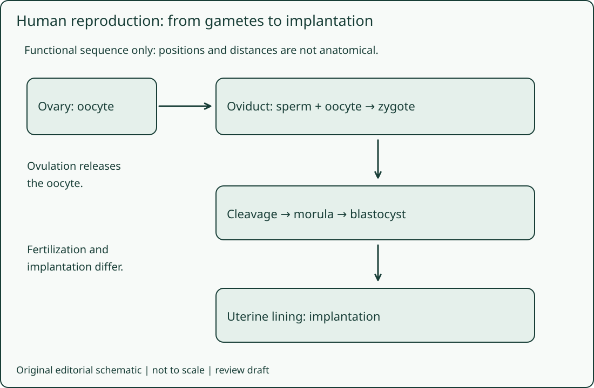
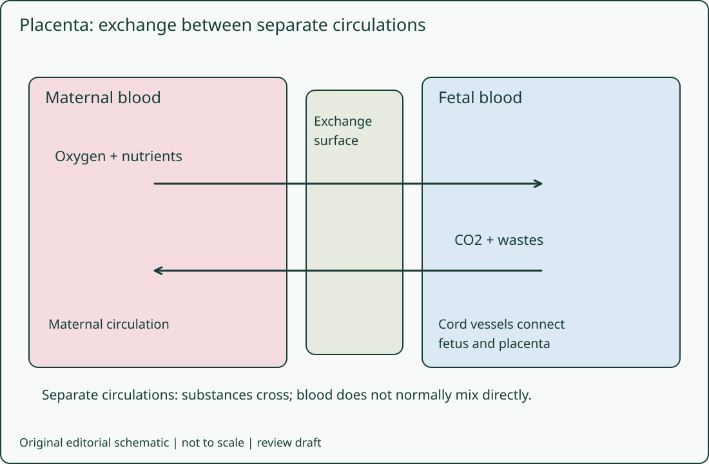
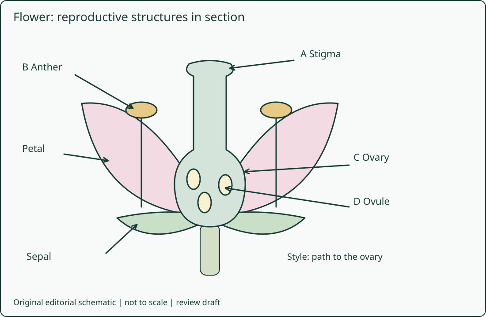
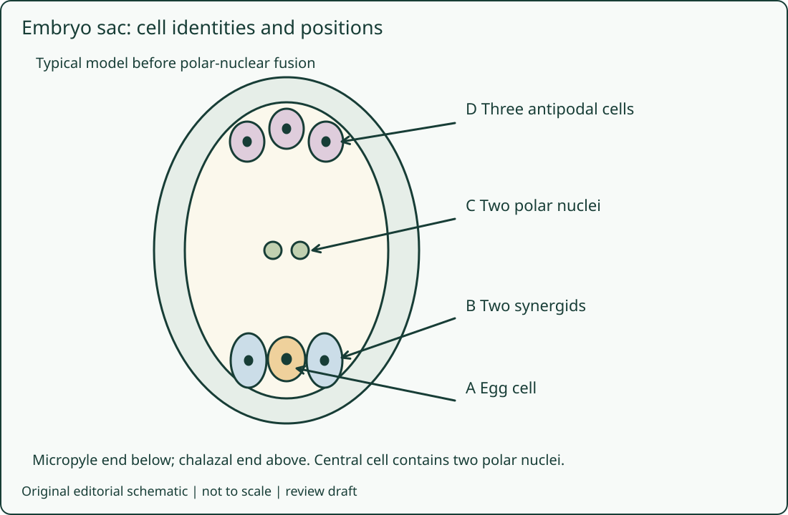

# ১১শ অধ্যায়: জীবের প্রজনন

> উত্তরসহ পর্যালোচনাধীন খসড়া; নির্ধারিত সংখ্যার উত্তরসহ খসড়া সম্পূর্ণ; বিষয়বস্তু পর্যালোচনা বাকি।
> মূল বই ও বিষয়বিশেষজ্ঞের পূর্ণ যাচাই বাকি। বোর্ড/স্কুল/সাল দাবি নেই।

## rebuild-mcq.json

### MCQ 1

বহিঃনিষেকের সংজ্ঞায় কোন স্থানটি বিবেচ্য?

A. জরায়ুর ভেতরে মিলন
B. স্ত্রীদেহের বাইরে গ্যামেট মিলন
C. দেহের বাইরে ভ্রূণের জন্মমাত্র
D. ডিম্বাশয়ের ভেতরে বৃদ্ধি

উত্তর: B — স্ত্রীদেহের বাইরে গ্যামেট মিলন
নিষেকের শ্রেণি গ্যামেটের মিলনস্থানের ভিত্তিতে হয়।

### MCQ 2

পরিচিত ব্যাঙে বহিঃনিষেকে পানির সুবিধা কী?

A. শুধু ফুসফুস গঠন
B. মিয়োসিস বাদ দেওয়া
C. গ্যামেটের চলন ও শুষ্কতা রোধ
D. সব ডিমকে শিকারিমুক্ত করা

উত্তর: C — গ্যামেটের চলন ও শুষ্কতা রোধ
পানি গ্যামেটের মিলন ও টিকে থাকার পরিবেশ দেয়, নিশ্চয়তা নয়।

### MCQ 3

অনেক বাহ্যিক নিষেককারী প্রাণী বেশি গ্যামেট ছাড়ে কেন?

A. ক্ষয় ও অনিষিক্ত থাকার ক্ষতি পুষিয়ে দিতে
B. ডিমে নিউক্লিয়াস নেই
C. সব শুক্রাণু ভ্রূণ হয়
D. সব গ্যামেট এক জাইগোটে লাগে

উত্তর: A — ক্ষয় ও অনিষিক্ত থাকার ক্ষতি পুষিয়ে দিতে
বিক্ষিপ্ত পরিবেশে গ্যামেট ও অপত্যের ক্ষতির সম্ভাবনা বেশি।

### MCQ 4

একই স্থানে কাছাকাছি সময়ে ডিম-শুক্রাণু ছাড়ার সুবিধা কী?

A. মিলনের সম্ভাবনা বাড়ে
B. খাদ্য লাগে না
C. ক্রোমোজোম বিলুপ্ত হয়
D. সব ভ্রূণ মেয়ে হয়

উত্তর: A — মিলনের সম্ভাবনা বাড়ে
সময় ও স্থান মিলে গেলে গ্যামেট পরস্পরের কাছে পৌঁছাতে পারে।

### MCQ 5

হাঙরে অন্তঃনিষেক থেকে কোন সাধারণীকরণটি ভুল প্রমাণিত?

A. সব প্রাণীতে গ্যামেট আছে
B. কিছু জীবে অন্তঃনিষেক
C. নিষেকে জাইগোট হতে পারে
D. সব জলজ প্রাণীতে বহিঃনিষেক

উত্তর: D — সব জলজ প্রাণীতে বহিঃনিষেক
আবাস একা নিষেকের ধরন নির্ধারণ করে না।

### MCQ 6

পাখির ডিম বাইরে পাড়লেও নিষেককে অন্তঃনিষেক বলা হয় কেন?

A. গ্যামেট মিলন স্ত্রীদেহের ভেতরে
B. বাইরে কখনো ভ্রূণ বাড়ে না
C. ডিমে কুসুম নেই
D. সব ভ্রূণ জরায়ুতে থাকে

উত্তর: A — গ্যামেট মিলন স্ত্রীদেহের ভেতরে
ডিম পাড়া ও নিষেকস্থানের শ্রেণি পৃথক।

### MCQ 7

মানুষের সাধারণ গ্যামেটে কয়টি ক্রোমোজোম থাকে?

A. 69টি
B. 23টি
C. 92টি
D. 46টি

উত্তর: B — 23টি
মানুষের গ্যামেট হ্যাপ্লয়েড, স্বাভাবিক সেটে 23টি ক্রোমোজোম থাকে।

### MCQ 8

মানুষের সাধারণ জাইগোটে ক্রোমোজোম সংখ্যা কত?

A. 69টি
B. 23টি
C. 12টি
D. 46টি

উত্তর: D — 46টি
শুক্রাণুর 23 ও ডিম্বাণুর 23 মিলে 46 হয়।

### MCQ 9

নিষেকে দুই জনকের বৈশিষ্ট্যের ভিত্তি কীভাবে আসে?

A. শুধু পিতার সম্পূর্ণ দেহ আসে
B. দুটি গ্যামেটই জিনহীন
C. প্রতি গ্যামেট একটি ক্রোমোজোম সেট দেয়
D. শুধু মায়ের রক্তই জিন

উত্তর: C — প্রতি গ্যামেট একটি ক্রোমোজোম সেট দেয়
দুটি সেট যুক্ত হওয়ায় উভয় জনকের নিউক্লীয় জিনের অবদান থাকে।

### MCQ 10

এক ডিম্বাণুতে বহু শুক্রাণুর প্রবেশ প্রতিরোধ কেন গুরুত্বপূর্ণ?

A. সব শুক্রাণুকে পুষ্টি দিতে
B. শুধু ভ্রূণের ওজন কমাতে
C. অস্বাভাবিক ক্রোমোজোম সমাবেশ ঠেকাতে
D. ডিম্বাণুর সব জিন সরাতে

উত্তর: C — অস্বাভাবিক ক্রোমোজোম সমাবেশ ঠেকাতে
Polyspermy-তে অতিরিক্ত সেট ঢুকে স্বাভাবিক বিকাশে বাধা হতে পারে।

### MCQ 11

শুক্রাণুর লেজের প্রধান ভূমিকা কী?

A. গর্ভাশয় গঠন
B. চলনে সাহায্য
C. হরমোন সঞ্চয়মাত্র
D. সস্য তৈরি

উত্তর: B — চলনে সাহায্য
লেজ বা flagellum শুক্রাণুর চলনে সহায়ক।

### MCQ 12

মানব শুক্রাণুর মাথায় প্রধান বংশগত উপাদান কোথায়?

A. সেমিনাল তরলের সবখানে সমান
B. শুধু মধ্যখণ্ডের তরলে
C. লেজের বাইরে
D. নিউক্লিয়াসে

উত্তর: D — নিউক্লিয়াসে
নিউক্লিয়াসে হ্যাপ্লয়েড ক্রোমোজোম সেট থাকে।

### MCQ 13

শুক্রাণুর মধ্যখণ্ডে মাইটোকন্ড্রিয়ার গুরুত্ব কী?

A. প্রোজেস্টেরন রিসেপ্টরই শুধু
B. ডিম্বাণু তৈরি
C. সব ক্রোমোজোম ভেঙে ফেলা
D. চলনের শক্তি সরবরাহে সহায়তা

উত্তর: D — চলনের শক্তি সরবরাহে সহায়তা
মাইটোকন্ড্রিয়ার ATP উৎপাদন চলনের চাহিদায় সহায়ক।

### MCQ 14

মানুষে শুক্রাণু উৎপত্তির প্রধান স্থান কোনটি?

A. প্রোস্টেটের আবরণ
B. ডিম্বনালি
C. শুক্রাশয়ের সেমিনিফেরাস নালিকা
D. মূত্রাশয়

উত্তর: C — শুক্রাশয়ের সেমিনিফেরাস নালিকা
সেমিনিফেরাস নালিকায় শুক্রাণু তৈরির ধাপ ঘটে।

### MCQ 15

শুক্রাণুর পরিপক্বতা ও সঞ্চয়ে কোন অংশ গুরুত্বপূর্ণ?

A. গর্ভমুণ্ড
B. জরায়ুমুখ
C. প্লাসেন্টা
D. এপিডিডাইমিস

উত্তর: D — এপিডিডাইমিস
এপিডিডাইমিসে শুক্রাণুর কার্যকর পরিপক্বতা ও সঞ্চয় ঘটে।

### MCQ 16

ভাস ডিফারেন্সের প্রধান কাজ কী?

A. মাতৃ-ভ্রূণ বিনিময়
B. শুক্রাণু পরিবহন
C. পরাগ তৈরি
D. ডিম্বাণু উৎপাদন

উত্তর: B — শুক্রাণু পরিবহন
শুক্রবাহী নালি শুক্রাণু পরিবহন করে, উৎপাদনস্থান নয়।

### MCQ 17

বীর্যকে শুধু শুক্রাণু বলা অসম্পূর্ণ কেন?

A. এতে কোনো কোষ নেই
B. গ্রন্থির তরলও মিশ্রণে থাকে
C. এটি শুধু মূত্র
D. এতে সবসময় ডিম্বাণু থাকে

উত্তর: B — গ্রন্থির তরলও মিশ্রণে থাকে
শুক্রাণুর সঙ্গে সহায়ক গ্রন্থির তরল মিলে বীর্য হয়।

### MCQ 18

স্ক্রোটামের তাপীয় ভূমিকা কোনটি?

A. দেহে সর্বোচ্চ তাপ তৈরি
B. ডিম্বাণু উষ্ণ রাখা
C. সব শুক্রাণু হিমায়িত রাখা
D. শুক্রাণু উৎপাদনের উপযোগী অপেক্ষাকৃত কম তাপ রাখা

উত্তর: D — শুক্রাণু উৎপাদনের উপযোগী অপেক্ষাকৃত কম তাপ রাখা
শুক্রাণু উৎপাদন তুলনামূলক কম তাপে ভালো হয়; শরীরতাপে সব শুক্রাণু নিশ্চল নয়।

### MCQ 19

ডিম্বাশয়ের দুটি প্রধান ভূমিকা কোনগুলো?

A. মূত্র তৈরি ও সঞ্চয়
B. নিষেক ও ভ্রূণ সংস্থাপনের একমাত্র স্থান
C. শুধু দুধ তৈরি
D. ডিম্বাণু-সংক্রান্ত বিকাশ ও হরমোন ক্ষরণ

উত্তর: D — ডিম্বাণু-সংক্রান্ত বিকাশ ও হরমোন ক্ষরণ
ডিম্বাশয়ে oocyte বিকাশ এবং ইস্ট্রোজেন-প্রোজেস্টেরন ক্ষরণ হয়।

### MCQ 20

মানুষে নিষেক সাধারণত কোন অঙ্গে ঘটে?

A. ডিম্বনালি
B. ডিম্বাশয়ের বাইরের আবরণমাত্র
C. জরায়ুমুখ
D. যোনি

উত্তর: A — ডিম্বনালি
ডিম্বনালির বিশেষ অংশে সাধারণত শুক্রাণু ও ডিম্বাণুর মিলন ঘটে।

### MCQ 21

স্বাভাবিক ভ্রূণ সংস্থাপনের স্থান কোনটি?

A. ডিম্বাশয়ের ফলিকল
B. জরায়ুর এন্ডোমেট্রিয়াম
C. মূত্রনালি
D. শুক্রবাহী নালি

উত্তর: B — জরায়ুর এন্ডোমেট্রিয়াম
জরায়ুর অন্তঃস্তর ব্লাস্টোসিস্ট গ্রহণের জন্য প্রস্তুত হয়।

### MCQ 22

জরায়ুমুখ কী সংযুক্ত করে?

A. মূত্রাশয় ও ফুসফুস
B. জরায়ু ও যোনিপথ
C. শুক্রাশয় ও প্রোস্টেট
D. ডিম্বাশয় ও বৃক্ক

উত্তর: B — জরায়ু ও যোনিপথ
জরায়ুর নিচের সংকীর্ণ অংশ cervix যোনিপথে খোলে।

### MCQ 23

মূত্রনালি ও যোনিপথ এক নয়—কোনটি সঠিক?

A. যোনি দিয়ে স্বাভাবিক প্রস্রাব
B. প্রস্রাব ও প্রজননপথের পৃথক বহির্মুখ
C. উভয়ই ডিম্বাণুর কারখানা
D. উভয়ই প্লাসেন্টার অংশ

উত্তর: B — প্রস্রাব ও প্রজননপথের পৃথক বহির্মুখ
নারীর মূত্রত্যাগ ও প্রজননপথ শারীরস্থানগতভাবে পৃথক।

### MCQ 24

মানুষে সাধারণ শুক্রাণু সৃষ্টির এক primary spermatocyte থেকে কী হয়?

A. দুটি প্লাসেন্টা
B. চারটি ডিপ্লয়েড ডিম্বাণু
C. চারটি হ্যাপ্লয়েড spermatid
D. একটি ট্রিপ্লয়েড শুক্রাণু

উত্তর: C — চারটি হ্যাপ্লয়েড spermatid
মিয়োসিসের দুই বিভাজনে চার হ্যাপ্লয়েড কোষ হয়, পরে পরিণত হয়।

### MCQ 25

ডিম্বাণু সৃষ্টিতে অসম সাইটোপ্লাজম বণ্টনের সুবিধা কী?

A. একটি বড় কোষে বিকাশের উপাদান রাখা
B. চার সমান বড় ভ্রূণ বাধ্যতামূলক
C. সব ক্রোমোজোম বাদ দেওয়া
D. শুক্রাণুর লেজ বানানো

উত্তর: A — একটি বড় কোষে বিকাশের উপাদান রাখা
Oogenesis-এ কার্যকর বড় কোষে অধিক সাইটোপ্লাজম থাকে, ছোট polar body হয়।

### MCQ 26

বয়ঃসন্ধির সূচনা সম্পর্কে কোনটি যথার্থ?

A. সময় ও পরিবর্তনের গতি ব্যক্তিভেদে ভিন্ন
B. পরিবর্তন মানেই রোগ
C. সবাই একই জন্মদিনে শুরু
D. প্রজননক্ষমতা মানেই অভিভাবকত্বের প্রস্তুতি

উত্তর: A — সময় ও পরিবর্তনের গতি ব্যক্তিভেদে ভিন্ন
হরমোনীয় পরিপক্বতা স্বাভাবিক ভিন্নতা দেখায়; সামাজিক প্রস্তুতি পৃথক।

### MCQ 27

GnRH-এর প্রধান উৎস কোনটি?

A. সেমিনাল ভেসিকল
B. অগ্র পিটুইটারি
C. হাইপোথ্যালামাস
D. শুধু জরায়ু

উত্তর: C — হাইপোথ্যালামাস
হাইপোথ্যালামাস GnRH দিয়ে পিটুইটারির গোনাডোট্রপিন নিয়ন্ত্রণে অংশ নেয়।

### MCQ 28

FSH ও LH প্রধানত কোথা থেকে নিঃসৃত হয়?

A. পশ্চাৎ পিটুইটারি
B. মূত্রাশয়
C. অমরার নাড়ি
D. অগ্র পিটুইটারি

উত্তর: D — অগ্র পিটুইটারি
অগ্র পিটুইটারির FSH ও LH জননগ্রন্থির কাজে সংকেত দেয়।

### MCQ 29

পুরুষে LH-এর গুরুত্বপূর্ণ প্রভাব কোনটি?

A. লেইডিগ কোষে টেস্টোস্টেরন উৎপাদন উদ্দীপনা
B. সরাসরি দুধ তৈরি
C. মূত্র ছাঁকা
D. ডিম্বস্ফোটন ঘটানো

উত্তর: A — লেইডিগ কোষে টেস্টোস্টেরন উৎপাদন উদ্দীপনা
LH শুক্রাশয়ের Leydig কোষে টেস্টোস্টেরন ক্ষরণে সহায়তা করে।

### MCQ 30

পুরুষে FSH-এর কাজের সঙ্গে কোনটি বেশি সম্পর্কিত?

A. সহায়ক কোষের মাধ্যমে শুক্রাণু উৎপাদনে সহায়তা
B. জরায়ুর পেশি সংকোচন
C. পরাগনালি বৃদ্ধি
D. অমরা থেকে অক্সিজেন নেওয়া

উত্তর: A — সহায়ক কোষের মাধ্যমে শুক্রাণু উৎপাদনে সহায়তা
FSH ও টেস্টোস্টেরন মিলে শুক্রাণু উৎপাদনের পরিবেশ বজায় রাখে।

### MCQ 31

টেস্টোস্টেরনের প্রভাবে কোন পরিবর্তন দেখা যেতে পারে?

A. গর্ভমুণ্ড বড় হওয়া
B. প্লাসেন্টা তৈরি
C. কণ্ঠস্বর ভারী হওয়া
D. প্রতিবার ঋতুস্রাব

উত্তর: C — কণ্ঠস্বর ভারী হওয়া
কৈশোরে অ্যান্ড্রোজেনীয় প্রভাবে কণ্ঠযন্ত্রসহ দেহে পরিবর্তন হয়।

### MCQ 32

মেয়েদের দ্বিতীয় যৌন বৈশিষ্ট্যের বিকাশে কোন হরমোন গুরুত্বপূর্ণ?

A. অ্যাড্রেনালিনমাত্র
B. ক্যালসিটোনিনমাত্র
C. ইস্ট্রোজেন
D. ইনসুলিনমাত্র

উত্তর: C — ইস্ট্রোজেন
ইস্ট্রোজেন স্তনসহ বিভিন্ন দ্বিতীয় যৌন বৈশিষ্ট্যের বিকাশে ভূমিকা রাখে।

### MCQ 33

ডিম্বাশয়ের ফলিকল বৃদ্ধির সঙ্গে কোনটি বেশি যুক্ত?

A. গ্লুকাগন
B. অক্সিটোসিন
C. FSH
D. ADH

উত্তর: C — FSH
FSH ফলিকলের বিকাশে উদ্দীপনা দেয়।

### MCQ 34

ডিম্বস্ফোটনের আগে কোন হরমোনের তীব্র বৃদ্ধি পরিচিত?

A. LH
B. ক্যালসিটোনিন
C. থাইরক্সিন
D. মেলাটোনিন

উত্তর: A — LH
LH surge পরিণত ফলিকল থেকে oocyte মুক্তির সঙ্গে যুক্ত।

### MCQ 35

ডিম্বস্ফোটন বলতে কোন ঘটনা বোঝায়?

A. ডিম্বাশয় থেকে oocyte মুক্তি
B. জরায়ু থেকে রক্তস্রাব
C. শুক্রাণু তৈরি
D. ব্লাস্টোসিস্ট সংস্থাপন

উত্তর: A — ডিম্বাশয় থেকে oocyte মুক্তি
Ovulation ও menstruation আলাদা ঘটনা।

### MCQ 36

ডিম্বস্ফোটনের পর ফেটে যাওয়া ফলিকল কী গঠন করে?

A. কর্পাস লুটিয়াম
B. সেমিনিফেরাস নালি
C. ভ্রূণথলি
D. অমরা সঙ্গে সঙ্গে

উত্তর: A — কর্পাস লুটিয়াম
কর্পাস লুটিয়াম প্রোজেস্টেরনসহ হরমোন ক্ষরণ করে।

### MCQ 37

প্রোজেস্টেরনের গুরুত্বপূর্ণ জরায়ুগত কাজ কোনটি?

A. শুক্রাণুর মাথা তৈরি
B. সবসময় জরায়ু সংকোচন বাড়ানো
C. এন্ডোমেট্রিয়াম রক্ষণে সহায়তা
D. পরাগ গ্রহণ

উত্তর: C — এন্ডোমেট্রিয়াম রক্ষণে সহায়তা
প্রোজেস্টেরন সংস্থাপনের উপযোগী অন্তঃস্তর রক্ষণে গুরুত্বপূর্ণ।

### MCQ 38

সাধারণ অগর্ভ চক্রের শেষে কোন পরিবর্তন ঋতুস্রাবে সহায়ক?

A. ডিম্বাণু রক্তে পরিণত
B. hCG সর্বদা বৃদ্ধি
C. ইস্ট্রোজেন ও প্রোজেস্টেরন হ্রাস
D. সব হরমোন চিরস্থায়ী বন্ধ

উত্তর: C — ইস্ট্রোজেন ও প্রোজেস্টেরন হ্রাস
কর্পাস লুটিয়াম ক্ষয়ে হরমোন কমলে এন্ডোমেট্রিয়ামের অংশ ঝরে।

### MCQ 39

ঋতুস্রাবের রক্তের প্রধান উৎস কোনটি?

A. মূত্রাশয়ের স্বাভাবিক ক্ষয়
B. ডিম্বাশয় ফেটে বড় ক্ষত
C. ডিম্বাণুর সরাসরি রক্তে রূপান্তর
D. জরায়ুর অন্তঃস্তর ঝরে যাওয়া

উত্তর: D — জরায়ুর অন্তঃস্তর ঝরে যাওয়া
রক্ত ও এন্ডোমেট্রিয়াল কলা বের হয়; এটি মূত্র নয়।

### MCQ 40

ঋতুচক্রের 28 দিনের উদাহরণ কীভাবে ব্যবহার করা উচিত?

A. সবার চক্র ঠিক একই
B. যেকোনো ভিন্নতা রোগ
C. শিক্ষণ-মডেল, সবার স্থির নিয়ম নয়
D. দিন গুনেই গর্ভধারণ অসম্ভব করা যায়

উত্তর: C — শিক্ষণ-মডেল, সবার স্থির নিয়ম নয়
চক্রের দৈর্ঘ্য ও ডিম্বস্ফোটনের সময় ভিন্ন হতে পারে।

### MCQ 41

প্রথম মাসিকের পর থেকেই কী সতর্কতা প্রাসঙ্গিক?

A. ডিম্বস্ফোটন হলে গর্ভধারণ সম্ভব
B. সবসময় অমরা থাকে
C. দুই বছর নিশ্চয়ই অসম্ভব
D. সব চক্রে নিষেক হয়

উত্তর: A — ডিম্বস্ফোটন হলে গর্ভধারণ সম্ভব
নির্দিষ্ট এক-দুই বছর প্রাকৃতিক সুরক্ষার নিশ্চয়তা নেই।

### MCQ 42

মাসিকের সময় নিরাপদ পরিচর্যা কোনটি?

A. পরিষ্কার উপকরণ ও বদলানোর গোপনীয় ব্যবস্থা
B. সারাদিন পানি বন্ধ
C. স্কুলে অপমান
D. সব ব্যায়াম স্থায়ী নিষেধ

উত্তর: A — পরিষ্কার উপকরণ ও বদলানোর গোপনীয় ব্যবস্থা
পরিচ্ছন্নতা, পানি ও মর্যাদা স্বাভাবিক অংশগ্রহণে সহায়তা করে।

### MCQ 43

অস্বাভাবিক বেশি রক্তপাত বা তীব্র ব্যথায় কী করা উচিত?

A. একে শাস্তি মনে করা
B. নিজে হরমোনের মাত্রা বাড়ানো
C. স্বাস্থ্যকর্মীর মূল্যায়ন নেওয়া
D. সবসময় চেপে রাখা

উত্তর: C — স্বাস্থ্যকর্মীর মূল্যায়ন নেওয়া
সাধারণ পরিবর্তন ও চিকিৎসাযোগ্য সমস্যার পার্থক্য মূল্যায়ন প্রয়োজন।

### MCQ 44

মেনোপজের সাধারণ অর্থ কী?

A. ডিম্বস্ফোটনের প্রথম দিন
B. এক মাস চক্র না-হওয়া মাত্র
C. স্বাভাবিক বয়সগত প্রক্রিয়ায় ঋতুচক্রের স্থায়ী সমাপ্তি
D. প্রতি গর্ভাবস্থা

উত্তর: C — স্বাভাবিক বয়সগত প্রক্রিয়ায় ঋতুচক্রের স্থায়ী সমাপ্তি
একটি চক্র বাদ পড়া মানেই মেনোপজ নয়; কারণ মূল্যায়ন লাগতে পারে।

### MCQ 45

প্রজনন হরমোনের নিয়ন্ত্রণে feedback কেন প্রয়োজন?

A. ফুসফুসে পরাগ ঢোকাতে
B. ক্রোমোজোম ভেঙে দিতে
C. সব হরমোন শূন্য করতে
D. মাত্রা ও কাজ সমন্বয় রাখতে

উত্তর: D — মাত্রা ও কাজ সমন্বয় রাখতে
হাইপোথ্যালামাস-পিটুইটারি-গোনাড অক্ষ feedback দ্বারা নিয়ন্ত্রিত।

### MCQ 46

ইস্ট্রোজেনের feedback সম্পর্কে কোনটি সতর্ক বক্তব্য?

A. শুধু পুরুষে তৈরি
B. পর্যায়ভেদে ঋণাত্মক বা ধনাত্মক প্রভাব হতে পারে
C. সবসময় শুধু ধনাত্মক
D. কখনো পিটুইটারিতে প্রভাব নেই

উত্তর: B — পর্যায়ভেদে ঋণাত্মক বা ধনাত্মক প্রভাব হতে পারে
ডিম্বস্ফোটনের আগের নির্দিষ্ট অবস্থায় sustained উচ্চ মাত্রায় positive feedback হয়।

### MCQ 47

প্রোল্যাকটিনের পরিচিত কাজ কোনটি?

A. পরাগ উৎপাদন
B. অমরায় সব বিষ আটকানো
C. ডিম্বাণুতে শুক্রাণু প্রবেশ
D. দুধ উৎপাদন উদ্দীপনা

উত্তর: D — দুধ উৎপাদন উদ্দীপনা
অগ্র পিটুইটারির প্রোল্যাকটিন স্তনগ্রন্থিতে দুধ উৎপাদনে কাজ করে।

### MCQ 48

অক্সিটোসিনের প্রজনন-সম্পর্কিত প্রভাব কোনটি?

A. শুক্রাণুর ক্রোমোজোম দ্বিগুণ
B. ডিম্বাণু উৎপত্তির মিয়োসিস
C. জরায়ু সংকোচন ও দুধ নির্গমনে সহায়তা
D. দুধের সব পুষ্টি সরাসরি তৈরি

উত্তর: C — জরায়ু সংকোচন ও দুধ নির্গমনে সহায়তা
অক্সিটোসিনের contraction ও milk ejection ভূমিকা প্রোল্যাকটিন থেকে পৃথক।

### MCQ 49

অক্সিটোসিন সংশ্লেষ ও রক্তে মুক্তির সঠিক জোড়া কোনটি?

A. ডিম্বাশয় ও মূত্রাশয়
B. হাইপোথ্যালামাস ও পশ্চাৎ পিটুইটারি
C. অগ্র পিটুইটারি ও থাইরয়েড
D. প্লাসেন্টা ও পাপড়ি

উত্তর: B — হাইপোথ্যালামাস ও পশ্চাৎ পিটুইটারি
অক্সিটোসিন হাইপোথ্যালামাসে তৈরি, পশ্চাৎ পিটুইটারি দিয়ে মুক্ত হয়।

### MCQ 50

প্রাথমিক গর্ভাবস্থায় hCG কী রক্ষণে সহায়তা করে?

A. মূত্রনালির মুখ
B. পরাগধানী
C. কর্পাস লুটিয়াম
D. প্রতিপাদ কোষ

উত্তর: C — কর্পাস লুটিয়াম
hCG কর্পাস লুটিয়াম বজায় রেখে প্রাথমিক হরমোন সহায়তা দেয়।

### MCQ 51

অমরাকে শুধু বিনিময়পৃষ্ঠ বলা অসম্পূর্ণ কেন?

A. এটি হরমোনও তৈরি করে
B. এটি শুধু পিতৃরক্ত
C. এটি স্থায়ী শুক্রাশয়
D. এতে কোনো কলা নেই

উত্তর: A — এটি হরমোনও তৈরি করে
অমরার অন্তঃক্ষরা ভূমিকাও গর্ভাবস্থা রক্ষণে গুরুত্বপূর্ণ।

### MCQ 52

মানব জাইগোটের cleavage-এ শুরুতে কী বাড়ে?

A. কোষসংখ্যা
B. প্রতি কোষের ক্রোমোজোম সেট
C. শুধু অমরার ওজন
D. প্রতি কোষের আয়তন সবসময়

উত্তর: A — কোষসংখ্যা
প্রাথমিক cleavage-এ বড় মোট বৃদ্ধি ছাড়াই ছোট কোষে বিভাজন হয়।

### MCQ 53

জাইগোট থেকে জরায়ুতে পৌঁছানোর পথে কোন ক্রমটি উপযুক্ত?

A. অমরা→গ্যামেট→জাইগোট
B. ব্লাস্টোসিস্ট→পরাগ→মরুলা
C. ক্লিভেজ→মরুলা→ব্লাস্টোসিস্ট
D. মেনোপজ→নিষেক→পরাগ

উত্তর: C — ক্লিভেজ→মরুলা→ব্লাস্টোসিস্ট
বিভাজনে কোষপুঞ্জ এবং পরে ব্লাস্টোসিস্ট গঠিত হয়।

### MCQ 54

ব্লাস্টোসিস্টের inner cell mass প্রধানত কী দেয়?

A. শুক্রাণুর লেজ
B. মূত্রাশয়ের সব কোষ
C. ভ্রূণের দেহ
D. মাতৃ জরায়ুর পেশি

উত্তর: C — ভ্রূণের দেহ
ভ্রূণীয় অংশের সূচনা inner cell mass থেকে হয়।

### MCQ 55

ব্লাস্টোসিস্টের বাইরের কোষস্তর কোন কাজে অংশ নেয়?

A. মায়ের সব লোহিত কণিকা তৈরি
B. নতুন পরাগ তৈরি
C. বীজত্বক তৈরি
D. সংস্থাপন ও অমরার ভ্রূণীয় অংশ গঠন

উত্তর: D — সংস্থাপন ও অমরার ভ্রূণীয় অংশ গঠন
Trophoblast সংস্থাপন ও placental development-এ ভূমিকা রাখে।

### MCQ 56

সংস্থাপনকে নিষেকের সমার্থক বলা যায় না কেন?

A. দুটিতে কোনো কোষ নেই
B. দুটিই শুধু বহিঃনিষেক
C. সময়, স্থান ও প্রক্রিয়া ভিন্ন
D. দুটিই পরাগায়ন

উত্তর: C — সময়, স্থান ও প্রক্রিয়া ভিন্ন
নিষেক গ্যামেট মিলন, সংস্থাপন জরায়ুর স্তরে ব্লাস্টোসিস্টের যুক্ত হওয়া।

### MCQ 57

জরায়ুর বাইরে সংস্থাপনের সন্দেহে তীব্র ব্যথা হলে করণীয় কী?

A. বাড়িতে মালিশ
B. জরুরি চিকিৎসা মূল্যায়ন
C. নিজে হরমোন সেবন
D. পরবর্তী মাস পর্যন্ত অপেক্ষা

উত্তর: B — জরুরি চিকিৎসা মূল্যায়ন
Ectopic pregnancy বিপজ্জনক হতে পারে, দ্রুত চিকিৎসা প্রয়োজন।

### MCQ 58

মাতৃ ও ভ্রূণীয় অংশ মিলে গঠিত অস্থায়ী অঙ্গ কোনটি?

A. বৃত্যাংশ
B. অমরা
C. শুক্রাশয়
D. ডিম্বনালি

উত্তর: B — অমরা
Placenta-তে মাতৃ জরায়ুকলা ও ভ্রূণীয় অবদান থাকে।

### MCQ 59

স্বাভাবিক অমরায় মাতৃ ও ভ্রূণীয় রক্ত সম্পর্কে কোনটি সঠিক?

A. কোনো পদার্থ পার হয় না
B. সব রক্ত এক নালিতে মেশে
C. বিনিময় হয়, রক্ত সাধারণত সরাসরি এক প্রবাহে মেশে না
D. ভ্রূণের রক্ত নেই

উত্তর: C — বিনিময় হয়, রক্ত সাধারণত সরাসরি এক প্রবাহে মেশে না
পৃথক সঞ্চালনের মাঝের বিনিময়পৃষ্ঠ দিয়ে পদার্থ যায়।

### MCQ 60

অমরা দিয়ে ভ্রূণের দিকে সাধারণত কী যায়?

A. অক্সিজেন ও পুষ্টি
B. ভ্রূণের সব CO2
C. সম্পূর্ণ মাতৃ ফুসফুস
D. ভ্রূণের ইউরিয়া শুধু

উত্তর: A — অক্সিজেন ও পুষ্টি
মাতৃ দিক থেকে অক্সিজেন ও পুষ্টি ভ্রূণের সঞ্চালনে যায়।

### MCQ 61

ভ্রূণ থেকে মাতৃদিকে অমরায় কোন বিনিময় হয়?

A. শুধু সব ডিম্বাণু
B. সব মাতৃ হরমোন
C. অক্সিজেনের একমাত্র উৎস
D. CO2 ও বিপাকীয় বর্জ্য

উত্তর: D — CO2 ও বিপাকীয় বর্জ্য
ভ্রূণীয় বর্জ্য মাতৃ সঞ্চালনে গিয়ে মাতৃ অঙ্গে অপসারিত হয়।

### MCQ 62

নাড়ি কী যুক্ত করে?

A. ডিম্বাশয় ও যোনি
B. মাতৃ হৃদপিণ্ড ও ভ্রূণের মুখ
C. ফুল ও বীজত্বক
D. ভ্রূণ ও অমরা

উত্তর: D — ভ্রূণ ও অমরা
Umbilical cord ভ্রূণের সঞ্চালনকে অমরার সঙ্গে যুক্ত করে।

### MCQ 63

স্বাভাবিক নাড়িতে রক্তনালির প্রচলিত সংখ্যা কত?

A. শুধু এক ফাঁপা নালি
B. দুই ধমনি ও এক শিরা
C. এক ধমনি ও দুই শিরা
D. কোনো রক্তনালি নেই

উত্তর: B — দুই ধমনি ও এক শিরা
তিন নালির সাধারণ বিন্যাস দুই umbilical artery এবং এক vein।

### MCQ 64

নাভিশিরার নাম শিরা হলেও অক্সিজেনসমৃদ্ধ কেন?

A. এতে কোনো রক্ত নেই
B. এটি মাতৃ মূত্র আনে
C. অমরা থেকে ভ্রূণের হৃদপিণ্ডমুখী রক্ত আনে
D. সব শিরায় অক্সিজেন বেশি

উত্তর: C — অমরা থেকে ভ্রূণের হৃদপিণ্ডমুখী রক্ত আনে
ধমনি-শিরার নাম প্রবাহের দিকভিত্তিক, অক্সিজেনের পরিমাণভিত্তিক নয়।

### MCQ 65

অমরা আছে মানেই সব ক্ষতিকর পদার্থ আটকায় নয় কেন?

A. এটি কেবল লোহা পার করে
B. কিছু ওষুধ ও সংক্রমণ পার হতে পারে
C. এতে রক্তপ্রবাহ নেই
D. এটি ভ্রূণকে বাইরের বাতাস দেয়

উত্তর: B — কিছু ওষুধ ও সংক্রমণ পার হতে পারে
Placenta সম্পূর্ণ অপ্রবেশ্য দেয়াল নয়; চিকিৎসকের পরামর্শ জরুরি।

### MCQ 66

অ্যামনিয়োটিক তরলের গুরুত্বপূর্ণ ভূমিকা কী?

A. ভ্রূণকে যান্ত্রিক ধাক্কা থেকে সুরক্ষায় সহায়তা
B. গ্যামেটের মিয়োসিস
C. শুধু মাতৃরক্ত সরাসরি পান করানো
D. সব হরমোনের একমাত্র উৎস

উত্তর: A — ভ্রূণকে যান্ত্রিক ধাক্কা থেকে সুরক্ষায় সহায়তা
তরল cushioning ও চলাচলের পরিবেশ দেয়।

### MCQ 67

গর্ভকাল প্রায় 40 সপ্তাহ বলা হলে সাধারণ গণনা কোথা থেকে?

A. শেষ মাসিকের প্রথম দিন
B. প্রসবের পর
C. নিষেকের সঠিক মুহূর্ত থেকে সর্বদা
D. প্রথম নড়াচড়া

উত্তর: A — শেষ মাসিকের প্রথম দিন
প্রসূতিবিদ্যায় LMP-ভিত্তিক বয়স নিষেক-পরবর্তী বয়সের প্রায় দুই সপ্তাহ বেশি।

### MCQ 68

নিষেকের পর প্রায় 38 সপ্তাহ ও LMP থেকে প্রায় 40 সপ্তাহ—পার্থক্য কেন?

A. একটিতে অমরা নেই
B. একটিতে দ্বিনিষেক
C. ভ্রূণের ক্রোমোজোম বদলায়
D. গণনার শুরুবিন্দু আলাদা

উত্তর: D — গণনার শুরুবিন্দু আলাদা
দুটি হিসাব একই সম্ভাব্য সময়কে আলাদা সূচনা দিয়ে বর্ণনা করে।

### MCQ 69

প্রসবের positive feedback-এ কোন ক্রমটি উপযুক্ত?

A. সংকোচন→সব সংকেত বন্ধ
B. দুধ→মিয়োসিস→ডিম্বক
C. প্রসারণ→অক্সিটোসিন→আরও সংকোচন
D. পরাগায়ন→LH→সস্য

উত্তর: C — প্রসারণ→অক্সিটোসিন→আরও সংকোচন
জরায়ুমুখ প্রসারণের সংকেতে অক্সিটোসিন ও সংকোচন বৃদ্ধি পেতে পারে।

### MCQ 70

প্রসবের পরে অমরার স্বাভাবিক পরিণতি কী?

A. ডিম্বাশয়ে ডিম্বাণু হয়
B. ফুসফুসে থাকে
C. দেহ থেকে বের হয়
D. স্থায়ী বৃক্ক হয়

উত্তর: C — দেহ থেকে বের হয়
অমরা অস্থায়ী অঙ্গ, শিশুর জন্মের পর বেরিয়ে আসে।

### MCQ 71

সন্তান জন্মের পর মাসিক ফিরতে দেরি হলেও কী সত্য?

A. গর্ভধারণ চিরতরে অসম্ভব
B. সবসময় ঠিক দেড় মাসে মাসিক
C. আগে ডিম্বস্ফোটন হতে পারে
D. অমরা আর বের হয় না

উত্তর: C — আগে ডিম্বস্ফোটন হতে পারে
প্রসব-পরবর্তী চক্র ফেরার সময় ভিন্ন; মাসিকের আগে ovulation সম্ভব।

### MCQ 72

কৈশোরে গর্ভধারণের আলোচনায় নিরাপদ বার্তা কোনটি?

A. প্রজননক্ষম হলেই গর্ভধারণের চাপ
B. অসুস্থ হলে কাউকে না বলা
C. সব ঝুঁকি কুসংস্কার
D. স্বাস্থ্যঝুঁকি ও শিক্ষা-সহায়তা বিবেচনা

উত্তর: D — স্বাস্থ্যঝুঁকি ও শিক্ষা-সহায়তা বিবেচনা
জৈবিক ক্ষমতা শারীরিক-মানসিক-সামাজিক প্রস্তুতির সমার্থক নয়।

### MCQ 73

HIV-এর পূর্ণ নামের মূল শব্দ কোনটি?

A. High insulin virus
B. Human immunodeficiency virus
C. Human influenza vaccine
D. Hereditary immune variation

উত্তর: B — Human immunodeficiency virus
HIV একটি ভাইরাস; নামটি মানুষের রোগপ্রতিরোধ ঘাটতির সঙ্গে সম্পর্কিত।

### MCQ 74

AIDS ও HIV-এর সম্পর্ক কোনটি?

A. দুটি একই ব্যাকটেরিয়া
B. HIV কেবল অ্যালার্জি
C. AIDS ভাইরাস HIV রোগ
D. HIV সংক্রমণের অগ্রসর পর্যায় AIDS

উত্তর: D — HIV সংক্রমণের অগ্রসর পর্যায় AIDS
HIV হলো ভাইরাস, AIDS হলো সংক্রমণের গুরুতর অগ্রসর অবস্থা।

### MCQ 75

HIV রোগপ্রতিরোধ ব্যবস্থার কোন কোষকে বিশেষভাবে আক্রমণ করে?

A. পরিণত লোহিত কণিকা মাত্র
B. অস্থিকোষমাত্র
C. CD4 T কোষ
D. পুং গ্যামেটমাত্র

উত্তর: C — CD4 T কোষ
CD4 T কোষের ক্ষতি প্রতিরোধ সমন্বয় দুর্বল করে।

### MCQ 76

HIV আক্রান্ত হলেই তাৎক্ষণিক AIDS হয় না কেন?

A. রোগের পর্যায় ও চিকিৎসার প্রভাব আছে
B. AIDS শুধু পোকায় হয়
C. ভাইরাস কখনো বংশবৃদ্ধি করে না
D. সবাই জন্ম থেকেই AIDS

উত্তর: A — রোগের পর্যায় ও চিকিৎসার প্রভাব আছে
সংক্রমণ ও অগ্রসর রোগের মধ্যে সময় ও চিকিৎসাভেদে পার্থক্য থাকে।

### MCQ 77

HIV সংক্রমণের বাস্তব পথ কোনটি?

A. সংক্রমিত রক্তের অনিরাপদ সঞ্চালন
B. করমর্দন
C. এক বেঞ্চে বসা
D. একই বই পড়া

উত্তর: A — সংক্রমিত রক্তের অনিরাপদ সঞ্চালন
দূষিত রক্ত ঝুঁকিপূর্ণ; সাধারণ সামাজিক স্পর্শে ছড়ায় না।

### MCQ 78

HIV প্রতিরোধে ইনজেকশনের কোন ব্যবস্থা গুরুত্বপূর্ণ?

A. জীবাণুমুক্ত সরঞ্জাম, সুচ ভাগ না-করা
B. এক সুচ সবাই ব্যবহার
C. শুধু সিরিঞ্জের রং বদল
D. সুচে শুধু পানি ঢালা

উত্তর: A — জীবাণুমুক্ত সরঞ্জাম, সুচ ভাগ না-করা
রক্তদূষিত সরঞ্জাম সংক্রমণ বহন করতে পারে।

### MCQ 79

মা থেকে শিশুর HIV সংক্রমণ কোন সময়ে সম্ভব?

A. শুধু নামকরণে
B. কেবল জন্মদিনে
C. গর্ভাবস্থা, প্রসব বা স্তন্যপানের সময়ে
D. শুধু পিতার রক্তের সরাসরি নালিতে

উত্তর: C — গর্ভাবস্থা, প্রসব বা স্তন্যপানের সময়ে
মাতৃ-শিশু সংক্রমণের একাধিক সুযোগ আছে; চিকিৎসায় ঝুঁকি কমানো যায়।

### MCQ 80

কোন ঘটনাটি HIV ছড়ানোর স্বাভাবিক পথ নয়?

A. দূষিত সুচ ভাগ
B. একসঙ্গে খাবার খাওয়া
C. অপরীক্ষিত সংক্রমিত রক্ত
D. অসুরক্ষিত যৌনসংস্পর্শ

উত্তর: B — একসঙ্গে খাবার খাওয়া
খাবার ভাগ বা আলিঙ্গনে HIV ছড়ায় না।

### MCQ 81

মশার কামড়ে HIV ছড়ায়—দাবিটি কেমন?

A. সব ভাইরাসের মতো সত্য
B. শুধু দিনের মশায় সত্য
C. বৈজ্ঞানিকভাবে সমর্থিত নয়
D. এটাই প্রধান পথ

উত্তর: C — বৈজ্ঞানিকভাবে সমর্থিত নয়
HIV মশাবাহিত সংক্রমণ নয়।

### MCQ 82

দীর্ঘ জ্বর বা ওজন কমলেই HIV বলা যায় না কেন?

A. HIV-এর কোনো পরীক্ষা নেই
B. সব জ্বরেই AIDS
C. ওজন কখনো কমে না
D. লক্ষণগুলো বহু রোগে হতে পারে

উত্তর: D — লক্ষণগুলো বহু রোগে হতে পারে
লক্ষণভিত্তিক অনুমান নয়, যথাযথ পরীক্ষা দরকার।

### MCQ 83

Window period-এ নেতিবাচক পরীক্ষার সীমা কী?

A. আর পরামর্শ লাগে না
B. সাম্প্রতিক সংক্রমণ সব পরীক্ষায় তখন ধরা না-ও পড়তে পারে
C. চিরকালের সুরক্ষা প্রমাণ
D. সংক্রমণ অসম্ভব

উত্তর: B — সাম্প্রতিক সংক্রমণ সব পরীক্ষায় তখন ধরা না-ও পড়তে পারে
পরীক্ষার ধরন ও সময় অনুযায়ী পুনঃপরীক্ষার পরামর্শ প্রয়োজন হতে পারে।

### MCQ 84

HIV নিশ্চিত নির্ণয়ে সবচেয়ে উপযুক্ত পদক্ষেপ কী?

A. মুখ দেখে রায়
B. অনলাইন ছবির মিল
C. অনুমোদিত পরীক্ষাক্রমে স্বাস্থ্যকর্মীর মূল্যায়ন
D. একটি উপসর্গ গণনা

উত্তর: C — অনুমোদিত পরীক্ষাক্রমে স্বাস্থ্যকর্মীর মূল্যায়ন
উপযুক্ত algorithm ও নিশ্চিতকরণে ভুল সিদ্ধান্ত কমে।

### MCQ 85

ART-এর প্রধান কাজ কী?

A. ভাইরাসের বংশবৃদ্ধি দমন
B. শুধু রক্তের গ্রুপ বদল
C. সব ভাইরাস তৎক্ষণাৎ নির্মূল
D. শুধু ব্যথানাশক কাজ

উত্তর: A — ভাইরাসের বংশবৃদ্ধি দমন
Antiretroviral therapy ভাইরাল বৃদ্ধি কমিয়ে প্রতিরোধক্ষমতা রক্ষায় সাহায্য করে।

### MCQ 86

HIV হলে মৃত্যু অনিবার্য—এই বার্তা ভুল কেন?

A. চিকিৎসায় দীর্ঘ সুস্থ জীবন সম্ভব
B. ওষুধের প্রয়োজন নেই
C. পরীক্ষা সবসময় অকার্যকর
D. ভাইরাস নিরীহ সর্বদা

উত্তর: A — চিকিৎসায় দীর্ঘ সুস্থ জীবন সম্ভব
ART ও নিয়মিত সেবায় HIV নিয়ন্ত্রণযোগ্য দীর্ঘমেয়াদি অবস্থা হতে পারে।

### MCQ 87

ART গ্রহণকারী যৌনসঙ্গীর ক্ষেত্রে U=U-এর শর্ত কোনটি?

A. চিকিৎসায় স্থায়ীভাবে undetectable viral load
B. পরীক্ষা ছাড়াই বিশ্বাস
C. শুধু সুস্থ চেহারা
D. একবার ওষুধ খাওয়ামাত্র

উত্তর: A — চিকিৎসায় স্থায়ীভাবে undetectable viral load
সঠিক চিকিৎসায় অশনাক্তযোগ্য ভাইরাল লোড বজায় থাকলে যৌনপথে HIV ছড়ায় না।

### MCQ 88

U=U তথ্যকে কোন ক্ষেত্রে বিনা শর্তে প্রয়োগ করা ভুল?

A. ভাইরাল লোড পর্যবেক্ষণ
B. যৌন সংক্রমণ নিয়ে পরামর্শ
C. চিকিৎসা অনুসরণের গুরুত্ব
D. সুচ ভাগ করাও নিরাপদ বলা

উত্তর: D — সুচ ভাগ করাও নিরাপদ বলা
যৌন সংক্রমণ-সম্পর্কিত প্রমাণকে সব রক্তসংস্পর্শে সাধারণীকরণ করা যাবে না।

### MCQ 89

গর্ভবতী HIV-সহ ব্যক্তির জন্য কোন বার্তা যথার্থ?

A. চিকিৎসা সম্পূর্ণ বন্ধ
B. দ্রুত বিশেষজ্ঞ সেবা ও ART
C. শুধু জন্মের পর চিন্তা
D. সব শিশু নিশ্চিত আক্রান্ত

উত্তর: B — দ্রুত বিশেষজ্ঞ সেবা ও ART
চিকিৎসায় মা ও শিশুর স্বাস্থ্য রক্ষা এবং সংক্রমণঝুঁকি হ্রাস সম্ভব।

### MCQ 90

সম্ভাব্য HIV exposure-এর পর কী করা উচিত?

A. নিজে অ্যান্টিবায়োটিক
B. যত দ্রুত সম্ভব চিকিৎসাসেবা নেওয়া
C. সব তথ্য প্রকাশ করা
D. লক্ষণ না-আসা পর্যন্ত মাস অপেক্ষা

উত্তর: B — যত দ্রুত সম্ভব চিকিৎসাসেবা নেওয়া
চিকিৎসক জরুরি মূল্যায়ন ও প্রয়োজনীয় post-exposure ব্যবস্থা নির্ধারণ করেন।

### MCQ 91

PrEP ও PEP-এর পার্থক্যের ভিত্তি কী?

A. সম্ভাব্য সংস্পর্শের আগে বনাম পরে
B. বয়সের উচ্চতা
C. রক্তের গ্রুপ
D. মশার প্রজাতি

উত্তর: A — সম্ভাব্য সংস্পর্শের আগে বনাম পরে
দুটিই বিশেষজ্ঞ-নির্ধারিত প্রতিরোধপন্থা, নিজে ওষুধ শুরু নয়।

### MCQ 92

কনডমের HIV প্রতিরোধ-সম্পর্কিত সঠিক বক্তব্য কোনটি?

A. সঠিক ও নিয়মিত ব্যবহারে ঝুঁকি কমে
B. এটি ART-এর সব কাজ করে
C. একবার ব্যবহারেই আজীবন সুরক্ষা
D. এটি HIV নিরাময় করে

উত্তর: A — সঠিক ও নিয়মিত ব্যবহারে ঝুঁকি কমে
বাধাপদ্ধতি ঝুঁকি কমায়, চিকিৎসা বা আজীবন প্রতিরোধ নয়।

### MCQ 93

রক্তদানের নিরাপত্তায় কোন কাজ জরুরি?

A. রক্তের রং দেখে সিদ্ধান্ত
B. শুধু দাতার চেহারা দেখা
C. শুধু আত্মীয়ের রক্ত নেওয়া
D. স্বীকৃত কেন্দ্রে রক্ত পরীক্ষা ও নিরাপদ প্রক্রিয়া

উত্তর: D — স্বীকৃত কেন্দ্রে রক্ত পরীক্ষা ও নিরাপদ প্রক্রিয়া
সুস্থদর্শন দাতারও সংক্রমণ থাকতে পারে, screening দরকার।

### MCQ 94

HIV-সহ সহপাঠীর প্রতি সঠিক আচরণ কোনটি?

A. গোপনীয়তা ও সমান অংশগ্রহণ রক্ষা
B. বেঞ্চ আলাদা করে দেওয়া
C. বই ছুঁতে না-দেওয়া
D. নাম ঘোষণা

উত্তর: A — গোপনীয়তা ও সমান অংশগ্রহণ রক্ষা
সাধারণ স্কুল সংস্পর্শে ছড়ায় না; বৈষম্য অযৌক্তিক।

### MCQ 95

HIV প্রতিরোধ পোস্টারে কোন বার্তা বেছে নেবে?

A. পরীক্ষা, নিরাপদ রক্ত, চিকিৎসা ও সহমর্মিতা
B. রোগীকে সমাজচ্যুত করো
C. সব সংস্পর্শ বিপজ্জনক
D. উপসর্গ না-থাকলে পরীক্ষা নয়

উত্তর: A — পরীক্ষা, নিরাপদ রক্ত, চিকিৎসা ও সহমর্মিতা
তথ্যভিত্তিক, অকলঙ্কজনক বার্তা প্রতিরোধ ও সেবাগ্রহণে সহায়ক।

### MCQ 96

HIV ঝুঁকি বিচার করতে কোনটি বেশি প্রাসঙ্গিক?

A. ব্যক্তির পোশাক
B. সামাজিক পরিচয়মাত্র
C. নির্দিষ্ট সংস্পর্শ ও সুরক্ষা ব্যবস্থা
D. ধর্ম

উত্তর: C — নির্দিষ্ট সংস্পর্শ ও সুরক্ষা ব্যবস্থা
ঝুঁকি নির্দিষ্ট সংক্রমণপথনির্ভর, পরিচয়ভিত্তিক নৈতিক রায় নয়।

### MCQ 97

CD4 কমায় opportunistic সংক্রমণের সুযোগ বাড়ে কেন?

A. লোহিত কণিকা অ্যান্টিবডি দেয়
B. প্রতিরোধ সমন্বয় দুর্বল হয়
C. সব অঙ্গ রক্তহীন হয়
D. সব জীবাণু হঠাৎ সৃষ্টি হয়

উত্তর: B — প্রতিরোধ সমন্বয় দুর্বল হয়
প্রতিরোধ দুর্বল হলে সাধারণত নিয়ন্ত্রিত জীবাণুও গুরুতর রোগ ঘটাতে পারে।

### MCQ 98

HIV-সম্পর্কিত স্বাস্থ্যতথ্য ব্যবহারে কোন নীতি জরুরি?

A. গুজব ছড়ানো
B. অবাধ প্রকাশ
C. চেহারা দেখে তালিকা
D. সম্মতি ও গোপনীয়তা

উত্তর: D — সম্মতি ও গোপনীয়তা
সংবেদনশীল তথ্য সুরক্ষা চিকিৎসা ও মানবিক মর্যাদার অংশ।

### MCQ 99

চিকিৎসায় উপসর্গ কমলে ART সম্পর্কে কী সিদ্ধান্ত নিরাপদ?

A. নিজে বন্ধ করা
B. চিকিৎসকের পরিকল্পনা অনুসরণ করা
C. অন্যের সঙ্গে ওষুধ ভাগ
D. শুধু জ্বর হলে খাওয়া

উত্তর: B — চিকিৎসকের পরিকল্পনা অনুসরণ করা
উপসর্গহীনতা ভাইরাস নির্মূলের প্রমাণ নয়; চিকিৎসা নিজে বদলানো অনিরাপদ।

### MCQ 100

শুক্রাণুর অ্যাক্রোসোম নিষেকে কীভাবে সহায়ক?

A. ভ্রূণের পুষ্টি সঞ্চয়
B. জরায়ুর পেশি তৈরি
C. ডিম্বাণুর আবরণ অতিক্রমে এনজাইমীয় সহায়তা
D. লেজের ATP-এর একমাত্র কারখানা

উত্তর: C — ডিম্বাণুর আবরণ অতিক্রমে এনজাইমীয় সহায়তা
মাথার অ্যাক্রোসোমের উপাদান ডিম্বাণুর আবরণ অতিক্রমের প্রক্রিয়ায় কাজ করে।

### MCQ 101

প্রজননের সরাসরি ফল কোনটি?

A. দেহের বর্জ্য ত্যাগ
B. খাদ্যের জারণ
C. শুধু দেহের দৈর্ঘ্য বৃদ্ধি
D. নতুন বংশধর সৃষ্টি

উত্তর: D — নতুন বংশধর সৃষ্টি
প্রজননে বংশধর সৃষ্টি হয়; বৃদ্ধি ও রেচন পৃথক জীবনক্রিয়া।

### MCQ 102

একটি বন্ধ্যা প্রাণী বেঁচে থাকে—এতে কোন পার্থক্য বোঝা যায়?

A. সব প্রাণী অযৌন জনন করে
B. শ্বসন অপ্রয়োজনীয়
C. প্রজনন শুধু উদ্ভিদে হয়
D. ব্যক্তির জীবনধারণ ও প্রজাতির ধারাবাহিকতা পৃথক

উত্তর: D — ব্যক্তির জীবনধারণ ও প্রজাতির ধারাবাহিকতা পৃথক
প্রজনন প্রজাতির ধারাবাহিকতার জন্য গুরুত্বপূর্ণ, প্রতিটি ব্যক্তির বেঁচে থাকার শর্ত নয়।

### MCQ 103

অযৌন জনন চিহ্নিত করতে সবচেয়ে উপযুক্ত মানদণ্ড কোনটি?

A. সবসময় দুটি জনক
B. গ্যামেটের মিলন অনুপস্থিত
C. অবশ্যই মিয়োসিস হয়
D. সবসময় বীজ সৃষ্টি

উত্তর: B — গ্যামেটের মিলন অনুপস্থিত
গ্যামেটের নিষেক ছাড়াই অযৌন বংশবিস্তার ঘটে।

### MCQ 104

যৌন জননে ক্রোমোজোম সংখ্যা প্রজন্মে স্থির রাখার জোড়া প্রক্রিয়া কোনটি?

A. পরাগায়ন ও প্রস্বেদন
B. রেচন ও বৃদ্ধি
C. মিয়োসিস ও নিষেক
D. মাইটোসিস ও শ্বসন

উত্তর: C — মিয়োসিস ও নিষেক
মিয়োসিস সংখ্যা অর্ধেক করে, নিষেক দুটি হ্যাপ্লয়েড সেট যুক্ত করে।

### MCQ 105

জাইগোট থেকে বহুকোষী ভ্রূণের কোষসংখ্যা প্রধানত কীভাবে বাড়ে?

A. বারবার পরাগায়নে
B. শুধু নিউক্লিয়াস বিলুপ্তিতে
C. প্রতি ধাপে নিষেকে
D. মাইটোটিক বিভাজনে

উত্তর: D — মাইটোটিক বিভাজনে
জাইগোটের ধারাবাহিক মাইটোসিসে কোষসংখ্যা বাড়ে।

### MCQ 106

ক্লোনেও সামান্য নতুন জিনগত পার্থক্য হতে পারে কেন?

A. সব ক্রোমোজোম হারায়
B. মিউটেশন ঘটতে পারে
C. গ্যামেটের মিলন বাধ্যতামূলক
D. প্রতিবার প্রজাতি বদলায়

উত্তর: B — মিউটেশন ঘটতে পারে
অযৌন অপত্য সাধারণত সদৃশ, কিন্তু মিউটেশন সম্ভাবনা শূন্য নয়।

### MCQ 107

যৌন জননে বৈচিত্র্য বৃদ্ধির কার্যকর ভিত্তি কোনটি?

A. শুধু দেহের ওজন
B. পুনর্বিন্যাস ও গ্যামেটের দৈব মিলন
C. শুধু পাতার আকার
D. শুধু একই কোষের অনুলিপি

উত্তর: B — পুনর্বিন্যাস ও গ্যামেটের দৈব মিলন
মিয়োসিসের পুনর্বিন্যাস ও নিষেকে জিনসমন্বয়ে ভিন্নতা বাড়ে।

### MCQ 108

দ্রুত অনুকূল পরিবেশ দখলে অযৌন জননের সুবিধা কোনটি?

A. অবশ্যই বেশি বৈচিত্র্য
B. সঙ্গী ছাড়াই দ্রুত বংশবৃদ্ধি
C. কখনো রোগ হয় না
D. পরিবেশের প্রভাব নেই

উত্তর: B — সঙ্গী ছাড়াই দ্রুত বংশবৃদ্ধি
সঙ্গীর প্রয়োজন না-থাকায় অনেক জীব দ্রুত বংশবৃদ্ধি করতে পারে।

### MCQ 109

অযৌন অপত্যের একই রোগে ক্ষতির সম্ভাবনা বেশি হওয়ার কারণ কী?

A. সবার নিষেক ঘটে
B. জিনগত সাদৃশ্য বেশি হতে পারে
C. কারো কোষ নেই
D. প্রতিটি অপত্য আলাদা প্রজাতি

উত্তর: B — জিনগত সাদৃশ্য বেশি হতে পারে
সাদৃশ্যপূর্ণ সংবেদনশীলতা একই রোগে ব্যাপক ক্ষতির ঝুঁকি বাড়াতে পারে।

### MCQ 110

হাইড্রার দেহে ছোট উঁচু অংশ বেড়ে বিচ্ছিন্ন হলে পদ্ধতিটি কী?

A. দ্বিনিষেক
B. পরাগায়ন
C. অঙ্কুরোদ্গম
D. মুকুলোদ্গম

উত্তর: D — মুকুলোদ্গম
দেহের মুকুল থেকে নতুন হাইড্রা হয়, গ্যামেটের মিলন লাগে না।

### MCQ 111

অ্যামিবার এক কোষ থেকে দুটি অপত্য হওয়ার পরিচিত পদ্ধতি কোনটি?

A. দ্বিবিভাজন
B. গুচ্ছ ফল সৃষ্টি
C. নিষেক
D. ভ্রূণ সংস্থাপন

উত্তর: A — দ্বিবিভাজন
উপযুক্ত অবস্থায় অ্যামিবা দ্বিবিভাজনে বংশবিস্তার করে।

### MCQ 112

টিকটিকির লেজ পুনর্গঠনকে সবসময় প্রজনন বলা যায় না কেন?

A. লেজে কোনো কলা নেই
B. কোষ বিভাজন হয় না
C. প্রজনন মানেই ক্ষত
D. নতুন পূর্ণ জীব তৈরি হয় না

উত্তর: D — নতুন পূর্ণ জীব তৈরি হয় না
অঙ্গ মেরামত ও নতুন স্বতন্ত্র জীব উৎপাদন এক ঘটনা নয়।

### MCQ 113

একই জীবের যৌন ও অযৌন দুইভাবে বংশবিস্তার থেকে কী বোঝা যায়?

A. সব অপত্য বন্ধ্যা
B. যৌন জনন বিলুপ্ত
C. সব কোষ গ্যামেট
D. জননপদ্ধতি একাধিক হতে পারে

উত্তর: D — জননপদ্ধতি একাধিক হতে পারে
হাইড্রার মতো জীবে অবস্থা অনুসারে দুই পদ্ধতি দেখা যায়।

### MCQ 114

সপুষ্পক উদ্ভিদে ফুল মূলত কী ধরনের অঙ্গ?

A. শুধু মূলের আগা
B. রেচন থলি
C. অযৌন স্পোরের আবরণ
D. প্রজননের জন্য রূপান্তরিত বিটপ

উত্তর: D — প্রজননের জন্য রূপান্তরিত বিটপ
ফুল হলো বিশেষভাবে রূপান্তরিত প্রজনন বিটপ।

### MCQ 115

ফুলের অন্য অংশগুলো যে ভিত্তিতে বিন্যস্ত থাকে সেটি কী?

A. পুষ্পাক্ষ
B. বীজত্বক
C. পরাগনালি
D. ভ্রূণমূল

উত্তর: A — পুষ্পাক্ষ
পুষ্পাক্ষে ফুলের বিভিন্ন অংশ সংযুক্ত থাকে।

### MCQ 116

বৃতির প্রতিটি খণ্ডের নাম কী?

A. গর্ভপত্র
B. ডিম্বক
C. বৃত্যাংশ
D. পুংকেশর

উত্তর: C — বৃত্যাংশ
বৃত্যাংশ সম্মিলিতভাবে বৃতি গঠন করে।

### MCQ 117

কুঁড়ি অবস্থায় ভেতরের অংশ রক্ষায় কোন অংশ প্রধান সহায়ক?

A. বৃতি
B. পরাগরেণু
C. ডিম্বাণু
D. সস্য

উত্তর: A — বৃতি
বাইরের বৃতি কুঁড়ির কোমল অংশ রক্ষা করে।

### MCQ 118

দলমণ্ডলের একক কোনটি?

A. পুংদণ্ড
B. মঞ্জরিদণ্ড
C. গর্ভদণ্ড
D. পাপড়ি

উত্তর: D — পাপড়ি
একাধিক পাপড়ি মিলে দলমণ্ডল হয়।

### MCQ 119

রঙিন পাপড়ির পরাগায়ন-সহায়ক ভূমিকা কোনটি?

A. সরাসরি জাইগোট তৈরি
B. শুক্রাণুর নিউক্লিয়াস বহন
C. ডিম্বাণু তৈরি
D. পরাগবাহককে আকর্ষণ

উত্তর: D — পরাগবাহককে আকর্ষণ
পাপড়ি বাহক আকর্ষণ করে; নিজে নিষেক করে না।

### MCQ 120

পুংস্তবকের গঠনগত একক কী?

A. বৃত্যাংশ
B. পাপড়ি
C. গর্ভপত্র
D. পুংকেশর

উত্তর: D — পুংকেশর
এক বা একাধিক পুংকেশর নিয়ে পুংস্তবক গঠিত।

### MCQ 121

একটি সাধারণ পুংকেশরের দুই প্রধান অংশ কোনগুলো?

A. বৃতি ও দল
B. গর্ভাশয় ও গর্ভমুণ্ড
C. পরাগধানী ও পুংদণ্ড
D. ডিম্বক ও বীজ

উত্তর: C — পরাগধানী ও পুংদণ্ড
পুংদণ্ডের শীর্ষে পরাগধানী থাকে।

### MCQ 122

পরাগরেণু উৎপন্ন হয় কোথায়?

A. গর্ভমুণ্ডে
B. পরাগধানীর পরাগথলিতে
C. পাপড়ির কিনারায়
D. ভ্রূণমূলে

উত্তর: B — পরাগধানীর পরাগথলিতে
পরাগথলির জননকোষীয় ধারায় পরাগ তৈরি হয়।

### MCQ 123

পরাগধানী ও পুংদণ্ডের সংযোগকারী অংশকে কী বলে?

A. নাভি
B. যোজনী
C. নালিকোষ
D. ডিম্বকরন্ধ্র

উত্তর: B — যোজনী
যোজনী পরাগধানীর সঙ্গে পুংদণ্ডের সংযোগে থাকে।

### MCQ 124

জবার পুংদণ্ডগুলো এক গুচ্ছে যুক্ত—কোন শব্দ প্রযোজ্য?

A. বিযুক্তগর্ভপত্রী
B. দ্বিগুচ্ছ
C. একগুচ্ছ
D. বহুগুচ্ছ

উত্তর: C — একগুচ্ছ
একগুচ্ছ বা monadelphous বিন্যাসে পুংদণ্ড এক গুচ্ছে থাকে।

### MCQ 125

মটরের পুংদণ্ড দুই গুচ্ছে থাকার নাম কী?

A. দললগ্ন
B. একগুচ্ছ
C. যুক্তগর্ভপত্রী
D. দ্বিগুচ্ছ

উত্তর: D — দ্বিগুচ্ছ
মটর দ্বিগুচ্ছ বা diadelphous পুংস্তবকের পরিচিত উদাহরণ।

### MCQ 126

শিমুলে পুংদণ্ডের একাধিক গুচ্ছ কোন বিন্যাস?

A. বহুগুচ্ছ
B. একগুচ্ছ
C. ক্লীব
D. যুক্তধানী

উত্তর: A — বহুগুচ্ছ
বহুগুচ্ছ বা polyadelphous বিন্যাসে বহু গুচ্ছ থাকে।

### MCQ 127

পুংকেশর পাপড়ির সঙ্গে যুক্ত থাকলে বলা হয় কী?

A. বিযুক্তগর্ভপত্রী
B. দললগ্ন
C. বিযুক্তবৃতি
D. অবৃন্তক

উত্তর: B — দললগ্ন
দললগ্ন অবস্থায় পুংকেশর দলমণ্ডলের সঙ্গে সংযুক্ত।

### MCQ 128

পুংদণ্ড নয়, পরাগধানীগুলো পরস্পর যুক্ত হলে পরিভাষা কোনটি?

A. দ্বিগুচ্ছ
B. অপ্রকৃত ফল
C. অনিয়ত
D. যুক্তধানী

উত্তর: D — যুক্তধানী
যুক্তধানী বিন্যাসে পরাগধানীর সংযুক্তি বিবেচ্য।

### MCQ 129

স্ত্রীস্তবকের গঠনগত একক কী?

A. গর্ভপত্র
B. পুংকেশর
C. পরাগরেণু
D. পুষ্পবৃন্ত

উত্তর: A — গর্ভপত্র
গর্ভপত্র একা বা সম্মিলিতভাবে স্ত্রীস্তবক গঠন করে।

### MCQ 130

গর্ভপত্রের তিনটি প্রধান অংশ কোনগুলো?

A. বীজ, ফল, পাতা
B. পুংদণ্ড, পরাগধানী, যোজনী
C. বৃতি, দল, পুষ্পবৃন্ত
D. গর্ভমুণ্ড, গর্ভদণ্ড, গর্ভাশয়

উত্তর: D — গর্ভমুণ্ড, গর্ভদণ্ড, গর্ভাশয়
পরাগ গ্রহণ, নালি অতিক্রম ও ডিম্বক ধারণে তিন অংশের পৃথক কাজ।

### MCQ 131

ফুলে পরাগরেণু গ্রহণের উপযুক্ত পৃষ্ঠ কোনটি?

A. গর্ভমুণ্ড
B. বৃত্যাংশ
C. গর্ভদণ্ডের বাইরের বাকল
D. পুংদণ্ডের গোড়া

উত্তর: A — গর্ভমুণ্ড
গর্ভমুণ্ড বা stigma পরাগ গ্রহণ করে; style হলো গর্ভদণ্ড।

### MCQ 132

গর্ভাশয়ের ভেতরে সাধারণত কী থাকে?

A. পাপড়ি
B. ডিম্বক
C. পরাগধানী
D. পুংদণ্ড

উত্তর: B — ডিম্বক
গর্ভাশয় ডিম্বক ধারণ করে; ডিম্বকের মধ্যে ভ্রূণথলি গড়ে ওঠে।

### MCQ 133

একাধিক গর্ভপত্র পরস্পর যুক্ত থাকলে কোন অবস্থা?

A. বিযুক্তগর্ভপত্রী
B. যুক্তগর্ভপত্রী
C. দললগ্ন
D. বহুগুচ্ছ

উত্তর: B — যুক্তগর্ভপত্রী
গর্ভপত্রের সংযুক্তি যুক্তগর্ভপত্রী অবস্থা নির্দেশ করে।

### MCQ 134

গর্ভপত্রগুলো মুক্ত থাকলে কোন পরিভাষা সঠিক?

A. যুক্তধানী
B. একগুচ্ছ
C. যুক্তগর্ভপত্রী
D. বিযুক্তগর্ভপত্রী

উত্তর: D — বিযুক্তগর্ভপত্রী
মুক্ত পৃথক গর্ভপত্রের বিন্যাস বিযুক্তগর্ভপত্রী।

### MCQ 135

শুধু পুংস্তবক ও স্ত্রীস্তবক উপস্থিতি কী নিশ্চিত করে?

A. বৃন্তহীনতা
B. উভলিঙ্গতা
C. স্ব-নিষেক অবশ্যই
D. সম্পূর্ণতা অবশ্যই

উত্তর: B — উভলিঙ্গতা
উভলিঙ্গ ফুলেও বৃতি বা দল না-থাকলে অসম্পূর্ণ হতে পারে।

### MCQ 136

এক ফুলে শুধু স্ত্রীস্তবক আছে, পুংস্তবক নেই—ফুলটি কেমন?

A. অবশ্যই ক্লীব ফুল
B. একলিঙ্গ স্ত্রীফুল
C. অবশ্যই সম্পূর্ণ ফুল
D. উভলিঙ্গ ফুল

উত্তর: B — একলিঙ্গ স্ত্রীফুল
প্রজনন স্তবক এক ধরনের থাকায় এটি একলিঙ্গ।

### MCQ 137

পুংস্তবক ও স্ত্রীস্তবক উভয় অনুপস্থিত ফুলকে কী বলে?

A. উভলিঙ্গ ফুল
B. পুংফুল
C. ক্লীব ফুল
D. স্ত্রীফুল

উত্তর: C — ক্লীব ফুল
দুটি প্রজনন স্তবকের অনুপস্থিতিতে ফুল ক্লীব।

### MCQ 138

কুমড়ার একই গাছে পৃথক পুং ও স্ত্রীফুল—অবস্থাটি কী?

A. সহবাসী
B. সব ফুল উভলিঙ্গ
C. ভিন্নবাসী
D. ক্লীব

উত্তর: A — সহবাসী
একই গাছে পৃথক দুই ধরনের একলিঙ্গ ফুল থাকলে monoecious বা সহবাসী।

### MCQ 139

নির্দিষ্ট উদ্ভিদের পুংফুল ও স্ত্রীফুল আলাদা গাছে থাকলে কী বলা হয়?

A. একগুচ্ছ
B. দললগ্ন
C. ভিন্নবাসী
D. সহবাসী

উত্তর: C — ভিন্নবাসী
পৃথক ব্যক্তিতে পুং ও স্ত্রীফুল থাকলে dioecious।

### MCQ 140

বৃন্তযুক্ত ও বৃন্তহীন ফুল আলাদা করার ভিত্তি কোনটি?

A. পরাগের রং
B. পুংকেশরের সংখ্যা
C. ডিম্বকের ক্রোমোজোম
D. পুষ্পবৃন্তের উপস্থিতি

উত্তর: D — পুষ্পবৃন্তের উপস্থিতি
বৃন্ত থাকলে সবৃন্তক এবং না-থাকলে অবৃন্তক ফুল।

### MCQ 141

এক শাখায় বিশেষ বিন্যাসে ফুলের সমষ্টিকে কী বলে?

A. দলমণ্ডল
B. সস্যকলা
C. পুষ্পমঞ্জরি
D. ভ্রূণথলি

উত্তর: C — পুষ্পমঞ্জরি
ফুলসহ বিন্যস্ত শাখা পুষ্পমঞ্জরি।

### MCQ 142

মঞ্জরিদণ্ডের অগ্রভাগের বৃদ্ধি চলতে থাকলে কোন ধরন?

A. দ্বিনিষেক
B. পরাগনালি
C. অনিয়ত পুষ্পমঞ্জরি
D. নিয়ত পুষ্পমঞ্জরি

উত্তর: C — অনিয়ত পুষ্পমঞ্জরি
অনিয়ত মঞ্জরিতে প্রধান অক্ষের বৃদ্ধি অব্যাহত থাকে।

### MCQ 143

শীর্ষে ফুল হওয়ার ফলে প্রধান অক্ষের বৃদ্ধি থামলে কী হয়?

A. নিয়ত পুষ্পমঞ্জরি
B. অনিয়ত পুষ্পমঞ্জরি
C. বিযুক্তবৃতি
D. মাইক্রোস্পোর

উত্তর: A — নিয়ত পুষ্পমঞ্জরি
নিয়ত মঞ্জরিতে শীর্ষ ফুল অক্ষের বৃদ্ধির সীমা নির্ধারণ করে।

### MCQ 144

ছোট ফুল গুচ্ছবদ্ধ থাকার সম্ভাব্য সুবিধা কোনটি?

A. পরাগের প্রয়োজন শেষ
B. সমষ্টিগতভাবে বাহকের নজরে পড়া
C. সব ফুল এক লিঙ্গ হওয়া
D. নিষেক ছাড়াই সব বীজ

উত্তর: B — সমষ্টিগতভাবে বাহকের নজরে পড়া
গুচ্ছের সম্মিলিত প্রদর্শন পরাগবাহককে আকর্ষণে সহায়ক হতে পারে।

### MCQ 145

পরাগায়নে কী স্থানান্তরিত হয়?

A. পরিণত বীজ
B. সম্পূর্ণ ডিম্বক
C. পরাগরেণু
D. জাইগোট

উত্তর: C — পরাগরেণু
পরাগধানী থেকে গর্ভমুণ্ডে পরাগরেণুর স্থানান্তরই পরাগায়ন।

### MCQ 146

একই গাছের দুই ফুলের মধ্যে পরাগ স্থানান্তরকে স্কুলের বিস্তৃত শ্রেণিতে কী বলা হয়?

A. পর-পরাগায়ন
B. স্ব-পরাগায়ন
C. দ্বিনিষেক
D. খণ্ডায়ন

উত্তর: B — স্ব-পরাগায়ন
একই ব্যক্তির ফুলের মধ্যে স্থানান্তরও স্ব-পরাগায়নের অন্তর্ভুক্ত।

### MCQ 147

পর-পরাগায়নের জন্য কোন সম্পর্কটি জরুরি?

A. একই ফুলের দুই পাপড়ি
B. একই প্রজাতির ভিন্ন গাছ
C. যেকোনো দুই প্রজাতি
D. একই গর্ভাশয়ের দুই ডিম্বক

উত্তর: B — একই প্রজাতির ভিন্ন গাছ
পর-পরাগায়নে ভিন্ন ব্যক্তির পরাগ একই প্রজাতির গর্ভমুণ্ডে যায়।

### MCQ 148

পরাগায়ন ঘটেছে মানেই নিষেক হয়েছে নয় কেন?

A. গ্যামেটের মিলন তখনও না-ও হতে পারে
B. নিষেকে পরাগ লাগে না
C. ডিম্বাণু অবশ্যই বিলুপ্ত
D. পরাগে কোষ নেই

উত্তর: A — গ্যামেটের মিলন তখনও না-ও হতে পারে
নালি বৃদ্ধি ও গ্যামেট মিলন পরবর্তী পৃথক ঘটনা।

### MCQ 149

স্ব-পরাগায়নে বৈচিত্র্য সম্পর্কে সবচেয়ে সতর্ক বক্তব্য কোনটি?

A. অবশ্যই বিলুপ্তি
B. সব অপত্যের জিন সর্বদা হুবহু
C. সাধারণত পর-পরাগায়নের তুলনায় কম
D. অবশ্যই নতুন প্রজাতি

উত্তর: C — সাধারণত পর-পরাগায়নের তুলনায় কম
স্ব-পরাগায়ন যৌন জননের অংশ; মিয়োসিসের কারণে ভিন্নতা একেবারে শূন্য নয়।

### MCQ 150

পর-পরাগায়নের সম্ভাব্য অসুবিধা কী?

A. সর্বদা রোগ
B. উপযুক্ত বাহক ও পরাগের ওপর নির্ভরতা
C. সকল বীজ নিষ্ক্রিয়
D. মিয়োসিস বন্ধ

উত্তর: B — উপযুক্ত বাহক ও পরাগের ওপর নির্ভরতা
বাহক বা উপযুক্ত সঙ্গীর অভাবে পরাগ পৌঁছানো কমতে পারে।

### MCQ 151

পালকের মতো উন্মুক্ত গর্ভমুণ্ড কোন কাজে উপযোগী?

A. বায়ুবাহিত পরাগ আটকে রাখা
B. বীজে পানি পাম্প
C. শুধু পাতার খাদ্য সঞ্চয়
D. ডিম্বাণুকে বাতাসে ছড়ানো

উত্তর: A — বায়ুবাহিত পরাগ আটকে রাখা
বিস্তৃত পৃষ্ঠ বাতাসের পরাগ ধরার সুযোগ বাড়ায়।

### MCQ 152

বায়ুপরাগী ফুলে হালকা ও প্রচুর পরাগ কেন উপকারী?

A. পতঙ্গের খাদ্য বন্ধ করে
B. গর্ভাশয় উড়িয়ে নেয়
C. সব পরাগ অবশ্যই নিষেক করে
D. বিক্ষিপ্ত পরিবহনে পৌঁছানোর সুযোগ বাড়ায়

উত্তর: D — বিক্ষিপ্ত পরিবহনে পৌঁছানোর সুযোগ বাড়ায়
বায়ুতে পরাগের বড় অংশ হারায়; প্রচুর হালকা পরাগ পরিবহন সহজ করে।

### MCQ 153

বড় রঙিন পাপড়ি, মধু ও আঠালো পরাগ কোন বাহকের সঙ্গে বেশি সামঞ্জস্যপূর্ণ?

A. শুধু শুষ্ক বায়ু
B. শুধু মাধ্যাকর্ষণ
C. পতঙ্গ
D. শুধু ভূগর্ভস্থ পানি

উত্তর: C — পতঙ্গ
আকর্ষণ ও বাহকের দেহে লেগে থাকার বৈশিষ্ট্য পতঙ্গপরাগে সহায়ক।

### MCQ 154

ধানের ফুলে মধু-সুগন্ধ কম হলেও পরাগায়ন সম্ভব কেন?

A. পাতা ডিম্বাণু তৈরি করে
B. ফলই পরাগ বহন করে
C. নিষেক বাইরে হয়
D. বায়ু পরাগ বহন করতে পারে

উত্তর: D — বায়ু পরাগ বহন করতে পারে
ধানের বায়ুপরাগে পতঙ্গ আকর্ষণ অপরিহার্য নয়।

### MCQ 155

জলজ উদ্ভিদ হলেই পানিপরাগী—কেন সিদ্ধান্তটি দুর্বল?

A. সব জলজ গাছে ফুল নেই
B. সব জলজ গাছে শুধু অযৌন জনন
C. জলজ আবাস ও পরাগবাহক এক মানদণ্ড নয়
D. পানিতে পরাগ বাঁচে না

উত্তর: C — জলজ আবাস ও পরাগবাহক এক মানদণ্ড নয়
কোনো জলজ উদ্ভিদে ফুল পানির ওপরে উঠে পতঙ্গেও পরাগায়িত হয়।

### MCQ 156

পাতাশেওলায় ভাসমান পুংফুল স্ত্রীফুলের কাছে পৌঁছানোতে প্রধান মাধ্যম কী?

A. পানি
B. কেবল বাদুড়
C. ভূমির ঘর্ষণ
D. সস্য

উত্তর: A — পানি
পাতাশেওলার পরিচিত মডেলে পানির পৃষ্ঠে ফুলের পরিবহন ঘটে।

### MCQ 157

পতঙ্গ ফুলে আসে মূলত খাদ্য নিতে, তবু উদ্ভিদের লাভ কী?

A. পতঙ্গের ডিমই ভ্রূণ
B. পরাগ স্থানান্তর হতে পারে
C. পরাগধানী সরাসরি বীজ হয়
D. সব ডিম্বক নষ্ট হয়

উত্তর: B — পরাগ স্থানান্তর হতে পারে
খাদ্য সংগ্রহকালে দেহে লাগা পরাগ অন্য গর্ভমুণ্ডে যেতে পারে।

### MCQ 158

অসময়ে পরাগধানী ও গর্ভমুণ্ড পরিপক্ব হলে কী কমতে পারে?

A. শ্বসন
B. একই ফুলে স্ব-পরাগায়ন
C. সব পর-পরাগায়ন
D. পানি শোষণ

উত্তর: B — একই ফুলে স্ব-পরাগায়ন
সময়ের অমিল একই ফুলের নিজ পরাগ গ্রহণের সুযোগ কমাতে পারে।

### MCQ 159

স্ব-অসঙ্গতিতে নিজের পরাগ পড়েও বীজ না-হওয়ার কারণ কী হতে পারে?

A. সব পরাগ মৃতই
B. ফুলে কখনো মিয়োসিস হয় না
C. পরাগ অঙ্কুরণ বা নালির বৃদ্ধি বাধাগ্রস্ত
D. গর্ভমুণ্ড সবসময় অনুপস্থিত

উত্তর: C — পরাগ অঙ্কুরণ বা নালির বৃদ্ধি বাধাগ্রস্ত
স্ব-অসঙ্গতি উপযুক্ত জিনগত পরিচয়ের নিজ পরাগের কাজ আটকাতে পারে।

### MCQ 160

এক কৃষিক্ষেতে পরাগবাহক কমলে প্রাথমিকভাবে কোন পরিমাপ অর্থবহ?

A. প্রতি ফুলে পরাগ পৌঁছানো ও ফলধারণ
B. শুধু কাণ্ডের উচ্চতা
C. শুধু মাটির রং
D. কেবল পাতার সংখ্যা

উত্তর: A — প্রতি ফুলে পরাগ পৌঁছানো ও ফলধারণ
পরাগবাহক হ্রাস ও ফলধারণের সম্পর্ক দেখতে সরাসরি প্রজননসূচক দরকার।

### MCQ 161

পরাগ মাতৃকোষের ক্রোমোজোম অবস্থা কী?

A. সবসময় টেট্রাপ্লয়েড
B. অবশ্যই ট্রিপ্লয়েড
C. ক্রোমোজোমহীন
D. ডিপ্লয়েড

উত্তর: D — ডিপ্লয়েড
সাধারণ দ্বিগুণিত উদ্ভিদের পরাগ মাতৃকোষ 2n।

### MCQ 162

এক পরাগ মাতৃকোষের মিয়োসিসে কয়টি মাইক্রোস্পোর তৈরি হয়?

A. আটটি
B. চারটি
C. দুটি
D. একটি

উত্তর: B — চারটি
এক 2n মাতৃকোষ মিয়োসিসে চারটি n মাইক্রোস্পোর দেয়।

### MCQ 163

পরাগরেণুকে সরাসরি একটি শুক্রাণু বলা যথার্থ নয় কেন?

A. এটি সবসময় 3n
B. এটি পুং গ্যামেটোফাইটের অংশ
C. এতে কখনো নিউক্লিয়াস থাকে না
D. এটি ডিম্বাশয়

উত্তর: B — এটি পুং গ্যামেটোফাইটের অংশ
পরাগ থেকে নালি ও পুং গ্যামেট তৈরি হয়; পরাগ নিজে একটিমাত্র গ্যামেট নয়।

### MCQ 164

পরাগের জেনারেটিভ কোষের মাইটোটিক বিভাজনে কী হয়?

A. দুটি পুং গ্যামেট
B. চারটি ডিম্বাণু
C. তিনটি প্রতিপাদ কোষ
D. একটি বীজত্বক

উত্তর: A — দুটি পুং গ্যামেট
জেনারেটিভ কোষ মাইটোসিসে দুটি হ্যাপ্লয়েড পুং গ্যামেট সৃষ্টি করে।

### MCQ 165

পরাগনালির বৃদ্ধির সঙ্গে প্রধানত কোন কোষ যুক্ত?

A. বৃত্যাংশ
B. পরাগ মাতৃকোষের আবরণ
C. প্রতিপাদ কোষ
D. নালিকোষ

উত্তর: D — নালিকোষ
নালিকোষ পরাগনালি গঠন ও বৃদ্ধিতে মুখ্য।

### MCQ 166

পুং গ্যামেট উৎপত্তির সময় সম্পর্কে কোনটি সঠিক?

A. প্রজাতিভেদে পরাগে বা নালিতে হতে পারে
B. শুধু ফলে
C. শুধু মাতৃকোষে মিয়োসিসের আগে
D. সবসময় নিষেকের পরে

উত্তর: A — প্রজাতিভেদে পরাগে বা নালিতে হতে পারে
জেনারেটিভ কোষের বিভাজনের পর্যায় প্রজাতিভেদে ভিন্ন।

### MCQ 167

সাধারণ ভ্রূণথলির কার্যকর মেগাস্পোর কোথা থেকে আসে?

A. পরাগের নালিকোষ থেকে
B. জাইগোটের মিয়োসিস থেকে
C. মেগাস্পোর মাতৃকোষের মিয়োসিস থেকে
D. পাপড়ির বিভাজন থেকে

উত্তর: C — মেগাস্পোর মাতৃকোষের মিয়োসিস থেকে
2n মেগাস্পোর মাতৃকোষ থেকে n মেগাস্পোর হয়।

### MCQ 168

প্রচলিত ভ্রূণথলি মডেলে চার মেগাস্পোরের কয়টি কার্যকর থাকে?

A. দুটি
B. তিনটি
C. একটি
D. চারটি

উত্তর: C — একটি
সাধারণ monosporic মডেলে তিনটি ক্ষয় হয়, একটি বিকশিত হয়।

### MCQ 169

কার্যকর মেগাস্পোরের নিউক্লিয়াস তিনবার মাইটোসিস করলে কয়টি নিউক্লিয়াস হয়?

A. ছয়টি
B. আটটি
C. বারোটি
D. তিনটি

উত্তর: B — আটটি
ধারাবাহিক দ্বিগুণনে 1→2→4→8 নিউক্লিয়াস হয়।

### MCQ 170

সাধারণ পরিণত ভ্রূণথলির প্রাথমিক বিন্যাস কোনটি?

A. সাত কোষে আট নিউক্লিয়াস
B. চার কোষে চার নিউক্লিয়াস
C. আট কোষে সাত নিউক্লিয়াস
D. এক কোষে এক নিউক্লিয়াস

উত্তর: A — সাত কোষে আট নিউক্লিয়াস
কেন্দ্রীয় কোষে দুটি polar nucleus থাকায় সাত কোষে আট নিউক্লিয়াস হয়।

### MCQ 171

ডিম্বযন্ত্রে কোন কোষগুলো থাকে?

A. শুধু দুটি মেরু নিউক্লিয়াস
B. তিন প্রতিপাদ কোষ
C. দুই ডিম্বাণু ও এক সস্য
D. এক ডিম্বাণু ও দুই সহকারী কোষ

উত্তর: D — এক ডিম্বাণু ও দুই সহকারী কোষ
ডিম্বকরন্ধ্রের দিকে এক ডিম্বাণু ও দুই synergid মিলে ডিম্বযন্ত্র।

### MCQ 172

ভ্রূণথলিতে প্রতিপাদ কোষের অবস্থান কোথায়?

A. পুষ্পবৃন্তের গোড়ায়
B. পরাগধানীর ভেতরে
C. ডিম্বযন্ত্রের বিপরীত প্রান্তে
D. গর্ভমুণ্ডের বাইরে

উত্তর: C — ডিম্বযন্ত্রের বিপরীত প্রান্তে
সাধারণ মডেলে chalazal প্রান্তে তিনটি প্রতিপাদ কোষ থাকে।

### MCQ 173

কেন্দ্রীয় কোষের দুই মেরু নিউক্লিয়াস মিললে অবস্থা কী?

A. 3n জাইগোট
B. 2n গৌণ নিউক্লিয়াস
C. n ডিম্বাণু
D. 4n মাইক্রোস্পোর

উত্তর: B — 2n গৌণ নিউক্লিয়াস
n+n মিলে 2n গৌণ নিউক্লিয়াস হয়, পুং গ্যামেট যুক্ত হলে 3n।

### MCQ 174

ডিম্বকের ক্ষুদ্র প্রবেশপথের নাম কী?

A. পরাগথলি
B. গর্ভদণ্ড
C. যোজনী
D. ডিম্বকরন্ধ্র

উত্তর: D — ডিম্বকরন্ধ্র
পরাগনালি সাধারণ মডেলে ডিম্বকরন্ধ্র বা micropyle দিয়ে ঢোকে।

### MCQ 175

পরাগনালির পথের সঠিক ক্রম কোনটি?

A. গর্ভমুণ্ড→গর্ভদণ্ড→ডিম্বক
B. ডিম্বক→বৃতি→পরাগধানী
C. পুংদণ্ড→মূল→ডিম্বক
D. সস্য→পাপড়ি→গর্ভমুণ্ড

উত্তর: A — গর্ভমুণ্ড→গর্ভদণ্ড→ডিম্বক
পরাগ গর্ভমুণ্ডে অঙ্কুরিত হয়ে গর্ভদণ্ডের মধ্য দিয়ে ডিম্বকের দিকে যায়।

### MCQ 176

পরাগনালি ভ্রূণথলিতে কী পৌঁছায়?

A. দুটি পুং গ্যামেট
B. একটি পরিণত বীজ
C. তিনটি বৃত্যাংশ
D. চারটি জাইগোট

উত্তর: A — দুটি পুং গ্যামেট
দ্বিনিষেকের দুটি পৃথক মিলনের জন্য দুটি পুং গ্যামেট পৌঁছায়।

### MCQ 177

উদ্ভিদের জাইগোট কোন মিলনে তৈরি হয়?

A. দুই প্রতিপাদ কোষ
B. পুং গ্যামেট ও ডিম্বাণু
C. দুই পরাগরেণু
D. গর্ভদণ্ড ও পাপড়ি

উত্তর: B — পুং গ্যামেট ও ডিম্বাণু
দুটি হ্যাপ্লয়েড গ্যামেটের মিলনে ডিপ্লয়েড জাইগোট হয়।

### MCQ 178

সাধারণ আবৃতবীজীর প্রাথমিক সস্য নিউক্লিয়াসের অবস্থা কী?

A. শূন্য
B. 3n
C. n
D. 2n

উত্তর: B — 3n
এক n পুং গ্যামেট ও দুই n মেরু নিউক্লিয়াসের মিলনে 3n হয়।

### MCQ 179

দ্বিনিষেক বলতে কী বোঝায়?

A. জাইগোটের দুটি বিভাজন
B. এক গ্যামেট ডিম্বাণুতে, অন্যটি কেন্দ্রীয় কোষে মিলন
C. দুই গাছে একসঙ্গে পরাগ পড়া
D. এক ডিম্বাণুতে দুই শুক্রাণুর মিলন

উত্তর: B — এক গ্যামেট ডিম্বাণুতে, অন্যটি কেন্দ্রীয় কোষে মিলন
দ্বিনিষেক দুটি ভিন্ন মিলন; এটি polyspermy নয়।

### MCQ 180

সস্যকলার প্রধান ভূমিকা কোনটি?

A. পরাগ উড়িয়ে দেওয়া
B. ফুলের রং নির্ধারণমাত্র
C. বিকাশমান ভ্রূণকে পুষ্টি দেওয়া
D. ডিম্বক আবৃত করে ফল তৈরি

উত্তর: C — বিকাশমান ভ্রূণকে পুষ্টি দেওয়া
সস্যে সঞ্চিত পুষ্টি ভ্রূণ ও অঙ্কুরোদ্গমে সহায়ক।

### MCQ 181

জাইগোটের পরবর্তী প্রধান পরিণতি কোনটি?

A. পাপড়ি
B. ফলত্বক
C. বীজত্বক
D. ভ্রূণ

উত্তর: D — ভ্রূণ
জাইগোট বিভাজিত হয়ে নতুন স্পোরোফাইটের ভ্রূণ গঠন করে।

### MCQ 182

নিষেকের পর ডিম্বক সাধারণত কী হয়?

A. বীজ
B. সম্পূর্ণ ফল
C. পাপড়ি
D. মঞ্জরিদণ্ড

উত্তর: A — বীজ
ডিম্বক থেকে ভ্রূণসহ বীজ গঠিত হয়।

### MCQ 183

সাধারণ ফলের ফলত্বক প্রধানত কিসের রূপান্তর?

A. পরাগনালির অগ্রভাগ
B. গর্ভাশয়ের প্রাচীর
C. পরাগধানী
D. ডিম্বাণুর নিউক্লিয়াস

উত্তর: B — গর্ভাশয়ের প্রাচীর
গর্ভাশয় প্রাচীর থেকে pericarp বা ফলত্বক তৈরি হয়।

### MCQ 184

বীজের আবরণ সাধারণত কোন অংশ থেকে গড়ে ওঠে?

A. গর্ভমুণ্ড
B. ডিম্বকের আবরণ
C. সস্য নিউক্লিয়াস
D. পুং গ্যামেট

উত্তর: B — ডিম্বকের আবরণ
ডিম্বকের integument বীজত্বক গঠন করে।

### MCQ 185

ভ্রূণের যে অংশ থেকে মূল বের হয় সেটি কী?

A. বৃত্যাংশ
B. পরাগনালি
C. ভ্রূণমুকুল
D. ভ্রূণমূল

উত্তর: D — ভ্রূণমূল
ভ্রূণমূল বা radicle নতুন মূলতন্ত্রের সূচনা করে।

### MCQ 186

ভ্রূণমুকুলের প্রধান পরিণতি কোনটি?

A. সস্যকলা
B. প্রাথমিক মূল
C. বীজত্বক
D. কাণ্ড-পাতার বিটপ

উত্তর: D — কাণ্ড-পাতার বিটপ
Plumule থেকে বিটপ গড়ে ওঠে।

### MCQ 187

বীজপত্রে সঞ্চিত খাদ্য থাকার তাৎপর্য কী?

A. চারার প্রাথমিক বৃদ্ধি সহায়তা
B. নতুন গর্ভমুণ্ড তৈরি
C. পরাগনালি বাড়ানো
D. বীজকে সবসময় উড়ানো

উত্তর: A — চারার প্রাথমিক বৃদ্ধি সহায়তা
নিজস্ব পর্যাপ্ত সালোকসংশ্লেষের আগে সঞ্চিত খাদ্য কাজে লাগে।

### MCQ 188

পরিণত মটরবীজে সস্য কম থাকলেও ভ্রূণ পুষ্টি পায় কেন?

A. শুধু বীজত্বক শ্বসন করে
B. কোনো খাদ্য লাগে না
C. পরাগধানী বীজে থাকে
D. খাদ্য বীজপত্রে সঞ্চিত

উত্তর: D — খাদ্য বীজপত্রে সঞ্চিত
কিছু বীজে বিকাশকালে সস্যের সঞ্চয় বীজপত্রে স্থানান্তরিত হয়।

### MCQ 189

উদ্ভিদের প্রজন্ম পর্যায়ক্রমে প্রধান পূর্ণাঙ্গ গাছ কোন পর্যায়?

A. ট্রিপ্লয়েড পরাগ
B. ক্রোমোজোমহীন পর্যায়
C. হ্যাপ্লয়েড গ্যামেট
D. ডিপ্লয়েড স্পোরোফাইট

উত্তর: D — ডিপ্লয়েড স্পোরোফাইট
আবৃতবীজীর দৃশ্যমান মূল গাছটি 2n স্পোরোফাইট।

### MCQ 190

আবৃতবীজীতে স্ত্রী গ্যামেটোফাইটের পরিচিত গঠন কোনটি?

A. ভ্রূণথলি
B. সম্পূর্ণ গাছ
C. ফলত্বক
D. পাপড়ি

উত্তর: A — ভ্রূণথলি
ভ্রূণথলি স্ত্রী গ্যামেটোফাইট, ডিম্বক সম্পূর্ণটিকে একই বলা যায় না।

### MCQ 191

শুধু গর্ভাশয় পুষ্ট হয়ে ফল হলে স্কুলীয় নাম কী?

A. প্রকৃত ফল
B. অপ্রকৃত ফল
C. সবসময় গুচ্ছ ফল
D. সবসময় যৌগিক ফল

উত্তর: A — প্রকৃত ফল
প্রকৃত ফলের প্রধান উৎপত্তি গর্ভাশয়।

### MCQ 192

আপেলের ভক্ষণীয় অংশে ফুলের অন্য অংশের অবদান থাকলে শ্রেণি কী?

A. কেবল গুচ্ছ ফল
B. অপ্রকৃত বা সহায়ক ফল
C. পুংফল
D. অবশ্যই বীজহীন ফল

উত্তর: B — অপ্রকৃত বা সহায়ক ফল
গর্ভাশয় ছাড়াও অন্য পুষ্পাংশ ফলগঠনে অংশ নিলে accessory fruit বলা হয়।

### MCQ 193

একটি ফুলের এক গর্ভাশয় থেকে গঠিত ফল কোন শ্রেণি?

A. যৌগিক ফল
B. গুচ্ছ ফল
C. পুষ্পমঞ্জরি
D. সরল ফল

উত্তর: D — সরল ফল
সরল ফল একটি ফুলের একটি গর্ভাশয়ের রূপান্তর।

### MCQ 194

এক ফুলের বহু মুক্ত গর্ভাশয় থেকে ফলসমষ্টি হলে কী বলে?

A. সস্য
B. যৌগিক ফল
C. শুধু সরল ফল
D. গুচ্ছ ফল

উত্তর: D — গুচ্ছ ফল
Aggregate ফল এক ফুলের বহু মুক্ত গর্ভাশয়জাত।

### MCQ 195

পুরো পুষ্পমঞ্জরির একাধিক ফুল মিলে ফল হলে কী বলে?

A. গুচ্ছ ফল
B. যৌগিক ফল
C. ভ্রূণথলি
D. শুধু প্রকৃত সরল ফল

উত্তর: B — যৌগিক ফল
Multiple বা যৌগিক ফল বহু ফুলের অংশের সম্মিলিত ফল।

### MCQ 196

সবজি হিসেবে খাওয়া কুমড়াকে উদ্ভিদবিদ্যায় ফল বলা হয় কেন?

A. মূল থেকে সরাসরি হয়
B. সবসময় মিষ্টি
C. ফুলের গর্ভাশয় থেকে বিকশিত
D. মাটির নিচে জন্মে

উত্তর: C — ফুলের গর্ভাশয় থেকে বিকশিত
উদ্ভিদতাত্ত্বিক উৎপত্তি ও রান্নার শ্রেণি পৃথক।

### MCQ 197

নিষেক ছাড়াই ফল গঠনকে কী বলে?

A. পরাগায়ন
B. মেগাস্পোরোজেনেসিস
C. পার্থেনোকার্পি
D. দ্বিনিষেক

উত্তর: C — পার্থেনোকার্পি
পার্থেনোকার্পি ফলের উৎপত্তি; নিষেকহীন ভ্রূণ উৎপাদনের সংজ্ঞা নয়।

### MCQ 198

বীজহীন ফল দেখেই যৌন জননের সব ধাপ ঘটেছে বলা যায় না কেন?

A. ফল নিষেক ছাড়াও হতে পারে
B. ফল কেবল মূল থেকে হয়
C. বীজহীনতায় কোষ থাকে না
D. সব পরাগে জাইগোট থাকে

উত্তর: A — ফল নিষেক ছাড়াও হতে পারে
ফলধারণ ও সফল বীজ-ভ্রূণ সৃষ্টি এক নয়।

### MCQ 199

শুকনো জীবিত বীজে উপযুক্ত পানি-অক্সিজেন-তাপ পেলে কী শুরু হতে পারে?

A. পুষ্পমঞ্জরি সরাসরি
B. আবার নিষেক
C. পরাগ উৎপত্তি অবিলম্বে
D. অঙ্কুরোদ্গম

উত্তর: D — অঙ্কুরোদ্গম
উপযুক্ত পরিবেশ সুপ্ত ভ্রূণের বৃদ্ধি পুনরারম্ভে সহায়ক।

### MCQ 200

শুধু বেশি পানি দিলেই বীজ ভালো গজায় না কেন?

A. পানিতে ক্রোমোজোম দ্বিগুণ হয়
B. সব বীজে আলো নিষিদ্ধ
C. অতিরিক্ত পানিতে অক্সিজেন কমতে পারে
D. পানি কখনো লাগে না

উত্তর: C — অতিরিক্ত পানিতে অক্সিজেন কমতে পারে
জলাবদ্ধতায় শ্বসনের জন্য প্রয়োজনীয় অক্সিজেনের প্রবেশ কমে যায়।

## rebuild-cq.json

### CQ 1

শিক্ষক একটি মানব শুক্রাণুর রেখাচিত্রে মাথা, মধ্যখণ্ড ও লেজ দেখিয়ে বললেন প্রতিটি অংশ কাজের উপযোগী।

ক. মাথার বংশগত উপাদান কোথায়? [1]
মাথার নিউক্লিয়াসে হ্যাপ্লয়েড ক্রোমোজোম থাকে।

খ. মধ্যখণ্ডে মাইটোকন্ড্রিয়া বেশি থাকা উপকারী কেন? [2]
চলনের শক্তিচাহিদায় ATP সরবরাহে মাইটোকন্ড্রিয়া সহায়তা করে।

গ. তিন অংশের গঠন-কার্য সম্পর্ক দাও। [3]
মাথা জিনগত সেট বহন করে, অ্যাক্রোসোম ডিম্বাণুর আবরণ অতিক্রমের প্রক্রিয়ায় সহায়ক। মধ্যখণ্ড শক্তি জোগায়। লেজ নড়াচড়া করে চলনে সহায়তা দেয়।

ঘ. একটি ছবি দেখে কোনো ব্যক্তির প্রজননক্ষমতা নিশ্চিত করা যাবে কি? [4]
না। কোষের সংখ্যা, কার্যক্ষমতা, পরিবহনপথ, হরমোন এবং অন্য জনকের কারণসহ বহু বিষয় জড়িত। কারও ক্ষমতা বা স্বাস্থ্য নিয়ে চেহারাভিত্তিক রায় নয়; প্রয়োজনে উপযুক্ত গোপনীয় চিকিৎসা মূল্যায়ন দরকার।

### CQ 2

কার্ডে লেখা: সেমিনিফেরাস নালিকা, এপিডিডাইমিস, ভাস ডিফারেন্স ও সহায়ক গ্রন্থির তরল। এক শিক্ষার্থী সবগুলোকে শুক্রাণুর উৎপত্তিস্থান বলল।

ক. শুক্রাশয়ের জননকোষ তৈরির নালিকার নাম কী? [1]
সেগুলো সেমিনিফেরাস নালিকা নামে পরিচিত।

খ. বীর্য ও শুক্রাণু এক নয় কেন? [2]
বীর্যে শুক্রাণুর সঙ্গে সহায়ক গ্রন্থির তরলও থাকে, তাই এটি মিশ্রণ।

গ. কার্ডগুলোর কাজের ধারাবাহিকতা ব্যাখ্যা করো। [3]
সেমিনিফেরাস নালিকায় শুক্রাণু বিকাশ হয়। এপিডিডাইমিসে কার্যকর পরিপক্বতা ও সঞ্চয় হয়। ভাস ডিফারেন্স পরিবহন করে। পথে গ্রন্থির তরল যুক্ত হয়ে উপযোগী বাহক মিশ্রণ দেয়।

ঘ. একটি নালির বাধা মানেই হরমোন উৎপাদন বন্ধ কি? [4]
অবশ্যই নয়। পরিবহন ও অন্তঃক্ষরা কাজ পৃথক কোষ ও ব্যবস্থার সঙ্গে যুক্ত। শুক্রাশয়ীয় হরমোন রক্তে যেতে পারে যদিও শুক্রাণুর পথ বাধাগ্রস্ত। ব্যক্তিগত নির্ণয়ে এই শিক্ষণ-মডেল যথেষ্ট নয়।

### CQ 3

স্ক্রোটাম শরীরের বাইরে ঝুলে থাকে দেখে ছাত্র বলল শরীরের তাপমাত্রায় সব শুক্রাণু নিশ্চল হয়ে যায়। বইয়ের গঠন-কার্য আলোচনা করতে বলা হলো।

ক. স্ক্রোটাম কী ধারণ করে? [1]
স্ক্রোটাম বা অণ্ডথলি শুক্রাশয় ধারণ ও সমর্থন করে।

খ. আপেক্ষিক কম তাপ উপকারী কেন? [2]
শুক্রাণু উৎপাদনের স্বাভাবিক প্রক্রিয়া দেহের কেন্দ্রীয় তাপের চেয়ে কিছুটা কম তাপে ভালো চলে।

গ. তাপ নিয়ন্ত্রণ ও উৎপাদনের সম্পর্ক ব্যাখ্যা করো। [3]
বাহ্যিক অবস্থান ও সংশ্লিষ্ট পেশি-রক্তপ্রবাহ শুক্রাশয়ের উপযোগী তাপীয় পরিবেশে সহায়তা করে। দীর্ঘ অতিরিক্ত তাপ উৎপাদনে প্রভাব ফেলতে পারে; এটি উৎপাদনের শারীরবৃত্তীয় বিশেষায়ন।

ঘ. উল্লিখিত নিশ্চলতার দাবি সংশোধন করো। [4]
দেহতাপে সব শুক্রাণু চলন হারায়—এটি ভুল। স্ত্রী প্রজননপথেও শুক্রাণু সক্রিয় থাকে। উৎপাদনের অনুকূল তাপ ও তৈরি শুক্রাণুর চলন এক জিনিস নয়। স্কুলে তাপ দিয়ে কোষ বা দেহে পরীক্ষা নয়।

### CQ 4

এক ফলিকলে oocyte বেড়ে ডিম্বাশয় থেকে মুক্ত হলো। পরে ডিম্বনালিতে শুক্রাণুর সঙ্গে মিলল, কিন্তু সংস্থাপন জরায়ুতে ঘটল।

ক. ডিম্বস্ফোটন কোন ঘটনাটি? [1]
ডিম্বাশয় থেকে oocyte মুক্ত হওয়াই ডিম্বস্ফোটন।

খ. ডিম্বাশয়কে কেবল হরমোন গ্রন্থি বলা অসম্পূর্ণ কেন? [2]
এতে জননকোষের বিকাশও হয়, তাই জনন ও অন্তঃক্ষরা দুটি ভূমিকা আছে।

গ. তিন অঙ্গের কাজ আলাদা করো। [3]
ডিম্বাশয় জননকোষীয় বিকাশ ও হরমোন দেয়। ডিম্বনালিতে সাধারণত নিষেক এবং প্রাথমিক যাত্রা-বিভাজন হয়। জরায়ুর এন্ডোমেট্রিয়ামে ব্লাস্টোসিস্ট সংস্থাপিত হয়ে বিকাশের পরিবেশ পায়।

ঘ. জরায়ুতে নিষেক হয় বললে কী সমস্যা? [4]
সাধারণ মানব প্রক্রিয়ার স্থানভেদ হারিয়ে যায়। নিষেক ও সংস্থাপন আলাদা ঘটনা, সময়ও আলাদা। শিক্ষণ-মডেলের সাধারণ পথ থেকে অস্বাভাবিক সংস্থাপন বা চিকিৎসা-সহায়তাপ্রাপ্ত ব্যতিক্রমের ব্যক্তিগত নির্ণয়ও করা যাবে না।

### CQ 5

প্রস্তুত কোষগণনায় একটি primary spermatocyte থেকে চার হ্যাপ্লয়েড spermatid এবং oogenesis-এ অসম বড়-ছোট কোষ পাওয়া গেল।

ক. বিভাজনের ধরন কী? [1]
হ্রাসসহ দুই ধাপের এই বিভাজন মিয়োসিস।

খ. ডিম্বাণু-পথে অসম কোষগঠন কেন উপকারী? [2]
এক কার্যকর বড় কোষে ভ্রূণবিকাশের প্রয়োজনীয় সাইটোপ্লাজম ও উপাদান বেশি রাখা যায়।

গ. সাধারণ মানব সংখ্যায় পুরুষ ধাপটি ব্যাখ্যা করো। [3]
46-ক্রোমোজোমের primary কোষে মিয়োসিস-I সেট অর্ধেক করে। মিয়োসিস-II-এ চারটি 23-ক্রোমোজোমের spermatid হয়। পরে বিশেষায়নে পরিণত শুক্রাণু তৈরি হয়।

ঘ. চার haploid কোষ মানেই চার সমান ডিম্বাণু কি? [4]
না। Oogenesis-এ সাইটোপ্লাজম অসম বণ্টনে ছোট polar body হয়; spermatogenesis-এর সমমাপের চার কোষের মডেল সরাসরি এখানে প্রযোজ্য নয়। কার্যকর কোষসংখ্যা ও সব ধাপের সমাপ্তির শর্ত আলাদা।

### CQ 6

কৈশোরে কারও কণ্ঠ বদলেছে, কারও স্তনের বিকাশ ও মাসিক শুরু। একই বয়সের অন্য শিক্ষার্থীর পরিবর্তন তুলনামূলক কম হওয়ায় তাকে উপহাস করা হলো।

ক. এই পরিবর্তনের পর্যায়ের নাম কী? [1]
এটি বয়ঃসন্ধিকালীন শারীরিক পরিপক্বতার পর্যায়।

খ. একই বয়সে সবার পরিবর্তন সমান নয় কেন? [2]
হরমোনীয় সূচনা, জিনগত ও স্বাস্থ্যের ভিন্নতায় সময় ও গতি আলাদা হতে পারে।

গ. হরমোনের ভূমিকা ব্যাখ্যা করো। [3]
হাইপোথ্যালামাস-পিটুইটারি সংকেতে গোনাড সক্রিয় হয়। টেস্টোস্টেরন বা ইস্ট্রোজেনসহ হরমোনে প্রজনন অঙ্গ ও দ্বিতীয় যৌন বৈশিষ্ট্য বিকশিত হয়। এক পরিবর্তনের নির্দিষ্ট দিন সবার এক নয়।

ঘ. শিক্ষক ও পরিবারের উপযুক্ত ভূমিকা মূল্যায়ন করো। [4]
সঠিক বয়সোপযোগী তথ্য, গোপনীয়তা ও উপহাসবিরোধী পরিবেশ দিতে হবে। উদ্বেগ বা অস্বাভাবিকতার সন্দেহে স্বাস্থ্যসেবার পরামর্শ নেওয়া যায়। চেহারা দিয়ে রোগ, চরিত্র বা সামাজিক প্রস্তুতি বিচার এবং সন্তানধারণের চাপ অনুচিত।

### CQ 7

 লিখিত সমতুল্য: Ovary→oviduct-এ gamete fusion→zygote→cleavage→blastocyst→uterine lining-এ implantation। এটি কার্যকর ব্লকচিত্র।

ক. জাইগোট কোথায় সাধারণত হয়? [1]
মানুষে ডিম্বনালিতে গ্যামেটের মিলনে সাধারণত জাইগোট হয়।

খ. ক্লিভেজে কোষ ছোট হয় কেন? [2]
বড় মোট আয়তনবৃদ্ধি ছাড়াই জাইগোটের সাইটোপ্লাজম ছোট কোষে ভাগ হয়।

গ. চিত্রের ধাপগুলোর কার্যকারণ লেখো। [3]
ডিম্বস্ফোটনের পর কোষ ডিম্বনালিতে আসে। নিষেকে 2n জাইগোট হয়ে মাইটোটিক cleavage চলে। মরুলা পেরিয়ে ব্লাস্টোসিস্ট জরায়ুতে পৌঁছে এন্ডোমেট্রিয়ামে সংস্থাপিত হয়, পরে ভ্রূণ-অমরার বিকাশ হয়।

ঘ. এটিকে অঙ্গের মাপ ও সময়ের নির্ভুল মানচিত্র বলা যাবে কি? [4]
না। এটি ঘটনাক্রমের নির্বাচিত ব্লকচিত্র, প্রকৃত দূরত্ব বা সবার একই সময় দেখায় না। সংস্থাপন ও নিষেককে এক না-করে স্থানভেদ মনে রাখতে হবে। অস্বাভাবিক ব্যথা বা ব্যক্তিগত প্রশ্নে স্বাস্থ্যসেবা প্রয়োজন।

### CQ 8

কার্ডে GnRH, FSH/LH, gonad এবং sex steroids লেখা। ছাত্র তীর শুধু নিচের দিকে এঁকে সব নিয়ন্ত্রণকে একমুখী বলল।

ক. GnRH-এর উৎস কী? [1]
GnRH হাইপোথ্যালামাস থেকে নিঃসৃত হয়।

খ. গোনাডকে target বলা হয় কেন? [2]
পিটুইটারির সংকেতে গোনাডের নির্দিষ্ট কোষ গ্যামেটীয় ও হরমোনীয় কাজে সাড়া দেয়।

গ. কার্ডগুলোর সংযোগ ব্যাখ্যা করো। [3]
GnRH অগ্র পিটুইটারিতে কাজ করে, সেখান থেকে FSH ও LH গোনাডে যায়। গোনাড গ্যামেটের বিকাশ ও sex steroid ক্ষরণে সাড়া দেয়। গোনাডীয় হরমোন ওপরের স্তরেও feedback দেয়।

ঘ. সব feedback সব পর্যায়ে শুধু ঋণাত্মক—মূল্যায়ন করো। [4]
সাধারণ নিয়ন্ত্রণে ঋণাত্মক feedback গুরুত্বপূর্ণ, কিন্তু ডিম্বস্ফোটনের আগে নির্দিষ্ট উচ্চ স্থায়ী ইস্ট্রোজেনে positive feedback ও LH surge হতে পারে। তাই একমুখী বা সর্বদা একধরনের চিত্র অসম্পূর্ণ। ওষুধের সিদ্ধান্তে এই সরল মডেল নয়।

### CQ 9

এক শিক্ষণচক্রে FSH বৃদ্ধির পরে ফলিকল বাড়ে, মাঝামাঝি LH surge হয় এবং পরে প্রোজেস্টেরন বেশি হয়। এখানে 28 দিন শুধু উদাহরণ।

ক. ফলিকল বৃদ্ধির প্রধান উদ্দীপক কোনটি? [1]
অগ্র পিটুইটারির FSH ফলিকল বৃদ্ধিতে সহায়ক।

খ. LH surge আলাদা ঘটনা কেন? [2]
এটি ডিম্বস্ফোটন ও পরবর্তী luteal পরিবর্তনের সংকেতের সঙ্গে সম্পর্কিত।

গ. ঘটনাক্রমের হরমোনীয় ব্যাখ্যা দাও। [3]
বিকাশমান ফলিকল ইস্ট্রোজেন দেয়। উপযুক্ত অবস্থায় LH surge-এ oocyte মুক্ত হয়। অবশিষ্ট ফলিকল কর্পাস লুটিয়াম হয়ে প্রোজেস্টেরনসহ হরমোন দেয়, জরায়ুর স্তর সংস্থাপনের উপযোগী রাখে।

ঘ. এই গ্রাফ দিয়ে কারও নিশ্চিত নিরাপদ দিন বলা যায় কি? [4]
না। বাস্তবে চক্রের দৈর্ঘ্য, ডিম্বস্ফোটনের সময় ও অন্য অবস্থা পরিবর্তিত হয়। শিক্ষণ-গ্রাফ সময়ক্রম বোঝায়, ব্যক্তিগত গর্ভনিরোধ বা রোগনির্ণয় নয়। প্রশিক্ষিত স্বাস্থ্যকর্মীর পরামর্শই নিরাপদ।

### CQ 10

মাসিক শুরু হওয়া এক শিক্ষার্থীকে বলা হলো রক্ত অপবিত্র, তাই পানি কম খেতে ও স্কুল ছাড়তে হবে। অন্যজন ব্যাখ্যা দিল জরায়ুর কলা ঝরে।

ক. ঋতুস্রাবের মূল কলাগত উৎস কী? [1]
জরায়ুর এন্ডোমেট্রিয়ামের অংশ রক্তসহ ঝরে বের হয়।

খ. একে ডিম্বাণুর রক্ত হওয়া বলা ভুল কেন? [2]
ক্ষুদ্র oocyte সরাসরি রক্তে রূপান্তরিত হয় না; রক্ত ও অন্তঃস্তরের কলা পৃথক উৎস।

গ. হরমোন হ্রাস থেকে রক্তপাতের ধারা বোঝাও। [3]
অগর্ভ সাধারণ চক্রে কর্পাস লুটিয়াম ক্ষয় হলে ইস্ট্রোজেন-প্রোজেস্টেরন কমে। অন্তঃস্তরের রক্ষণ কমে তার অংশ বিচ্ছিন্ন হয়। এটি সাধারণ শারীরবৃত্তীয় প্রক্রিয়া, নৈতিক অপবিত্রতা নয়।

ঘ. পরিচর্যার দায়িত্বশীল পরিকল্পনা দাও। [4]
পরিষ্কার উপকরণ, নিয়মিত বদল, হাত ধোয়া, পানি ও ব্যক্তিগত স্থান রাখতে হবে। স্বাচ্ছন্দ্য অনুযায়ী শিক্ষা-কাজ চালানো যায়। তীব্র ব্যথা, খুব বেশি রক্তপাত বা উদ্বেগ হলে স্বাস্থ্যকর্মীর সাহায্য, অপমান বা নিজের ইচ্ছায় হরমোন নয়।

### CQ 11

এক মা শুনলেন মাসিক শুরুর দুই বছর পর্যন্ত গর্ভধারণ হয় না এবং সন্তান জন্মের ঠিক দেড় মাসে মাসিক ফিরলেই শুধু আবার গর্ভধারণ সম্ভব।

ক. ডিম্বস্ফোটন কী? [1]
ডিম্বাশয় থেকে oocyte মুক্ত হওয়াই ডিম্বস্ফোটন।

খ. প্রজননক্ষমতা ও সামাজিক প্রস্তুতি আলাদা কেন? [2]
গ্যামেটীয় ক্ষমতা তৈরি হলেও দেহ-মন, নিরাপত্তা, শিক্ষা ও সামাজিক প্রস্তুতি সম্পূর্ণ হওয়া নিশ্চিত নয়।

গ. দুটি সময়সংক্রান্ত দাবি সংশোধন করো। [3]
প্রথম মাসিকের পরে নির্দিষ্ট দুই বছরের সুরক্ষা নেই; ovulation হলে গর্ভধারণ সম্ভব। প্রসবের পরে চক্র ফেরার সময়ও ভিন্ন এবং মাসিকের আগেই ovulation হতে পারে।

ঘ. ক্যালেন্ডারের সরল নিশ্চয়তার পরিবর্তে কী বার্তা দেবে? [4]
কৈশোরে গর্ভধারণের স্বাস্থ্যঝুঁকি ও শিক্ষা-সহায়তা বোঝাতে হবে। প্রসব-পরবর্তী পরিচর্যা ও প্রয়োজনীয় পরিবার-পরিকল্পনা প্রশিক্ষিত স্বাস্থ্যসেবায় আলোচনা করতে হবে। ভয়, চাপ বা আত্মচিকিৎসা নয়; ব্যক্তিগত অবস্থা মূল্যায়ন জরুরি।

### CQ 12

প্রসবের পরে শিশুর চোষণে দুধ তৈরি ও দুধ বের হওয়ার প্রতিক্রিয়া বাড়ে। এক ছাত্র দুটোই অক্সিটোসিনের উৎপাদন কাজ বলল।

ক. দুধ উৎপাদনের প্রধান পিটুইটারি হরমোন কোনটি? [1]
অগ্র পিটুইটারির প্রোল্যাকটিন দুধ উৎপাদনে সহায়ক।

খ. অক্সিটোসিনের উৎপত্তি ও মুক্তি আলাদা কেন? [2]
হাইপোথ্যালামাসে সংশ্লেষ হলেও পশ্চাৎ পিটুইটারি থেকে রক্তে মুক্ত হয়।

গ. দুটি প্রতিক্রিয়ার কাজ পৃথক করো। [3]
প্রোল্যাকটিন স্তনগ্রন্থিতে দুধ তৈরির প্রক্রিয়া উদ্দীপিত করে। অক্সিটোসিন সংশ্লিষ্ট সংকোচন ঘটিয়ে দুধ নির্গমনে সাহায্য করে। একই sensory input থেকে ভিন্ন hormonal pathway সক্রিয় হতে পারে।

ঘ. কেউ দুধ না-পেলে শুধু একটি হরমোন কম বলে সিদ্ধান্ত যথেষ্ট কি? [4]
না। শিশুর latch, ঘনঘন খাওয়ানো, স্বাস্থ্য ও অন্য বিষয়ও প্রভাব ফেলে। মাকে দোষারোপ নয়; প্রশিক্ষিত স্বাস্থ্যকর্মীর সহায়তা উপযুক্ত। নিজে হরমোন, ডোজ বা অজানা ওষুধের পরীক্ষা অনিরাপদ।

### CQ 13

প্রস্তুত কোষচিত্রে 1→2→4→8 blastomere হলো, কিন্তু শুরুতে মোট কোষপুঞ্জের আকার প্রায় একই। পরে ফাঁপা ব্লাস্টোসিস্ট দেখা গেল।

ক. এই প্রাথমিক বিভাজনের নাম কী? [1]
এই প্রাথমিক মাইটোটিক বিভাজনকে cleavage বা ক্লিভেজ বলে।

খ. প্রতি কোষের মাপ কমে কেন? [2]
দ্রুত বড় আয়তন না-বাড়িয়ে একই প্রাথমিক পদার্থ কয়েকটি কোষে ভাগ হচ্ছে।

গ. জাইগোট থেকে সংস্থাপনের পথ ব্যাখ্যা করো। [3]
ডিম্বনালিতে জাইগোট cleavage করতে করতে মরুলা হয়। পরে cavity-সহ ব্লাস্টোসিস্ট জরায়ুতে আসে। বাইরের কোষস্তর ও এন্ডোমেট্রিয়ামের পারস্পরিক প্রক্রিয়ায় সংস্থাপন হয়।

ঘ. ভ্রূণের সব পর্যায় শুধু কোষসংখ্যা বাড়া কি? [4]
না। পরে কোষের অবস্থান, বিশেষায়ন, অঙ্গগঠন ও সমন্বিত বৃদ্ধিও গুরুত্বপূর্ণ। সব কোষ একই কাজ করে না। এই কয়েকটি প্রস্তুত ছবি সমগ্র বিকাশ বা সবার নির্ভুল সময়সূচি দেখায় না।

### CQ 14

দুটি হাসপাতালে একই সম্ভাব্য প্রসবের জন্য এক প্রতিবেদনে নিষেক থেকে প্রায় 38 সপ্তাহ, অন্যটিতে শেষ মাসিক থেকে প্রায় 40 সপ্তাহ লেখা।

ক. শেষ মাসিকের সংক্ষেপ কী? [1]
শেষ মাসিকের প্রথম দিনভিত্তিক হিসাবকে সাধারণত LMP-ভিত্তিক হিসাব বলে।

খ. দুটি হিসাব ভিন্ন দেখায় কেন? [2]
গণনার শুরুবিন্দু আলাদা, সাধারণ উদাহরণে নিষেকের আগের প্রায় দুই সপ্তাহ প্রথম হিসাবে যোগ হয় না।

গ. সপ্তাহকে দিনে রূপান্তরসহ মিল দেখাও। [3]
38×7=266 দিন এবং 40×7=280 দিন। পার্থক্য 14 দিন বা দুই সপ্তাহ। একই সম্ভাব্য সময়কে আলাদা বয়সগণনা দিয়ে বর্ণনা করা হয়েছে।

ঘ. প্রতিটি গর্ভকাল ঠিক 280 দিন হবে কি? [4]
না। এটি আনুমানিক মডেল; চক্রের দৈর্ঘ্য, তারিখের অনিশ্চয়তা ও বাস্তব প্রসবভেদ থাকে। চিকিৎসা মূল্যায়নে সঠিক বয়স ও পর্যবেক্ষণ দরকার। শুধু গণনার পার্থক্যে ভ্রূণ অস্বাভাবিক বলার ভিত্তি নেই।

### CQ 15

 লিখিত সমতুল্য: দুই পৃথক রক্তক্ষেত্রের মাঝের পৃষ্ঠে পদার্থ যায়; ভ্রূণীয় দিকে নাড়ির নালি যুক্ত। এটি কার্যকর বিনিময় মডেল।

ক. অমরা কী ধরনের অঙ্গ? [1]
অমরা মাতৃ ও ভ্রূণীয় অংশের সম্পর্ক স্থাপনকারী অস্থায়ী বিনিময় ও অন্তঃক্ষরা অঙ্গ।

খ. একই রক্তস্রোত না-হয়েও বিনিময় সম্ভব কেন? [2]
পৃথক সঞ্চালনের মাঝের বিশেষ পৃষ্ঠ দিয়ে নির্বাচিত পদার্থ পার হতে পারে।

গ. দুই দিকের পদার্থ ও কাজ ব্যাখ্যা করো। [3]
অক্সিজেন ও পুষ্টি মাতৃ দিক থেকে ভ্রূণীয় রক্তে আসে। ভ্রূণের CO2 ও কিছু বিপাকীয় বর্জ্য মাতৃদিকে যায়, মাতৃ অঙ্গে অপসারিত হয়। নাড়ি ভ্রূণকে অমরার সঙ্গে যুক্ত করে।

ঘ. অমরা সব ওষুধ-সংক্রমণ আটকায়—দাবি মূল্যায়ন করো। [4]
এটি সম্পূর্ণ অপ্রবেশ্য দেয়াল নয়। কিছু পদার্থ ও জীবাণু পার হতে পারে, তাই চিকিৎসকের পরামর্শ গুরুত্বপূর্ণ। প্রয়োজনীয় ওষুধও নিজে বন্ধ নয়। চিত্রের তীর কেবল নির্বাচিত বিনিময়, সব পরিবহনপদ্ধতি বা প্রকৃত মাপ নয়।

### CQ 16

নাড়ির একটি শিরায় অমরা থেকে ভ্রূণমুখী অক্সিজেনসমৃদ্ধ রক্ত এবং দুই ধমনিতে ভ্রূণ থেকে অমরামুখী অপেক্ষাকৃত কম অক্সিজেনের রক্ত দেখানো হলো।

ক. নাড়ির সাধারণ রক্তনালি কয়টি? [1]
সাধারণ বিন্যাসে তিনটি—দুই ধমনি ও এক শিরা।

খ. নাভিশিরা অক্সিজেনসমৃদ্ধ হওয়ায় নাম বদলায় না কেন? [2]
শিরার নাম হৃদপিণ্ডমুখী প্রবাহের ভিত্তিতে, অক্সিজেনের পরিমাণের ভিত্তিতে নয়।

গ. ভ্রূণীয় বিনিময়পথ ব্যাখ্যা করো। [3]
ভ্রূণের রক্ত ধমনি দিয়ে অমরার বিনিময়পৃষ্ঠে যায়। সেখানে CO2-বর্জ্য কমে এবং অক্সিজেন-পুষ্টি পাওয়া রক্ত শিরা দিয়ে ফিরে আসে। নাড়ির নালিগুলো ভ্রূণের সঞ্চালনের অংশ।

ঘ. মায়ের ফুসফুসের সঙ্গে নাড়ির সরাসরি খোলা সংযোগ—এই ধারণা বিচার করো। [4]
ভুল। মাতৃ ফুসফুস রক্তে অক্সিজেন দেয়; মাতৃ সঞ্চালন তা অমরায় আনে, তারপর পৃথক ভ্রূণীয় রক্তে বিনিময় হয়। নাড়ি ভ্রূণকে অমরায় যুক্ত করে, সরাসরি মাতৃ ফুসফুসে নয়।

### CQ 17

জরায়ুতে ভ্রূণ তরলভরা আবরণে আছে। শিক্ষার্থী ভাবল এই তরলই মায়ের রক্ত এবং ভ্রূণ সরাসরি এতে শ্বাস নেয়।

ক. তরলটির নাম কী? [1]
ভ্রূণের চারপাশের পরিচিত তরলটি অ্যামনিয়োটিক তরল।

খ. এই তরল যান্ত্রিকভাবে সহায়ক কেন? [2]
এটি ধাক্কার প্রভাব কমানো ও ভ্রূণের নড়াচড়ার উপযোগী পরিবেশ দিতে সাহায্য করে।

গ. তরল, নাড়ি ও অমরার ভূমিকা আলাদা করো। [3]
তরল সুরক্ষা ও পরিবেশে সহায়ক; নাড়ি ভ্রূণীয় রক্তনালি বহন করে; অমরা মাতৃ-ভ্রূণ পদার্থবিনিময়ের পৃষ্ঠ দেয়। অক্সিজেনের মূল ভ্রূণীয় সরবরাহ অমরা-নাড়ির রক্তপথে।

ঘ. একটি রক্ষাকারী আবরণ থাকলেই সব ক্ষতি ঠেকবে কি? [4]
না। যান্ত্রিক সুরক্ষা, সংক্রমণ ও রাসায়নিক ঝুঁকি আলাদা। গর্ভাবস্থায় স্বাস্থ্যসেবা ও নিরাপদ পরিবেশ দরকার। মডেলের তরলকে রক্ত বা বাতাসে শ্বাস নেওয়ার সমার্থক করা যাবে না।

### CQ 18

প্রসবের শিক্ষণচিত্রে জরায়ুমুখ প্রসারিত হলে সংকেত যায়, অক্সিটোসিন মুক্তি ও সংকোচন বাড়ে; শিশুর জন্মের পরে উদ্দীপনা কমে।

ক. এটি কোন feedback? [1]
এটি ধনাত্মক বা positive feedback-এর উদাহরণ।

খ. ধনাত্মক মানে ভালো আর ঋণাত্মক মানে খারাপ নয় কেন? [2]
শব্দগুলো প্রতিক্রিয়া মূল পরিবর্তন বাড়ায় না কমায় তা বোঝায়, নৈতিক বা স্বাস্থ্যমান নয়।

গ. চক্রটির ধাপ ব্যাখ্যা করো। [3]
প্রসারণের sensory সংকেত কেন্দ্রে যায়। পশ্চাৎ পিটুইটারি দিয়ে অক্সিটোসিন মুক্তি পেয়ে জরায়ুর পেশি সংকোচনে সহায়তা করে। আরও চাপ-প্রসারণে সংকেত বাড়ে; জন্মে মূল উদ্দীপনা কমে।

ঘ. সবসময় ঘরে ওষুধ দিয়ে এই চক্র বাড়ানো নিরাপদ কি? [4]
না। প্রসব জটিল চিকিৎসা-পর্যবেক্ষণের বিষয়; মা-শিশুর অবস্থাভেদে ব্যবস্থা লাগে। শেখার feedback মডেল ওষুধের ডোজ বা ঘরোয়া প্রসব-নির্দেশ নয়। প্রশিক্ষিত সেবা প্রয়োজন।

### CQ 19

HIV-সহ একজন ART নিয়ে সুস্থ জীবন কাটাচ্ছেন। পুরোনো লিফলেটে লেখা HIV হলেই AIDS ও অবশ্যম্ভাবী মৃত্যু।

ক. HIV কী ধরনের জীবাণু? [1]
HIV মানুষের রোগপ্রতিরোধ ব্যবস্থাকে আক্রমণকারী ভাইরাস।

খ. HIV ও AIDS এক নয় কেন? [2]
ভাইরাস/সংক্রমণের পরিচয় HIV; AIDS হলো অগ্রসর প্রতিরোধঘাটতির পর্যায়।

গ. কোষীয় ক্ষতি ও ART-এর ভূমিকা বোঝাও। [3]
HIV বিশেষত CD4 T কোষ ক্ষতিগ্রস্ত করে প্রতিরোধ সমন্বয় দুর্বল করে। ART ভাইরাসের বংশবৃদ্ধি দমন করে viral load কমায়, প্রতিরোধ রক্ষায় সাহায্য করে এবং অগ্রসর রোগ প্রতিরোধে কার্যকর।

ঘ. পুরোনো লিফলেটের সংশোধিত বার্তা দাও। [4]
বর্তমানে পূর্ণ নিরাময় নেই, তবে নিয়মিত কার্যকর চিকিৎসা ও পরিচর্যায় দীর্ঘ সুস্থ জীবন সম্ভব। সুস্থ বোধ করেই ওষুধ বন্ধ নয়। সংক্রমণকে নিশ্চিত মৃত্যু বা নৈতিক ব্যর্থতা বলা ভুল ও সেবাগ্রহণে বাধা।

### CQ 20

বিদ্যালয়ে গুজব উঠেছে খাবার ভাগ, করমর্দন ও মশার কামড়ে HIV ছড়ায়। বাস্তবে স্বাস্থ্যকেন্দ্রের আলোচনায় দূষিত সুচ ও অনিরাপদ রক্তের ঝুঁকি বলা হলো।

ক. সরাসরি একটি বাস্তব পথ লেখো। [1]
সংক্রমিত রক্তদূষিত সুচ ভাগ করলে HIV সংক্রমণ হতে পারে।

খ. করমর্দনে সাধারণ সংক্রমণ হয় না কেন? [2]
অক্ষত ত্বকের সামাজিক স্পর্শ HIV-এর স্বীকৃত সংক্রমণপথ নয়।

গ. বাস্তব ও গুজবের পথগুলো শ্রেণিবিন্যাস করো। [3]
অনিরাপদ রক্ত, দূষিত সুচ, নির্দিষ্ট যৌনসংস্পর্শ এবং মা-শিশু সংক্রমণ বাস্তব পথ। খাবার ভাগ, করমর্দন ও মশার কামড় সাধারণ HIV পথ নয়। তাই প্রয়োজন পথনির্ভর নিরাপত্তা।

ঘ. স্কুল কীভাবে প্রতিক্রিয়া জানাবে? [4]
গোপনীয়তা রক্ষা করে তথ্যভিত্তিক শিক্ষা, সমান অংশগ্রহণ ও বৈষম্যবিরোধী পরিবেশ দিতে হবে। সব রক্তসংস্পর্শে standard precautions প্রাসঙ্গিক, কেবল পরিচিত HIV-সহ ব্যক্তিকে আলাদা করা নয়। গুজব ও নাম প্রকাশ ক্ষতিকর।

### CQ 21

সাম্প্রতিক ঝুঁকির পরে একজন উপসর্গহীন। একটি পরীক্ষা নেতিবাচক দেখে বন্ধু বলল আর কখনো পরীক্ষার প্রয়োজন নেই।

ক. Window period কী? [1]
সংক্রমণের পর পরীক্ষায় শনাক্তযোগ্য চিহ্ন পর্যাপ্ত হওয়ার আগের সময়কে window period বলে।

খ. উপসর্গহীনতা সংক্রমণহীনতার প্রমাণ নয় কেন? [2]
HIV সংক্রমণে দীর্ঘ সময় স্পষ্ট লক্ষণ নাও থাকতে পারে।

গ. নেতিবাচক ফলের সীমা ব্যাখ্যা করো। [3]
ফলটি কোন পরীক্ষা, কতদিন পরে এবং নতুন exposure হয়েছে কি না তার ওপর অর্থ নির্ভর করে। সাম্প্রতিক সংক্রমণ প্রথম পরীক্ষায় ধরা না-পড়তে পারে। অনুমোদিত পরীক্ষাক্রম ও প্রয়োজনে পুনঃপরীক্ষা দরকার।

ঘ. দায়িত্বশীল পরবর্তী পদক্ষেপ কী? [4]
যত দ্রুত সম্ভব গোপনীয় স্বাস্থ্যসেবায় সংস্পর্শের মূল্যায়ন নিতে হবে, বিশেষত জরুরি প্রতিরোধ প্রয়োজন কি না দেখার জন্য। লক্ষণের অপেক্ষা বা নিজের ওষুধ নয়। এক ফল দিয়ে আজীবন সুরক্ষা দাবি অনুচিত।

### CQ 22

HIV-সহ গর্ভবতী ব্যক্তিকে কেউ বলল শিশুর সংক্রমণ নিশ্চিত, তাই চিকিৎসার লাভ নেই। স্বাস্থ্যকর্মী ART ও মা-শিশু পরিচর্যার কথা বললেন।

ক. মা-শিশু সংক্রমণের একটি সময় লেখো। [1]
গর্ভাবস্থা, প্রসব বা স্তন্যপানের সময়ে মা-শিশু সংক্রমণ হতে পারে।

খ. নিশ্চিত সংক্রমণ বলা ভুল কেন? [2]
সম্ভাব্য পথ থাকা আর প্রতিটি শিশুর সংক্রমণ অনিবার্য হওয়া এক নয়; চিকিৎসায় ঝুঁকি কমে।

গ. চিকিৎসা ও পর্যবেক্ষণের গুরুত্ব লেখো। [3]
ART মাতৃ viral load কমিয়ে স্বাস্থ্য রক্ষা ও শিশুর ঝুঁকি হ্রাসে সহায়তা করে। গর্ভাবস্থা-প্রসব-শিশু খাওয়ানোতে প্রশিক্ষিত দলের পরিকল্পনা এবং বয়সোপযোগী শিশুর পরীক্ষা গুরুত্বপূর্ণ।

ঘ. নিজে চিকিৎসা বা স্তন্যপান নিয়ে একক সিদ্ধান্ত দেওয়া কেন ঠিক নয়? [4]
ব্যক্তির অবস্থা ও স্থানীয় সেবানীতি বিবেচনায় বিশেষজ্ঞ পরামর্শ লাগে। ভয় দেখিয়ে চিকিৎসা বন্ধ করা ক্ষতিকর। মা ও শিশুর মর্যাদা, গোপনীয়তা ও ধারাবাহিক সেবা নিশ্চিত করাই দায়িত্বশীল, এখানে ডোজ বা ব্যক্তিগত পরিকল্পনা দেওয়া নয়।

### CQ 23

তরুণদের সচেতনতা পোস্টারে দল A লিখল ‘দেখতে সুস্থ মানেই HIV নেই’। দল B লিখল ‘পরীক্ষা, নিরাপদ রক্ত, জীবাণুমুক্ত সরঞ্জাম ও সহমর্মিতা’।

ক. ART-এর পূর্ণ ধারণা কী? [1]
ART হলো HIV নিয়ন্ত্রণে ব্যবহৃত antiretroviral therapy।

খ. চেহারাভিত্তিক রায় অনির্ভরযোগ্য কেন? [2]
উপসর্গহীন সংক্রমণ থাকতে পারে এবং সাধারণ উপসর্গও বহু রোগে হয়।

গ. দল B-এর বার্তার বৈজ্ঞানিক ভিত্তি দাও। [3]
সঠিক পরীক্ষা সংক্রমণ চিহ্নিত করে; পরীক্ষিত রক্ত ও জীবাণুমুক্ত সরঞ্জাম পথগত ঝুঁকি কমায়। সহমর্মিতা মানুষকে গোপনীয় সেবা ও চিকিৎসা নিতে সাহায্য করে। নিরাপদ যৌন আচরণের তথ্যও প্রাসঙ্গিক।

ঘ. পোস্টারে U=U যোগ করলে কোন শর্ত রাখবে? [4]
কার্যকর ART-এ অশনাক্তযোগ্য viral load বজায় থাকলে যৌনপথে HIV ছড়ায় না—শর্তসহ লিখব। একবার ওষুধ বা সুস্থ চেহারা দিয়ে এই অবস্থা ধরে নেব না। সুচ ভাগসহ সব পথকে নির্বিচারে নিরাপদও বলব না।

### CQ 24

কলেজের এক আলোচনায় PrEP ও PEP গুলিয়ে সবাইকে নিজের ইচ্ছায় একই ওষুধ খেতে বলা হলো। অন্যজন ঝুঁকিপূর্ণ সংস্পর্শের পরে দ্রুত স্বাস্থ্যসেবার কথা বললেন।

ক. দুটির সময়গত পার্থক্য কী? [1]
PrEP সম্ভাব্য exposure-এর আগে, PEP exposure-এর পরে প্রতিরোধের ব্যবস্থা।

খ. দুটিকে ART-এর সম্পূর্ণ নিরাময় বলা ভুল কেন? [2]
প্রতিরোধ ও সংক্রমণের চিকিৎসা আলাদা উদ্দেশ্য; বর্তমান ART-ও সব ভাইরাস নির্মূল করে না।

গ. দ্রুত স্বাস্থ্যসেবার যুক্তি ব্যাখ্যা করো। [3]
নির্দিষ্ট সংস্পর্শ, সময়, পূর্ব অবস্থা ও পরীক্ষা দেখে চিকিৎসক উপযুক্ত জরুরি পদক্ষেপ নির্ধারণ করেন। লক্ষণ প্রকাশের অপেক্ষা করলে প্রয়োজনীয় প্রতিরোধের সুযোগ কমতে পারে।

ঘ. দলের জন্য নিরাপদ নীতিমালা প্রস্তাব করো। [4]
ব্যক্তিগত ওষুধ বা ডোজ নয়; অনুমোদিত সেবা, গোপনীয় পরামর্শ, নিরাপদ রক্ত-সরঞ্জাম ও সঠিক প্রতিরোধশিক্ষা দিতে হবে। রক্তদূষিত বস্তু ছুঁয়ে পরীক্ষা নয়। পরিচয় বা নৈতিক রায় নয়, সংস্পর্শভিত্তিক ঝুঁকি মূল্যায়ন জরুরি।

### CQ 25

পরীক্ষিত সচেতনতা জরিপে 40 জনের মধ্যে আগে 12 জন সঠিক সংক্রমণপথ জানত; পরে 30 জন জানে। দল বলল তাই এলাকায় HIV নির্মূল হয়েছে।

ক. জরিপের মাপা সূচক কী? [1]
এখানে সঠিক জ্ঞানের উত্তরদাতার অনুপাত মাপা হয়েছে।

খ. জ্ঞান ও সংক্রমণ এক সূচক নয় কেন? [2]
জ্ঞান পরিবর্তন সরাসরি ভাইরাসের উপস্থিতি বা নতুন সংক্রমণের সংখ্যা মাপে না।

গ. হার ও বৃদ্ধির হিসাব করো। [3]
আগে 12/40×100=30%, পরে 30/40×100=75%। বৃদ্ধি 45 শতাংশ-বিন্দু; আগের তুলনায় আপেক্ষিক বৃদ্ধি 45/30×100=150%।

ঘ. নির্মূলের দাবি ও গবেষণার সীমা মূল্যায়ন করো। [4]
জ্ঞান বাড়া উৎসাহজনক, কিন্তু ছোট নমুনা, নিয়ন্ত্রণের অভাব ও আচরণ-সংক্রমণ তথ্য না-থাকায় নির্মূল দাবি অযৌক্তিক। গোপনীয় ও সম্মতিসম্পন্ন মূল্যায়ন দরকার; কারও HIV অবস্থা প্রকাশ বা বাধ্যতামূলক শনাক্তকরণ নয়।

### CQ 26

 লিখিত সমতুল্য: কেন্দ্রে গর্ভমুণ্ড-গর্ভদণ্ড-গর্ভাশয়; পাশে পুংদণ্ডের মাথায় পরাগধানী; গর্ভাশয়ে ডিম্বক। বাইরের বৃতি ও পাপড়িও আছে।

ক. B অংশটির নাম কী? [1]
B হলো পরাগ উৎপাদক পরাগধানী।

খ. A পৃষ্ঠের ভূমিকা কী? [2]
A বা গর্ভমুণ্ড উপযুক্ত পরাগ গ্রহণ করে এবং অঙ্কুরণের অনুকূল পৃষ্ঠ দেয়।

গ. B থেকে D পর্যন্ত প্রজননধারা ব্যাখ্যা করো। [3]
পরাগধানীতে তৈরি পরাগ গর্ভমুণ্ডে পৌঁছায়। উপযুক্ত পরাগ অঙ্কুরিত হয়ে গর্ভদণ্ড দিয়ে নালি বাড়ায়; ডিম্বকের ভ্রূণথলিতে দুটি গ্যামেট পৌঁছালে দ্বিনিষেক হতে পারে।

ঘ. C ও D একই পরিণতি পায়—দাবি মূল্যায়ন করো। [4]
দুটি এক নয়। সাধারণ সফল বিকাশে C গর্ভাশয় ফলে এবং তার প্রাচীর ফলত্বকে যায়; D ডিম্বক বীজ হয়। ডিম্বকের আবরণ বীজত্বক ও জাইগোট ভ্রূণ দেয়। অন্য পুষ্পাংশও কোনো ফলে অংশ নিতে পারে।

### CQ 27

এক ছাত্র ফুলের পুষ্পাক্ষ, বৃতি, দল, পুংস্তবক ও স্ত্রীস্তবক গুনে পাঁচ অংশ বলল। অন্যজন চার floral whorl বলায় বিতর্ক হলো।

ক. পুষ্পাক্ষ কী? [1]
ফুলের অক্ষের যে ভিত্তিতে অন্য অংশ বসে সেটি পুষ্পাক্ষ।

খ. দলমণ্ডল কী দিয়ে গঠিত? [2]
একাধিক পাপড়ি মিলে দলমণ্ডল গঠন করে; এগুলো অনেক ফুলে আকর্ষণ ও সুরক্ষায় সহায়ক।

গ. দুটি গণনা কীভাবে আলাদা বোঝাবে? [3]
চার স্তবক হলো বৃতি, দল, পুং ও স্ত্রীস্তবক। পুষ্পাক্ষ এদের ধারণকারী অক্ষ, পৃথক স্তবক নয়। স্থানীয় পাঁচ প্রধান অংশের তালিকায় একে যুক্ত করলে সংখ্যা পাঁচ হয়।

ঘ. শুধু সংখ্যার ভিত্তিতে একজনকে ভুল বলা যথার্থ কি? [4]
না। গণনার একক ও পাঠরীতি আগে স্পষ্ট করতে হবে। অংশ এবং স্তবক সমার্থক ধরে নিলে ভুল বোঝা হয়। প্রশ্নেও কোন তালিকা চাওয়া তা বলা উচিত; অক্ষ ও স্তবকের কাজ বোঝা মুখ্য।

### CQ 28

নমুনা X-এ পুং ও স্ত্রীস্তবক আছে কিন্তু পাপড়ি নেই। Y-এ বৃতি-দলসহ শুধু পুংস্তবক। শিক্ষার্থী দুটিকেই সম্পূর্ণ বলল।

ক. উভলিঙ্গ ফুল কী? [1]
এক ফুলে পুং ও স্ত্রীস্তবক দুটো থাকলে উভলিঙ্গ ফুল।

খ. পাপড়ি না-থাকলেও প্রজনন সম্ভব কেন? [2]
উপযুক্ত প্রজননস্তবক ও পরাগ পৌঁছানোর ব্যবস্থা থাকলে পাপড়ি সরাসরি গ্যামেট মিলনের বাধ্যতামূলক অংশ নয়।

গ. X ও Y শ্রেণিবিন্যাস করো। [3]
X উভলিঙ্গ কিন্তু দলহীন হওয়ায় অসম্পূর্ণ। Y-এ স্ত্রীস্তবক নেই, তাই একলিঙ্গ পুংফুল ও অসম্পূর্ণ। সম্পূর্ণতার জন্য চার প্রধান স্তবকের উপস্থিতি দরকার।

ঘ. দুটি নমুনার তথ্য থেকে পুরো গাছের সহবাসিতা নির্ণয় সম্ভব কি? [4]
না। একই গাছে পৃথক পুং ও স্ত্রীফুল আছে কি না দেখতে হবে। একটি ফুলের উভলিঙ্গতা ও গোটা উদ্ভিদের monoecious/dioecious অবস্থা আলাদা স্তরের বৈশিষ্ট্য। আরও ফুল ও ব্যক্তি পর্যবেক্ষণ দরকার।

### CQ 29

কৃষক একই কুমড়াগাছে আলাদা পুং ও স্ত্রীফুল দেখলেন। পরীক্ষায় এক পুংফুলের পরাগ একই গাছের স্ত্রীফুলে এবং আরেক গাছের স্ত্রীফুলে দেওয়া হলো।

ক. সহবাসী উদ্ভিদের অর্থ কী? [1]
একই উদ্ভিদে পৃথক পুং ও স্ত্রীফুল থাকাকে সহবাসী অবস্থা বলে।

খ. একলিঙ্গ ফুল নিজ ফুলে স্ব-পরাগায়ন করতে পারে না কেন? [2]
একই ফুলে দুই প্রজনন স্তবক না-থাকায় নিজের পরাগধানী থেকে নিজের গর্ভমুণ্ডে পথটি থাকে না।

গ. দুটি স্থানান্তরের ধরন নির্ণয় করো। [3]
একই গাছের ভিন্ন ফুলে পরাগ গেলে বিস্তৃত স্কুলীয় শ্রেণিতে স্ব-পরাগায়ন। অন্য একই প্রজাতির গাছের স্ত্রীফুলে গেলে পর-পরাগায়ন। ফুল আলাদা হওয়া একাই পর-পরাগায়নের শর্ত নয়।

ঘ. এ পরীক্ষায় বীজ হলেও উভয় অপত্য সমান হবে কি? [4]
নিশ্চিত নয়। স্ব-পরাগেও মিয়োসিসে পুনর্বিন্যাস হয়; পর-পরাগে অন্য ব্যক্তির জিন যুক্ত হতে পারে। বৈচিত্র্য ও ফলের গুণে পরিবেশও প্রভাব ফেলে। এক ফল দেখে সব অপত্যের জিনগত সমতা দাবি করা যাবে না।

### CQ 30

উদ্যানের ছোট ফুলগুলো একটি শাখায় গুচ্ছবদ্ধ। P-তে প্রধান অক্ষ বাড়ছে, Q-তে অগ্রভাগে ফুল হয়ে বৃদ্ধি থেমেছে।

ক. ফুলসহ বিন্যস্ত শাখার নাম কী? [1]
ফুলসহ বিশেষ বিন্যস্ত শাখাটি পুষ্পমঞ্জরি।

খ. ছোট ফুল গুচ্ছবদ্ধ থাকা সহায়ক কেন? [2]
সমষ্টিগত আকার ও প্রদর্শন পরাগবাহকের চোখে পড়া ও একাধিক ফুলে যাওয়ার সুযোগ বাড়াতে পারে।

গ. P ও Q-এর শ্রেণি ও ভিত্তি লেখো। [3]
P অনিয়ত, কারণ প্রধান অক্ষের বৃদ্ধি চলতে থাকে। Q নিয়ত, কারণ শীর্ষ ফুল প্রধান অক্ষের বৃদ্ধি সীমিত করেছে। রং নয়, অক্ষের বৃদ্ধি এখানে মানদণ্ড।

ঘ. বড় পুষ্পমঞ্জরি মানেই বেশি বীজ হবে কি? [4]
সবসময় নয়। কার্যকর গ্যামেট, পরাগবাহক, সঙ্গতি, নিষেক, পুষ্টি ও পরিবেশে ফল নির্ভর করে। বেশি ফুল সুযোগ বাড়াতে পারে, কিন্তু সফল বীজসংখ্যা মাপা ছাড়া নিশ্চয়তা দেওয়া যাবে না।

### CQ 31

ধানের ফুলে বড় রঙিন পাপড়ি নেই; পরাগ হালকা ও প্রচুর। বাগানের অন্য ফুলে মধু, গন্ধ ও আঠালো পরাগ আছে।

ক. বায়ুপরাগ কী? [1]
বাতাসে পরাগ গর্ভমুণ্ডে পৌঁছালে তাকে বায়ুপরাগ বলে।

খ. বিক্ষিপ্ত বাহকে বেশি পরাগ উপকারী কেন? [2]
পরাগের বড় অংশ লক্ষ্য গর্ভমুণ্ডে না-পৌঁছানোয় অধিক উৎপাদন সফল পৌঁছানোর সুযোগ বাড়ায়।

গ. দুই ফুলের গঠন-কার্য তুলনা করো। [3]
ধানের হালকা পরাগ বাতাসে ছড়ায় এবং উন্মুক্ত গর্ভমুণ্ডে আটকায়। অন্য ফুল মধু-গন্ধে পতঙ্গ টানে; আঠালো পরাগ বাহকের দেহে লেগে পরের ফুলে যায়। দুই কৌশলের বাহক ভিন্ন।

ঘ. একটি বৈশিষ্ট্য দেখে বাহক নিশ্চিত করা কতটা যুক্তিসংগত? [4]
শুধু রং বা গন্ধ যথেষ্ট নয়। বৈশিষ্ট্যের সমষ্টি, বাস্তব বাহক-আগমন, পরাগ জমা ও ফলধারণ দেখতে হবে। সব পতঙ্গের আচরণ বা সব বায়ুপরাগী ফুলের রূপ অভিন্ন নয়।

### CQ 32

জলাশয়ে A উদ্ভিদের পুংফুল ভেসে স্ত্রীফুলের কাছে যায়। B জলজ হলেও পানির ওপরে ফুলে পতঙ্গ বসে পরাগ বহন করে।

ক. A-র প্রধান বাহক কী? [1]
বর্ণিত A-তে পানিই পরাগায়নের প্রধান বাহক।

খ. জলজ ও পানিপরাগী এক কথা নয় কেন? [2]
প্রথমটি বাসস্থান, দ্বিতীয়টি প্রজননের পরাগ পরিবহন-মাধ্যম নির্দেশ করে।

গ. A ও B-এর বাহকগত পার্থক্য ব্যাখ্যা করো। [3]
A-তে পানির পৃষ্ঠে চলাচল ফুল বা পরাগকে স্ত্রীফুলে পৌঁছায়। B-তে পানির ওপরে পতঙ্গের দেহে পরাগ স্থানান্তর হয়। তাই একই আবাসে ভিন্ন পরাগায়ন ব্যবস্থা থাকতে পারে।

ঘ. শুধু পতঙ্গ বসার ছবি কি B-র সফল পরাগায়নের যথেষ্ট প্রমাণ? [4]
না। বাহকের দেহে সঠিক পরাগ থাকা ও উপযুক্ত গর্ভমুণ্ডে জমা নিশ্চিত করতে হবে। পরের নিষেক ও বীজধারণও আলাদা ফল। পর্যবেক্ষণ, তুলনা ও পুনরাবৃত্ত তথ্য সিদ্ধান্ত জোরদার করবে।

### CQ 33

সমবয়সী গাছের 20টি খোলা ফুলে 15টি ফল, আর 20টি ব্যাগ-ঢাকা ফুলে 5টি ফল হলো। শিক্ষার্থী বলল বাহকই একমাত্র কারণ।

ক. এই পরীক্ষার ফলসূচক কী? [1]
প্রতি গোষ্ঠীতে ফলধারণের হারই এখানে মাপা ফলসূচক।

খ. শুধু সংখ্যার পার্থক্য যথেষ্ট নয় কেন? [2]
মোট ফুলের ভিত্তি না-জানলে হার তুলনা হয় না; পাশাপাশি পরিবেশগত পার্থক্যও বিবেচ্য।

গ. দুই হার ও পার্থক্য হিসাব করো। [3]
খোলা দলে 15/20×100=75%, ঢাকা দলে 5/20×100=25%। পার্থক্য 50 শতাংশ-বিন্দু; প্রথম হার দ্বিতীয়টির তিনগুণ। এটি 50% relative বৃদ্ধি বলা একই কথা নয়।

ঘ. এককারণ দাবিটি কীভাবে যাচাই করবে? [4]
ব্যাগের তাপ-আর্দ্রতা প্রভাব, ফুলের বয়স, সঙ্গতি ও পুষ্টি নিয়ন্ত্রণ করতে হবে। শিক্ষক-পরিচালিত সহায়ক পরাগায়ন গোষ্ঠী এবং আরও গাছ-পুনরাবৃত্তি দরকার। প্রস্তুত তথ্য তুলনা নিরাপদ; বিষ দিয়ে পতঙ্গ মেরে পরীক্ষা নয়।

### CQ 34

একই ফুলে পরাগ আছে, কিন্তু নিজের পরাগে নালি থামে। অন্য একই প্রজাতির উপযুক্ত গাছের পরাগে নালি বাড়ে ও বীজ হয়।

ক. এ ধরনের বাধার নাম কী হতে পারে? [1]
এটি স্ব-অসঙ্গতির উদাহরণ হতে পারে।

খ. পরাগ থাকা মানেই নিষেক নয় কেন? [2]
জীবিত পরাগের অঙ্কুরণ, নালিবৃদ্ধি, পৌঁছানো ও গ্যামেট মিলন আরও প্রয়োজন।

গ. প্রস্তুত তথ্যের ভিত্তিতে ব্যাখ্যা দাও। [3]
নিজ পরাগের সঙ্গে গর্ভমুণ্ড-গর্ভদণ্ডের জিনগত সঙ্গতি না-থাকলে বৃদ্ধি বাধা পেতে পারে। উপযুক্ত পরাগ গ্রহণে পথ চালু হওয়া দেখায় গর্ভাশয় সর্বাংশে অকেজো নয়।

ঘ. সব নিজের পরাগকে মৃত বলা যাবে কি? [4]
না। Viability এবং compatibility পৃথক। পরাগ অন্য উপযুক্ত ফুলে কাজ করে কি না বা স্বাধীন জীবিততা তথ্য লাগবে। এক বাধা থেকে প্রজাতির সব পরাগ বা সব উদ্ভিদের জন্য একই নিয়ম বলা যাবে না।

### CQ 35

কৃষিক্ষেতে ফল কমায় কেউ সব পতঙ্গ মারতে চান। পাশের জমিতে ফুলে মৌমাছির আগমন এবং ফলধারণ দুটোই বেশি।

ক. পরাগবাহক কী? [1]
পরাগকে পরাগধানী থেকে গর্ভমুণ্ডে পৌঁছানো মাধ্যমই পরাগবাহক।

খ. সব পতঙ্গকে ক্ষতিকর বলা ভুল কেন? [2]
কিছু পতঙ্গ পরাগ বহনসহ উপকারী পরিবেশগত কাজ করে; প্রজাতিভেদে ভূমিকা ভিন্ন।

গ. ফল কমার সম্ভাব্য জৈবিক ব্যাখ্যা দাও। [3]
পরাগবাহক কমলে যথেষ্ট উপযুক্ত পরাগ না-পৌঁছে নিষেক ও বীজ/ফল কমতে পারে। তবে পানি, পুষ্টি, রোগ ও আবহাওয়াও ফলের কারণ হতে পারে। একই জমিতে এসব তথ্য তুলতে হবে।

ঘ. দায়িত্বশীল পদক্ষেপ প্রস্তাব করো। [4]
ফুল ফোটার সময় বাহক পর্যবেক্ষণ, পরিবেশসম্মত সমন্বিত বালাইব্যবস্থা ও কৃষিবিশেষজ্ঞের পরামর্শ উপযুক্ত। শিশুরা কীটনাশক প্রয়োগ করবে না। পাশাপাশি এক কারণের অনুমানকে নিশ্চিত না-বলে নিয়ন্ত্রিত ও পুনরাবৃত্ত তথ্য নিতে হবে।

### CQ 36

পরাগ মাতৃকোষ 2n=16। প্রস্তুত চিত্রে একটি মাতৃকোষ থেকে চার মাইক্রোস্পোর এবং পরে প্রতিটি পরাগের জেনারেটিভ কোষ থেকে দুই গ্যামেট দেখানো।

ক. প্রথম বিভাজনের নাম কী? [1]
পরাগ মাতৃকোষের প্রথম ধারা হলো মিয়োসিস বা হ্রাস বিভাজন।

খ. পরের গ্যামেট-উৎপাদন কেন মিয়োসিস নয়? [2]
জেনারেটিভ কোষ ইতিমধ্যে n; তার মাইটোসিসে সংখ্যা বজায় রেখে দুটি গ্যামেট হয়।

গ. 20টি মাতৃকোষে সম্ভাব্য পরাগ ও গ্যামেট গুনো। [3]
সব ধাপ সফল হলে পরাগ=20×4=80টি। প্রতি পরাগে দুই গ্যামেট, মোট 160টি। প্রতিটি মাইক্রোস্পোর ও গ্যামেটে n=8 ক্রোমোজোম থাকে।

ঘ. 160 গ্যামেট মানেই 160 বীজ কি? [4]
না। সাধারণ দ্বিনিষেকে প্রতি ডিম্বকে দুই গ্যামেট লাগে, তাই তাত্ত্বিক ঊর্ধ্বসীমা 80টি বীজ যদি 80 কার্যকর পরাগনালি উপযুক্ত ডিম্বকে পৌঁছায়। বাস্তবে জীবিততা, সঙ্গতি ও বিকাশে ক্ষতি হতে পারে।

### CQ 37

 লিখিত সমতুল্য: ডিম্বকরন্ধ্রের কাছে A ও B, কেন্দ্রে C, বিপরীত প্রান্তে D। চিত্র সাধারণ সাত-কোষী মডেল, স্কেল নয়।

ক. A কোন কোষ? [1]
A হলো হ্যাপ্লয়েড স্ত্রী গ্যামেট বা ডিম্বাণু।

খ. কোষ সাত অথচ নিউক্লিয়াস আট কেন? [2]
কেন্দ্রীয় একটি কোষে দুটি মেরু নিউক্লিয়াস থাকায় নিউক্লিয়াস সংখ্যা কোষের চেয়ে একটি বেশি।

গ. চিত্রের সহায়তায় দুটি নিষেক দেখাও। [3]
এক পুং গ্যামেট A-তে মিলে 2n জাইগোট গঠন করে। অন্যটি C-র দুটি n মেরু নিউক্লিয়াসসহ মিলে 3n প্রাথমিক সস্য নিউক্লিয়াস দেয়। B-র সংকেত নালি নির্দেশনায় সহায়ক।

ঘ. D-কেই ডিম্বযন্ত্র বলা এবং সব উদ্ভিদে একই গঠন দাবি করা বিচার করো। [4]
D প্রতিপাদ কোষ, ডিম্বযন্ত্র হলো A ও B-র তিন কোষ। চিত্রটি প্রচলিত আবৃতবীজী মডেল; প্রজাতিভেদে গ্যামেটোফাইট বিকাশে ভিন্নতা আছে। তাই নির্বাচিত মডেলকে ব্যতিক্রমহীন সংজ্ঞা করা যাবে না।

### CQ 38

একটি মেগাস্পোর মাতৃকোষ থেকে চার হ্যাপ্লয়েড কোষ হয়েছে। তিনটি ক্ষয় পেয়ে অবশিষ্টটির নিউক্লিয়াস ধারাবাহিক বিভাজনে ভ্রূণথলি গঠন করে।

ক. কার্যকর কোষটির নাম কী? [1]
সেটি কার্যকর হ্যাপ্লয়েড মেগাস্পোর।

খ. প্রথম ও পরের বিভাজন আলাদা কেন? [2]
মিয়োসিসে সংখ্যা অর্ধেক হয়, পরে মাইটোসিসে হ্যাপ্লয়েড অবস্থায় নিউক্লিয়াস সংখ্যা বাড়ে।

গ. আট নিউক্লিয়াস হওয়ার হিসাব ও বিন্যাস দাও। [3]
তিন মাইটোসিসে 1→2→4→8। ডিম্বকরন্ধ্রের দিকে ডিম্বাণু ও দুই সহকারী, বিপরীতে তিন প্রতিপাদ এবং মাঝের কোষে দুই মেরু নিউক্লিয়াস থাকে।

ঘ. চার মেগাস্পোর মানেই চার ডিম্বাণু—দাবি মূল্যায়ন করো। [4]
বর্ণিত monosporic মডেলে শুধু একটি মেগাস্পোর কার্যকর, সেটি থেকে একটি ভ্রূণথলি ও একটি ডিম্বাণু হয়। মেগাস্পোর ও ডিম্বাণু আলাদা ধাপ। সব প্রজাতির ভ্রূণথলি বিকাশও একই নয়।

### CQ 39

পরাগ গর্ভমুণ্ডে অঙ্কুরিত হয়েছে, কিন্তু গর্ভদণ্ডে নালির বৃদ্ধি থেমে গেছে। গর্ভাশয়ে জীবিত ডিম্বক আছে, তবু বীজ হয়নি।

ক. পরাগায়ন কি হয়েছে? [1]
হ্যাঁ, উপযুক্ত স্থানে পরাগ পৌঁছানোর ঘটনাটি পরাগায়ন।

খ. নিষেক কেন বাধাগ্রস্ত হতে পারে? [2]
পুং গ্যামেট ডিম্বকের ভ্রূণথলিতে না-পৌঁছালে মিলন হয় না।

গ. স্বাভাবিক পরবর্তী পথ ব্যাখ্যা করো। [3]
পরাগনালি গর্ভদণ্ড দিয়ে গর্ভাশয়ের ডিম্বকের দিকে বাড়ে, সাধারণ পথে ডিম্বকরন্ধ্র দিয়ে ভ্রূণথলিতে প্রবেশ করে। দুটি পুং গ্যামেট মুক্ত হয়ে দুটি ভিন্ন মিলনে অংশ নেয়।

ঘ. কেবল সার দিলেই সমস্যার সমাধান নিশ্চিত কি? [4]
না। নালিবৃদ্ধি থামার কারণ সঙ্গতি, পরিবেশ বা কলার ক্ষতিসহ ভিন্ন হতে পারে। পুষ্টি-ঘাটতির প্রমাণ ছাড়াই সার একমাত্র প্রতিকার নয়। প্রস্তুত তথ্য ও বিশেষজ্ঞ পরীক্ষায় কারণ আলাদা করা উচিত।

### CQ 40

উদ্ভিদ X-এ 2n=18। নিষেকের পর ভ্রূণ, সস্য ও বীজত্বকের নমুনায় আলাদা বংশগত উৎস পাওয়া গেল।

ক. গ্যামেটের ক্রোমোজোম সংখ্যা কত? [1]
X-এর স্বাভাবিক গ্যামেটে n=9 ক্রোমোজোম।

খ. বীজত্বককে জাইগোটজাত বলা ভুল কেন? [2]
এটি মাতৃ ডিম্বকের আবরণ থেকে আসে, জাইগোট বিভাজন থেকে নয়।

গ. তিন কলার সাধারণ সংখ্যা ও উৎস দাও। [3]
ভ্রূণ 2n=18, দুটি গ্যামেটের জাইগোটজাত। সস্য 3n=27, পুং গ্যামেট ও দুই মেরু নিউক্লিয়াসের মিলনজাত। বীজত্বক মাতৃ আবরণজাত 2n=18।

ঘ. ভ্রূণ ও বীজত্বকে সংখ্যা একই মানেই জিনগত উৎস একই কি? [4]
না। ভ্রূণে দুই জনকের নিউক্লীয় সেট আছে, বীজত্বক শুধু মাতৃ গাছের কলা। প্লয়েডি সমান হওয়া ও জনকীয় উৎস এক হওয়া পৃথক। সাধারণ মডেল ও সুস্থ বিকাশ ধরা হয়েছে।

### CQ 41

এক ফুলে 24টি ডিম্বক। সবগুলোতে সফল দ্বিনিষেকের পরে 24টি বীজ হলো, কিন্তু একটি ফলই দেখা গেল।

ক. ডিম্বক কী হয়? [1]
সফল সাধারণ বিকাশে প্রতিটি ডিম্বক বীজে পরিণত হয়।

খ. বীজ ও ফলের সংখ্যা কেন সমান নয়? [2]
এক গর্ভাশয়ে বহু ডিম্বক থাকতে পারে; একটি ফলের ভেতরে তাই বহু বীজ হয়।

গ. মিলনে অংশগ্রহণকারী গ্যামেট গুনো। [3]
24 ডিম্বাণুর সঙ্গে 24 পুং গ্যামেট এবং 24 কেন্দ্রীয় কোষে আরও 24 পুং গ্যামেট লাগে। মোট পুং গ্যামেট 48টি। প্রয়োজনীয় ন্যূনতম কার্যকর পরাগনালি 24টি।

ঘ. প্রতিটি ফুলে একই ফল-বীজ অনুপাত হবে কি? [4]
না। ডিম্বক সংখ্যা, গর্ভাশয়ের বিন্যাস, নিষেকের সফলতা ও বিকাশভেদে সংখ্যা বদলায়। ফলগঠনে অন্য পুষ্পাংশও অংশ নিতে পারে। এই একটি উদাহরণ থেকে সব ফলের নিয়ম করা যাবে না।

### CQ 42

ফল A এক ফুলের এক গর্ভাশয়জাত। B একই ফুলের বহু মুক্ত গর্ভাশয়জাত। C পুরো পুষ্পমঞ্জরির বহু ফুল মিলে তৈরি।

ক. A-এর শ্রেণি কী? [1]
A একটি সরল ফলের উৎপত্তি নির্দেশ করে।

খ. B ও C দৃশ্যত গুচ্ছ হলেও আলাদা কেন? [2]
B-র উৎস এক ফুল, C-র উৎস বহু ফুলের পুষ্পমঞ্জরি।

গ. তিনটির উৎসভিত্তিক তুলনা লেখো। [3]
A সরল, B গুচ্ছ বা aggregate, C যৌগিক বা multiple ফল। উৎপত্তিতে ফুল ও গর্ভাশয়ের সংখ্যা আলাদা; বাইরের আকার একা সিদ্ধান্ত দেয় না।

ঘ. কোনটি অপ্রকৃত তা এই তথ্যেই জানা যায় কি? [4]
না। অপ্রকৃত বা accessory শ্রেণির জন্য গর্ভাশয় ছাড়া পুষ্পাক্ষ বা অন্য অংশের অবদান জানতে হবে। সরল-গুচ্ছ-যৌগিক এবং প্রকৃত-অপ্রকৃত ভিন্ন বিচার্য অক্ষ। আরও গঠনগত তথ্য প্রয়োজন।

### CQ 43

দোকানে মিষ্টি আপেল, কুমড়া ও বীজহীন কলা দেখে কেউ বলল শুধু মিষ্টিটিই ফল, আর সব ফলেই নিষেক হয়েছে।

ক. উদ্ভিদতাত্ত্বিক ফল কোন অঙ্গের বিকাশ? [1]
সাধারণত গর্ভাশয় একা বা অন্য পুষ্পাংশসহ পুষ্ট হয়ে ফল হয়।

খ. কুমড়াও ফল কেন? [2]
রান্নায় সবজি হলেও গঠনগতভাবে ফুলের গর্ভাশয়জাত অঙ্গ।

গ. আপেল ও বীজহীন ফলের প্রাসঙ্গিক ব্যাখ্যা দাও। [3]
আপেলের ফলগঠনে গর্ভাশয়ের বাইরের পুষ্পাংশ অবদান রাখে। কিছু ফলে নিষেক ছাড়াই পার্থেনোকার্পি হয়, ফলে বীজহীন হতে পারে। মিষ্টতা উৎপত্তির মানদণ্ড নয়।

ঘ. বীজহীন দেখেই নির্দিষ্ট কারণ নিশ্চিত করা যাবে কি? [4]
না। পার্থেনোকার্পি ছাড়াও বীজের বিকাশ ব্যর্থতার মতো কারণ থাকতে পারে। জাত ও বিকাশের ইতিহাস লাগবে। ফল দেখা সফল ভ্রূণ বা সব যৌন ধাপ সম্পন্ন হওয়ার অব্যর্থ প্রমাণ নয়।

### CQ 44

জীবিত সমজাতীয় বীজ তিন পাত্রে রাখা হলো: A ভেজা তুলায় বায়ু পায়, B সম্পূর্ণ জলমগ্ন, C শুকনো। তাপ সমান; A-তে অঙ্কুরোদ্গম বেশি।

ক. বীজের নতুন মূলের উৎস কী? [1]
ভ্রূণমূল থেকে নতুন মূলের সূচনা হয়।

খ. শুকনো C-তে বৃদ্ধি কম কেন? [2]
পানি না-পাওয়ায় প্রয়োজনীয় জলীয় সক্রিয়তা ও ভ্রূণের বৃদ্ধি শুরু বাধাগ্রস্ত হয়।

গ. A ও B-এর ফলের যুক্তি দাও। [3]
A-তে পানি ও অক্সিজেন উভয় সরবরাহ সম্ভব। B-তে অতিরিক্ত পানি বায়ুপ্রবেশ কমিয়ে শ্বসনে বাধা দিতে পারে। একই তাপ থাকলেও বীজের স্থানীয় অক্সিজেন সমান নয়।

ঘ. পরীক্ষাটি আরও নির্ভরযোগ্য করবে কীভাবে? [4]
সমবয়সী জীবিত বীজ বহু সংখ্যায়, পাত্র ও তাপ নিয়ন্ত্রণ, নির্দিষ্ট সময় ও অঙ্কুরের সংজ্ঞা রাখব। ছত্রাকসহ অন্য প্রভাব নথিভুক্ত করব। পাত্রে খাদ্য হিসেবে স্বাদ নেওয়া বা অজানা রাসায়নিক ব্যবহার নয়।

### CQ 45

একই জীবের দেহে তৈরি ক্ষুদ্র মুকুল বেড়ে বিচ্ছিন্ন হয়। অন্য পর্যায়ে ওই প্রজাতির গ্যামেটের মিলনে জাইগোট তৈরি হয়।

ক. প্রথম পদ্ধতির নাম কী? [1]
প্রথমটি অযৌন মুকুলোদ্গম বা budding।

খ. দুই পদ্ধতি থাকলে বিরোধ হয় না কেন? [2]
একই প্রজাতিতে জীবনপর্যায় বা পরিবেশভেদে ভিন্ন জননপদ্ধতি থাকতে পারে।

গ. দুই প্রক্রিয়ার বৈচিত্র্যগত পার্থক্য করো। [3]
মুকুলে প্রধানত জনকের অনুলিপি যায়, মিউটেশন ব্যতীত সাদৃশ্য বেশি। যৌন ধাপে মিয়োসিস ও গ্যামেট মিলনে নতুন জিনসমন্বয় তৈরি হতে পারে।

ঘ. যৌন ধাপ মানেই প্রতিটি অপত্য বেশি সক্ষম—এ দাবির সীমা কী? [4]
নতুন সমন্বয়ের উপযোগিতা পরিবেশনির্ভর। কেউ সুবিধা পেতে পারে, কেউ না-ও পারে। বৈচিত্র্য জনসংখ্যার অভিযোজনের সুযোগ দেয়; স্বয়ংক্রিয় ব্যক্তিগত শ্রেষ্ঠত্ব বা নিশ্চিত নতুন প্রজাতি তৈরি করে না।

### CQ 46

ছবিতে হাইড্রার মুকুল থেকে নতুন জীব, আর একটি টিকটিকির হারানো লেজ আবার গজানো দেখা গেল। ছাত্র দুটোকেই অযৌন প্রজনন বলল।

ক. প্রজননের ফল কী? [1]
প্রজননের ফল হলো নতুন বংশধর বা স্বতন্ত্র জীব সৃষ্টি।

খ. লেজ গজানো কেন শুধু মেরামত হতে পারে? [2]
এতে আগের ব্যক্তির অঙ্গ ফিরেছে, আলাদা পূর্ণ ব্যক্তি তৈরি হয়নি।

গ. দুটি ঘটনার কোষীয় সাদৃশ্য ও পার্থক্য দাও। [3]
উভয় ঘটনায় কোষ বিভাজন ও বিশেষায়ন থাকতে পারে। হাইড্রায় মুকুল পৃথক জীব হয়, তাই প্রজনন। লেজ পুনর্গঠন ব্যক্তির দেহ মেরামত, তাই নিজে প্রজনন নয়।

ঘ. খণ্ড থেকে জীব হওয়ার উদাহরণ কি সব প্রাণীতে প্রয়োগ করা যায়? [4]
না। পুনর্জন্মক্ষমতা ও প্রয়োজনীয় খণ্ডের গঠন প্রজাতিভেদে সীমিত। শিক্ষায় ছবি বা প্রস্তুত তথ্য ব্যবহার করতে হবে; প্রাণী কেটে পরীক্ষা অনৈতিক ও অপ্রয়োজনীয়। কোষ বিভাজন থাকাই প্রজননের যথেষ্ট শর্ত নয়।

### CQ 47

এক জলাশয়ে ব্যাঙ কাছাকাছি সময়ে ডিম-শুক্রাণু ছাড়ে। বহু গ্যামেট থাকলেও অল্প কিছু পূর্ণাঙ্গ অপত্য হয়।

ক. নিষেকের ধরন কী? [1]
স্ত্রীদেহের বাইরে মিলন হওয়ায় এটি বহিঃনিষেক।

খ. পানি এখানে সহায়ক কেন? [2]
গ্যামেটকে শুষ্কতা থেকে বাঁচানো এবং চলন-মিলনের মাধ্যম হিসেবে পানি সহায়তা করে।

গ. সময়, স্থান ও সংখ্যার ভূমিকা বিশ্লেষণ করো। [3]
এক সময়ে কাছাকাছি মুক্তি গ্যামেটের মুখোমুখি হওয়ার সুযোগ বাড়ায়। বহু গ্যামেট উৎপাদন বিচ্ছুরণ ও ক্ষতির আংশিক প্রতিপূরণ। কিন্তু অনিষেক, পরিবেশ ও শিকারিতে অনেক ক্ষতি হয়।

ঘ. কম অপত্য দেখেই প্রজননব্যবস্থা ব্যর্থ বলা ঠিক কি? [4]
পূর্ণ ব্যর্থতা নয়; কিছু অপত্য টিকে বংশধারা রক্ষা করতে পারে। কার্যকারিতা বিচার করতে গ্যামেট, নিষেক ও প্রাপ্তবয়স্ক হওয়ার পৃথক হার দরকার। এক পর্যায়ের কম বেঁচে থাকা পুরো জীবনচক্রের একমাত্র মাপকাঠি নয়।

### CQ 48

পাখি বাইরে ডিম পাড়ে, হাঙর পানিতে থাকে, মানুষে ভ্রূণ জরায়ুতে বাড়ে। তিনটির নিষেকস্থানের তথ্য আলাদা করে দেওয়া আছে: সবগুলো স্ত্রীদেহের ভেতরে।

ক. তিনটির নিষেকশ্রেণি কী? [1]
দেওয়া তথ্য অনুযায়ী তিন ক্ষেত্রেই অন্তঃনিষেক।

খ. বাইরে ডিম পাড়া মানেই বহিঃনিষেক নয় কেন? [2]
নিষেকের শ্রেণি মিলনস্থানের ভিত্তিতে, পরবর্তী ভ্রূণবিকাশের অবস্থানের ভিত্তিতে নয়।

গ. আবাস ও বিকাশের দুটি ভুল সাধারণীকরণ সংশোধন করো। [3]
সব জলজ প্রাণী বহিঃনিষেককারী নয়, হাঙর ব্যতিক্রমের উদাহরণ। সব অন্তঃনিষেককারী জরায়ুতে সম্পূর্ণ সন্তান ধারণও করে না; পাখির ডিম বাইরে বিকশিত হয়।

ঘ. ভ্রূণের সুরক্ষা তুলতে শুধু নিষেকস্থান জানাই যথেষ্ট কি? [4]
না। ডিমের আবরণ, পুষ্টি, মাতৃ পরিচর্যা, পরিবেশ ও শিকারির তথ্যও লাগে। নিষেকস্থানের সুবিধা থাকলেও মোট অপত্যের বেঁচে থাকা বহু বিষয়ের সমন্বিত ফল।

### CQ 49

প্রস্তুত তথ্য: 1000টি ডিমের মধ্যে 600টি নিষিক্ত; তাদের 150টি শিশু পর্যায়ে টিকে। কেউ নিষেকের হার 15% বলল।

ক. জাইগোট কী? [1]
দুই গ্যামেটের মিলনে তৈরি প্রথম ডিপ্লয়েড কোষ জাইগোট।

খ. দুটি হার গুলিয়ে ফেলা হয় কেন? [2]
মোট ডিম ও নিষিক্ত ডিম—দুটি ভিন্ন ভিত্তি ব্যবহার করা হচ্ছে।

গ. নিষেক ও পরবর্তী বেঁচে থাকার হার নির্ণয় করো। [3]
নিষেকের হার=600/1000×100=60%। নিষিক্ত ডিমের মধ্যে শিশু পর্যায়ে টিকে=150/600×100=25%। মূল ডিমের তুলনায় টিকে=15%।

ঘ. 15% একেবারে ভুল সংখ্যা কি? [4]
সংখ্যাটি মূল ডিম থেকে শিশু পর্যায়ের যৌথ ফলের হার হিসেবে ঠিক, কিন্তু নিষেকের হার হিসেবে ভুল। ভিত্তি ও পর্যায় স্পষ্ট লিখতে হবে। এই প্রস্তুত ডেটা কোনো প্রজাতির স্থির প্রাকৃতিক হার নয়।

### CQ 50

এক সাধারণ মানব জাইগোটে 46 ক্রোমোজোম। শিক্ষার্থী বলল দুই গ্যামেটেও 46 করে ছিল এবং নিষেকে অর্ধেক হারিয়েছে।

ক. হ্যাপ্লয়েডের অর্থ কী? [1]
এক প্রস্থ ক্রোমোজোমবিশিষ্ট অবস্থাই হ্যাপ্লয়েড।

খ. মিয়োসিসের প্রয়োজন কী? [2]
গ্যামেটে সেট কমায়, ফলে নিষেকে সংখ্যা প্রজন্মে অনিয়ন্ত্রিত দ্বিগুণ হয় না।

গ. সঠিক সংখ্যা ও ধাপ লিখো। [3]
স্বাভাবিক গ্যামেটে 23টি করে থাকে। n+n=23+23=46 বা 2n জাইগোট হয়। পরে মাইটোসিসে সাধারণ দেহকোষে 46 বজায় থাকে।

ঘ. নিষেকের পরে আবার মিয়োসিসে দেহ গড়ে—এই দাবি বিচার করো। [4]
ভুল। মানব জাইগোটের প্রাথমিক বৃদ্ধি মাইটোটিক বিভাজনে; প্রতিবার মিয়োসিস হলে সংখ্যা কমে যেত। গ্যামেট সৃষ্টির হ্রাস ও ভ্রূণের কোষবৃদ্ধি আলাদা পর্যায়। স্বাভাবিক সেটের উদাহরণ ধরা হয়েছে।

## rebuild-sq.json

### SQ 1

প্রজনন না-করেও কোনো ব্যক্তি বেঁচে থাকতে পারে, অথচ প্রজাতির জন্য প্রজনন অপরিহার্য কেন?

নমুনা উত্তর: ব্যক্তির শ্বসন-পুষ্টি তার নিজের জীবনধারণ চালায়। প্রজননে পরবর্তী প্রজন্ম আসে এবং মৃত্যুর পরও বংশধারা থাকে। সব ব্যক্তি সন্তান না-দিলেও জনসংখ্যায় যথেষ্ট প্রজনন হলে প্রজাতি টিকে থাকতে পারে।

### SQ 2

অযৌন ও যৌন জননের প্রধান জৈবিক পার্থক্য কী?

নমুনা উত্তর: অযৌন জননে গ্যামেটের মিলন ছাড়াই অপত্য হয়। যৌন জননে গ্যামেট মিলনে জাইগোট হয় এবং সাধারণত মিয়োসিসের মাধ্যমে হ্যাপ্লয়েড ধাপ সৃষ্টি হয়। শুধু জনকের সংখ্যা দিয়ে সব ব্যতিক্রমসহ শ্রেণি নির্ধারণ নিরাপদ নয়।

### SQ 3

যৌন জননে বৈচিত্র্য সৃষ্টি মানেই সব অপত্য বেশি সক্ষম নয় কেন?

নমুনা উত্তর: মিয়োসিস ও নিষেক নতুন জিনসমন্বয় তৈরি করে। কোনো সমন্বয় নির্দিষ্ট পরিবেশে সুবিধাজনক, অন্যটি নিরপেক্ষ বা ক্ষতিকর হতে পারে। বৈচিত্র্য জনসংখ্যাকে পরিবর্তিত পরিবেশে টিকে থাকার সম্ভাবনা দেয়, প্রত্যেক ব্যক্তির শ্রেষ্ঠত্বের নিশ্চয়তা নয়।

### SQ 4

মিউটেশন থাকলে অযৌন অপত্যকে ক্লোন বলা অর্থহীন কি?

নমুনা উত্তর: না। অযৌন অপত্যে সাধারণত জনকের জিনগত অনুলিপিই প্রধান বৈশিষ্ট্য। অনুলিপির সময় মিউটেশন থেকে অল্প ভিন্নতা হতে পারে। তাই প্রায় অভিন্ন বলা যুক্তিসংগত, চিরকাল শতভাগ অভিন্ন নয়।

### SQ 5

প্রজনন ও ক্ষত মেরামত আলাদা করতে কী দেখবে?

নমুনা উত্তর: নতুন স্বতন্ত্র জীব তৈরি হয়েছে কি না দেখব। শুধু অঙ্গের হারানো অংশ পুনর্গঠিত হলে তা মেরামত। কোনো সক্ষম জীবে খণ্ড থেকে পূর্ণ জীব হলে পুনর্জন্ম প্রজননেরও অংশ হতে পারে।

### SQ 6

হাইড্রার মুকুল ও অ্যামিবার দ্বিবিভাজনের গঠনগত পার্থক্য দাও।

নমুনা উত্তর: হাইড্রার জনকের গায়ে ছোট মুকুল জন্মে বৃদ্ধি ও বিচ্ছিন্নতায় নতুন জীব হয়। অ্যামিবায় একটি জনককোষ বিভাজিত হয়ে দুটি অপত্য হয়। উভয় ক্ষেত্রেই গ্যামেটের মিলন অনুপস্থিত।

### SQ 7

অনুকূল পরিবেশে অযৌন জনন এবং পরিবর্তনশীল পরিবেশে যৌন জননের আপেক্ষিক সুবিধা ব্যাখ্যা করো।

নমুনা উত্তর: অযৌন জননে সঙ্গী ছাড়াই কম সময়ে অনেক সদৃশ অপত্য হতে পারে। যৌন জননের জিনগত বৈচিত্র্য পরিবেশ বদলালে কিছু অপত্যের টিকে থাকার সম্ভাবনা বাড়ায়। কোনো পদ্ধতিই সব পরিবেশে নিশ্চিত শ্রেষ্ঠ নয়।

### SQ 8

একই উদ্ভিদের উভলিঙ্গ ফুল ও সহবাসী অবস্থা এক কথা নয় কেন?

নমুনা উত্তর: উভলিঙ্গতা একটি ফুলে পুং ও স্ত্রীস্তবকের উপস্থিতি বোঝায়। সহবাসী শব্দটি কঠোর উদ্ভিদতাত্ত্বিক অর্থে একই গাছে পৃথক পুং ও স্ত্রীফুল বোঝায়, যেমন কুমড়া। ফুলের স্তর ও পুরো গাছের স্তর আলাদা।

### SQ 9

ফুলকে রূপান্তরিত বিটপ বলা হয় কেন?

নমুনা উত্তর: ফুলের সীমিত অক্ষে বিশেষ রূপান্তরিত অঙ্গগুলো সাজানো থাকে। পুং ও স্ত্রীস্তবক গ্যামেটোফাইট ও নিষেকের ব্যবস্থা করে, বাইরের অংশ সুরক্ষা ও পরাগায়নে সহায়তা দেয়। তাই এর বিশেষায়ন প্রজননকেন্দ্রিক।

### SQ 10

পুষ্পাক্ষকে আলাদা স্তবক ধরার স্থানীয় রীতি ও চার স্তবকের আন্তর্জাতিক রীতি কীভাবে মিলবে?

নমুনা উত্তর: বৃতি, দলমণ্ডল, পুংস্তবক ও স্ত্রীস্তবক চারটি floral whorl। পুষ্পাক্ষ এদের ধারণকারী অক্ষ; কিছু স্থানীয় পাঠে এটিসহ পাঁচ প্রধান অংশ গোনা হয়। সংখ্যা লেখার সময় অংশ বনাম স্তবক কোন রীতি তা স্পষ্ট করা উচিত।

### SQ 11

সম্পূর্ণ ফুল ও উভলিঙ্গ ফুলের সম্পর্ক উদাহরণভিত্তিকভাবে বোঝাও।

নমুনা উত্তর: সম্পূর্ণ ফুলে চার প্রধান স্তবক থাকে, ফলে সেটি উভলিঙ্গও হয়। কিন্তু পুং ও স্ত্রীস্তবক থাকলেও বৃতি বা দল অনুপস্থিত হতে পারে; সে ফুল উভলিঙ্গ কিন্তু অসম্পূর্ণ। দুটি শব্দের বিচার্য অংশ এক নয়।

### SQ 12

বৃতির সুরক্ষা ও পাপড়ির আকর্ষণ কাজ পরস্পরের বিকল্প কি?

নমুনা উত্তর: পুরোপুরি নয়। বৃতি বিশেষত কুঁড়ি রক্ষা করে; পাপড়ি অনেক ফুলে পরাগবাহককে আকর্ষণ করে। কিছু বর্ণিল বৃতি আকর্ষণেও সাহায্য করে এবং পাপড়িও ভেতরের অংশ ঢাকে। কাজের এই overlap গঠনগত নাম বদলায় না।

### SQ 13

পুংদণ্ডের একগুচ্ছতা ও পরাগধানীর যুক্ততা আলাদা করে লেখো।

নমুনা উত্তর: একগুচ্ছ/দ্বিগুচ্ছ/বহুগুচ্ছ পুংদণ্ডের বিন্যাস বোঝায়। যুক্তধানী বিন্যাসে পরাগধানীগুলো যুক্ত থাকে। কোন অংশের সংযুক্তি দেখা হয়েছে তা না-বলে শুধু গুচ্ছ বললে ভুল শনাক্তকরণ হতে পারে।

### SQ 14

গর্ভমুণ্ড, গর্ভদণ্ড ও গর্ভাশয়ের কাজের ক্রম দাও।

নমুনা উত্তর: গর্ভমুণ্ড উপযুক্ত পরাগ গ্রহণ করে। পরাগনালি গর্ভদণ্ডের মধ্য দিয়ে বাড়ে। গর্ভাশয়ের ডিম্বকের ভ্রূণথলিতে গ্যামেট মিলন ঘটে। গর্ভমুণ্ডকে ইংরেজিতে stigma, গর্ভদণ্ডকে style বলা হয়।

### SQ 15

একাধিক গর্ভপত্র থাকলেই গুচ্ছ ফল হয় না কেন?

নমুনা উত্তর: গর্ভপত্রগুলো যুক্ত হয়ে একটি যৌগিক গর্ভাশয় গঠন করতে পারে; তখন একটি সরল ফল হতে পারে। এক ফুলের পৃথক মুক্ত গর্ভাশয়গুলো ফল হলে গুচ্ছ ফল হয়। গর্ভপত্রের সংখ্যা ও মুক্ততা দুটোই জানতে হবে।

### SQ 16

নিয়ত ও অনিয়ত পুষ্পমঞ্জরি আলাদা করার মূল মানদণ্ড কী?

নমুনা উত্তর: প্রধান অক্ষের বৃদ্ধি চলতে থাকলে অনিয়ত। শীর্ষে ফুল গঠনে অক্ষের বৃদ্ধি সীমিত হলে নিয়ত। শুধু ফুলের রং বা মোট সংখ্যা দেখে এই শ্রেণি ঠিক করা যায় না।

### SQ 17

স্ব-পরাগায়নেও সবসময় বাহক একেবারে অপ্রয়োজনীয় বলা ঠিক নয় কেন?

নমুনা উত্তর: একই ফুলে অল্প দূরত্বে সরাসরি পরাগ পড়তে পারে, কিন্তু একই গাছের আলাদা ফুলের মধ্যে স্থানান্তরে বাহক লাগতে পারে। স্ব-পরাগায়নের সংজ্ঞা পরাগের জনক-পরিচয়ভিত্তিক, যাতায়াতের বাহকভিত্তিক নয়।

### SQ 18

পর-পরাগায়ন মানেই নতুন প্রজাতি তৈরি—এই দাবি সংশোধন করো।

নমুনা উত্তর: একই প্রজাতির ভিন্ন গাছের গ্যামেটের জিনসমন্বয়ে ভিন্নতা বাড়তে পারে। কিন্তু একটি পর-পরাগায়ন থেকেই নতুন প্রজাতি নিশ্চিত হয় না। প্রজাতি গঠনে দীর্ঘমেয়াদি বিচ্ছিন্নতা ও বিবর্তনীয় শর্ত লাগে।

### SQ 19

বায়ুপরাগী ফুলে আকর্ষণীয় পাপড়ির চেয়ে উন্মুক্ত গর্ভমুণ্ড কেন কার্যকর?

নমুনা উত্তর: বাতাসকে রং বা মধু দিয়ে আকর্ষণ করা যায় না। হালকা প্রচুর পরাগ ছড়ানো ও বিস্তৃত উন্মুক্ত গর্ভমুণ্ডে তা ধরা কাজের। পতঙ্গপরাগীর আকর্ষণ-লগ্নতার কৌশল থেকে এটি পৃথক।

### SQ 20

পানিতে বাস করা গাছের ফুলে মৌমাছি দেখলে কী সিদ্ধান্ত নেবে?

নমুনা উত্তর: জলজ আবাস মানেই পানিপরাগ নয়। মৌমাছি পরাগ বহন ও গর্ভমুণ্ডে জমা করছে কি না দেখতে হবে। শুধু আগমনও সফল পরাগায়নের প্রমাণ নয়; পরাগ জমা ও পরবর্তী ফলধারণ পর্যবেক্ষণ সহায়ক।

### SQ 21

পরাগবাহক সুরক্ষায় নির্বিচারে কীটনাশক ব্যবহার সমস্যা কেন?

নমুনা উত্তর: উপকারী পতঙ্গও ক্ষতিগ্রস্ত হতে পারে, ফলে পরাগ স্থানান্তর কমে। পরিবেশসম্মত সমন্বিত বালাইব্যবস্থা, ফুল ফোটার সময়ের ঝুঁকি বিবেচনা ও বিশেষজ্ঞ নির্দেশনা দরকার। শিক্ষার্থীদের নিজে বিষ প্রয়োগ করা উচিত নয়।

### SQ 22

স্ব-অসঙ্গতি ও পরাগরেণুর মৃত্যু একই ব্যাখ্যা নয় কেন?

নমুনা উত্তর: জীবিত পরাগও গর্ভমুণ্ডের সঙ্গে জিনগত অসঙ্গতিতে অঙ্কুরিত না-হতে বা নালির বৃদ্ধি থামতে পারে। মৃত পরাগ কোনো উপযুক্ত পৃষ্ঠেও স্বাভাবিকভাবে কাজ করবে না। পরীক্ষায় compatibility ও viability আলাদা বিষয়।

### SQ 23

ব্যাগ দিয়ে ফুল ঢাকার পরীক্ষায় নিয়ন্ত্রণ কেন দরকার?

নমুনা উত্তর: ব্যাগ বাহক আটকানোর পাশাপাশি তাপ-আর্দ্রতাও বদলাতে পারে। খোলা, ঢেকে রাখা এবং প্রয়োজনমতো শিক্ষক-পরিচালিত নিয়ন্ত্রিত পরাগায়ন গোষ্ঠী তুললে কারণ আলাদা করা সহজ। সমবয়সী বহু ফুল ও পরিবেশের তথ্য রাখা উচিত।

### SQ 24

মাইক্রোস্পোরোজেনেসিস ও পুং গ্যামেট গঠন পৃথক করো।

নমুনা উত্তর: পরাগ মাতৃকোষের মিয়োসিসে হ্যাপ্লয়েড মাইক্রোস্পোর হয়। তার বিকাশে গ্যামেটোফাইট এবং জেনারেটিভ কোষের মাইটোসিসে দুটি পুং গ্যামেট হয়। সব ধাপকেই মিয়োসিস বলা ভুল।

### SQ 25

সাধারণ ভ্রূণথলিতে সাত কোষে আট নিউক্লিয়াস কেন হয়?

নমুনা উত্তর: ডিম্বাণু এক, সহকারী দুই, প্রতিপাদ তিন এবং কেন্দ্রীয় কোষ এক—মোট সাত কোষ। কেন্দ্রীয় কোষে দুই মেরু নিউক্লিয়াস থাকায় মোট আট নিউক্লিয়াস। পরে দুটি মিলে গৌণ নিউক্লিয়াস হতে পারে।

### SQ 26

ডিম্বযন্ত্র ও প্রতিপাদ কোষের অবস্থান বোঝাও।

নমুনা উত্তর: সাধারণ ভ্রূণথলিতে ডিম্বকরন্ধ্রের দিকে এক ডিম্বাণু ও দুই সহকারী কোষের ডিম্বযন্ত্র থাকে। বিপরীত chalazal দিকে তিন প্রতিপাদ কোষ থাকে। কেন্দ্রীয় কোষ দুই মেরু নিউক্লিয়াস ধারণ করে।

### SQ 27

দ্বিনিষেকের দুটি মিলন সমীকরণসহ লেখো।

নমুনা উত্তর: এক পুং গ্যামেট n + ডিম্বাণু n → জাইগোট 2n। অন্য পুং গ্যামেট n + দুই মেরু নিউক্লিয়াস n+n → প্রাথমিক সস্য নিউক্লিয়াস 3n। একই ডিম্বাণুতে দুই গ্যামেট ঢোকা এই প্রক্রিয়া নয়।

### SQ 28

ভ্রূণ ও সস্যের উৎপত্তি ও ভূমিকা কীভাবে ভিন্ন?

নমুনা উত্তর: জাইগোট থেকে 2n ভ্রূণ হয়, যা নতুন উদ্ভিদের দেহ গড়ে। দ্বিতীয় মিলনের 3n কোষ থেকে সাধারণত সস্য হয়, যা পুষ্টি দেয়। তাই সস্যকে নতুন স্পোরোফাইটের সম্পূর্ণ দেহ বলা যাবে না।

### SQ 29

ডিম্বক, আবরণ ও গর্ভাশয়-প্রাচীরের পরিণতি মিলাও।

নমুনা উত্তর: সফল সাধারণ নিষেকের পর ডিম্বক বীজে, ডিম্বকের আবরণ বীজত্বকে এবং গর্ভাশয়-প্রাচীর ফলত্বকে পরিণত হয়। সব আবরণকে ভ্রূণের বংশগত কলা মনে করা ভুল; বীজত্বক মাতৃ উদ্ভিদজাত।

### SQ 30

এক উদ্ভিদে 2n=24 হলে গ্যামেট, জাইগোট ও সাধারণ সস্যে কত ক্রোমোজোম?

নমুনা উত্তর: গ্যামেটে n=12। দুটি গ্যামেট মিললে জাইগোটে 24। সাধারণ সস্যে তিন সেট মিলে 36। এখানে প্রচলিত দ্বিনিষেকের মডেল ধরা হয়েছে, সব উদ্ভিদের ব্যতিক্রম দাবি নয়।

### SQ 31

12টি পরাগ মাতৃকোষ থেকে সর্বোচ্চ কত পরাগরেণু এবং পুং গ্যামেট হতে পারে?

নমুনা উত্তর: সব মিয়োসিস ও বিকাশ সফল হলে 12×4=48 পরাগরেণু। প্রতিটি থেকে দুটি করে মোট 96 পুং গ্যামেট হতে পারে। উৎপন্ন সংখ্যা মানেই সমসংখ্যক বীজ নয়; প্রতি দ্বিনিষেকে দুই গ্যামেট লাগে।

### SQ 32

15টি ডিম্বকের সবগুলোতে দ্বিনিষেক হলে মোট কত পুং গ্যামেটের মিলন দরকার?

নমুনা উত্তর: প্রতি ডিম্বকে একটি গ্যামেট ডিম্বাণুতে ও অন্যটি কেন্দ্রীয় কোষে মেলে। তাই মোট 15×2=30 পুং গ্যামেটের অংশগ্রহণ প্রয়োজন। অনুকূল পূর্ণ সফলতায় 15টি বীজ হতে পারে।

### SQ 33

সরল, গুচ্ছ ও যৌগিক ফলের উৎস আলাদা করো।

নমুনা উত্তর: সরল ফল এক ফুলের এক গর্ভাশয়জাত। গুচ্ছ ফল এক ফুলের অনেক মুক্ত গর্ভাশয়জাত। যৌগিক ফল এক পুষ্পমঞ্জরির বহু ফুলের অংশ মিলে গঠিত। মিষ্টতা বা আকার এই তিন শ্রেণির মানদণ্ড নয়।

### SQ 34

প্রকৃত-অপ্রকৃত ও সরল-যৌগিক ফল একই শ্রেণিবিভাগ নয় কেন?

নমুনা উত্তর: প্রথমটি ফলগঠনে গর্ভাশয়ের বাইরে অন্য পুষ্পাংশের অবদান বিবেচনা করে। দ্বিতীয় ধরনের বিভাজন ফুল ও গর্ভাশয়ের উৎসসংখ্যা বিবেচনা করে। তাই ভিন্ন অক্ষে শ্রেণিকরণ হচ্ছে।

### SQ 35

পার্থেনোকার্পি ও পার্থেনোজেনেসিস পার্থক্য করো।

নমুনা উত্তর: পার্থেনোকার্পি হলো নিষেক ছাড়াই ফল গঠন, প্রায়ই বীজহীন ফল দেখা যায়। পার্থেনোজেনেসিসে অনিষিক্ত ডিম্বাণু থেকে নতুন জীব বিকশিত হয়। ফল উৎপত্তি ও ভ্রূণ উৎপত্তি এক নয়।

### SQ 36

বীজ অঙ্কুরোদ্গমের পরীক্ষায় অতিরিক্ত পানি ও পানিহীনতা দুটোই সমস্যা কেন?

নমুনা উত্তর: পানির অভাবে প্রয়োজনীয় জলীয় সক্রিয়তা শুরু হয় না। অতিরিক্ত পানিতে বায়ুপ্রবেশ কমে শ্বসনের অক্সিজেনের ঘাটতি হতে পারে। তাই পানি, অক্সিজেন ও প্রজাতিসঙ্গত তাপের সমন্বয় দরকার।

### SQ 37

অন্তঃনিষেক ও জরায়ুতে সন্তান ধারণ আলাদা ধারণা কেন?

নমুনা উত্তর: অন্তঃনিষেক গ্যামেট মিলন স্ত্রীদেহের ভেতরে বোঝায়। ভ্রূণ পরে ডিমে বাইরে বা দেহে ভেতরে বিকশিত হতে পারে। পাখিতে অন্তঃনিষেক হলেও বাইরে পাড়া ডিমে বিকাশ ঘটে।

### SQ 38

সব মাছ বহিঃনিষেককারী নয়—কেন এমন সতর্কতা প্রয়োজন?

নমুনা উত্তর: নিষেকের ধরন প্রজাতিভেদে ভিন্ন। বহু অস্থিমাছে বহিঃনিষেক, কিন্তু হাঙরের মতো কিছু জলজ প্রাণীতে অন্তঃনিষেক। আবাসের ভিত্তিতে সব সদস্যকে একই দলে ফেলা ভুল।

### SQ 39

বহিঃনিষেকে একসঙ্গে গ্যামেট ছাড়ার সঙ্গে অপত্যের বেশি সংখ্যার সম্পর্ক বোঝাও।

নমুনা উত্তর: সমকালীন মুক্তিতে গ্যামেট মিলনের সুযোগ বাড়ে। তবু পরিবেশে বিচ্ছুরণ, ক্ষয় ও শিকারির কারণে সব গ্যামেট বা ভ্রূণ টেকে না। অনেক অপত্য উৎপাদন সেই ক্ষতির আংশিক প্রতিপূরণ হতে পারে।

### SQ 40

মানব শুক্রাণুর মাথা, মধ্যখণ্ড ও লেজের কাজ মিলাও।

নমুনা উত্তর: মাথায় হ্যাপ্লয়েড নিউক্লিয়াস এবং নিষেক-সহায়ক অ্যাক্রোসোম থাকে। মধ্যখণ্ডের মাইটোকন্ড্রিয়া শক্তি যোগায়। লেজ চলনে সাহায্য করে। ক্ষুদ্র গঠন হলেও গ্যামেটটি এক সম্পূর্ণ কোষ।

### SQ 41

শুক্রাশয়, এপিডিডাইমিস ও শুক্রবাহী নালির কাজ পৃথক করো।

নমুনা উত্তর: শুক্রাশয়ের সেমিনিফেরাস নালিকায় শুক্রাণু গঠিত হয়। এপিডিডাইমিসে পরিপক্বতা ও সঞ্চয় ঘটে। ভাস ডিফারেন্স পরিবহন করে। এই ধারাকে একটি অঙ্গের তিন নাম মনে করা ভুল।

### SQ 42

ডিম্বাশয়, ডিম্বনালি ও জরায়ুর কাজের ধারাবাহিকতা দাও।

নমুনা উত্তর: ডিম্বাশয়ে oocyte বিকাশ ও হরমোন ক্ষরণ হয়। মুক্ত কোষ ডিম্বনালিতে আসে, সাধারণত সেখানেই নিষেক হয়। বিকাশমান কোষপুঞ্জ জরায়ুতে গিয়ে এন্ডোমেট্রিয়ামে সংস্থাপিত হয়।

### SQ 43

বীর্যে শুধু শুক্রাণুর উপস্থিতির চেয়ে তরল উপাদান গুরুত্বপূর্ণ কেন?

নমুনা উত্তর: সহায়ক গ্রন্থির তরল পরিবহন ও উপযোগী রাসায়নিক পরিবেশে সহায়তা করে, কিছু পুষ্টিও দেয়। তাই বীর্য ও শুক্রাণু সমার্থক নয়। এই তথ্য থেকে কারও প্রজননক্ষমতা চেহারা দেখে নির্ণয় করা যায় না।

### SQ 44

এক primary spermatocyte-এর 46 ক্রোমোজোম থেকে হ্যাপ্লয়েড কোষ হয় কীভাবে?

নমুনা উত্তর: মিয়োসিস-I-এ সমসংস্থ ক্রোমোজোম আলাদা হয়ে সেট অর্ধেক হয়। মিয়োসিস-II-এ sister chromatid পৃথক হয়ে চার হ্যাপ্লয়েড spermatid হয়। প্রতিটির স্বাভাবিক ক্রোমোজোম সংখ্যা 23।

### SQ 45

বয়ঃসন্ধিকালের পরিবর্তনে কাউকে উপহাস না-করার বৈজ্ঞানিক ও মানবিক যুক্তি কী?

নমুনা উত্তর: হরমোনীয় পরিবর্তনের সময় ও প্রকাশ ব্যক্তিভেদে স্বাভাবিকভাবে আলাদা। কণ্ঠ, দেহগঠন বা মাসিক নিয়ে উপহাস উদ্বেগ ও সেবাগ্রহণে বাধা দেয়। গোপনীয় তথ্য, সহমর্মিতা এবং প্রয়োজনে বিশ্বস্ত স্বাস্থ্যসেবা উপকারী।

### SQ 46

প্রজনন হরমোনের নিয়ন্ত্রণ অক্ষে তিনটি স্তর ব্যাখ্যা করো।

নমুনা উত্তর: হাইপোথ্যালামাস GnRH দেয়; অগ্র পিটুইটারি FSH ও LH দেয়; গোনাড গ্যামেট বিকাশ ও যৌন হরমোন ক্ষরণে সাড়া দেয়। গোনাডীয় হরমোন feedback-এ ওপরের স্তরকে প্রভাবিত করে। এটি একমুখী আদেশমাত্র নয়।

### SQ 47

FSH ও LH-এর নারীদেহে দুটি পৃথক গুরুত্বপূর্ণ কাজ লেখো।

নমুনা উত্তর: FSH ডিম্বাশয়ের ফলিকল বিকাশে সহায়তা করে। LH-এর surge ডিম্বস্ফোটনের সঙ্গে এবং পরে কর্পাস লুটিয়ামের কাজের সঙ্গে যুক্ত। দুটিই অগ্র পিটুইটারি-উৎপন্ন, ডিম্বাণু নিজে নয়।

### SQ 48

কর্পাস লুটিয়ামের ক্ষয় ও ঋতুস্রাবের সম্পর্ক কী?

নমুনা উত্তর: গর্ভাবস্থা না-হলে সাধারণ চক্রে কর্পাস লুটিয়াম ক্ষয় পায়। ইস্ট্রোজেন ও প্রোজেস্টেরন কমে জরায়ুর অন্তঃস্তরের রক্ষণ কমে এবং অংশবিশেষ ঝরে রক্তসহ বের হয়। ডিম্বাণু রক্তে রূপান্তরিত হয় না।

### SQ 49

শিক্ষণ-মডেলের 28 দিনের চক্রকে নিশ্চিত নিরাপদ দিনের হিসাব বানানো অনুচিত কেন?

নমুনা উত্তর: বাস্তবে চক্র ও ডিম্বস্ফোটনের দিন পরিবর্তিত হয়; কেবল ক্যালেন্ডারে নিশ্চিত গর্ভনিরোধ দাবি করা যায় না। শিক্ষার গ্রাফ ঘটনাক্রম বোঝায়, ব্যক্তিগত চিকিৎসা পরিকল্পনা নয়। প্রয়োজনে প্রশিক্ষিত স্বাস্থ্যসেবার পরামর্শ দরকার।

### SQ 50

প্রথম মাসিকের পরে দুই বছর গর্ভধারণ অসম্ভব—দাবিটি সংশোধন করো।

নমুনা উত্তর: এই নির্দিষ্ট নিশ্চয়তা ভুল। ডিম্বস্ফোটন হলে গর্ভধারণ সম্ভব, চক্র অনিয়মিত হলেও। বয়সগত শারীরিক ক্ষমতাকে নিরাপদ অভিভাবকত্বের প্রস্তুতি বলা যায় না; কৈশোরে গর্ভধারণে স্বাস্থ্য ও সামাজিক ঝুঁকি থাকে।

### SQ 51

দুধ উৎপাদন ও দুধ নির্গমনের হরমোন আলাদা করো।

নমুনা উত্তর: প্রোল্যাকটিন অগ্র পিটুইটারি থেকে এসে দুধ উৎপাদনে উদ্দীপনা দেয়। অক্সিটোসিন হাইপোথ্যালামাসে তৈরি হয়ে পশ্চাৎ পিটুইটারি দিয়ে মুক্ত হয় এবং দুধ নির্গমনে পেশিসদৃশ কোষ সংকুচিত করে। একই হরমোনের এক কাজ নয়।

### SQ 52

ক্লিভেজে কোষ ছোট হলেও কোষসংখ্যা বাড়ার কারণ কী?

নমুনা উত্তর: প্রাথমিক পর্যায়ে জাইগোটের সাইটোপ্লাজম বড় আকারে না-বাড়িয়ে কয়েকটি ছোট blastomere-এ ভাগ হয়। তাই মোট আয়তনের দ্রুত বৃদ্ধি ছাড়াও কোষসংখ্যা বাড়ে। পরে বৃদ্ধি ও বিশেষায়ন মিলে জটিল ভ্রূণ গঠন করে।

### SQ 53

নিষেক, সংস্থাপন ও প্রসবের স্থান-ঘটনা মিলাও।

নমুনা উত্তর: নিষেক সাধারণত ডিম্বনালিতে গ্যামেট মিলন। সংস্থাপন জরায়ুর এন্ডোমেট্রিয়ামে ব্লাস্টোসিস্টের যুক্ত হওয়া। প্রসব জরায়ুর সংকোচন ও জরায়ুমুখের পরিবর্তনের মাধ্যমে শিশুর জন্মের প্রক্রিয়া। এরা একই মুহূর্ত নয়।

### SQ 54

নাড়ি মাতৃ-ভ্রূণ রক্তের একটি সাধারণ খোলা পাইপ নয় কেন?

নমুনা উত্তর: নাড়ির রক্তনালিগুলো ভ্রূণের সঞ্চালনের অংশ, অমরায় পৌঁছায়। অমরায় মাতৃ ও ভ্রূণীয় রক্ত সাধারণত পৃথক থাকে এবং মাঝের বিনিময়পৃষ্ঠ দিয়ে পদার্থ যায়। নাড়ি সরাসরি মাতৃ হৃদপিণ্ডে খোলে না।

### SQ 55

অমরা কীভাবে ফুসফুস ও বৃক্কের কিছু কাজের বিকল্প বিনিময়পৃষ্ঠ দেয়?

নমুনা উত্তর: ভ্রূণ অমরা দিয়ে মাতৃ সঞ্চালন থেকে অক্সিজেন পায় এবং CO2 ত্যাগ করে। ইউরিয়ার মতো বর্জ্যও মাতৃদিকে যায়, পরে মাতৃ অঙ্গে বের হয়। অমরা নিজে বাতাসে শ্বাস নেয় না বা পূর্ণ মাতৃ বৃক্ক হয়ে যায় না।

### SQ 56

গর্ভাবস্থায় নিজের ইচ্ছায় ওষুধ না-খাওয়ার কারণ কী?

নমুনা উত্তর: কিছু পদার্থ অমরা পেরিয়ে বিকাশমান ভ্রূণকে প্রভাবিত করতে পারে। আবার প্রয়োজনীয় চিকিৎসা নিজে বন্ধ করাও ক্ষতিকর। উপকার-ঝুঁকি বিবেচনায় চিকিৎসকের পরামর্শে ওষুধ নির্বাচন জরুরি।

### SQ 57

40 সপ্তাহের গর্ভকাল ও 38 সপ্তাহের ভ্রূণীয় বয়স কীভাবে মেলে?

নমুনা উত্তর: প্রথমটি সাধারণত শেষ মাসিকের প্রথম দিন থেকে গণনা, দ্বিতীয়টি নিষেক থেকে আনুমানিক সময়। প্রায় দুই সপ্তাহের শুরুবিন্দুর পার্থক্য আছে। বাস্তব তারিখে ভিন্নতা হয়; প্রত্যেক প্রসব ঠিক দিনে হয় না।

### SQ 58

প্রসবের positive feedback সাধারণ ঋণাত্মক feedback থেকে কীভাবে ভিন্ন?

নমুনা উত্তর: প্রসারণের সংকেতে অক্সিটোসিন বাড়ে, সংকোচন আরও প্রসারণ ঘটায়—প্রতিক্রিয়া মূল উদ্দীপনা জোরদার করে। ঋণাত্মক feedback-এ পরিবর্তন কমানোর প্রবণতা থাকে। প্রসবে এই চক্র শিশুর জন্মে উদ্দীপনা কমলে শেষ হয়।

### SQ 59

HIV ও AIDS-কে একই অর্থে ব্যবহার করলে কী ভুল হয়?

নমুনা উত্তর: HIV ভাইরাস ও সংক্রমণের পরিচয়; AIDS অগ্রসর রোগপ্রতিরোধ ঘাটতির পর্যায়। চিকিৎসায় বহু HIV-সহ ব্যক্তি AIDS-এ না-গিয়েও দীর্ঘ জীবন কাটান। সংক্রমণের উপস্থিতি মানেই তাৎক্ষণিক গুরুতর রোগ নয়।

### SQ 60

CD4 T কোষ কমলে অন্য সংক্রমণ কেন গুরুতর হতে পারে?

নমুনা উত্তর: CD4 T কোষ রোগপ্রতিরোধের বহু অংশ সমন্বয় করে। HIV এগুলো ক্ষতিগ্রস্ত করলে প্রতিরোধ দুর্বল হয় এবং সুযোগসন্ধানী জীবাণু বেশি ক্ষতি করতে পারে। CD4 কোষ নিজে অ্যান্টিবডি তৈরির প্রধান B কোষ নয়।

### SQ 61

HIV-এর তিনটি সংক্রমণপথ ও দুটি অ-সংক্রমণপথ দাও।

নমুনা উত্তর: অনিরাপদ যৌনসংস্পর্শ, সংক্রমিত রক্ত বা সুচ এবং মা-শিশু সংক্রমণ বাস্তব পথ। করমর্দন ও খাবার ভাগ করা সাধারণ সংক্রমণপথ নয়। পথভিত্তিক সতর্কতা দরকার, সামাজিক বিচ্ছিন্নতা নয়।

### SQ 62

লক্ষণ না-থাকলেও HIV পরীক্ষা প্রাসঙ্গিক হতে পারে কেন?

নমুনা উত্তর: সংক্রমণে দীর্ঘ উপসর্গহীন পর্যায় থাকতে পারে। চেহারা বা সুস্থ অনুভূতি ভাইরাসের অনুপস্থিতি প্রমাণ করে না। নির্দিষ্ট ঝুঁকির পরে গোপনীয় পরামর্শ ও উপযুক্ত সময়ের অনুমোদিত পরীক্ষা প্রয়োজন।

### SQ 63

Window period ব্যাখ্যা করো, তবে একটি নির্দিষ্ট দিনকে সব পরীক্ষার জন্য কেন দেবে না?

নমুনা উত্তর: সংক্রমণ হওয়ার পর পরীক্ষার শনাক্তযোগ্য চিহ্ন যথেষ্ট হতে সময় লাগে। এই সময়ে কোনো পরীক্ষা নেতিবাচক হতে পারে। পরীক্ষা-ধরন ও সংস্পর্শের সময়ভেদে সীমা বদলায়, তাই পুনঃপরীক্ষা স্বাস্থ্যকর্মীর নির্দেশনায় হবে।

### SQ 64

ART নিয়ন্ত্রণ দেয়, সম্পূর্ণ নিরাময় নয়—ব্যাখ্যা করো।

নমুনা উত্তর: ART ভাইরাসের বংশবৃদ্ধি দমন করে viral load কমায় এবং প্রতিরোধক্ষমতা পুনরুদ্ধারে সহায়তা করে। বর্তমানে এটি সব ভাইরাস নির্মূল করে না। তাই সুস্থ বোধ করলেও নির্ধারিত চিকিৎসা ও পর্যবেক্ষণ চালানো গুরুত্বপূর্ণ।

### SQ 65

U=U বার্তা বলার সময় কোন শর্ত ও সীমা রাখবে?

নমুনা উত্তর: নিয়মিত কার্যকর ART-এ অশনাক্তযোগ্য viral load বজায় থাকলে যৌনসঙ্গীর কাছে HIV সংক্রমণ হয় না। এটি পরীক্ষা ও চিকিৎসা-নির্ভর শর্তযুক্ত তথ্য। একবার ওষুধ খাওয়া, সুচ ভাগ বা সব সংক্রমণপথকে একইভাবে নিরাপদ বলা যাবে না।

### SQ 66

HIV-সহ গর্ভবতী ব্যক্তির ক্ষেত্রে শিশুর সংক্রমণ নিশ্চিত নয় কেন?

নমুনা উত্তর: ART, মাতৃ-শিশু পরিচর্যা ও উপযুক্ত স্বাস্থ্যসেবায় সংক্রমণঝুঁকি অনেক কমানো যায়। গর্ভাবস্থা, প্রসব ও স্তন্যপানের বিষয়ে প্রশিক্ষিত দলের পরামর্শ প্রয়োজন। শিশুর বয়স অনুযায়ী উপযুক্ত পরীক্ষাও জরুরি; নিজে চিকিৎসা বন্ধ নয়।

### SQ 67

সম্ভাব্য HIV সংস্পর্শের পরে দ্রুত স্বাস্থ্যসেবা কেন জরুরি?

নমুনা উত্তর: প্রশিক্ষিত চিকিৎসক সংস্পর্শের ধরন, সময় ও পরীক্ষা মূল্যায়ন করেন এবং প্রয়োজনমতো জরুরি প্রতিরোধের ব্যবস্থা করেন। উপসর্গের জন্য অপেক্ষা করলে সুযোগ নষ্ট হতে পারে। নিজে অন্যের ওষুধ বা অ্যান্টিবায়োটিক নেওয়া বিকল্প নয়।

### SQ 68

HIV প্রতিরোধে নিরাপদ রক্ত ও সরঞ্জাম ব্যবহারের পরিকল্পনা লেখো।

নমুনা উত্তর: স্বীকৃত ব্যবস্থায় পরীক্ষিত রক্ত ও নিরাপদ সঞ্চালন ব্যবহার করতে হবে। ইনজেকশনে জীবাণুমুক্ত সরঞ্জাম এবং রক্তদূষিত সুচ বা ধারালো বস্তু ভাগ না-করা জরুরি। স্বাস্থ্যকর্মীরা প্রত্যেকের ক্ষেত্রেই standard precautions মানবেন, পরিচয় দেখে নয়।

### SQ 69

HIV-সহ সহপাঠীকে আলাদা করলে প্রতিরোধ বাড়ে না কেন?

নমুনা উত্তর: একসঙ্গে বসা, পড়া, খাবার ভাগ বা করমর্দনে HIV ছড়ায় না। বিচ্ছিন্নতা কুসংস্কার, গোপনীয়তা লঙ্ঘন ও মানসিক ক্ষতি বাড়ায়। সমান অংশগ্রহণ, সম্মান ও চিকিৎসাসহায়তাই তথ্যভিত্তিক আচরণ।

### SQ 70

দায়িত্বশীল HIV সচেতনতা পোস্টারে কোন চারটি বার্তা রাখবে?

নমুনা উত্তর: বাস্তব সংক্রমণপথ জানো; নিরাপদ রক্ত ও জীবাণুমুক্ত সুচ ব্যবহার করো; ঝুঁকি হলে গোপনীয় পরীক্ষা ও চিকিৎসা নাও; HIV-সহ ব্যক্তিকে সম্মান করো। ভয়, দোষারোপ বা পোশাক-পরিচয়ভিত্তিক রায় নয়।
