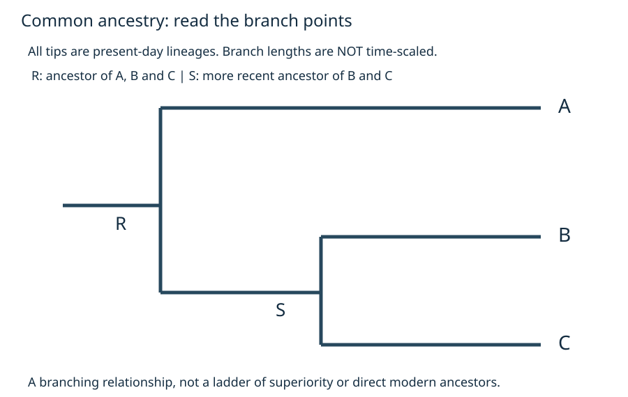
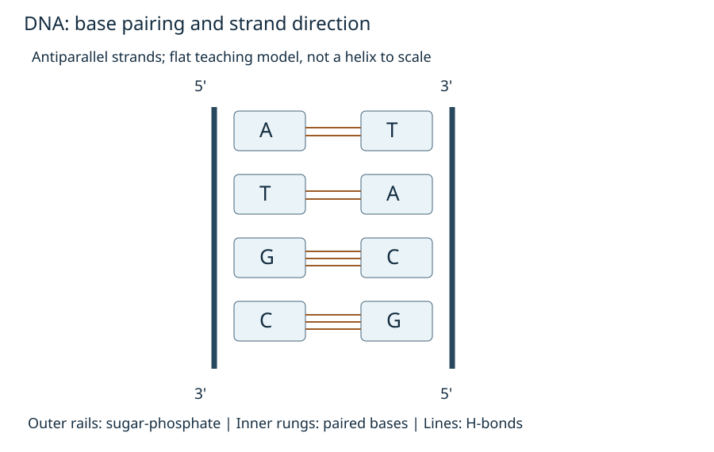
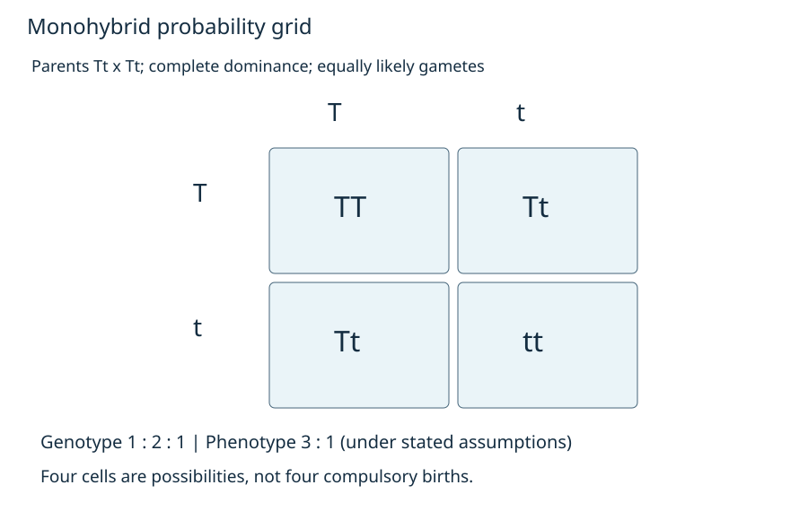
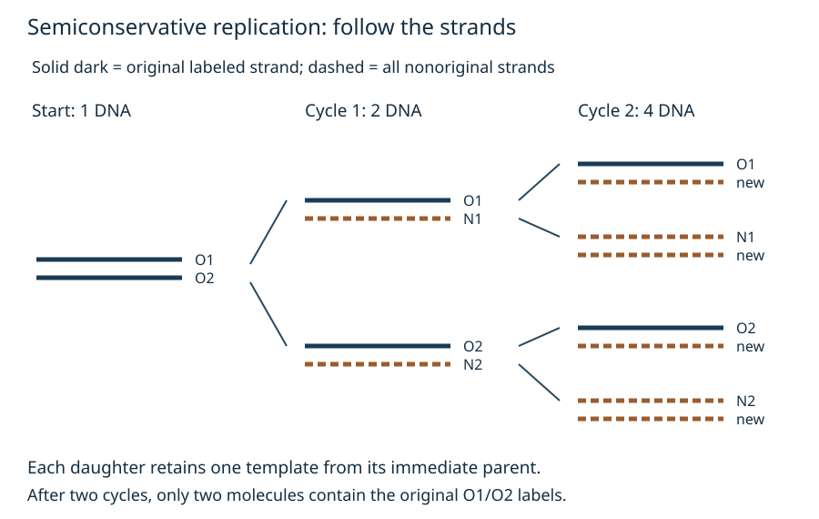

# ১২শ অধ্যায়: জীবের বংশগতি ও জৈব অভিব্যক্তি

> উত্তরসহ পর্যালোচনাধীন খসড়া; নির্ধারিত সংখ্যার উত্তরসহ খসড়া সম্পূর্ণ; বিষয়বস্তু পর্যালোচনা বাকি।
> মূল বই ও বিষয়বিশেষজ্ঞের পূর্ণ যাচাই বাকি। বোর্ড/স্কুল/সাল দাবি নেই।

## rebuild-mcq.json

### MCQ 1

DNA প্রোফাইলিংয়ে সাধারণত কী তুলনা করা হয়?

A. সবসময় সম্পূর্ণ জিনোম
B. শুধু রক্তের রং
C. শুধু ব্যক্তির ছবি
D. নির্বাচিত পরিবর্তনশীল marker

উত্তর: D — নির্বাচিত পরিবর্তনশীল marker
নির্বাচিত DNA অঞ্চলের বৈচিত্র্য পরিচয়-তুলনায় ব্যবহৃত হয়।

### MCQ 2

DNA fingerprint আঙুলের ছাপ থেকে কীভাবে ভিন্ন?

A. এটি ত্বকের রেখার ছবি
B. এটি শুধু বুড়ো আঙুলে থাকে
C. জিনগত marker-ভিত্তিক নকশা
D. এতে DNA লাগে না

উত্তর: C — জিনগত marker-ভিত্তিক নকশা
নামের সাদৃশ্য থাকলেও দুটি ভিন্ন শনাক্তকরণপদ্ধতি।

### MCQ 3

একই ব্যক্তির গালকোষ ও শ্বেতকণিকার nuclear DNA সাধারণত কেমন?

A. মূল প্রোফাইলে প্রায় একই
B. প্রতিবার সব marker উল্টো
C. একটিতে সবসময় RNA মাত্র
D. সম্পূর্ণ ভিন্ন প্রজাতির

উত্তর: A — মূল প্রোফাইলে প্রায় একই
এক ব্যক্তির অধিকাংশ নিউক্লিয়াসযুক্ত দেহকোষ একই জাইগোটীয় জিনোম বহন করে।

### MCQ 4

পরিণত মানব লোহিত কণিকা nuclear DNA পরীক্ষার সরাসরি উৎস নয় কেন?

A. এতে শুধু পরাগ থাকে
B. নিউক্লিয়াস অনুপস্থিত
C. এতে কোনো ঝিল্লি নেই
D. এটি ব্যাকটেরিয়া

উত্তর: B — নিউক্লিয়াস অনুপস্থিত
রক্তের DNA সাধারণত শ্বেতকণিকার মতো নিউক্লিয়াসযুক্ত কোষ থেকে পাওয়া যায়।

### MCQ 5

শুধু চুলের দণ্ডে nuclear DNA কম পাওয়া যেতে পারে কেন?

A. নিউক্লিয়াসযুক্ত মূলকলা নাও থাকতে পারে
B. চুলে সবসময় সম্পূর্ণ তাজা কোষ
C. প্রতিটি চুল আলাদা প্রজাতি
D. চুল কখনো জৈব বস্তু নয়

উত্তর: A — নিউক্লিয়াসযুক্ত মূলকলা নাও থাকতে পারে
নমুনার অংশ ও সংরক্ষণ শনাক্তযোগ্য DNA-র পরিমাণকে প্রভাবিত করে।

### MCQ 6

নমুনা দূষণ DNA তুলনায় কী সমস্যা ঘটাতে পারে?

A. একাধিক ব্যক্তির marker মিশে যাওয়া
B. সব DNA একই হওয়া
C. সবসময় নিশ্চিত নির্ভুলতা
D. সব অ্যালিল মুছে যাওয়া নিশ্চিত

উত্তর: A — একাধিক ব্যক্তির marker মিশে যাওয়া
অন্যের কোষ মিশলে ব্যাখ্যা জটিল হয়, তাই সতর্ক সংগ্রহ দরকার।

### MCQ 7

Chain of custody কেন রাখা হয়?

A. পরীক্ষার সব সম্ভাবনা মুছতে
B. নমুনার উৎস ও হস্তান্তরের ধারাবাহিক নথি
C. নতুন প্রোটিন বানাতে
D. জিনের মিউটেশন ঘটাতে

উত্তর: B — নমুনার উৎস ও হস্তান্তরের ধারাবাহিক নথি
পরিচয় ও হেফাজতের নথি নমুনার অখণ্ডতা মূল্যায়নে সহায়ক।

### MCQ 8

DNA মিল পেলেই ব্যক্তি অপরাধ করেছেন বলা অনুচিত কেন?

A. DNA কখনো বৈজ্ঞানিক নয়
B. কোনো ব্যক্তির DNA নেই
C. মিল মানেই সবসময় দূষণ
D. উপস্থিতির ব্যাখ্যা ও অন্য প্রমাণ দরকার

উত্তর: D — উপস্থিতির ব্যাখ্যা ও অন্য প্রমাণ দরকার
প্রোফাইল মিল উৎসের প্রমাণে সহায়ক, অপরাধের সম্পূর্ণ ঘটনাবিবরণ নয়।

### MCQ 9

এক marker মেলার চেয়ে বহু স্বাধীন marker মেলা কেন শক্তিশালী?

A. সব আত্মীয়ের প্রোফাইল অচেনা
B. পরীক্ষা নিশ্চিত শতভাগ হয়
C. দৈব মিলে যাওয়ার সম্ভাবনা কমাতে সাহায্য করে
D. একই marker বারবারই যথেষ্ট

উত্তর: C — দৈব মিলে যাওয়ার সম্ভাবনা কমাতে সাহায্য করে
সঠিক পরিসংখ্যানসহ বহু marker তুলনা বেশি তথ্য দেয়।

### MCQ 10

একজাইগোটিক যমজ আলাদা করতে প্রচলিত STR প্রোফাইলের সীমা কী?

A. সব marker দ্বিগুণ লম্বা
B. সাধারণত একইরকম প্রোফাইল পাওয়া যায়
C. দুজনের DNA সর্বদা সম্পূর্ণ ভিন্ন
D. কারও DNA নেই

উত্তর: B — সাধারণত একইরকম প্রোফাইল পাওয়া যায়
নিয়মিত marker panel তাদের সাধারণত আলাদা করতে পারে না।

### MCQ 11

PCR-এর মূল উদ্দেশ্য কী?

A. সম্পূর্ণ ক্রোমোজোমের সংখ্যা অর্ধেক
B. নির্বাচিত DNA অংশের বহু কপি
C. নতুন ব্যক্তির জন্ম
D. প্রোটিনকে DNA বানানো

উত্তর: B — নির্বাচিত DNA অংশের বহু কপি
অল্প template-এর নির্দিষ্ট অংশ amplification করা যায়।

### MCQ 12

Gel electrophoresis-এ DNA খণ্ড আলাদা করার সাধারণ ভিত্তি কী?

A. শুধু দাতার বয়স
B. রক্তের গ্রুপমাত্র
C. শুধু বেসের নাম
D. খণ্ডের দৈর্ঘ্য

উত্তর: D — খণ্ডের দৈর্ঘ্য
সাধারণ জেলে ছোট খণ্ড তুলনামূলক দ্রুত দূরে যায়।

### MCQ 13

একই জেলে ছোট DNA খণ্ড সাধারণত কোথায় যায়?

A. অবশ্যই বাতাসে উঠে
B. কূপ থেকে বেশি দূরে
C. সবসময় কূপেই থাকে
D. বড় খণ্ডের চেয়ে কম দূরে

উত্তর: B — কূপ থেকে বেশি দূরে
একই শর্তে ছোট খণ্ড জালের বাধা তুলনামূলক সহজে পেরোয়।

### MCQ 14

DNA সাধারণ জেলে কোন তড়িৎদ্বারের দিকে যায়?

A. কোনো দিকেই নয়
B. ধনাত্মক
C. ঋণাত্মক
D. সবসময় ওপরের দিকে

উত্তর: B — ধনাত্মক
ফসফেটের ঋণাত্মক চার্জে DNA ধনাত্মক দিকে সরে।

### MCQ 15

সব আধুনিক DNA পরীক্ষায় radioactive probe বাধ্যতামূলক কি?

A. হ্যাঁ, শুধু স্কুলে
B. না, পদ্ধতিভেদে শনাক্তকরণ ভিন্ন
C. হ্যাঁ, সব ক্ষেত্রেই
D. না, কারণ marker লাগে না

উত্তর: B — না, পদ্ধতিভেদে শনাক্তকরণ ভিন্ন
পুরোনো RFLP ধাপকে সব আধুনিক PCR/STR পরীক্ষার নিয়ম বলা যায় না।

### MCQ 16

জিনগত রোগ পরীক্ষা ও পরিচয় প্রোফাইলিংয়ের লক্ষ্য কীভাবে ভিন্ন?

A. রোগ পরীক্ষায় কখনো DNA নয়
B. দুটিই শুধু মুখের ছবি
C. পরিচয়ে সব রোগ জানা যায়
D. রোগসংশ্লিষ্ট পরিবর্তন বনাম পরিচয়-marker

উত্তর: D — রোগসংশ্লিষ্ট পরিবর্তন বনাম পরিচয়-marker
পরীক্ষার লক্ষ্য অনুযায়ী অঞ্চল ও ব্যাখ্যা আলাদা।

### MCQ 17

নেতিবাচক genetic test সব বংশগত ঝুঁকি বাদ দেয় না কেন?

A. পরীক্ষার আওতায় সব পরিবর্তন নাও থাকতে পারে
B. DNA কখনো স্থায়ী নয়
C. সব রোগই একই অ্যালিল
D. কোনো পরীক্ষাই তথ্য দেয় না

উত্তর: A — পরীক্ষার আওতায় সব পরিবর্তন নাও থাকতে পারে
একটি সীমিত panel সব জিন বা সব variant দেখে না।

### MCQ 18

জিনগত তথ্য প্রকাশের আগে সবচেয়ে জরুরি নীতি কী?

A. চেহারা দেখে অনুমতি
B. স্কুলে বাধ্যতামূলক পরীক্ষা
C. উপযুক্ত সম্মতি ও গোপনীয়তা
D. সবার সামনে নাম ঘোষণা

উত্তর: C — উপযুক্ত সম্মতি ও গোপনীয়তা
তথ্য ব্যক্তি ও আত্মীয়দের সংবেদনশীল বিষয় প্রকাশ করতে পারে।

### MCQ 19

বিদ্যালয়ে DNA-সম্পর্কিত কার্যক্রমে নিরাপদ বিকল্প কোনটি?

A. কাল্পনিক marker ডেটা বিশ্লেষণ
B. সহপাঠীর গোপন নমুনা সংগ্রহ
C. রক্ত নিয়ে নিজের পরীক্ষা
D. সন্দেহভাজনকে প্রকাশ্যে অভিযুক্ত করা

উত্তর: A — কাল্পনিক marker ডেটা বিশ্লেষণ
প্রস্তুত কাল্পনিক ডেটায় শিক্ষা হয়, গোপনীয়তা ও জৈবঝুঁকি এড়ানো যায়।

### MCQ 20

সাধারণ মানব দেহকোষে অটোজোমের জোড়া কয়টি?

A. 23 জোড়া
B. 22 জোড়া
C. এক জোড়া
D. 44 জোড়া

উত্তর: B — 22 জোড়া
স্বাভাবিক 46-এর মধ্যে 44 টি বা 22 জোড়া অটোজোম।

### MCQ 21

সাধারণ মানব গ্যামেটে অটোজোম কয়টি?

A. 44 টি
B. 46 টি
C. 23 জোড়া
D. 22 টি

উত্তর: D — 22 টি
গ্যামেটে 22 অটোজোম ও একটি sex chromosome থাকে।

### MCQ 22

সাধারণ XX/XY মডেলে ডিম্বাণুর sex chromosome কী?

A. XY
B. XX
C. Y
D. X

উত্তর: D — X
স্বাভাবিক হ্যাপ্লয়েড ডিম্বাণু একটি X পায়।

### MCQ 23

সাধারণ XY মডেলে শুক্রাণুর দুই ধরন কী?

A. XX-বাহী ও YY-বাহী
B. X-বাহী ও Y-বাহী
C. শুধু O-বাহী
D. শুধু XY-বাহী

উত্তর: B — X-বাহী ও Y-বাহী
মিয়োসিসে X ও Y পৃথক গ্যামেটে যায়।

### MCQ 24

X-বাহী ডিম্বাণুর সঙ্গে Y-বাহী শুক্রাণু মিললে কী হয়?

A. YY
B. XX
C. XO নিশ্চিত
D. XY

উত্তর: D — XY
দুটি sex chromosome মিলে সাধারণ XY সমন্বয় হয়।

### MCQ 25

সাধারণ XX/XY মডেলে XX হওয়ার সম্ভাবনা কত ধরা হয়?

A. শূন্য
B. প্রায় 1/4
C. প্রায় 3/4
D. প্রায় 1/2

উত্তর: D — প্রায় 1/2
সমান সম্ভাব্য X/Y শুক্রাণু ধরলে XX ও XY প্রায় সমান।

### MCQ 26

আগে তিন কন্যাসন্তান হলে পরেরবার পুত্র নিশ্চিত নয় কেন?

A. প্রতিটি নিষেকের সম্ভাবনা নতুন
B. X-গুলো শেষ হয়ে যায়
C. মা পরেরবার Y দেন
D. আগের সন্তান পরের গ্যামেট ঠিক করে

উত্তর: A — প্রতিটি নিষেকের সম্ভাবনা নতুন
স্বাধীনতার সরল মডেলে আগের ফল পরের ফল বাধ্য করে না।

### MCQ 27

সন্তানের chromosomal sex নিয়ে কাউকে দোষারোপ কেন অযৌক্তিক?

A. পিতা ইচ্ছায় সবসময় Y বাছেন
B. গ্যামেটের মিলন ইচ্ছাধীন নয়
C. সব ক্রোমোজোম খাবারে বদলায়
D. মা ইচ্ছায় X বদলান

উত্তর: B — গ্যামেটের মিলন ইচ্ছাধীন নয়
জৈবিক ভূমিকা ব্যাখ্যা দোষ বা নিয়ন্ত্রণের প্রমাণ নয়।

### MCQ 28

অটোজোম শুধু sex development-এর সঙ্গে একেবারে সম্পর্কহীন বলা ভুল কেন?

A. বিকাশে বহু অটোসোমীয় জিনও কাজ করে
B. অটোজোমে কোনো জিন নেই
C. X একটি অটোজোম
D. সব অটোজোম Y

উত্তর: A — বিকাশে বহু অটোসোমীয় জিনও কাজ করে
Sex development বহু জিন ও সংকেতের সমন্বয়, সরল ছক সীমিত।

### MCQ 29

XX/XY ছক মানুষের সব যৌন বিকাশের বৈচিত্র্য পুরো বোঝায় কি?

A. হ্যাঁ, ব্যক্তির সব পরিচয়ও নির্ধারিত
B. হ্যাঁ, কোনো ব্যতিক্রম নেই
C. না, জৈবিক বৈচিত্র্য ও বিকাশের অন্য বিষয় আছে
D. না, কারণ গ্যামেটে DNA নেই

উত্তর: C — না, জৈবিক বৈচিত্র্য ও বিকাশের অন্য বিষয় আছে
এটি সাধারণ chromosomal model, ব্যক্তির সব বৈশিষ্ট্য বা পরিচয়ের সম্পূর্ণ ব্যাখ্যা নয়।

### MCQ 30

X-linked প্রচ্ছন্ন variant সাধারণ XY ব্যক্তিতে সহজে প্রকাশ পেতে পারে কেন?

A. একটি X-এ ঐ লোকাসের এক কপি থাকে
B. দুটি অভিন্ন X থাকে
C. কোনো অটোজোম নেই
D. Y-তে সব X জিনের অনুলিপি

উত্তর: A — একটি X-এ ঐ লোকাসের এক কপি থাকে
অনেক X লোকাসে Y-তে সমকাজের অ্যালিল নেই।

### MCQ 31

সাধারণ X-linked বংশগতিতে পিতা পুত্রকে সরাসরি কোন sex chromosome দেন?

A. X
B. XX
C. দুটি X
D. Y

উত্তর: D — Y
পুত্রের X মাতৃউৎসীয়, পিতা Y দেন—সাধারণ মডেলে।

### MCQ 32

X-linked রক্তজমাট সমস্যায় heterozygous নারীর কী হতে পারে?

A. বাহক হওয়ার পাশাপাশি উপসর্গও হতে পারে
B. অবশ্যই ছোঁয়াচে রোগ
C. অবশ্যই সম্পূর্ণ অন্ধ
D. কখনো কোনো উপসর্গ অসম্ভব

উত্তর: A — বাহক হওয়ার পাশাপাশি উপসর্গও হতে পারে
নারীর উপসর্গ অসম্ভব বলা ভুল; প্রকাশের মাত্রা ভিন্ন হতে পারে।

### MCQ 33

বর্ণদৃষ্টির ঘাটতি মানেই সব রং না-দেখা নয় কেন?

A. সবসময় শুধু ব্যাকটেরিয়া
B. সব ক্ষেত্রেই সম্পূর্ণ অন্ধত্ব
C. নির্দিষ্ট রং পৃথকীকরণে সমস্যা বেশি প্রচলিত
D. সবসময় লেন্স অনুপস্থিত

উত্তর: C — নির্দিষ্ট রং পৃথকীকরণে সমস্যা বেশি প্রচলিত
লাল-সবুজ পৃথকীকরণ সমস্যাসহ বিভিন্ন ধরন আছে।

### MCQ 34

সব বর্ণদৃষ্টি সমস্যাই X-linked বলা অনুচিত কেন?

A. অর্জিত ও অন্য বংশগত কারণও আছে
B. সবসময় Y-তে হয়
C. সব বর্ণদৃষ্টি এক জিনের
D. কোনোটিই বংশগত নয়

উত্তর: A — অর্জিত ও অন্য বংশগত কারণও আছে
চোখ/স্নায়ু ক্ষতি বা রোগ-ওষুধও বর্ণদৃষ্টি প্রভাবিত করতে পারে।

### MCQ 35

বর্ণদৃষ্টি নিয়ে উদ্বেগে উপযুক্ত পদক্ষেপ কোনটি?

A. চক্ষু বিশেষজ্ঞের মূল্যায়ন
B. সহপাঠীর উপহাস
C. নিজে ওষুধ বন্ধ
D. তীব্র আলো দিয়ে পরীক্ষা

উত্তর: A — চক্ষু বিশেষজ্ঞের মূল্যায়ন
সঠিক পরীক্ষা ও কারণভিত্তিক পরামর্শ দরকার।

### MCQ 36

রঙিন মানচিত্রে বর্ণদৃষ্টি-বান্ধব পরিবর্তন কোনটি?

A. শুধু লাল-সবুজ পার্থক্য
B. অংশগ্রহণ নিষেধ
C. রঙের সঙ্গে প্রতীক ও লেখা
D. সব label মুছে দেওয়া

উত্তর: C — রঙের সঙ্গে প্রতীক ও লেখা
দ্বৈত সংকেত তথ্যকে শুধু রং-নির্ভর রাখে না।

### MCQ 37

থ্যালাসেমিয়ায় মূল প্রোটিনগত সমস্যা কী?

A. অ্যান্টিবডি সম্পূর্ণ অনুপস্থিত
B. গ্লোবিন শৃঙ্খল উৎপাদনে ঘাটতি
C. প্লেটলেট দ্বিগুণ
D. সবসময় শুধু খাদ্যের লোহা কম

উত্তর: B — গ্লোবিন শৃঙ্খল উৎপাদনে ঘাটতি
হিমোগ্লোবিনের globin উৎপাদন ব্যাহত হয়ে অ্যানিমিয়া হতে পারে।

### MCQ 38

আলফা ও বিটা থ্যালাসেমিয়ার নামের ভিত্তি কী?

A. কোন globin শৃঙ্খল কম তৈরি হয়
B. চোখের রঞ্জক
C. দুই সংক্রমণকারী ভাইরাস
D. রক্তের দুই রং

উত্তর: A — কোন globin শৃঙ্খল কম তৈরি হয়
অপর্যাপ্ত alpha বা beta chain অনুসারে নাম।

### MCQ 39

থ্যালাসেমিয়া ছোঁয়াচে নয় কেন?

A. এটি কেবল বাতাসে ছড়ায়
B. এটি জিনগত রক্তের সমস্যা
C. স্পর্শেই জিন বদলায়
D. খাবার ভাগে globin হারায়

উত্তর: B — এটি জিনগত রক্তের সমস্যা
একসঙ্গে থাকা বা খাবার ভাগে থ্যালাসেমিয়া সংক্রমিত হয় না।

### MCQ 40

থ্যালাসেমিয়া trait-যুক্ত ব্যক্তি সম্পর্কে সতর্ক বক্তব্য কোনটি?

A. কখনো জিন সঞ্চার হয় না
B. উপসর্গহীন বা মৃদু অ্যানিমিয়া থাকতে পারে
C. সবসময় গুরুতর অসুস্থ
D. সবাই অল্প বয়সে মারা যান

উত্তর: B — উপসর্গহীন বা মৃদু অ্যানিমিয়া থাকতে পারে
বাহকের প্রকাশ মৃদু হতে পারে, তবুও variant অপত্যে যেতে পারে।

### MCQ 41

সরল beta-thal মডেলে দুই বাহক Aa×Aa হলে aa সম্ভাবনা কত?

A. 25% প্রতি গর্ভধারণে
B. 25% শুধু প্রথমবার
C. চার সন্তানের ঠিক একজন নিশ্চিত
D. 100%

উত্তর: A — 25% প্রতি গর্ভধারণে
প্রত্যেক নিষেকে 1/4 সম্ভাবনা; নির্দিষ্ট পরিবারের সংখ্যা নিশ্চিত নয়।

### MCQ 42

Aa×Aa-তে সরল recessive মডেলে বাহক হওয়ার সম্ভাবনা কত?

A. 75%
B. 25%
C. 100%
D. 50%

উত্তর: D — 50%
Aa দুই সমসম্ভাব্য ঘরে, মোট চার ঘরের দুইটি।

### MCQ 43

Aa×AA-তে সাধারণ recessive রোগ aa হওয়ার সম্ভাবনা কত?

A. 50%
B. 100%
C. শূন্য, মডেলের শর্তে
D. 25%

উত্তর: C — শূন্য, মডেলের শর্তে
AA জনক a না-দেওয়ায় aa হয় না; অর্ধেক অপত্য বাহক হতে পারে।

### MCQ 44

আলফা থ্যালাসেমিয়াকে সবসময় একজোড়া Aa ছকে ফেলা কেন সীমিত?

A. এটি সবসময় সংক্রমণ
B. সাধারণত চার alpha-globin gene copy জড়িত
C. এতে কোনো জিন নেই
D. এটি শুধু Y-linked

উত্তর: B — সাধারণত চার alpha-globin gene copy জড়িত
আলফার কপি ও বিন্যাস beta-র সরল দুই কপির মডেল থেকে ভিন্ন।

### MCQ 45

সব অ্যানিমিয়ায় নিজে iron tablet খাওয়া অনিরাপদ কেন?

A. লোহা কোনো কাজে লাগে না
B. কিছু অবস্থায় iron overload থাকতে পারে
C. সব রক্তশূন্যতা একই কারণ
D. ওষুধ সবসময় নিষিদ্ধ

উত্তর: B — কিছু অবস্থায় iron overload থাকতে পারে
কারণ ও iron status যাচাই করে চিকিৎসক প্রয়োজন ঠিক করেন।

### MCQ 46

নিয়মিত রক্তসঞ্চালনে থ্যালাসেমিয়ায় কোন জটিলতা পর্যবেক্ষণ জরুরি?

A. সব গ্যামেট দ্বিগুণ
B. সবসময় DNA বিলুপ্তি
C. লোহার অতিসঞ্চয়
D. পরাগায়ন

উত্তর: C — লোহার অতিসঞ্চয়
পুনঃপুন রক্তে iron জমতে পারে; পর্যবেক্ষণ ও প্রয়োজনে chelation লাগে।

### MCQ 47

Chelation চিকিৎসার উদ্দেশ্য কী?

A. অতিরিক্ত লোহা অপসারণে সহায়তা
B. শুধু রক্তের রং বাড়ানো
C. নতুন অ্যালিল তৈরি
D. সব globin gene মুছে দেওয়া

উত্তর: A — অতিরিক্ত লোহা অপসারণে সহায়তা
এটি চিকিৎসক-নির্ধারিত iron overload ব্যবস্থাপনা, নিজে ডোজ নয়।

### MCQ 48

থ্যালাসেমিয়ায় সবার আয়ু নির্দিষ্ট কম—এ দাবির সীমা কী?

A. সব রোগী একই রকম
B. চিকিৎসা কখনো কাজে আসে না
C. trait মানেই মৃত্যু
D. তীব্রতা ও আধুনিক পরিচর্যায় ফল ভিন্ন

উত্তর: D — তীব্রতা ও আধুনিক পরিচর্যায় ফল ভিন্ন
ব্যক্তিগত ভবিষ্যৎ এক বয়স দিয়ে বলা অযৌক্তিক; সেবায় জীবনমান উন্নত হয়।

### MCQ 49

জেনেটিক কাউন্সেলিংয়ের উদ্দেশ্য কী হওয়া উচিত?

A. সব আত্মীয়কে প্রকাশ্যে চিহ্নিত
B. তথ্যভিত্তিক স্বেচ্ছা সিদ্ধান্তে সহায়তা
C. বাহককে সামাজিকভাবে নিষিদ্ধ করা
D. নির্দেশ দিয়ে সন্তানধারণ বন্ধ

উত্তর: B — তথ্যভিত্তিক স্বেচ্ছা সিদ্ধান্তে সহায়তা
ঝুঁকি, বিকল্প ও গোপনীয়তা বুঝিয়ে স্বাধীন সিদ্ধান্ত সমর্থন করা হয়।

### MCQ 50

ঘনিষ্ঠ আত্মীয়দের recessive variant ভাগের সম্ভাবনা বেশি হতে পারে কেন?

A. সব আত্মীয় বাহক
B. সাধারণ পূর্বপুরুষ থেকে একই variant আসতে পারে
C. আত্মীয় মানেই রোগী
D. বিয়েই নতুন সব mutation তৈরি করে

উত্তর: B — সাধারণ পূর্বপুরুষ থেকে একই variant আসতে পারে
সম্ভাব্য ভাগ বেড়ে যেতে পারে, কিন্তু রোগ নিশ্চিত নয়; পরীক্ষা/পরামর্শ জরুরি।

### MCQ 51

পরিবারে ইতিহাস না-থাকলেও genetic disorder হতে পারে কেন?

A. অপ্রকাশিত বাহকত্ব বা নতুন mutation
B. কেবল রক্তের গ্রুপে নির্ধারিত
C. বংশগত রোগে জিন লাগে না
D. সব রোগ সংক্রমণ

উত্তর: A — অপ্রকাশিত বাহকত্ব বা নতুন mutation
ইতিহাসের অনুপস্থিতি সব জিনগত কারণ বাদ দেয় না।

### MCQ 52

প্রচলিত hemophilia A-তে কোন উপাদানের ঘাটতি থাকে?

A. Clotting factor VIII
B. আলফা-অ্যামাইলেজ
C. ইনসুলিন
D. থাইরক্সিন

উত্তর: A — Clotting factor VIII
Hemophilia A-তে factor VIII-এর মাত্রা বা কাজ কমে।

### MCQ 53

Hemophilia B-তে পরিচিত ঘাটতি কোনটি?

A. হিমোগ্লোবিনের সব chain
B. Clotting factor IX
C. ক্লোরোফিল
D. অক্সিটোসিন

উত্তর: B — Clotting factor IX
A ও B রক্তজমাট factor-এর ভিন্ন সমস্যার উদাহরণ।

### MCQ 54

হিমোফিলিয়া ও থ্যালাসেমিয়ার প্রধান কাজগত পার্থক্য কী?

A. রক্তজমাট বনাম হিমোগ্লোবিন সমস্যা
B. দুটিই কেবল Y-linked
C. দুটিই চোখের রঞ্জক
D. দুটিই ব্যাকটেরিয়া

উত্তর: A — রক্তজমাট বনাম হিমোগ্লোবিন সমস্যা
রক্তসম্পর্কিত হলেও ক্ষতিগ্রস্ত প্রোটিন ও ফল ভিন্ন।

### MCQ 55

জেনেটিক ব্যাধিযুক্ত শিক্ষার্থীর জন্য যথাযথ স্কুলনীতি কী?

A. সব কার্যক্রমে স্থায়ী নিষেধ
B. নামসহ তালিকা টাঙানো
C. গোপনীয়তা ও প্রয়োজনীয় সহায়তা
D. বন্ধুদের দূরে রাখা

উত্তর: C — গোপনীয়তা ও প্রয়োজনীয় সহায়তা
ব্যক্তির প্রয়োজন অনুযায়ী সহায়তা ও সম্মান, বৈষম্য নয়।

### MCQ 56

জনসংখ্যাগত বিবর্তনের আধুনিক সূচক কোনটি?

A. এক ব্যক্তির ব্যায়ামে পেশি বাড়া
B. প্রজন্মে allele frequency বদল
C. প্রতিদিন ক্ষুধা লাগা
D. একটি ক্ষত শুকানো

উত্তর: B — প্রজন্মে allele frequency বদল
জিনগত বণ্টনের প্রজন্মান্তর পরিবর্তন বিবর্তনের মাপকাঠি।

### MCQ 57

জনসংখ্যার gene pool কী?

A. শুধু একটি কোষের পানি
B. সমস্ত অ্যালিলের সমষ্টি
C. একটি DNA বেস
D. শুধু মৃত জীবাশ্ম

উত্তর: B — সমস্ত অ্যালিলের সমষ্টি
এক জনসংখ্যার উত্তরাধিকারযোগ্য অ্যালিলসমষ্টি gene pool।

### MCQ 58

কেবল A অ্যালিলের সংখ্যা বাড়লেই frequency বাড়ে না কেন?

A. অ্যালিল গোনা যায় না
B. frequency-র কোনো ভিত্তি নেই
C. মোট allele copy সংখ্যাও বদলাতে পারে
D. সব সংখ্যা একই

উত্তর: C — মোট allele copy সংখ্যাও বদলাতে পারে
Frequency হলো মোট কপির তুলনায় অনুপাত, শুধু count নয়।

### MCQ 59

100 ডিপ্লয়েড ব্যক্তির এক অটোসোমীয় লোকাসে মোট কপি কত?

A. 100 টি
B. 200 টি
C. 400 টি
D. 50 টি

উত্তর: B — 200 টি
প্রতি ব্যক্তিতে দুই কপি, তাই 100×2=200।

### MCQ 60

200 মোট কপির মধ্যে A=80 হলে A frequency কত?

A. 1.6
B. 0.8
C. 0.4
D. 0.2

উত্তর: C — 0.4
80/200=0.4 বা 40%।

### MCQ 61

প্রাকৃতিক নির্বাচনের জন্য কোন বৈচিত্র্য বিশেষ গুরুত্বপূর্ণ?

A. শুধু সাময়িক কালি লাগা
B. সম্পূর্ণ অনুত্তরাধিকারযোগ্য সব অভিজ্ঞতা
C. শুধু কাটা দাগ
D. বংশগত ও প্রজননসাফল্যে প্রভাবযুক্ত

উত্তর: D — বংশগত ও প্রজননসাফল্যে প্রভাবযুক্ত
বংশগত ভিন্নতায় ভিন্ন প্রজননসাফল্য হলে অ্যালিল বণ্টন বদলাতে পারে।

### MCQ 62

বিবর্তনীয় fitness প্রধানত কী বোঝায়?

A. শুধু দৈহিক শক্তি
B. সবার নৈতিক মান
C. আপেক্ষিক সফল প্রজনন-অবদান
D. শুধু দীর্ঘ আয়ু

উত্তর: C — আপেক্ষিক সফল প্রজনন-অবদান
অপত্যে জিন সঞ্চারের আপেক্ষিক সাফল্য fitness-এর কেন্দ্র।

### MCQ 63

বেশি দিন বাঁচলেও অপত্য না-দিলে fitness বিষয়ে কী সীমা আছে?

A. বাঁচা একাই প্রজনন-অবদান মাপে না
B. প্রজনন কখনো গুরুত্বপূর্ণ নয়
C. সবসময় সর্বোচ্চ fitness
D. দীর্ঘ আয়ুই একমাত্র মাপকাঠি

উত্তর: A — বাঁচা একাই প্রজনন-অবদান মাপে না
এখানে নির্দিষ্ট বৈজ্ঞানিক মাপকাঠি, মানুষের মূল্য বিচার নয়।

### MCQ 64

অতিরিক্ত অপত্য ও সীমিত সম্পদ কোন ধারণায় প্রাসঙ্গিক?

A. সব অপত্য নিশ্চিত টিকে
B. বেঁচে থাকা ও প্রজননে পার্থক্য
C. মিয়োসিস বন্ধ
D. সবাই অভিন্ন হয়

উত্তর: B — বেঁচে থাকা ও প্রজননে পার্থক্য
সীমিত সম্পদে সব সম্ভাব্য অপত্য পূর্ণ সাফল্য পায় না।

### MCQ 65

প্রকৃতি সচেতনভাবে জীব বেছে নেয়—এই ভাষা কেন রূপক?

A. নির্বাচনে জিন লাগে না
B. বাছাই ইচ্ছাকৃত সিদ্ধান্ত নয়
C. পরিবেশে কোনো প্রভাব নেই
D. সব প্রাণী একই সিদ্ধান্ত নেয়

উত্তর: B — বাছাই ইচ্ছাকৃত সিদ্ধান্ত নয়
পরিবেশে বৈশিষ্ট্যভেদে প্রজননসাফল্য আলাদা হয়, সচেতন নির্বাচন নয়।

### MCQ 66

খরায় বড় বীজ খাওয়ার উপযোগী ঠোঁটের পাখির অপত্য বাড়লে কী ঘটতে পারে?

A. সংশ্লিষ্ট বংশগত বৈশিষ্ট্যের হার বাড়তে পারে
B. খাদ্য নতুন DNA লিখে দেয়
C. প্রত্যেক পাখির ঠোঁট ইচ্ছায় বদলায়
D. সব প্রজাতি সঙ্গে সঙ্গে বিলুপ্ত

উত্তর: A — সংশ্লিষ্ট বংশগত বৈশিষ্ট্যের হার বাড়তে পারে
উত্তরাধিকার ও ভিন্ন প্রজননসাফল্যে জনসংখ্যার বণ্টন বদলায়।

### MCQ 67

এক পরিবেশে উপকারী অ্যালিল অন্য পরিবেশে অনুপকারী হতে পারে কেন?

A. জিন কখনো কাজ করে না
B. সব অ্যালিল সবসময় ক্ষতিকর
C. সব পরিবেশ অভিন্ন
D. সুবিধা পরিবেশনির্ভর

উত্তর: D — সুবিধা পরিবেশনির্ভর
নির্বাচনের দিক পরিবেশ বদলে পরিবর্তিত হতে পারে।

### MCQ 68

অ্যান্টিবায়োটিকে টিকে থাকা ব্যাকটেরিয়া বাড়ার উপযুক্ত ব্যাখ্যা কোনটি?

A. মানুষের কোষই ব্যাকটেরিয়া হয়
B. ওষুধ সব কোষকে প্রয়োজনমতো শেখায়
C. সব অ্যালিল মুছে যায়
D. প্রতিরোধী variant নির্বাচিত হয়ে বৃদ্ধি পায়

উত্তর: D — প্রতিরোধী variant নির্বাচিত হয়ে বৃদ্ধি পায়
ওষুধের চাপে প্রতিরোধী lineage তুলনামূলক বেশি বংশবৃদ্ধি করতে পারে।

### MCQ 69

জীবাণুর antibiotic resistance মানে কী নয়?

A. রোগীর দেহই ওষুধপ্রতিরোধী হয়ে গেছে
B. জীবাণুর প্রতিরোধী বৈশিষ্ট্য
C. নির্বাচনের ফল হতে পারে
D. চিকিৎসায় সমস্যা হতে পারে

উত্তর: A — রোগীর দেহই ওষুধপ্রতিরোধী হয়ে গেছে
Resistance মূলত জীবাণুর বৈশিষ্ট্য, রোগীর ব্যক্তিত্ব বা দেহের সিদ্ধান্ত নয়।

### MCQ 70

মিউটেশন প্রয়োজনের দিক লক্ষ্য করে হয়—ধারণাটি ভুল কেন?

A. নির্দিষ্ট অভিযোজনের প্রয়োজন জেনে পরিবর্তন হয় না
B. মিউটেশন কখনো হয় না
C. সব mutation সমান দ্রুত
D. নির্বাচন কোনো ভূমিকা রাখে না

উত্তর: A — নির্দিষ্ট অভিযোজনের প্রয়োজন জেনে পরিবর্তন হয় না
পরিবর্তনের উৎপত্তি ও পরে তার নির্বাচিত হওয়া আলাদা।

### MCQ 71

প্রাকৃতিক নির্বাচন কি একমাত্র বিবর্তনীয় প্রক্রিয়া?

A. না, drift ও gene flow-ও আছে
B. না, শুধু ব্যায়াম আছে
C. হ্যাঁ, সব পরিবর্তন নির্বাচিত
D. হ্যাঁ, mutation নেই

উত্তর: A — না, drift ও gene flow-ও আছে
অ্যালিলের হার ভিন্ন প্রক্রিয়ায় বদলাতে পারে।

### MCQ 72

ছোট জনসংখ্যায় দৈবক্রমে অ্যালিল হারানো কী নির্দেশ করতে পারে?

A. শুধু transcription
B. শুধু অনুলিপন
C. জেনেটিক drift
D. লক্ষ্যনির্ভর mutation

উত্তর: C — জেনেটিক drift
দৈব sampling-এ অ্যালিলের হার বদল drift।

### MCQ 73

অন্য জনসংখ্যা থেকে প্রজননক্ষম জীব এলে অ্যালিল আদানপ্রদানকে কী বলে?

A. শুধু অনুবাদ
B. অর্ধরক্ষণশীলতা
C. শুধু ক্লিভেজ
D. Gene flow

উত্তর: D — Gene flow
স্থানান্তরিত জীবের সফল প্রজননে জনসংখ্যার মধ্যে অ্যালিল যায়।

### MCQ 74

নতুন অ্যালিলের চূড়ান্ত উৎস কোনটি?

A. শুধু রং বদল
B. মিউটেশন
C. শুধু পুরোনো গ্যামেটের মিলন
D. শুধু খাদ্য সংগ্রহ

উত্তর: B — মিউটেশন
পুনর্বিন্যাস পুরোনো অ্যালিলের সমন্বয় বদলায়; mutation নতুন variant আনতে পারে।

### MCQ 75

অভিযোজন ও এক জীবের সাময়িক acclimatization ভিন্ন কেন?

A. দুটিতেই সবসময় mutation
B. বংশগত জনসংখ্যাগত পরিবর্তন বনাম ব্যক্তির সাড়া
C. দুটিই শুধু নতুন প্রজাতি
D. কোনোটিতে পরিবেশ নেই

উত্তর: B — বংশগত জনসংখ্যাগত পরিবর্তন বনাম ব্যক্তির সাড়া
তাপের সঙ্গে ব্যক্তির সাময়িক সাড়া বিবর্তনীয় অভিযোজনের সমার্থক নয়।

### MCQ 76

বিবর্তন মানেই সবসময় জটিলতা বৃদ্ধি নয় কেন?

A. কেবল মানুষ বিবর্তিত
B. সরল জীব বিলুপ্ত সব
C. কিছু ধারায় গঠন সরল বা হ্রাসও পায়
D. সব পরিবর্তন থেমে গেছে

উত্তর: C — কিছু ধারায় গঠন সরল বা হ্রাসও পায়
বিবর্তনে শাখাভেদে ভিন্ন অভিযোজন হয়, একমুখী উন্নতির সিঁড়ি নয়।

### MCQ 77

গুহামাছের দৃষ্টি হ্রাসকে ইচ্ছাকৃত ত্যাগ বলা ভুল কেন?

A. জিনগত ভিন্নতা নেই
B. প্রতিটি মাছ চোখ খুলে ফেলে
C. অন্ধকারে সব প্রাণী তৎক্ষণাৎ অন্ধ
D. বংশগত পরিবর্তন ও নির্বাচনী/দৈব প্রক্রিয়া লাগে

উত্তর: D — বংশগত পরিবর্তন ও নির্বাচনী/দৈব প্রক্রিয়া লাগে
অনেক প্রজন্মের প্রক্রিয়া এক জীবের ইচ্ছা নয়।

### MCQ 78

জীবাশ্ম কী ধরনের প্রমাণ দিতে পারে?

A. সকল নরম অংশ অক্ষত
B. অতীত জীব ও সময়ক্রমিক পরিবর্তনের
C. সব পূর্বপুরুষের সম্পূর্ণ তালিকা
D. প্রতিটি জীবের সব DNA নিশ্চিত

উত্তর: B — অতীত জীব ও সময়ক্রমিক পরিবর্তনের
সংরক্ষিত অবশেষ বা ছাপ অতীত জীবের তথ্য দেয়, রেকর্ড অসম্পূর্ণ।

### MCQ 79

জীবাশ্মের রেকর্ড অসম্পূর্ণ হওয়ার যুক্তি কী?

A. অতীতে জীব ছিল না
B. কোনো প্রমাণ নেই
C. সব শিলা একই বয়স
D. সব জীব সমানভাবে সংরক্ষিত হয় না

উত্তর: D — সব জীব সমানভাবে সংরক্ষিত হয় না
সংরক্ষণ, ক্ষয় ও আবিষ্কারের সীমায় কিছু তথ্য অনুপস্থিত থাকে।

### MCQ 80

হাত, তিমির flipper ও বাদুড়ের forelimb-এর মৌলিক অস্থিবিন্যাস কী নির্দেশ করে?

A. সমসংস্থ উৎপত্তির প্রমাণ
B. সব অঙ্গ পতঙ্গজাত
C. সব কাজ অভিন্ন
D. কোনো পূর্বপুরুষ নেই

উত্তর: A — সমসংস্থ উৎপত্তির প্রমাণ
মৌলিক বিন্যাসের মিল সাধারণ পূর্বপুরুষের সঙ্গে সামঞ্জস্যপূর্ণ।

### MCQ 81

পতঙ্গ ও পাখির উড়ার ডানার কাজের মিল একাই কী প্রমাণ করে না?

A. উভয়ে উড়তে পারে
B. কাজগত সামঞ্জস্য
C. সমপরিবেশে অনুরূপ সুবিধা
D. একই মূল অঙ্গ থেকে ঘনিষ্ঠ উৎপত্তি

উত্তর: D — একই মূল অঙ্গ থেকে ঘনিষ্ঠ উৎপত্তি
অনুরূপ কাজ স্বাধীনভাবে উদ্ভূত হতে পারে, analogy/homoplasy বিবেচ্য।

### MCQ 82

DNA ক্রমের তুলনা বিবর্তনীয় সম্পর্ক জানতে সহায়ক কেন?

A. সব জীবের ক্রম সম্পূর্ণ এক
B. DNA বয়সের ঘড়ি সর্বদা নির্ভুল
C. বংশধারায় সঞ্চিত মিল-অমিল তথ্য দেয়
D. শুধু বাহ্যিক রং দেখায়

উত্তর: C — বংশধারায় সঞ্চিত মিল-অমিল তথ্য দেয়
উপযুক্ত বহু sequence ও বিশ্লেষণ সাধারণ পূর্বপুরুষের অনুমান সমর্থন করে।

### MCQ 83

একটি বিবর্তনবৃক্ষের শাখা-সংযোগ কী বোঝায়?

A. প্রতিটি শাখায় সমান সময় নিশ্চিত
B. সাধারণ পূর্বপুরুষের অনুমিত বিভাজন
C. নৈতিক উচ্চতা
D. সরাসরি আধুনিক প্রজাতি অন্যটি জন্ম দিয়েছে

উত্তর: B — সাধারণ পূর্বপুরুষের অনুমিত বিভাজন
Node পূর্বপুরুষের সংযোগ, অগ্রগতির মান নয়।

### MCQ 84

বর্তমান মানুষ বর্তমান শিম্পাঞ্জি থেকে এসেছে—সংশোধন কী?

A. দুই প্রজাতির সম্পর্ক নেই
B. সব আধুনিক জীব একই ব্যক্তি
C. দুই বংশধারার সাধারণ পূর্বপুরুষ ছিল
D. শিম্পাঞ্জি মানুষকে জন্ম দেয়

উত্তর: C — দুই বংশধারার সাধারণ পূর্বপুরুষ ছিল
আধুনিক cousin lineage-কে সরাসরি জনক বলা ভুল।

### MCQ 85

ভৌগোলিক বিচ্ছিন্নতা নতুন প্রজাতির সুযোগ বাড়াতে পারে কেন?

A. সবসময় মিয়োসিস বন্ধ
B. ভিন্ন প্রজাতি নিশ্চিত পরদিন
C. Gene flow কমিয়ে ভিন্ন বিবর্তনের সুযোগ দেয়
D. সঙ্গে সঙ্গে সব জিন বদলায়

উত্তর: C — Gene flow কমিয়ে ভিন্ন বিবর্তনের সুযোগ দেয়
বিচ্ছিন্নতার পরে পরিবর্তন ও প্রজননবাধা গড়লে speciation হতে পারে।

### MCQ 86

প্রজনন বিচ্ছিন্নতার গুরুত্ব কী?

A. বংশধারার স্বাধীনতা বজায় রাখতে পারে
B. সব mutation বন্ধ করে
C. সবসময় আবাস একই করে
D. সব জীবকে এক করে

উত্তর: A — বংশধারার স্বাধীনতা বজায় রাখতে পারে
জিন আদানপ্রদানের বাধা পৃথক ধারার বিকাশে সহায়ক।

### MCQ 87

সব সংকরই নতুন প্রজাতি হয় না কেন?

A. সব সংকর একই জাইগোট
B. সংকর সবসময় অমর
C. সংকরে DNA থাকে না
D. স্থিতিশীল প্রজননক্ষম ও পৃথক বংশধারা নাও গড়তে পারে

উত্তর: D — স্থিতিশীল প্রজননক্ষম ও পৃথক বংশধারা নাও গড়তে পারে
সংকর সৃষ্টি ও স্বতন্ত্র প্রজাতির প্রতিষ্ঠা পৃথক ধাপ।

### MCQ 88

উদ্ভিদে polyploidy বলতে কী বোঝায়?

A. একটি বেসের বদলমাত্র
B. সব ক্রোমোজোম হারানো
C. সম্পূর্ণ ক্রোমোজোম সেটের বৃদ্ধি
D. শুধু একটি জিনের ক্ষয়

উত্তর: C — সম্পূর্ণ ক্রোমোজোম সেটের বৃদ্ধি
বহু সেট তৈরি কিছু উদ্ভিদে প্রজনন বিচ্ছিন্নতায় ভূমিকা রাখতে পারে।

### MCQ 89

জীবনের উৎপত্তি ও পরবর্তী জৈব বিবর্তন এক প্রশ্ন নয় কেন?

A. দুটিই নিশ্চিত একই ঘটনা
B. বিবর্তনে বংশগতি নেই
C. দুটিই শুধু ভ্রূণবিকাশ
D. প্রথম জীবন আসা ও জীবিত জনসংখ্যার পরিবর্তন আলাদা

উত্তর: D — প্রথম জীবন আসা ও জীবিত জনসংখ্যার পরিবর্তন আলাদা
রাসায়নিক উৎপত্তির গবেষণা ও প্রতিষ্ঠিত জনসংখ্যাগত বিবর্তনের ক্ষেত্র আলাদা।

### MCQ 90

প্রাচীন পরিবেশ অনুকরণে amino acid তৈরি মানেই কী নয়?

A. রাসায়নিক প্রক্রিয়া গবেষণাযোগ্য
B. অজৈব থেকে জৈব অণু সম্ভব
C. সম্পূর্ণ জীব তৈরি হয়েছে
D. মডেল পরীক্ষা সম্ভব

উত্তর: C — সম্পূর্ণ জীব তৈরি হয়েছে
জৈব অণু সৃষ্টি ও জীবনের সম্পূর্ণ উদ্ভব এক নয়।

### MCQ 91

জীবনের উৎপত্তিস্থান নিয়ে দায়িত্বশীল বক্তব্য কোনটি?

A. একটি স্থানের সব ধাপ চূড়ান্ত প্রমাণিত
B. একাধিক বৈজ্ঞানিক অনুমান গবেষণাধীন
C. আজকের ভাইরাসই নিশ্চিত প্রথম জীবন
D. সমুদ্রের লবণই একমাত্র প্রমাণ

উত্তর: B — একাধিক বৈজ্ঞানিক অনুমান গবেষণাধীন
অজানা ধাপ ও বিকল্প মডেলের সীমা স্পষ্ট রাখা দরকার।

### MCQ 92

আধুনিক ভাইরাস→ব্যাকটেরিয়া→মানুষ সরল সিঁড়ি কেন অনুপযুক্ত?

A. সব ভাইরাস ব্যাকটেরিয়ার জনক প্রমাণিত
B. কোনো বংশধারা নেই
C. সব আধুনিক জীব একই প্রজাতি
D. বিবর্তন শাখাবিশিষ্ট ও ইতিহাস জটিল

উত্তর: D — বিবর্তন শাখাবিশিষ্ট ও ইতিহাস জটিল
প্রাচীন উৎসের অনিশ্চয়তা ও branching evolution উপেক্ষা করা যায় না।

### MCQ 93

ডারউইনের সঙ্গে স্বাধীনভাবে প্রাকৃতিক নির্বাচন ব্যাখ্যায় কার অবদান ছিল?

A. শুধু মেন্ডেল
B. শুধু পাস্তুর
C. আলফ্রেড রাসেল ওয়ালেস
D. শুধু ওয়াটসন

উত্তর: C — আলফ্রেড রাসেল ওয়ালেস
Darwin ও Wallace স্বাধীনভাবে সংশ্লিষ্ট ধারণা বিকশিত করেন।

### MCQ 94

On the Origin of Species প্রকাশের সাল কোনটি?

A. 1859
B. 1953
C. 1759
D. 1869

উত্তর: A — 1859
ডারউইনের গ্রন্থ 1859 সালে প্রকাশিত হয়।

### MCQ 95

ডারউইন আধুনিক DNA-জিন তত্ত্ব জানতেন—এ দাবি কেন ভুল?

A. প্রাকৃতিক নির্বাচন DNA-র নাম
B. DNA-র আধুনিক ব্যাখ্যা পরে প্রতিষ্ঠিত
C. বংশগতি তখন অস্তিত্বহীন
D. তিনি কোনো জীব দেখেননি

উত্তর: B — DNA-র আধুনিক ব্যাখ্যা পরে প্রতিষ্ঠিত
ঐতিহাসিক নির্বাচন ব্যাখ্যা ও পরবর্তী molecular genetics আলাদা অবদান।

### MCQ 96

নির্বাচন ও কৃত্রিম নির্বাচনের প্রধান পার্থক্য কী?

A. বাহ্যিক পরিবেশগত সাফল্য বনাম মানুষের জনক-বাছাই
B. একটিতে কখনো অপত্য নেই
C. দুটিই ইচ্ছামতো mutation
D. একটিতে কখনো জিন নেই

উত্তর: A — বাহ্যিক পরিবেশগত সাফল্য বনাম মানুষের জনক-বাছাই
উভয়ে বংশগত বৈচিত্র্যে কাজ করতে পারে, বাছাইয়ের ভিত্তি ভিন্ন।

### MCQ 97

প্রজাতি টিকতে বৈচিত্র্য মূল্যবান হলেও বিলুপ্তি সম্ভব কেন?

A. অভিযোজন ভবিষ্যৎ জানে
B. বৈচিত্র্য সবসময় শূন্য
C. পরিবর্তন দ্রুত বা অন্য সীমা প্রবল হতে পারে
D. সব বৈচিত্র্যই ক্ষতিকর

উত্তর: C — পরিবর্তন দ্রুত বা অন্য সীমা প্রবল হতে পারে
অভিযোজন কোনো ভবিষ্যদর্শী নিশ্চয়তা নয়।

### MCQ 98

প্রজননে সহায়তা ও সহযোগিতাও নির্বাচনে প্রাসঙ্গিক হতে পারে কেন?

A. সহযোগিতায় জিন থাকে না
B. সব জীব একে অন্যকে খায়
C. নির্বাচন শুধুই হত্যা
D. সাফল্য শুধু লড়াই বা শক্তি নয়

উত্তর: D — সাফল্য শুধু লড়াই বা শক্তি নয়
পরিবেশনির্ভর পারস্পরিক সহায়তাও টিকে থাকা ও প্রজননে প্রভাব ফেলে।

### MCQ 99

বিবর্তনীয় fitness দিয়ে মানুষের মর্যাদা বিচার করা কেন অগ্রহণযোগ্য?

A. দুর্বল মানুষ অধিকারহীন
B. বেশি সন্তানেই বেশি অধিকার
C. জৈবিক মাপকাঠি নৈতিক মূল্য নির্ধারণ করে না
D. রোগীকে বাদ দেওয়াই বিজ্ঞান

উত্তর: C — জৈবিক মাপকাঠি নৈতিক মূল্য নির্ধারণ করে না
বৈজ্ঞানিক বিবরণ দিয়ে বৈষম্য বা বঞ্চনা ন্যায্য হয় না।

### MCQ 100

প্রস্তুত ডেটায় প্রতিরোধী জীবের হার 10% থেকে 60% হলে কত শতাংশ-বিন্দু বেড়েছে?

A. 50
B. 500
C. 70
D. 6

উত্তর: A — 50
60−10=50 শতাংশ-বিন্দু; relative বৃদ্ধি 500%, দুটি পৃথক।

### MCQ 101

বংশগতির মূল অর্থ কোনটি?

A. এক ব্যক্তির ব্যায়াম
B. বর্জ্য অপসারণ
C. প্রজন্মে জৈবিক বৈশিষ্ট্যের তথ্য সঞ্চার
D. খাদ্য পরিবহন

উত্তর: C — প্রজন্মে জৈবিক বৈশিষ্ট্যের তথ্য সঞ্চার
বংশগতিতে জনক থেকে বংশধরে জিনগত তথ্য যায়।

### MCQ 102

বংশগতি ও প্রকরণ অধ্যয়ন করে কোন শাখা?

A. ইকোলজি
B. জেনেটিক্স
C. হিস্টোলজিমাত্র
D. অ্যানাটমিমাত্র

উত্তর: B — জেনেটিক্স
জেনেটিক্স বংশগতি ও জিনগত ভিন্নতার বিজ্ঞান।

### MCQ 103

সহোদরদের মধ্যে পার্থক্যের উপযুক্ত কারণ কী?

A. একই সব গ্যামেট
B. বংশগতির সম্পূর্ণ অনুপস্থিতি
C. ভিন্ন জিনসমন্বয় ও পরিবেশ
D. প্রত্যেকের ভিন্ন প্রজাতি

উত্তর: C — ভিন্ন জিনসমন্বয় ও পরিবেশ
মিয়োসিস-নিষেকে ভিন্ন সমন্বয় ও পরিবেশে বৈসাদৃশ্য হয়।

### MCQ 104

কেবল খাদ্যাভ্যাসে পেশি বাড়াকে সরাসরি বংশগত পরিবর্তন বলা যায় না কেন?

A. ব্যায়ামে সব জিন হারায়
B. সব পেশিকোষ গ্যামেট
C. অপত্যে সবসময় একই পেশি হয়
D. জননধারার DNA বদল প্রমাণিত নয়

উত্তর: D — জননধারার DNA বদল প্রমাণিত নয়
অর্জিত দেহগত পরিবর্তন অনিবার্যভাবে অপত্যে যায় না।

### MCQ 105

ক্রোমোজোমকে বংশগতির ভৌত ভিত্তি বলা হয় কেন?

A. সবসময় কোষের বাইরে থাকে
B. এটি শুধু শক্তির ভাণ্ডার
C. এতে কেবল চর্বি
D. বহু জিন বহন ও বণ্টন করে

উত্তর: D — বহু জিন বহন ও বণ্টন করে
ক্রোমোজোমে DNA-ভিত্তিক জিনের বিন্যাস ও উত্তরাধিকার ঘটে।

### MCQ 106

সুকেন্দ্রিক ক্রোমোজোমের প্রধান উপাদানের জোড়া কোনটি?

A. DNA ও প্রোটিন
B. তেল ও গ্লুকোজ
C. শুধু RNA ও পানি
D. সেলুলোজ ও স্টার্চ

উত্তর: A — DNA ও প্রোটিন
DNA প্রোটিনের সঙ্গে সংগঠিত হয়ে ক্রোমাটিন গঠন করে।

### MCQ 107

ক্রোমাটিন ও দৃশ্যমান বিভাজনকালীন ক্রোমোজোমের সম্পর্ক কী?

A. একটি শুধু ব্যাকটেরিয়ার
B. একটি খাদ্য অন্যটি বর্জ্য
C. সম্পূর্ণ আলাদা জীব
D. একই উপাদানের ভিন্ন সংকোচনাবস্থা

উত্তর: D — একই উপাদানের ভিন্ন সংকোচনাবস্থা
বিভাজনে ক্রোমাটিন ঘনীভূত হয়ে ক্রোমোজোম স্পষ্ট হয়।

### MCQ 108

সমসংস্থ ক্রোমোজোম জোড়ায় সাধারণত কী মেলে?

A. শুধু দৈর্ঘ্য, কোনো জিন নয়
B. সব অ্যালিল অবশ্যই অভিন্ন
C. সবসময় একই জনকীয় উৎস
D. একই ধরনের জিনের লোকাস

উত্তর: D — একই ধরনের জিনের লোকাস
সমসংস্থ জোড়ার একই লোকাসে একই জিনের ভিন্ন অ্যালিল থাকতে পারে।

### MCQ 109

এক জিনের ক্রোমোজোমীয় ঠিকানাকে কী বলে?

A. নিউক্লিওটাইড
B. লোকাস
C. কোডন
D. সেন্ট্রিওল

উত্তর: B — লোকাস
লোকাস জিনের অবস্থান, জিনের বিকল্প রূপ নয়।

### MCQ 110

অ্যালিল বলতে কী বোঝায়?

A. এক জিনের বিকল্প সংস্করণ
B. সকল প্রোটিন
C. যেকোনো দুই ক্রোমোজোম
D. একটি কোষের সব অঙ্গাণু

উত্তর: A — এক জিনের বিকল্প সংস্করণ
একই জিনের ভিন্ন সংস্করণ হলো অ্যালিল।

### MCQ 111

একটি সাধারণ ডিপ্লয়েড কোষে নির্দিষ্ট অটোসোমীয় লোকাসে কয়টি অ্যালিল কপি থাকে?

A. একটি
B. চারটি সর্বদা
C. অসংখ্য
D. দুটি

উত্তর: D — দুটি
প্রতিটি সমসংস্থ ক্রোমোজোমে একটি করে মোট দুই কপি থাকে।

### MCQ 112

জনসংখ্যায় এক জিনের বহু অ্যালিল থাকলেও এক ডিপ্লয়েড ব্যক্তির সীমা কী?

A. কোনো অ্যালিল থাকে না
B. সব অ্যালিল অবশ্যই থাকে
C. সেই লোকাসে দুই কপি
D. প্রতিটি গ্যামেটে দশ কপি

উত্তর: C — সেই লোকাসে দুই কপি
জনসংখ্যার বৈচিত্র্য ও ব্যক্তির কপিসংখ্যা আলাদা।

### MCQ 113

জিনের অধিকতর যথাযথ ধারণা কোনটি?

A. একটি চর্বিকণা
B. কার্যকর RNA বা প্রোটিনের তথ্যবাহী DNA অঞ্চল
C. শুধু দৃশ্যমান অঙ্গ
D. একটি সম্পূর্ণ ক্রোমোজোম সর্বদা

উত্তর: B — কার্যকর RNA বা প্রোটিনের তথ্যবাহী DNA অঞ্চল
সব জিন কেবল একটি দৃশ্যমান বৈশিষ্ট্য বা শুধু প্রোটিনই দেয় না।

### MCQ 114

উচ্চতার মতো বৈশিষ্ট্যে বহু জিনের প্রভাবকে কী বলে?

A. দ্বিনিষেক
B. অর্ধরক্ষণশীলতা
C. বহুজিনীয় প্রভাব
D. শুধু এক অ্যালিলের আধিপত্য

উত্তর: C — বহুজিনীয় প্রভাব
বহু জিন ও পরিবেশ মিলিয়ে উচ্চতার মতো বৈশিষ্ট্য প্রভাবিত হয়।

### MCQ 115

এক জিন একাধিক বৈশিষ্ট্যকে প্রভাবিত করলে ধারণাটি কী?

A. ক্লিভেজ
B. দ্বিবিভাজন
C. পরাগায়ন
D. প্লিওট্রপি

উত্তর: D — প্লিওট্রপি
প্লিওট্রপিতে এক জিনের একাধিক ফল থাকতে পারে।

### MCQ 116

বৈশিষ্ট্য প্রকাশের সঠিক সাধারণ সম্পর্ক কোনটি?

A. শুধু খাদ্য, কখনো জিন নয়
B. সব বৈশিষ্ট্য একই এক জিনে
C. জিনগত গঠন ও পরিবেশের পারস্পরিক প্রভাব
D. শুধু জিন, কখনো পরিবেশ নয়

উত্তর: C — জিনগত গঠন ও পরিবেশের পারস্পরিক প্রভাব
ফেনোটাইপে জিন, নিয়ন্ত্রণ ও পরিবেশের ভূমিকা আছে।

### MCQ 117

DNA-এর পূর্ণ নামের প্রধান শব্দ কোনটি?

A. রাইবোনিউক্লিক অ্যাসিড
B. ডিঅক্সিরাইবোনিউক্লিক অ্যাসিড
C. ডাইঅ্যামিনো অ্যাসিড
D. ডাইস্যাকারাইড অ্যাসিড

উত্তর: B — ডিঅক্সিরাইবোনিউক্লিক অ্যাসিড
DNA-এর শর্করা ডিঅক্সিরাইবোজ।

### MCQ 118

নিউক্লিওটাইডের তিন উপাদান কী?

A. গ্লুকোজ, স্টার্চ ও সেলুলোজ
B. অ্যামিনো অ্যাসিড, তেল ও লবণ
C. শর্করা, ফসফেট ও নাইট্রোজেন বেস
D. শুধু বেস, পানি ও প্রোটিন

উত্তর: C — শর্করা, ফসফেট ও নাইট্রোজেন বেস
নিউক্লিওটাইড নিউক্লিক অ্যাসিডের গঠন-একক।

### MCQ 119

DNA-এর শর্করা কোনটি?

A. রাইবোজ
B. ফ্রুক্টোজ
C. ডিঅক্সিরাইবোজ
D. সুক্রোজ

উত্তর: C — ডিঅক্সিরাইবোজ
DNA-তে পাঁচ কার্বনের ডিঅক্সিরাইবোজ থাকে।

### MCQ 120

অ্যাডেনিন ও গুয়ানিন কোন শ্রেণির বেস?

A. পলিস্যাকারাইড
B. পলিপেপটাইড
C. পিউরিন
D. পাইরিমিডিন

উত্তর: C — পিউরিন
A ও G দুই-রিংবিশিষ্ট পিউরিন বেস।

### MCQ 121

সাইটোসিন ও থাইমিনের শ্রেণি কোনটি?

A. পিউরিন
B. পাইরিমিডিন
C. ফসফোলিপিড
D. স্টেরয়েড

উত্তর: B — পাইরিমিডিন
C ও T এক-রিংবিশিষ্ট পাইরিমিডিন।

### MCQ 122

দ্বিসূত্রক DNA-তে A-এর স্বাভাবিক পরিপূরক কোনটি?

A. U
B. C
C. T
D. G

উত্তর: C — T
সাধারণ Watson–Crick জোড়ায় A-এর সঙ্গে T থাকে।

### MCQ 123

G–C জোড়া কতটি হাইড্রোজেন বন্ধনে যুক্ত?

A. দুটি
B. তিনটি
C. চারটি
D. একটি

উত্তর: B — তিনটি
G ও C-এর মধ্যে তিনটি হাইড্রোজেন বন্ধন হয়।

### MCQ 124

A–T জোড়ায় বন্ধনসংখ্যা কত?

A. তিনটি
B. পাঁচটি
C. চারটি
D. দুটি

উত্তর: D — দুটি
A ও T দুটি হাইড্রোজেন বন্ধন গঠন করে।

### MCQ 125

DNA সিঁড়ির বাইরের দণ্ডের উপাদান কী?

A. শুধু হাইড্রোজেন
B. পর্যায়ক্রমিক শর্করা ও ফসফেট
C. প্রোটিন ও স্টার্চ
D. শুধু বেস জোড়া

উত্তর: B — পর্যায়ক্রমিক শর্করা ও ফসফেট
চিনির সঙ্গে ফসফেট যুক্ত হয়ে backbone গঠন করে।

### MCQ 126

এক সূত্রে পরপর নিউক্লিওটাইড যুক্ত রাখে প্রধানত কোন বন্ধন?

A. ফসফোডাইএস্টার
B. পেপটাইড
C. শুধু হাইড্রোজেন
D. গ্লাইকোসাইডিকমাত্র

উত্তর: A — ফসফোডাইএস্টার
শর্করা-ফসফেট backbone-এ শক্ত সমযোজী ফসফোডাইএস্টার বন্ধন থাকে।

### MCQ 127

Antiparallel বলতে DNA-তে কী বোঝায়?

A. দুই সূত্রের রাসায়নিক দিক বিপরীত
B. দুই সূত্রের বেস সম্পূর্ণ একই
C. সূত্র দুটি কখনো জোড়া নয়
D. দুই সূত্রই প্রোটিন

উত্তর: A — দুই সূত্রের রাসায়নিক দিক বিপরীত
এক সূত্র 5′→3′ হলে অপরটি বিপরীত দিকে থাকে।

### MCQ 128

5′-ATGC-3′ সূত্রের বিপরীতে সরাসরি পরিপূরকটি কী?

A. 3′-UACG-5′
B. 3′-ATGC-5′
C. 5′-TACG-3′
D. 3′-TACG-5′

উত্তর: D — 3′-TACG-5′
জোড়ায় A–T, G–C এবং দিক বিপরীত রাখতে হয়।

### MCQ 129

পুরো দ্বিসূত্রক DNA-তে A=20% হলে G কত?

A. 30%
B. 20%
C. 60%
D. 40%

উত্তর: A — 30%
T=20%, বাকি 60% সমান G ও C, তাই G=30%।

### MCQ 130

দুটি সূত্রে মোট 1000 নিউক্লিওটাইড থাকলে বেসজোড়া কত?

A. 500 টি
B. 2000 টি
C. 1000 টি
D. 250 টি

উত্তর: A — 500 টি
প্রতি বেসজোড়ায় দুটি নিউক্লিওটাইড থাকে।

### MCQ 131

একটি সূত্রে A=30% দেখেই একই সূত্রে T=30% বলা যায় না কেন?

A. DNA-তে শতাংশ নেই
B. A কখনো T-এর সঙ্গে জোড়ে না
C. সূত্রে শর্করা নেই
D. সমতা পুরো পরিপূরক দ্বিসূত্রের জন্য

উত্তর: D — সমতা পুরো পরিপূরক দ্বিসূত্রের জন্য
এক সূত্রের বেসবণ্টন অপর সূত্রের পরিপূরক, নিজে সমান হওয়া জরুরি নয়।

### MCQ 132

সরল B-DNA মডেলে ব্যাস প্রায় কত?

A. 0.2 mm
B. 34 nm
C. 2 nm
D. 20 nm

উত্তর: C — 2 nm
B-DNA-এর ব্যাস প্রায় 2nm; সব DNA রূপ একই নয়।

### MCQ 133

B-DNA-তে পাশাপাশি বেসজোড়ার দূরত্বের স্কুলীয় মান কোনটি?

A. 0.34 nm
B. 0.034 mm
C. 34 nm
D. 3.4 nm

উত্তর: A — 0.34 nm
প্রায় 0.34nm অন্তর বেসজোড়া থাকে।

### MCQ 134

স্কুলের দশ বেসজোড়া প্রতি পাক মডেলে এক পাকের দৈর্ঘ্য কত?

A. 2 mm
B. 0.34 nm
C. 34 µm
D. 3.4 nm

উত্তর: D — 3.4 nm
10×0.34=3.4nm; এটি আনুমানিক মডেল।

### MCQ 135

দশ বেসজোড়া মানে ওই অংশে মোট নিউক্লিওটাইড কত?

A. 20 টি
B. 5 টি
C. 10 টি
D. 40 টি

উত্তর: A — 20 টি
দুই সূত্র মিলিয়ে প্রতি জোড়ায় দুই একক, তাই 20 টি।

### MCQ 136

DNA তথ্যের বৈচিত্র্য প্রধানত কোথায় নিহিত?

A. শুধু পানির পরিমাণে
B. বেসের ক্রমে
C. শুধু অণুর অবস্থানে
D. শুধু ফসফেটের রঙে

উত্তর: B — বেসের ক্রমে
বেসের নির্দিষ্ট ক্রম তথ্য বহন করে।

### MCQ 137

RNA-এর শর্করা কোনটি?

A. মলটোজ
B. রাইবোজ
C. ল্যাকটোজ
D. ডিঅক্সিরাইবোজ

উত্তর: B — রাইবোজ
RNA-তে পাঁচ কার্বনযুক্ত রাইবোজ থাকে।

### MCQ 138

RNA-তে থাইমিনের পরিবর্তে সাধারণত কোন বেস থাকে?

A. ইউরাসিল
B. গুয়ানিন
C. সাইটোসিন
D. অ্যাডেনিন

উত্তর: A — ইউরাসিল
RNA-এর প্রচলিত চার বেস A,U,G,C।

### MCQ 139

RNA-এর গঠন সম্পর্কে কোনটি বেশি যথাযথ?

A. সবসময় সমান সোজা দণ্ড
B. কখনো বেসজোড়া হয় না
C. সাধারণত একসূত্রক, ভাঁজ হতে পারে
D. সবসময় দ্বিসূত্রক DNA

উত্তর: C — সাধারণত একসূত্রক, ভাঁজ হতে পারে
একসূত্রক RNA নিজের অংশের সঙ্গে জোড়া দিয়ে ভাঁজ করতে পারে।

### MCQ 140

কিছু ভাইরাসের বংশগত বস্তু কোনটি হতে পারে?

A. শুধু তেল
B. শুধু খনিজ লবণ
C. শুধু সেলুলোজ
D. RNA

উত্তর: D — RNA
কিছু ভাইরাসে DNA নয় RNA জিনোম থাকে।

### MCQ 141

প্রোটিন তৈরির বার্তা রাইবোজোমে বহন করে কোন RNA?

A. mRNA
B. tRNA
C. rRNA
D. DNA পলিমারেজ

উত্তর: A — mRNA
mRNA-তে প্রোটিন সংশ্লেষের সংকেত থাকে।

### MCQ 142

অ্যামিনো অ্যাসিড রাইবোজোমে উপস্থাপনে প্রধান RNA কোনটি?

A. mRNA
B. শুধু rRNA
C. tRNA
D. ক্রোমাটিন

উত্তর: C — tRNA
tRNA উপযুক্ত অ্যামিনো অ্যাসিড আনার কাজে যুক্ত।

### MCQ 143

রাইবোজোমের গঠন ও অনুঘটনক্রিয়ায় গুরুত্বপূর্ণ কোনটি?

A. rRNA
B. কেবল DNA
C. গ্লাইকোজেন
D. সেলুলোজ

উত্তর: A — rRNA
rRNA রাইবোজোমের গঠন ও কার্যকর কেন্দ্রের গুরুত্বপূর্ণ উপাদান।

### MCQ 144

Transcription-এর মূল ফল কী?

A. ডিম্বাণুর নিষেক
B. নতুন সম্পূর্ণ কোষ
C. DNA-এর তথ্যভিত্তিক RNA
D. চর্বির জারণ

উত্তর: C — DNA-এর তথ্যভিত্তিক RNA
ট্রান্সক্রিপশনে DNA template থেকে RNA তৈরি হয়।

### MCQ 145

Translation বলতে কোনটি বোঝায়?

A. ক্রোমোজোম অর্ধেক করা
B. কোষের পানি সরানো
C. mRNA তথ্য অনুযায়ী পলিপেপটাইড তৈরি
D. DNA-এর দুই সূত্র খুলে অনুলিপি

উত্তর: C — mRNA তথ্য অনুযায়ী পলিপেপটাইড তৈরি
রাইবোজোমে RNA-র সংকেত অনুযায়ী অ্যামিনো অ্যাসিড যুক্ত হয়।

### MCQ 146

সব প্রোটিন ER ও গলজিতে যায়—দাবিটি ভুল কেন?

A. সব প্রোটিনই DNA
B. প্রোটিনে অ্যামিনো অ্যাসিড নেই
C. অনেক প্রোটিন সাইটোসলে কাজ করে
D. ER শুধু ব্যাকটেরিয়ায়

উত্তর: C — অনেক প্রোটিন সাইটোসলে কাজ করে
বিশেষ স্রাবী/ঝিল্লি প্রোটিন ওই পথে যায়, সব প্রোটিন নয়।

### MCQ 147

জিন থেকে বৈশিষ্ট্যে প্রোটিনের ভূমিকা কী হতে পারে?

A. এনজাইম বা গাঠনিক কাজের মাধ্যমে প্রভাব
B. জিনকে সবসময় ধ্বংস করা
C. সব জিন সরাসরি অঙ্গ হয়ে যাওয়া
D. শুধু রং বহন করা

উত্তর: A — এনজাইম বা গাঠনিক কাজের মাধ্যমে প্রভাব
প্রোটিনের কার্যকলাপ কোষ ও দেহের বৈশিষ্ট্যে প্রভাব ফেলে।

### MCQ 148

DNA অনুলিপনের সাধারণ ফল কী?

A. DNA থেকে শুধু প্রোটিন
B. একটি দ্বিসূত্রক অণু থেকে দুটি অনুরূপ অণু
C. একটি সূত্র থেকে চার কোষ
D. DNA পুরোপুরি RNA হওয়া

উত্তর: B — একটি দ্বিসূত্রক অণু থেকে দুটি অনুরূপ অণু
প্রতিলিপনে বংশগত তথ্যের কপি তৈরি হয়।

### MCQ 149

অর্ধরক্ষণশীল অনুলিপনে প্রতিটি অপত্য অণুতে কী থাকে?

A. শুধু RNA
B. এক পুরোনো ও এক নতুন সূত্র
C. দুই পুরোনো সূত্রই
D. শুধু নতুনের টুকরা

উত্তর: B — এক পুরোনো ও এক নতুন সূত্র
প্রতিটি পুরোনো সূত্র নতুন পরিপূরক সূত্রের template হয়।

### MCQ 150

সূত্র আলাদা হলেও একই ধরনের তথ্য বজায় থাকে কীভাবে?

A. নির্দিষ্ট পরিপূরক বেসজোড়ায়
B. এলোমেলো বেস বাছাইয়ে
C. সব বেস A হয়ে
D. শুধু প্রোটিনের রঙে

উত্তর: A — নির্দিষ্ট পরিপূরক বেসজোড়ায়
A–T ও G–C জোড়া template-নির্দেশিত কপি সম্ভব করে।

### MCQ 151

DNA polymerase-এর প্রধান কাজ কোনটি?

A. অ্যামিনো অ্যাসিড বহন
B. নতুন DNA সূত্র সংশ্লেষ
C. সব হাইড্রোজেন ধ্বংস
D. মিয়োসিসে কোষ আলাদা

উত্তর: B — নতুন DNA সূত্র সংশ্লেষ
পলিমারেজ template অনুসারে নতুন DNA দীর্ঘ করে।

### MCQ 152

হেলিকেজের কাজ কোনটির সঙ্গে সম্পর্কিত?

A. পরাগের অঙ্কুরণ
B. প্রোটিনের পেপটাইড বন্ধন
C. DNA দ্বিসূত্র খুলে দেওয়া
D. ক্লোরোফিল সংশ্লেষ

উত্তর: C — DNA দ্বিসূত্র খুলে দেওয়া
হেলিকেজ সূত্র পৃথক করার প্রক্রিয়ায় কাজ করে।

### MCQ 153

অনুলিপনের ভুল সবসময় থেকে যায় না কেন?

A. সব ভুলই ভালো
B. সংশোধন ও মেরামত ব্যবস্থা আছে
C. DNA-তে ভুল অসম্ভব
D. সব কোষ সঙ্গে সঙ্গে মরে

উত্তর: B — সংশোধন ও মেরামত ব্যবস্থা আছে
Proofreading ও repair অনেক ভুল কমায়, তবু হার শূন্য নয়।

### MCQ 154

সংশোধন এড়িয়ে স্থায়ী DNA ক্রমবদলকে কী বলে?

A. পরাগায়ন
B. মাইক্রোভিলাস
C. মিউটেশন
D. প্রস্বেদন

উত্তর: C — মিউটেশন
DNA ক্রমের স্থায়ী পরিবর্তন মিউটেশন হতে পারে।

### MCQ 155

সব মিউটেশন ক্ষতিকর—এ দাবির সঠিক সংশোধন কোনটি?

A. প্রভাব ক্ষতিকর, নিরপেক্ষ বা উপকারী হতে পারে
B. সবসময় দৃশ্যমান
C. সবসময় উপকারী
D. কোনোটিই বংশগত নয়

উত্তর: A — প্রভাব ক্ষতিকর, নিরপেক্ষ বা উপকারী হতে পারে
প্রভাব স্থান, পরিবর্তন ও পরিবেশনির্ভর।

### MCQ 156

বংশধরে যেতে প্রাণীর মিউটেশন কোন ধারায় থাকা বিশেষ প্রাসঙ্গিক?

A. জননকোষীয় ধারায়
B. কেবল নখের মৃত অংশে
C. শুধু চুলের বাইরে
D. শুধু ঘামে

উত্তর: A — জননকোষীয় ধারায়
জননধারায় থাকা পরিবর্তন গ্যামেট হয়ে অপত্যে যেতে পারে।

### MCQ 157

মেন্ডেলের বংশগতি পরীক্ষায় পরিচিত উদ্ভিদ কোনটি?

A. ধানমাত্র
B. শ্যাওলা
C. ফার্ন
D. মটর

উত্তর: D — মটর
মেন্ডেল মটরের বিপরীত বৈশিষ্ট্য নিয়ে নিয়ন্ত্রিত সংকরায়ণ করেন।

### MCQ 158

মটর নির্বাচন পরীক্ষায় সুবিধাজনক কেন?

A. কোনো বিপরীত বৈশিষ্ট্য নেই
B. কখনো বীজ হয় না
C. স্ব ও নিয়ন্ত্রিত পর-পরাগায়ন সম্ভব
D. প্রজন্ম হতে শত বছর

উত্তর: C — স্ব ও নিয়ন্ত্রিত পর-পরাগায়ন সম্ভব
পরাগ নিয়ন্ত্রণ ও স্পষ্ট বৈশিষ্ট্য পরীক্ষাকে সুবিধা দেয়।

### MCQ 159

বিশুদ্ধ বংশ বলতে পরীক্ষায় কী বোঝায়?

A. সব জিনে সম্পূর্ণ সমতা
B. অবশ্যই রোগমুক্ত মানুষ
C. নির্দিষ্ট বৈশিষ্ট্যে স্বজননে স্থিতিশীল বংশ
D. জীব হিসেবে শ্রেষ্ঠ বংশ

উত্তর: C — নির্দিষ্ট বৈশিষ্ট্যে স্বজননে স্থিতিশীল বংশ
True-breeding শব্দ নির্দিষ্ট পরীক্ষাধীন বৈশিষ্ট্য নিয়ে, মূল্যায়ন নয়।

### MCQ 160

জিনোটাইপ কী নির্দেশ করে?

A. বিবেচ্য জিনগত গঠন
B. শুধু আবাসস্থল
C. শুধু বাহ্যিক উচ্চতা
D. শুধু বয়স

উত্তর: A — বিবেচ্য জিনগত গঠন
TT,Tt,tt দিয়ে নির্দিষ্ট লোকাসের জিনোটাইপ দেখানো যায়।

### MCQ 161

ফেনোটাইপের উদাহরণ কোনটি?

A. শুধু DNA-এর রাসায়নিক নাম
B. শুধু Tt প্রতীক
C. মটরের লম্বা গঠন
D. শুধু অ্যালিলের সংখ্যা

উত্তর: C — মটরের লম্বা গঠন
পর্যবেক্ষণযোগ্য বা পরিমাপযোগ্য প্রকাশ ফেনোটাইপ।

### MCQ 162

Tt-কে হেটেরোজাইগাস বলা হয় কেন?

A. এতে তিন অ্যালিল
B. কোনো গ্যামেট হয় না
C. দুই অ্যালিল ভিন্ন
D. সব ক্রোমোজোম ভিন্ন

উত্তর: C — দুই অ্যালিল ভিন্ন
এক লোকাসে T ও t ভিন্ন সংস্করণ।

### MCQ 163

tt জিনোটাইপের যথাযথ পরিচয় কোনটি?

A. হ্যাপ্লয়েডমাত্র
B. ট্রিপ্লয়েড
C. প্রচ্ছন্ন হোমোজাইগাস
D. প্রকট হেটেরোজাইগাস

উত্তর: C — প্রচ্ছন্ন হোমোজাইগাস
একই প্রচ্ছন্ন অ্যালিলের দুই কপি থাকায় homozygous recessive।

### MCQ 164

সম্পূর্ণ প্রকটতায় Tt লম্বা হলে t সম্পর্কে কী সত্য?

A. উত্তরাধিকারযোগ্য থেকে যায়
B. অবশ্যই মিউটেশন হয়
C. সব গ্যামেটে দুবার থাকে
D. DNA থেকে মুছে যায়

উত্তর: A — উত্তরাধিকারযোগ্য থেকে যায়
অপ্রকাশ মানে অ্যালিল হারানো নয়; গ্যামেটে যেতে পারে।

### MCQ 165

প্রকট অ্যালিল মানেই কী নয়?

A. জনসংখ্যায় সবচেয়ে সাধারণ
B. এক জিনের সংস্করণ
C. হেটেরোজাইগোটে প্রকাশে প্রভাবশালী
D. উত্তরাধিকারযোগ্য

উত্তর: A — জনসংখ্যায় সবচেয়ে সাধারণ
Dominance প্রকাশের সম্পর্ক, সংখ্যাধিক্য বা শ্রেষ্ঠত্ব নয়।

### MCQ 166

Tt থেকে স্বাভাবিক গ্যামেটের ধরন কোনটি?

A. শুধু Tt বিষম জোড়া
B. T অথবা t
C. TT ও tt উভয় সমজোড়া
D. শুধু TT প্রকট জোড়া

উত্তর: B — T অথবা t
মিয়োসিসে অ্যালিল পৃথক হয়ে প্রতি গ্যামেটে একটি যায়।

### MCQ 167

TT×tt সংকরায়ণে F1 কী হওয়ার প্রত্যাশা?

A. সব TT প্রকট সমঅ্যালিল
B. সব tt প্রচ্ছন্ন সমঅ্যালিল
C. সব Tt বিষমঅ্যালিল
D. অর্ধেক TT অর্ধেক tt

উত্তর: C — সব Tt বিষমঅ্যালিল
একজনের T ও অন্যজনের t মিলে সব Tt হয়।

### MCQ 168

Tt×Tt-তে জিনোটাইপ অনুপাত কত?

A. 3 TT:1 tt
B. সব Tt
C. 1 TT:1 tt
D. 1 TT:2 Tt:1 tt

উত্তর: D — 1 TT:2 Tt:1 tt
চার সমসম্ভাব্য মিলনে TT,Tt,tT,tt পাওয়া যায়।

### MCQ 169

সম্পূর্ণ প্রকটতায় Tt×Tt-এর ফেনোটাইপ অনুপাত কত?

A. 1 লম্বা:2 মাঝারি:1 খাটো
B. সব লম্বা
C. 1 লম্বা:1 খাটো
D. 3 লম্বা:1 খাটো

উত্তর: D — 3 লম্বা:1 খাটো
TT ও Tt লম্বা এবং tt খাটো, তাই 3:1 প্রত্যাশা।

### MCQ 170

Tt×tt-এর অপত্যে tt হওয়ার সম্ভাবনা কত?

A. 3/4
B. 1/4
C. 1/2
D. শূন্য

উত্তর: C — 1/2
Tt-এর অর্ধেক গ্যামেট t, অন্য জনক সব t দেয়।

### MCQ 171

অজানা প্রকট ফেনোটাইপের পরীক্ষামূলক টেস্টক্রসের সঙ্গী কেমন?

A. অন্য প্রজাতির সব গাছ
B. সমবৈশিষ্ট্যে হোমোজাইগাস প্রচ্ছন্ন
C. যেকোনো হেটেরোজাইগাস
D. শুধু প্রকট হোমোজাইগাস

উত্তর: B — সমবৈশিষ্ট্যে হোমোজাইগাস প্রচ্ছন্ন
প্রচ্ছন্ন সঙ্গীর সঙ্গে অপত্য দেখে গোপন অ্যালিলের সূত্র পাওয়া যায়।

### MCQ 172

পরীক্ষামূলক লম্বা×খাটো ক্রসে খাটো অপত্য হলে লম্বা জনক কী?

A. নিশ্চিত ট্রিপ্লয়েড
B. TT প্রকট সমঅ্যালিল
C. tt প্রচ্ছন্ন সমঅ্যালিল
D. Tt বিষমঅ্যালিল

উত্তর: D — Tt বিষমঅ্যালিল
খাটো অপত্য t দুই দিক থেকে পায়, লম্বা জনককে t বহন করতে হয়।

### MCQ 173

ছোট টেস্টক্রসে সব লম্বা হলেই TT নিশ্চিত নয় কেন?

A. TT থেকে সবসময় খাটো হয়
B. গ্যামেট কখনো আলাদা হয় না
C. সব অপত্য একই জাইগোট
D. Tt থেকেও দৈবক্রমে সব লম্বা হতে পারে

উত্তর: D — Tt থেকেও দৈবক্রমে সব লম্বা হতে পারে
নমুনা ছোট হলে 1:1 প্রত্যাশার উভয় শ্রেণি না-ও দেখা যেতে পারে।

### MCQ 174

পানেট ছক মূলত কী দেখায়?

A. সব পরিবেশের রোগচিত্র
B. নিশ্চিত সন্তানের লিঙ্গ
C. প্রতি চার জন্মের স্থির ক্রম
D. সম্ভাব্য গ্যামেট-মিলনের বণ্টন

উত্তর: D — সম্ভাব্য গ্যামেট-মিলনের বণ্টন
ছক সম্ভাবনা দেখায়, নির্দিষ্ট পরিবারের ঠিক সংখ্যা নয়।

### MCQ 175

Tt×Tt থেকে লম্বা অপত্যের মধ্যে Tt-এর প্রত্যাশিত ভাগ কত?

A. 1/4
B. 2/3
C. 1/2
D. 3/4

উত্তর: B — 2/3
লম্বা তিন অংশের দুই অংশ Tt, এক অংশ TT।

### MCQ 176

Tt×Tt-তে 200 অপত্য হলে খাটো হওয়ার প্রত্যাশিত সংখ্যা কত?

A. 150
B. 200
C. 100
D. 50

উত্তর: D — 50
tt-এর সম্ভাবনা 1/4, তাই 200×1/4=50; বাস্তব সংখ্যা ভিন্ন হতে পারে।

### MCQ 177

চার অপত্যে ঠিক একটি খাটো না-পেলে মেন্ডেলীয় মডেল সঙ্গে সঙ্গে বাতিল নয় কেন?

A. সব ক্রস ভুল
B. সম্ভাবনায় কোনো নিয়ম নেই
C. অ্যালিলের পৃথকীকরণ বন্ধ
D. দৈব নমুনায় অনুপাত ওঠানামা করে

উত্তর: D — দৈব নমুনায় অনুপাত ওঠানামা করে
প্রত্যাশিত অনুপাত বড় নমুনায় ভালোভাবে দেখা যায়।

### MCQ 178

F2 বলতে কোন প্রজন্ম বোঝায়?

A. সবসময় দাদা-দাদি
B. মাতৃকোষ
C. শুধু প্রথম গ্যামেট
D. F1 থেকে উৎপন্ন দ্বিতীয় অপত্য প্রজন্ম

উত্তর: D — F1 থেকে উৎপন্ন দ্বিতীয় অপত্য প্রজন্ম
Filial প্রজন্মের ক্রমে F1-এর পর F2।

### MCQ 179

একসংকর ক্রসে কী অনুসরণ করা হয়?

A. একটি বিবেচ্য বৈশিষ্ট্যের উত্তরাধিকার
B. শুধু দুই প্রজাতির বিবর্তন
C. সম্পূর্ণ জীবের সব জিন একসঙ্গে
D. শুধু RNA গঠন

উত্তর: A — একটি বিবেচ্য বৈশিষ্ট্যের উত্তরাধিকার
একসংকর বিশ্লেষণে এক লোকাস/বৈশিষ্ট্যের মডেল নেওয়া হয়।

### MCQ 180

মেন্ডেলের পৃথকীকরণ ধারণার কোষীয় ভিত্তি কোনটি?

A. নিষেকে সব অ্যালিল হারানো
B. মিয়োসিসে সমসংস্থ ক্রোমোজোম পৃথক হওয়া
C. রাইবোজোমের ভাঙন
D. সব দেহকোষ হ্যাপ্লয়েড হওয়া

উত্তর: B — মিয়োসিসে সমসংস্থ ক্রোমোজোম পৃথক হওয়া
সমসংস্থ অ্যালিলগুলো গ্যামেট সৃষ্টিতে আলাদা হয়।

### MCQ 181

অসম্পূর্ণ প্রকটতায় লাল×সাদা থেকে গোলাপি হলে F2 ফেনোটাইপ কী হতে পারে?

A. সব সাদা
B. 1 লাল:2 গোলাপি:1 সাদা
C. 3 লাল:1 সাদা
D. সব গোলাপি

উত্তর: B — 1 লাল:2 গোলাপি:1 সাদা
হেটেরোজাইগোটের নিজস্ব মধ্যবর্তী প্রকাশে ফেনোটাইপও 1:2:1।

### MCQ 182

সহপ্রকটতায় হেটেরোজাইগোটে কী দেখা যায়?

A. দুই অ্যালিলের পৃথক প্রকাশ
B. দুটিই চিরতরে হারায়
C. শুধু মধ্যবর্তী মিশ্র রং
D. শুধু পরিবেশ

উত্তর: A — দুই অ্যালিলের পৃথক প্রকাশ
Codominance ও incomplete dominance ভিন্ন প্রকাশের ধরন।

### MCQ 183

মানুষের উচ্চতাকে মটরের একজিনীয় লম্বা-খাটো ছকে ফেলা অনুচিত কেন?

A. উচ্চতায় কোনো উত্তরাধিকার নেই
B. বহু জিন ও পরিবেশ জড়িত
C. সব মানুষের অ্যালিল এক
D. মানুষে DNA নেই

উত্তর: B — বহু জিন ও পরিবেশ জড়িত
সরল মেন্ডেলীয় উদাহরণ সব জটিল বৈশিষ্ট্যে প্রযোজ্য নয়।

### MCQ 184

স্বাধীন দুটি হেটেরোজাইগাস লোকাস AaBb থেকে গ্যামেটের ধরন কয়টি?

A. একটি
B. আটটি
C. চারটি
D. দুটি

উত্তর: C — চারটি
স্বাধীন বিন্যাসে AB,Ab,aB,ab চার ধরন হয়।

### MCQ 185

AaBb থেকে AB গ্যামেটের সম্ভাবনা স্বাধীন বিন্যাসে কত?

A. 1/2
B. 1/4
C. 1
D. 3/4

উত্তর: B — 1/4
A ও B পৃথক হওয়ার সম্ভাবনা 1/2×1/2=1/4।

### MCQ 186

সব জিন স্বাধীনভাবে বিন্যস্ত হয় না কেন?

A. মিয়োসিস কখনো হয় না
B. ক্রোমোজোমে জিন থাকে না
C. প্রতিটি জিন আলাদা কোষে
D. একই ক্রোমোজোমে কাছাকাছি জিন linkage দেখাতে পারে

উত্তর: D — একই ক্রোমোজোমে কাছাকাছি জিন linkage দেখাতে পারে
সংযুক্ত জিনের উত্তরাধিকার সম্পূর্ণ স্বাধীন মডেল থেকে ভিন্ন হতে পারে।

### MCQ 187

নিয়ন্ত্রিত পরাগায়নে অন্য পরাগ আটকানো হয় কেন?

A. জনকীয় উৎস নিশ্চিত রাখতে
B. সব মিয়োসিস বন্ধ করতে
C. বীজকে বন্ধ্যা করতেই
D. DNA-কে RNA করতে

উত্তর: A — জনকীয় উৎস নিশ্চিত রাখতে
অজানা পরাগ ফলাফলের জিনগত ব্যাখ্যা বিভ্রান্ত করতে পারে।

### MCQ 188

বড় নমুনা ও পুনরাবৃত্তি বংশগতি পরীক্ষায় কেন মূল্যবান?

A. জৈব বৈচিত্র্য মুছে দেয়
B. সব ভুল শূন্য করে
C. সব অ্যালিল প্রকট করে
D. দৈব ওঠানামার তুলনামূলক প্রভাব কমায়

উত্তর: D — দৈব ওঠানামার তুলনামূলক প্রভাব কমায়
পুনরাবৃত্ত তথ্য প্রত্যাশার সঙ্গে তুলনা নির্ভরযোগ্য করে।

### MCQ 189

বাছাইকৃত ফসলের কাঙ্ক্ষিত বৈশিষ্ট্যে প্রজনন কোন প্রক্রিয়ার উদাহরণ?

A. শুধু রাসায়নিক বিবর্তন
B. শুধু দৈব প্রবাহ
C. কখনো বংশগতি নয়
D. কৃত্রিম নির্বাচন

উত্তর: D — কৃত্রিম নির্বাচন
মানুষ জনক বেছে বৈশিষ্ট্যের বণ্টনে প্রভাব দেয়।

### MCQ 190

একই জিনোটাইপের দুটি চারা ভিন্ন আলোয় ভিন্ন উচ্চতা পেলে কী বোঝা যায়?

A. জিনোটাইপের কোনো ভূমিকা নেই
B. আলো সবসময় মিউটেশন ঘটায়
C. পরিবেশ ফেনোটাইপকে প্রভাবিত করে
D. অবশ্যই নতুন প্রজাতি

উত্তর: C — পরিবেশ ফেনোটাইপকে প্রভাবিত করে
পরিবেশগত বৃদ্ধি-পার্থক্য জিনগত পরিবর্তনের একক প্রমাণ নয়।

### MCQ 191

একজাইগোটিক যমজেও কিছু পার্থক্য হতে পারে কেন?

A. একজনের কোনো কোষ নেই
B. তাদের সবসময় আলাদা প্রজাতি
C. তাদের নিউক্লীয় DNA সম্পূর্ণ অসংলগ্ন
D. পরিবেশ ও বিকাশে ভিন্নতা

উত্তর: D — পরিবেশ ও বিকাশে ভিন্নতা
খুব সদৃশ জিনোম হলেও অভিজ্ঞতা, বিকাশ ও কিছু পরবর্তী পরিবর্তনে ভিন্নতা হয়।

### MCQ 192

ফেনোটাইপ দেখে সবসময় জিনোটাইপ জানা যায় না কেন?

A. সব অ্যালিল চোখে দেখা যায়
B. সব জিনোটাইপ হ্যাপ্লয়েড
C. সব ফেনোটাইপ জিনবিহীন
D. সম্পূর্ণ প্রকটতায় AA ও Aa একইরূপ হতে পারে

উত্তর: D — সম্পূর্ণ প্রকটতায় AA ও Aa একইরূপ হতে পারে
এক প্রকাশের অন্তরালে একাধিক অ্যালিলসমন্বয় থাকতে পারে।

### MCQ 193

প্রচ্ছন্ন অ্যালিলের প্রকাশ না-থাকা মানেই ক্ষতিকর হওয়া নয় কেন?

A. সব প্রচ্ছন্নই রোগ
B. সব প্রকটই উপকারী
C. প্রকটতা ও স্বাস্থ্যপ্রভাব পৃথক বিষয়
D. কোনো প্রচ্ছন্ন বংশগত নয়

উত্তর: C — প্রকটতা ও স্বাস্থ্যপ্রভাব পৃথক বিষয়
Dominant/recessive প্রকাশের তুলনা, ভালো-মন্দের শ্রেণি নয়।

### MCQ 194

DNA অনুলিপন ও ট্রান্সক্রিপশনের template ব্যবহারে প্রধান ফলগত পার্থক্য কী?

A. প্রথমে DNA, দ্বিতীয়তে RNA তৈরি
B. প্রথমে কেবল প্রোটিন
C. দ্বিতীয়তে সবসময় নতুন কোষ
D. দুটিতেই শুধু চর্বি

উত্তর: A — প্রথমে DNA, দ্বিতীয়তে RNA তৈরি
অনুলিপনে জিনোমের কপি, ট্রান্সক্রিপশনে নির্বাচিত RNA হয়।

### MCQ 195

একটি DNA দুই চক্র সফল অনুলিপনের পরে অণুসংখ্যা কত?

A. আটটি
B. ছয়টি
C. দুটি
D. চারটি

উত্তর: D — চারটি
প্রতি চক্রে দ্বিগুণ হলে 1→2→4 অণু হয়।

### MCQ 196

শুরুতে চিহ্নিত দুই পুরোনো সূত্র দুই চক্র পরে কয়টি অণুতে থাকে?

A. শূন্য
B. দুটি
C. চারটি
D. একটি

উত্তর: B — দুটি
অর্ধরক্ষণশীলতায় মূল দুটি সূত্র পৃথক দুটি অণুতেই থাকে।

### MCQ 197

DNA মডেলের রঙিন কাগজের প্রকৃত বৈজ্ঞানিক অর্থ কী?

A. অণুর নির্ভুল মাপ
B. কোষে কাগজ থাকার প্রমাণ
C. আসল বেসের দৃশ্যমান রং
D. বেসের পরিচয় বোঝানোর সংকেত

উত্তর: D — বেসের পরিচয় বোঝানোর সংকেত
রং ও আকার শিক্ষণ-প্রতীক; প্রকৃত রাসায়নিক রূপ নয়।

### MCQ 198

ডাবল হেলিক্স মডেলের ইতিহাসে কোন বক্তব্য দায়িত্বশীল?

A. একাধিক বিজ্ঞানীর তথ্য-অবদান ছিল
B. একজনই সব তথ্য তৈরি করেন
C. X-ray ছিল DNA-এর রঙিন ফটো
D. মডেল ছাড়া কোনো পরীক্ষা হয়নি

উত্তর: A — একাধিক বিজ্ঞানীর তথ্য-অবদান ছিল
Franklin-সহ বহু গবেষকের প্রমাণ মডেল নির্মাণে গুরুত্বপূর্ণ।

### MCQ 199

DNA দুই সূত্র আলাদা করার সময় backbone সবখানে কাটতেই হবে কি?

A. হ্যাঁ, প্রতিটি ফসফেট মুছতে হয়
B. না, কারণ কোনো বন্ধন নেই
C. হ্যাঁ, সব বেস নষ্ট হয়
D. না, বেসজোড়ার পারস্পরিক সংযোগ আলাদা করা যায়

উত্তর: D — না, বেসজোড়ার পারস্পরিক সংযোগ আলাদা করা যায়
অনুলিপনে সূত্র খোলা ও প্রতিটি সূত্রকে টুকরা করা একই নয়।

### MCQ 200

বংশগত তথ্যের কপি ভুল হলে ব্যক্তির সব বৈশিষ্ট্য বদলাবেই কি?

A. হ্যাঁ, সবসময় নতুন প্রজাতি
B. হ্যাঁ, সবসময় মৃত্যু
C. না, প্রভাব পরিবর্তনের স্থান-ধরননির্ভর
D. না, কারণ DNA তথ্য বহন করে না

উত্তর: C — না, প্রভাব পরিবর্তনের স্থান-ধরননির্ভর
অনেক পরিবর্তন নিরপেক্ষ বা সীমিত প্রভাবযুক্ত হতে পারে।

## rebuild-cq.json

### CQ 1

কাল্পনিক X-linked recessive মডেলে পিতা XᶜY ও মাতা XᴺXᶜ। কেউ দাবি করল কন্যা কখনো condition প্রকাশ করতে পারে না।

ক. কন্যা পিতা থেকে কোন sex chromosome পায়? [1]
সাধারণ XX/XY মডেলে কন্যা পিতা থেকে X পায়।

খ. কন্যায় recessive condition প্রকাশ সম্ভব কেন? [2]
দুই X-তেই সংশ্লিষ্ট recessive allele থাকলে সরল পূর্ণ penetrance ছকে প্রকাশ হতে পারে।

গ. সম্ভাব্য চার genotype নির্ণয় করো। [3]
XᴺXᶜ,XᶜXᶜ,XᴺY,XᶜY—সমান গ্যামেট ও নিষেক ধরলে প্রতিটি 1/4। কন্যাদের মধ্যে 1/2XᶜXᶜহতে পারে। পুত্রের X মায়ের থেকে আসে।

ঘ. মডেল থেকে সব ধরনের বর্ণদৃষ্টি সমস্যা X-linked বলা যায় কি? [4]
না। লাল-সবুজের কিছু প্রচলিত বংশগত রূপে এ মডেল প্রাসঙ্গিক, অন্য বংশগত ও অর্জিত কারণও আছে। condition-নির্দিষ্ট জ্ঞান ও clinical evaluation ছাড়া সব সমস্যা এক সূত্রে ফেলা যায় না। ব্যক্তিগত ফল প্রকাশ অনুচিত।

### CQ 2

এক মানচিত্রে নিরাপদ ও ঝুঁকিপূর্ণ এলাকা শুধু লাল ও সবুজে দেখানো। এক শিক্ষার্থী রং পৃথক করতে অসুবিধায় ভুল উত্তর দিলেও লেখা স্বাভাবিক পড়তে পারে।

ক. বর্ণদৃষ্টি ঘাটতি কী? [1]
নির্দিষ্ট বর্ণ পৃথকীকরণে অসুবিধাকে বর্ণদৃষ্টির ঘাটতি বলা যায়।

খ. এটি সম্পূর্ণ অন্ধত্বের সমার্থক নয় কেন? [2]
কিছু রঙের পার্থক্য কম বোঝা গেলেও আকার, লেখা ও অনেক দৃশ্য স্বাভাবিক বোঝা যেতে পারে।

গ. প্রশ্নচিত্রের তিনটি ব্যবহারযোগ্য সংশোধন দাও। [3]
রঙের সঙ্গে A/Blabel, ভিন্ন hatch/প্রতীক ও স্পষ্ট legend দেব। Contrast বাড়াব এবং grayscale-এও অঞ্চল পৃথক কি না যাচাই করব। প্রয়োজনমাফিক সহজলভ্য লিখিত বর্ণনাও দেব।

ঘ. ভুল উত্তরে শিক্ষার্থীর ভূগোলজ্ঞান কম সিদ্ধান্ত ন্যায্য কি? [4]
না। প্রশ্নের অপ্রয়োজনীয় রঙনির্ভর বাধা ফলকে প্রভাবিত করেছে। একই তথ্য accessible রূপে দিয়ে মূল জ্ঞান যাচাই দরকার। উপহাস/বঞ্চনা নয়; উদ্বেগে যোগ্য eye professional-এর মূল্যায়ন, নিজে diagnosis নয়।

### CQ 3

একজনের ছোটবেলা থেকে লাল-সবুজ পৃথকীকরণ সমস্যা, অন্যজনের হঠাৎ বর্ণদৃষ্টি বদলেছে। বিজ্ঞাপনে চশমা দিয়ে সবার বংশগত সমস্যা সম্পূর্ণ সারানোর দাবি।

ক. রঙের dot-plate পরীক্ষা কী মূল্যায়নে ব্যবহৃত হয়? [1]
নির্দিষ্ট বর্ণদৃষ্টির ঘাটতি মূল্যায়নে ব্যবহৃত হয়।

খ. দুই ব্যক্তির কারণ একই ধরে নেওয়া ভুল কেন? [2]
একটিতে বংশগত কারণ হতে পারে, অন্যটিতে চোখ/স্নায়ু বা অন্যান্য অর্জিত কারণ বিবেচনা দরকার।

গ. উপযুক্ত মূল্যায়ন ও সহায়তার রূপরেখা দাও। [3]
চক্ষু বিশেষজ্ঞের পরীক্ষায় ধরন ও কারণ নির্ণয় দরকার, বিশেষত নতুন পরিবর্তনে দ্রুত পরামর্শ। label, contrast, প্রযুক্তিগত সহায়ক উপায় কাজে আসতে পারে; নিজের ওষুধ বন্ধ নয়।

ঘ. বিজ্ঞাপনের সার্বজনীন cure দাবি মূল্যায়ন করো। [4]
রঙিন lens কিছু পরিস্থিতিতে contrast বোঝায় সাহায্য করতে পারে, কিন্তু সাধারণ inherited color vision-কে সবার ক্ষেত্রে স্বাভাবিক করে দেওয়ার নিশ্চয়তা নয়। পরীক্ষিত প্রমাণ, সীমা ও ব্যক্তিগত প্রয়োজন বিবেচনায় সিদ্ধান্ত দরকার; অতিরঞ্জিত দাবি গ্রহণযোগ্য নয়।

### CQ 4

দুই ব্যক্তিরই অ্যানিমিয়া। A-র পরীক্ষায় iron deficiency, B-র beta-globin উৎপাদনের জিনগত ঘাটতি। বন্ধু বলল দুজনেই একই iron tablet খেলেই ভালো হবে।

ক. হিমোগ্লোবিনের protein অংশের নাম কী? [1]
হিমোগ্লোবিনের protein অংশ globin।

খ. থ্যালাসেমিয়ায় অ্যানিমিয়া হতে পারে কেন? [2]
Globin chain-এর ঘাটতিতে কার্যকর হিমোগ্লোবিন ও লোহিত কণিকার উৎপাদন/স্থায়িত্ব ব্যাহত হতে পারে।

গ. A ও B-এর কারণভিত্তিক পার্থক্য ব্যাখ্যা করো। [3]
A-তে iron স্বল্পতা মূল তথ্য; B-তে inherited globin সমস্যা। লক্ষণ মিললেও রোগপ্রক্রিয়া আলাদা, কখনো কারণ সহাবস্থানও করতে পারে। নির্দিষ্ট lab assessment ও চিকিৎসক-নির্ধারিত ব্যবস্থা দরকার।

ঘ. সবার জন্য একই supplement পরামর্শ কেন প্রত্যাখ্যান করবে? [4]
কিছু থ্যালাসেমিয়ায় iron overload হতে পারে, বিশেষত repeated transfusion-এ। পরীক্ষা ছাড়া iron উপকার নাও করতে বা ক্ষতি করতে পারে। বন্ধুর diagnosis/dose নয়; ব্যক্তিগত চিকিৎসকই প্রয়োজন ও monitoring ঠিক করবেন।

### CQ 5

কাল্পনিক beta-thalassemia recessive model-এ দুই বাহক Aa×Aa। একজন বললেন প্রথম সন্তান AA হওয়ায় দ্বিতীয়জন আর AA হতে পারে না।

ক. বাহকের genotype এখানে কী? [1]
দেওয়া মডেলে বাহক genotype Aa।

খ. বাহক হওয়া ও গুরুতর রোগ এক নয় কেন? [2]
একটি স্বাভাবিক কপি থাকায় trait মৃদু বা উপসর্গহীন হতে পারে; বাস্তব severity variant-নির্ভর।

গ. প্রতি গর্ভধারণের genotype সম্ভাবনা নির্ণয় করো। [3]
A/a×A/a→1/4AA,1/2Aa,1/4aa। দ্বিতীয় সন্তানের AA সম্ভাবনাও 1/4, প্রথম ফল স্বাধীনতার মডেলে সেটি বদলায় না।

ঘ. এই ছক থেকে কী নৈতিক পরামর্শ দেওয়া যায়, কী যায় না? [4]
ঝুঁকি ও test limitation বুঝে স্বেচ্ছা genetic counselling-এর পরামর্শ দেওয়া যায়। সন্তানসংখ্যার নিশ্চিত ভবিষ্যদ্বাণী, বাধ্যতামূলক বিয়ে/সন্তাননিষেধ বা বাহকের নাম প্রকাশ নয়। বাস্তব রোগের variant ও clinical মূল্যায়ন আলাদা দরকার।

### CQ 6

একটি কাল্পনিক দম্পতিতে beta-thal বাহক Aa ও পরীক্ষিত স্বাভাবিক AA, এক-locus recessive model। দ্বিতীয় দম্পতিতে Aa ও aa।

ক. Homozygous কী? [1]
এক লোকাসে একই দুই অ্যালিল থাকাকে homozygous বলে।

খ. প্রথম দম্পতিতে aa হয় না কেন? [2]
AA জনক a দেন না; তাই দুই a মিলন অসম্ভব, প্রদত্ত সরল মডেলে।

গ. দুই দম্পতির অপত্যবণ্টন তুলনা করো। [3]
Aa×AA→1/2AA ও 1/2Aa, aa শূন্য। Aa×aa→1/2Aa ও 1/2aa। এগুলো প্রতি নিষেকের সম্ভাবনা; বাস্তব ছোট পরিবারের নির্দিষ্ট সংখ্যা নয়।

ঘ. প্রথম ছক দিয়ে সব genetic disease-এর ঝুঁকি শূন্য বলা যায় কি? [4]
না। এটি নির্দিষ্ট locus ও পরীক্ষিত শর্তের হিসাব। অন্য জিন, পরীক্ষার coverage বা নতুন পরিবর্তন এর বাইরে। ব্যক্তিগত পরীক্ষার ফল পেশাজীবীর ব্যাখ্যাসহ, গোপনীয়ভাবে ও বৈষম্য ছাড়া ব্যবহার করতে হবে।

### CQ 7

Alpha-globin-এর সাধারণ চার copy মডেলে প্রতি জনক থেকে দুটি copy আসে। কেউ beta-র Aa ছক ব্যবহার করে সব alpha অবস্থা একই severity বলল।

ক. Alpha-thal নামের ভিত্তি কী? [1]
Alpha-globin chain উৎপাদনের ঘাটতির ভিত্তিতে নাম।

খ. চার copy গুরুত্বপূর্ণ কেন? [2]
কয়টি কার্যকর copy বাকি ও কোন ক্রোমোজোমে কী বিন্যাস তা উত্তরাধিকারে প্রভাব ফেলে।

গ. একটি সাধারণ copy-সংখ্যাভিত্তিক ব্যাখ্যা দাও। [3]
সাধারণ deletion মডেলে এক copy প্রভাবিত হলে silent carrier, দুইতে trait, তিনতে HbH এবং চারতে গুরুতর অবস্থা হতে পারে। কিন্তু deletion/variant ও বিন্যাস অনুযায়ী ব্যক্তিগত ফলের ব্যাখ্যা প্রয়োজন।

ঘ. Beta-র 25/50/25 কে যেকোনো alpha পরিবারে বসানোর সীমা লেখো। [4]
Beta-র সহজ একজোড়া allele model চার alpha copy-এর বিন্যাস বোঝায় না। প্রতিটি জনকের molecular তথ্য না-জেনে ঝুঁকি হিসাব ভুল হতে পারে। এই বিষয় সম্প্রসারণ; qualified counselling দরকার, শিক্ষার্থীর নিজস্ব clinical prediction নয়।

### CQ 8

এক transfusion-dependent থ্যালাসেমিয়া রোগী নিয়মিত সেবা পান। রিপোর্টে iron burden পর্যবেক্ষণ ও প্রয়োজনমাফিক chelation লেখা। প্রতিবেশী বললেন রক্ত দেওয়া বন্ধ করলেই সব ঠিক।

ক. Transfusion কী সরবরাহে সহায়তা করে? [1]
কার্যকর লোহিত কণিকা ও অক্সিজেন পরিবহনক্ষমতা সরবরাহে সহায়তা করে।

খ. Iron জমতে পারে কেন? [2]
বারবার transfusion-এ রক্তের সঙ্গে iron আসে এবং দেহে অতিরিক্ত জমতে পারে।

গ. চিকিৎসার দুই উদ্দেশ্যের সম্পর্ক ব্যাখ্যা করো। [3]
Transfusion অ্যানিমিয়ার প্রয়োজন মেটায়; monitoring ও prescribed chelation iron overload সামলায়। রোগের ধরন ও অবস্থাভেদে প্রয়োজন আলাদা, নিয়মিত follow-up গুরুত্বপূর্ণ।

ঘ. প্রতিবেশীর পরামর্শের পরিবর্তে কী সিদ্ধান্তপ্রক্রিয়া উপযুক্ত? [4]
নিজে transfusion বা medicine বন্ধ নয়; treating specialist-এর সঙ্গে সুবিধা, ঝুঁকি, test ও বিকল্প আলোচনা দরকার। গুরুতর রোগেও পরিচর্যায় জীবনমান উন্নত হতে পারে। পুরোনো সবার নির্দিষ্ট স্বল্পায়ু বা একটি পদ্ধতিই চিরকাল একমাত্র cure—দাবি নয়।

### CQ 9

ক্লাসে একজন carrier শিক্ষার্থীর অবস্থা অনুমান করে খাবার ভাগ না-করার সিদ্ধান্ত হলো। শিক্ষক genetic counselling ও privacy নিয়ে আলোচনা করলেন।

ক. থ্যালাসেমিয়া সংক্রমণযোগ্য কি? [1]
না, থ্যালাসেমিয়া স্পর্শ বা খাবার ভাগে ছড়ায় না।

খ. Carrier-কে রোগসংক্রমণের উৎস বলা ভুল কেন? [2]
এটি উত্তরাধিকারসূত্রে globin-সম্পর্কিত জিনগত অবস্থা, জীবাণুবাহিত সংক্রমণ নয়।

গ. বিদ্যালয়ের যথাযথ প্রতিক্রিয়া নির্ধারণ করো। [3]
গুজব বন্ধ, চিকিৎসাতথ্যের গোপনীয়তা রক্ষা, সমান অংশগ্রহণ ও প্রয়োজনভিত্তিক সহায়তা দিতে হবে। কারও পরীক্ষার ফল দাবি বা প্রকাশ না-করে সাধারণ বিজ্ঞান শেখাতে হবে।

ঘ. প্রতিরোধের নাম করে বাধ্যতামূলক তালিকা/বিয়ে-নিষেধ ন্যায্য কি? [4]
না। স্বেচ্ছা পরীক্ষা, তথ্যভিত্তিক counselling ও স্বাস্থ্যসেবার সুযোগ উপকারী হতে পারে, কিন্তু জবরদস্তি ও কলঙ্ক নয়। genetic status মানুষের মর্যাদা বা শিক্ষার অধিকার কমায় না। ঝুঁকির তথ্য ব্যক্তির স্বাধীন সিদ্ধান্তে সহায়তা করবে।

### CQ 10

কাল্পনিক X-linked hemophilia A-র পরিবারে দীর্ঘ রক্তপাতের ইতিহাস আছে। কেউ একে beta-thalassemia ও সংক্রমণ একসঙ্গে বললেন।

ক. Hemophilia A-তে পরিচিত ঘাটতি কী? [1]
রক্তজমাট factor VIII-এর ঘাটতি বা কাজের ত্রুটি।

খ. থ্যালাসেমিয়া থেকে মূল কাজগত পার্থক্য কী? [2]
Hemophilia-তে clotting ব্যাহত; thalassemia-তে globin উৎপাদনে ঘাটতিজনিত অ্যানিমিয়া প্রধান।

গ. সঠিক উত্তরাধিকার ও নারীসম্পর্কিত সতর্কতা লেখো। [3]
প্রচলিত inherited A/B সাধারণত X-linked। পিতার X সরাসরি পুত্রে যায় না। XX ব্যক্তি ও carrier-ও condition-ভেদে উপসর্গ দেখাতে পারেন; নারী মানেই সম্পূর্ণ নিরাপদ নয়।

ঘ. শুধু পারিবারিক ইতিহাস দিয়ে diagnosis/চিকিৎসা দেওয়া যায় কি? [4]
না। ইতিহাস অনুপস্থিত হলেও নতুন variant হতে পারে এবং রক্তপাতের অন্য কারণও আছে। প্রশিক্ষিত clinical assessment ও factor test দরকার। রোগীকে দূরে রাখা, নিজে ওষুধের dose বা আঘাত দিয়ে পরীক্ষা নয়; এটি সম্প্রসারিত তুলনা।

### CQ 11

প্রস্তুত জনসংখ্যায় এক diploid autosomal locus-এ প্রজন্ম 1 এ 50 ব্যক্তি, A কপি 40। প্রজন্ম 2 এ 100 ব্যক্তি, A কপি 80। শিক্ষার্থী বিবর্তন বলল কারণ A দ্বিগুণ।

ক. Gene pool কী? [1]
এক জনসংখ্যার সব অ্যালিলের সমষ্টি gene pool।

খ. প্রতি ব্যক্তিতে দুই copy কেন গণনা করা হলো? [2]
দেওয়া locus-টি সাধারণ diploid autosomal, তাই দুই সমসংস্থ copy থাকে।

গ. দুই প্রজন্মের A frequency হিসাব করো। [3]
প্রজন্ম 1 এমোট 100copy,A=40/100=0.4। প্রজন্ম 2 এমোট 200copy,A=80/200=0.4। তাই এই locus-এ frequency বদলের প্রমাণ নেই, count বাড়লেও।

ঘ. এ ফল থেকে পুরো জনসংখ্যায় কোনো বিবর্তন হয়নি নিশ্চিত কি? [4]
না। কেবল এই locus-এর এই মাপকাঠি অপরিবর্তিত। অন্য locus/সময়সীমায় পরিবর্তন থাকতে পারে। বিবর্তনীয় দাবি নির্দিষ্ট ডেটার সীমায় রাখতে হবে; raw count ও proportion আলাদা।

### CQ 12

প্রস্তুত insect population-এ treatment-এর আগে 100 টির 10 টি resistant; পরে sample100 টির 60 টি resistant। নিয়ন্ত্রিত জীবাণুমুক্ত শিক্ষামডেল নয়, কেবল কাগজের ডেটা বিশ্লেষণ।

ক. এখানে নির্বাচনী চাপ কী? [1]
Treatment-সংশ্লিষ্ট পরিবেশগত চাপ নির্বাচনী প্রভাব ফেলতে পারে।

খ. প্রতিরোধ প্রয়োজন জেনে তৈরি হয় বলা ভুল কেন? [2]
নির্দিষ্ট প্রয়োজন লক্ষ্য করে mutation হয় না; প্রতিরোধী variant-এর ভিন্ন টিকে থাকা/প্রজনন গুরুত্বপূর্ণ।

গ. হার পরিবর্তন ও সম্ভাব্য selection ব্যাখ্যা করো। [3]
10%থেকে 60%,বৃদ্ধি 50 শতাংশ-বিন্দু। প্রতিরোধ বংশগত হলে susceptible কমে resistantlineage তুলনায় বাড়তে পারে। Sampling ও অন্য কারণ যাচাই দরকার; শতাংশবিন্দু ও relative বৃদ্ধি 500%পৃথক।

ঘ. দুটি sample-ই selection চূড়ান্ত প্রমাণ কি? [4]
না। sample design, control, replication, migration বা drift-এর বিকল্পও দেখতে হবে। ডেটা selection-এর সঙ্গে সামঞ্জস্যপূর্ণ, একা সব প্রক্রিয়া বাতিল নয়। শিক্ষার্থীরা কীটনাশক/অ্যান্টিবায়োটিক দিয়ে বাস্তব নির্বাচন পরীক্ষা করবে না।

### CQ 13

খরায় শক্ত বড় বীজ বেশি, নরম ছোট বীজ কম। বংশগত গভীর ঠোঁটের পাখি বেশি অপত্য রাখল। বর্ষায় খাদ্যবিন্যাস আবার বদলাল।

ক. বংশগত বৈচিত্র্য কী? [1]
উত্তরাধিকারযোগ্য বৈশিষ্ট্যে ব্যক্তিদের পার্থক্য বংশগত বৈচিত্র্য।

খ. শুধু বেশি শক্তিশালী বললে ব্যাখ্যা অসম্পূর্ণ কেন? [2]
খাদ্যব্যবহার ও সফল প্রজননে নির্দিষ্ট বৈশিষ্ট্যের সুবিধা দরকার; সার্বিক শক্তি একমাত্র মানদণ্ড নয়।

গ. খরায় সম্ভাব্য জনসংখ্যাগত পরিবর্তন ব্যাখ্যা করো। [3]
বৈশিষ্ট্য উত্তরাধিকারযোগ্য ও প্রজননসাফল্য ভিন্ন হলে গভীর ঠোঁট-সংশ্লিষ্ট variant পরের প্রজন্মে বাড়তে পারে। এক পাখির ইচ্ছায় ঠোঁট বদল নয়; populationdistribution বদলায়।

ঘ. বর্ষাতেও একই দিক অনিবার্য কি? [4]
না। খাদ্য ও অন্য চাপ বদলে সুবিধার দিক বদলাতে পারে। Genetic variation, trade-off ও দৈব ঘটনা প্রাসঙ্গিক। অভিযোজন পরিবেশনির্ভর, ভবিষ্যৎ জানে না এবং সবসময় নতুন প্রজাতি গড়ে না।

### CQ 14

দুই beetle গোষ্ঠীর গড় শক্তি এক। P-র 80%প্রজননক্ষম অপত্য থাকে, Q-র 30%। শারীরিক লড়াইয়ে Q সামান্য এগিয়ে।

ক. Evolutionary fitness-এর কেন্দ্র কী? [1]
নির্দিষ্ট পরিবেশে আপেক্ষিক সফল প্রজনন-অবদান।

খ. লড়াইয়ে জেতাই যথেষ্ট নয় কেন? [2]
বেঁচে থাকা ছাড়াও mating, fertility ও offspringsurvival প্রজনন-অবদান নির্ধারণ করে।

গ. দেওয়া ডেটায় P/Q তুলনা করো। [3]
অন্য প্রাসঙ্গিক শর্ত তুলনীয় ও সঠিক denominator ধরে P-রপ্রজনন-অবদান বেশি বলে ধারণা হয়। শক্তি কাছাকাছি হলেও অপত্যের success ভিন্ন, তাই fitness শুধু শক্তির সমার্থক নয়।

ঘ. এই মাপকাঠি দিয়ে মানুষের অধিকার কম-বেশি করা যৌক্তিক কি? [4]
না। নির্দিষ্ট জৈবিক প্রক্রিয়ার বর্ণনা মানুষের নৈতিক মর্যাদার মাপকাঠি নয়। অসুস্থতা, প্রজনন বা শরীরের ক্ষমতার কারণে বৈষম্যকে বিজ্ঞান ন্যায্য করে না। descriptive ও ethical প্রশ্ন আলাদা।

### CQ 15

এক ব্যাকটেরিয়া sample-এ অল্প resistant variant ছিল। Antibiotic-এর পরে susceptible কমল, resistant বংশ বাড়ল। বন্ধু বলল রোগীর দেহটাই resistant হয়ে গেছে।

ক. Resistance এখানে কার বৈশিষ্ট্য? [1]
এখানে resistance ব্যাকটেরিয়ার বৈশিষ্ট্য।

খ. ওষুধ সব কোষকে একইভাবে শেখায় না কেন? [2]
Variant ভেদে প্রতিক্রিয়া আলাদা; পূর্বস্থিত বা নতুন resistance এর উপর selection কাজ করতে পারে।

গ. সঠিক evolutionary ব্যাখ্যা দাও। [3]
ওষুধ susceptible বংশ কমায়, resistant রা তুলনামূলক টিকে প্রজনন করে। বংশগত প্রতিরোধ হলে পরের generation এতার হার বাড়ে। ব্যক্তির মানসিক ইচ্ছা বা দেহের অভ্যাস নয়।

ঘ. ডেটা থেকে নিজে antibiotic বন্ধ/বদল করা উচিত কি? [4]
না। রোগ, জীবাণু, sensitivity ও clinical অবস্থা বিবেচনায় চিকিৎসক সিদ্ধান্ত দেন। এখানে লক্ষ্য populationselection বোঝা, ব্যক্তিগত prescription নয়। জীবন্ত রোগজীবাণু বাড়ানো বা ঘরে resistance পরীক্ষা করা অনিরাপদ।

### CQ 16

ঝড়ে দৈবভাবে এক ছোট পোকা জনসংখ্যার কয়েকটি বেঁচে গেল। বেঁচে থাকার সঙ্গে রঙের সুবিধার সম্পর্ক প্রমাণিত নয়, তবু লাল অ্যালিলের হার বদলেছে।

ক. Genetic drift কী? [1]
দৈব sampling-এর কারণে অ্যালিলের হার বদল genetic drift।

খ. ছোট population-এ প্রভাব বেশি হতে পারে কেন? [2]
অল্প ব্যক্তির ভাগ্য মোট gene pool-এর বড় অংশ বদলে দিতে পারে।

গ. Selection দাবির বিকল্প ব্যাখ্যা দাও। [3]
দৈব ঝড় survivors-এর allelecomposition বদলাতে পারে; রংভিত্তিক survival/reproduction এর systematic পার্থক্য না-থাকলে drift বিবেচ্য। পরিবর্তন হলেই adaptiveselection বলা যায় না।

ঘ. Drift মানেই কোনো selection একসঙ্গে নেই কি? [4]
না। বাস্তবে mutation,gene flow,drift ও selection একসঙ্গে কাজ করতে পারে। এই প্রস্তুত পরিস্থিতি পার্থক্য শেখায়, একক প্রক্রিয়া প্রমাণ নয়। বহু sample ও পুনরাবৃত্তি প্রয়োজন; এটি সম্প্রসারণ।

### CQ 17

নদীর দুই পাড়ে একই প্রজাতির ফুলগাছ। নতুন সেতুর পরে পরাগবাহকের চলাচল বাড়ায় দুই দিকের অ্যালিল আদানপ্রদান বাড়ল।

ক. Gene flow কী? [1]
জনসংখ্যার মধ্যে সফল প্রজননের মাধ্যমে অ্যালিলের আদানপ্রদান।

খ. শুধু জীবের চলাচলই যথেষ্ট নয় কেন? [2]
নতুন স্থানে প্রজনন বা গ্যামেটের সফল অবদান না-হলে gene pool-এঅ্যালিল নাও যেতে পারে।

গ. দুই পাড়ে সম্ভাব্য জিনগত প্রভাব বোঝাও। [3]
পরাগের মাধ্যমে fertilization হলে এক দিকের allele অন্যদিকে যায়। Gene flow পার্থক্য কমাতে পারে এবং নতুন variation আনতে পারে, যদিও স্থানীয় selection ও কাজ করতে পারে।

ঘ. সেতু হলেই সব পার্থক্য মুছে যাবে কি? [4]
নিশ্চিত নয়। চলাচলের হার, compatibility,environment ও population আকারে ফল নির্ভর করে। ভৌগোলিক সংযোগ মানেই সম্পূর্ণ geneticmixing নয়; ডেটা দরকার। প্রাকৃতিক পরিবেশ বদলে শিক্ষার্থী-পরীক্ষা নয়।

### CQ 18

এক মানুষ পাহাড়ে গিয়ে কয়েক সপ্তাহে শারীরবৃত্তীয় পরিবর্তন পেলেন। অন্যদিকে বহু প্রজন্মের পাহাড়ি জনসংখ্যায় কিছু বংশগত variant-এর হার সমতল থেকে ভিন্ন।

ক. Acclimatization কোন স্তরের সাড়া? [1]
মূলত এক ব্যক্তির পরিবেশগত সামঞ্জস্যের সাড়া।

খ. দুটি পরিস্থিতি একই নয় কেন? [2]
প্রথমটি ব্যক্তির সাময়িক সাড়া; দ্বিতীয়টিতে প্রজন্মান্তর বংশগত বণ্টন প্রাসঙ্গিক।

গ. অভিযোজনের দাবি যাচাইয়ের ডেটা লেখো। [3]
Variant উত্তরাধিকার,frequency,পরিবেশে কার্যকর প্রভাব ও প্রজননসাফল্যের প্রমাণ দেখতে হবে। শুধু আলাদা frequency তে migration/drift এর বিকল্প থাকে; functional ও populationdata সহ বিচার দরকার।

ঘ. পাহাড়ে যাওয়া ব্যক্তির সব পরিবর্তন সরাসরি সন্তানে যাবে কি? [4]
না। দেহগত সাড়া মানেই germlineDNA পরিবর্তন নয়। Parent পরিবেশের বিভিন্ন প্রভাব থাকতে পারে, কিন্তু নির্দিষ্ট hereditary দাবিতে নিয়ন্ত্রিত প্রমাণ প্রয়োজন। ব্যক্তি ও population প্রক্রিয়াকে আলাদা রাখা জরুরি।

### CQ 19

 লিখিত সমতুল্য: R থেকে A ও S; S থেকে B ও C; সব প্রান্ত বর্তমান lineage, শাখাদৈর্ঘ্য সময়সূচক নয়।

ক. বৃক্ষের node কী বোঝায়? [1]
বংশধারার অনুমিত সাধারণ পূর্বপুরুষীয় বিভাজন বোঝায়।

খ. B ও C কেন বেশি সাম্প্রতিক common ancestor ভাগ করে? [2]
তাদের মিলনবিন্দু S,R-এরপরে; A-এরসঙ্গে মিলতে R এযেতে হয়।

গ. সম্পর্ক ব্যাখ্যা করে একটি ভুল ধারণা সংশোধন করো। [3]
B ও C সিস্টার lineage; A তাদের সঙ্গে অপেক্ষাকৃত পুরোনো commonancestorR ভাগ করে। বর্তমান B বর্তমান C কে জন্ম দিয়েছে বলা ঠিক নয়; দুটোই S থেকে পৃথক বংশধারা।

ঘ. চিত্রে ওপরে বা বেশি ডানে থাকা মানেই বেশি উন্নত কি? [4]
না। অবস্থান layout মাত্র; branchlength ওএখানে সময়ের scale নয়। বিবর্তন branching,নৈতিক শ্রেষ্ঠত্ব বা বাধ্যতামূলক progress নয়। সম্পর্কের ধারণা অন্যান্য morphology/DNA তথ্য দিয়ে যাচাই করতে হয়।

### CQ 20

মানুষের হাত, তিমির flipper ও বাদুড়ের সামনের অঙ্গে humerus,radius,ulna-এর মৌলিক বিন্যাস মেলে, ব্যবহার ভিন্ন। পাখি-পতঙ্গ উভয়ে উড়ে।

ক. সমসংস্থ অঙ্গ কী? [1]
সাধারণ পূর্বপুরুষীয় গঠন/উৎপত্তির সম্পর্কযুক্ত অঙ্গ সমসংস্থ।

খ. কাজ ভিন্ন হলেও homology হতে পারে কেন? [2]
বংশধারায় একই মূল কাঠামো ভিন্ন কাজে পরিবর্তিত হতে পারে।

গ. দুই তুলনার প্রমাণমূল্য আলাদা করো। [3]
স্তন্যপায়ীর forelimb এরমৌলিক অস্থিবিন্যাস commonancestry সমর্থন করে। পাখি-পতঙ্গের উড়ার কাজের মিল একাই একই মূল ডানার উৎপত্তি প্রমাণ নয়; independentadaptation হতে পারে।

ঘ. একটি মিল দিয়েই পূর্ণ বৃক্ষ নির্ধারণ যথেষ্ট কি? [4]
না। বহু অঙ্গ,ভ্রূণবিকাশ,DNA ওজীবাশ্ম মিলিয়ে বিচার শক্ত হয়। Superficialsimilarity ও ancestry এক নয়; সংজ্ঞার স্তর স্পষ্ট রাখতে হবে, যেমন bird/batforelimbhomology ও flightwingfunction তুলনা আলাদা।

### CQ 21

শিলাস্তরে কিছু প্রাচীন জীবের ছাপ ও শক্ত অংশ পাওয়া যায়, কিন্তু নরমদেহী অনেক জীবের পূর্ণ রেকর্ড নেই। একজন বলল ফাঁক মানেই অতীতে কোনো পরিবর্তন হয়নি।

ক. জীবাশ্ম কী? [1]
অতীত জীবের সংরক্ষিত অবশেষ,ছাপ বা জীবনচিহ্ন জীবাশ্ম।

খ. রেকর্ড অসম্পূর্ণ কেন? [2]
মৃতদেহ সংরক্ষণ বিরল ও অসম; ক্ষয়,ভূতাত্ত্বিক পরিবর্তন এবং অনাবিষ্কৃত স্তরও সীমা তৈরি করে।

গ. জীবাশ্ম কী তথ্য দিতে পারে তা ব্যাখ্যা করো। [3]
গঠন,অতীত বৈচিত্র্য,পরিবেশ ও উপযুক্ত dating এসময়ক্রম সম্পর্কে জানায়। তুলনামূলক ধারায় পরিবর্তনের প্রমাণ দেয়, কিন্তু প্রতিটি পূর্বপুরুষ বা প্রতিটি nucleotide সংরক্ষিত থাকে না।

ঘ. ফাঁক দিয়ে সব evolutionaryevidence বাতিল করা যুক্তিযুক্ত কি? [4]
না। সীমা স্বীকার করেই সংরক্ষিত প্রমাণ,ভূতত্ত্ব,DNA ওতুলনামূলক জীববিদ্যার সামঞ্জস্য দেখা হয়। অনুপস্থিত তথ্য নতুন অনুসন্ধানের বিষয়, বিদ্যমান সব তথ্যের অস্বীকৃতি নয়। নির্দিষ্ট fossil থেকেসরাসরি অযাচাইকৃত পূর্বপুরুষ ঘোষণা করাও নয়।

### CQ 22

এক পাহাড় গড়ে দুটি প্রাণী population আলাদা হলো। শুরুতে তারা মিললে fertileoffspring দিত; পরে যোগাযোগ ফেরার পর mating ও fertility তে বাধা দেখা গেল।

ক. ভৌগোলিক বিচ্ছিন্নতা কী? [1]
ভৌত বাধায় population এরযোগাযোগ/চলাচল সীমিত হওয়া।

খ. প্রথম দিনেই নতুন প্রজাতি বলা তাড়াহুড়া কেন? [2]
একই প্রজাতির population দূরে থাকলেও প্রজননবাধা তখনও নাও থাকতে পারে।

গ. সম্ভাব্য allopatricspeciation ধাপ বোঝাও। [3]
পাহাড় gene flow কমায়। Mutation,selection ও drift এপার্থক্য জমে; সময়ের সঙ্গে pre/postzygotic বাধা তৈরি হলে স্বাধীন lineage প্রতিষ্ঠা পেতে পারে। পরে যোগাযোগেও বাধা থাকা গুরুত্বপূর্ণ প্রমাণ।

ঘ. প্রজাতির ধারণা সব জীবে একইভাবে প্রয়োগযোগ্য কি? [4]
না। Biologicalspeciesconcept প্রজননকারী population এসহায়ক, কিন্তু অযৌন জীব,জীবাশ্ম ও কিছু hybrid ক্ষেত্রে সীমা আছে। তাই কেবল দুরত্ব/চেহারা বা এক সংকর দিয়ে সর্বজনীন সিদ্ধান্ত নয়; বহু তথ্য দরকার।

### CQ 23

দুই উদ্ভিদগোষ্ঠীর সংকর তৈরি হলেও অধিকাংশ বন্ধ্যা। আরেক পরীক্ষায় polyploidlineage নিজেদের মধ্যে fertile,মূল population এরসঙ্গে কার্যকর gene flow কম।

ক. Polyploidy কী? [1]
সম্পূর্ণ chromosome set এরসংখ্যা দুইয়ের বেশি হওয়া polyploidy।

খ. সংকর মানেই নতুন প্রজাতি নয় কেন? [2]
স্থিতিশীল প্রজননক্ষম lineage ওঅন্যদের থেকে যথেষ্ট বিচ্ছিন্নতা নাও গড়তে পারে।

গ. দুটি ঘটনার পার্থক্য ব্যাখ্যা করো। [3]
বন্ধ্যা সংকর স্থায়ী স্বপ্রজননশীল population নাও গড়তে পারে। Polyploid উদ্ভিদে compatible সঙ্গী/স্বপ্রজনন থাকলে নিজস্ব lineage ওপ্রজননবাধা প্রতিষ্ঠার সুযোগ থাকে। এটি সম্ভাব্য পথ,প্রতিটি ঘটনায় নিশ্চিত নয়।

ঘ. সব প্রাণী-উদ্ভিদে একই দ্রুত পথ প্রযোজ্য বলা যায় কি? [4]
না। জৈবিক ক্ষমতা,প্রজননব্যবস্থা ও পরিবেশ ভিন্ন। নতুন set হলেই সফল species প্রতিষ্ঠা নিশ্চয়তা নয়। এটি উদ্ভিদ-speciation এরসম্প্রসারিত উদাহরণ; স্কুলে রাসায়নিক দিয়ে genome পরিবর্তনের নির্দেশনা নয়।

### CQ 24

প্রাচীন বায়ুমণ্ডলের একটি laboratorymodel এবিদ্যুৎপ্রবাহ দিয়ে কিছু aminoacid পাওয়া গেল। শিরোনাম হলো বিজ্ঞানীরা প্রথম জীব বানিয়ে ফেলেছেন।

ক. Amino acid কোন বৃহৎ অণুর উপাদান? [1]
Amino acid প্রোটিনের নির্মাণ উপাদান।

খ. জৈব অণু ও জীব এক নয় কেন? [2]
জীবনের জন্য সংগঠিত বিপাক,তথ্যসংরক্ষণ,প্রতিলিপি ও সীমাবদ্ধ ব্যবস্থাসহ আরও শর্ত লাগে।

গ. পরীক্ষার যথাযথ বৈজ্ঞানিক উপসংহার দাও। [3]
দেওয়া গ্যাস/শক্তির মডেলে কিছু জৈব অণু অজৈব উৎস থেকে তৈরি হতে পারে। বাস্তব প্রাচীন পরিবেশের মিল ও সম্পূর্ণ পথ আলাদা গবেষণার প্রশ্ন। এটি সম্ভাব্য রাসায়নিক ধাপের সহায়ক প্রমাণ।

ঘ. শিরোনাম ও জীবনের নিশ্চিত স্থান-কাল দাবি মূল্যায়ন করো। [4]
শিরোনাম অতিরঞ্জিত; সম্পূর্ণ জীবন তৈরি হয়নি। একটি মডেল সব originhypothesis বা নির্দিষ্ট স্থান-কাল চূড়ান্ত করে না। বিবর্তনের পরবর্তী population প্রমাণ ও প্রথম জীবের গবেষণার অনিশ্চয়তা আলাদা রাখতে হবে। বাস্তব গ্যাস/উচ্চভোল্টেজ পরীক্ষা শিক্ষার্থীদের নয়।

### CQ 25

এক পোস্টারে ভাইরাস→ব্যাকটেরিয়া→বর্তমান মানুষ সরল সিঁড়ি,পাশে 1859 সালে DNA নির্বাচন তত্ত্ব লেখা। শিক্ষক সংশোধনের দায়িত্ব দিলেন।

ক. 1859 সালে প্রকাশিত ডারউইনের গ্রন্থের নাম কী? [1]
On the Origin of Species প্রকাশিত হয় 1859 সালে।

খ. ওয়ালেসের নাম প্রাসঙ্গিক কেন? [2]
আলফ্রেড রাসেল ওয়ালেস স্বাধীনভাবে প্রাকৃতিক নির্বাচনের ধারণা বিকশিত করেছিলেন।

গ. পোস্টারের দুটি বৈজ্ঞানিক সংশোধন লেখো। [3]
বিবর্তন branchinglineage,বর্তমান virus থেকে মানুষ পর্যন্ত নিশ্চিত সরল সিঁড়ি নয়। Darwin এরসময় আধুনিক DNA/alleletheory প্রতিষ্ঠিত ছিল না; পরে genetics ও molecularbiology প্রক্রিয়ার ব্যাখ্যা যুক্ত করেছে।

ঘ. ঐতিহাসিক তত্ত্ব পরে সংশোধিত/বিস্তৃত হলে সব প্রমাণ বাতিল হয় কি? [4]
না। বিজ্ঞান নতুন প্রমাণে সীমা স্পষ্ট ও ব্যাখ্যা উন্নত করে। Selection এরপ্রমাণকে originoflife এরঅজানা ধাপের সঙ্গে গুলিয়ে বা পুরোনো গল্পকে নিশ্চিত সত্য করে শেখানো যাবে না। বিভিন্ন গবেষকের পৃথক অবদান ও প্রমাণের স্তর উল্লেখই দায়িত্বশীল।

### CQ 26

 লিখিত সমতুল্য: বাইরের দুটি রেখা বিপরীতমুখী শর্করা-ফসফেট backbone; ভেতরে A–T ও G–C জোড়া। একটি সূত্র 5′-ATGC-3′।

ক. DNA-র শর্করার নাম কী? [1]
DNA-র শর্করা হলো ডিঅক্সিরাইবোজ।

খ. বেসগুলো পরিপূরক বলা হয় কেন? [2]
সাধারণ DNA-তে A-এর বিপরীতে T এবং G-এর বিপরীতে C জোড়া বাঁধে; একটি সূত্র অন্যটির ক্রম নির্ধারণ করে।

গ. প্রদত্ত সূত্রের পরিপূরক দিকসহ লিখে চিত্রের অবস্থান ব্যাখ্যা করো। [3]
পরিপূরক 3′-TACG-5′। সূত্র দুটি antiparallel; বাইরের backbone একই সূত্রের nucleotide যুক্ত রাখে, ভেতরের বেস বিপরীত সূত্রকে জোড়ায়। A–T-তে 2 ও G–C-তে 3 hydrogen bond ধরা হয়।

ঘ. চিত্রের মইয়ের প্রতিটি ধাপ একটি nucleotide—দাবি বিচার করো। [4]
ভুল। প্রতিটি ধাপে দুই সূত্রের দুটি nucleotide-এর বেসজোড়া। চার ধাপে 4bp কিন্তু মোট 8 nucleotide। মইটি শিক্ষামূলক প্রতীক, হেলিক্সের প্রকৃত ত্রিমাত্রিক প্যাঁচ বা রাসায়নিক অনুপাতের পূর্ণ মডেল নয়।

### CQ 27

কোষে একটি সমসংস্থ জোড়ার একই লোকাসে একদিকে T অন্যদিকে t আছে। শিক্ষক বললেন দুটি ক্রোমোজোম একই ধরনের হলেও DNA পুরো অভিন্ন নয়।

ক. লোকাস কী? [1]
ক্রোমোজোমে জিনের নির্দিষ্ট অবস্থান লোকাস।

খ. T ও t-কে অ্যালিল বলা হয় কেন? [2]
একই বৈশিষ্ট্য-সংশ্লিষ্ট জিনের বিকল্প রূপ এবং সমসংস্থ ক্রোমোজোমের একই লোকাসে থাকে।

গ. কোষটির genotype ও গ্যামেটে বণ্টন ব্যাখ্যা করো। [3]
একটি সাধারণ ডিপ্লয়েড লোকাসে genotype Tt বা heterozygous। মিয়োসিসে সমসংস্থ ক্রোমোজোম পৃথক হওয়ায় ঐ লোকাসে প্রায় অর্ধেক গ্যামেট T ও অর্ধেক t পায়, segregation-এর শর্তে।

ঘ. এক ব্যক্তির দুই অ্যালিল মানেই পুরো প্রজাতিতে দুই অ্যালিল—মূল্যায়ন করো। [4]
না। ব্যক্তির সাধারণ diploid locus-এ দুই copy থাকে, কিন্তু অন্য ব্যক্তিতে তৃতীয় বা চতুর্থ বিকল্প থাকতে পারে। জনসংখ্যার gene pool ও ব্যক্তির genotype আলাদা স্তর। একই locus থাকা sequence-এর সম্পূর্ণ অভিন্নতা বোঝায় না।

### CQ 28

একটি বিশুদ্ধ লম্বা মটর TT ও খাটো tt সংকরায়ণে F1 সব লম্বা হলো। তাদের স্বসংকরের প্রস্তুত ফল: 302 লম্বা,98 খাটো। সম্পূর্ণ প্রকটতা ধরা আছে।

ক. F1 কী? [1]
মূল জনক সংকরায়ণের প্রথম অপত্য প্রজন্ম F1।

খ. F1-এ খাটো না-দেখালেও t থাকে কেন? [2]
সব F1 Tt; T-এর প্রকটতায় t phenotype-এ ঢাকা থাকে, কিন্তু DNA থেকে হারায় না।

গ. দুই প্রজন্মের genotype ও প্রত্যাশিত F2 হিসাব করো। [3]
TT×tt→সব Tt। Tt×Tt→1TT:2Tt:1tt।400 অপত্যে প্রত্যাশিত 300 লম্বা ও 100 খাটো; দেখা 302 ও 98 কাছাকাছি, একেবারে সমান হওয়া প্রয়োজন নেই।

ঘ. প্রস্তুত ফলেই সব উদ্ভিদে উচ্চতা একজিনীয় প্রমাণিত কি? [4]
না। ফল প্রদত্ত মটর মডেলের সঙ্গে সামঞ্জস্যপূর্ণ। অন্য প্রজাতি/বৈশিষ্ট্যে বহু জিন, অসম্পূর্ণ প্রকটতা বা পরিবেশ কাজ করতে পারে। বৈশিষ্ট্য, জনকের বিশুদ্ধতা ও যথেষ্ট পুনরাবৃত্তি ছাড়া সর্বজনীন সিদ্ধান্ত অনুচিত।

### CQ 29

একটি লম্বা গাছের genotype অজানা। খাটো tt গাছের সঙ্গে সংকরায়ণে প্রস্তুত 12 অপত্যের 6 লম্বা ও 6 খাটো পাওয়া গেল।

ক. Test cross কী? [1]
অজানা প্রকট phenotype-কে homozygous recessive-এর সঙ্গে সংকরায়ণ test cross।

খ. শুধু গাছের উচ্চতা দেখে genotype বলা যায় না কেন? [2]
সম্পূর্ণ প্রকটতায় TT ও Tt দুটোই লম্বা; phenotype একই হলেও গ্যামেটের ধরন ভিন্ন।

গ. ফল থেকে সম্ভাব্য genotype ছকসহ নির্ণয় করো। [3]
tt শুধু t দেয়। খাটো tt অপত্য হওয়ায় অজানা গাছ t দিয়েছে; লম্বা হওয়ায় T-ও আছে, অর্থাৎ Tt। Tt×tt-তে 1/2Tt লম্বা ও 1/2tt খাটো প্রত্যাশিত।

ঘ. যদি 12 টিই লম্বা হতো তবে TT নিশ্চিত বলা যেত কি? [4]
না। Tt×tt থেকেও দৈবক্রমে সব লম্বা হতে পারে; সরল স্বাধীন মডেলে সম্ভাবনা(1/2)^12। বেশি অপত্য ও পরীক্ষানিয়ন্ত্রণে অনুমান শক্ত হয়, কিন্তু ছোট নমুনার অনুপস্থিতিকে অ্যালিলের চূড়ান্ত অনুপস্থিতি বলা যায় না।

### CQ 30

 লিখিত সমতুল্য: দুই জনকের T ও t গ্যামেট চার ঘরে TT,Tt,Tt,tt। একজন বলল চার সন্তান হলে ঠিক একটি tt হবেই।

ক. Tt কী ধরনের genotype? [1]
Tt বিষমঅ্যালিল বা heterozygous genotype।

খ. চার ঘর চার বাধ্যতামূলক সন্তান নয় কেন? [2]
ছকটি সম্ভাব্য মিলনের সমসম্ভাব্য ধরন, জন্মের বাধ্যতামূলক ক্রম বা চার সদস্যের পরিবার নয়।

গ. TT, Tt ও tt-এর সম্ভাবনা এবং প্রকট phenotype হিসাব করো। [3]
ছকে 1/4TT,2/4Tt,1/4tt। সম্পূর্ণ প্রকটতা ও সমান viability ধরলে T- phenotype3/4। চার সন্তানে tt-এর প্রত্যাশিত সংখ্যা 1, কিন্তু বাস্তবে 0 থেকে 4 যেকোনো সংখ্যা হতে পারে।

ঘ. প্রথম সন্তান tt হলে পরের তিনজন tt হতে পারবে না—দাবি মূল্যায়ন করো। [4]
ভুল। সরল স্বাধীন নিষেকের মডেলে প্রতিবার tt-এর সম্ভাবনা 1/4-ই। আগের জন্ম Punnett ঘরটি ব্যবহার করে শেষ করে না। সম্ভাবনা তথ্য দেয়, ব্যক্তিগত পরিবার সম্পর্কে নিশ্চয়তা বা দোষারোপের ভিত্তি নয়।

### CQ 31

এক শিক্ষার্থী বলল DNA-তে adenine30%, সুতরাং cytosine30%। নমুনাটি পূর্ণ দ্বিসূত্র DNA এবং মোট 1000 nucleotide বলে দেওয়া আছে।

ক. A-এর পরিপূরক বেস কী? [1]
A-এর সাধারণ DNA পরিপূরক হলো thymine বা T।

খ. এক সূত্রে A=T নাও হতে পারে কেন? [2]
পরিপূরকতা দুই সূত্রের মধ্যে; একটি নির্দিষ্ট সূত্রে A-এর সংখ্যা নিজের T-এর সমান হওয়া বাধ্যতামূলক নয়।

গ. সম্পূর্ণ নমুনায় চার বেসের সংখ্যা হিসাব করো। [3]
A=300, তাই T=300। বাকি 400 টি G ও C-তে সমান,200 করে। মোট 1000 nucleotide=500bp। অতএব C30% নয় 20%।

ঘ. এই নিয়মকে সব RNA-তে প্রয়োগ করা যায় কি? [4]
না। সাধারণ একসূত্র RNA-তে বেসজোড়ার একই সমতার বাধ্যবাধকতা নেই এবং T-এর বদলে U থাকে। নমুনার সূত্রসংখ্যা ও অণুর ধরন না-জেনে Chargaff-সদৃশ সমতা প্রয়োগ ভুল ফল দেয়।

### CQ 32

প্রস্তুত B-DNA মডেলে 100bp আছে, যার 40 টি G–C ও 60 টি A–T। প্রতি bp ব্যবধান 0.34nm ও প্রতি পাক প্রায় 10bp ধরা হলো।

ক. এক G–C জোড়ায় hydrogen bond কয়টি? [1]
সাধারণ Watson–Crick G–C জোড়ায় 3 টি।

খ. দৈর্ঘ্য nucleotide দ্বিগুণ গুনে নয় কেন? [2]
একই অক্ষীয় স্তরে দুই সূত্রের nucleotide মিলে একটি bp; অক্ষ বরাবর ধাপ 100 টি,200 টি নয়।

গ. দৈর্ঘ্য, পাক ও মোট hydrogen bond নির্ণয় করো। [3]
দৈর্ঘ্য 100×0.34=34nm। পাক প্রায় 100/10=10 টি। বন্ধন 40×3+60×2=240 টি। মোট nucleotide200 টি। এগুলো দেওয়া সরল B-DNA মডেলের হিসাব।

ঘ. হিসাব থেকে সব অবস্থায় সব DNA ঠিক একই জ্যামিতি—দাবি করো কি? [4]
না। এগুলো শ্রেণিকক্ষের আনুমানিক B-DNA মান; পরিবেশ ও DNA form-এ geometry ভিন্ন হতে পারে। Hydrogen bond সংখ্যা দিয়ে একাই কোষে স্থিতিশীলতার সব দিকও নির্ধারিত হয় না; sequence ও অন্য interaction প্রাসঙ্গিক।

### CQ 33

 লিখিত সমতুল্য: প্রথমে পুরোনো দুই সূত্র O1/O2; প্রথম চক্রে O1/N1 এবং O2/N2; দ্বিতীয় চক্রে মোট চার DNA, দুটিতে মূল O সূত্র থাকে।

ক. ছাঁচের ইংরেজি পরিভাষা কী? [1]
নতুন সূত্র গঠনের নির্দেশক পুরোনো সূত্রটি template।

খ. পদ্ধতিটি অর্ধরক্ষণশীল কেন? [2]
প্রতিটি নতুন দ্বিসূত্র অণুর একটি সূত্র আগের এবং অপরটি সদ্য তৈরি; দুই আগের সূত্র আলাদা অপত্যে যায়।

গ. দুই চক্রে অণু ও মূল চিহ্নিত সূত্রের বণ্টন বোঝাও। [3]
একটি DNA→দুটি→চারটি। মূল O1 ও O2 দুটি ভিন্ন অণুতে থাকে; বাকি দুটি অণুতে মূল চিহ্নিত সূত্র নেই। তবুও দ্বিতীয় চক্রের প্রতিটি অণু তার তৎকালীন parent থেকে একটি সূত্র পেয়েছে।

ঘ. মূল পুরোনো সূত্র ছাড়া অণু দুটো অর্ধরক্ষণশীল নয়—দাবি বিচার করো। [4]
ভুল। পুরোনো শব্দটি প্রতিটি replication ঘটনার parent-এর তুলনায় ব্যবহৃত। প্রথম চক্রের নতুন সূত্র দ্বিতীয় চক্রে template হিসেবে পুরোনো হয়। নির্দিষ্ট isotope label ও প্রক্রিয়ার সংজ্ঞা এক করে ফেললে বিভ্রান্তি হয়।

### CQ 34

প্রস্তুত isotope পরীক্ষায় ব্যাকটেরিয়া 15N মাধ্যম থেকে 14N-এ নেওয়া হলো। এক generation পরে সব DNA মধ্যঘনত্ব; দুই generation পরে মধ্যঘনত্ব ও হালকা দুই band।

ক. এখানে isotope কী আলাদা করে? [1]
নাইট্রোজেনের ভিন্ন isotope DNA-র ঘনত্বের চিহ্ন দেয়।

খ. প্রথম ফল conservative মডেলের সঙ্গে অসঙ্গত কেন? [2]
Conservative মডেলে পুরোনো ভারী অণু অক্ষত ও নতুন হালকা আলাদা হওয়ার কথা; সব hybrid হওয়ার কথা নয়।

গ. অর্ধরক্ষণশীল মডেলে দুই প্রজন্মের band ব্যাখ্যা করো। [3]
প্রথমে প্রতিটি DNA-তে একটি 15N পুরোনো ও একটি 14N নতুন সূত্র, তাই hybrid। দ্বিতীয়বার hybrid-এর 15N সূত্র আবার hybrid দেয়,14N সূত্র সম্পূর্ণ light দেয়; প্রায় অর্ধেক hybrid ও অর্ধেক light প্রত্যাশিত।

ঘ. প্রথম generation একাই সব বিকল্প বাতিল করে কি? [4]
না। Dispersive মডেলেও প্রথমে মধ্যঘনত্ব হতে পারে। দ্বিতীয় generation-এ আলাদা light band এবং hybrid থাকা বেশি পার্থক্যকারী। এটি পরীক্ষার যুক্তি শেখানোর সম্প্রসারণ; বিদ্যালয়ে isotope নিয়ে বাস্তব পরীক্ষা নয়।

### CQ 35

কোষের nucleus-এ DNA থেকে RNA তৈরি, পরে ribosome-এ amino acid-এর শৃঙ্খল হচ্ছে। শিক্ষার্থী দুটিকেই replication লিখল।

ক. RNA তৈরির ধাপের নাম কী? [1]
DNA ছাঁচে RNA তৈরি transcription।

খ. Ribosome কেন প্রয়োজন? [2]
রাইবোসোম mRNA বার্তার ভিত্তিতে tRNA-আনা amino acid যুক্ত করে polypeptide তৈরি করতে সহায়তা করে।

গ. ভুল নাম সংশোধন করে তিন প্রক্রিয়ার উৎপাদ তুলনা করো। [3]
Replication:DNA→DNA; transcription:DNA→RNA; translation:mRNA-নির্দেশে polypeptide। প্রথমটি জিনতথ্য অনুলিপি, পরের দুটি expression-এর অংশ। সব RNA অনুবাদ হয় না।

ঘ. সব প্রোটিন ER-এ তৈরি হয়—মূল্যায়ন করো। [4]
ভুল। Translation ribosome-এ; কিছু ribosome rough ER-এর সঙ্গে যুক্ত, অন্যগুলো cytosol-এ মুক্ত থাকে। প্রোটিনের গন্তব্যভেদে সংশ্লিষ্টতা ভিন্ন। ER গুরুত্বপূর্ণ প্রক্রিয়াকরণে, কিন্তু সব protein synthesis-এর বাধ্যতামূলক স্থান নয়।

### CQ 36

কৃত্রিম DNA template 3′-TAC GGA ACT-5′ দেওয়া হলো। শুধু transcription শেখানো হচ্ছে, codon table দেওয়া হয়নি।

ক. RNA-তে T-এর বদলে কোন বেস থাকে? [1]
RNA-তে thymine-এর বদলে uracil বা U থাকে।

খ. Template ও RNA কেন পুরো এক ক্রম নয়? [2]
পরিপূরক base pairing-এ RNA গড়ে এবং দিক বিপরীত; template-এর A-এর বিপরীতে U বসে।

গ. প্রদত্ত RNA দিকসহ নির্ণয় করো। [3]
RNA হবে 5′-AUG CCU UGA-3′। T→A,A→U,C→G,G→C অনুসরণ করেছি। Template ও coding strand গুলিয়ে ফেললে ভিন্ন ফল হতে পারে, তাই সূত্রের পরিচয় অপরিহার্য।

ঘ. Codon table ছাড়া সম্পূর্ণ amino acid তালিকা দাবি করা ঠিক কি? [4]
না। এই প্রশ্নে প্রাসঙ্গিক নিশ্চিত কাজ transcription। AUG ও stop সম্পর্কে সাধারণ জ্ঞান থাকলেও নির্ভুল পূর্ণ অনুবাদের জন্য reading frame ও genetic code-এর নিয়ম দিতে হবে। এই দক্ষতা সম্প্রসারিত molecular expression, সব SSC গভীরতার অনুমোদন নয়।

### CQ 37

একই উদ্ভিদের clone দুদলে রাখা হলো। A-তে পর্যাপ্ত আলো, B-তে অল্প আলো; একই মাটি-পানি। B-এর গড় উচ্চতা ভিন্ন। এক ছাত্র বলল নতুন অ্যালিল প্রমাণিত।

ক. Phenotype কী? [1]
পর্যবেক্ষণযোগ্য বা পরিমাপযোগ্য প্রকাশিত বৈশিষ্ট্য phenotype।

খ. Clone নেওয়া সহায়ক কেন? [2]
শুরুর genotype-এর পার্থক্য কমিয়ে পরিবেশের প্রভাব আলাদা বুঝতে সহায়তা করে।

গ. ফল ব্যাখ্যা ও পরীক্ষার উন্নতি লেখো। [3]
আলোর প্রভাবে প্রকাশ ভিন্ন হতে পারে; উচ্চতার পার্থক্য নতুন অ্যালিলের সরাসরি প্রমাণ নয়। পর্যাপ্ত clone, random assignment, একই বয়স, পুনরাবৃত্তি ও নির্দিষ্ট উচ্চতা মাপ দরকার।

ঘ. শুধু পরের প্রজন্মও ভিন্ন দেখলেই mutation নিশ্চিত কি? [4]
নিশ্চিত নয়। পরিবেশের ধারাবাহিক প্রভাব, মাতৃপ্রভাব বা অন্য বংশগত নিয়ন্ত্রণ থাকতে পারে। নিয়ন্ত্রিত বহু প্রজন্ম ও প্রয়োজনে DNA evidence দরকার। Genotype-phenotype একে অপরের সরল সমার্থক নয়।

### CQ 38

একজনের চামড়ার কোষে UV-জনিত পরিবর্তন ও অন্যজনের কার্যকর গ্যামেটে পরিবর্তন পাওয়া গেল। উভয় পরিবর্তন সন্তানে সমানভাবে যাবে বলা হলো।

ক. Mutation কী? [1]
জিনগত উপাদানের ক্রম বা গঠনের পরিবর্তন mutation।

খ. সব mutation ক্ষতিকর নয় কেন? [2]
পরিবর্তনের স্থান ও ধরনের ওপর প্রভাব নির্ভর করে; কিছু নিরপেক্ষ, কিছু ক্ষতিকর বা পরিবেশনির্ভর সুবিধাজনক।

গ. দুটি পরিবর্তনের সম্ভাব্য উত্তরাধিকার তুলনা করো। [3]
চামড়ার দেহকোষের পরিবর্তন তার কোষবংশে যেতে পারে, সাধারণ যৌন প্রজননে সরাসরি সন্তানে যায় না। গ্যামেট নিষেকে অংশ নিলে তার পরিবর্তন জাইগোট ও অপত্যে আসতে পারে।

ঘ. একটি mutation পেলেই নতুন প্রজাতি ঘোষণা যৌক্তিক কি? [4]
না। একটি পরিবর্তন ব্যক্তিতে থাকলেই জনসংখ্যায় প্রতিষ্ঠা, প্রজনন বিচ্ছিন্নতা বা নতুন স্থায়ী বংশধারা হয় না। পরিবর্তনের পরিণতি, সংক্রমণ নয় উত্তরাধিকার, এবং বহু প্রজন্মের তথ্য দেখতে হবে।

### CQ 39

AaBb উদ্ভিদের দুই locus স্বাধীনভাবে বণ্টিত হয়, linkage নেই। AB,Ab,aB,ab গ্যামেটের কাল্পনিক সংখ্যা 102,99,101,98।

ক. স্বাধীন বণ্টন কোন পর্যায়ের সঙ্গে যুক্ত? [1]
মিয়োসিসে ভিন্ন সমসংস্থ জোড়ার স্বাধীন বিন্যাস ও পৃথকীকরণের সঙ্গে যুক্ত।

খ. চার গ্যামেটের সংখ্যা ঠিক 100 না-হলেও গ্রহণযোগ্য কেন? [2]
সমান সম্ভাবনা থেকে সীমিত sampling-এ সামান্য দৈব বিচ্যুতি হয়।

গ. প্রতিটি গ্যামেট ও aabb সঙ্গীর সঙ্গে ফলের প্রত্যাশা নির্ণয় করো। [3]
প্রতি গ্যামেট 1/4। aabb শুধু ab দেয়; ফলে AaBb,Aabb,aaBb,aabb প্রতিটি 1/4 প্রত্যাশিত। দেওয়া মোট 400 এ চার ধরন প্রায় 100 করে হওয়া ছকের সঙ্গে মেলে।

ঘ. সব জিনে একই নিয়ম প্রয়োগের সীমা লেখো। [4]
কাছাকাছি linked gene-এ parental ও recombinant গ্যামেটের হার সমান নাও হতে পারে। অন্য segregation distortion-ও প্রাসঙ্গিক হতে পারে। তাই স্বাধীনতার শর্ত প্রশ্নেই স্পষ্ট থাকা দরকার; এটি একসংকর মূল বিষয়ের সম্প্রসারণ।

### CQ 40

স্কুলে জিনতত্ত্ব শেখাতে শিক্ষক মানুষের জিহ্বা গোটানো ও বুদ্ধিমত্তাকে নিশ্চিত একজিনীয় প্রকট-প্রচ্ছন্ন ছকে ফেলতে বললেন। বিকল্প হিসেবে মটরের প্রস্তুত ডেটা আছে।

ক. একসংকর সংকরায়ণে কয়টি বৈশিষ্ট্য অনুসরণ করা হয়? [1]
একটি নির্বাচিত বৈশিষ্ট্য বা locus-এর উত্তরাধিকার অনুসরণ করা হয়।

খ. মানব জটিল বৈশিষ্ট্যের সরল ছক ঝুঁকিপূর্ণ কেন? [2]
বহু জিন ও পরিবেশ কাজ করতে পারে; ভুল শ্রেণিবিন্যাস ও ব্যক্তিগত মূল্যায়ন হয়।

গ. নিরাপদ বিকল্প পাঠ পরিকল্পনা দাও। [3]
দেওয়া মটর TT×tt ও Tt×Tt দিয়ে genotype/phenotype ও probability শেখাব। মানুষের ব্যক্তিগত তথ্য সংগ্রহ না-করে ছকের শর্ত ও সীমা আলোচনা করব। চাইলে কাল্পনিক allele token ব্যবহার করা যায়।

ঘ. শিক্ষাগত সরলীকরণ বলে সব ভুল মডেল গ্রহণযোগ্য কি? [4]
না। সরল মডেল ব্যবহারে কোন শর্তে ঠিক তা বলতে হয়। জটিল বৈশিষ্ট্যে ভুল একজিনীয় পরিচয় বা মানবমর্যাদার ক্রম নির্ধারণ ক্ষতিকর। সহজে হিসাব করা যায় বলেই একটি ছক প্রমাণিত হয় না।

### CQ 41

ফরেনসিকের কাল্পনিক নমুনায় marker-1 এ 10/12, marker-2 এ 8/9; ব্যক্তি P-তেও একই। ব্যক্তি Q-তে 10/13 ও 8/9। কেবল এই দুই marker দেওয়া।

ক. DNA marker কী? [1]
তুলনা বা অনুসরণের জন্য নির্বাচিত শনাক্তযোগ্য DNA অঞ্চল marker।

খ. বহু marker দেখা দরকার কেন? [2]
স্বাধীন marker-এ সম্মিলিত মিলের দৈব সম্ভাবনা মূল্যায়নে বেশি তথ্য পাওয়া যায়।

গ. P ও Q-এর সামঞ্জস্য এবং সীমা লেখো। [3]
দেওয়া দুই locus-এ P সামঞ্জস্যপূর্ণ, Q marker-1 এ অমিল। কিন্তু এই ছোট কাল্পনিক panel, নমুনার অখণ্ডতা ও বিকল্প ব্যাখ্যা না-জেনে P-কে একক উৎস বা অপরাধী বলা যাবে না।

ঘ. DNA মিলকে অপরাধের চূড়ান্ত সিদ্ধান্ত করার বিরোধিতা করো। [4]
মিল উৎস সম্পর্কে সহায়ক, কীভাবে/কখন DNA এসেছে বা অপরাধ কে করেছে তার সব উত্তর নয়। contamination, mixture, আত্মীয়তা ও population statistics বিবেচনায় অন্য প্রমাণও দরকার। এটি বাস্তব ব্যক্তির বিরুদ্ধে ব্যবহারযোগ্য পরীক্ষা নয়।

### CQ 42

কাল্পনিক মাতৃ marker12/14, সন্তানের 14/16। সম্ভাব্য জৈবিক পিতা P16/18, Q12/18। এক autosomal locus-এর আদর্শ model, mutation/ত্রুটি উপেক্ষা করা হয়েছে।

ক. সন্তানের প্রতি autosomal locus-এ কপি কয়টি ধরা হয়েছে? [1]
ডিপ্লয়েড সন্তানে দুই কপি ধরা হয়েছে।

খ. মাতৃ তথ্য এখানে সহায়ক কেন? [2]
মায়ের দেওয়া সম্ভব কপি চিহ্নিত করলে অন্য জনকের প্রয়োজনীয় কপি অনুমান করা যায়।

গ. দুই প্রার্থীর সামঞ্জস্য ব্যাখ্যা করো। [3]
মা 14 দিতে পারেন,16 নেই। তাই 16 পিতৃউৎসীয় হতে হবে। P16 দিতে পারেন, Q পারেন না; সরল প্রদত্ত মডেলে P সামঞ্জস্যপূর্ণ ও Q অসমঞ্জস্যপূর্ণ।

ঘ. এই এক locus দিয়ে বাস্তব পিতৃত্ব ঘোষণা করা উচিত কি? [4]
না। বহু locus, পরীক্ষার মান, mutation/ত্রুটি, statistical weight এবং সম্মতিসহ বৈধ প্রক্রিয়া লাগে। পরিবার সম্পর্কে এ ছোট ডেটা দিয়ে বাস্তব অভিযোগ বা সম্পর্কের সিদ্ধান্ত অনৈতিক; কেবল inheritance অনুশীলন।

### CQ 43

দুটি সিল করা নমুনায় নাম ছিল না; সহকারী পরে অনুমান করে লেবেল দিলেন। যন্ত্রে পরিচ্ছন্ন DNA profile পাওয়া গেল।

ক. Chain of custody কী? [1]
নমুনার উৎস, সংগ্রহ, হেফাজত ও হস্তান্তরের ধারাবাহিক নথি।

খ. যন্ত্রের পরিচ্ছন্ন ফলই যথেষ্ট নয় কেন? [2]
রাসায়নিক পাঠ ভালো হলেও নমুনাটি কার তা ভুল হলে পরিচয়-ব্যাখ্যা ভুল হবে।

গ. বিশ্বাসযোগ্য প্রক্রিয়ায় কী কী পরিবর্তন আনবে? [3]
প্রশিক্ষিত সংগ্রাহক, পরিচয় যাচাই, সঙ্গে সঙ্গে অনন্য label, পৃথক সরঞ্জাম, সিল, যথাযথ সংরক্ষণ এবং প্রতিটি হস্তান্তরের নথি রাখব। সন্দেহজনক উৎসে ফলের সীমা নথিভুক্ত করে নতুন সংগ্রহের প্রয়োজন মূল্যায়ন করতে হবে।

ঘ. লেবেল হারানোর তথ্য গোপন করলে ফল শক্ত হয় কি? [4]
না। গোপন করলে অনিশ্চয়তা দূর হয় না, বরং জবাবদিহি নষ্ট হয়। প্রোটোকলভঙ্গ জানানো, মাননিয়ন্ত্রণ ও উপযুক্ত পুনঃপরীক্ষা দরকার। শিক্ষার্থীদের বাস্তব forensic নমুনা বা অন্যের গোপন কোষ সংগ্রহে উৎসাহ দেওয়া যাবে না।

### CQ 44

এক জেলে সমান শর্তে DNA খণ্ড A=200bp,B=500bp,C=1000bp। কূপ ঋণাত্মক দিকে, ধনাত্মক দিক ডানে।

ক. DNA-র মোট চার্জ সাধারণত কেমন? [1]
ফসফেটের কারণে DNA সাধারণত ঋণাত্মক চার্জযুক্ত।

খ. ছোট খণ্ড দূরে যায় কেন? [2]
জেলের ছিদ্রযুক্ত জালে ছোট খণ্ড তুলনামূলক সহজে চলতে পারে।

গ. ডানদিকে band-এর প্রত্যাশিত ক্রম ব্যাখ্যা করো। [3]
কূপ থেকে কম থেকে বেশি দূরত্বে C,B,A প্রত্যাশিত। DNA ধনাত্মক দিকের দিকে যায়;200bp সবচেয়ে দূরে। Marker ladder দিয়ে আনুমানিক আকার তুলনা করা যায়।

ঘ. দুটি band একই দূরত্বে মানেই সম্পূর্ণ sequence অভিন্ন কি? [4]
না। একই দৈর্ঘ্যের ভিন্ন sequence থাকতে পারে। সাধারণ size separation পরিচয় বা রোগের সম্পূর্ণ নিশ্চিত পরীক্ষা নয়। পদ্ধতি ও marker-নির্ভর ব্যাখ্যা দরকার; এই polarity/analysis বিস্তারিত সম্প্রসারণ।

### CQ 45

অল্প DNA-তে marker amplification হলো। একজন বলল PCR-এ পুরো ব্যক্তির সব genome একইভাবে পড়া হয়ে গেছে। অন্যজন বলল radioactive probe ছাড়া কোনো ফল সম্ভব নয়।

ক. PCR কী করে? [1]
নির্বাচিত DNA অংশের বহু কপি তৈরি বা amplification করে।

খ. Primer নির্বাচন গুরুত্বপূর্ণ কেন? [2]
Primer target অংশের সীমানা ও নির্দিষ্টতা নির্ধারণে সাহায্য করে; সব DNA সমানভাবে লক্ষ্য নয়।

গ. দুটি দাবির সংশোধন করো। [3]
PCR কপি বাড়ায়, নিজে সব base sequence পড়া নয়। পরবর্তী detection ভিন্ন হতে পারে, যেমন fluorescent STR analysis; সব আধুনিক পদ্ধতিতে পুরোনো radioactive probe ধাপ বাধ্যতামূলক নয়।

ঘ. Amplification সফল হলেই নমুনার উৎস নির্ভুল কি? [4]
না। দূষিত DNA-ও amplify হতে পারে; উপযুক্ত negative/positive control ও নমুনার নথি দরকার। পদ্ধতির সংবেদনশীলতা সুবিধা হলেও দূষণ-ত্রুটির গুরুত্ব বাড়ায়। স্কুলে বাস্তব পরিচয়পরীক্ষার বদলে প্রস্তুত ডেটাই উপযুক্ত।

### CQ 46

এক সীমিত genetic panel-এ কোনো রোগসংশ্লিষ্ট variant মেলেনি। ব্যক্তি ঘোষণা করলেন ভবিষ্যতে কোনো genetic disease হবে না। রিপোর্টে test coverage ও limitations আছে।

ক. Genetic test কী ধরনের পরিবর্তন দেখতে পারে? [1]
পরীক্ষাভেদে জিন, ক্রোমোজোম বা সংশ্লিষ্ট protein-এর পরিবর্তন দেখতে পারে।

খ. Negative ফল সর্বজনীন নিশ্চয়তা নয় কেন? [2]
Panel-এর বাইরে জিন/variant থাকতে পারে এবং সব পদ্ধতি সব ধরনের পরিবর্তন শনাক্ত করে না।

গ. ফল বোঝার উপযুক্ত ধাপ লেখো। [3]
কী condition ও region দেখা হয়েছে, sensitivity, পরিবার/ক্লিনিক্যাল ইতিহাস ও report limitation পড়তে হবে। চিকিৎসক বা genetic counsellor-এর সঙ্গে নির্দিষ্ট অর্থ ও প্রয়োজনীয় পরবর্তী মূল্যায়ন আলোচনা করা উচিত।

ঘ. Positive ফলও সবসময় রোগ অবধারিত করে কি? [4]
না। কিছু পরীক্ষা নির্দিষ্ট diagnosis সহায়তা করে, কিছু শুধু risk বা carrier status দেয়। Variant, penetrance ও পরিবেশে ফল ভিন্ন। দুই দিকের অতিরঞ্জিত নিশ্চয়তাই ভুল; কাউকে নিজে চিকিৎসা শুরু/বন্ধের নির্দেশ দেওয়া যাবে না।

### CQ 47

এক গবেষণায় অংশগ্রহণকারীর নাম মুছে genomic data প্রকাশের পরিকল্পনা। Consent-এ ভবিষ্যৎ ব্যবহার ও আত্মীয়ের তথ্য নিয়ে কিছু বলা নেই।

ক. Informed consent কী? [1]
উদ্দেশ্য, ঝুঁকি ও বিকল্প বুঝে স্বেচ্ছায় সম্মতি দেওয়া informed consent।

খ. নাম মুছলেই সব privacy risk যায় না কেন? [2]
Genomic বৈশিষ্ট্য পুনঃশনাক্তকরণ বা আত্মীয়-সম্পর্কের তথ্য অনুমানে কাজে আসতে পারে।

গ. পরিকল্পনাটি কীভাবে উন্নত করবে? [3]
স্পষ্ট ও উপযুক্ত consent, প্রয়োজনমাফিক data minimization, controlled access, সুরক্ষিত storage, অনুমোদিত ব্যবহার এবং withdrawal-এর সীমা ব্যাখ্যা দরকার। আত্মীয়/সম্প্রদায়ের সংবেদনশীল প্রভাবও বিবেচ্য।

ঘ. গবেষণার উপকার আছে বলে অবাধ প্রকাশ ন্যায্য কি? [4]
সবসময় নয়। জ্ঞানলাভের সঙ্গে অংশগ্রহণকারীর অধিকার ও গোপনীয়তার ভারসাম্য দরকার। এক দেশের আইন সর্বত্র সুরক্ষা দেয় ধরে নেওয়া যায় না। শিক্ষায় ব্যক্তিগত sequence সংগ্রহ ছাড়াই কাল্পনিক ডেটা ব্যবহার করা সম্ভব।

### CQ 48

প্রস্তুত মানব ছকে মায়ের 46,XX; পিতার 46,XY। এক শিক্ষার্থী ডিম্বাণুতে 22 জোড়া অটোজোম ও XX লিখল।

ক. মানব সাধারণ গ্যামেটের মোট ক্রোমোজোম কয়টি? [1]
সাধারণ মানব হ্যাপ্লয়েড গ্যামেটে 23 টি।

খ. দেহকোষের ছক সরাসরি গ্যামেটে বসানো ভুল কেন? [2]
মিয়োসিসে দুই সেট থেকে এক সেট হয়; জোড়া নয় প্রতিটির একটি করে থাকে।

গ. ডিম্বাণু, দুই শুক্রাণু ও নিষেকের ছক সংশোধন করো। [3]
ডিম্বাণু 22 অটোজোম+X। শুক্রাণু 22+X অথবা 22+Y। মিলনে 44 অটোজোম+XX বা XY, মোট 46। সমান X/Y অংশগ্রহণ ধরলে প্রায় 1:1 সম্ভাবনা।

ঘ. এ ছক দিয়ে সব ব্যক্তির sex development বা পরিচয় সম্পূর্ণ নির্ধারণ করা যায় কি? [4]
না। এটি সাধারণ chromosomal model। Chromosomal ও বিকাশগত বৈচিত্র্য, অটোসোমীয় জিন, hormone response-সহ আরও বিষয় আছে। ব্যক্তির পরিচয় বা মর্যাদার সম্পূর্ণ ব্যাখ্যা নয়; কোনো পক্ষকে দায়ী করা অযৌক্তিক।

### CQ 49

এক পরিবারে পরপর তিন কন্যাসন্তান। আত্মীয় বললেন এবার পুত্র হওয়া বাধ্যতামূলক এবং না-হলে মায়ের দোষ। সাধারণ সমান ও স্বাধীন XX/XY সম্ভাবনা মডেল ধরা হলো।

ক. এই মডেলে XY সম্ভাবনা কত? [1]
প্রতিটি নিষেকে XY হওয়ার সম্ভাবনা প্রায় 1/2।

খ. আগের তিন ফল পরেরটি নিশ্চিত করে না কেন? [2]
স্বাধীন ঘটনার সরল মডেলে আগের ফল পরের গ্যামেটের মিলনকে ব্যবহার করে শেষ করে না।

গ. সঠিক জৈবিক বণ্টন দিয়ে দোষারোপ সংশোধন করো। [3]
ডিম্বাণু X, শুক্রাণু X বা Y দেয়। কোন শুক্রাণু মিলবে তা কোনো জনকের ইচ্ছাধীন নির্বাচন নয়। তাই মায়ের দোষ নয়, পিতাকেও ইচ্ছাকৃত দায়ী করা নয়; এটি সম্ভাব্য জৈবিক প্রক্রিয়া।

ঘ. এই তথ্য সামাজিক আচরণে কীভাবে ব্যবহার করা উচিত? [4]
সন্তানদের সমান যত্ন ও মর্যাদা, মায়ের নিরাপত্তা এবং বৈজ্ঞানিক ভুলধারণা সংশোধনে ব্যবহার করতে হবে। সম্ভাবনার ছক দিয়ে চাপ, লিঙ্গপক্ষপাত বা ভবিষ্যৎ ফলের ব্যক্তিগত নিশ্চয়তা দেওয়া উচিত নয়।

### CQ 50

দুটি কাল্পনিক X-linked recessive allele Xᴺ ও Xᶜ। মা XᴺXᶜ, পিতা XᴺY। সাধারণ পূর্ণ penetrance মডেল ধরা আছে।

ক. মায়ের সরল ছকীয় অবস্থা কী? [1]
মা heterozygous carrier হিসেবে চিহ্নিত।

খ. পিতা পুত্রকে X দেন না কেন? [2]
সাধারণ XY পুত্র পিতা থেকে Y ও মা থেকে X পায়।

গ. কন্যা ও পুত্রের শর্তাধীন সম্ভাবনা নির্ণয় করো। [3]
কন্যার 1/2XᴺXᴺও 1/2XᴺXᶜ; পুত্রের 1/2XᴺY ও 1/2XᶜY। তাই পুত্রদের অর্ধেক প্রকাশিত হওয়ার প্রত্যাশা; মোট সন্তানের মধ্যে 1/4, যদি sex সম্ভাবনা সমান হয়।

ঘ. সব carrier নারী কখনো উপসর্গ দেখান না—এ দাবি গ্রহণযোগ্য কি? [4]
না। সরল ছকের বাইরে X inactivation ও condition-ভেদে carrier-ও উপসর্গ দেখাতে পারেন। বাস্তব diagnosis ও severity ছকের এক লেবেল দিয়ে নির্ধারিত নয়। এটি কাল্পনিক inheritance অনুশীলন, ব্যক্তিগত চিকিৎসা বা পরিচয় প্রকাশ নয়।

## rebuild-sq.json

### SQ 1

বংশগতি ও প্রকরণ পরস্পরবিরোধী নয় কেন?

নমুনা উত্তর: বংশগতি জনকের জিনগত তথ্য অপত্যে দেয়। মিয়োসিসের পুনর্বিন্যাস, নিষেক ও mutation-এ একই বংশে ভিন্নতা আসে। পরিবেশও প্রকাশে প্রভাব ফেলে। তাই সাদৃশ্যের পাশাপাশি পার্থক্য স্বাভাবিক।

### SQ 2

ক্রোমোজোম, DNA ও জিনের পারস্পরিক সম্পর্ক লেখো।

নমুনা উত্তর: ইউক্যারিওটিক ক্রোমোজোম DNA ও সংশ্লিষ্ট প্রোটিনে গঠিত। DNA-র নির্দিষ্ট কার্যকর অংশ জিন; তার তথ্য থেকে RNA এবং অনেক ক্ষেত্রে প্রোটিন তৈরি হয়। একটি ক্রোমোজোমে বহু জিন থাকে।

### SQ 3

সমসংস্থ ক্রোমোজোম মানে সম্পূর্ণ অভিন্ন DNA নয় কেন?

নমুনা উত্তর: দুই সমসংস্থ ক্রোমোজোমে সাধারণত একই লোকাসে একই ধরনের জিন থাকে, একটি মাতৃ ও অন্যটি পিতৃউৎসীয়। কিন্তু অ্যালিল আলাদা হতে পারে। তাই সমসংস্থতা ও সমঅ্যালিলতা এক কথা নয়।

### SQ 4

অ্যালিল ও লোকাসের পার্থক্য উদাহরণে বোঝাও।

নমুনা উত্তর: লোকাস ক্রোমোজোমে জিনের নির্দিষ্ট অবস্থান। এক লোকাসে জিনের বিকল্প রূপ অ্যালিল, যেমন সরল মটরের উচ্চতা মডেলে T ও t। অবস্থান ও সেখানে থাকা বিকল্প তথ্য আলাদা ধারণা।

### SQ 5

TT ও Tt উভয় গাছ লম্বা হলেও একই genotype নয় কেন?

নমুনা উত্তর: সম্পূর্ণ প্রকটতার মডেলে T-এর উপস্থিতিতে লম্বা phenotype হয়। TT সমঅ্যালিল, Tt বিষমঅ্যালিল। Tt দুই ধরনের গ্যামেট দিতে পারে কিন্তু TT উচ্চতা-লোকাসে শুধু T দেয়; অপত্যের সম্ভাবনা তাই ভিন্ন।

### SQ 6

প্রকট মানেই বেশি প্রচলিত বা বেশি উপকারী নয় কেন?

নমুনা উত্তর: প্রকটতা heterozygote-এ অ্যালিলের প্রকাশের সম্পর্ক বোঝায়। জনসংখ্যায় তার হার ও নির্দিষ্ট পরিবেশে উপকার পৃথক প্রশ্ন। বিরল বা ক্ষতিকর অ্যালিলও কোনো বৈশিষ্ট্যে প্রকট হতে পারে।

### SQ 7

একটি ডিপ্লয়েড ব্যক্তিতে দুই অ্যালিল থাকলেও জনসংখ্যায় বহু অ্যালিল কীভাবে থাকে?

নমুনা উত্তর: প্রতি সাধারণ অটোসোমীয় লোকাসে ব্যক্তি দুই সমসংস্থ ক্রোমোজোমে সর্বোচ্চ দুই অ্যালিল বহন করে। ভিন্ন ব্যক্তির জোড়ায় অন্য বিকল্প থাকতে পারে। সব ব্যক্তিকে একত্রে ধরলে দুইয়ের বেশি অ্যালিল পাওয়া যায়।

### SQ 8

নিউক্লিওটাইড ও নিউক্লিওসাইডের পার্থক্য কী?

নমুনা উত্তর: নিউক্লিওসাইডে শর্করা ও নাইট্রোজেন বেস থাকে। তাতে ফসফেট যুক্ত হলে নিউক্লিওটাইড হয়। DNA-তে deoxyribose এবং RNA-তে ribose শর্করা থাকে। এটি পরিভাষাগত সম্প্রসারণ।

### SQ 9

DNA-তে শর্করা-ফসফেট কাঠামো ও বেসের অবস্থান ব্যাখ্যা করো।

নমুনা উত্তর: ডাবল হেলিক্সে দুই সূত্রের শর্করা-ফসফেট মেরুদণ্ড বাইরের দিকে, পরিপূরক বেসজোড়া ভেতরে। একই সূত্রের শৃঙ্খল রাসায়নিক বন্ধনে যুক্ত; বিপরীত সূত্রের বেসে hydrogen bond থাকে।

### SQ 10

এক সূত্রের ক্রম 5′-ATGC-3′ হলে বিপরীত সূত্রটি কীভাবে লিখবে?

নমুনা উত্তর: পরিপূরক ও বিপরীতমুখী সূত্র 3′-TACG-5′। যদি সেটিও 5′ থেকে 3′ দিকে লিখতে হয় তবে 5′-GCAT-3′। বেসজোড়ার সঙ্গে দিকও স্পষ্ট লেখা প্রয়োজন।

### SQ 11

দ্বিসূত্র DNA-তে A=30% হলে অন্য বেসগুলোর হার কত?

নমুনা উত্তর: দ্বিসূত্রে A=T, তাই T=30%। অবশিষ্ট 40% সমান G ও C-তে, প্রতিটি 20%। হিসাবটি সম্পূর্ণ দ্বিসূত্র অণুর জন্য; একটি সূত্রে আলাদাভাবে A=T বাধ্যতামূলক নয়।

### SQ 12

20 A–T ও 30 G–C জোড়ায় মোট hydrogen bond কত?

নমুনা উত্তর: A–T প্রতি জোড়ায় 2 টি, G–C-তে 3 টি। মোট 20×2+30×3=130 টি। এটি বেসজোড়ার মধ্যের বন্ধন, backbone-এর সমযোজী বন্ধনের সংখ্যা নয়।

### SQ 13

DNA-র 10 base pair আর 10 nucleotide এক নয় কেন?

নমুনা উত্তর: একটি base pair-এ দুই বিপরীত সূত্রের দুটি nucleotide থাকে। তাই 10bp-তে মোট 20 nucleotide। সাধারণ B-DNA শিক্ষামডেলে প্রতি পূর্ণ পাক প্রায় 10bp,10 টি মোট nucleotide নয়।

### SQ 14

DNA ও RNA-র দুটি রাসায়নিক ও একটি কাজগত পার্থক্য দাও।

নমুনা উত্তর: DNA-তে deoxyribose ও thymine; RNA-তে ribose ও uracil। কোষীয় জীবের দীর্ঘমেয়াদি জিনতথ্য সাধারণত DNA-তে; RNA তথ্যবহন, protein synthesis ও নিয়ন্ত্রণসহ নানা কাজে অংশ নেয়। RNA সবসময় কেবল messenger নয়।

### SQ 15

mRNA, tRNA ও rRNA কীভাবে এক কাজে অংশ নেয়?

নমুনা উত্তর: mRNA অনুবাদের বার্তা বহন করে। tRNA নির্দিষ্ট amino acid এনে codon-anticodon মিলনে অংশ নেয়। rRNA রাইবোসোমের গঠন ও peptide bond গঠনে কেন্দ্রীয় ভূমিকা রাখে। এরা পরস্পর বিনিমেয় নয়।

### SQ 16

সব জিন সরাসরি প্রোটিন তৈরি করে বলা সীমিত কেন?

নমুনা উত্তর: জিন থেকে RNA তৈরি হয়; অনেক RNA অনুবাদে প্রোটিন দেয়। অন্য জিনের কার্যকর উৎপাদ RNA-ই, যেমন rRNA বা tRNA। তাই জিনকে শুধু প্রোটিনের টুকরা বলা অসম্পূর্ণ।

### SQ 17

DNA অনুলিপনকে অর্ধরক্ষণশীল বলা হয় কেন?

নমুনা উত্তর: প্রতিটি অপত্য দ্বিসূত্র DNA-তে একটি জনকসূত্র অক্ষতভাবে থাকে এবং তার ছাঁচে নতুন পরিপূরক সূত্র গড়ে। দুটি পুরোনো সূত্র একসঙ্গে শুধু এক অপত্যে থাকে না।

### SQ 18

Replication ও transcription-এর ফল কীভাবে আলাদা?

নমুনা উত্তর: Replication-এ DNA-র অনুলিপি DNA হয়, সাধারণত জিনোম বণ্টনের আগে। Transcription-এ নির্বাচিত অংশের ছাঁচে RNA তৈরি হয়। একই অণুর তথ্য ব্যবহৃত হলেও উৎপাদ ও ব্যাপ্তি ভিন্ন।

### SQ 19

অনুলিপনের পর DNA দ্বিগুণ হলেও ক্রোমোজোম গণনা সঙ্গে সঙ্গে দ্বিগুণ নয় কেন?

নমুনা উত্তর: সাধারণ স্কুলীয় গণনায় centromere অনুযায়ী ক্রোমোজোম ধরা হয়। S phase-এর পর প্রতিটি ক্রোমোজোমে দুই sister chromatid থাকে, DNA পরিমাণ দ্বিগুণ হলেও আলাদা centromere বিভাজনের আগে সংখ্যা অপরিবর্তিত।

### SQ 20

মেসেলসন–স্টালের এক প্রজন্মের hybrid band একাই dispersive মডেল বাদ দেয় না কেন?

নমুনা উত্তর: অর্ধরক্ষণশীল ও dispersive উভয় পূর্বাভাসেই প্রথম প্রজন্ম মধ্যঘনত্ব হতে পারে। দ্বিতীয় প্রজন্মে পৃথক হালকা ও hybrid band পাওয়া অর্ধরক্ষণশীলতার পক্ষে বেশি পার্থক্যকারী। এটি পরীক্ষাগত সম্প্রসারণ।

### SQ 21

দেহকোষের mutation ও জননধারার mutation-এর উত্তরাধিকারে পার্থক্য কী?

নমুনা উত্তর: দেহকোষের পরিবর্তন ঐ কোষবংশে যেতে পারে, কিন্তু সাধারণ যৌন প্রজননে সন্তানের কাছে যায় না। কার্যকর গ্যামেট বা তার পূর্বসূরির পরিবর্তন সন্তান পেতে পারে। সব পরিবর্তনের প্রভাব সমান নয়।

### SQ 22

জিনসমন্বয় বদল ও নতুন অ্যালিল সৃষ্টি আলাদা কেন?

নমুনা উত্তর: Crossing over, স্বাধীন বণ্টন ও নিষেকে বিদ্যমান অ্যালিলের নতুন সমন্বয় হয়। Mutation DNA পরিবর্তন করে নতুন অ্যালিল সৃষ্টি করতে পারে। সমন্বয় বদলালেই নতুন বেসক্রম তৈরি হওয়া আবশ্যক নয়।

### SQ 23

মটর Mendel-এর পরীক্ষায় সুবিধাজনক ছিল কেন?

নমুনা উত্তর: বিপরীতধর্মী বৈশিষ্ট্য ও নিয়ন্ত্রিত স্ব/পর-পরাগায়নের সুযোগ ছিল; বহু অপত্য এবং তুলনামূলক সংক্ষিপ্ত প্রজন্মে ফল গোনা যায়। তবু সব বৈশিষ্ট্য একজিনীয় বা পূর্ণ প্রকটতার নয়।

### SQ 24

TT×tt থেকে F1 ও F2-এর পার্থক্য দেখাও।

নমুনা উত্তর: প্রথম সংকরায়ণে সব F1=Tt, পূর্ণ প্রকটতায় লম্বা। F1 স্বসংকর Tt×Tt-তে genotype1TT:2Tt:1tt এবং phenotype3 লম্বা:1 খাটো প্রত্যাশিত। এগুলো সম্ভাব্য অনুপাত, প্রতিটি ক্ষুদ্র নমুনায় ঠিক নয়।

### SQ 25

প্রচ্ছন্ন বৈশিষ্ট্য F1-এ না-দেখা মানেই অ্যালিল হারানো নয় কেন?

নমুনা উত্তর: F1 Tt-তে t উপস্থিত থাকে কিন্তু পূর্ণ প্রকটতার শর্তে phenotype-এ প্রকাশিত নয়। গ্যামেট গঠনে T ও t পৃথক হয়। দুই t মিললে F2-তে খাটো বৈশিষ্ট্য ফের দেখা যেতে পারে।

### SQ 26

Test cross-এ কেন homozygous recessive ব্যবহার করা হয়?

নমুনা উত্তর: পরীক্ষাধীন প্রকট phenotype-এর গ্যামেট T না t তা recessive tt সঙ্গীর সঙ্গে ফল থেকে অনুমান করা যায়। Tt×tt-তে প্রায় 1:1, TT×tt-তে সব Tt প্রত্যাশিত। সীমিত অপত্যে সব প্রকট পাওয়া TT-এর চূড়ান্ত প্রমাণ নয়।

### SQ 27

একই পরিবারের চার সন্তানের ঠিক একজন recessive হবে—ভুল কোথায়?

নমুনা উত্তর: Aa×Aa-এর 1/4 হলো প্রতি নিষেকের সম্ভাবনা। ছোট পরিবারে শূন্য, এক বা একাধিক recessive অপত্য হতে পারে। Punnett-এর চার ঘর চার বাধ্যতামূলক সন্তান নয়।

### SQ 28

দুই স্বাধীন locus-এ AaBb গ্যামেটের ধরন কী?

নমুনা উত্তর: Linkage উপেক্ষা ও স্বাধীন বণ্টন ধরলে AB, Ab, aB, ab—প্রতিটি 1/4। কাছাকাছি linked gene-এ এই সমহার নাও হতে পারে। এটি মূল একসংকর ছকের সম্প্রসারণ।

### SQ 29

একই জিনোটাইপের উদ্ভিদের উচ্চতায় পরিবেশের ভূমিকা কীভাবে যাচাই করবে?

নমুনা উত্তর: একাধিক সমজাতীয় clone-কে দৈবভাবে আলো-পানি-নিয়ন্ত্রিত ভিন্ন পরিবেশে রেখে উচ্চতা মাপব। বাকি শর্ত নিয়ন্ত্রণ ও পুনরাবৃত্তি দরকার। পার্থক্য হলে শুধু নতুন অ্যালিল সৃষ্টির প্রমাণ নয়।

### SQ 30

মানুষের বুদ্ধিমত্তাকে এক জোড়া প্রকট-প্রচ্ছন্ন অ্যালিলে দেখানো অনুচিত কেন?

নমুনা উত্তর: এটি বহু জিন ও পরিবেশে প্রভাবিত জটিল বৈশিষ্ট্য। একসংকর ছক দিয়ে ব্যক্তি বা গোষ্ঠীর সামর্থ্য/মর্যাদা নির্ধারণ করা বৈজ্ঞানিক ও নৈতিকভাবে অনুপযুক্ত। শিক্ষা ও সুযোগের প্রভাবও গুরুত্বপূর্ণ।

### SQ 31

DNA প্রোফাইলিং ও পূর্ণ genome sequencing এক নয় কেন?

নমুনা উত্তর: প্রোফাইলিংয়ে পরিচয়-তুলনার জন্য নির্বাচিত পরিবর্তনশীল marker দেখা হয়। Sequencing-এ বেসক্রম পড়া হয়; পরীক্ষাভেদে অংশ বা অনেক বিস্তৃত অঞ্চল থাকতে পারে। নিয়মিত profile ব্যক্তির সব বৈশিষ্ট্য প্রকাশ করে না।

### SQ 32

ফরেনসিক DNA নমুনায় লেবেল ও contamination control কেন প্রয়োজন?

নমুনা উত্তর: ভুল নাম বা অন্যের কোষ মেশায় প্রকৃত উৎসের ব্যাখ্যা ভুল হতে পারে। পৃথক সরঞ্জাম, যথাযথ সংরক্ষণ ও হস্তান্তরের নথি নমুনার অখণ্ডতা মূল্যায়নে সহায়তা করে। শিক্ষার্থীরা বাস্তব সন্দেহভাজনের নমুনা নেবে না।

### SQ 33

পিতৃত্বের কাল্পনিক marker তুলনায় মাতৃ অ্যালিল জানা সহায়ক কেন?

নমুনা উত্তর: সন্তানের প্রতি অটোসোমীয় locus-এ এক কপি মা ও এক কপি জৈবিক পিতার কাছ থেকে আসে। মাতৃসম্ভব কপি শনাক্ত করে অবশিষ্টটির সঙ্গে সম্ভাব্য পিতার সামঞ্জস্য দেখা যায়। বহু locus ও পরিসংখ্যান ছাড়া ব্যক্তিগত সিদ্ধান্ত নয়।

### SQ 34

পরিচয় marker মিলে গেলেও কেন অপরাধের ঘটনা নিশ্চিত নয়?

নমুনা উত্তর: নমুনার উৎস, সংগ্রহের ত্রুটি, আত্মীয়তা, দৈব মিল ও ঘটনাস্থলে পৌঁছানোর বিকল্প ব্যাখ্যা বিবেচ্য। অন্যান্য প্রমাণ ও উপযুক্ত পরিসংখ্যান দরকার। DNA মিল উপস্থিতির উৎসে সহায়ক, উদ্দেশ্য বা কর্মের একমাত্র প্রমাণ নয়।

### SQ 35

PCR ও electrophoresis-এর ধারাবাহিক ভূমিকা বোঝাও।

নমুনা উত্তর: PCR নির্বাচিত DNA অংশের কপি বাড়ায়। পরবর্তী fragment analysis-এ আকারের পার্থক্য শনাক্ত করা যায়; সাধারণ জেলে ছোট খণ্ড বেশি দূরে যায়। সব আধুনিক পদ্ধতি একই পুরোনো radioactive probe ধাপ অনুসরণ করে না।

### SQ 36

Genetic test-এর positive ফল মানেই ভবিষ্যৎ রোগ নিশ্চিত নয় কেন?

নমুনা উত্তর: পরীক্ষার ধরনভেদে ফল রোগ নিশ্চিত করতে বা কেবল ঝুঁকি বাড়ার তথ্য দিতে পারে। Penetrance, অন্যান্য জিন ও পরিবেশ গুরুত্বপূর্ণ হতে পারে। চিকিৎসক/কাউন্সেলর নির্দিষ্ট ফলের সীমা ব্যাখ্যা করেন।

### SQ 37

জিনগত তথ্য শুধু ব্যক্তির নয়, আত্মীয়ের গোপনীয়তাও জড়ায় কেন?

নমুনা উত্তর: একই বংশে DNA-র অংশ ভাগ হয়। একজনের ফল থেকে আত্মীয়ের সম্ভাব্য carrier status বা সম্পর্ক অনুমান হতে পারে। সম্মতি, সীমিত প্রবেশাধিকার ও প্রয়োজনমাফিক ভাগ করা জরুরি; নাম মুছলেই ঝুঁকি পুরো শেষ নয়।

### SQ 38

কোন অবস্থায় genetic counselling উপকারী?

নমুনা উত্তর: পরিবারে বংশগত রোগ, carrier result বা পরীক্ষার বিকল্প বুঝতে সহায়তা চাইলে উপকারী। এতে ঝুঁকি ও সীমা ব্যাখ্যা এবং স্বেচ্ছা সিদ্ধান্তে সমর্থন থাকে। কাউকে বিয়ে/সন্তান বিষয়ে জোর করা বা প্রকাশ্যে চিহ্নিত করা উদ্দেশ্য নয়।

### SQ 39

সাধারণ মানব XX/XY মডেলে sex chromosome বণ্টন লেখো।

নমুনা উত্তর: ডিম্বাণুতে 22 অটোজোম+X, শুক্রাণুতে 22+X বা 22+Y থাকে। নিষেকে সাধারণত XX বা XY হয়। এটি সাধারণ chromosomal model; জৈবিক sex development-এর সব বৈচিত্র্য বা ব্যক্তির পরিচয়কে পুরো সংজ্ঞায়িত করে না।

### SQ 40

মাকে কন্যাসন্তানের জন্য দায়ী করা কেন বৈজ্ঞানিক নয়?

নমুনা উত্তর: সাধারণ মডেলে মা X দেন; X বা Y শুক্রাণুর মিলনে সমন্বয় হয়। কিন্তু কোনো জনকই ইচ্ছায় গ্যামেটের মিলন নিয়ন্ত্রণ করেন না। কাউকে দোষ দেওয়া অযৌক্তিক এবং সন্তানের মর্যাদা sex-নির্ভর নয়।

### SQ 41

তিনটি XX অপত্যের পরে XY সম্ভাবনা নিশ্চিত বেড়ে যায় কি?

নমুনা উত্তর: সরল সমান ও স্বাধীন গ্যামেট মডেলে পরের নিষেকে XY সম্ভাবনা প্রায় 1/2-ই। আগের ফলের ক্ষতিপূরণ করতে প্রকৃতি বাধ্য নয়। এটি শিক্ষামডেল, ব্যক্তিগত গর্ভাবস্থার নিশ্চয়তা নয়।

### SQ 42

সাধারণ X-linked recessive ছকে পিতা থেকে পুত্রে সরাসরি সঞ্চার থাকে না কেন?

নমুনা উত্তর: সাধারণ XY পুত্র পিতা থেকে Y এবং মা থেকে X পায়। তাই পিতার X-এর variant সরাসরি পুত্রের X-এ আসে না। এটি নির্দিষ্ট X-linked ছক, সব বংশগত রোগের নিয়ম নয়।

### SQ 43

বর্ণদৃষ্টির ঘাটতি ও সম্পূর্ণ অন্ধত্বের পার্থক্য কী?

নমুনা উত্তর: বর্ণদৃষ্টির ঘাটতিতে নির্দিষ্ট রঙ আলাদা করতে অসুবিধা হতে পারে; সাধারণ দেখার ক্ষমতা পুরো নাও হারায়। লাল-সবুজ ঘাটতি প্রচলিত, পূর্ণ রঙহীন দৃষ্টি বিরল। শুধু আচরণ দেখে রোগনির্ণয় নয়।

### SQ 44

বর্ণদৃষ্টি-বান্ধব প্রশ্নচিত্র তৈরির দুটি উপায় দাও।

নমুনা উত্তর: রঙের সঙ্গে লেখা, ভিন্ন রেখা বা প্রতীক যোগ করব। যথেষ্ট contrast ও grayscale-এও পার্থক্য বজায় রাখব। শুধু লাল-সবুজ পার্থক্যে উত্তর নির্ভর করলে কিছু শিক্ষার্থী অযথা বঞ্চিত হয়।

### SQ 45

বর্ণদৃষ্টি সমস্যায় নারী আক্রান্ত হতে পারে না—সংশোধন করো।

নমুনা উত্তর: X-linked recessive-এর সরল ছকেও দুই সংশ্লিষ্ট X অ্যালিল থাকলে XX ব্যক্তি আক্রান্ত হতে পারেন। প্রকাশ ভিন্ন হতে পারে এবং অন্য বংশগত বা অর্জিত কারণও আছে। তাই নারী হওয়া রোগ বাদ দেওয়ার যুক্তি নয়।

### SQ 46

থ্যালাসেমিয়া আয়রন-ঘাটতির অ্যানিমিয়ার সমার্থক নয় কেন?

নমুনা উত্তর: থ্যালাসেমিয়ায় globin chain তৈরির জিনগত সমস্যা প্রধান। আয়রন-ঘাটতির কারণ অন্য; দুটিতে অ্যানিমিয়া হলেও পরীক্ষা ও চিকিৎসা এক নয়। কোনো কোনো থ্যালাসেমিয়ায় অতিরিক্ত iron জমে, তাই নিজের সিদ্ধান্তে iron নয়।

### SQ 47

Beta-thalassemia-তে carrier ও গুরুতর রোগের পার্থক্য কী?

নমুনা উত্তর: সাধারণ সরল মডেলে একটি পরিবর্তিত beta-globin কপি থাকলে carrier/trait মৃদু বা উপসর্গহীন হতে পারেন। উভয় কপি প্রভাবিত হলে প্রকাশ তুলনামূলক গুরুতর হতে পারে, তবে variant-ভেদে ভিন্নতা আছে। নির্দিষ্ট মূল্যায়ন প্রয়োজন।

### SQ 48

দুই beta-thal বাহকের ঝুঁকি ছকটি ব্যাখ্যা করো।

নমুনা উত্তর: A স্বাভাবিক ও a recessive disease allele ধরে Aa×Aa-তে 1/4AA,1/2Aa,1/4aa। প্রতি গর্ভধারণে একই সম্ভাবনা ধরা হয়, চার সন্তানে ঠিক এই সংখ্যা বাধ্যতামূলক নয়। বাস্তব রোগতীব্রতা variant-নির্ভর।

### SQ 49

Alpha-thalassemia-র উত্তরাধিকার beta-র সরল ছক থেকে কীভাবে ভিন্ন?

নমুনা উত্তর: সাধারণত alpha-globin-এর চার gene copy, প্রতি সমসংস্থ ক্রোমোজোমে দুটি, বিবেচনা করতে হয়। কোন বিন্যাসে কয়টি কপি প্রভাবিত তা গুরুত্বপূর্ণ। তাই সব alpha অবস্থা একজোড়া Aa দিয়ে দেখানো সীমিত। এটি সম্প্রসারিত বিষয়।

### SQ 50

রক্তসঞ্চালন ও chelation-এর কাজ এক নয় কেন?

নমুনা উত্তর: রক্তসঞ্চালনে কার্যকর লোহিত কণিকা দিয়ে অক্সিজেন পরিবহন বাড়ানো হয়। পুনঃপুন সঞ্চালনে iron জমতে পারে; chelation অতিরিক্ত iron কমাতে সাহায্য করে। দুটিই প্রয়োজনমাফিক চিকিৎসকনির্ভর, ঘরোয়া চিকিৎসা নয়।

### SQ 51

থ্যালাসেমিয়ায় সব রোগীর ভবিষ্যৎ একই বলা যায় না কেন?

নমুনা উত্তর: রোগের ধরন, তীব্রতা, পরিচর্যা ও চিকিৎসার প্রাপ্যতায় ফল আলাদা। Trait ও transfusion-dependent রোগ এক নয়। নির্দিষ্ট স্বল্পায়ু বা সবার জন্য এক চিকিৎসা ঘোষণা না-করে বিশেষজ্ঞের ব্যক্তিগত মূল্যায়ন দরকার।

### SQ 52

হিমোফিলিয়া ও থ্যালাসেমিয়া আলাদা বংশগত সমস্যা কেন?

নমুনা উত্তর: প্রচলিত hemophilia A/B-তে clotting factor VIII/IX সমস্যা হয়ে রক্তজমাট ব্যাহত হয়। থ্যালাসেমিয়ায় globin উৎপাদন কমে অ্যানিমিয়া হয়। একই রক্তসম্পর্কিত হওয়া মানেই একই প্রোটিন বা উত্তরাধিকার নয়। এটি সম্প্রসারণ।

### SQ 53

Population evolution ও ব্যক্তির বৃদ্ধি আলাদা করো।

নমুনা উত্তর: বৃদ্ধি এক ব্যক্তির আকার/কোষসংখ্যা বদল। বিবর্তনে প্রজন্মের মধ্যে জনসংখ্যায় বংশগত বৈশিষ্ট্য বা allele frequency বদলায়। একটি গাছ বড় হওয়া বা মানুষ ব্যায়ামে শক্তিশালী হওয়া একাই এই পরিবর্তনের প্রমাণ নয়।

### SQ 54

প্রাকৃতিক নির্বাচনের যুক্তির প্রধান ধাপ লেখো।

নমুনা উত্তর: জনসংখ্যায় বংশগত বৈচিত্র্য থাকে এবং সব অপত্য সমান সফল হয় না। নির্দিষ্ট পরিবেশে কিছু বৈশিষ্ট্য প্রজননসাফল্য বাড়ালে সংশ্লিষ্ট variant পরের প্রজন্মে বেশি প্রতিনিধিত্ব পেতে পারে। নির্বাচন সচেতন বা ভবিষ্যদর্শী নয়।

### SQ 55

Fitness কেন শুধু শারীরিক শক্তি নয়?

নমুনা উত্তর: এটি নির্দিষ্ট পরিবেশে আপেক্ষিক প্রজনন-অবদান বোঝায়। খাদ্যলাভ, সঙ্গী, সহযোগিতা ও অপত্যের টিকে থাকা সবই প্রাসঙ্গিক হতে পারে। মানুষের নৈতিক মর্যাদা এই বৈজ্ঞানিক মাপকাঠি দিয়ে বিচার করা যায় না।

### SQ 56

Antibiotic resistance-কে জীবাণুর প্রয়োজনমতো শেখা বলা অনুচিত কেন?

নমুনা উত্তর: জনসংখ্যায় প্রতিরোধী variant আগে থাকতে বা নতুনভাবে আসতে পারে; ওষুধচাপে সংবেদনশীলরা কমে ও প্রতিরোধীরা বাড়ে। Mutation প্রয়োজন জেনে নির্দিষ্ট সমাধান বানায় না। চিকিৎসকের পরামর্শমতো antibiotic ব্যবহার জরুরি।

### SQ 57

উত্তরাধিকারযোগ্য অভিযোজন ও acclimatization-এর একটি পার্থক্য দাও।

নমুনা উত্তর: বহু প্রজন্মে নির্বাচিত বংশগত বৈশিষ্ট্য অভিযোজন হতে পারে। এক ব্যক্তির গরমে ঘাম বা ঋতুভিত্তিক শারীরবৃত্তীয় সামঞ্জস্য তাৎক্ষণিক সাড়া। এই ব্যক্তিগত সাড়াকে নতুন অ্যালিলের জনসংখ্যাগত বৃদ্ধি ধরে নেওয়া যায় না।

### SQ 58

পরিবেশ বদলালেই সব জীব নতুন প্রজাতি হয় না কেন?

নমুনা উত্তর: উপযুক্ত বৈচিত্র্য, সময়, প্রজনন ও অন্যান্য শর্ত প্রয়োজন। কিছু জনসংখ্যা স্থানান্তরিত, অভিযোজিত বা বিলুপ্ত হতে পারে। বিবর্তন প্রজনন বিচ্ছিন্নতা ছাড়াও হয়, তাই প্রত্যেক পরিবর্তন speciation নয়।

### SQ 59

সমসংস্থ ও সমবৃত্তীয় অঙ্গের প্রমাণমূল্য আলাদা কীভাবে?

নমুনা উত্তর: সমসংস্থ অঙ্গে মৌলিক গঠন/উৎপত্তির মিল সাধারণ পূর্বপুরুষের সঙ্গে সঙ্গতিপূর্ণ, কাজ ভিন্ন হতে পারে। সমবৃত্তীয় অঙ্গে কাজের মিল স্বাধীন অভিযোজনেও হতে পারে। শুধু উড়তে পারা ঘনিষ্ঠ আত্মীয়তার যথেষ্ট প্রমাণ নয়।

### SQ 60

নিষ্ক্রিয় অঙ্গ মানেই সম্পূর্ণ কাজহীন—কেন অতিসরল?

নমুনা উত্তর: পূর্বপুরুষের প্রধান কাজ হ্রাস পেলেও অন্য ছোট কাজ থাকতে পারে। Vestigial বা অবশেষী বৈশিষ্ট্য ঐতিহাসিক হ্রাসের ধারণা, একেবারে শূন্য কাজের দাবি নয়। তুলনামূলক ও বিকাশগত তথ্য একত্রে বিচার করা দরকার।

### SQ 61

জীবাশ্ম ও DNA-প্রমাণ পরস্পর পরিপূরক কেন?

নমুনা উত্তর: জীবাশ্ম অতীত গঠন ও সময়স্থান সম্পর্কে জানায়। DNA তুলনা জীবিত বা সংরক্ষিত উপাদানের বংশসম্পর্কের তথ্য দেয়। প্রতিটি প্রমাণের সীমা থাকলেও সামঞ্জস্যপূর্ণ বহু উৎস সাধারণ পূর্বপুরুষের অনুমানকে শক্তিশালী করে।

### SQ 62

মানুষ ও শিম্পাঞ্জির সাধারণ পূর্বপুরুষ থাকার অর্থ কী?

নমুনা উত্তর: দুটি বর্তমান বংশধারা অতীতের একটি পূর্বপুরুষীয় জনসংখ্যা থেকে পৃথক হয়েছে। বর্তমান শিম্পাঞ্জি বর্তমান মানুষকে জন্ম দিয়েছে—এ কথা নয়। বৃক্ষটি শাখাবিশিষ্ট, মর্যাদা বা অগ্রগতির সিঁড়ি নয়।

### SQ 63

ভৌগোলিক বিচ্ছিন্নতা ও প্রজনন বিচ্ছিন্নতার সম্পর্ক কী?

নমুনা উত্তর: নদী/পর্বতের বাধায় gene flow কমলে পৃথক পরিবর্তন জমতে পারে। পরে প্রজননবাধা তৈরি হলে পৃথক প্রজাতি গড়তে সহায়তা হয়। শুধু দূরে থাকা মানেই সঙ্গে সঙ্গে নতুন প্রজাতি নয়।

### SQ 64

Gene flow ও genetic drift-এর পার্থক্য দাও।

নমুনা উত্তর: Gene flow-তে জনসংখ্যার মধ্যে প্রজননের মাধ্যমে অ্যালিল যায়। Drift-এ দৈব sampling-এ অ্যালিলের হার বদলায়, বিশেষত ছোট জনসংখ্যায় প্রভাব বেশি হতে পারে। কোনোটিই সচেতন প্রয়োজনমতো পরিবর্তন নয়। এটি সম্প্রসারণ।

### SQ 65

অ্যালিল count নয় frequency দেখে তুলনা কেন জরুরি?

নমুনা উত্তর: প্রথম প্রজন্মে 40/100 কপি ও পরেরটিতে 80/200 কপি হলে count দ্বিগুণ হলেও frequency দুবারই 0.4। মোট কপির ভিত্তি না-জানলে পরিবর্তন ভুল বোঝা যায়। জনসংখ্যার আকার আলাদা হলে অনুপাত দরকার।

### SQ 66

জীবনের উৎপত্তির রাসায়নিক পরীক্ষা কী দেখাতে পারে, কী নয়?

নমুনা উত্তর: প্রাচীন পরিবেশের একটি মডেলে কিছু জৈব অণু তৈরি সম্ভব কি না পরীক্ষা করা যায়। Amino acid তৈরি মানে সম্পূর্ণ জীব বা পৃথিবীতে সংঘটিত সব ধাপ পুনর্গঠন নয়। মডেলের পরিবেশগত অনুমানও যাচাইযোগ্য সীমা।

### SQ 67

প্রথম জীব নিশ্চিতভাবে বর্তমান ভাইরাস ছিল বলা কেন ঠিক নয়?

নমুনা উত্তর: প্রথম জীবন ও আধুনিক ভাইরাসের সম্পর্ক নিয়ে অনিশ্চয়তা আছে; বর্তমান ভাইরাস host-নির্ভর। একটি পুরোনো অনুমানকে নিশ্চিত virus→bacterium সরল সিঁড়ি হিসেবে শেখানো যাবে না। বিবর্তনের পরবর্তী প্রমাণ ও উৎপত্তির অজানা ধাপ আলাদা।

### SQ 68

Darwin–Wallace ও Mendel-এর কাজ পরে কীভাবে মিলিত হয়েছে?

নমুনা উত্তর: Darwin–Wallace বংশগত বৈচিত্র্যের উপর প্রাকৃতিক নির্বাচনের ব্যাখ্যা দেন। Mendel অ্যালিল বণ্টনের নিয়ম বোঝার ভিত্তি দেন। পরবর্তী জিনতত্ত্ব ও DNA গবেষণা উত্তরাধিকার ও জনসংখ্যাগত পরিবর্তনের প্রক্রিয়া যুক্ত করেছে; তাঁরা সবাই একই সময় DNA জানতেন না।

### SQ 69

বিবর্তন সম্পর্কিত দাবি যাচাইয়ে নমুনা ও বিকল্প ব্যাখ্যা কেন দেখবে?

নমুনা উত্তর: একবারের দেহগত সাড়া, পরিবেশের প্রভাব বা sampling error-কে বংশগত পরিবর্তন মনে হতে পারে। পুনরাবৃত্তি, একাধিক প্রজন্ম ও উপযুক্ত genetic data দরকার। শক্ত প্রমাণের ক্ষেত্র ও অনুমানাধীন ক্ষেত্র স্পষ্ট পৃথক রাখা বিজ্ঞানের অংশ।

### SQ 70

বিদ্যালয়ে বংশগতি শেখাতে বাস্তব পারিবারিক রোগতালিকার বদলে কাল্পনিক pedigree কেন ভালো?

নমুনা উত্তর: শিক্ষার্থীর পরিবার, সম্পর্ক বা রোগসংক্রান্ত সংবেদনশীল তথ্য প্রকাশ হয় না। নির্দিষ্ট শর্ত দেওয়া থাকায় অ্যালিল-সম্ভাবনা শেখা যায়। বাস্তব ফল দিয়ে সহপাঠীকে রোগী/বাহক চিহ্নিত বা চিকিৎসা সিদ্ধান্ত দেওয়া অনুচিত।
