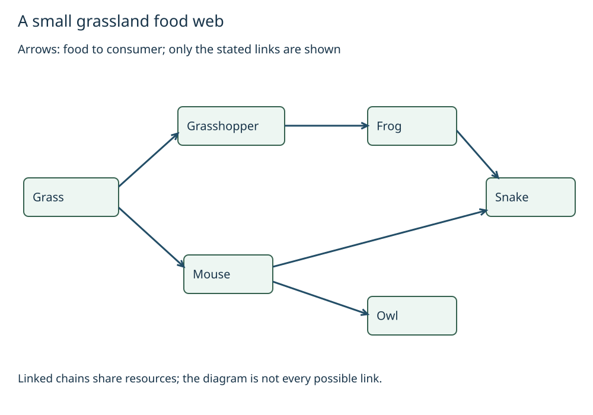
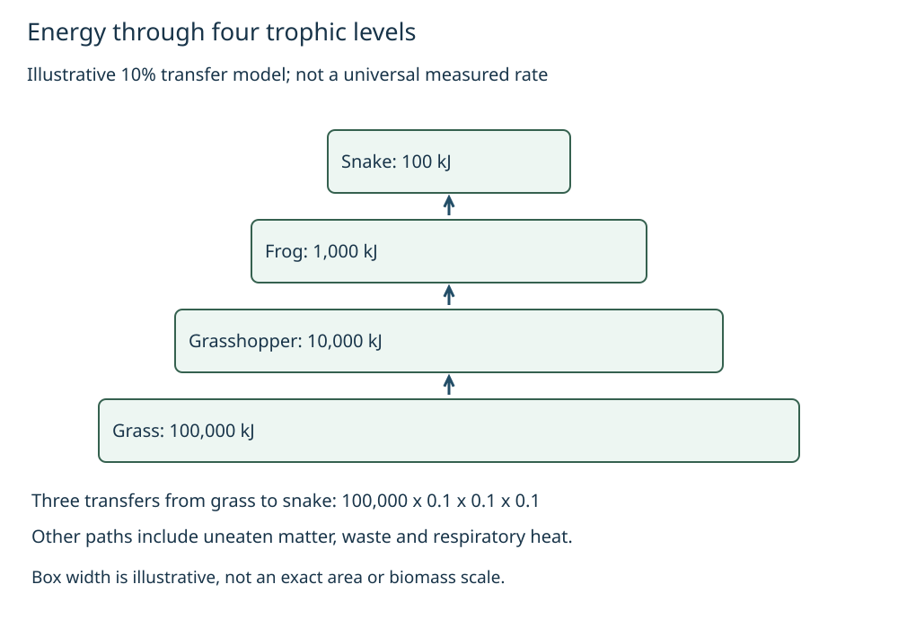
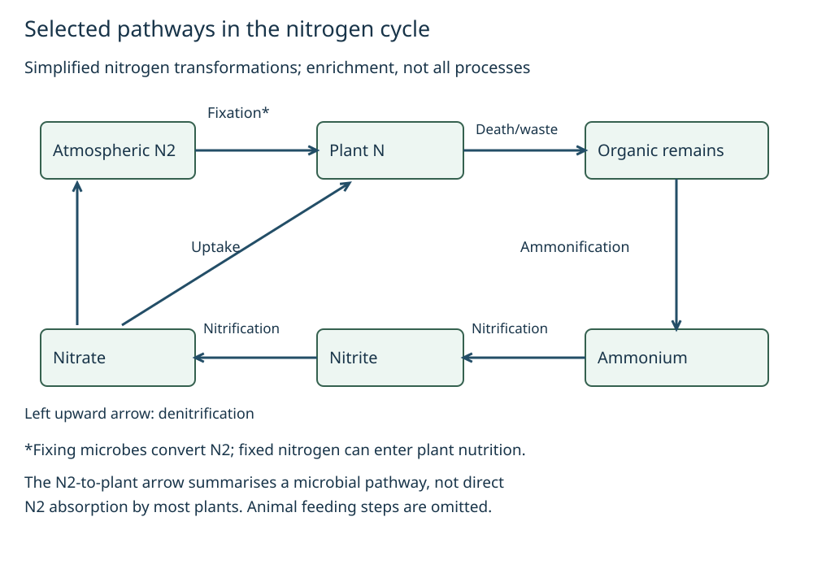
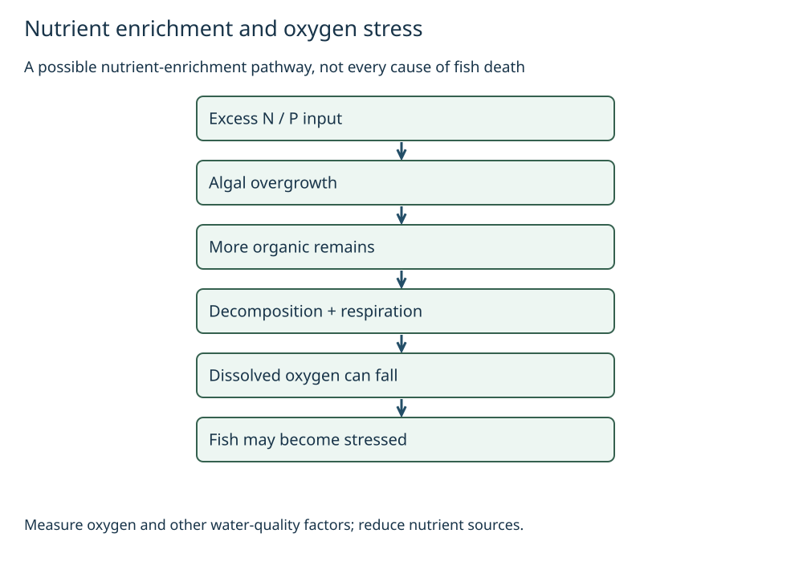

# ১৩শ অধ্যায়: জীবের পরিবেশ

> উত্তরসহ পর্যালোচনাধীন খসড়া; নির্ধারিত সংখ্যার উত্তরসহ খসড়া সম্পূর্ণ; বিষয়বস্তু পর্যালোচনা বাকি।
> মূল বই ও বিষয়বিশেষজ্ঞের পূর্ণ যাচাই বাকি। বোর্ড/স্কুল/সাল দাবি নেই।

## rebuild-mcq.json

### MCQ 1

জীব ও জড় পরিবেশের পারস্পরিক ক্রিয়াসহ কার্যকর একক কোনটি?

A. শুধু প্রজাতি
B. শুধু জনসংখ্যা
C. বাস্তুতন্ত্র
D. শুধু কোষ

উত্তর: C — বাস্তুতন্ত্র
বাস্তুতন্ত্রে জীবসমষ্টি, জড় উপাদান ও তাদের আন্তঃক্রিয়া অন্তর্ভুক্ত।

### MCQ 2

এক পুকুরের সব রুই মাছ একত্রে কী গঠন করে?

A. বায়োমণ্ডল
B. জীবসমষ্টি
C. খাদ্যজাল
D. জনসংখ্যা

উত্তর: D — জনসংখ্যা
একই স্থানে একই প্রজাতির সদস্যদের দল জনসংখ্যা।

### MCQ 3

পুকুরের মাছ, শৈবাল ও ব্যাকটেরিয়ার সম্মিলিত জীবন্ত অংশ কী?

A. একটি জনসংখ্যা
B. জড় উপাদান
C. আবাসস্থল
D. জীবসমষ্টি

উত্তর: D — জীবসমষ্টি
বিভিন্ন প্রজাতির জনসংখ্যা মিলে জীবসমষ্টি গঠিত হয়।

### MCQ 4

মাছের আবাসস্থল বলতে কোনটি বোঝায়?

A. কেবল মাছের শিকারি
B. যে জলাশয়ে মাছটি বাস করে
C. মাছের বংশগত বৈশিষ্ট্য
D. কেবল মাছটির খাদ্য

উত্তর: B — যে জলাশয়ে মাছটি বাস করে
আবাসস্থল হলো জীবের বসবাসের স্থান; খাদ্যভূমিকার সঙ্গে এটি এক নয়।

### MCQ 5

শাপলা, পানি ও সূর্যালোকের মধ্যে উৎপাদক কোনটি?

A. সূর্যালোক
B. শাপলা
C. পানি
D. তিনটিই উৎপাদক

উত্তর: B — শাপলা
সবুজ শাপলা সালোকসংশ্লেষণে জৈব খাদ্য গঠন করে। পানি ও আলো জড় উপাদান।

### MCQ 6

পুকুরের কোন উপাদানটি জীবজ?

A. খনিজ লবণ
B. দ্রবীভূত অক্সিজেন
C. পানির তাপমাত্রা
D. জুপ্ল্যাঙ্কটন

উত্তর: D — জুপ্ল্যাঙ্কটন
জুপ্ল্যাঙ্কটন জীবন্ত ভোক্তা; অন্যগুলো জড় পরিবেশের বৈশিষ্ট্য বা পদার্থ।

### MCQ 7

জলজ বাস্তুতন্ত্রের ভৌত নিয়ামকের উদাহরণ কোনটি?

A. ছত্রাকের সংখ্যা
B. ব্যাকটেরিয়ার শ্বসন
C. আলোর তীব্রতা
D. রুইয়ের সংখ্যা

উত্তর: C — আলোর তীব্রতা
আলোকতীব্রতা জীব নয়; এটি পরিবেশের একটি ভৌত নিয়ামক।

### MCQ 8

পুকুরে ফসফেট লবণের পরিমাণ কোন শ্রেণির উপাদান?

A. জড় রাসায়নিক উপাদান
B. শীর্ষ খাদক
C. উৎপাদক
D. প্রাথমিক খাদক

উত্তর: A — জড় রাসায়নিক উপাদান
ফসফেট অজৈব পুষ্টি; নিজে খাদ্য উৎপাদন বা ভক্ষণ করে না।

### MCQ 9

একটি বনে কেবল গাছ গুনলে কোন তথ্যটি বাদ পড়ে?

A. গাছের উপস্থিতি
B. গাছের অবস্থান
C. অন্যান্য জীব ও জড় উপাদানের সম্পর্ক
D. গাছের মোট সংখ্যা

উত্তর: C — অন্যান্য জীব ও জড় উপাদানের সম্পর্ক
বাস্তুতন্ত্র বোঝার জন্য শুধু গাছ নয়, অন্যান্য জীব ও জড় পরিবেশও বিবেচ্য।

### MCQ 10

পুকুরের ভাসমান ক্ষুদ্র সালোকসংশ্লেষী জীবদের সাধারণ নাম কী?

A. বৃহৎ মাংসাশী
B. ডেট্রিটাস
C. জুপ্ল্যাঙ্কটন
D. ফাইটোপ্ল্যাঙ্কটন

উত্তর: D — ফাইটোপ্ল্যাঙ্কটন
ফাইটোপ্ল্যাঙ্কটন আলোকশক্তি ব্যবহারকারী ক্ষুদ্র উৎপাদক।

### MCQ 11

শুধু প্ল্যাঙ্কটন শব্দ শুনে কোনো জীবকে উৎপাদক বলা যায় না কেন?

A. প্ল্যাঙ্কটন কখনো খাদ্য নয়
B. প্ল্যাঙ্কটনের মধ্যে ভোক্তাও থাকে
C. সব প্ল্যাঙ্কটন জড়
D. সব প্ল্যাঙ্কটন পরজীবী

উত্তর: B — প্ল্যাঙ্কটনের মধ্যে ভোক্তাও থাকে
ফাইটোপ্ল্যাঙ্কটন ও জুপ্ল্যাঙ্কটনের পুষ্টি গ্রহণ আলাদা।

### MCQ 12

সবুজ শৈবাল অক্সিজেন উৎপন্ন করে প্রধানত কোন প্রক্রিয়ায়?

A. প্রস্বেদন
B. সালোকসংশ্লেষণ
C. প্রজনন
D. কেবল শ্বসন

উত্তর: B — সালোকসংশ্লেষণ
আলোতে অক্সিজেনীয় সালোকসংশ্লেষণের মাধ্যমে শৈবাল অক্সিজেন ছাড়ে।

### MCQ 13

অন্ধকারে পুকুরের সবুজ উদ্ভিদের কোন প্রক্রিয়াটি চলতে পারে?

A. আলোকনির্ভর সালোকসংশ্লেষণ
B. আলোর শোষণ
C. শ্বসন
D. সূর্যালোক সৃষ্টি

উত্তর: C — শ্বসন
জীবিত উদ্ভিদ দিনরাত শ্বসন করে; অন্ধকারে আলোকনির্ভর বিক্রিয়া চলে না।

### MCQ 14

রাতে ঘন শৈবালযুক্ত পুকুরে অক্সিজেন কমার একটি কারণ কী?

A. মাছের শ্বসন বন্ধ হওয়া
B. জীবগুলোর শ্বসন চলতে থাকা
C. পানি শক্তিতে রূপান্তর
D. অক্সিজেনের সালোকসংশ্লেষণ

উত্তর: B — জীবগুলোর শ্বসন চলতে থাকা
অন্ধকারে আলোকসংশ্লেষণ বন্ধ হলেও শৈবালসহ বিভিন্ন জীব অক্সিজেন ব্যবহার করে।

### MCQ 15

পুকুরের মৃতপাতার জৈব পদার্থ ভাঙায় প্রধান ভূমিকা কার?

A. সূর্যালোকের একার
B. রুই মাছের ফুলকার
C. বিয়োজক ব্যাকটেরিয়া ও ছত্রাকের
D. শুধু খনিজ লবণের

উত্তর: C — বিয়োজক ব্যাকটেরিয়া ও ছত্রাকের
বিয়োজকরা জৈব পদার্থ ভেঙে পুষ্টি পরিবেশে ফেরায়।

### MCQ 16

শিক্ষার্থী মাটির কেঁচোকে ব্যাকটেরিয়ার সমার্থক বলল। সঠিক সংশোধন কোনটি?

A. কেঁচো এককোষী ব্যাকটেরিয়া
B. কেঁচো সালোকসংশ্লেষী উৎপাদক
C. কেঁচো মৃতজৈব পদার্থ খণ্ডকারী ভোক্তা
D. কেঁচো অজৈব পুষ্টি

উত্তর: C — কেঁচো মৃতজৈব পদার্থ খণ্ডকারী ভোক্তা
কেঁচো ডেট্রিটিভোর; অণুজীব বিয়োজকের সঙ্গে ভূমিকা সম্পর্কিত হলেও পরিচয় এক নয়।

### MCQ 17

মানুষের বানানো কিন্তু জীব–জড় মিথস্ক্রিয়াযুক্ত ক্ষেত কোন ধরনের ব্যবস্থা?

A. কৃত্রিমভাবে পরিচালিত বাস্তুতন্ত্র
B. অবশ্যই প্রাকৃতিক বন
C. শুধু জনসংখ্যা
D. জীবহীন ব্যবস্থা

উত্তর: A — কৃত্রিমভাবে পরিচালিত বাস্তুতন্ত্র
কৃষিক্ষেত্রে উৎপাদক, খাদক ও জড় উপাদান থাকে; মানুষ ব্যবস্থাপনা করে।

### MCQ 18

অ্যাকুয়ারিয়ামকে বাস্তুতন্ত্র বিবেচনায় কোন তথ্যটি প্রাসঙ্গিক?

A. কেবল ঘরের নাম
B. কেবল পাত্রের রং
C. কেবল কাচের দাম
D. জীব, পানি, আলো ও তাদের মিথস্ক্রিয়া

উত্তর: D — জীব, পানি, আলো ও তাদের মিথস্ক্রিয়া
পাত্রের জীব ও জড় উপাদানের কার্যগত সম্পর্ক বাস্তুতন্ত্র নির্ধারণে গুরুত্বপূর্ণ।

### MCQ 19

এক পুকুর থেকে অন্য পুকুরে মাছ চলে গেলে কোন ধারণাটি স্পষ্ট হয়?

A. মাছ জড় পদার্থ
B. দুই পুকুরে একই জীবসমষ্টি অবশ্যই থাকে
C. সব সীমানা অভেদ্য
D. বাস্তুতন্ত্রের সীমানা সবসময় সম্পূর্ণ বন্ধ নয়

উত্তর: D — বাস্তুতন্ত্রের সীমানা সবসময় সম্পূর্ণ বন্ধ নয়
পদার্থ ও জীব বাস্তুতন্ত্রের নির্বাচিত সীমানা অতিক্রম করতে পারে।

### MCQ 20

পুকুরের পানির pH বদলালে মাছের উপর প্রভাব পড়া কী নির্দেশ করে?

A. জড় পরিবেশ অপ্রাসঙ্গিক
B. মাছ pH উৎপাদন করে না তাই প্রভাব নেই
C. সব মাছ সব pH-তে সমান থাকে
D. জড় নিয়ামক জীবকে প্রভাবিত করে

উত্তর: D — জড় নিয়ামক জীবকে প্রভাবিত করে
প্রজাতিভেদে সহনসীমা থাকে; রাসায়নিক পরিবেশ জীবনকে প্রভাবিত করে।

### MCQ 21

শুধু দুই প্রজাতির উপস্থিতি থেকে তাদের প্রতিযোগী বলা অনুচিত কেন?

A. সীমিত একই সম্পদ ব্যবহারের তথ্যও প্রয়োজন
B. সব সহাবস্থান পরজীবিতা
C. উপস্থিতি মানেই অভিন্ন খাদ্য
D. সব প্রজাতি পরস্পর শিকারি

উত্তর: A — সীমিত একই সম্পদ ব্যবহারের তথ্যও প্রয়োজন
প্রতিযোগিতা শনাক্তে সম্পদের চাহিদা ও সীমাবদ্ধতার প্রমাণ গুরুত্বপূর্ণ।

### MCQ 22

একই ডালে দুই পাখি বাস করেও ভিন্ন খাবার খায়। কোন সিদ্ধান্তটি নিরাপদ?

A. দুটি পাখি অবশ্যই একই প্রজাতি
B. একই আবাস মানেই অভিন্ন পরিবেশগত ভূমিকা নয়
C. তাদের কোনো জড় নিয়ামক নেই
D. তারা অবশ্যই পরজীবী

উত্তর: B — একই আবাস মানেই অভিন্ন পরিবেশগত ভূমিকা নয়
আবাসস্থান ও খাদ্য/সম্পদ ব্যবহারের ভূমিকা পৃথক ধারণা।

### MCQ 23

তাপমাত্রা বাড়ার পর মাছ কমেছে। কারণ নিশ্চিত করতে কী দরকার?

A. পুকুরের নাম পরিবর্তন
B. একটি মাছের রং
C. অন্য নিয়ামক ও তুলনামূলক তথ্য যাচাই
D. শুধু একই দিনে ছবি

উত্তর: C — অন্য নিয়ামক ও তুলনামূলক তথ্য যাচাই
একসঙ্গে পরিবর্তন ঘটলেই একমাত্র কারণ প্রমাণ হয় না; অক্সিজেন ও দূষণও দেখতে হবে।

### MCQ 24

অক্সিজেনের কম দ্রাব্যতা ও বেশি শ্বসন মিলিয়ে উষ্ণ পানিতে কী ঝুঁকি বাড়তে পারে?

A. দ্রবীভূত অক্সিজেনের ঘাটতি
B. সব জীব উৎপাদক হওয়া
C. অক্সিজেন অসীম বৃদ্ধি
D. পুষ্টিচক্র সম্পূর্ণ বন্ধ

উত্তর: A — দ্রবীভূত অক্সিজেনের ঘাটতি
উষ্ণতায় অক্সিজেনের দ্রাব্যতা সাধারণত কমে; জৈব চাহিদাও ফলকে প্রভাবিত করে।

### MCQ 25

আলো খুব কম পৌঁছায় এমন গভীর পানিতে কোন প্রক্রিয়া সীমিত হতে পারে?

A. মাছের ভর থাকা
B. পানির অণু চলাচল
C. মাধ্যাকর্ষণ
D. সালোকসংশ্লেষণ

উত্তর: D — সালোকসংশ্লেষণ
উপযুক্ত আলোর অভাবে সালোকসংশ্লেষী উৎপাদন কমতে পারে।

### MCQ 26

উদ্ভিদের সব পুষ্টি কি কেবল সূর্যালোক থেকে আসে?

A. হ্যাঁ, শিকড় অপ্রয়োজনীয়
B. হ্যাঁ, আলোই সব পরমাণু
C. না, পানি ও খনিজও পরিবেশ থেকে লাগে
D. না, সব উদ্ভিদ শুধু মাছ খায়

উত্তর: C — না, পানি ও খনিজও পরিবেশ থেকে লাগে
আলো শক্তি দেয়; জৈব পদার্থ তৈরির উপাদানসহ খনিজ অন্য উৎস থেকে আসে।

### MCQ 27

বায়ুমণ্ডলের কোন গ্যাস স্থলজ সবুজ উদ্ভিদের কার্বনের প্রধান উৎস?

A. হিলিয়াম
B. কার্বন ডাই-অক্সাইড
C. নাইট্রোজেন
D. অক্সিজেন

উত্তর: B — কার্বন ডাই-অক্সাইড
সালোকসংশ্লেষণে CO2-এর কার্বন জৈব পদার্থে যুক্ত হয়।

### MCQ 28

শিকড়ের মাধ্যমে উদ্ভিদ প্রধানত কোন জোড়া পদার্থ গ্রহণ করে?

A. শুধু তৈরি শর্করা
B. অক্সিজেন ও সূর্যের আলো
C. পানি ও খনিজ আয়ন
D. আলো ও তাপ

উত্তর: C — পানি ও খনিজ আয়ন
স্থলজ উদ্ভিদের শিকড় পানি ও দ্রবীভূত খনিজ গ্রহণে প্রধান ভূমিকা রাখে।

### MCQ 29

পাতার পতনের পরও বনের মাটিতে পুষ্টি ফেরার ব্যাখ্যা কোনটি?

A. মৃতপাতার বিয়োজন
B. মাটি কখনো পুষ্টি হারায় না
C. সব পাতা অজৈব হওয়া
D. পাতার আলো উৎপাদন

উত্তর: A — মৃতপাতার বিয়োজন
মৃত জৈব পদার্থের বিয়োজন পুষ্টির পুনঃব্যবহারে সাহায্য করে।

### MCQ 30

একটি বাস্তুতন্ত্রে জল সরালে কী হতে পারে?

A. শুধু স্থাননাম বদলাবে
B. জীব ও রাসায়নিক প্রক্রিয়া উভয়ই প্রভাবিত হবে
C. সব জীবের প্রয়োজন সমানভাবে শেষ হবে
D. জড় উপাদান বলে কোনো প্রভাব নেই

উত্তর: B — জীব ও রাসায়নিক প্রক্রিয়া উভয়ই প্রভাবিত হবে
পানি আবাস, পরিবহন ও জৈব প্রক্রিয়ার জন্য গুরুত্বপূর্ণ।

### MCQ 31

একই প্রজাতির পোনার সংখ্যা খুব বেড়ে গেলে খাদ্য কমার পরিস্থিতিতে কোন সম্পর্ক তীব্র হতে পারে?

A. পরাগায়ন
B. ভিন্ন প্রজাতির মিথোজীবিতা
C. অন্তঃপ্রজাতিক প্রতিযোগিতা
D. অ্যামেনসালিজম

উত্তর: C — অন্তঃপ্রজাতিক প্রতিযোগিতা
একই প্রজাতির সদস্যের সীমিত সম্পদের প্রতিযোগিতা অন্তঃপ্রজাতিক।

### MCQ 32

পুকুরে শুধু বড় মাছ গণনা করলে জীবসমষ্টির কোন অংশ সহজে বাদ পড়ে?

A. অক্সিজেন অণুর জীবসমষ্টি
B. অণুজীব ও ক্ষুদ্র প্ল্যাঙ্কটন
C. পানির পাত্র
D. গণনা করা বড় মাছ

উত্তর: B — অণুজীব ও ক্ষুদ্র প্ল্যাঙ্কটন
আকারে ক্ষুদ্র জীবও জীবসমষ্টির অংশ; পানি ও অক্সিজেন জীব নয়।

### MCQ 33

প্রাকৃতিক জলাশয়ের বিয়োজকদের সরিয়ে দিলে দীর্ঘমেয়াদে কোন কাজ ব্যাহত হতে পারে?

A. মৃতজৈব পদার্থ থেকে পুষ্টি মুক্তি
B. সমস্ত মাছের তাৎক্ষণিক উৎপাদন
C. সূর্যের আলো সৃষ্টি
D. সব পাথরের প্রজনন

উত্তর: A — মৃতজৈব পদার্থ থেকে পুষ্টি মুক্তি
বিয়োজক পুষ্টি পুনঃচক্রায়নের গুরুত্বপূর্ণ সংযোগ।

### MCQ 34

ফসলের জমি থেকে ধান কেটে নেওয়া কোন পরিবর্তনের উদাহরণ?

A. বাইরে থেকে সব শক্তির প্রত্যাবর্তন
B. উৎপাদক ছাড়া বাস্তুতন্ত্র অক্ষত থাকা
C. বাস্তুতন্ত্র থেকে জৈব পদার্থ অপসারণ
D. সব খনিজের অবধারিত বৃদ্ধি

উত্তর: C — বাস্তুতন্ত্র থেকে জৈব পদার্থ অপসারণ
ফসলের সঙ্গে কার্বন ও পুষ্টিসহ জৈব পদার্থ ক্ষেতের বাইরে যায়।

### MCQ 35

খরা একটি বাস্তুতন্ত্রে প্রথমে কোন জড় উপাদানের সরাসরি ঘাটতি নির্দেশ করে?

A. বাঘের
B. বীজের বংশগতির
C. পানির
D. পরজীবীর

উত্তর: C — পানির
খরা পানি-প্রাপ্যতা হ্রাসের অবস্থা; পরে নানা জীবজ প্রভাব দেখা যায়।

### MCQ 36

লবণাক্ততা বেড়ে মিঠাপানির উদ্ভিদ ক্ষতিগ্রস্ত হলে মূল ধারণা কী?

A. সব উদ্ভিদের একই সহনশীলতা
B. লবণ শুধু আলোর অংশ
C. লবণ জীবন্ত খাদক
D. পরিবেশগত সহনসীমা

উত্তর: D — পরিবেশগত সহনসীমা
প্রজাতির সহ্যক্ষমতার বাইরে জড় পরিবর্তন জীবনধারণ বাধাগ্রস্ত করতে পারে।

### MCQ 37

উপকূলের ম্যানগ্রোভ ও পাহাড়ি বন একই নয়—এটি বোঝাতে কোন জোড়া তথ্য উপযোগী?

A. দর্শনার্থীর পোশাক
B. দুই ছবির ফ্রেম
C. লবণাক্ততা ও জীবসমষ্টির পার্থক্য
D. কেবল গ্রামের নাম

উত্তর: C — লবণাক্ততা ও জীবসমষ্টির পার্থক্য
জড় অবস্থা ও জীবজ গঠনের পার্থক্য ভিন্ন বাস্তুতন্ত্র বুঝতে সাহায্য করে।

### MCQ 38

বৃষ্টির পানির সঙ্গে জমির সার পুকুরে যাওয়া কোন বিষয় দেখায়?

A. পুকুরে স্থলভাগের প্রভাব অসম্ভব
B. পাশাপাশি বাস্তুতন্ত্রের মধ্যে পদার্থ বিনিময়
C. সব বাস্তুতন্ত্র বিচ্ছিন্ন
D. সার শক্তিহীন আলো

উত্তর: B — পাশাপাশি বাস্তুতন্ত্রের মধ্যে পদার্থ বিনিময়
প্রবাহিত পানি স্থলভাগের পুষ্টি জলাশয়ে বহন করতে পারে।

### MCQ 39

মাছের খাদ্য ও আশ্রয় দুটিই দেওয়া জলজ উদ্ভিদ সরালে কী বিবেচনা জরুরি?

A. একাধিক প্রত্যক্ষ ও পরোক্ষ প্রভাব
B. শুধু পানি স্বচ্ছ হওয়া
C. মাছের কোনো উদ্ভিদনির্ভরতা নেই
D. শুধু উদ্ভিদের রং

উত্তর: A — একাধিক প্রত্যক্ষ ও পরোক্ষ প্রভাব
একটি উপাদান সরালে খাদ্যসম্পর্ক ও আবাসগঠন দুটোই বদলাতে পারে।

### MCQ 40

পুকুরের পাড়ের মাটি ধুয়ে পানিতে ঘোলাভাব বাড়লে উদ্ভিদের উৎপাদন কমতে পারে কেন?

A. সব উদ্ভিদ বিয়োজক হয়
B. ঘোলা পানি সবসময় বেশি আলো দেয়
C. মাটি সব CO2 ধ্বংস করে
D. আলোর প্রবেশ বাধাগ্রস্ত হতে পারে

উত্তর: D — আলোর প্রবেশ বাধাগ্রস্ত হতে পারে
ভাসমান কণা আলোর প্রবেশ কমিয়ে সালোকসংশ্লেষণ সীমিত করতে পারে।

### MCQ 41

জীবজ ও জড় অংশ মিলিয়ে অধ্যয়নের সবচেয়ে উপযুক্ত উদাহরণ কোনটি?

A. শুধু পুকুরের দাম
B. শুধু মাছের নাম মুখস্থ
C. আলো, শৈবাল ও মাছের সম্পর্ক পরিমাপ
D. কেবল রাস্তার দূরত্ব

উত্তর: C — আলো, শৈবাল ও মাছের সম্পর্ক পরিমাপ
উদাহরণটিতে ভৌত নিয়ামক ও জীবদের পারস্পরিক সম্পর্ক রয়েছে।

### MCQ 42

একই মাপের দুই পুকুরে উৎপাদন সমান হবে বলা যায় না কেন?

A. পুষ্টি, আলো ও জীবসমষ্টি ভিন্ন হতে পারে
B. দুই পুকুরে পানি থাকা অসম্ভব
C. একই মাপ মানেই একই জনসংখ্যা
D. আয়তনই একমাত্র নিয়ামক

উত্তর: A — পুষ্টি, আলো ও জীবসমষ্টি ভিন্ন হতে পারে
বাস্তুতন্ত্রের কার্যকারিতা অনেক জীবজ ও জড় নিয়ামকের উপর নির্ভরশীল।

### MCQ 43

জমির কেঁচো ও মাটির আর্দ্রতার সম্পর্ক পরীক্ষা কোন বিষয়টির উদাহরণ?

A. শুধু জিন স্থানান্তরের
B. খাদ্যহীন জীবনের
C. শুধু পরাগায়নের
D. জীব–জড় মিথস্ক্রিয়ার

উত্তর: D — জীব–জড় মিথস্ক্রিয়ার
কেঁচো জীবজ অংশ এবং মাটির আর্দ্রতা জড় পরিবেশের বৈশিষ্ট্য।

### MCQ 44

উদ্ভিদ, তৃণভোজী ও মাংসাশীর মধ্যে কোন বৈশিষ্ট্য সবার সাধারণ?

A. জৈব প্রক্রিয়ায় শক্তির প্রয়োজন
B. সবাই সরাসরি আলো দিয়ে খাদ্য বানায়
C. সবাই প্রথম পুষ্টিস্তরে থাকে
D. সবাই অজৈব পদার্থ

উত্তর: A — জৈব প্রক্রিয়ায় শক্তির প্রয়োজন
জীবনের সব স্তরে শক্তি লাগে; শক্তির উৎস ও পুষ্টি গ্রহণের ধরন ভিন্ন।

### MCQ 45

একটি জীবের পরিবেশ বলতে সবচেয়ে যথাযথ কোনটি?

A. তার উপর প্রভাব ফেলা জীবজ ও জড় অবস্থা
B. কেবল তার শিকার
C. কেবল তার শরীর
D. কেবল তার প্রজাতির নাম

উত্তর: A — তার উপর প্রভাব ফেলা জীবজ ও জড় অবস্থা
পরিবেশে ভৌত-রাসায়নিক অবস্থা ও অন্যান্য জীবের প্রভাব অন্তর্ভুক্ত।

### MCQ 46

পুকুরের শাপলা ও শাপলার খনিজ গ্রহণ একত্রে কোন বক্তব্য সমর্থন করে?

A. উৎপাদকও জড় পরিবেশের উপর নির্ভরশীল
B. শাপলা সব খনিজ সৃষ্টি করে
C. উৎপাদকের কোনো উপাদান লাগে না
D. খনিজ নিজে ভোক্তা

উত্তর: A — উৎপাদকও জড় পরিবেশের উপর নির্ভরশীল
উৎপাদক খাদ্য বানালেও পানি, খনিজ ও অন্যান্য অনুকূল অবস্থা প্রয়োজন।

### MCQ 47

এক এলাকার সব হরিণ ও সব বাঘ একসঙ্গে একটি জনসংখ্যা নয় কেন?

A. জনসংখ্যায় কখনো প্রাণী থাকে না
B. দুটি ভিন্ন প্রজাতি রয়েছে
C. তারা একই জায়গায় নেই বলা হয়েছে
D. তারা জীবন্ত নয়

উত্তর: B — দুটি ভিন্ন প্রজাতি রয়েছে
জনসংখ্যা নির্দিষ্ট প্রজাতির সদস্যদের নিয়ে গঠিত হয়।

### MCQ 48

শৈবাল ভক্ষক ক্ষুদ্র প্রাণীকে কোন শ্রেণিতে রাখা যুক্তিযুক্ত?

A. ভোক্তা
B. আলোকশক্তি
C. খনিজ উৎপাদক
D. অজৈব পদার্থ

উত্তর: A — ভোক্তা
অন্য জীবের জৈব পদার্থ খেয়ে শক্তি পাওয়া জীব ভোক্তা।

### MCQ 49

বিয়োজকরা কি মৃতদেহ ভাঙার সময় শ্বসন করতে পারে?

A. না, শ্বসন কেবল মাছের
B. না, মৃতদেহ শক্তিহীন
C. হ্যাঁ, জৈব পদার্থ থেকে শক্তি ব্যবহার করে
D. না, তারা জড় বস্তু

উত্তর: C — হ্যাঁ, জৈব পদার্থ থেকে শক্তি ব্যবহার করে
জীবিত বিয়োজকরা বিপাকীয় কাজ করে; অনেকেই শ্বসনে অক্সিজেন ব্যবহার করে।

### MCQ 50

বদ্ধ কাচের পাত্রে উদ্ভিদ বাঁচলেই সেটি শক্তিগতভাবে সম্পূর্ণ বিচ্ছিন্ন বলা ভুল কেন?

A. কাচের কোনো ভর নেই
B. পাতা কখনো শ্বসন করে না
C. বাইরে থেকে আলো ঢুকতে পারে
D. পানি নিজেই সূর্য

উত্তর: C — বাইরে থেকে আলো ঢুকতে পারে
পদার্থে প্রায় বন্ধ পাত্রও আলোকশক্তি গ্রহণ এবং তাপ ছাড়তে পারে।

### MCQ 51

খাদ্যশৃঙ্খল ঘাস → ফড়িং → ব্যাঙ-এ তিরের অর্থ কী?

A. আকার ক্রমশ কমে
B. খাদ্য ও শক্তি ভক্ষকের দিকে যায়
C. অক্সিজেন বিপরীত দিকে যায়
D. ভক্ষক সবসময় পূর্বের জীবকে জন্ম দেয়

উত্তর: B — খাদ্য ও শক্তি ভক্ষকের দিকে যায়
তিরটি খাদ্য থেকে তা ভক্ষণকারী জীবের দিকে শক্তি স্থানান্তর নির্দেশ করে।

### MCQ 52

ধান → ইঁদুর → সাপ শৃঙ্খলে প্রাথমিক খাদক কোনটি?

A. সাপ
B. তিনটিই
C. ধান
D. ইঁদুর

উত্তর: D — ইঁদুর
ইঁদুর উৎপাদক ধান খেলে এই পথে প্রাথমিক খাদক।

### MCQ 53

শৈবাল → ক্ষুদ্র প্রাণী → ছোট মাছ → বড় মাছ শৃঙ্খলে দ্বিতীয় পুষ্টিস্তর কোনটি?

A. ক্ষুদ্র প্রাণী
B. বড় মাছ
C. শৈবাল
D. ছোট মাছ

উত্তর: A — ক্ষুদ্র প্রাণী
উৎপাদক প্রথম স্তর এবং উৎপাদকভক্ষক দ্বিতীয় স্তর।

### MCQ 54

ঘাস → হরিণ → বাঘ শৃঙ্খলে বাঘ কোন ধরনের খাদক?

A. মাধ্যমিক খাদক
B. অজৈব উপাদান
C. উৎপাদক
D. প্রাথমিক খাদক

উত্তর: A — মাধ্যমিক খাদক
এ পথে বাঘ প্রাথমিক খাদক হরিণ খায়; তাই মাধ্যমিক খাদক।

### MCQ 55

ঘাস → ফড়িং → ব্যাঙ → সাপ পথে সাপ কোন পুষ্টিস্তরে?

A. প্রথম
B. চতুর্থ
C. দ্বিতীয়
D. তৃতীয়

উত্তর: B — চতুর্থ
ঘাস থেকে গণনা করলে চারটি পুষ্টিস্তর হয়; সাপ তৃতীয় পর্যায়ের খাদক।

### MCQ 56

খাদ্যজাল খাদ্যশৃঙ্খল থেকে কীভাবে আলাদা?

A. সবসময় একটিমাত্র পথ থাকে
B. শুধু মৃত জীব দেখায়
C. কোনো উৎপাদক দেখায় না
D. অনেক সংযুক্ত খাদ্যপথ দেখায়

উত্তর: D — অনেক সংযুক্ত খাদ্যপথ দেখায়
বাস্তবে একটি জীব একাধিক খাদ্যসম্পর্কে যুক্ত হতে পারে; খাদ্যজালে তা প্রকাশ পায়।

### MCQ 57

ব্যাঙ ফড়িং ও মশা দুটিই খেলে ব্যাঙের কোন সুবিধা থাকতে পারে?

A. কোনো শক্তি ব্যয় না হওয়া
B. সব শিকারি থেকে মুক্তি
C. এক খাদ্য কমলে বিকল্প খাদ্য পাওয়া
D. উৎপাদক হয়ে যাওয়া

উত্তর: C — এক খাদ্য কমলে বিকল্প খাদ্য পাওয়া
বিকল্প খাদ্য কোনো একটি উৎস কমার প্রভাব কিছুটা কমাতে পারে; নিশ্চয়তা নয়।

### MCQ 58

ইঁদুরকে সাপ ও পেঁচা উভয়েই খায়। ইঁদুর কমলে কোন প্রভাব সম্ভব?

A. দুই শিকারিই খাদ্যসংকটে পড়তে পারে
B. সাপ আলোকসংশ্লেষী হবে
C. শুধু ইঁদুরই প্রভাবিত হবে
D. সব পেঁচা সঙ্গে সঙ্গে মারা যাবে

উত্তর: A — দুই শিকারিই খাদ্যসংকটে পড়তে পারে
খাদ্যজালের একটি শিকার কমলে একাধিক ভক্ষকের উপর প্রভাব পড়তে পারে।

### MCQ 59

একই পাখি ধান ও ফড়িং খায়। তার পুষ্টিস্তর সম্পর্কে সঠিক বক্তব্য কী?

A. খাদ্যপথ অনুযায়ী ভিন্ন হতে পারে
B. সর্বদা উৎপাদক
C. কখনো ভোক্তা নয়
D. সর্বদা প্রথম স্তর

উত্তর: A — খাদ্যপথ অনুযায়ী ভিন্ন হতে পারে
সর্বভুকের পুষ্টিগত অবস্থান খাওয়া খাদ্যের উপর নির্ভর করে।

### MCQ 60

ধান ও পোকা খাওয়া মুরগি কোন খাদ্যাভ্যাসের উদাহরণ?

A. সর্বভুক
B. বাধ্যতামূলক বিয়োজক
C. পরজীবী উদ্ভিদ
D. কেবল তৃণভোজী

উত্তর: A — সর্বভুক
উদ্ভিদ ও প্রাণী উভয় উৎস থেকে খাদ্য নিলে সর্বভুক বলা হয়।

### MCQ 61

চারণভিত্তিক খাদ্যশৃঙ্খল সাধারণত কোথা থেকে শুরু হয়?

A. শুধু তাপ থেকে
B. জীবন্ত উৎপাদক থেকে
C. কেবল মাংসাশী থেকে
D. শুধু পাথর থেকে

উত্তর: B — জীবন্ত উৎপাদক থেকে
ঘাস বা শৈবালের মতো জীবন্ত উৎপাদকভিত্তিক পথ চারণ শৃঙ্খল।

### MCQ 62

ঝরা পাতা → কেঁচো → পাখি পথে প্রথম খাদ্যভিত্তি কী?

A. নাইট্রোজেন গ্যাস
B. মৃত জৈব পদার্থ
C. মুক্ত তাপ
D. জীবন্ত শিকারি

উত্তর: B — মৃত জৈব পদার্থ
পথটির ভিত্তি মৃতজৈব পদার্থ; এটি ডেট্রিটাসনির্ভর খাদ্যপথ।

### MCQ 63

বিয়োজকদের খাদ্য কেবল শীর্ষ খাদক থেকেই আসে—দাবিটি কেন ভুল?

A. সব পুষ্টিস্তরের মৃতদেহ ও বর্জ্য কাজে লাগে
B. তৃণভোজীর কোনো বর্জ্য নেই
C. উৎপাদক কখনো মরে না
D. সব বিয়োজক আলো খায়

উত্তর: A — সব পুষ্টিস্তরের মৃতদেহ ও বর্জ্য কাজে লাগে
উৎপাদক থেকে শীর্ষ খাদক সব স্তর থেকেই মৃতজৈব পদার্থ আসে।

### MCQ 64

পুষ্টিস্তর গুনতে উৎপাদককে বাদ দিলে কোন ভুল হবে?

A. তিরের অর্থ ঠিক হয়ে যাবে
B. শুধু নামের বানান বদলাবে
C. সব পরবর্তী স্তরের ক্রম এক ধাপ সরে যাবে
D. ভোক্তা উৎপাদক হবে না

উত্তর: C — সব পরবর্তী স্তরের ক্রম এক ধাপ সরে যাবে
প্রচলিত গণনায় উৎপাদকই প্রথম পুষ্টিস্তর।

### MCQ 65

একটি খাদ্যপথে শীর্ষ খাদক মানে কী?

A. সেই পথে সর্বোচ্চ প্রদর্শিত ভক্ষক
B. কখনো রোগ হয় না এমন প্রাণী
C. সবসময় সবচেয়ে বড় প্রাণী
D. সব বাস্তুতন্ত্রে অপরাজেয় জীব

উত্তর: A — সেই পথে সর্বোচ্চ প্রদর্শিত ভক্ষক
শীর্ষ অবস্থান নির্দিষ্ট খাদ্যপথ/জাল সাপেক্ষ; রোগ বা অন্য সম্পর্ক বাদ যায় না।

### MCQ 66

পুকুরে শৈবাল → জুপ্ল্যাঙ্কটন তির আঁকা কেন সঠিক?

A. সব জুপ্ল্যাঙ্কটন অজৈব
B. শৈবাল জুপ্ল্যাঙ্কটন খায় বলেই
C. জুপ্ল্যাঙ্কটন শৈবাল খেলে তার শক্তি পায়
D. জুপ্ল্যাঙ্কটন আলো তৈরি করে

উত্তর: C — জুপ্ল্যাঙ্কটন শৈবাল খেলে তার শক্তি পায়
উদাহরণে খাদ্য থেকে ভক্ষকের দিকে তির আঁকা হয়েছে।

### MCQ 67

ঘাস → হরিণ → বাঘ-এ হরিণ কমার পর ঘাস বাড়বে—এটি কী ধরনের বক্তব্য?

A. আবহাওয়ার প্রভাব নেই তার প্রমাণ
B. উৎপাদক কখনো খাওয়া হয় না তার প্রমাণ
C. অন্যান্য শর্ত স্থির থাকলে সম্ভাব্য পূর্বাভাস
D. সবসময় অবধারিত প্রমাণ

উত্তর: C — অন্যান্য শর্ত স্থির থাকলে সম্ভাব্য পূর্বাভাস
হরিণের চারণ কমলে ঘাস বাড়তে পারে, কিন্তু পানি ও অন্য খাদকও গুরুত্বপূর্ণ।

### MCQ 68

সাপ কমিয়ে দিলে ইঁদুর বাড়ার একটি সম্ভাব্য কারণ কী?

A. ইঁদুরের আলোকসংশ্লেষণ শুরু
B. ইঁদুরের খাদ্য সম্পূর্ণ নষ্ট হওয়া
C. সব রোগ বন্ধ
D. শিকারচাপ কমে যাওয়া

উত্তর: D — শিকারচাপ কমে যাওয়া
সাপ ইঁদুর খেলে সাপ কমায় ইঁদুরের মৃত্যুচাপ কমতে পারে।

### MCQ 69

কোন তিরটি ভুল, যদি অর্থ খাদ্য থেকে ভক্ষক হয়?

A. ধান → ইঁদুর
B. বাঘ → হরিণ, যখন বাঘ হরিণ খায়
C. ঘাস → হরিণ
D. পোকা → ব্যাঙ

উত্তর: B — বাঘ → হরিণ, যখন বাঘ হরিণ খায়
বাঘের খাওয়া হরিণ থেকে বাঘের দিকে তির হওয়া উচিত।

### MCQ 70

এক খাদ্যজালের দুই জীবের সরাসরি তির নেই। তারা কি পরোক্ষভাবে প্রভাবিত হতে পারে?

A. শুধু একই প্রজাতি হলে
B. না, কখনো নয়
C. হ্যাঁ, অন্য খাদ্যসংযোগের মাধ্যমে
D. শুধু উভয়ে পাথর হলে

উত্তর: C — হ্যাঁ, অন্য খাদ্যসংযোগের মাধ্যমে
মাঝের জীবের সংখ্যা বা খাদ্যচাপ বদলে পরোক্ষ প্রভাব ছড়াতে পারে।

### MCQ 71

উৎপাদকস্তরের জৈব পদার্থে মূলত কোন শক্তি সঞ্চিত থাকে?

A. তেজস্ক্রিয় শক্তিমাত্র
B. রাসায়নিক শক্তি
C. মাধ্যাকর্ষণমাত্র
D. শব্দমাত্র

উত্তর: B — রাসায়নিক শক্তি
সালোকসংশ্লেষণে আলোকশক্তি জৈব যৌগের রাসায়নিক শক্তিতে রূপান্তরিত হয়।

### MCQ 72

অধিকাংশ স্থলজ বাস্তুতন্ত্রে শক্তির প্রধান প্রাথমিক উৎস কী?

A. জমা পাথর
B. সূর্য
C. মাটির কেঁচো
D. ব্যাঘ্রের তাপ

উত্তর: B — সূর্য
অধিকাংশ বাস্তুতন্ত্রের উৎপাদক সূর্যালোক থেকে শক্তি নেয়; রাসায়নিকভিত্তিক ব্যতিক্রম আছে।

### MCQ 73

গভীর সমুদ্রের কিছু জীবজালে সূর্যালোক ছাড়াও উৎপাদন হয় কীভাবে? (সম্প্রসারিত)

A. শুধু শিকারির শব্দ নিয়ে
B. তাপকে শতভাগ খাদ্যে বদলে
C. কোনো শক্তি না নিয়ে
D. অজৈব পদার্থের রাসায়নিক শক্তি ব্যবহার করে

উত্তর: D — অজৈব পদার্থের রাসায়নিক শক্তি ব্যবহার করে
কিছু অণুজীব কেমোসিন্থেসিসে রাসায়নিক বিক্রিয়ার শক্তি ব্যবহার করে।

### MCQ 74

প্রতি পুষ্টিস্তরে শ্বসনের ফলে শক্তির একটি অংশ কোথায় যায়?

A. পূর্বের স্তরে সম্পূর্ণ খাদ্য হয়ে
B. সূর্যে ফিরে জৈব খাদ্য হয়ে
C. শতভাগ পরের স্তরে
D. তাপ হিসেবে পরিবেশে

উত্তর: D — তাপ হিসেবে পরিবেশে
বিপাকে তাপ উৎপন্ন হয়; সেই তাপ খাদ্যশৃঙ্খলে সম্পূর্ণ পুনরুদ্ধার হয় না।

### MCQ 75

পুষ্টিচক্র ও শক্তিপ্রবাহের প্রধান পার্থক্য কোনটি?

A. পুষ্টি পুনঃচক্রায়িত হয়, শক্তি একমুখীভাবে প্রবাহিত ও অপচয়িত হয়
B. দুটিই একই অণু
C. পুষ্টি কখনো স্থানান্তরিত হয় না
D. শক্তি অসীমবার পূর্ণভাবে ফিরে আসে

উত্তর: A — পুষ্টি পুনঃচক্রায়িত হয়, শক্তি একমুখীভাবে প্রবাহিত ও অপচয়িত হয়
পদার্থ ঘুরে ব্যবহার হতে পারে; ব্যবহারযোগ্য শক্তির একাংশ প্রতিটি ধাপে তাপে ছড়ায়।

### MCQ 76

দশ শতাংশ স্থানান্তরকে কীভাবে ব্যবহার করা উচিত?

A. শক্তি সংরক্ষণ অস্বীকারে
B. আনুমানিক শিক্ষামূলক মডেল হিসেবে
C. পুষ্টি না ফেরার প্রমাণে
D. প্রতিটি জীবের নির্ভুল ধ্রুবক হিসেবে

উত্তর: B — আনুমানিক শিক্ষামূলক মডেল হিসেবে
বাস্তব স্থানান্তর দক্ষতা জীব, খাদ্য ও অবস্থাভেদে বদলায়।

### MCQ 77

উৎপাদকে 10000 kJ থাকলে 10% মডেলে প্রাথমিক খাদকে কত শক্তি পৌঁছায়?

A. 10 kJ
B. 1000 kJ
C. 10000 kJ
D. 100 kJ

উত্তর: B — 1000 kJ
এক ধাপ স্থানান্তরে 10000 × 0.10 = 1000 kJ।

### MCQ 78

ঘাসে 20000 kJ থাকলে ঘাস → ফড়িং → ব্যাঙ পথে 10% মডেলে ব্যাঙে কত পৌঁছায়?

A. 20 kJ
B. 20000 kJ
C. 2000 kJ
D. 200 kJ

উত্তর: D — 200 kJ
দুই ধাপে 20000 × 0.1 × 0.1 = 200 kJ।

### MCQ 79

শৈবালে 50000 kJ হলে শৈবাল → ক্ষুদ্র প্রাণী → মাছ → বক পথে 10% মডেলে বকে কত?

A. 50000 kJ
B. 5000 kJ
C. 500 kJ
D. 50 kJ

উত্তর: D — 50 kJ
তিনটি স্থানান্তর: 50000 × (0.1)^3 = 50 kJ।

### MCQ 80

প্রাথমিক খাদকে 800 kJ মজুত থাকলে তার আগের উৎপাদকে 10% মডেলে কত ছিল?

A. 8000 kJ
B. 800 kJ
C. 80 kJ
D. 8 kJ

উত্তর: A — 8000 kJ
পরের স্তর আগের দশ ভাগের এক ভাগ হলে আগের পরিমাণ 800 ÷ 0.1 = 8000 kJ।

### MCQ 81

1000 kJ থেকে পরের স্তরে 150 kJ গেলে দক্ষতা কত? (সম্প্রসারিত)

A. 85%
B. 15%
C. 6.7%
D. 150%

উত্তর: B — 15%
স্থানান্তর দক্ষতা = প্রাপ্ত/পূর্বস্তরের শক্তি × 100 = 15%।

### MCQ 82

এক পুষ্টিস্তরের সব জৈব শক্তি পরের স্তরে যায় না কেন?

A. জীব কোনো শক্তি ব্যবহার করে না
B. সব শক্তি ভরহীন হয়ে যায়
C. বর্জ্যে কখনো শক্তি থাকে না
D. সব অংশ খাওয়া/আত্তীকৃত হয় না এবং বিপাকে শক্তি লাগে

উত্তর: D — সব অংশ খাওয়া/আত্তীকৃত হয় না এবং বিপাকে শক্তি লাগে
খাদ্যের অপাচ্য অংশ, না-খাওয়া অংশ ও শ্বসন শক্তি হস্তান্তর সীমিত করে।

### MCQ 83

এক শৃঙ্খলে স্তরের সংখ্যা বেশি হলে সাধারণত শীর্ষে শক্তি কম হওয়ার কারণ কী?

A. শক্তি শুধু প্রথম ধাপে লাগে
B. উৎপাদক প্রতি ধাপে বাড়তি আলো পাঠায়
C. ক্রমাগত স্থানান্তরে ব্যবহারযোগ্য শক্তি কমে
D. শীর্ষে জৈব পদার্থ অসম্ভব

উত্তর: C — ক্রমাগত স্থানান্তরে ব্যবহারযোগ্য শক্তি কমে
প্রতিটি ধাপে শক্তির অংশ তাপ ও অন্য পথে যায়; সবটা পরের স্তরে পৌঁছায় না।

### MCQ 84

শক্তির পিরামিড সাধারণত উল্টানো হয় না কেন?

A. সব প্রাণীর আকার সমান
B. একই সময়-এলাকায় উচ্চস্তরের উৎপাদনে কম শক্তি প্রবাহ পায়
C. উৎপাদক কখনো শ্বসন করে না
D. শীর্ষ খাদক আলো ধরে

উত্তর: B — একই সময়-এলাকায় উচ্চস্তরের উৎপাদনে কম শক্তি প্রবাহ পায়
সঙ্গত একক ও সময়সীমায় প্রতিটি স্থানান্তরে ব্যবহারযোগ্য শক্তি কমে।

### MCQ 85

এক গাছে বহু পোকা থাকলে সংখ্যার পিরামিড কেমন হতে পারে?

A. সবসময় সমান প্রস্থ
B. নিচে সংকীর্ণ ও উপরে প্রশস্ত
C. শক্তির নিয়ম অবশ্যই ভঙ্গ
D. কোনো উৎপাদক নেই

উত্তর: B — নিচে সংকীর্ণ ও উপরে প্রশস্ত
এক বড় উৎপাদক বহু ক্ষুদ্র ভোক্তাকে সমর্থন করতে পারে; সংখ্যা ও শক্তি এক নয়।

### MCQ 86

গাছ ও পোকার শুধু সংখ্যা থেকে শক্তির পরিমাণ বোঝা যায় না কেন?

A. পোকা জড়
B. সব জীবের শক্তি সমান
C. আকার ও জৈব ভরও ভিন্ন
D. সংখ্যা নিজে আলোকশক্তি

উত্তর: C — আকার ও জৈব ভরও ভিন্ন
একটি বড় গাছের শক্তি বহু ছোট পোকার তুলনায় বেশি হতে পারে।

### MCQ 87

পুকুরে ফাইটোপ্ল্যাঙ্কটনের ক্ষণিক জৈবভর কম হলেও ভোক্তা টিকতে পারে কেন? (সম্প্রসারিত)

A. শক্তির পিরামিড উল্টে যায়
B. জৈবভরই সবসময় বার্ষিক উৎপাদন
C. ভোক্তা শক্তি ছাড়াই বাঁচে
D. উৎপাদকের দ্রুত বৃদ্ধি ও পুনর্নবীকরণ হতে পারে

উত্তর: D — উৎপাদকের দ্রুত বৃদ্ধি ও পুনর্নবীকরণ হতে পারে
এক মুহূর্তের মজুত ও সময় ধরে উৎপাদনের হার পৃথক পরিমাপ।

### MCQ 88

পিরামিড তুলনায় একই এলাকা ও সময় বিবেচনা দরকার কেন?

A. শুধু রং ঠিক রাখতে
B. উৎপাদক বাদ দিতে
C. সব প্রজাতির নাম একই করতে
D. অসম এককের তথ্য বিভ্রান্তিকর হতে পারে

উত্তর: D — অসম এককের তথ্য বিভ্রান্তিকর হতে পারে
শক্তিপ্রবাহের হার তুলনায় সময় ও এলাকার ভিত্তি এক হতে হবে।

### MCQ 89

শীর্ষ খাদক সংখ্যায় কম হলেই তার পরিবেশগত গুরুত্ব কম—কেন ভুল?

A. সংখ্যাই গুরুত্বের একমাত্র মান
B. অল্প সংখ্যাতেও শিকারচাপ ও জালের নিয়ন্ত্রণে ভূমিকা থাকতে পারে
C. কোনো শিকারি পরোক্ষ প্রভাব ফেলে না
D. শীর্ষ খাদক শ্বসন করে না

উত্তর: B — অল্প সংখ্যাতেও শিকারচাপ ও জালের নিয়ন্ত্রণে ভূমিকা থাকতে পারে
পরিবেশগত ভূমিকা শুধু সংখ্যায় নির্ধারিত হয় না।

### MCQ 90

বিয়োজক কি তাপে ছড়িয়ে যাওয়া সব শক্তি উৎপাদকে ফিরিয়ে দেয়?

A. হ্যাঁ, শতভাগ শক্তি ফেরায়
B. না, তারা কোনো পদার্থ ভাঙে না
C. না, পুষ্টি ফেরায় কিন্তু বিপাকে তাপও ছাড়ে
D. হ্যাঁ, নতুন সূর্য বানায়

উত্তর: C — না, পুষ্টি ফেরায় কিন্তু বিপাকে তাপও ছাড়ে
বিয়োজন পুষ্টিচক্রে অবদান রাখে; শক্তিকে সম্পূর্ণ চক্রায়িত করে না।

### MCQ 91

একটি ছাগল খাদ্যের সবটুকু মাংসে রূপান্তর করে না কেন?

A. ছাগল কেবল আলো খায়
B. শ্বসন, চলন, তাপ ও বর্জ্যে অংশ ব্যয় হয়
C. ছাগলের কোষ নেই
D. খাদ্যের কোনো রাসায়নিক শক্তি নেই

উত্তর: B — শ্বসন, চলন, তাপ ও বর্জ্যে অংশ ব্যয় হয়
খাদ্যের শক্তি ও পদার্থের কেবল অংশ নতুন জৈবভরে সঞ্চিত হয়।

### MCQ 92

সমপরিমাণ উদ্ভিজ্জ শক্তি থেকে ছোট খাদ্যপথে বেশি ভোক্তা সমর্থিত হওয়ার যুক্তি কী?

A. উৎপাদক এ পথে শ্বসনহীন
B. কম স্থানান্তরে শক্তিক্ষয় তুলনামূলক কম
C. প্রতি স্তরে শক্তি দশগুণ হয়
D. তাপ আবার পুরো খাদ্য হয়

উত্তর: B — কম স্থানান্তরে শক্তিক্ষয় তুলনামূলক কম
আরও মধ্যবর্তী পুষ্টিস্তর যোগ হলে উপলব্ধ শক্তি সাধারণত আরও কমে।

### MCQ 93

1200 kJ-এর 20% আত্তীকৃত হলে পরিমাণ কত? (সম্প্রসারিত)

A. 240 kJ
B. 24 kJ
C. 6000 kJ
D. 60 kJ

উত্তর: A — 240 kJ
শতকরা পরিমাণ = 1200 × 20/100 = 240 kJ; এটি নির্দিষ্ট উদাহরণের হার।

### MCQ 94

তৃণভোজীর মলে অপাচ্য জৈব পদার্থ থাকলে তার শক্তি কোন পথে যেতে পারে?

A. ডেট্রিটাসভিত্তিক খাদ্যপথে
B. শুধু সূর্যের কেন্দ্রে
C. সঙ্গে সঙ্গে পাথরে
D. কখনো কোনো জীবের কাছে নয়

উত্তর: A — ডেট্রিটাসভিত্তিক খাদ্যপথে
অপাচ্য জৈব পদার্থ অন্য ভোক্তা ও বিয়োজকের শক্তির উৎস হতে পারে।

### MCQ 95

সবুজ পাতার ধরা সৌরশক্তির সবটুকু কি পরের খাদকে পৌঁছায়?

A. হ্যাঁ, প্রতিফলন নেই
B. হ্যাঁ, পাতা বিপাকহীন
C. না, উৎপাদক নিজেও শক্তি ব্যবহার করে
D. না, পাতায় কোনো খাদ্য হয় না

উত্তর: C — না, উৎপাদক নিজেও শক্তি ব্যবহার করে
ধরা শক্তির অংশ উদ্ভিদের নিজস্ব শ্বসনে লাগে; সব জৈব পদার্থও খাওয়া হয় না।

### MCQ 96

শক্তিপ্রবাহ বোঝাতে কোন জোড়া প্রক্রিয়া সবচেয়ে প্রাসঙ্গিক?

A. শুধু পরাগায়ন ও নিষেক
B. শুধু পানি জমাট ও গলন
C. শুধু নামকরণ ও শ্রেণিবিন্যাস
D. সালোকসংশ্লেষণ ও শ্বসন

উত্তর: D — সালোকসংশ্লেষণ ও শ্বসন
প্রথমটি আলোকশক্তি জৈব যৌগে বাঁধে, দ্বিতীয়টি জৈব শক্তি ব্যবহারযোগ্য করে ও তাপ ছাড়ে।

### MCQ 97

প্রাণীর শক্তি প্রয়োজন শুধু বৃদ্ধির জন্য—কেন ভুল?

A. বয়স্ক কোষে বিপাক নেই
B. স্থির প্রাণী জীব নয়
C. রক্ষণাবেক্ষণ ও চলনেও শক্তি লাগে
D. সব প্রাণী নিজে আলো বানায়

উত্তর: C — রক্ষণাবেক্ষণ ও চলনেও শক্তি লাগে
বৃদ্ধি ছাড়াও শ্বসন, পরিবহন, চলন ও কোষীয় রক্ষণে শক্তি লাগে।

### MCQ 98

একই খাদ্যজালে চারণ ও ডেট্রিটাস পথ সম্পর্কে সঠিক বক্তব্য কী?

A. জৈব পদার্থের মাধ্যমে পরস্পর যুক্ত থাকতে পারে
B. বিয়োজক কেবল সূর্য খায়
C. ডেট্রিটাসে কোনো খাদ্য নেই
D. তারা কখনো যুক্ত নয়

উত্তর: A — জৈব পদার্থের মাধ্যমে পরস্পর যুক্ত থাকতে পারে
চারণপথের মৃতদেহ ও বর্জ্য ডেট্রিটাসপথে প্রবেশ করতে পারে।

### MCQ 99

মানুষ মাছ খাওয়ার সময় মানুষের পুষ্টিস্তর স্থির বলা কঠিন কেন?

A. মানুষের শ্বসন নেই
B. মাছের খাদ্যসহ খাদ্যপথ জানা দরকার
C. সব মাছ উৎপাদক
D. মানুষ কখনো ভোক্তা নয়

উত্তর: B — মাছের খাদ্যসহ খাদ্যপথ জানা দরকার
তৃণভোজী ও মাংসাশী মাছ খাওয়ার পথের দৈর্ঘ্য এক নয়।

### MCQ 100

10% মডেলে 100 kJ পেতে 1000 kJ পূর্বস্তরের দরকার; এটি কি প্রাণীর খাদ্যমাত্রার চিকিৎসা-নির্দেশ?

A. হ্যাঁ, সব প্রাণীর দৈনিক খাবার
B. না, শক্তির কোনো একক নেই
C. হ্যাঁ, মানুষের নির্দিষ্ট ওষুধমাত্রা
D. না, এটি পুষ্টিস্তরভিত্তিক সরল শিক্ষামূলক হিসাব

উত্তর: D — না, এটি পুষ্টিস্তরভিত্তিক সরল শিক্ষামূলক হিসাব
বাস্তুতন্ত্রের সরল শক্তি স্থানান্তর ব্যক্তির পুষ্টি বা চিকিৎসা নির্দেশ নয়।

### MCQ 101

বায়ুর CO2 থেকে উদ্ভিদের জৈব পদার্থে কার্বন প্রবেশ করে কীভাবে?

A. শুধু প্রস্বেদনে
B. শুধু পরাগায়নে
C. শুধু গলনে
D. সালোকসংশ্লেষণে

উত্তর: D — সালোকসংশ্লেষণে
সালোকসংশ্লেষণে অজৈব কার্বন জৈব যৌগে স্থিত হয়।

### MCQ 102

জীবের শ্বসন কার্বনচক্রে কী ভূমিকা রাখে?

A. CO2 পরিবেশে ফেরায়
B. সব কার্বন হিলিয়ামে বদলায়
C. কার্বন চলাচল বন্ধ করে
D. সব কার্বন ধ্বংস করে

উত্তর: A — CO2 পরিবেশে ফেরায়
জৈব যৌগ ভাঙার সময় শ্বসনে কার্বন ডাই-অক্সাইড নির্গত হতে পারে।

### MCQ 103

কাঠ পোড়ালে গাছের কার্বনের কিছু অংশ কোথায় যায়?

A. সবটা আলোকশক্তিতে
B. বায়ুমণ্ডলে CO2 হিসেবে
C. সঙ্গে সঙ্গে নাইট্রোজেনে
D. শুধু নতুন শিকড়ে

উত্তর: B — বায়ুমণ্ডলে CO2 হিসেবে
দহন জৈব পদার্থের কার্বনকে বায়ুমণ্ডলীয় CO2-তে স্থানান্তর করতে পারে।

### MCQ 104

মৃত জীবের বিয়োজন ও প্রাণীর শ্বসনের মিল কোনটি?

A. উভয় প্রক্রিয়ায় কার্বন পরিবেশে ফিরতে পারে
B. উভয়েই কার্বন সৃষ্টি করে
C. উভয়েই সবসময় সালোকসংশ্লেষণ
D. উভয়েই কেবল বৃষ্টিপাত

উত্তর: A — উভয় প্রক্রিয়ায় কার্বন পরিবেশে ফিরতে পারে
বিয়োজকের শ্বসনসহ জৈব পদার্থ ভাঙায় CO2 মুক্ত হতে পারে।

### MCQ 105

বন কমিয়ে জীবাশ্ম জ্বালানি বেশি পোড়ালে CO2 বাড়ার দুটি কারণ কী?

A. সব মাটি বাষ্প হওয়া
B. শোষণ কমা ও নির্গমন বাড়া
C. দুটিই শোষণ বাড়ায়
D. সব অক্সিজেন কার্বন হওয়া

উত্তর: B — শোষণ কমা ও নির্গমন বাড়া
উদ্ভিদ কমলে শোষণ কমতে পারে; দহন দীর্ঘমেয়াদি সঞ্চয়ের কার্বন ছাড়ে।

### MCQ 106

অধিকাংশ উদ্ভিদ বায়ুর N2 সরাসরি ব্যবহার করতে পারে না কেন?

A. সব উদ্ভিদ নাইট্রোজেনহীন
B. উপযুক্ত নাইট্রোজেন যৌগে রূপান্তর প্রয়োজন
C. N2 কোনো পদার্থ নয়
D. পাতার কোনো প্রয়োজন নেই

উত্তর: B — উপযুক্ত নাইট্রোজেন যৌগে রূপান্তর প্রয়োজন
উদ্ভিদ সাধারণত নাইট্রেট বা অ্যামোনিয়ামের মতো আয়ন শোষণ করে।

### MCQ 107

নাইট্রোজেন সংবন্ধনের একটি উদাহরণ কোনটি?

A. উদ্ভিদের সব নাইট্রোজেন ধ্বংস
B. প্রাণীর হাঁটা
C. পানির বাষ্পীভবন
D. নির্দিষ্ট ব্যাকটেরিয়ার N2-কে ব্যবহারযোগ্য যৌগে রূপান্তর

উত্তর: D — নির্দিষ্ট ব্যাকটেরিয়ার N2-কে ব্যবহারযোগ্য যৌগে রূপান্তর
কিছু অণুজীব N2 সংবন্ধন করে নাইট্রোজেনচক্রে নতুন ব্যবহারযোগ্য উৎস যোগ করে।

### MCQ 108

শিমজাতীয় উদ্ভিদের মূলগ্রন্থিতে কোন অণুজীবের সম্পর্ক পরিচিত?

A. রাইজোবিয়াম ব্যাকটেরিয়া
B. অ্যামিবা মাত্র
C. প্লাজমোডিয়াম
D. ইনফ্লুয়েঞ্জা ভাইরাস

উত্তর: A — রাইজোবিয়াম ব্যাকটেরিয়া
উপযুক্ত শিমজাতীয় মূলগ্রন্থিতে নাইট্রোজেন সংবন্ধনকারী রাইজোবিয়ামের মিথোজীবী সম্পর্ক থাকে।

### MCQ 109

শিমগাছের মিথোজীবী ব্যাকটেরিয়া বিনিময়ে কী পায়?

A. শুধু পাথরের গুঁড়া
B. উদ্ভিদের তৈরি জৈব খাদ্য ও আশ্রয়
C. গাছের সব ফুল
D. সরাসরি সূর্য তৈরির ক্ষমতা

উত্তর: B — উদ্ভিদের তৈরি জৈব খাদ্য ও আশ্রয়
ব্যাকটেরিয়া উদ্ভিদের কার্বনজাত খাদ্য পায়, গাছ নাইট্রোজেন পুষ্টিতে উপকার পায়।

### MCQ 110

মৃত প্রোটিনের নাইট্রোজেন অ্যামোনিয়ামজাত রূপে মুক্ত হওয়ার নাম কী? (সম্প্রসারিত)

A. অ্যামোনিফিকেশন
B. আলোকপর্যায়
C. প্রস্বেদন
D. পরাগায়ন

উত্তর: A — অ্যামোনিফিকেশন
অ্যামোনিফিকেশনে জৈব নাইট্রোজেন অ্যামোনিয়া/অ্যামোনিয়ামজাত রূপে আসে।

### MCQ 111

অ্যামোনিয়াম থেকে নাইট্রাইট ও পরে নাইট্রেট তৈরির প্রক্রিয়া কী? (সম্প্রসারিত)

A. নাইট্রিফিকেশন
B. জলীয় ঘনীভবন
C. ডিনাইট্রিফিকেশন
D. কার্বন স্থিতিকরণ

উত্তর: A — নাইট্রিফিকেশন
নির্দিষ্ট অণুজীব এই জারণধাপগুলো সম্পন্ন করে।

### MCQ 112

ডিনাইট্রিফিকেশন নাইট্রোজেনচক্রে কী করে? (সম্প্রসারিত)

A. নাইট্রেট থেকে গ্যাসীয় নাইট্রোজেন পরিবেশে ফেরাতে পারে
B. সব প্রোটিন সরাসরি গাছে দেয়
C. সবসময় N2 থেকে প্রোটিন বানায়
D. পানিকে কার্বনে বদলায়

উত্তর: A — নাইট্রেট থেকে গ্যাসীয় নাইট্রোজেন পরিবেশে ফেরাতে পারে
নির্দিষ্ট অণুজীবের ক্রিয়ায় নাইট্রোজেন বায়ুমণ্ডলীয় গ্যাসরূপে ফিরতে পারে।

### MCQ 113

নাইট্রোজেন সংবন্ধন ও ডিনাইট্রিফিকেশন কি একই দিকের পরিবর্তন?

A. হ্যাঁ, দুটিই শুধু শ্বসন বন্ধ
B. হ্যাঁ, দুটিই একই বিক্রিয়া
C. না, প্রথমটি N2 যুক্ত করে আর দ্বিতীয়টি গ্যাসরূপে ফেরায়
D. না, প্রথমটি কেবল আলোর পরিবর্তন

উত্তর: C — না, প্রথমটি N2 যুক্ত করে আর দ্বিতীয়টি গ্যাসরূপে ফেরায়
এরা নাইট্রোজেনচক্রে ভিন্ন ও মোটামুটি বিপরীতমুখী ভূমিকা রাখে।

### MCQ 114

কৃষিজমি থেকে অতিরিক্ত নাইট্রেট পানিতে ধুয়ে গেলে কী সমস্যা হতে পারে?

A. জলাশয়ে পুষ্টির অতিবৃদ্ধি
B. সব পুষ্টি সম্পূর্ণ অদৃশ্য
C. পানি চিরকাল জীবাণুমুক্ত
D. সব শৈবাল অবশ্যই মরে

উত্তর: A — জলাশয়ে পুষ্টির অতিবৃদ্ধি
অতিরিক্ত নাইট্রোজেন ও ফসফরাস ইউট্রোফিকেশনে ভূমিকা রাখতে পারে।

### MCQ 115

ফসফরাসচক্রে শিলা ক্ষয়ের ভূমিকা কী? (সম্প্রসারিত)

A. আলো থেকে ফসফরাস তৈরি
B. ফসফেট পরিবেশে মুক্ত করতে পারে
C. সরাসরি সব প্রাণী সৃষ্টি
D. নাইট্রোজেন গ্যাস ধ্বংস

উত্তর: B — ফসফেট পরিবেশে মুক্ত করতে পারে
শিলা ক্ষয়ে ফসফেট মাটি/পানিতে আসে; পরে জীব তা ব্যবহার করতে পারে।

### MCQ 116

বিয়োজক না থাকলে খনিজ পুষ্টি মৃত পদার্থে আটকে থাকার প্রভাব কী?

A. উৎপাদক সব খনিজ বানাবে
B. সব উদ্ভিদ শিকারি হবে
C. পুষ্টির কোনো চাহিদা থাকবে না
D. উৎপাদকের জন্য পুনঃপ্রাপ্যতা কমতে পারে

উত্তর: D — উৎপাদকের জন্য পুনঃপ্রাপ্যতা কমতে পারে
জৈব পদার্থের খনিজীকরণ ব্যাহত হলে উদ্ভিদের পুনঃব্যবহার সীমিত হয়।

### MCQ 117

পানিচক্রে উদ্ভিদের প্রস্বেদনের ভূমিকা কোনটি?

A. জলীয় বাষ্প বায়ুতে যোগ করা
B. শুধু মাটিতে লবণ সৃষ্টি
C. পানির অণু ধ্বংস
D. সব বৃষ্টি বন্ধ করা

উত্তর: A — জলীয় বাষ্প বায়ুতে যোগ করা
উদ্ভিদ থেকে বাষ্প বেরিয়ে বায়ুমণ্ডলের পানির অংশ হয়।

### MCQ 118

মেঘের ক্ষুদ্র জলকণা তৈরি হওয়া পানিচক্রের কোন ধাপ?

A. ঘনীভবন
B. নাইট্রিফিকেশন
C. বিয়োজন
D. দহন

উত্তর: A — ঘনীভবন
জলীয় বাষ্প ঠান্ডা হয়ে ক্ষুদ্র জলকণায় পরিণত হতে পারে।

### MCQ 119

বন কেটে ঢালু ভূমি খালি করলে মাটি ক্ষয় বাড়তে পারে কেন?

A. মূল ও আচ্ছাদনের সুরক্ষা কমে
B. পাতা বৃষ্টির একমাত্র উৎস
C. শিলা সবসময় নরম হয়ে যায়
D. সব মাটি গ্যাস হয়ে যায়

উত্তর: A — মূল ও আচ্ছাদনের সুরক্ষা কমে
উদ্ভিদ আচ্ছাদন ও মূল বৃষ্টির আঘাত ও মাটিধস/ক্ষয় কমাতে সাহায্য করে।

### MCQ 120

একই জল বারবার বিভিন্ন জীব ব্যবহার করলেও শক্তির নতুন যোগান লাগে কেন?

A. জীবের কোনো বিপাক নেই
B. সৌরশক্তি কেবল একবার জন্মেছিল
C. পানি নিজে সব শক্তি বানায়
D. পদার্থের চক্র ও শক্তির প্রবাহের প্রকৃতি ভিন্ন

উত্তর: D — পদার্থের চক্র ও শক্তির প্রবাহের প্রকৃতি ভিন্ন
পানি ঘুরে ব্যবহার হলেও বিপাকে ছড়িয়ে যাওয়া শক্তির বদলে নতুন শক্তি চাই।

### MCQ 121

ব্যাঙের পোকা ধরে খাওয়া কোন সম্পর্ক?

A. পারস্পরিক উপকার
B. কমেনসালিজম
C. নিরপেক্ষ সহাবস্থান
D. শিকারিতা

উত্তর: D — শিকারিতা
এক জীব অন্য জীবকে ধরে ভক্ষণ করলে তা শিকারিতা।

### MCQ 122

মানুষের অন্ত্রে ফিতাকৃমির বাস কী উদাহরণ?

A. উৎপাদক-অজৈব সম্পর্ক
B. দুই পক্ষের সমান উপকার
C. পরজীবিতা
D. পরাগায়ন

উত্তর: C — পরজীবিতা
পরজীবী পোষক থেকে উপকার পায় এবং পোষকের ক্ষতি করে।

### MCQ 123

পরজীবী ও শিকারির একটি পার্থক্য কোনটি?

A. সব পরজীবী তাৎক্ষণিকভাবে পোষক হত্যা করে
B. শিকারি কখনো খাদ্য নেয় না
C. পরজীবী সাধারণত পোষকের সঙ্গে দীর্ঘকাল সম্পর্ক রাখে
D. সব শিকারি অণুজীব

উত্তর: C — পরজীবী সাধারণত পোষকের সঙ্গে দীর্ঘকাল সম্পর্ক রাখে
পরজীবিতা সাধারণত দীর্ঘ পোষকনির্ভর সম্পর্ক; সব ক্ষেত্রে তাৎক্ষণিক মৃত্যু ঘটে না।

### MCQ 124

কুকুরের শরীরের উকুন কোন ধরনের পরজীবী?

A. প্রস্বেদনকারী
B. বহিঃপরজীবী
C. উৎপাদক
D. অন্তঃপরজীবী

উত্তর: B — বহিঃপরজীবী
উকুন পোষকের দেহের বাইরের দিকে থাকে ও পোষকনির্ভর খাদ্য নেয়।

### MCQ 125

মানুষের অন্ত্রে বসবাসকারী রোগসৃষ্টিকারী কৃমি কী ধরনের?

A. অজৈব পুষ্টি
B. বহিঃপরজীবী
C. আলোকভোজী
D. অন্তঃপরজীবী

উত্তর: D — অন্তঃপরজীবী
দেহের ভেতরে বসবাসকারী পরজীবী অন্তঃপরজীবী।

### MCQ 126

আমগাছে পরাশ্রয়ী অর্কিড কেবল আশ্রয় নিলে ও গাছের ক্ষতি না করলে সম্পর্ক কী?

A. উভয়ের নিশ্চিত ক্ষতি
B. বাধ্যতামূলক পরজীবিতা
C. শিকারিতা
D. কমেনসালিজম

উত্তর: D — কমেনসালিজম
বর্ণিত অবস্থায় এক পক্ষ উপকৃত ও অন্য পক্ষ উল্লেখযোগ্যভাবে অপ্রভাবিত।

### MCQ 127

একটি লতা আশ্রয়ের পাশাপাশি গাছের পুষ্টিও শোষণ করলে তাকে কেবল এপিফাইট বলা ভুল কেন?

A. পোষক থেকে পুষ্টি নেওয়া পরজীবিতার লক্ষণ
B. আশ্রয় মানেই উৎপাদক নয়
C. সব এপিফাইট প্রাণী
D. সব লতা জড়

উত্তর: A — পোষক থেকে পুষ্টি নেওয়া পরজীবিতার লক্ষণ
আশ্রয়গ্রহণ ও পোষকের জীবন্ত টিস্যু থেকে পুষ্টি শোষণ এক সম্পর্ক নয়।

### MCQ 128

লাইকেনের শৈবাল/সায়ানোব্যাকটেরিয়া ও ছত্রাকের সম্পর্ক সাধারণত কী হিসেবে শেখানো হয়?

A. শুধু পরজীবী কৃমি
B. পারস্পরিক সহায়ক মিথোজীবিতা
C. দুটি প্রাণীর শিকারিতা
D. অজৈব দহন

উত্তর: B — পারস্পরিক সহায়ক মিথোজীবিতা
আলোকসংশ্লেষী অংশ কার্বনজাত খাদ্য দেয়; ছত্রাক পানি-খনিজ ও আশ্রয়ে সাহায্য করে।

### MCQ 129

মৌমাছি মধু নেয় এবং ফুলে পরাগ স্থানান্তর করে। বর্ণিত সম্পর্ক কী?

A. শুধু পরজীবিতা
B. একই প্রজাতির প্রতিযোগিতা
C. সবসময় উভয়ের ক্ষতি
D. পারস্পরিক উপকার

উত্তর: D — পারস্পরিক উপকার
মৌমাছির খাদ্য ও উদ্ভিদের পরাগায়ন—উভয়ের উপকার হতে পারে।

### MCQ 130

ফুলে মৌমাছি বসলেই সফল পরাগায়ন হয়েছে বলা যায় না কেন?

A. সব মৌমাছি জড়
B. ফুলে কোনো প্রজনন নেই
C. পরাগ কখনো যায় না
D. কার্যকর পরাগ স্থানান্তর ও উপযুক্ত গর্ভমুণ্ড দরকার

উত্তর: D — কার্যকর পরাগ স্থানান্তর ও উপযুক্ত গর্ভমুণ্ড দরকার
দর্শনমাত্র সফল প্রজনন প্রমাণ নয়; প্রাসঙ্গিক পরাগের স্থানান্তর জরুরি।

### MCQ 131

দুই প্রজাতির ঘাস একই সীমিত পানি ব্যবহার করে বৃদ্ধিতে বাধা পেলে সম্পর্ক কী?

A. অন্তঃপ্রজাতিক প্রতিযোগিতা
B. পরজীবী কৃমি
C. উৎপাদক–খাদক
D. আন্তঃপ্রজাতিক প্রতিযোগিতা

উত্তর: D — আন্তঃপ্রজাতিক প্রতিযোগিতা
ভিন্ন প্রজাতির মধ্যে সীমিত সম্পদের প্রতিযোগিতা আন্তঃপ্রজাতিক।

### MCQ 132

একই পাখির বাসা তৈরির স্থান কম থাকলে সদস্যদের মধ্যে কী হতে পারে?

A. অবশ্যই পরজীবিতা
B. সবসময় শিকারিতা
C. অজৈব সহাবস্থান
D. অন্তঃপ্রজাতিক প্রতিযোগিতা

উত্তর: D — অন্তঃপ্রজাতিক প্রতিযোগিতা
একই প্রজাতির সদস্য একই সীমিত বাসাস্থানের জন্য প্রতিযোগিতা করতে পারে।

### MCQ 133

পেনিসিলিয়ামের ক্ষরিত পদার্থে সংবেদনশীল ব্যাকটেরিয়ার বৃদ্ধি বাধাগ্রস্ত হলে উদাহরণটি কী বোঝায়?

A. নাইট্রোজেন সংবন্ধন
B. পরাগায়ন
C. অ্যান্টিবায়োসিস
D. জলীয় বাষ্পীভবন

উত্তর: C — অ্যান্টিবায়োসিস
এক জীবের রাসায়নিক পদার্থ অন্য জীবের বৃদ্ধি দমাতে পারে; এটি পাঠ্যধর্মী উদাহরণ, পরীক্ষার নির্দেশ নয়।

### MCQ 134

দুটি জীব পাশাপাশি থাকলেই মিথোজীবী পারস্পরিক উপকার বলা যায় না কেন?

A. একই স্থান মানেই একই প্রজাতি
B. সব সহাবস্থান জড় সম্পর্ক
C. সব জীব আলাদা গ্রহে থাকে
D. উভয়ের উপকারের প্রমাণ প্রয়োজন

উত্তর: D — উভয়ের উপকারের প্রমাণ প্রয়োজন
সামাজিক উপস্থিতি নয়, সম্পর্কের ফল দিয়ে ধরন নির্ধারণ করতে হয়।

### MCQ 135

বড় গাছের ছায়ায় ছোট গাছের আলো কমা কোন সম্পদকে ঘিরে প্রভাব?

A. আলো
B. মাধ্যাকর্ষণ
C. নাইট্রোজেন গ্যাসের পরমাণু সংখ্যা
D. জিনের অদৃশ্য হওয়া

উত্তর: A — আলো
ছায়া আলোর প্রাপ্যতা সীমিত করতে পারে; উৎপাদকদের বৃদ্ধিতে প্রভাব পড়ে।

### MCQ 136

রাইজোবিয়াম–শিমগাছ সম্পর্ক ও উকুন–মানুষ সম্পর্কের পার্থক্য কী?

A. প্রথমে উভয় উপকৃত, দ্বিতীয়তে পোষক ক্ষতিগ্রস্ত
B. দুটিই শিকারিতা
C. প্রথমটি সম্পূর্ণ জড়
D. দুটিতেই কেবল উদ্ভিদ থাকে

উত্তর: A — প্রথমে উভয় উপকৃত, দ্বিতীয়তে পোষক ক্ষতিগ্রস্ত
এ দুটি উদাহরণ যথাক্রমে মিথোজীবী উপকার ও পরজীবিতার।

### MCQ 137

বকের পোকা খাওয়ায় গবাদিপশুর গায়ে বিরক্তিকর পোকা কমলে কোন তথ্য সম্পর্ক বোঝায়?

A. বক খাদ্য পায় ও পশুর উপকার হয়
B. বক শ্বসনহীন
C. পশু বকের খাদ্য হয়ই
D. বক সবসময় উদ্ভিদ

উত্তর: A — বক খাদ্য পায় ও পশুর উপকার হয়
উদ্দীপকে উভয় পক্ষের উপকার উল্লেখ থাকায় পারস্পরিক উপকার সমর্থিত।

### MCQ 138

গবাদিপশুর চলাচলে উঠে আসা পোকা বক খায়, পশু অপ্রভাবিত। সম্পর্ক কী?

A. অবশ্যই মিথোজীবী উভয় উপকার
B. কমেনসালিজম
C. উভয়ের ক্ষতি
D. পশুকে শিকার

উত্তর: B — কমেনসালিজম
একই প্রাণীজুটির সম্পর্কও বর্ণিত বাস্তব প্রভাব অনুযায়ী বিচার করতে হয়।

### MCQ 139

শিকারি কমলে শিকার সবসময় সীমাহীন বাড়ে না কেন?

A. সব জড় নিয়ামক অকার্যকর
B. প্রজনন বন্ধই থাকে
C. সব শিকার অমর
D. খাদ্য, রোগ ও স্থানও সংখ্যা সীমিত করে

উত্তর: D — খাদ্য, রোগ ও স্থানও সংখ্যা সীমিত করে
একাধিক জীবজ ও জড় নিয়ামক জনসংখ্যাকে প্রভাবিত করে।

### MCQ 140

প্রতিযোগিতা কমাতে ভিন্ন সময় খাদ্য খাওয়ার আচরণ কী সুবিধা দিতে পারে?

A. উৎপাদককে প্রাণী বানায়
B. সম্পদ ব্যবহারের ওভারল্যাপ কমায়
C. সব পরজীবী ধ্বংস করে
D. খাদ্যের প্রয়োজন মুছে দেয়

উত্তর: B — সম্পদ ব্যবহারের ওভারল্যাপ কমায়
স্থান বা সময়ভেদে সম্পদ ব্যবহার ভাগ হলে সরাসরি চাপ কমতে পারে।

### MCQ 141

শিকারি ও শিকারের সংখ্যা সময়ের সঙ্গে পাল্টালে কেবল একটি দিনের গণনা যথেষ্ট নয় কেন?

A. সংখ্যা কখনো বদলায় না
B. একদিনের ছবি সবসময় বার্ষিক গড়
C. সব শিকারি স্থির
D. সম্পর্কের গতিশীলতা জানতে ধারাবাহিক তথ্য দরকার

উত্তর: D — সম্পর্কের গতিশীলতা জানতে ধারাবাহিক তথ্য দরকার
সময়ভিত্তিক পর্যবেক্ষণ পরিবর্তনের ধারা ও বিলম্বিত প্রভাব বুঝতে সাহায্য করে।

### MCQ 142

শিমের জমিতে সব ব্যাকটেরিয়া ক্ষতিকর ধরে নির্বিচারে দমন করার ত্রুটি কী?

A. মাটিতে কোনো জীব নেই
B. পুষ্টি কখনো জীবের মাধ্যমে চলে না
C. উপকারী পুষ্টিচক্রের অণুজীবও ক্ষতিগ্রস্ত হতে পারে
D. সব ব্যাকটেরিয়া একই রোগ করে

উত্তর: C — উপকারী পুষ্টিচক্রের অণুজীবও ক্ষতিগ্রস্ত হতে পারে
অণুজীবের ভূমিকা বৈচিত্র্যময়; নির্বিচারে ক্ষতি কার্যকারিতা কমাতে পারে।

### MCQ 143

অতি ঘন ধানগাছে ফলন কমার সম্ভাব্য ব্যাখ্যা কী?

A. সূর্য ধান খায়
B. সব ধান শিকারি হয়েছে
C. আলো, পানি ও পুষ্টির প্রতিযোগিতা
D. ঘনত্বের কোনো প্রভাব নেই

উত্তর: C — আলো, পানি ও পুষ্টির প্রতিযোগিতা
একই প্রজাতির ঘনত্ব বেশি হলে সীমিত সম্পদের জন্য প্রতিযোগিতা বাড়তে পারে।

### MCQ 144

খাদ্য নয় কিন্তু বাসার জায়গা নিয়ে দুই পাখির বিরোধ কি প্রতিযোগিতা?

A. না, শুধু খাদ্যেই প্রতিযোগিতা
B. হ্যাঁ, স্থানও সীমিত সম্পদ
C. না, সব পাখির একই বাসা
D. হ্যাঁ, তাই তারা একই প্রজাতি

উত্তর: B — হ্যাঁ, স্থানও সীমিত সম্পদ
প্রতিযোগিতার সম্পদ খাদ্য ছাড়াও স্থান, আলো বা পানিও হতে পারে।

### MCQ 145

মৃত গাছের গুঁড়িতে ছত্রাকের বৃদ্ধি কোন পুষ্টিসম্পর্ক নির্দেশ করে?

A. জীবন্ত পোষককে অবশ্যই পরজীবিতা
B. আলোর সরাসরি ভক্ষণ
C. শুধু পরাগায়ন
D. মৃতজৈব পদার্থের বিয়োজন

উত্তর: D — মৃতজৈব পদার্থের বিয়োজন
মৃত পদার্থ থেকে খাদ্য নেওয়া ছত্রাক বিয়োজক হিসেবে কাজ করে।

### MCQ 146

মানুষের সব অন্ত্রের ব্যাকটেরিয়া রোগজীবাণু নয়—কোন যুক্তিটি উপযুক্ত?

A. কোনো ব্যাকটেরিয়া ক্ষতি করে না
B. কিছু অণুজীব স্বাভাবিক সহায়ক ভূমিকা রাখে
C. সব ব্যাকটেরিয়া উৎপাদক
D. ব্যাকটেরিয়ার কোনো বিপাক নেই

উত্তর: B — কিছু অণুজীব স্বাভাবিক সহায়ক ভূমিকা রাখে
অণুজীবের উপকার ও ক্ষতি প্রজাতি এবং অবস্থাভেদে ভিন্ন।

### MCQ 147

হরিণের ঘাস খাওয়াকে আন্তঃপ্রজাতিক প্রতিযোগিতা বলা ঠিক নয় কেন?

A. এটি ভোক্তা–খাদ্যের সম্পর্ক, একই সম্পদের প্রতিদ্বন্দ্বিতা নয়
B. হরিণ জড়
C. ঘাস ও হরিণ একই প্রজাতি
D. সব তৃণভোজী উৎপাদক

উত্তর: A — এটি ভোক্তা–খাদ্যের সম্পর্ক, একই সম্পদের প্রতিদ্বন্দ্বিতা নয়
উৎপাদকভক্ষণ ও প্রতিযোগিতার সংজ্ঞা পৃথক।

### MCQ 148

পরাগবাহক কমে ফল ধারণ কমা কী ধরনের প্রভাব?

A. ফল ধারণে জীবের প্রয়োজন নেই তার
B. প্রজাতির আন্তঃনির্ভরতার
C. সব উদ্ভিদের স্বয়ংসম্পূর্ণতার
D. কেবল বিয়োজনের

উত্তর: B — প্রজাতির আন্তঃনির্ভরতার
কিছু উদ্ভিদের সফল প্রজনন কার্যকর পরাগবাহকের উপর নির্ভরশীল।

### MCQ 149

এক সম্পর্ককে +/− চিহ্নে দেখালে + ও − কী বোঝায়?

A. এক পক্ষের উপকার ও অন্য পক্ষের ক্ষতি
B. তিরের ডান ও বাম সবসময়
C. দুই পক্ষের ক্রোমোজোম সংখ্যা
D. দুই পক্ষের জৈবভর ঠিক একক

উত্তর: A — এক পক্ষের উপকার ও অন্য পক্ষের ক্ষতি
চিহ্নগুলো সম্পর্কের আনুমানিক ফল নির্দেশ করে; সরাসরি সংখ্যাগত পরিমাপ নয়।

### MCQ 150

কমেনসালিজমের +/0-তে 0 বলতে কী বোঝানো হয়?

A. তার খাদ্য লাগে না
B. সে জীবন্ত নয়
C. তার কোনো পরিবেশ নেই
D. অন্য পক্ষের উল্লেখযোগ্য লাভ-ক্ষতি শনাক্ত হয়নি

উত্তর: D — অন্য পক্ষের উল্লেখযোগ্য লাভ-ক্ষতি শনাক্ত হয়নি
পাঠ্য মডেলে অন্য পক্ষ কার্যত অপ্রভাবিত ধরা হয়; এটি জীবহীনতা নয়।

### MCQ 151

জীববৈচিত্র্যের অন্তর্ভুক্ত কোন তিন স্তরের ভিন্নতা?

A. শুধু দেশ, জেলা ও গ্রাম
B. শুধু আলো, তাপ ও শব্দ
C. শুধু উচ্চতা, ওজন ও বয়স
D. জিন, প্রজাতি ও বাস্তুতন্ত্র

উত্তর: D — জিন, প্রজাতি ও বাস্তুতন্ত্র
জীববৈচিত্র্যে একই প্রজাতির জিনগত, বিভিন্ন প্রজাতির ও বাস্তুতন্ত্রের বৈচিত্র্য অন্তর্ভুক্ত।

### MCQ 152

একই ধানের বিভিন্ন স্থানীয় জাত সংরক্ষণ কোন স্তরের বৈচিত্র্য রক্ষা করে?

A. কেবল বাস্তুতন্ত্রের সংখ্যা
B. জিনগত বৈচিত্র্য
C. অজৈব লবণ
D. কেবল খাদ্যপথের দৈর্ঘ্য

উত্তর: B — জিনগত বৈচিত্র্য
একই প্রজাতির জাতভেদে বংশগত বৈশিষ্ট্য আলাদা থাকতে পারে।

### MCQ 153

এক অঞ্চলে বন, জলাভূমি ও তৃণভূমি থাকা কী প্রকাশ করে?

A. বাস্তুতন্ত্রের বৈচিত্র্য
B. শুধু এক খাদ্য
C. মাত্র একটি জনসংখ্যা
D. শুধু এক জাতের ধান

উত্তর: A — বাস্তুতন্ত্রের বৈচিত্র্য
আবাস ও জীব–জড় ব্যবস্থার ভিন্নতা বাস্তুতন্ত্রের বৈচিত্র্যের অংশ।

### MCQ 154

দুই বনে প্রজাতির সংখ্যা সমান হলেও জীববৈচিত্র্য একরকম নাও হতে পারে কেন?

A. সব প্রজাতি একই জিনোম
B. প্রজাতির সংখ্যা অর্থহীন
C. কোনো বনে জীব নেই
D. প্রজাতির আপেক্ষিক প্রাচুর্য ভিন্ন হতে পারে

উত্তর: D — প্রজাতির আপেক্ষিক প্রাচুর্য ভিন্ন হতে পারে
প্রজাতির সমৃদ্ধির সঙ্গে প্রাচুর্যের বণ্টনও তুলনায় গুরুত্বপূর্ণ।

### MCQ 155

দশ প্রজাতির মধ্যে নয়টি প্রায় বিলুপ্তপ্রায় অল্প সংখ্যায় থাকলে কেবল প্রজাতি গণনার সীমা কী?

A. গণনা কোনো তথ্যই দেয় না
B. প্রাচুর্য ও ঝুঁকি গোপন থাকে
C. দশ প্রজাতি এক প্রজাতি হয়ে যায়
D. সব প্রাণী একই রং পায়

উত্তর: B — প্রাচুর্য ও ঝুঁকি গোপন থাকে
সমৃদ্ধির হিসাব উপকারী হলেও জনসংখ্যা ও সংরক্ষণ অবস্থাও জানা দরকার।

### MCQ 156

বৈচিত্র্যময় খাদ্যজাল একটি খাদ্য কমার চাপ সামলাতে কেন সাহায্য করতে পারে?

A. সব বিপর্যয়ে নিশ্চিত অক্ষত থাকে
B. বিকল্প খাদ্যসম্পর্ক থাকতে পারে
C. প্রজাতির আর প্রজনন লাগে না
D. শক্তিক্ষয় শূন্য হয়

উত্তর: B — বিকল্প খাদ্যসম্পর্ক থাকতে পারে
বিকল্প সংযোগ কিছু স্থিতিস্থাপকতা দিতে পারে; সব অবস্থায় নিশ্চয়তা নয়।

### MCQ 157

জলাভূমি ভরাটের সরাসরি একটি ক্ষতি কী?

A. জলজ জীবের আবাস হারানো
B. পানিচক্রের সব পানি সৃষ্টি
C. বৃষ্টির প্রয়োজন শেষ
D. সব মাছ স্থলজ হওয়া

উত্তর: A — জলজ জীবের আবাস হারানো
আবাস ধ্বংস জীববৈচিত্র্য হ্রাসের বড় কারণ।

### MCQ 158

বনকে ছোট ছোট বিচ্ছিন্ন খণ্ডে ভাগ করা কোন সমস্যা?

A. জিনের অনুবাদ
B. নাইট্রোজেন সংবন্ধন
C. আবাস খণ্ডায়ন
D. শুধু আলোকসংশ্লেষণ

উত্তর: C — আবাস খণ্ডায়ন
খণ্ডায়নে জীবের চলাচল, প্রজননসংযোগ ও সম্পদপ্রাপ্তি বাধাগ্রস্ত হতে পারে।

### MCQ 159

দুটি বনখণ্ডকে পরিবেশসম্মত সবুজ করিডর দিয়ে যুক্ত করার উদ্দেশ্য কী?

A. সব জীবকে একই প্রজাতি করা
B. সব খাদ্যজাল মুছে ফেলা
C. জীবের চলাচল ও জনসংযোগে সহায়তা
D. সব রোগ নিশ্চিত বন্ধ

উত্তর: C — জীবের চলাচল ও জনসংযোগে সহায়তা
করিডর বিচ্ছিন্নতার ক্ষতি কমাতে পারে; প্রজাতিভিত্তিক পরিকল্পনা দরকার।

### MCQ 160

অতিরিক্ত মাছ আহরণ দীর্ঘমেয়াদে মৎস্যসম্পদ কমাতে পারে কেন?

A. সব মাছ অমর
B. জাল সবসময় নতুন মাছ বানায়
C. প্রজননের মাধ্যমে পুনঃপূরণের চেয়ে অপসারণ বেশি হতে পারে
D. ডিমের কোনো ভূমিকা নেই

উত্তর: C — প্রজননের মাধ্যমে পুনঃপূরণের চেয়ে অপসারণ বেশি হতে পারে
আহরণ হার প্রাকৃতিক পুনঃবৃদ্ধির বেশি হলে জনসংখ্যা কমে।

### MCQ 161

প্রজনন মৌসুমে মাছ ধরায় সীমা দেওয়ার যুক্তি কী?

A. জলাশয় সব শুকিয়ে ফেলা
B. সব মাছ স্থায়ীভাবে না খাওয়া
C. শিকারি সব মেরে ফেলা
D. প্রজনন ও পরবর্তী প্রজন্ম রক্ষায় সময় দেওয়া

উত্তর: D — প্রজনন ও পরবর্তী প্রজন্ম রক্ষায় সময় দেওয়া
বৈজ্ঞানিক ব্যবস্থাপনায় প্রজননক্ষম জীব ও নতুন প্রজন্ম রক্ষা গুরুত্বপূর্ণ।

### MCQ 162

অতি ক্ষুদ্র ফাঁসের জালে পোনা ধরা কেন ক্ষতিকর হতে পারে?

A. পোনা কোনো জীব নয়
B. শুধু বায়ু আটকে যায়
C. পূর্ণবয়স্ক হওয়ার আগে বহু মাছ অপসারিত হয়
D. সব পোনা সবসময় রোগী

উত্তর: C — পূর্ণবয়স্ক হওয়ার আগে বহু মাছ অপসারিত হয়
বংশবিস্তার ও ভবিষ্যৎ মজুতের সুযোগ কমে যেতে পারে।

### MCQ 163

দেশি প্রজাতির আবাসে বহিরাগত জীব ছাড়ার আগে মূল্যায়ন কেন দরকার?

A. জীব স্থান বদলালে খাদ্য লাগে না
B. সব বিদেশি জীব সবসময় ক্ষতিকর
C. প্রতিযোগিতা, রোগ ও শিকারের ঝুঁকি থাকতে পারে
D. সব বহিরাগত স্বয়ংক্রিয় উপকারী

উত্তর: C — প্রতিযোগিতা, রোগ ও শিকারের ঝুঁকি থাকতে পারে
ঝুঁকি প্রজাতি ও পরিবেশভিত্তিক; অনুমান করে জীবমুক্তি নিরাপদ নয়।

### MCQ 164

বহিরাগত ও আগ্রাসী প্রজাতি শব্দ দুটি সম্পূর্ণ সমার্থক নয় কেন?

A. সব বহিরাগত প্রজাতি ক্ষতিকর বিস্তার ঘটায় না
B. সব দেশি জীব বিদেশি
C. কোনো বহিরাগত বাঁচে না
D. আগ্রাসী মানেই বাঘ

উত্তর: A — সব বহিরাগত প্রজাতি ক্ষতিকর বিস্তার ঘটায় না
আগ্রাসী বহিরাগত জীব পরিবেশে প্রতিষ্ঠা ও বিস্তারে উল্লেখযোগ্য ক্ষতি করতে পারে।

### MCQ 165

ঘন কচুরিপানার চাদরে জলজ জীব ক্ষতিগ্রস্ত হওয়ার কারণ কী হতে পারে?

A. আলো ও অক্সিজেনের অবস্থার পরিবর্তন
B. পানি আর শ্বসনে লাগে না
C. কচুরিপানা জড় প্লাস্টিক
D. সব জলজ গাছ শুধু উপকারী

উত্তর: A — আলো ও অক্সিজেনের অবস্থার পরিবর্তন
ঘন আচ্ছাদন ও পচন আলো, গ্যাস বিনিময় ও অক্সিজেনচাহিদা বদলায়।

### MCQ 166

জলাশয়ে অতিরিক্ত নাইট্রোজেন-ফসফরাস যাওয়ার পর শৈবাল বেড়ে পরে মাছ মরা—কোন ব্যাখ্যা উপযুক্ত?

A. সব শৈবাল সরাসরি বিষই
B. সার সব অক্সিজেন অণু খেয়ে ফেলে
C. বিয়োজন ও শ্বসনে অক্সিজেনের চাহিদা বাড়ে
D. মাছের খাদ্য বাড়া মানেই অমরত্ব

উত্তর: C — বিয়োজন ও শ্বসনে অক্সিজেনের চাহিদা বাড়ে
ইউট্রোফিকেশনে অতিবৃদ্ধি ও মৃত জৈব পদার্থের বিয়োজন অক্সিজেন কমাতে পারে।

### MCQ 167

শৈবাল বেশি হলেই সবসময় মাছ বেশি হবে বলা যায় না কেন?

A. অতিরিক্ত বৃদ্ধি অক্সিজেনসংকটও ঘটাতে পারে
B. শৈবাল কখনো উৎপাদক নয়
C. মাছ কোনো অক্সিজেন নেয় না
D. সব পুকুর আলোহীন

উত্তর: A — অতিরিক্ত বৃদ্ধি অক্সিজেনসংকটও ঘটাতে পারে
পুষ্টি ও উৎপাদনের ভারসাম্য গুরুত্বপূর্ণ; অতিবৃদ্ধি ক্ষতিকর হতে পারে।

### MCQ 168

পানিতে কম মাত্রার স্থায়ী দূষক উচ্চ পুষ্টিস্তরে বেশি ঘনীভূত হওয়া কী?

A. জৈব বিবর্ধন
B. শুধু পানিচক্র
C. প্রস্বেদন
D. অ্যামোনিফিকেশন

উত্তর: A — জৈব বিবর্ধন
কিছু স্থায়ী, দেহে সঞ্চয়ক্ষম দূষক খাদ্যশৃঙ্খলে উচ্চস্তরে বেশি ঘনীভূত হয়।

### MCQ 169

একটি মাছের দেহে সময়ের সঙ্গে দূষক জমা হওয়া আর স্তরভেদে ঘনত্ব বাড়া কি একই পরিমাপ?

A. না, দূষক কখনো জীবদেহে থাকে না
B. না, প্রথমটি জৈব সঞ্চয়ন; দ্বিতীয়টি জৈব বিবর্ধন
C. হ্যাঁ, সব দূষক একই আচরণ করে
D. হ্যাঁ, দুটোই শুধু তাপ

উত্তর: B — না, প্রথমটি জৈব সঞ্চয়ন; দ্বিতীয়টি জৈব বিবর্ধন
জৈব সঞ্চয়ন ব্যক্তি/জীবের মধ্যে জমা; বিবর্ধন খাদ্যস্তর বরাবর ঘনত্ব বৃদ্ধির ধারণা।

### MCQ 170

কোন দূষকে জৈব বিবর্ধনের ঝুঁকি বেশি হতে পারে?

A. সবসময় বিশুদ্ধ অক্সিজেন
B. সহজে অবক্ষয় না হওয়া ও দেহে জমতে পারা পদার্থ
C. সব অবস্থায় দ্রুত ভাঙা খাদ্যশর্করা
D. শুধু দৃশ্যমান আলো

উত্তর: B — সহজে অবক্ষয় না হওয়া ও দেহে জমতে পারা পদার্থ
স্থায়িত্ব, শোষণ ও অপসারণ হার নির্ধারক; সব পদার্থে বিবর্ধন হয় না।

### MCQ 171

খাদ্যজালে শক্তি কমলেও কিছু দূষকের ঘনত্ব বাড়তে পারে কেন?

A. দূষকই সব শক্তি সৃষ্টি করে
B. দুইটির স্থানান্তর ও অপসারণের প্রকৃতি ভিন্ন
C. জীব কোনো খাদ্য খায় না
D. তাপ পুরো বিষে পরিণত হয়

উত্তর: B — দুইটির স্থানান্তর ও অপসারণের প্রকৃতি ভিন্ন
জৈব শক্তি বিপাকে ব্যবহৃত হয়; কিছু দূষক অপসারণের চেয়ে দ্রুত জমে।

### MCQ 172

ফসলের ক্ষতিকর পোকা দমনে তার প্রাকৃতিক শত্রুকে বিবেচনা করার পদ্ধতি কী?

A. সব প্রাণী হত্যা
B. জলাভূমি ভরাট
C. জৈব নিয়ন্ত্রণ
D. নির্বিচার বন উজাড়

উত্তর: C — জৈব নিয়ন্ত্রণ
জৈব নিয়ন্ত্রণে প্রাকৃতিক শত্রুর ভূমিকা ব্যবহৃত হয়; পরিকল্পনা ও ঝুঁকি মূল্যায়ন দরকার।

### MCQ 173

জৈব নিয়ন্ত্রণ মানেই যেকোনো বিদেশি শিকারি ছেড়ে দেওয়া নয় কেন?

A. সব দেশি জীব রোগমুক্ত
B. কোনো জীব প্রতিষ্ঠিত হয় না
C. অলক্ষ্য প্রজাতির ক্ষতি ও আগ্রাসনের ঝুঁকি আছে
D. সব শিকারি একই খাদ্য খায়

উত্তর: C — অলক্ষ্য প্রজাতির ক্ষতি ও আগ্রাসনের ঝুঁকি আছে
অনুমোদিত বিশেষজ্ঞভিত্তিক নির্বাচন ও মূল্যায়ন ছাড়া জীব ছাড়লে ক্ষতি হতে পারে।

### MCQ 174

সমন্বিত বালাই ব্যবস্থাপনার যৌক্তিক লক্ষ্য কী?

A. পর্যবেক্ষণসহ একাধিক উপযুক্ত উপায় মিলিয়ে ক্ষতি কমানো
B. শুধু বেশি মাত্রায় নির্বিচার বিষ
C. সব পোকা নিশ্চিহ্ন করা
D. প্রতিবার একই অন্ধ পদ্ধতি

উত্তর: A — পর্যবেক্ষণসহ একাধিক উপযুক্ত উপায় মিলিয়ে ক্ষতি কমানো
কৃষিপদ্ধতি, প্রাকৃতিক শত্রু ও প্রয়োজনভিত্তিক নিয়ন্ত্রণ মিলিয়ে ঝুঁকি কমানো হয়।

### MCQ 175

সংরক্ষিত বনে জীবকে তার স্বাভাবিক আবাসে রক্ষা কোন সংরক্ষণ?

A. কেবল কৃত্রিম প্রজনন
B. শুধু দহন
C. ইন-সিটু
D. এক্স-সিটু

উত্তর: C — ইন-সিটু
স্বাভাবিক আবাসে প্রজাতি ও সম্পর্ক রক্ষা ইন-সিটু সংরক্ষণ।

### MCQ 176

বীজব্যাংকে স্থানীয় ধানের বীজ রক্ষা কোন সংরক্ষণের উদাহরণ?

A. ইন-সিটু বন
B. মুক্ত শিকার
C. এক্স-সিটু
D. খাদ্যজাল ধ্বংস

উত্তর: C — এক্স-সিটু
স্বাভাবিক আবাসের বাইরে নিয়ন্ত্রিত অবস্থায় রক্ষা এক্স-সিটু।

### MCQ 177

চিড়িয়াখানায় কয়েকটি প্রাণী রাখলেই বনের সব সম্পর্ক রক্ষা হয় না কেন?

A. বনে কোনো খাদ্য নেই
B. শুধু বাঘেই সম্পূর্ণ বন
C. চিড়িয়াখানার প্রাণী জীবন্ত নয়
D. আবাস, অন্যান্য প্রজাতি ও প্রাকৃতিক প্রক্রিয়া আলাদা বিষয়

উত্তর: D — আবাস, অন্যান্য প্রজাতি ও প্রাকৃতিক প্রক্রিয়া আলাদা বিষয়
প্রজাতি রক্ষার সহায়ক ব্যবস্থা পুরো বাস্তুতন্ত্র রক্ষার বিকল্প নয়।

### MCQ 178

স্থানীয় জনগোষ্ঠীকে সংরক্ষণ পরিকল্পনায় যুক্ত করার যুক্তি কী?

A. মানুষ সবসময় পরিবেশের বাইরে
B. শুধু শাস্তিই যথেষ্ট
C. স্থানীয় তথ্য সবসময় বাতিল
D. জীবিকা, জ্ঞান ও অংশগ্রহণ দীর্ঘমেয়াদি সাফল্যে প্রভাব ফেলে

উত্তর: D — জীবিকা, জ্ঞান ও অংশগ্রহণ দীর্ঘমেয়াদি সাফল্যে প্রভাব ফেলে
ন্যায্য অংশগ্রহণ ও টেকসই ব্যবহার সংরক্ষণ বাস্তবায়নে সহায়ক হতে পারে।

### MCQ 179

বিপন্ন প্রজাতি ও বিলুপ্ত প্রজাতির পার্থক্য কী?

A. বিপন্ন মানে শুধু বিদেশি
B. বিলুপ্ত মানে বেশি সংখ্যায় আছে
C. প্রথমটির টিকে থাকা ঝুঁকিতে, দ্বিতীয়টির জীবিত সদস্য নেই
D. দুটিই অবশ্যই নিরাপদ

উত্তর: C — প্রথমটির টিকে থাকা ঝুঁকিতে, দ্বিতীয়টির জীবিত সদস্য নেই
বিপন্নতা ঝুঁকি; বিলুপ্তি জীবিত সদস্যের অবসান, ভৌগোলিক পরিসরও স্পষ্ট করা দরকার।

### MCQ 180

কোনো পাখি এক গ্রামে দেখা না গেলে বিশ্বে বিলুপ্ত বলা যায় না কেন?

A. এক গ্রামই পুরো পৃথিবী
B. পাখি কখনো স্থান বদলায় না
C. সব অনুপস্থিতি গণনাভুল
D. অন্যান্য এলাকায় জীবিত থাকতে পারে

উত্তর: D — অন্যান্য এলাকায় জীবিত থাকতে পারে
স্থানীয় অনুপস্থিতি ও বৈশ্বিক বিলুপ্তির প্রমাণের পরিসর এক নয়।

### MCQ 181

শব্দদূষণে পাখির প্রজনন প্রভাবিত হতে পারে কোন পথে?

A. সব শব্দ খাদ্য হয়ে
B. ডাকের মাধ্যমে যোগাযোগ ব্যাহত হয়ে
C. পাখির কোনো শ্রবণ নেই
D. সব পাখি তাৎক্ষণিক অন্ধ হয়ে

উত্তর: B — ডাকের মাধ্যমে যোগাযোগ ব্যাহত হয়ে
যোগাযোগ ও আচরণে বিঘ্ন কিছু প্রজাতির বেঁচে থাকা/প্রজননে প্রভাব ফেলতে পারে।

### MCQ 182

প্লাস্টিক বর্জ্য জলজ প্রাণীর জন্য কী ঝুঁকি তৈরি করে?

A. সবসময় পুষ্টি সরবরাহ
B. অবশ্যই দ্রুত পচে সার হওয়া
C. গিলে ফেলা বা জড়িয়ে পড়া
D. অক্সিজেনের নিশ্চয়তা

উত্তর: C — গিলে ফেলা বা জড়িয়ে পড়া
প্লাস্টিকের ভৌত ও অন্যান্য প্রভাব আছে; মাছের নিশ্চিত খাদ্য নয়।

### MCQ 183

নদীতে অপরিশোধিত জৈব বর্জ্য ফেললে অক্সিজেন কমতে পারে কেন?

A. সব বর্জ্য সরাসরি অক্সিজেন গ্যাস
B. মাছ শ্বসন বন্ধ করে
C. অণুজীবের বিয়োজনে অক্সিজেনচাহিদা বাড়ে
D. নদী আর আলো পায় না অবশ্যই

উত্তর: C — অণুজীবের বিয়োজনে অক্সিজেনচাহিদা বাড়ে
জৈব বোঝা বাড়লে বিয়োজক জীবের শ্বসন অক্সিজেন কমাতে পারে।

### MCQ 184

শিল্পবর্জ্যের প্রভাব পরীক্ষায় শুধু পানির রং যথেষ্ট নয় কেন?

A. সব বিষ শুধু কালো
B. স্বচ্ছ পানি সবসময় নিরাপদ
C. অদৃশ্য দূষক ও রাসায়নিক পরিবর্তন থাকতে পারে
D. রংহীন সব পদার্থ খাদ্য

উত্তর: C — অদৃশ্য দূষক ও রাসায়নিক পরিবর্তন থাকতে পারে
উপযুক্ত রাসায়নিক/জৈব পরীক্ষা ও উৎস যাচাই দরকার।

### MCQ 185

এক প্রজাতির সব সদস্য বংশগতভাবে প্রায় অভিন্ন হলে ঝুঁকি কী হতে পারে?

A. কোনো প্রজনন দরকার নেই
B. একই রোগ বা পরিবেশচাপে অনেকেই সংবেদনশীল হতে পারে
C. সব রোগ নিশ্চিত বন্ধ
D. পরিবর্তনে সবসময় সমান সুবিধা

উত্তর: B — একই রোগ বা পরিবেশচাপে অনেকেই সংবেদনশীল হতে পারে
জিনগত বৈচিত্র্য পরিবর্তনশীল পরিবেশে ভিন্ন প্রতিক্রিয়ার সুযোগ দেয়।

### MCQ 186

দুটি বনাঞ্চলে পাখির সংখ্যা তুলনায় সমান পর্যবেক্ষণ প্রচেষ্টা কেন জরুরি?

A. গণনায় সময় অপ্রাসঙ্গিক
B. দুই এলাকার নাম মিলাতে
C. সব পাখি একই সংখ্যায় আসে
D. অসম সময়/পদ্ধতিতে দেখা সংখ্যার পক্ষপাত হয়

উত্তর: D — অসম সময়/পদ্ধতিতে দেখা সংখ্যার পক্ষপাত হয়
পদ্ধতি ও প্রচেষ্টার সামঞ্জস্য তুলনার বিশ্বাসযোগ্যতা বাড়ায়।

### MCQ 187

জীববৈচিত্র্য পর্যবেক্ষণে বুনো পাখির বাসা নাড়ানো অনুচিত কেন?

A. পর্যবেক্ষণে সবসময় ধ্বংস চাই
B. বাসা জড় বলে ক্ষতি নেই
C. ডিম, ছানা ও আচরণ ক্ষতিগ্রস্ত হতে পারে
D. সব পাখি পোষা

উত্তর: C — ডিম, ছানা ও আচরণ ক্ষতিগ্রস্ত হতে পারে
নিরাপদ দূরত্বে অ-ক্ষতিকর পর্যবেক্ষণ ও প্রযোজ্য নিয়ম মানা উচিত।

### MCQ 188

মাঠসমীক্ষায় অজানা সাপ ধরার বদলে কোনটি নিরাপদ?

A. দূরত্ব রেখে পর্যবেক্ষণ ও দায়িত্বশীল বিশেষজ্ঞকে জানানো
B. লাঠি দিয়ে খোঁচানো
C. হাতে তুলে মুখ দেখা
D. বিষ আছে কি না কামড় খেয়ে দেখা

উত্তর: A — দূরত্ব রেখে পর্যবেক্ষণ ও দায়িত্বশীল বিশেষজ্ঞকে জানানো
বন্যপ্রাণী বিরক্ত না করে নিজের ও প্রাণীর নিরাপত্তা রক্ষা জরুরি।

### MCQ 189

স্থানীয় মাছের সংখ্যা কমার কারণ নির্ধারণে কোন তথ্য বেশি সহায়ক?

A. শুধু এক জেলের অনুমান
B. শুধু বাজারের নাম
C. শুধু মাছের ছবি বড় করা
D. আহরণ, পানি ও আবাসের দীর্ঘমেয়াদি তথ্য

উত্তর: D — আহরণ, পানি ও আবাসের দীর্ঘমেয়াদি তথ্য
একাধিক সম্ভাব্য নিয়ামক ও সময়ভিত্তিক তথ্য বিবেচনা করে কারণ যাচাই করতে হয়।

### MCQ 190

রোপণকৃত সবুজ একজাতি বনকে পুরোনো বৈচিত্র্যময় বনের সম্পূর্ণ বিকল্প বলা যায় না কেন?

A. সব বন একই বয়সের
B. প্রজাতি, গঠন ও সম্পর্ক আলাদা
C. একজাতি বনে কখনো আলো নেই
D. রোপণ করা গাছ জীব নয়

উত্তর: B — প্রজাতি, গঠন ও সম্পর্ক আলাদা
গাছের সংখ্যা বাড়া ও সমৃদ্ধ বাস্তুতন্ত্র পুনরুদ্ধার সমান বিষয় নয়।

### MCQ 191

প্রাকৃতিক আবাস পুনরুদ্ধারে শুধু গাছ লাগানো ছাড়াও কী দেখা দরকার?

A. স্থানীয় প্রজাতি, মাটি, পানি ও জীবদের সম্পর্ক
B. শুধু উৎসবের ব্যানার
C. শুধু বিদেশি নাম
D. কেবল দ্রুত উচ্চতা

উত্তর: A — স্থানীয় প্রজাতি, মাটি, পানি ও জীবদের সম্পর্ক
বাস্তুতন্ত্র পুনরুদ্ধার বহু উপাদান ও কার্যগত সম্পর্ক বিবেচনা করে।

### MCQ 192

জলবায়ুর দীর্ঘমেয়াদি পরিবর্তনে জীবের বিস্তার বদলাতে পারে কেন?

A. সব জীবের সহনসীমা অসীম
B. সব জীব একই গতিতে অভিযোজিত
C. তাপ ও বৃষ্টির উপযোগী অঞ্চল বদলায়
D. জলবায়ু জড় বলে প্রভাব নেই

উত্তর: C — তাপ ও বৃষ্টির উপযোগী অঞ্চল বদলায়
পরিবেশগত চাহিদা ও সহনসীমা প্রজাতির বাসযোগ্য অঞ্চল নির্ধারণে ভূমিকা রাখে।

### MCQ 193

বৈশ্বিক উষ্ণতা ও ওজোনস্তর ক্ষয়কে অভিন্ন বলা ভুল কেন?

A. দুটিই কেবল স্থানীয় শব্দ
B. উষ্ণতার সঙ্গে গ্যাসের সম্পর্ক নেই
C. কারণ ও প্রধান প্রক্রিয়া পৃথক
D. ওজোন কোনো অণু নয়

উত্তর: C — কারণ ও প্রধান প্রক্রিয়া পৃথক
গ্রিনহাউস প্রভাব বৃদ্ধি ও ওজোন ক্ষয়ের প্রক্রিয়া সম্পর্কিত পরিবেশবিষয় হলেও একই নয়।

### MCQ 194

শহরে স্থানীয় গাছ ও জলাশয় রক্ষা একসঙ্গে কেন উপকারী হতে পারে?

A. সব প্রজাতিকে পোষা বানাতে
B. শক্তির সব ক্ষয় বন্ধ করতে
C. সব দূষণ তৎক্ষণাৎ শূন্য করতে
D. বিভিন্ন জীবের খাদ্য ও আবাস ধরে রাখতে

উত্তর: D — বিভিন্ন জীবের খাদ্য ও আবাস ধরে রাখতে
সমন্বিত সবুজ-জলীয় স্থান নগর জীববৈচিত্র্যে সহায়তা করতে পারে; সর্বসমাধান নয়।

### MCQ 195

স্থানীয় বন্যপ্রাণী রক্ষায় কোন কাজটি যুক্তিযুক্ত?

A. দুর্লভ জীব পোষার প্রতিযোগিতা
B. অজানা প্রাণী ধরে বিক্রি
C. বাসা সংগ্রহ করে সাজানো
D. অবৈধ শিকার-বাণিজ্য না করা ও দায়িত্বশীলভাবে জানানো

উত্তর: D — অবৈধ শিকার-বাণিজ্য না করা ও দায়িত্বশীলভাবে জানানো
আবাস ও জীবের ক্ষতি কমানো এবং প্রযোজ্য আইন মানা সংরক্ষণের অংশ।

### MCQ 196

একটি সংরক্ষণ প্রকল্প সফল কি না বুঝতে কী দরকার?

A. শুধু উদ্বোধনী ছবি
B. কেবল খরচের রং
C. আগে-পরে উপযুক্ত সূচক ও পর্যবেক্ষণ
D. শুধু প্রচারসংখ্যা

উত্তর: C — আগে-পরে উপযুক্ত সূচক ও পর্যবেক্ষণ
জনসংখ্যা, আবাস ও স্থানীয় প্রভাবের মাপা পরিবর্তন মূল্যায়নে সহায়ক।

### MCQ 197

খাদ্যজাল থেকে সব শিকারি সরিয়ে শুধু তৃণভোজী রাখলে কেন ঝুঁকি?

A. কোনো পরোক্ষ প্রভাব নেই
B. তৃণভোজী ও উদ্ভিদের ভারসাম্য বদলাতে পারে
C. সব তৃণভোজী সঙ্গে সঙ্গে উৎপাদক হবে
D. পুষ্টিচক্র নিখুঁত হবে নিশ্চিত

উত্তর: B — তৃণভোজী ও উদ্ভিদের ভারসাম্য বদলাতে পারে
শিকারি সরালে চারণচাপসহ খাদ্যজালের সম্পর্ক বদলাতে পারে।

### MCQ 198

প্রকৃতিতে ভারসাম্য বলতে কী বোঝানো অধিক উপযুক্ত?

A. সব প্রজাতির সংখ্যা চিরস্থির
B. কোনো জীবের মৃত্যু নেই
C. সবসময় সব জীব সমান সংখ্যায়
D. পরিবর্তনের মধ্যে সম্পর্ক ও কার্যকারিতা বজায় থাকার গতিশীল অবস্থা

উত্তর: D — পরিবর্তনের মধ্যে সম্পর্ক ও কার্যকারিতা বজায় থাকার গতিশীল অবস্থা
বাস্তুতন্ত্র সময়ের সঙ্গে বদলায়; ভারসাম্যকে স্থবিরতা মনে করা ঠিক নয়।

### MCQ 199

বাস্তুতন্ত্র সংরক্ষণে উৎপাদক, খাদক ও বিয়োজক সবাই কেন বিবেচ্য?

A. উৎপাদক নিজের জড় পরিবেশ বানায় সবটা
B. খাদ্য, শক্তি ও পুষ্টি বিনিময়ে তাদের আন্তঃনির্ভরতা আছে
C. কেবল বড় প্রাণীই গুরুত্বপূর্ণ
D. অণুজীব কখনো দরকার নেই

উত্তর: B — খাদ্য, শক্তি ও পুষ্টি বিনিময়ে তাদের আন্তঃনির্ভরতা আছে
বিভিন্ন কার্যকরী দলের সংযোগ বাস্তুতন্ত্রের কাজ বজায় রাখে।

### MCQ 200

একটি প্রজাতির স্থানীয় সংখ্যা আজ বেশি—তাই ভবিষ্যৎ ঝুঁকি নেই, দাবি কেন অযৌক্তিক?

A. আবাসহানি ও পরিবর্তনের প্রবণতাও বিবেচ্য
B. সব ঝুঁকি সবসময় দৃশ্যমান
C. প্রজনন কোনো বিষয় নয়
D. বেশি সংখ্যা মানেই বিলুপ্ত

উত্তর: A — আবাসহানি ও পরিবর্তনের প্রবণতাও বিবেচ্য
বর্তমান গণনার সঙ্গে প্রবণতা, বিস্তার, আবাস ও চাপের তথ্য দরকার।

## rebuild-cq.json

### CQ 1

একটি পুকুরে শৈবাল, ক্ষুদ্র প্রাণী, মাছ ও ব্যাকটেরিয়া আছে। শিক্ষার্থী শুধু মাছ গুনে বলল, সম্পূর্ণ বাস্তুতন্ত্রের তথ্য পাওয়া গেছে।

ক. বাস্তুতন্ত্র কী? [1]
জীব ও জড় পরিবেশ এবং তাদের পারস্পরিক ক্রিয়ার কার্যকর একক বাস্তুতন্ত্র।

খ. জনসংখ্যা ও জীবসমষ্টি আলাদা কেন? [2]
একই এলাকার একই প্রজাতির সদস্যরা জনসংখ্যা; বিভিন্ন প্রজাতির জনসংখ্যা মিলে জীবসমষ্টি। তাই পুকুরের সব মাছ বললেও প্রজাতিভেদ না জানলে একটি জনসংখ্যা বলা যাবে না।

গ. পুকুরের জীবদের কার্যকরী দলে সাজাও। [3]
শৈবাল সালোকসংশ্লেষী উৎপাদক; ক্ষুদ্র প্রাণী ও মাছ খাদ্যাভ্যাস অনুযায়ী ভোক্তা। ব্যাকটেরিয়ার মধ্যে বিয়োজক মৃতজৈব পদার্থ ভাঙতে পারে; সব ব্যাকটেরিয়াকে একই ভূমিকার বলা ঠিক নয়।

ঘ. শিক্ষার্থীর সিদ্ধান্ত মূল্যায়ন করো। [4]
মাছগণনা কেবল জীবজ অংশের একটি সূচক। শৈবাল, অণুজীব ও তাদের সম্পর্ক বাদ পড়েছে; পানি, আলো, তাপ ও অক্সিজেনও মাপা হয়নি। বাস্তুতন্ত্রের গঠন ও কাজ বুঝতে জীবজ–জড় তথ্য ও আন্তঃক্রিয়া দরকার, তাই সিদ্ধান্ত অসম্পূর্ণ।

### CQ 2

দুই সমান আয়তনের পুকুরের একটিতে পানি স্বচ্ছ ও আলো পৌঁছায়, অন্যটিতে পাড়ের মাটি ধুয়ে এসে পানি ঘোলা। দ্বিতীয়টিতে জলজ উদ্ভিদের বৃদ্ধি কম দেখা গেল।

ক. জড় নিয়ামক কী? [1]
পরিবেশের অজীব ভৌত বা রাসায়নিক প্রভাবক জড় নিয়ামক।

খ. সূর্যালোককে উৎপাদক বলা যায় না কেন? [2]
উৎপাদক হলো জৈব খাদ্য গঠনকারী জীব। আলো শক্তি দেয় কিন্তু নিজে জীব বা খাদ্য গঠনকারী কোষ নয়।

গ. ঘোলাভাব কীভাবে উদ্ভিদের বৃদ্ধি প্রভাবিত করতে পারে? [3]
ভাসমান কণা পানিতে আলোর প্রবেশ কমাতে পারে। আলো সীমিত হলে সালোকসংশ্লেষণ ও নতুন জৈব পদার্থ তৈরির হার কমে বৃদ্ধি বাধাগ্রস্ত হতে পারে; প্রজাতিভেদে প্রতিক্রিয়া ভিন্ন।

ঘ. শুধু ঘোলাভাবকে একমাত্র কারণ বলা কি যথার্থ? [4]
না। মাটি আসার সঙ্গে পুষ্টি, pH বা অন্যান্য দূষকও বদলাতে পারে। সমান পদ্ধতিতে আলো, পুষ্টি ও পানির মান মেপে সময়ভিত্তিক তুলনা দরকার। সম্পর্কটি সম্ভাব্য ব্যাখ্যা দেয়, একক পর্যবেক্ষণ পূর্ণ কারণ প্রমাণ নয়।

### CQ 3

শৈবালসমৃদ্ধ পুকুরে বিকেলে মাছ স্বাভাবিক ছিল, কিন্তু ভোরে উপরিভাগে হাঁসফাঁস করল। মালিক বললেন, সবুজ জীব থাকলে অক্সিজেন কখনো কমে না।

ক. উৎপাদক কী? [1]
যে জীব অজৈব উপাদান থেকে জৈব খাদ্য গঠন করে, তাকে উৎপাদক বলে।

খ. সবুজ উদ্ভিদও শ্বসন করে কেন? [2]
জীবিত কোষের কাজ চালাতে ব্যবহারযোগ্য শক্তি দরকার। উদ্ভিদ দিনরাত শ্বসনে জৈব খাদ্যের শক্তি ব্যবহার করে; আলো থাকলেই শুধু শ্বসন হয় এমন নয়।

গ. রাতের পরিবর্তনের সম্ভাব্য ব্যাখ্যা দাও। [3]
রাতে আলোকনির্ভর সালোকসংশ্লেষণ বন্ধ হলেও শৈবাল, মাছ ও অণুজীবের শ্বসন চলে। ঘন শৈবাল ও জৈব পদার্থ থাকলে অক্সিজেনচাহিদা বেশি হয়ে ভোরে ঘাটতি দেখা দিতে পারে।

ঘ. মালিকের বক্তব্য এবং তাৎক্ষণিক করণীয়ের নীতি মূল্যায়ন করো। [4]
বক্তব্য ভুল, কারণ সবুজ জীব অক্সিজেন উৎপাদনের পাশাপাশি ব্যবহারও করে। দ্রবীভূত অক্সিজেন ও পানির মান পরীক্ষা করে মৎস্যবিশেষজ্ঞের পরামর্শে বায়ুচলাচল ও জৈব বোঝা ব্যবস্থাপনা দরকার। শুধু রং দেখে বা নির্বিচারে রাসায়নিক দিয়ে কারণ এড়িয়ে যাওয়া অনুচিত।

### CQ 4

বনের মেঝেতে ঝরা পাতা, কেঁচো ও ছত্রাক দেখা গেল। একজন বললেন, এরা সব একই ধরনের অণুজীব এবং কেবল ময়লা বাড়ায়।

ক. ডেট্রিটাস কী? [1]
মৃত জীবের অংশ ও জৈব বর্জ্যজাত পদার্থকে ডেট্রিটাস বলা হয়।

খ. কেঁচোকে ছত্রাকের সমার্থক বলা যায় না কেন? [2]
কেঁচো বহুকোষী প্রাণী ও ডেট্রিটিভোর, মৃতজৈব পদার্থ খেয়ে খণ্ডায়িত করে। ছত্রাক বিয়োজক হিসেবে এনজাইমের মাধ্যমে পদার্থ ভাঙতে পারে; গঠন ও কাজ এক নয়।

গ. এই ব্যবস্থায় পুষ্টি ফেরার পথ ব্যাখ্যা করো। [3]
পাতার জৈব পদার্থ কেঁচোর ক্রিয়ায় খণ্ডিত ও পরিবেশিত হতে পারে। ছত্রাক ও ব্যাকটেরিয়ার বিয়োজনে খনিজ পুষ্টি মুক্ত হলে উদ্ভিদ পুনরায় গ্রহণ করতে পারে; জীবজ–জড় সংযোগ তৈরি হয়।

ঘ. এদের অপসারণ করে বন পরিষ্কার রাখার প্রস্তাব মূল্যায়ন করো। [4]
নির্বিচারে অপসারণ মৃতজৈব পদার্থের প্রক্রিয়াকরণ ও পুষ্টি পুনঃপ্রাপ্যতা কমাতে পারে। পাতার আচ্ছাদন মাটির আর্দ্রতা ও আবাসেও ভূমিকা রাখে। রোগ/আগুনের নির্দিষ্ট ঝুঁকিতে বিশেষজ্ঞ ব্যবস্থাপনা আলাদা; সব মৃতপাতা ও বিয়োজককে ক্ষতিকর ময়লা বলা বৈজ্ঞানিক নয়।

### CQ 5

শিক্ষার্থীরা একটি ধানক্ষেতে ধান, পোকা, ব্যাঙ ও মাটির অণুজীব পেল। সেখানে নিয়মিত সেচ দেওয়া হয় এবং ফসল কেটে বাইরে নেওয়া হয়।

ক. কৃত্রিম বাস্তুতন্ত্র কী? [1]
মানুষের তৈরি বা নিবিড়ভাবে পরিচালিত জীব–জড় মিথস্ক্রিয়াযুক্ত ব্যবস্থা কৃত্রিম বাস্তুতন্ত্র।

খ. ক্ষেতের পানি ও ধান কি একই ধরনের উপাদান? [2]
না। ধান জীবজ উৎপাদক, পানি জড় উপাদান। ধানের বৃদ্ধি ও বিপাকে পানি লাগে; দুই অংশের মিথস্ক্রিয়া বাস্তুতন্ত্রের কাজ বোঝায়।

গ. ক্ষেতের সীমানা দিয়ে পদার্থ চলাচল দেখাও। [3]
সেচে পানি ও দ্রবীভূত পদার্থ প্রবেশ করে; সার বা জৈব পদার্থও যোগ হয়। ফসলের সঙ্গে কার্বন ও খনিজ বের হয়; পানি ও মাটির প্রবাহেও পদার্থ আদানপ্রদান হতে পারে।

ঘ. ক্ষেতকে সম্পূর্ণ বন্ধ ও স্বয়ংসম্পূর্ণ বলা কতটা যুক্তিসংগত? [4]
যথার্থ নয়। বাইরে থেকে আলো, পানি ও ব্যবস্থাপনার উপকরণ আসে, আবার ফসল ও অন্যান্য পদার্থ বের হয়। পুষ্টি ব্যবস্থাপনা, প্রাকৃতিক শত্রু ও মাটির জীব রক্ষা দরকার। প্রাকৃতিক ও কৃত্রিম উভয় ব্যবস্থায় আন্তঃক্রিয়া আছে, কিন্তু বাহ্যিক নির্ভরতা ও পরিচালনা ভিন্ন।

### CQ 6

একটি গ্রামের খাদ্যপথ ধান → ইঁদুর → সাপ → পেঁচা। অন্যদিকে পেঁচা সরাসরি ইঁদুরও খায়।

ক. খাদ্যশৃঙ্খল কী? [1]
খাদ্য গ্রহণের মাধ্যমে জীবগুলোর মধ্যে শক্তি ও পদার্থ স্থানান্তরের ধারাবাহিক পথ খাদ্যশৃঙ্খল।

খ. তির খাদ্যের দিকে উল্টো আঁকা যাবে না কেন? [2]
প্রচলিত তির খাদ্য থেকে ভক্ষকের দিকে স্থানান্তর বোঝায়। তাই ইঁদুর ধান খেলে ধান থেকে ইঁদুরের দিকে তির হবে।

গ. দুই পথে পেঁচার পুষ্টিস্তর নির্ধারণ করো। [3]
ধান–ইঁদুর–পেঁচা পথে পেঁচা তৃতীয় পুষ্টিস্তরের মাধ্যমিক খাদক। ধান–ইঁদুর–সাপ–পেঁচা পথে চতুর্থ স্তরের তৃতীয় পর্যায়ের খাদক; অবস্থান পথনির্ভর।

ঘ. একটি নির্দিষ্ট স্তর দিয়ে পেঁচার সব ভূমিকা প্রকাশ সম্ভব কি? [4]
না। পেঁচা ভিন্ন পুষ্টিস্তরের শিকার খেতে পারে। সংযুক্ত দুটি পথ খাদ্যজালের অংশ, একক শৃঙ্খল নয়। নির্দিষ্ট খাদ্যপথ উল্লেখ করে স্তর বলা উচিত; শুধু প্রাণীর নাম শুনে স্থায়ী সংখ্যা নির্ধারণ বিভ্রান্তিকর।

### CQ 7

ঘাস ফড়িং ও ইঁদুরের খাদ্য। ব্যাঙ ফড়িং খায়; সাপ ব্যাঙ ও ইঁদুর খায়। পেঁচা ইঁদুর খায়।  লিখিত সমতুল্য: ঘাস থেকে ফড়িং ও ইঁদুর, ফড়িং থেকে ব্যাঙ, ব্যাঙ ও ইঁদুর থেকে সাপ এবং ইঁদুর থেকে পেঁচার দিকে খাদ্যশক্তির তির।

ক. খাদ্যজাল কী? [1]
একাধিক আন্তঃসংযুক্ত খাদ্যশৃঙ্খলের সমষ্টি খাদ্যজাল।

খ. এই উদাহরণে ঘাস প্রথম পুষ্টিস্তরে কেন? [2]
ঘাস সালোকসংশ্লেষী উৎপাদক হিসেবে জৈব খাদ্য গঠন করে। প্রদত্ত চারণপথগুলোর শক্তির প্রাথমিক জীবন্ত ভিত্তি তাই ঘাস।

গ. তিনটি খাদ্যপথ লেখো। [3]
ঘাস → ফড়িং → ব্যাঙ → সাপ; ঘাস → ইঁদুর → সাপ; ঘাস → ইঁদুর → পেঁচা। প্রতিটি তির খাদ্য থেকে ভক্ষকের দিকে; একই জীব একাধিক পথে যুক্ত।

ঘ. ইঁদুর কমলে সাপ ও পেঁচায় সমান প্রভাব পড়বেই কি? [4]
নিশ্চিত নয়। উভয়ের খাদ্য কমে, কিন্তু প্রদত্ত জালে সাপের বিকল্প ব্যাঙ আছে, পেঁচার আর খাদ্য দেখানো হয়নি। বাস্তবে বিকল্প শিকার, প্রতিযোগিতা ও চলাচলও জরুরি। জালের তথ্য সম্ভাব্য পার্থক্য দেখায়, সুনির্দিষ্ট সংখ্যাগত ফল নয়।

### CQ 8

খোলা তৃণভূমিতে ঘাস → হরিণ → বাঘ পথ আছে। কয়েক বছর শিকারি কমার পর হরিণের চারণচাপ বেড়েছে বলে সমীক্ষায় পাওয়া গেল।

ক. প্রাথমিক খাদক কী? [1]
উৎপাদককে সরাসরি খাদ্য হিসেবে গ্রহণকারী ভোক্তা প্রাথমিক খাদক।

খ. হরিণ ও বাঘের খাদকক্রম আলাদা কেন? [2]
হরিণ ঘাস খায় বলে প্রাথমিক খাদক। বাঘ সেই হরিণ খেলে মাধ্যমিক খাদক; একই পথে খাদ্যের উৎস ভিন্ন।

গ. শিকারি কমার একটি পরোক্ষ ফল বিশ্লেষণ করো। [3]
শিকারচাপ কমায় অন্য শর্ত অনুকূল থাকলে হরিণের সংখ্যা বা টিকে থাকা বাড়ে। বেশি চারণে ঘাসের আবরণ ও পুনর্জন্ম কমতে পারে; এতে মাটি ও অন্য জীবের আবাসেও প্রভাব পড়তে পারে।

ঘ. হরিণ বাঁচাতে সব বাঘ সরানোর প্রস্তাব মূল্যায়ন করো। [4]
একক প্রজাতির সুবিধা দেখে পুরো সম্পর্ক উপেক্ষা করা অনুচিত। অতিচারণ খাদ্যঘাটতি ও আবাসহানি ঘটিয়ে হরিণকেও পরে ক্ষতিগ্রস্ত করতে পারে। শিকারি, শিকার, উদ্ভিদ, মানুষ ও জড় পরিবেশের তথ্য নিয়ে সমন্বিত সংরক্ষণ উপযুক্ত; সব স্থানে একই ফল অবধারিত বলা যাবে না।

### CQ 9

একটি ছোট পাখি ধানও খায়, আবার ধানভক্ষক পোকাও খায়। কৃষক পাখিটিকে শুধু ক্ষতিকর ধানভক্ষক হিসেবে তালিকাভুক্ত করলেন।

ক. সর্বভুক কী? [1]
উদ্ভিদ ও প্রাণী উভয় উৎস থেকে খাদ্য গ্রহণকারী জীব সর্বভুক।

খ. পাখির পুষ্টিস্তর স্থায়ী নয় কেন? [2]
ধান খেলে দ্বিতীয় স্তরে, ধানভক্ষক পোকা খেলে তৃতীয় স্তরে অবস্থান করে। নির্দিষ্ট খাদ্যপথে তার ভূমিকা বদলায়।

গ. পাখির দুটি বিপরীত কৃষিগত প্রভাব বিশ্লেষণ করো। [3]
ধান খাওয়ায় ফসলের সরাসরি ক্ষতি হতে পারে। আবার ক্ষতিকর পোকা খেয়ে বালাইয়ের চাপ কমাতে পারে; খাদ্যাভ্যাস, ঋতু ও ঘনত্ব অনুযায়ী দুই প্রভাবের আপেক্ষিক মাত্রা বদলায়।

ঘ. পাখি নির্বিচারে মেরে ফেলার সিদ্ধান্ত বিচার করো। [4]
শুধু একটি খাদ্য দেখে সিদ্ধান্ত অসম্পূর্ণ। ধানক্ষতি ও বালাই নিয়ন্ত্রণের বাস্তব তথ্য, প্রজনন ও সংরক্ষণ অবস্থা বিবেচনা করতে হবে। অ-ক্ষতিকর ফসলসুরক্ষা ও সমন্বিত ব্যবস্থাপনা দরকার; পাখি নিধন প্রাকৃতিক খাদ্যজাল ও উপকারী ভূমিকা ক্ষতিগ্রস্ত করতে পারে।

### CQ 10

দুটি খাদ্যপথ দেখা গেল: জীবন্ত ঘাস → ফড়িং → পাখি এবং ঝরা পাতা → কেঁচো → পাখি।

ক. ডেট্রিটিভোর কী? [1]
মৃতজৈব পদার্থ বা ডেট্রিটাস ভক্ষণকারী জীব ডেট্রিটিভোর।

খ. পথ দুটির সূচনা ভিন্ন কেন? [2]
প্রথম পথ জীবন্ত উৎপাদক ঘাসভিত্তিক চারণপথ। দ্বিতীয় পথ মৃতপাতাভিত্তিক ডেট্রিটাসপথ; প্রথম খাদ্যবস্তুর অবস্থা আলাদা।

গ. দুটি পথের পারস্পরিক সংযোগ ব্যাখ্যা করো। [3]
ঘাস, ফড়িং ও পাখির মৃতদেহ/বর্জ্য ডেট্রিটাসে যোগ হতে পারে। আবার কেঁচো পাখির খাদ্য হয়; বিয়োজনে মুক্ত পুষ্টি ঘাসের বৃদ্ধিতে লাগে। ফলে পথগুলো বিচ্ছিন্ন নয়।

ঘ. দ্বিতীয় পথে সূর্যের কোনো ঐতিহাসিক ভূমিকা নেই—দাবিটি বিচার করো। [4]
পাতার জৈব খাদ্য সাধারণত আগে সালোকসংশ্লেষণে তৈরি, তাই তার সঞ্চিত শক্তির মূল যোগান সূর্য হতে পারে। পাতা মরে যাওয়ায় সেই উৎস বদলায় না। তবে শক্তি সবটা চক্রায়িত হয় না; কেঁচো, পাখি ও বিয়োজকের বিপাকে তাপ ছড়ায়।

### CQ 11

একটি শিক্ষামূলক মডেলে ঘাসে 100000 kJ শক্তি আছে। পথটি ঘাস → ফড়িং → ব্যাঙ → সাপ; প্রতি ধাপে 10% স্থানান্তর ধরা হলো।  লিখিত সমতুল্য: ঘাস 100000, ফড়িং 10000, ব্যাঙ 1000, সাপ 100 kJ; প্রতি ধাপে 10% ধরা হয়েছে, প্রস্থ স্কেলমাফিক নয়।

ক. পুষ্টিস্তর কী? [1]
খাদ্যপথে খাদ্য ও শক্তি গ্রহণের ক্রম অনুযায়ী জীবের অবস্থান পুষ্টিস্তর।

খ. এখানে ব্যাঙকে দ্বিতীয় খাদক কিন্তু তৃতীয় স্তর বলা হয় কেন? [2]
খাদক গণনা ফড়িং থেকে শুরু, উৎপাদক ঘাস থেকে নয়। পুষ্টিস্তর গণনায় ঘাস প্রথম, ফড়িং দ্বিতীয় ও ব্যাঙ তৃতীয়।

গ. প্রতিটি ভোক্তাস্তরে শক্তি হিসাব করো। [3]
ফড়িংয়ে 100000 × 0.1 = 10000 kJ, ব্যাঙে 1000 kJ এবং সাপে 100 kJ। প্রথম থেকে চতুর্থ স্তরে তিনবার স্থানান্তর হয়েছে।

ঘ. এই সংখ্যাগুলো প্রকৃত সব তৃণভূমির নির্ভুল ফল নয় কেন? [4]
10% এখানে নির্ধারিত সরল অনুমান। আত্তীকরণ, বিপাক, খাদ্যের ধরন ও পরিবেশভেদে দক্ষতা বদলায়; সময় ও এলাকার এককও এক করতে হয়। হিসাবটি শক্তি কমার ধারণা বোঝায়, মাঠের পরিমাপ বা প্রাণীর দৈনিক খাদ্য-নির্দেশ নয়।

### CQ 12

এক সমীক্ষায় একই এলাকায় সমান সময় ধরে উৎপাদকের শক্তি 6000 kJ ও প্রাথমিক খাদকের উৎপাদনে স্থানান্তর 900 kJ পাওয়া গেল।

ক. শক্তিপ্রবাহ কী? [1]
বাস্তুতন্ত্রের জীব ও খাদ্যসম্পর্কের মাধ্যমে শক্তির স্থানান্তর ও ব্যবহার শক্তিপ্রবাহ।

খ. শক্তির পরিমাপে সময় ও এলাকা উল্লেখ জরুরি কেন? [2]
এককালীন মজুত ও নির্দিষ্ট সময়ে উৎপাদন এক নয়। অসম সময় বা এলাকার মান সরাসরি তুলনা করলে দক্ষতা ও প্রবাহ নিয়ে ভুল হতে পারে।

গ. উদাহরণে স্থানান্তর দক্ষতা নির্ণয় করো। [3]
দক্ষতা = 900/6000 × 100 = 15%। তাই এই তথ্যের ক্ষেত্রে পূর্বস্তরের উৎপাদনের 15% পরের স্তরের উৎপাদনে পাওয়া গেছে।

ঘ. 15% ফল কি শক্তি কমার ধারণা খণ্ডন করে? [4]
না। পরের স্তরে 900 kJ, যা 6000 kJ-এর চেয়ে কম; কেবল হার 10% সরল মডেল থেকে আলাদা। না-খাওয়া অংশ, অপাচ্য পদার্থ ও শ্বসনে শক্তি অন্য পথে যায়। বাস্তব দক্ষতার পরিবর্তন স্বীকার করাই বৈজ্ঞানিক।

### CQ 13

একটি বিশাল গাছে 300টি পাতা-খেকো পোকা এবং তাদের খাওয়া 12টি পাখি আছে। শিক্ষার্থী বলল, পোকা বেশি বলে শক্তির পিরামিড উল্টে গেছে।

ক. সংখ্যার পিরামিড কী? [1]
পুষ্টিস্তরভেদে জীবের সংখ্যার চিত্ররূপ সংখ্যার পিরামিড।

খ. একটি গাছ বহু পোকার খাদ্য হতে পারে কেন? [2]
গাছের আকার ও জৈবভর একটি পোকার তুলনায় অনেক বড় হতে পারে। জীবের সংখ্যা তাই খাদ্যভিত্তির ভর বা শক্তির সমান মাপ নয়।

গ. প্রদত্ত সংখ্যার পিরামিডের বৈশিষ্ট্য দেখাও। [3]
উৎপাদকস্তরে 1, প্রাথমিক খাদকে 300 এবং পরের খাদকে 12। প্রথম স্তর থেকে দ্বিতীয়তে প্রস্থ বাড়ে, পরে কমে; সংখ্যার বিন্যাস সরল সোজা পিরামিড নয়।

ঘ. শিক্ষার্থীর শক্তি-সংক্রান্ত দাবি মূল্যায়ন করো। [4]
শুধু সংখ্যা থেকে শক্তির মান পাওয়া যায় না। প্রতিটি জীবের আকার, উৎপাদন ও সমান সময়-এলাকার শক্তিপ্রবাহ মাপতে হবে। সংখ্যার উল্টানো অংশ সম্ভব হলেও শক্তি হস্তান্তরে কমে যাওয়ার নিয়ম এতে খণ্ডিত হয়নি।

### CQ 14

পুকুরে এক মুহূর্তে শৈবালের জৈবভর 8 একক, ক্ষুদ্র প্রাণীর 12 একক। কিন্তু শৈবাল দ্রুত জন্মায় ও দ্রুত খাওয়া হয়।

ক. জৈবভর কী? [1]
নির্দিষ্ট জীবসমষ্টি বা পুষ্টিস্তরের জীবন্ত পদার্থের মোট ভর জৈবভর।

খ. মজুত ও উৎপাদন আলাদা কেন? [2]
মজুত একটি সময়ের পরিমাণ। উৎপাদন নির্দিষ্ট সময় ধরে নতুন জৈব পদার্থ গঠনের পরিমাণ বা হার, তাই দ্রুত নবীকরণে কম মজুতও বেশি উৎপাদন দিতে পারে।

গ. প্রদত্ত জৈবভরের আপাত উল্টানো অবস্থা ব্যাখ্যা করো। [3]
শৈবাল দ্রুত নতুন ভর গঠন করে এবং ভোক্তারা তা দ্রুত সরিয়ে নেয়। ফলে মাপার মুহূর্তে শৈবালের মজুত কম থাকলেও দীর্ঘ সময় ধরে ভোক্তার খাদ্য যোগান চলতে পারে।

ঘ. এতে উচ্চস্তরে শক্তি বেড়ে যায় বলা যাবে কি? [4]
না। ভরের ক্ষণিক মজুত শক্তিপ্রবাহের সমান সূচক নয়। উপযুক্ত সময়জুড়ে উৎপাদন ও শ্বসন মাপা প্রয়োজন; পরবর্তী স্তরে সব শক্তি যায় না। জৈবভরের পিরামিড ও শক্তির পিরামিড আলাদা হওয়া শক্তির নিয়ম ভঙ্গ নয়।

### CQ 15

এক কৃষক বললেন, বিয়োজক মৃতদেহ থেকে পুষ্টি ফেরায়, তাই আগের সব শক্তিও উৎপাদকের কাছে ফিরে আসে।

ক. বিয়োজন কী? [1]
মৃতজৈব পদার্থকে অপেক্ষাকৃত সরল পদার্থে ভাঙার প্রক্রিয়া বিয়োজন।

খ. বিয়োজক নিজের শক্তি কোথা থেকে পায়? [2]
মৃতজৈব পদার্থের রাসায়নিক শক্তি বিপাকে ব্যবহার করে। অনেক বিয়োজক শ্বসন করে এবং তাপও ছাড়ে; তারা নিছক জড় অনুঘটক নয়।

গ. মৃতপাতা থেকে উদ্ভিদে পুষ্টি ফেরার পথ দেখাও। [3]
পাতার জৈব পদার্থ অণুজীব ভেঙে খনিজ রূপ মুক্ত করতে পারে। তা মাটি/পানিতে মিশে উদ্ভিদের শিকড়ে শোষিত হয় এবং নতুন জৈব পদার্থে যুক্ত হতে পারে।

ঘ. কৃষকের শেষ সিদ্ধান্ত যুক্তিসহ বিচার করো। [4]
পুষ্টির পরমাণু পুনঃব্যবহার হওয়া আর শক্তি একইভাবে ফিরে আসা আলাদা। উদ্ভিদ, ভোক্তা ও বিয়োজকের শ্বসনে শক্তির অংশ তাপে ছড়ায়। সেই সব তাপ উৎপাদক পুনরায় খাদ্যশক্তি হিসেবে নেয় না; সাধারণত নতুন আলো বা অন্য প্রাথমিক শক্তির যোগান দরকার।

### CQ 16

এক এলাকায় বন কেটে কাঠ পোড়ানো হলো, একই সঙ্গে যানবাহনে জীবাশ্ম জ্বালানির ব্যবহার বাড়ল।

ক. কার্বনচক্র কী? [1]
জীব ও পরিবেশের বিভিন্ন ভান্ডারের মধ্যে কার্বনের চলাচল ও পুনঃব্যবহারের প্রক্রিয়া কার্বনচক্র।

খ. সবুজ উদ্ভিদ কার্বনচক্রের প্রবেশদ্বার কেন? [2]
সালোকসংশ্লেষণে CO2-এর কার্বন জৈব যৌগে যুক্ত হয়। খাদ্যপথে সেই কার্বন ভোক্তা ও বিয়োজকের কাছে যেতে পারে।

গ. ঘটনাগুলো বায়ুমণ্ডলীয় কার্বনে কীভাবে প্রভাব ফেলে? [3]
কাঠ ও জীবাশ্ম জ্বালানির দহনে সঞ্চিত কার্বনের অংশ CO2 হয়ে বের হয়। বন কমলে জীবন্ত উদ্ভিদের ভবিষ্যৎ শোষণ ও সঞ্চয়ের সুযোগও কমে যেতে পারে।

ঘ. শুধু কয়েকটি চারা লাগানোই সব নির্গমন তাৎক্ষণিক মুছে দেবে কি? [4]
না। চারার বৃদ্ধি ও কার্বন সঞ্চয়ে সময় লাগে, টিকে থাকা ও জমির অবস্থা গুরুত্বপূর্ণ। নির্গমন কমানো, বিদ্যমান বন ও মাটি রক্ষা এবং উপযুক্ত পুনরুদ্ধার একসঙ্গে দরকার; গাছগণনাকে সম্পূর্ণ কার্বনসমতা বলা যাবে না।

### CQ 17

শিমগাছের শিকড়ে গ্রন্থি দেখা গেল। এক শিক্ষার্থী বলল, গাছ নিজেই সরাসরি বায়ুর সব N2 শোষণ করে প্রোটিন বানায়।

ক. নাইট্রোজেন সংবন্ধন কী? [1]
N2-কে জীবের ব্যবহারযোগ্য নাইট্রোজেন যৌগে রূপান্তর করার প্রক্রিয়া নাইট্রোজেন সংবন্ধন।

খ. অধিকাংশ উদ্ভিদে বাতাস থাকলেই নাইট্রোজেন পুষ্টি নিশ্চিত নয় কেন? [2]
তারা সরাসরি N2 ব্যবহার করতে পারে না। মাটি থেকে উপযুক্ত নাইট্রেট/অ্যামোনিয়াম এবং প্রয়োজনীয় পরিবেশ পেতে হয়।

গ. মূলগ্রন্থির জীবদের পারস্পরিক সম্পর্ক ব্যাখ্যা করো। [3]
উপযুক্ত রাইজোবিয়াম ব্যাকটেরিয়া নাইট্রোজেন সংবন্ধন করে গাছের পুষ্টিতে সাহায্য করে। গাছ ব্যাকটেরিয়াকে কার্বনজাত খাদ্য ও আশ্রয় দেয়; উভয় উপকৃত হতে পারে।

ঘ. শিক্ষার্থীর দাবিটি সংশোধন করো। [4]
মূলগ্রন্থির ব্যাকটেরিয়ার ভূমিকা বাদ দিয়ে গাছের সরাসরি N2 ব্যবহার বলা ভুল। নাইট্রোজেনকে উপযুক্ত যৌগে রূপান্তর ও পরে জৈব অণুতে যুক্ত করতে হয়। সব উদ্ভিদে একই গ্রন্থি বা সক্ষমতা নেই; গ্রন্থি দেখেই কার্যকারিতা শতভাগ নিশ্চিতও নয়।

### CQ 18

মৃত উদ্ভিদের জৈব নাইট্রোজেন থেকে প্রথমে অ্যামোনিয়াম, পরে নাইট্রাইট ও নাইট্রেট পাওয়া গেল। অন্য স্থানে নাইট্রেট থেকে গ্যাসীয় নাইট্রোজেন বের হলো। (সম্প্রসারিত)  লিখিত সমতুল্য: অণুজীবের সংবন্ধনে N2 উদ্ভিদ-পুষ্টিতে আসতে পারে; মৃত জৈব N থেকে অ্যামোনিয়াম, পরে নাইট্রাইট ও নাইট্রেট; নাইট্রেট উদ্ভিদ নেয়, ডিনাইট্রিফিকেশনে গ্যাস ফেরে। অধিকাংশ উদ্ভিদ সরাসরি N2 নেয় না।

ক. অ্যামোনিফিকেশন কী? [1]
জৈব নাইট্রোজেন থেকে অ্যামোনিয়া/অ্যামোনিয়ামজাত রূপ মুক্ত হওয়া অ্যামোনিফিকেশন।

খ. নাইট্রিফিকেশনে দুটি ধাপ উল্লেখ করো। [2]
অ্যামোনিয়াম থেকে নাইট্রাইট এবং পরে নাইট্রেট তৈরির জারণধাপ হয়। নির্দিষ্ট অণুজীব এই পরিবর্তনে ভূমিকা রাখে।

গ. ঘটনাগুলো নাইট্রোজেনচক্রে সাজাও। [3]
মৃতজৈব পদার্থ বিয়োজনে অ্যামোনিয়াম আসে, নাইট্রিফিকেশনে নাইট্রেট হয়। উদ্ভিদ তা নিতে পারে; আবার ডিনাইট্রিফিকেশনে কিছু নাইট্রেট গ্যাসীয় রূপে পরিবেশে ফিরে যায়।

ঘ. সব নাইট্রোজেন রূপান্তরকে সংবন্ধন বলা যায় কি? [4]
না। সংবন্ধনের সূচনা N2 থেকে, অ্যামোনিফিকেশনে জৈব যৌগ থেকে এবং নাইট্রিফিকেশনে অ্যামোনিয়াম থেকে। ডিনাইট্রিফিকেশন নাইট্রেটকে গ্যাসরূপে ফেরায়। ভিন্ন সূচনাবস্তু ও দিকের জন্য নাম ও চক্রগত ভূমিকা পৃথক।

### CQ 19

এক ঢালু জমির বন সরানোর পর বৃষ্টিতে মাটি ও সার নিচের পুকুরে জমল। পুকুরে ঘোলাভাব ও শৈবাল বেড়ে গেল।

ক. মাটিক্ষয় কী? [1]
মাটির উপরিভাগ পানি, বায়ু বা অন্য শক্তিতে অপসারিত হওয়া মাটিক্ষয়।

খ. গাছের মূল ও আচ্ছাদন মাটি রক্ষায় কীভাবে সাহায্য করে? [2]
মূল মাটি ধরে রাখতে পারে এবং পাতার আচ্ছাদন বৃষ্টির সরাসরি আঘাত কমায়। ভূমির ধরন ও ব্যবস্থাপনা অনুযায়ী ক্ষয় কমতে পারে।

গ. স্থলভাগ ও পুকুরের সংযোগ বিশ্লেষণ করো। [3]
প্রবাহিত পানি মাটির কণা ও পুষ্টি পুকুরে আনে। কণায় আলো কমতে পারে, আবার নাইট্রোজেন-ফসফরাসে শৈবাল বাড়তে পারে; একই প্রবাহে একাধিক প্রভাব ঘটে।

ঘ. শুধু পুকুর থেকে শৈবাল তুলে স্থায়ী সমাধান দাবি করা যুক্তিযুক্ত কি? [4]
না। উপরের জমির ক্ষয় ও পুষ্টিপ্রবাহের উৎস নিয়ন্ত্রণ না করলে সমস্যা ফিরতে পারে। ভূমি আচ্ছাদন, উপযুক্ত কৃষি-পুষ্টি ব্যবস্থাপনা ও পানি পর্যবেক্ষণ একসঙ্গে দরকার। জল ও স্থলের বাস্তুতন্ত্রকে সম্পূর্ণ বিচ্ছিন্ন ধরে সমাধান অসম্পূর্ণ।

### CQ 20

এক জমিতে প্রতি বছর ফসলের শস্য ও খড় দুটিই সরানো হয়। পাশের জমিতে উপযুক্তভাবে প্রক্রিয়াজাত জৈব পদার্থ মাটিতে ফেরানো হয়।

ক. পুষ্টিচক্র কী? [1]
জীব ও জড় পরিবেশের মধ্যে পুষ্টি উপাদানের স্থানান্তর ও পুনঃব্যবহারের প্রক্রিয়া পুষ্টিচক্র।

খ. ফসল সরালে পুষ্টিও সরতে পারে কেন? [2]
ফসলের দেহে কার্বন ও খনিজজাত উপাদান থাকে। শস্য-খড় সরিয়ে নিলে তাদের অংশ ক্ষেতের বাইরে যায়।

গ. জৈব পদার্থ ফেরানোর সম্ভাব্য ভূমিকা লেখো। [3]
বিয়োজনে কিছু খনিজ পুনঃপ্রাপ্য হতে পারে; মাটির গঠন, পানি ধারণ ও জীবদের আবাসেও সাহায্য হতে পারে। উপাদানের গুণমান ও সঠিক ব্যবস্থাপনা জরুরি।

ঘ. অতিরিক্ত সার দিলেই যেকোনো মাটির সমস্যা মিটবে—দাবি বিচার করো। [4]
মাটির pH, গঠন, পানি ও পুষ্টির ভারসাম্য আলাদা নিয়ামক। নির্বিচার সার খরচ ও পানিদূষণ বাড়াতে পারে, সব ত্রুটি মেটায় না। উপযুক্ত পরীক্ষা, ফসলের চাহিদা এবং জৈব–খনিজ ব্যবস্থাপনার সমন্বয় দরকার।

### CQ 21

দুই গাছ একই বাগানে থাকে। এক গাছে অর্কিড শুধু আশ্রয় নেয়, অন্য গাছের দেহ থেকে একটি পরজীবী লতা পুষ্টি শোষণ করে।

ক. কমেনসালিজম কী? [1]
এক পক্ষ উপকৃত এবং অন্য পক্ষ উল্লেখযোগ্যভাবে অপ্রভাবিত এমন সম্পর্ক কমেনসালিজম।

খ. আশ্রয় নেওয়া মানেই পরজীবিতা নয় কেন? [2]
পোষকের দেহ থেকে পুষ্টি নিয়ে ক্ষতি করা পরজীবিতার বৈশিষ্ট্য। কেবল বাহ্যিক অবলম্বন ব্যবহার করলে একই পুষ্টিনির্ভরতা ও ক্ষতি নাও থাকে।

গ. দুটি সম্পর্কের লাভ-ক্ষতি বিশ্লেষণ করো। [3]
বর্ণিত অর্কিড আশ্রয় পায়, গাছ কার্যত অপ্রভাবিত—+/0। লতা পুষ্টি পায় কিন্তু পোষক গাছ ক্ষতিগ্রস্ত হতে পারে—+/−; তাই সম্পর্ক আলাদা।

ঘ. শুধু গাছের উপর জন্মেছে দেখে জীবের সম্পর্ক নির্ধারণ কতটা নির্ভরযোগ্য? [4]
তা যথেষ্ট নয়। পুষ্টির উৎস, পোষকের বৃদ্ধি ও ক্ষতি পর্যবেক্ষণ দরকার; আকার বা অবস্থান পুরো ফল জানায় না। বর্ণিত নির্দিষ্ট প্রভাবের ভিত্তিতে শ্রেণিবিন্যাস করতে হবে, সব গাছবাসী উদ্ভিদকে পরজীবী বলা যাবে না।

### CQ 22

এক ফুলবাগানে মৌমাছি মধু সংগ্রহ করে। জাল দিয়ে মৌমাছি ঠেকানো অংশে একই প্রজাতির কিছু ফুলে ফলধারণ কম পাওয়া গেল।

ক. পরাগায়ন কী? [1]
পরাগধানী থেকে একই প্রজাতির উপযুক্ত গর্ভমুণ্ডে পরাগ স্থানান্তর পরাগায়ন।

খ. মৌমাছির খাদ্য সংগ্রহ উদ্ভিদের জন্য উপকারী হতে পারে কেন? [2]
দেহে লাগা পরাগ অন্য উপযুক্ত ফুলে যেতে পারে। কার্যকর স্থানান্তর হলে নিষেক ও ফলধারণে সহায়তা হয়; প্রতিটি ভ্রমণ সমান কার্যকর নয়।

গ. প্রদত্ত সম্পর্ককে লাভ-ক্ষতির আলোকে বিশ্লেষণ করো। [3]
মৌমাছি মধু পেয়ে খাদ্যশক্তি নেয়। উদ্ভিদ পরাগ স্থানান্তরে উপকার পেলে উভয়ের পারস্পরিক উপকার হয়; ফলধারণের পার্থক্য সেই সম্ভাবনাকে সমর্থন করে।

ঘ. ফল কমার একমাত্র কারণ মৌমাছির অনুপস্থিতি—এ সিদ্ধান্ত যাচাই করবে কীভাবে? [4]
জালের প্রভাবে আলো, তাপ ও বাতাসও বদলেছে কি না দেখতে হবে। একাধিক সমতুল্য নমুনা, জাল-নিয়ন্ত্রণ ও পরাগ স্থানান্তরের পর্যবেক্ষণ দরকার। তথ্য পারস্পরিক নির্ভরতা সমর্থন করলেও অন্য নিয়ামক বাদ না দিয়ে একমাত্র কারণ নিশ্চিত করা যাবে না।

### CQ 23

একই জমিতে বেশি ঘন ধান এবং কিছু আগাছা আছে। পানির সংকটের সময় ধানের বৃদ্ধি কমে গেল।

ক. প্রতিযোগিতা কী? [1]
সীমিত একই সম্পদের জন্য জীবগুলোর পারস্পরিক বাধাগ্রস্ত ব্যবহার প্রতিযোগিতা।

খ. ধানের ঘনত্ব নিজেই সমস্যা হতে পারে কেন? [2]
একই প্রজাতির বেশি গাছের পানি, আলো ও খনিজ চাহিদা ওভারল্যাপ করে। সম্পদ সীমিত হলে অন্তঃপ্রজাতিক প্রতিযোগিতা বাড়ে।

গ. ধান–ধান ও ধান–আগাছার সম্পর্ক তুলনা করো। [3]
ধান–ধান অন্তঃপ্রজাতিক এবং ধান–আগাছা ভিন্ন প্রজাতির হলে আন্তঃপ্রজাতিক প্রতিযোগিতা। উভয়ই পানি বা পুষ্টির প্রাপ্যতা কমিয়ে ধানের বৃদ্ধিতে প্রভাব ফেলতে পারে।

ঘ. সব বৃদ্ধি-হ্রাসের দায় শুধু আগাছার উপর দেওয়া যথার্থ কি? [4]
না। অতিরিক্ত ধানের ঘনত্ব, খরা, মাটির অবস্থা ও রোগও প্রভাব ফেলতে পারে। সমান শর্তে ভিন্ন ঘনত্ব/আগাছার তুলনা দরকার। কারণভিত্তিক কৃষিব্যবস্থাপনা উপযুক্ত; নির্বিচার দমনেই সব সমস্যা মিটবে না।

### CQ 24

গরুর চলায় ওঠা পোকা বক খাচ্ছে; গরু অপ্রভাবিত। অন্য পর্যবেক্ষণে বক গরুর দেহের বিরক্তিকর পোকা সরিয়ে খাচ্ছে, গরুরও উপকার হচ্ছে।

ক. মিথোজীবী পারস্পরিক উপকার কী? [1]
দুই ভিন্ন জীবের সম্পর্কে উভয় পক্ষ উপকৃত হওয়াকে এখানে পারস্পরিক উপকার বলা হচ্ছে।

খ. প্রথম পর্যবেক্ষণে বক কেন উপকৃত? [2]
গরুর চলাচলে সহজলভ্য পোকা বকের খাদ্য হয়। এতে গরুর উল্লেখযোগ্য লাভ বা ক্ষতি নেই বলে উদ্দীপকে বলা হয়েছে।

গ. দুটি পর্যবেক্ষণের সম্পর্ক চিহ্নিত করো। [3]
প্রথমটি +/0 কমেনসালিজম। দ্বিতীয়টিতে বক খাদ্য পায় এবং গরুর ক্ষতিকর পোকা কমে, তাই +/+ পারস্পরিক উপকার; একই জুটির বাস্তব ফল আলাদা।

ঘ. শুধু বক–গরু নাম শুনে স্থির সম্পর্ক মুখস্থ করার সীমা বিচার করো। [4]
নাম বা পাশাপাশি অবস্থান লাভ-ক্ষতির তথ্য দেয় না। পোকা কোথা থেকে আসছে ও গরুর ফল কী তা দেখতে হয়। সম্পর্কের শ্রেণি নির্দিষ্ট প্রক্রিয়া ও প্রভাবনির্ভর; ভিন্ন পর্যবেক্ষণকে একই ছাঁচে ফেলা বৈজ্ঞানিক বিশ্লেষণ নয়।

### CQ 25

এক শিক্ষার্থী বলল, বনের সব ব্যাকটেরিয়া ও ছত্রাক নষ্ট করলে রোগ থাকবে না, বন ভালো থাকবে। অন্য শিক্ষার্থী মূলগ্রন্থি ও মৃতপাতার উদাহরণ দিল।

ক. পরজীবী কী? [1]
পোষক থেকে উপকার/পুষ্টি নিয়ে তাকে ক্ষতিগ্রস্ত করা জীব পরজীবী।

খ. সব অণুজীবের ভূমিকা এক নয় কেন? [2]
কিছু রোগ ঘটায়, অন্যরা বিয়োজন বা সহায়ক মিথোজীবী কাজে অংশ নেয়। প্রজাতি ও অবস্থাভেদে ফল বদলায়।

গ. দ্বিতীয় শিক্ষার্থীর উদাহরণগুলোর ভূমিকা ব্যাখ্যা করো। [3]
মূলগ্রন্থির উপযুক্ত ব্যাকটেরিয়া নাইট্রোজেন পুষ্টিতে সাহায্য করে। মৃতপাতার ছত্রাক/ব্যাকটেরিয়া জৈব পদার্থ ভেঙে খনিজ ফেরায়; দুটি কাজই উদ্ভিদের পরোক্ষ সুবিধা দেয়।

ঘ. প্রথম প্রস্তাবের পরিবেশগত মূল্যায়ন করো। [4]
নির্বিচারে অণুজীব ধ্বংসে পুষ্টিচক্র, মৃতজৈব পদার্থের প্রক্রিয়াকরণ ও উপকারী সম্পর্ক ক্ষতিগ্রস্ত হবে। রোগ নিয়ন্ত্রণে নির্দিষ্ট কারণ শনাক্ত ও লক্ষ্যভিত্তিক বিশেষজ্ঞ ব্যবস্থা দরকার। সব ক্ষুদ্র জীবকে রোগজীবাণু ভাবা ভুল এবং বাস্তুতন্ত্রের আন্তঃনির্ভরতা উপেক্ষা করে।

### CQ 26

এক বনে পোকাভুক দুই প্রজাতির পাখি থাকে। একটি দিনে এবং অন্যটি সন্ধ্যার পরে একই এলাকায় খাদ্য সংগ্রহ করে।

ক. আবাসস্থান কী? [1]
জীবের স্বাভাবিক বসবাসের স্থান আবাসস্থান।

খ. ভিন্ন সময়ে খাদ্য সংগ্রহের তাৎপর্য কী? [2]
এক সময়ে খাদ্যের চাহিদা ওভারল্যাপ কমে সরাসরি প্রতিযোগিতা কমতে পারে। তবে একই মোট খাদ্যের উপর নির্ভরতা পুরো দূর হয় না।

গ. দুটি পাখির পরিবেশগত ভূমিকার মিল ও অমিল দেখাও। [3]
উভয়ই পোকা খাওয়া ভোক্তা এবং একই এলাকার খাদ্যজালে যুক্ত। কিন্তু খাদ্যগ্রহণের সময় আলাদা; শিকারের ধরন ও অন্যান্য ব্যবহারও ভিন্ন হতে পারে, তাই আবাস এক হলেই ভূমিকা এক নয়।

ঘ. একই এলাকায় থাকে বলে তারা অবশ্যই পরজীবী—দাবিটি বিচার করো। [4]
পরজীবিতায় এক জীব পোষকনির্ভর উপকার নিয়ে পোষককে ক্ষতি করে। এখানে কেবল খাদ্যসম্পদ ভাগের তথ্য আছে, পোষক-পরজীবী সম্পর্ক নেই। সীমিত খাদ্যে প্রতিযোগিতা হতে পারে, কিন্তু পাশাপাশির অবস্থান একা সম্পর্ক নির্ধারণ করে না।

### CQ 27

এক তৃণভূমি থেকে সব শিকারি সরানোর পর প্রথমে তৃণভোজী বাড়ল। পরে খাদ্য কমে কিছু প্রাণীর বৃদ্ধি ও প্রজনন কমতে দেখা গেল।

ক. জনসংখ্যা কী? [1]
নির্দিষ্ট এলাকায় একই প্রজাতির সদস্যদের দল জনসংখ্যা।

খ. শিকারচাপ কমলে তৃণভোজী বাড়তে পারে কেন? [2]
শিকারজনিত মৃত্যু কমলে অন্যান্য শর্ত অনুকূল থাকলে টিকে থাকা বাড়ে। তবে জন্ম-মৃত্যু ও চলাচলের সব কারণ একসঙ্গে ফল নির্ধারণ করে।

গ. পরবর্তী খাদ্যসংকট ও প্রজননহ্রাসের সম্পর্ক বোঝাও। [3]
বেশি চারণে উদ্ভিদের পুনর্জন্মের চেয়ে অপসারণ বেশি হতে পারে। খাদ্য কমলে প্রতিযোগিতা ও পুষ্টির ঘাটতি বাড়ে, বৃদ্ধি ও সফল প্রজনন সীমিত হয়।

ঘ. শিকারি না থাকলে তৃণভোজীর সংখ্যা অসীম হবে—দাবির মূল্যায়ন করো। [4]
খাদ্য ও জায়গার সীমা, রোগ এবং জড় পরিবেশ সংখ্যাকে বাধা দেয়। উদ্দীপকের পরের পর্যায়ই অন্য নিয়ামকের প্রমাণ। শিকারি গুরুত্বপূর্ণ হলেও জনসংখ্যা নিয়ন্ত্রণের একমাত্র উপাদান নয়; অসীম বৃদ্ধির ধারণা বাস্তবসম্মত নয়।

### CQ 28

এক অঞ্চলে বিভিন্ন দেশি ধানের জাত, বহু মাছের প্রজাতি এবং বন–জলাভূমি–তৃণভূমি আছে। উন্নয়ন পরিকল্পনায় শুধু বড় প্রাণী গোনার কথা বলা হলো।

ক. জীববৈচিত্র্য কী? [1]
জিনগত, প্রজাতিগত ও বাস্তুতন্ত্রীয় স্তরে জীবনের বৈচিত্র্য জীববৈচিত্র্য।

খ. একই প্রজাতির ধানের জাত কেন গুরুত্বপূর্ণ? [2]
জাতভেদে বংশগত বৈশিষ্ট্য ও পরিবেশপ্রতিক্রিয়া আলাদা হতে পারে। এই জিনগত ভিন্নতা ভবিষ্যৎ অভিযোজন ও কৃষিসম্পদে মূল্যবান।

গ. তিনটি উদাহরণ বৈচিত্র্যের স্তরে সাজাও। [3]
দেশি ধানের জাত জিনগত বৈচিত্র্য, বিভিন্ন মাছ প্রজাতিগত বৈচিত্র্য। বন, জলাভূমি ও তৃণভূমির ভিন্নতা বাস্তুতন্ত্রের বৈচিত্র্য প্রকাশ করে।

ঘ. শুধু বড় প্রাণী গণনার পরিকল্পনা মূল্যায়ন করো। [4]
ছোট প্রাণী, উদ্ভিদ, অণুজীব ও জিনগত ভিন্নতা এতে বাদ যায়। আবাস ও কার্যকরী সম্পর্কও বোঝা যায় না। বড় প্রাণীর সংখ্যা একটি সূচক হতে পারে, কিন্তু বহুমাত্রিক জীববৈচিত্র্য মূল্যায়নে প্রতিনিধিত্বশীল বিভিন্ন দল ও আবাসের তথ্য দরকার।

### CQ 29

ক ও খ এলাকায় চারটি করে প্রজাতি আছে। ক-তে প্রতিটির সংখ্যা 25; খ-তে সংখ্যা যথাক্রমে 97, 1, 1, 1।

ক. প্রজাতি-সমৃদ্ধি কী? [1]
নির্দিষ্ট এলাকায় উপস্থিত প্রজাতির সংখ্যা প্রজাতি-সমৃদ্ধি।

খ. দুই এলাকার সমৃদ্ধি সমান কেন? [2]
উভয় এলাকায় চারটি করে প্রজাতি উপস্থিত। সদস্যের মোট বা আপেক্ষিক সংখ্যা প্রজাতি গণনার এই সূচককে বদলায় না।

গ. প্রাচুর্যের বণ্টন তুলনা করো। [3]
ক-তে সব প্রজাতির প্রাচুর্য সমান। খ-তে একটি প্রজাতির প্রবল আধিপত্য এবং অন্য তিনটির খুব কম সদস্য; সমবণ্টন কম ও ক্ষুদ্র জনসংখ্যার ঝুঁকি থাকতে পারে।

ঘ. চার প্রজাতি আছে বলে দুই এলাকার সংরক্ষণ প্রয়োজন এক—দাবি বিচার করো। [4]
প্রজাতির সংখ্যা ছাড়াও প্রাচুর্য, বিস্তার, প্রজনন ও হুমকি জানা দরকার। খ-এর ক্ষুদ্র জনসংখ্যা স্থানীয় ক্ষতির ঝুঁকিতে থাকতে পারে, তবে অতিরিক্ত তথ্য ছাড়া চূড়ান্ত ঝুঁকি বলা যায় না। একক সূচকে সমান ব্যবস্থাপনা নির্ধারণ অনুচিত।

### CQ 30

খাদ্যজাল ক-তে এক শিকারির কেবল একটি শিকার আছে। খাদ্যজাল খ-তে একই ধরনের শিকারির একাধিক উপযুক্ত শিকার রয়েছে। একটি শিকার কমে গেল।

ক. স্থিতিস্থাপকতা বলতে এখানে কী বোঝায়? [1]
চাপের পর বাস্তুতন্ত্রের কাজ ধরে রাখা বা পুনরুদ্ধারের সক্ষমতা এখানে স্থিতিস্থাপকতা।

খ. বিকল্প খাদ্য কেন সহায়ক হতে পারে? [2]
এক উৎস কমলে অন্য উৎস থেকে শক্তি পাওয়া সম্ভব হতে পারে। এতে একটি নির্দিষ্ট ঘাটতির প্রভাব কিছুটা কমে।

গ. ক ও খ-এর সম্ভাব্য প্রতিক্রিয়া তুলনা করো। [3]
ক-এর শিকারি নির্দিষ্ট শিকার কমলে বেশি খাদ্যসংকটে পড়তে পারে। খ-এর শিকারি অন্য খাদ্য নিতে পারলে টিকে থাকতে পারে; উপযুক্ততা ও প্রতিযোগিতার মাত্রা ফল নির্ধারণ করবে।

ঘ. বৈচিত্র্য থাকলে কোনো বিপর্যয় ক্ষতি করবে না—সিদ্ধান্ত কি সঠিক? [4]
না। বড় দূষণ বা আবাস ধ্বংস বহু বিকল্প শিকারকেও একসঙ্গে ক্ষতি করতে পারে। সংযোগের ধরন, চাপের মাত্রা ও জীবদের সহনশীলতা গুরুত্বপূর্ণ। বিকল্প খাদ্য সম্ভাব্য সুবিধা, সব বিপদের বিরুদ্ধে নিশ্চয়তা নয়।

### CQ 31

এক জলাভূমি ভরাট করে ছোট সাজানো জলাধার রাখা হলো। কর্তৃপক্ষ বলল, পানি আছে বলেই আগের বাস্তুতন্ত্র সম্পূর্ণ রক্ষা পেয়েছে।

ক. আবাসহানি কী? [1]
জীবের বাসযোগ্য প্রাকৃতিক স্থান নষ্ট বা অনুপযোগী হয়ে যাওয়া আবাসহানি।

খ. জলাভূমি কেবল পানির আয়তন নয় কেন? [2]
পানির গভীরতা, মৌসুমি ওঠানামা, উদ্ভিদ, তলদেশ ও বহু জীবের সম্পর্ক মিলিয়ে ব্যবস্থা গড়ে ওঠে। শুধু পানি থাকাই সমান পরিবেশ নিশ্চিত করে না।

গ. ভরাটের সম্ভাব্য জীবজ প্রভাব ব্যাখ্যা করো। [3]
মাছের প্রজননস্থান, পাখির খাদ্যভূমি ও উদ্ভিদের আবাস হারাতে পারে। বিয়োজন, খাদ্যসংযোগ ও পানিধারণ প্রক্রিয়াও বদলাতে পারে; প্রজাতিভেদে প্রভাব ভিন্ন।

ঘ. কর্তৃপক্ষের পূর্ণ সংরক্ষণ দাবি যাচাইয়ের মানদণ্ড দাও। [4]
আগের ও পরের দেশি প্রজাতি, প্রজনন, পানির গুণমান, জলপ্রবাহ ও কার্যকরী সম্পর্ক তুলনা করতে হবে। ছোট কৃত্রিম জলাধার কিছু সুবিধা দিলেও হারানো জটিল বাস্তুতন্ত্রের সমান প্রমাণ নয়। দীর্ঘমেয়াদি তথ্য ছাড়া সম্পূর্ণ প্রতিস্থাপনের দাবি অতিরঞ্জিত।

### CQ 32

এক বন রাস্তা দিয়ে কয়েকটি খণ্ডে বিভক্ত হলো। কিছু স্থলচর প্রাণীর দুই পাশের চলাচল কমে গেল; পরিকল্পনায় উপযুক্ত সবুজ করিডর বিবেচনা করা হলো।

ক. আবাস খণ্ডায়ন কী? [1]
অবিচ্ছিন্ন আবাস ছোট বিচ্ছিন্ন অংশে ভাগ হয়ে যাওয়া আবাস খণ্ডায়ন।

খ. সব প্রাণী রাস্তা সহজে পার হয় না কেন? [2]
প্রজাতিভেদে চলাচল, আশ্রয়চাহিদা ও ঝুঁকিবোধ ভিন্ন। যানবাহন, খোলা স্থান বা বাধা অনেক জীবের চলাচল সীমিত করতে পারে।

গ. বিচ্ছিন্নতার জনসংখ্যাগত ফল বিশ্লেষণ করো। [3]
খাদ্য, সঙ্গী ও নতুন আবাসে প্রবেশ কমতে পারে। ছোট বিচ্ছিন্ন জনসংখ্যায় প্রজননসংযোগ ও পুনর্বাসনের সুযোগও কমে; প্রকৃত ফল জানতে প্রজাতিভিত্তিক তথ্য প্রয়োজন।

ঘ. যেকোনো সরু গাছের সারিই পূর্ণ সমাধান—এ দাবি বিচার করো। [4]
করিডরের প্রস্থ, আবরণ, অবস্থান ও নিরাপদ পারাপার জীবের চাহিদা অনুযায়ী হতে হবে। রোগ বা অন্যান্য অনাকাঙ্ক্ষিত বিস্তারের ঝুঁকিও বিবেচ্য। করিডর উপকারী হতে পারে, কিন্তু মূল আবাস রক্ষা ও পরিবেশসম্মত নকশার বিকল্প নয়।

### CQ 33

এক নদীতে ছোট ফাঁসের জালে পোনা ও ডিমওয়ালা মাছ বেশি ধরা হচ্ছে। কয়েক বছরের আহরণে ছোট মাছের আধিক্য ও পূর্ণবয়স্ক মাছের ঘাটতি দেখা গেল।

ক. অতিআহরণ কী? [1]
সম্পদের স্বাভাবিক পুনঃপূরণের তুলনায় অতিরিক্ত অপসারণ অতিআহরণ।

খ. পোনা ধরা ভবিষ্যৎ মজুত কমায় কেন? [2]
অনেক মাছ পূর্ণবয়স্ক হয়ে প্রজননের আগেই সরিয়ে নেওয়া হয়। পরবর্তী প্রজননক্ষম সদস্যের সম্ভাব্য সংখ্যা কমে যায়।

গ. প্রজননক্ষম মাছ আহরণের প্রভাব বিশ্লেষণ করো। [3]
ডিম উৎপাদন ও নতুন প্রজন্ম যোগ হওয়ার সুযোগ কমতে পারে। পোনা ও বড় প্রজননক্ষম উভয় শ্রেণি কমলে জনসংখ্যার পুনর্গঠন বাধাগ্রস্ত হয়; পানি ও আবাসও গুরুত্বপূর্ণ।

ঘ. টেকসই ব্যবস্থাপনার নীতি প্রস্তাব করো। [4]
স্থানীয় বিধি ও বৈজ্ঞানিক তথ্য অনুযায়ী জালের ফাঁস, প্রজননকাল ও আশ্রয়স্থল সুরক্ষা দরকার। মৎস্যজীবীর জীবিকা ও অংশগ্রহণ রাখতে হবে। আহরণ ও জনসংখ্যার নিয়মিত পর্যবেক্ষণ ছাড়া শুধু নিষেধাজ্ঞা ঘোষণা বা বেশি পোনা ছাড়াই পূর্ণ সমাধান নয়।

### CQ 34

এক পুকুরে দ্রুতবর্ধনশীল বহিরাগত উদ্ভিদ ঘন চাদর গড়েছে। দেশি জলজ গাছ কমেছে ও পানিতে আলো প্রবেশ কম দেখা গেছে।

ক. বহিরাগত প্রজাতি কী? [1]
স্বাভাবিক বিস্তারের বাইরে মানুষের মাধ্যমে বা অন্যভাবে আসা প্রজাতিকে এখানে বহিরাগত বলা হচ্ছে।

খ. বহিরাগত মানেই আগ্রাসী নয় কেন? [2]
অনেক বহিরাগত পরিবেশে ক্ষতিকরভাবে ছড়ায় না। প্রতিষ্ঠা, দ্রুত বিস্তার ও উল্লেখযোগ্য ক্ষতি আগ্রাসী হওয়ার গুরুত্বপূর্ণ বৈশিষ্ট্য।

গ. ঘন চাদর দেশি জীবকে কীভাবে প্রভাবিত করতে পারে? [3]
আলো কমে নিমজ্জিত উদ্ভিদের সালোকসংশ্লেষণ কমতে পারে। গ্যাস বিনিময় ও মৃত জৈব পদার্থের বিয়োজন অক্সিজেনের অবস্থাও বদলাতে পারে; ফলে মাছ ও অন্যান্য জীব প্রভাবিত হয়।

ঘ. দমনের জন্য নতুন অজানা ভক্ষক ছেড়ে দেওয়ার পরিকল্পনা বিচার করো। [4]
নতুন ভক্ষক দেশি প্রজাতি খেতে বা আরও আগ্রাসী হতে পারে। খাদ্যপরিসর, রোগ ও পরিবেশগত ঝুঁকি বিশেষজ্ঞভাবে যাচাই ও অনুমোদন প্রয়োজন। আক্রান্ত পদার্থ অন্য জলাশয়ে না ছড়িয়ে উৎস ও আবাসভিত্তিক সমন্বিত ব্যবস্থাপনা নিরাপদ নীতি।

### CQ 35

সারসমৃদ্ধ পানি পুকুরে ঢোকার পরে শৈবাল বেড়েছে। পরে শৈবালের অংশ মরে যায় ও মাছ মারা পড়ে; অক্সিজেন কম মাপা হয়।  লিখিত সমতুল্য: অতিরিক্ত N ও P → শৈবালের বৃদ্ধি → মৃত জৈব পদার্থ ও বিয়োজন-শ্বসনের চাপ → অক্সিজেন কমতে পারে → মাছের চাপ; এটি সম্ভাব্য পথ, সব মাছমৃত্যুর একমাত্র কারণ নয়।

ক. ইউট্রোফিকেশন কী? [1]
পানিতে অতিরিক্ত পুষ্টি যোগে উৎপাদনের অতিবৃদ্ধি ও সংশ্লিষ্ট পরিবেশগত পরিবর্তন ইউট্রোফিকেশন।

খ. শৈবাল বাড়া মানেই সবসময় মাছের উপকার নয় কেন? [2]
উৎপাদন বাড়লেও অতিবৃদ্ধিতে আলো, রাতের শ্বসন ও বিয়োজনের চাপ বদলায়। এতে অক্সিজেনসংকট হতে পারে।

গ. ঘটনার অক্সিজেন-সংক্রান্ত কার্যকারণ বিশ্লেষণ করো। [3]
নাইট্রোজেন-ফসফরাসে শৈবাল বাড়ে; মৃত অংশের বিয়োজনে অণুজীব অক্সিজেন ব্যবহার করে। জীবগুলোর শ্বসন চলায় মাছের জন্য উপলব্ধ অক্সিজেন আরও কমতে পারে; মাপা ঘাটতি এ ব্যাখ্যার সঙ্গে সামঞ্জস্যপূর্ণ।

ঘ. পুকুরে আরও সার দিলে মাছের মৃত্যু ঠেকবে—প্রস্তাব বিচার করো। [4]
অতিরিক্ত পুষ্টি সমস্যার উৎস হলে আরও সার চাপ বাড়াতে পারে। প্রবাহিত পুষ্টি ও বর্জ্যের উৎস কমানো, পানির মান পর্যবেক্ষণ এবং মৎস্যবিশেষজ্ঞের ব্যবস্থাপনা দরকার। সব মাছমৃত্যুর কারণ একই নয়; অন্য দূষক/রোগও যাচাই করতে হবে।

### CQ 36

কিছু স্থায়ী দূষকের গড় ঘনত্ব প্ল্যাঙ্কটনে 0.02, ছোট মাছে 0.2, বড় মাছে 2 ও মাছভুক পাখিতে 10 একক মাপা হলো; একই ঘনত্ব-একক ব্যবহৃত।

ক. জৈব বিবর্ধন কী? [1]
খাদ্যস্তর ধরে কোনো দেহে সঞ্চয়ক্ষম দূষকের ঘনত্ব বেড়ে যাওয়া জৈব বিবর্ধন।

খ. এক জীবের জমা ও স্তরভেদে বৃদ্ধির পার্থক্য কী? [2]
এক জীবের দেহে সময়ের সঙ্গে জমা জৈব সঞ্চয়ন। ভিন্ন পুষ্টিস্তরের গড় ঘনত্ব তুলনায় ক্রমবৃদ্ধি জৈব বিবর্ধন বোঝায়।

গ. তথ্যে কত গুণ বৃদ্ধি দেখা যায় হিসাব করো। [3]
প্ল্যাঙ্কটন থেকে ছোট মাছে 10 গুণ, ছোট থেকে বড় মাছে 10 গুণ ও বড় মাছ থেকে পাখিতে 5 গুণ। প্রথম থেকে শেষে 10/0.02 = 500 গুণ ঘনত্ব।

ঘ. সব পদার্থে একই ফল হবে কি? যুক্তি দাও। [4]
না। স্থায়িত্ব, শোষণ, চর্বিতে সঞ্চয় ও অপসারণের হার আলাদা। নমুনা, খাদ্যপথ ও এককও সামঞ্জস্যপূর্ণ হতে হবে। উদাহরণে নির্দিষ্ট দূষকের বিবর্ধন দেখা গেলেও সব রাসায়নিক বা সব জলাশয়ে একই হার আরোপ অনুচিত।

### CQ 37

একটি পুরোনো পুকুরের মাছের দেহে বছরের সঙ্গে দূষক বাড়ছে। অন্য সমীক্ষায় বিভিন্ন খাদ্যস্তরের দূষক তুলনা করা হচ্ছে।

ক. জৈব সঞ্চয়ন কী? [1]
শোষণের তুলনায় অপসারণ কম হলে জীবদেহে পদার্থ জমতে থাকা জৈব সঞ্চয়ন।

খ. স্থায়ী দূষক অপসারণ ধীর হলে কী সমস্যা? [2]
দেহে দীর্ঘদিন থেকে ঘনত্ব বাড়তে পারে। বিষক্রিয়ার ঝুঁকি পদার্থ, মাত্রা ও সংবেদনশীলতার উপর নির্ভর করে।

গ. সমীক্ষা দুটির লক্ষ্য পৃথক করো। [3]
প্রথমটি একই ধরনের জীবের মধ্যে সময়ের পরিবর্তন, অর্থাৎ সঞ্চয়ন পর্যবেক্ষণ। দ্বিতীয়টি খাদ্যস্তরভেদে ঘনত্ব বাড়ছে কি না, অর্থাৎ বিবর্ধন যাচাই করতে পারে।

ঘ. দূষিত মাছ শিক্ষার্থীরা খেয়ে লক্ষণ দেখে পরীক্ষা করবে—এ প্রস্তাব মূল্যায়ন করো। [4]
এটি অনিরাপদ ও অনৈতিক। নির্ভরযোগ্য পরীক্ষাগারে নমুনা পরীক্ষা, উৎস শনাক্ত ও সংশ্লিষ্ট কর্তৃপক্ষের নিরাপত্তা নির্দেশ প্রয়োজন। লক্ষণ না হলেই নিরাপত্তা প্রমাণ হয় না; বাস্তব খাদ্যঝুঁকিতে অনুমানভিত্তিক স্ব-পরীক্ষা করা যাবে না।

### CQ 38

এক কৃষক নিয়মিত নির্বিচারে কীটনাশক ছিটিয়ে ক্ষতিকর পোকার সঙ্গে মাকড়সা ও অন্যান্য প্রাকৃতিক শত্রুও কমিয়ে ফেললেন। কিছুদিন পর বালাই আবার বেড়েছে।

ক. জৈব নিয়ন্ত্রণ কী? [1]
প্রাকৃতিক শত্রুর ভূমিকা কাজে লাগিয়ে বালাইয়ের চাপ কমানো জৈব নিয়ন্ত্রণ।

খ. উপকারী শিকারি কমা কেন গুরুত্বপূর্ণ? [2]
তারা ক্ষতিকর পোকা খেয়ে প্রাকৃতিক নিয়ন্ত্রণে সাহায্য করতে পারে। তাদের কমায় পোকা বৃদ্ধির ওপর একটি বাধা কমে যায়।

গ. ঘটনার একটি সম্ভাব্য পরোক্ষ ব্যাখ্যা দাও। [3]
নির্বিচার প্রয়োগে বালাইয়ের পাশাপাশি শত্রুও ক্ষতিগ্রস্ত হয়েছে। অবশিষ্ট বা নতুন পোকা কম শিকারচাপে বাড়তে পারে; প্রতিরোধক্ষমতা ও পরিবেশের অন্যান্য কারণও যাচাই দরকার।

ঘ. সমন্বিত বালাই ব্যবস্থাপনার নীতি লেখো। [4]
বালাই ও প্রাকৃতিক শত্রু পর্যবেক্ষণ, কৃষিপদ্ধতি ও উপযুক্ত অ-রাসায়নিক উপায় মিলিয়ে ব্যবহার করতে হবে। প্রয়োজন হলে অনুমোদিত পরামর্শ অনুযায়ী লক্ষ্যভিত্তিক ব্যবস্থা নেওয়া যায়। নির্বিচার বেশি মাত্রা বা অজানা জীব ছাড়ার বদলে পরিবেশ ও মানবনিরাপত্তা বিবেচনা জরুরি।

### CQ 39

বনে প্রজাতি রক্ষা, বীজব্যাংক ও নিয়ন্ত্রিত উদ্ভিদ উদ্যানে সংরক্ষণের তিনটি উদ্যোগ নেওয়া হলো।

ক. ইন-সিটু সংরক্ষণ কী? [1]
প্রজাতিকে তার স্বাভাবিক আবাসে রক্ষা করা ইন-সিটু সংরক্ষণ।

খ. বীজব্যাংককে এক্স-সিটু বলা হয় কেন? [2]
বীজকে প্রাকৃতিক আবাসের বাইরে নিয়ন্ত্রিতভাবে রাখা হয়। এটি জিনগত সম্পদ রক্ষার সহায়ক ব্যবস্থা।

গ. তিন উদ্যোগের পরিপূরক ভূমিকা বিশ্লেষণ করো। [3]
বন স্বাভাবিক খাদ্যজাল, প্রজনন ও পরিবেশগত সম্পর্ক রক্ষা করে। বীজব্যাংক ও উদ্ভিদ উদ্যান নির্বাচিত জীবসম্পদকে বাইরে রক্ষা ও পুনরুদ্ধারের সুযোগ দিতে পারে; সংরক্ষণপদ্ধতি প্রজাতিভেদে উপযোগী হতে হয়।

ঘ. শুধু বীজব্যাংক থাকলে বন নষ্ট করা চলে—দাবি বিচার করো। [4]
বীজ সংরক্ষণ পুরো বন, প্রাণী, অণুজীব, মাটি ও জলীয় প্রক্রিয়ার বিকল্প নয়। সব প্রজাতির বীজ একইভাবে দীর্ঘদিন সংরক্ষণযোগ্যও নয়। এক্স-সিটু সহায়ক, মূল আবাস ও সম্পর্ক রক্ষার প্রয়োজন বাতিল করে না।

### CQ 40

এক অঞ্চলে মাত্র কয়েকটি প্রাণী চিড়িয়াখানায় রেখে তাদের বন কেটে দেওয়ার প্রস্তাব এল। বলা হলো, প্রজাতির নাম টিকে থাকলেই সংরক্ষণ সম্পূর্ণ।

ক. এক্স-সিটু সংরক্ষণ কী? [1]
প্রাকৃতিক আবাসের বাইরে নিয়ন্ত্রিত স্থানে জীবসম্পদ রক্ষা এক্স-সিটু সংরক্ষণ।

খ. অল্প সদস্য রেখে জিনগত সমস্যা হতে পারে কেন? [2]
প্রাথমিক সদস্য কম হলে বৈচিত্র্যের কেবল অংশ থাকে। দীর্ঘমেয়াদে উপযুক্ত প্রজনন ব্যবস্থাপনা ছাড়া জিনগত বৈচিত্র্য ও সুস্থতা ক্ষতিগ্রস্ত হতে পারে।

গ. বন হারালে প্রজাতির বাইরেও কী হারাতে পারে? [3]
অন্যান্য জীবের আবাস, খাদ্যসম্পর্ক, প্রাকৃতিক আচরণ, বিয়োজন ও পুষ্টিচক্র ক্ষতিগ্রস্ত হয়। শুধু বড় প্রাণীর নাম বা কয়েকটি সদস্য রাখা এসব কার্যকারিতা সংরক্ষণ করে না।

ঘ. প্রস্তাবটির পূর্ণ মূল্যায়ন দাও। [4]
চিড়িয়াখানা নির্দিষ্ট প্রজাতির গবেষণা ও রক্ষায় সহায়ক হতে পারে, কিন্তু বনবিনাশের বৈধ বিকল্প নয়। আবাস, পর্যাপ্ত জনসংখ্যা, জিনগত বৈচিত্র্য ও স্থানীয় সম্প্রদায়ের স্বার্থসহ সমন্বিত পরিকল্পনা দরকার। প্রজাতি টিকিয়ে রাখা ও বাস্তুতন্ত্র রক্ষা সম্পর্কিত হলেও অভিন্ন সাফল্য নয়।

### CQ 41

এক গ্রামে আগে দেখা একটি পাখি একদিনের সমীক্ষায় পাওয়া গেল না। সংবাদে বলা হলো, প্রজাতিটি পৃথিবী থেকে বিলুপ্ত।

ক. বিলুপ্তি কী? [1]
নির্দিষ্ট পরিসরে কোনো প্রজাতির জীবিত সদস্যের সম্পূর্ণ অবসান বিলুপ্তি; পরিসরটি স্পষ্ট করা দরকার।

খ. বিপন্ন ও বিলুপ্ত আলাদা কেন? [2]
বিপন্ন প্রজাতির টিকে থাকা ঝুঁকিতে কিন্তু জীবিত সদস্য আছে। বিলুপ্তিতে সংশ্লিষ্ট পরিসরে আর জীবিত সদস্য নেই।

গ. একদিনে না দেখার সম্ভাব্য ব্যাখ্যা দাও। [3]
মৌসুমি চলাচল, সময়, আড়ালে থাকা বা কম সমীক্ষা-প্রচেষ্টায় পাখি ধরা নাও পড়তে পারে। স্থানীয় আবাস পরিবর্তনও কারণ হতে পারে; এসব যাচাই ছাড়া ফল চূড়ান্ত নয়।

ঘ. সংবাদের দাবি যাচাই করতে কী তথ্য প্রয়োজন? [4]
বিভিন্ন মৌসুমে পুনরাবৃত্ত ও উপযুক্ত সমীক্ষা, অন্যান্য অঞ্চলের নির্ভরযোগ্য উপস্থিতি এবং বিশেষজ্ঞ মূল্যায়ন দরকার। এক গ্রামের অনুপস্থিতি বৈশ্বিক বিলুপ্তির প্রমাণ নয়। অনিশ্চয়তা স্পষ্ট করে স্থানীয় হ্রাসের উদ্বেগ জানানো বেশি যথার্থ।

### CQ 42

ক ও খ বনের পাখি তুলনায় ক-তে ভোরে দুই ঘণ্টা এবং খ-তে দুপুরে দশ মিনিট পর্যবেক্ষণ করা হলো। ক-তে বেশি প্রজাতি দেখা গেল।

ক. পর্যবেক্ষণ প্রচেষ্টা বলতে কী বোঝায়? [1]
সমীক্ষায় সময়, এলাকা ও পদ্ধতিসহ ব্যবহৃত অনুসন্ধান মাত্রাকে এখানে পর্যবেক্ষণ প্রচেষ্টা বলা হচ্ছে।

খ. পাখি দেখার সময় ফল বদলাতে পারে কেন? [2]
প্রজাতির দৈনিক সক্রিয়তা ও ডাকের সময় ভিন্ন। আলো, তাপ ও পর্যবেক্ষকের অবস্থানও শনাক্তকরণে প্রভাব ফেলে।

গ. তুলনার প্রধান পক্ষপাতগুলো চিহ্নিত করো। [3]
দুই স্থানে সময়কাল ও দিনের সময় আলাদা; ফলে দেখার সুযোগ অসম। এলাকা, পদ্ধতি ও পর্যবেক্ষকের দক্ষতাও না মিললে প্রকৃত বৈচিত্র্যের পার্থক্য থেকে পর্যবেক্ষণ পার্থক্য আলাদা করা কঠিন।

ঘ. একটি উন্নত ও নিরাপদ সমীক্ষার নীতি প্রস্তাব করো। [4]
দুই স্থানে সমতুল্য সময়, দৈর্ঘ্য, মৌসুম ও পদ্ধতিতে একাধিক পুনরাবৃত্তি করতে হবে। বাসা নাড়া বা জীব ধরার বদলে দূরবর্তী অ-ক্ষতিকর পর্যবেক্ষণ উপযুক্ত। শনাক্তকরণ-সীমা ও অনিশ্চয়তা জানিয়ে ফল উপস্থাপন করলে তুলনা বেশি নির্ভরযোগ্য হবে।

### CQ 43

শিল্পাঞ্চলের নদীর পানি দেখতে স্বচ্ছ। স্থানীয়রা বলল, রং না থাকায় পানি পান ও মাছ চাষের জন্য নিশ্চয় নিরাপদ।

ক. পানিদূষণ কী? [1]
ক্ষতিকর পদার্থ বা পরিবেশগত পরিবর্তনে পানির গুণমান অবনতি পানিদূষণ।

খ. স্বচ্ছতা নিরাপত্তার একমাত্র সূচক নয় কেন? [2]
দ্রবীভূত বিষাক্ত পদার্থ ও রোগজীবাণু চোখে নাও দেখা যেতে পারে। অক্সিজেন বা pH-ও রং দিয়ে নির্ভরযোগ্যভাবে বোঝা যায় না।

গ. জলজ জীবের জন্য কোন তথ্যগুলো দরকার? [3]
দ্রবীভূত অক্সিজেন, pH, তাপ, জৈব বোঝা ও সম্ভাব্য শিল্পদূষক উপযুক্তভাবে পরীক্ষা করতে হবে। জীবের লক্ষণ, উৎস ও সময়ভিত্তিক পরিবর্তনও প্রাসঙ্গিক।

ঘ. স্থানীয়দের দাবি ও পরীক্ষা-পদ্ধতির নিরাপত্তা বিচার করো। [4]
দেখে নিরাপদ বলার যথেষ্ট প্রমাণ নেই। স্বাদ নিয়ে বা নিজে দূষিত পানি ব্যবহার করে পরীক্ষা অনুচিত; উপযুক্ত পরীক্ষাগার ও সংশ্লিষ্ট কর্তৃপক্ষের মূল্যায়ন দরকার। মাছচাষ-উপযোগিতা ও পানযোগ্যতার মানও এক নয়; ব্যবহারভিত্তিক নিরাপত্তা যাচাই করতে হবে।

### CQ 44

একটি পুরোনো বৈচিত্র্যময় বন কেটে একই সংখ্যক দ্রুতবর্ধনশীল এক প্রজাতির চারা লাগানো হলো। বলা হলো, আগের বন সম্পূর্ণ ফিরেছে।

ক. বাস্তুতন্ত্রীয় বৈচিত্র্য কী? [1]
বিভিন্ন ধরনের আবাস ও জীব–জড় মিথস্ক্রিয়াযুক্ত ব্যবস্থার বৈচিত্র্য বাস্তুতন্ত্রীয় বৈচিত্র্য।

খ. গাছের সংখ্যা সমান হলেই গঠন সমান নয় কেন? [2]
প্রজাতি, বয়স, আকার ও স্তরবিন্যাস ভিন্ন হতে পারে। গাছের ফাঁক, মৃত কাঠ, মাটি ও অন্য জীবের আবাসও আলাদা হয়।

গ. দুটি ব্যবস্থার সম্ভাব্য জীবজ পার্থক্য বিশ্লেষণ করো। [3]
পুরোনো বনে বিভিন্ন খাদ্য, আশ্রয় ও প্রজননস্থান বহু জীবকে সমর্থন করতে পারে। একজাতি চারার বাগানে সেই সব সম্পর্ক ও জিনগত/প্রজাতিগত বৈচিত্র্য নাও থাকে; প্রকৃত তুলনায় মাঠতথ্য দরকার।

ঘ. সম্পূর্ণ পুনরুদ্ধারের দাবি মূল্যায়ন করো। [4]
চারা রোপণ কিছু উপকার দিলেও পুরো বন পুনর্গঠন সময়সাপেক্ষ। দেশি প্রজাতি, মাটি-পানি, খাদ্যজাল ও প্রাণীদের প্রত্যাবর্তন মাপতে হবে। শুধু সমান গাছগণনা দিয়ে আগের কার্যকারিতা, স্থিতিস্থাপকতা ও বৈচিত্র্য ফিরেছে বলা যায় না।

### CQ 45

এক সংরক্ষণ প্রকল্পে স্থানীয় জনগণকে বাদ দিয়ে সম্পদ ব্যবহারে বাধা দেওয়া হলো। অন্য প্রকল্পে জীবিকা, নিয়ম ও পর্যবেক্ষণ নিয়ে অংশগ্রহণমূলক পরিকল্পনা করা হলো।

ক. টেকসই ব্যবহার কী? [1]
সম্পদের পুনঃপূরণ ও ভবিষ্যৎ প্রাপ্যতা বিবেচনায় ব্যবহার টেকসই ব্যবহার।

খ. স্থানীয় জ্ঞান কেন প্রাসঙ্গিক হতে পারে? [2]
দীর্ঘ অভিজ্ঞতায় ঋতু, জীবের উপস্থিতি ও সম্পদ ব্যবহারের পরিবর্তন জানা থাকতে পারে। তা বৈজ্ঞানিক যাচাইয়ের সঙ্গে মিলিয়ে ব্যবস্থাপনায় কাজে লাগানো যায়।

গ. দুই প্রকল্পের সামাজিক প্রভাব তুলনা করো। [3]
প্রথমটিতে জীবিকা ও গ্রহণযোগ্যতার সমস্যা তৈরি হতে পারে। দ্বিতীয়টিতে স্থানীয় প্রয়োজন ও দায়িত্ব বোঝার সুযোগ থাকে; ন্যায্যতা ও বাস্তব সম্পদসীমা বজায় রাখাও জরুরি।

ঘ. অংশগ্রহণ থাকলেই সফলতা নিশ্চিত—দাবি বিচার করো। [4]
অংশগ্রহণ গুরুত্বপূর্ণ কিন্তু একমাত্র শর্ত নয়। আবাসের মান, সম্পদের অবস্থা, কার্যকর নিয়ম ও পর্যবেক্ষণও দরকার। সামাজিক ফল ও জীববৈচিত্র্যের সূচক আগে-পরে মেপে পরিকল্পনা সংশোধন করতে হবে; শুধু সভার উপস্থিতি সফলতার পূর্ণ প্রমাণ নয়।

### CQ 46

এক বনাঞ্চলে তাপ ও বৃষ্টির দীর্ঘমেয়াদি ধারা বদলাচ্ছে। কিছু উদ্ভিদের বিস্তার উঁচু বা শীতল অঞ্চলের দিকে সরে যেতে দেখা গেল।

ক. সহনসীমা কী? [1]
কোনো নিয়ামকের যে পরিসরের মধ্যে জীব জীবনধারণ করতে পারে, তা তার সহনসীমা।

খ. জড় পরিবর্তন জীবের বিস্তার বদলায় কেন? [2]
জীবের বৃদ্ধি ও প্রজননে উপযুক্ত তাপ, পানি ও অন্যান্য শর্ত প্রয়োজন। অবস্থার পরিবর্তনে আগের স্থান কম উপযোগী হতে পারে।

গ. উদ্ভিদের সরে যাওয়ার সম্ভাব্য বাধা বিশ্লেষণ করো। [3]
বীজ বিস্তার, মাটির ধরন ও উপযুক্ত আবাসের প্রাপ্যতা সীমিত হতে পারে। রাস্তা/বসতি বা বনখণ্ডায়ন চলাচলের ধারাবাহিকতা ভেঙে দেয়; সব প্রজাতি একই গতিতে সরে যেতে পারে না।

ঘ. জলবায়ু বদলালে সব জীব নিশ্চিত অভিযোজিত হবে—দাবি বিচার করো। [4]
অভিযোজন ও বিস্তারে সময়, জিনগত বৈচিত্র্য ও প্রজননসাফল্য লাগে। পরিবর্তনের গতি সহ্যক্ষমতার বেশি হতে পারে, বিকল্প আবাসও নাও থাকে। তাই নিশ্চয়তা নয়; আবাস সংযোগ, চাপ কমানো ও প্রজাতিভিত্তিক পর্যবেক্ষণ প্রয়োজন।

### CQ 47

নগরের একটি পাড়ায় দেশি গাছ, ছোট জলাশয় ও বর্জ্য ব্যবস্থাপনা একসঙ্গে উন্নত করা হলো। পরে কিছু পাখি ও পোকা ফিরে এল।

ক. পুনরুদ্ধার কী? [1]
ক্ষতিগ্রস্ত পরিবেশের গঠন ও কার্যকারিতা ফিরিয়ে আনতে সহায়তামূলক প্রচেষ্টা এখানে পুনরুদ্ধার।

খ. গাছ ও জলাশয় একসঙ্গে সহায়ক হতে পারে কেন? [2]
ভিন্ন জীবের খাদ্য, আশ্রয় ও প্রজননের প্রয়োজন ভিন্ন। সবুজ ও জলীয় স্থান মিলিয়ে একাধিক উপযোগী আবাস পাওয়া যেতে পারে।

গ. বর্জ্য ব্যবস্থাপনার ভূমিকা ব্যাখ্যা করো। [3]
জৈব বর্জ্যের অতিরিক্ত বিয়োজন ও প্লাস্টিকের ভৌত ক্ষতি কমতে পারে। ফলে পানির মান ও আবাসের উপযোগিতা বাড়ার সুযোগ তৈরি হয়; দূষণের নির্দিষ্ট উৎসও নিয়ন্ত্রণ দরকার।

ঘ. কিছু জীব ফিরলেই পূর্ণ সফলতা ঘোষণা করা যায় কি? [4]
এটি ইতিবাচক সূচক, কিন্তু পর্যাপ্ত নয়। দেশি-আগ্রাসী পরিচয়, দীর্ঘমেয়াদি প্রজনন, পানির মান ও জনগণের প্রভাব পর্যবেক্ষণ দরকার। আগের অবস্থা ও তুলনীয় তথ্য ছাড়া পুরো বাস্তুতন্ত্র আগের মতো হয়েছে বলা অতিরঞ্জিত।

### CQ 48

একটি হ্রদে শৈবাল, ক্ষুদ্র প্রাণী, ছোট মাছ ও বড় মাছ আছে। বড় মাছ কমে যাওয়ার পরে ছোট মাছ বাড়ল এবং ক্ষুদ্র প্রাণী কমল বলে পর্যবেক্ষণ পাওয়া গেল।

ক. মাধ্যমিক খাদক কী? [1]
প্রাথমিক খাদককে ভক্ষণকারী জীব মাধ্যমিক খাদক।

খ. খাদ্যজালে পরোক্ষ প্রভাব কী? [2]
এক জীবের পরিবর্তন মাঝের জীবের মাধ্যমে অন্য জীবকে প্রভাবিত করলে তা পরোক্ষ প্রভাব। সরাসরি ভক্ষণতির না থাকলেও এমন প্রভাব হয়।

গ. প্রদত্ত ধারাবাহিক পরিবর্তনের একটি ব্যাখ্যা দাও। [3]
বড় মাছ কমায় ছোট মাছের শিকারচাপ কমতে পারে। ছোট মাছ বেশি হলে ক্ষুদ্র প্রাণী বেশি খাওয়া হয়; তাদের শৈবালভক্ষণ কমলে শৈবালও বাড়তে পারে—শেষটি যাচাইযোগ্য পূর্বাভাস।

ঘ. কেবল তিনটি গণনা দিয়ে পূর্ণ কারণ নিশ্চিত করা যাবে কি? [4]
না। পানি, খাদ্য, রোগ, আহরণ ও সময়ের পরিবর্তনও ফল দিতে পারে। পুনরাবৃত্ত সমীক্ষা ও তুলনীয় নিয়ন্ত্রণ দরকার। খাদ্যসম্পর্ক ব্যাখ্যার ভিত্তি দেয়, কিন্তু অনুমান ও প্রত্যক্ষ প্রমাণের পার্থক্য স্পষ্ট রাখতে হবে।

### CQ 49

শিক্ষার্থী বলল, সুন্দর প্রকৃতিতে সব প্রজাতি একই সংখ্যায় থাকে এবং কোনো জন্ম-মৃত্যু ঘটে না। শিক্ষক ঋতুভেদে উদ্ভিদ ও পাখির পরিবর্তনের কথা বললেন।

ক. গতিশীল ভারসাম্য কী? [1]
পরিবর্তনের মধ্যেও গুরুত্বপূর্ণ সম্পর্ক ও কার্যকারিতা বজায় থাকার অবস্থাকে এখানে গতিশীল ভারসাম্য বলা হচ্ছে।

খ. বিয়োজন ছাড়া সুস্থ বাস্তুতন্ত্র কল্পনা অসম্পূর্ণ কেন? [2]
মৃতদেহ ও বর্জ্যের প্রক্রিয়াকরণ এবং পুষ্টি পুনঃপ্রাপ্যতায় বিয়োজন গুরুত্বপূর্ণ। মৃত্যু ও পদার্থের রূপান্তরও প্রাকৃতিক ব্যবস্থার অংশ।

গ. ঋতুভেদে সংখ্যা বদলের সম্ভাব্য কারণ বিশ্লেষণ করো। [3]
আলো, তাপ ও বৃষ্টিতে উৎপাদন ও খাদ্যপ্রাপ্যতা বদলায়। প্রজনন, অভিবাসন ও মৃত্যু সংখ্যা পরিবর্তন করে; সব পরিবর্তনই অস্বাভাবিক ক্ষতির প্রমাণ নয়।

ঘ. শিক্ষার্থীর প্রকৃতি-ধারণা সংশোধন করো। [4]
বিভিন্ন পুষ্টিস্তরের সংখ্যা সমান হওয়া প্রয়োজন নেই, এবং জন্ম-মৃত্যু চলতেই থাকে। ভারসাম্যকে স্থবির সৌন্দর্য নয়, আন্তঃক্রিয়া ও কার্যগত ধারাবাহিকতা দিয়ে বোঝা উচিত। অস্বাভাবিক চাপ শনাক্তে স্বাভাবিক মৌসুমি ওঠানামার সঙ্গে দীর্ঘমেয়াদি প্রবণতা তুলনা করতে হবে।

### CQ 50

এক জলাশয় পুনরুদ্ধারের প্রতিবেদনে শুধু লাগানো গাছের সংখ্যা লেখা হলো। মাছের প্রজনন, পানির মান বা দেশি উদ্ভিদের পরিবর্তন মাপা হয়নি।

ক. সংরক্ষণ সূচক কী? [1]
সংরক্ষণ অবস্থার পরিবর্তন মূল্যায়নের উপযোগী পরিমাপ বা চিহ্ন সংরক্ষণ সূচক।

খ. কাজের পরিমাণ ও পরিবেশগত ফল আলাদা কেন? [2]
গাছ লাগানো একটি সম্পাদিত কাজের গণনা। সেগুলো টিকেছে কি না এবং আবাস বা জীববৈচিত্র্য উন্নত হয়েছে কি না হলো ফল; দুটো এক নয়।

গ. তিনটি পরিপূরক সূচক প্রস্তাব করো। [3]
দেশি উদ্ভিদের টিকে থাকা ও বিস্তার, মাছের প্রজনন/পোনার উপস্থিতি এবং দ্রবীভূত অক্সিজেনসহ উপযুক্ত পানির মান মাপা যায়। একই মৌসুম ও পদ্ধতিতে আগে-পরে পর্যবেক্ষণ দরকার।

ঘ. পূর্ণ সফলতার দাবির একটি ন্যায্য মূল্যায়ন লেখো। [4]
রোপণের তথ্য উদ্যোগের প্রমাণ, সম্পূর্ণ পরিবেশগত সফলতার নয়। বহুমাত্রিক সূচক, যথেষ্ট সময়, তুলনীয় নমুনা ও স্থানীয় জনগণের প্রভাব দেখতে হবে। প্রমাণ না থাকা অংশ স্পষ্ট রেখে আংশিক অগ্রগতি বলা উচিত; অযাচাইকৃত পূর্ণতা বা স্বাধীন সনদ দাবি অনুচিত।

## rebuild-sq.json

### SQ 1

একটি পুকুরের উদাহরণে বাস্তুতন্ত্র ও জীবসমষ্টির পার্থক্য লেখো।

নমুনা উত্তর: পুকুরের মাছ, শৈবাল ও অণুজীবসহ সব জীবন্ত জনসংখ্যা মিলে জীবসমষ্টি। তাদের সঙ্গে পানি, আলো, তাপ, খনিজ এবং পারস্পরিক ক্রিয়া যুক্ত হলে পুকুরের বাস্তুতন্ত্র বিবেচিত হয়।

### SQ 2

একই জলাশয়ের সব তেলাপিয়া ও সব রুই একসঙ্গে কেন একটি জনসংখ্যা নয়?

নমুনা উত্তর: জনসংখ্যা একই প্রজাতির নির্দিষ্ট এলাকার সদস্যদের নিয়ে গঠিত। রুই ও তেলাপিয়া আলাদা প্রজাতি; তাই তারা ভিন্ন জনসংখ্যা, একই জীবসমষ্টির অংশ হতে পারে।

### SQ 3

আবাসস্থান ও পরিবেশগত ভূমিকার পার্থক্য একটি পাখির উদাহরণে বোঝাও।

নমুনা উত্তর: পাখি যে বন বা গাছে বাস করে তা তার আবাসস্থলের অংশ। কোন খাদ্য খায়, কখন সক্রিয় থাকে ও অন্য জীবকে কীভাবে প্রভাবিত করে—এসব তার পরিবেশগত ভূমিকা বোঝায়; একই আবাসের সব পাখির ভূমিকা এক নয়।

### SQ 4

জলজ শৈবালকে উৎপাদক এবং জুপ্ল্যাঙ্কটনকে ভোক্তা বলার যুক্তি দাও।

নমুনা উত্তর: সালোকসংশ্লেষী শৈবাল আলো ব্যবহার করে অজৈব উপাদান থেকে জৈব খাদ্য তৈরি করে। জুপ্ল্যাঙ্কটন অন্য জীব বা জৈব খাদ্য গ্রহণ করে; তাই উদাহরণে ভোক্তা। সব প্ল্যাঙ্কটন একই পুষ্টিদলের নয়।

### SQ 5

সূর্যালোককে উৎপাদক না বলে জড় নিয়ামক বলা হয় কেন?

নমুনা উত্তর: উৎপাদক হলো খাদ্য গঠনকারী জীব। আলো কোনো জীব নয়; এটি সালোকসংশ্লেষণের শক্তির উৎস এবং পরিবেশের একটি ভৌত নিয়ামক।

### SQ 6

মাটির কেঁচো ও বিয়োজক ব্যাকটেরিয়ার কাজের একটি মিল ও একটি পার্থক্য লেখো।

নমুনা উত্তর: উভয়েই মৃতজৈব পদার্থের প্রক্রিয়াকরণ ও পুষ্টি ফেরায় সহায়তা করে। কেঁচো পদার্থ খেয়ে খণ্ডায়িত করা ডেট্রিটিভোর প্রাণী; বিয়োজক অণুজীব রাসায়নিকভাবে জৈব পদার্থ ভাঙে ও খনিজ মুক্ত করতে পারে।

### SQ 7

একটি কৃষিক্ষেত্র মানুষের তৈরি হলেও বাস্তুতন্ত্র কেন?

নমুনা উত্তর: সেখানে ফসল উৎপাদক, বিভিন্ন পোকা ও প্রাণী ভোক্তা এবং অণুজীব বিয়োজক হিসেবে থাকে। মাটি, পানি ও আলোর সঙ্গে তাদের ক্রিয়া ঘটে; মানুষ সেচ, সার ও আহরণের মাধ্যমে ব্যবস্থাপনা করে।

### SQ 8

অ্যাকুয়ারিয়ামের মাছ ভালো রাখতে কেবল খাদ্য দিলেই যথেষ্ট নয় কেন?

নমুনা উত্তর: দ্রবীভূত অক্সিজেন, উপযুক্ত পানি, তাপমাত্রা ও বর্জ্য ব্যবস্থাপনাও প্রয়োজন। খাদ্য অতিরিক্ত হলে অবশিষ্ট অংশের বিয়োজন পানির মান ও অক্সিজেনের অবস্থা খারাপ করতে পারে।

### SQ 9

শৈবালসমৃদ্ধ পুকুরে ভোরে অক্সিজেন কমার সম্ভাব্য ব্যাখ্যা দাও।

নমুনা উত্তর: রাতে আলোকনির্ভর সালোকসংশ্লেষণ চলে না, কিন্তু শৈবাল, মাছ ও অণুজীবের শ্বসন চলে। ফলে রাতভর অক্সিজেন ব্যবহার হয়ে ভোরে কমতে পারে; প্রকৃত অবস্থা পরিমাপ করে দেখতে হবে।

### SQ 10

তাপমাত্রা বৃদ্ধির সঙ্গে মাছ মারা দেখলেই শুধু তাপকে কারণ বলা যায় না কেন?

নমুনা উত্তর: তাপ মাছের সহনসীমা ও অক্সিজেন দ্রাব্যতা প্রভাবিত করতে পারে। তবে দূষণ, রোগ ও অক্সিজেনচাহিদাও বদলাতে পারে; তুলনামূলক পর্যবেক্ষণ ছাড়া একমাত্র কারণ নিশ্চিত নয়।

### SQ 11

খাদ্যশৃঙ্খলে তিরের দিক নির্ধারণের নিয়ম উদাহরণসহ লেখো।

নমুনা উত্তর: তির খাদ্য থেকে তা খাওয়া জীবের দিকে শক্তি ও পদার্থ স্থানান্তর বোঝায়। তাই ঘাস খাওয়া ফড়িং এবং তাকে খাওয়া ব্যাঙের পথ ঘাস → ফড়িং → ব্যাঙ।

### SQ 12

ধান → ইঁদুর → সাপ → পেঁচা শৃঙ্খলে ইঁদুর ও সাপের খাদকক্রম ও পুষ্টিস্তর নির্ধারণ করো।

নমুনা উত্তর: ধান প্রথম পুষ্টিস্তরের উৎপাদক। ইঁদুর প্রাথমিক খাদক ও দ্বিতীয় পুষ্টিস্তরে; সাপ মাধ্যমিক খাদক ও তৃতীয় পুষ্টিস্তরে। খাদকক্রম ও পুষ্টিস্তরের সংখ্যা একইভাবে শুরু হয় না।

### SQ 13

খাদ্যজাল বাস্তব পরিবেশকে একক খাদ্যশৃঙ্খলের চেয়ে ভালোভাবে প্রকাশ করতে পারে কেন?

নমুনা উত্তর: একটি জীব একাধিক খাদ্য খায় এবং একাধিক শিকারির খাদ্য হতে পারে। খাদ্যজাল এই সংযুক্ত পথগুলো দেখায়; একক শৃঙ্খল তার একটি সরল অংশমাত্র।

### SQ 14

একই পাখি ধান ও পোকা খেলে তাকে সবসময় দ্বিতীয় পুষ্টিস্তরে রাখা যায় কি?

নমুনা উত্তর: না। ধান খাওয়ার পথে পাখি প্রাথমিক খাদক; ধানভক্ষক পোকা খেলে মাধ্যমিক খাদক হয়। পুষ্টিগত অবস্থান নির্দিষ্ট খাদ্যপথের উপর নির্ভর করে।

### SQ 15

চারণভিত্তিক ও ডেট্রিটাসভিত্তিক খাদ্যপথের প্রারম্ভ তুলনা করো।

নমুনা উত্তর: চারণপথ জীবন্ত উৎপাদক, যেমন ঘাস দিয়ে শুরু হয়। ডেট্রিটাসপথ মৃত জৈব পদার্থ, যেমন ঝরা পাতা দিয়ে শুরু হতে পারে; উভয় পথ মৃতদেহ ও বর্জ্যের মাধ্যমে সংযুক্ত।

### SQ 16

বিয়োজককে কেবল শেষ পুষ্টিস্তরের জীব বলা বিভ্রান্তিকর কেন?

নমুনা উত্তর: উৎপাদক, তৃণভোজী ও মাংসাশী—সব স্তরের মৃতদেহ ও বর্জ্য বিয়োজকের উৎস। তাই তারা বহু স্তরের সঙ্গে যুক্ত, শুধু সরল শৃঙ্খলের শেষ জীব নয়।

### SQ 17

ঘাস → হরিণ → বাঘ পথে বাঘ কমলে সম্ভাব্য দুটি পরোক্ষ পরিবর্তন লেখো।

নমুনা উত্তর: অন্য শর্ত অনুকূল থাকলে হরিণের শিকারচাপ কমে সংখ্যা বাড়তে পারে। ফলে চারণ বাড়িয়ে ঘাস কমাতে পারে; খাদ্য, রোগ, মানুষ ও আবহাওয়ার প্রভাবও বিবেচনা করতে হবে।

### SQ 18

এক খাদ্যজালে ইঁদুর কমলে পেঁচা ও সাপের উপর কী প্রভাব পড়তে পারে?

নমুনা উত্তর: উভয়ে ইঁদুর খেলে তাদের একটি খাদ্যউৎস কমে যায়। বিকল্প খাদ্য থাকলে প্রভাব আংশিক সামলাতে পারে; না থাকলে সংখ্যা বা প্রজনন কমতে পারে।

### SQ 19

খাদ্যজালে তির না থাকলেই দুটি জীব সম্পর্কহীন বলা যায় না কেন?

নমুনা উত্তর: তাদের মধ্যে প্রত্যক্ষ ভক্ষণসম্পর্ক না থাকলেও অন্য জীবের মাধ্যমে পরোক্ষ প্রভাব থাকতে পারে। যেমন শিকারি তৃণভোজীকে নিয়ন্ত্রণ করে উদ্ভিদের উপর চারণচাপ বদলায়।

### SQ 20

শীর্ষ খাদক বলতে কি সবচেয়ে বড় আকারের প্রাণী বোঝায়?

নমুনা উত্তর: না। নির্দিষ্ট খাদ্যপথ বা জালে উপরের ভক্ষক অবস্থান বোঝায়, শুধু দৈহিক আকার নয়। শীর্ষ খাদকও পরজীবী, রোগ ও পরিবেশগত চাপের প্রভাবমুক্ত নয়।

### SQ 21

অধিকাংশ বাস্তুতন্ত্রের শক্তি সূর্য থেকে আসে—বক্তব্যে অধিকাংশ শব্দটি কেন দরকার?

নমুনা উত্তর: সবুজ উৎপাদকগুলো সূর্যালোক থেকে জৈব শক্তি সঞ্চয় করে। তবে গভীর সমুদ্রের কিছু উৎপাদক অজৈব পদার্থের রাসায়নিক বিক্রিয়ার শক্তি ব্যবহার করে; তাই সব বাস্তুতন্ত্রের জন্য একই উৎস বলা ঠিক নয়।

### SQ 22

উৎপাদক ও ভোক্তার মধ্যে শক্তি স্থানান্তর শতভাগ হয় না কেন?

নমুনা উত্তর: উৎপাদকের সব অংশ খাওয়া হয় না; খাওয়া অংশেরও সব আত্তীকৃত হয় না। জীবের শ্বসন ও অন্যান্য বিপাকে শক্তি ব্যয় হয়ে তাপে ছড়ায় এবং বর্জ্যেও কিছু জৈব শক্তি যায়।

### SQ 23

পুষ্টি চক্রায়িত হলেও শক্তি কেন একই অর্থে চক্রায়িত হয় না?

নমুনা উত্তর: পুষ্টি উপাদান জীব ও জড় পরিবেশের মধ্যে পুনরায় ব্যবহৃত হতে পারে। শক্তি খাদ্যপথে প্রবাহের সময় তাপে ছড়িয়ে ব্যবহারযোগ্য অংশ কমে; তা সম্পূর্ণ উৎপাদকে ফিরে আসে না, নতুন যোগান লাগে।

### SQ 24

10% নিয়ম বাস্তব সব বাস্তুতন্ত্রে নির্ভুল নয়—ব্যাখ্যা করো।

নমুনা উত্তর: এটি পুষ্টিস্তরগুলোর মধ্যে শক্তি স্থানান্তরের একটি সরল আনুমানিক মডেল। খাদ্যের প্রকৃতি, আত্তীকরণ, জীবের বিপাক ও পরিবেশভেদে প্রকৃত দক্ষতা ভিন্ন হতে পারে।

### SQ 25

উৎপাদকে 40000 kJ শক্তি থাকলে 10% মডেলে তৃতীয় পুষ্টিস্তরে কত থাকবে? ধাপ দেখাও।

নমুনা উত্তর: দ্বিতীয় স্তরে 40000 × 0.1 = 4000 kJ। তৃতীয় স্তরে 4000 × 0.1 = 400 kJ; প্রথম স্তরের পর দুটি স্থানান্তর হয়েছে।

### SQ 26

চার স্তরের খাদ্যপথের শেষ স্তরে 30 kJ হলে 10% মডেলে উৎপাদকে কত ছিল?

নমুনা উত্তর: তিনটি স্থানান্তর উল্টো হিসাব করতে হবে: 30 ÷ 0.1 ÷ 0.1 ÷ 0.1 = 30000 kJ। এটি একই সময়-ভিত্তিক শক্তিমাত্রার সরল মডেল, ব্যক্তির দৈনিক খাদ্য নির্দেশ নয়।

### SQ 27

এক স্তরে 2500 kJ থেকে পরের স্তরে 300 kJ গেলে দক্ষতা কত? (সম্প্রসারিত)

নমুনা উত্তর: দক্ষতা = পরের স্তরের শক্তি ÷ পূর্বস্তরের শক্তি × 100। তাই 300/2500 × 100 = 12%; উদাহরণটি দেখায় প্রকৃত হার মডেলের 10% থেকে আলাদা হতে পারে।

### SQ 28

একটি বড় গাছের উপর শত পোকা থাকলে সংখ্যার পিরামিড ও শক্তির পিরামিড কেন এক নয়?

নমুনা উত্তর: সংখ্যার পিরামিডে এক গাছের উপরে বহু পোকা থাকায় উল্টানো অংশ হতে পারে। শক্তির পিরামিডে একই এলাকা-সময়ে শক্তিপ্রবাহ দেখা হয়; প্রতিটি স্তরের হস্তান্তরে শক্তি কমে।

### SQ 29

পুকুরে কম দৃশ্যমান ফাইটোপ্ল্যাঙ্কটন দেখেই কম উৎপাদন সিদ্ধান্ত অনুচিত কেন? (সম্প্রসারিত)

নমুনা উত্তর: এক সময়ে দেখা জৈবভর হলো মজুত; উৎপাদন হলো সময় ধরে নতুন জৈবভর তৈরির হার। দ্রুত বৃদ্ধি ও দ্রুত খাওয়া হলে মজুত কম থেকেও মোট উৎপাদন যথেষ্ট হতে পারে।

### SQ 30

দীর্ঘ খাদ্যশৃঙ্খলে শীর্ষ খাদকের জন্য শক্তি সীমিত হওয়ার যুক্তি লেখো।

নমুনা উত্তর: প্রতি স্থানান্তরে শক্তির অংশ শ্বসন, তাপ ও অন্যান্য পথে যায়; সবটা পরের স্তরে পৌঁছায় না। তাই অনেক ধাপ পেরিয়ে উচ্চস্তরে তুলনামূলক অল্প শক্তি থাকে।

### SQ 31

সালোকসংশ্লেষণ ও শ্বসন কার্বনচক্রে কীভাবে বিপরীতমুখী ভূমিকা রাখে?

নমুনা উত্তর: সালোকসংশ্লেষণে CO2-এর কার্বন জৈব যৌগে স্থিত হয়। শ্বসনে জৈব যৌগ ভেঙে CO2 পরিবেশে ফিরে যেতে পারে; উৎপাদকও শ্বসন করে।

### SQ 32

বন কেটে জ্বালানি হিসেবে পোড়ানো কার্বনচক্রে দ্বিমুখী প্রভাব ফেলে কেন?

নমুনা উত্তর: দহনে কাঠের কার্বনের অংশ CO2 হয়ে নির্গত হয়। একই সঙ্গে জীবন্ত উদ্ভিদ কমলে ভবিষ্যতের CO2 শোষণ ও কার্বন সঞ্চয়ের ক্ষমতা কমতে পারে।

### SQ 33

উদ্ভিদের নাইট্রোজেন প্রয়োজন থাকলেও শুধু N2-সমৃদ্ধ বাতাস যথেষ্ট নয় কেন?

নমুনা উত্তর: অধিকাংশ উদ্ভিদ সরাসরি বায়বীয় N2 ব্যবহার করতে পারে না। নাইট্রোজেন সংবন্ধন ও অন্যান্য রূপান্তরের পরে পাওয়া নাইট্রেট/অ্যামোনিয়ামের মতো যৌগ শোষণ করে পুষ্টি নেয়।

### SQ 34

শিমগাছের মূলগ্রন্থির ব্যাকটেরিয়া ও গাছের পারস্পরিক উপকার লেখো।

নমুনা উত্তর: উপযুক্ত রাইজোবিয়াম ব্যাকটেরিয়া নাইট্রোজেন সংবন্ধনে গাছের নাইট্রোজেন পুষ্টিতে সহায়তা করে। ব্যাকটেরিয়া গাছ থেকে জৈব কার্বনজাত খাদ্য ও বাসস্থান পায়।

### SQ 35

অ্যামোনিফিকেশন ও নাইট্রিফিকেশনের পার্থক্য লেখো। (সম্প্রসারিত)

নমুনা উত্তর: অ্যামোনিফিকেশনে জৈব নাইট্রোজেন থেকে অ্যামোনিয়া/অ্যামোনিয়ামজাত রূপ মুক্ত হয়। নাইট্রিফিকেশনে অ্যামোনিয়াম ধাপে ধাপে নাইট্রাইট ও নাইট্রেটে জারিত হয়; নির্দিষ্ট অণুজীব ভূমিকা রাখে।

### SQ 36

ডিনাইট্রিফিকেশনকে নাইট্রোজেন সংবন্ধনের সমার্থক বলা ভুল কেন? (সম্প্রসারিত)

নমুনা উত্তর: সংবন্ধনে বায়বীয় N2 ব্যবহারযোগ্য নাইট্রোজেন যৌগে আসে। ডিনাইট্রিফিকেশনে নাইট্রেটজাত রূপ থেকে গ্যাসীয় নাইট্রোজেন পরিবেশে ফেরে; দুটির চক্রগত দিক আলাদা।

### SQ 37

বিয়োজক উৎপাদকের পরবর্তী প্রজন্মকে পরোক্ষভাবে কীভাবে সাহায্য করে?

নমুনা উত্তর: মৃতদেহ ও বর্জ্যের জৈব পদার্থ ভেঙে খনিজ পুষ্টি মুক্ত করে। উদ্ভিদ সেই পুষ্টির অংশ পুনরায় শোষণ করতে পারে; তবে বিয়োজক আলোর সব শক্তি ফিরিয়ে দেয় না।

### SQ 38

পানিচক্রে প্রস্বেদন ও ঘনীভবনের ভূমিকা লেখো।

নমুনা উত্তর: প্রস্বেদনে উদ্ভিদ থেকে জলীয় বাষ্প বায়ুতে যায়। ঘনীভবনে জলীয় বাষ্প ক্ষুদ্র তরল কণায় পরিণত হয়; পরে উপযুক্ত অবস্থায় বৃষ্টিপাত হতে পারে।

### SQ 39

পুকুরের পুষ্টিচক্রকে শুধু পুকুরের ভেতরে সীমাবদ্ধ ভাবা অসম্পূর্ণ কেন?

নমুনা উত্তর: পাড়ের পাতা, কৃষিজ সার ও প্রবাহিত পানির পুষ্টি পুকুরে আসতে পারে। মাছ ধরা বা পানি বের হওয়ার সঙ্গে পুষ্টি বাইরেও যায়; নির্বাচিত সীমানা পদার্থের চলাচল সম্পূর্ণ বন্ধ করে না।

### SQ 40

প্রতি বছর ফসল কাটা জমিতে পুষ্টি ব্যবস্থাপনা দরকার কেন?

নমুনা উত্তর: কাটা ফসলের সঙ্গে কিছু খনিজসহ জৈব পদার্থ মাঠ থেকে অপসারিত হয়। মাটির অবস্থা ও ফসলের চাহিদা বিচার করে জৈব পদার্থ ফেরানো ও উপযুক্ত পুষ্টি ব্যবস্থাপনা দরকার; নির্বিচার অতিরিক্ত সার নয়।

### SQ 41

পরজীবিতা ও শিকারিতার মধ্যে দুটি পার্থক্য লেখো।

নমুনা উত্তর: শিকারি সাধারণত শিকার ধরে ভক্ষণ করে; পরজীবী পোষকের দেহে বা দেহের উপর থেকে দীর্ঘকাল পুষ্টি নিতে পারে। পরজীবী সাধারণত পোষককে তৎক্ষণাৎ হত্যা করে না, যদিও ক্ষতি ও রোগ ঘটাতে পারে।

### SQ 42

গাছে জন্মানো অর্কিড ও পরজীবী লতার সম্পর্ককে এক করা যায় না কেন?

নমুনা উত্তর: শুধু আশ্রয় নেওয়া অর্কিড গাছের জীবন্ত টিস্যু থেকে পুষ্টি শোষণ নাও করতে পারে; গাছ উল্লেখযোগ্যভাবে অপ্রভাবিত থাকলে কমেনসালিজম। পোষকের পুষ্টি শোষণকারী পরজীবী লতা তাকে ক্ষতিগ্রস্ত করতে পারে।

### SQ 43

মৌমাছি–ফুল সম্পর্ককে পারস্পরিক উপকার বলার জন্য কী তথ্য প্রয়োজন?

নমুনা উত্তর: মৌমাছি খাদ্য পাচ্ছে এবং তার ভ্রমণে উপযুক্ত ফুলে কার্যকর পরাগ স্থানান্তর হচ্ছে—দুটি ফলই দরকার। শুধু ফুলে বসার দৃশ্য থেকে সফল পরাগায়ন বা উভয়ের উপকার নিশ্চিত নয়।

### SQ 44

লাইকেনে আলোসংশ্লেষী অংশ ও ছত্রাকের পাঠ্যধর্মী ভূমিকা তুলনা করো।

নমুনা উত্তর: শৈবাল/সায়ানোব্যাকটেরিয়ার অংশ আলোকসংশ্লেষণে জৈব কার্বন সরবরাহ করে। ছত্রাক আশ্রয়, পানি ও খনিজ ধরে রাখতে সাহায্য করে; সম্পর্ককে সাধারণভাবে মিথোজীবী উপকার হিসেবে শেখানো হয়।

### SQ 45

একই জমিতে ধান–ধান এবং ধান–আগাছার প্রতিযোগিতা আলাদা কেন?

নমুনা উত্তর: ধানগাছগুলোর মধ্যে সীমিত সম্পদের প্রতিযোগিতা অন্তঃপ্রজাতিক। ধান ও ভিন্ন প্রজাতির আগাছার মধ্যে প্রতিযোগিতা আন্তঃপ্রজাতিক; উভয় ক্ষেত্রেই আলো, পানি ও পুষ্টি সীমিত হতে পারে।

### SQ 46

পাশাপাশি থাকা দুটি জীবের সম্পর্কের ধরন জানার জন্য শুধু ছবি কেন যথেষ্ট নয়?

নমুনা উত্তর: ছবি সহাবস্থান দেখাতে পারে, কিন্তু লাভ-ক্ষতির ধরন বা সম্পদ বিনিময় সবসময় দেখায় না। খাদ্য, আশ্রয়, প্রজনন ও বৃদ্ধিতে প্রত্যেক পক্ষের প্রভাব পর্যবেক্ষণ করতে হবে।

### SQ 47

একই বক ও গরুর সম্পর্ক কখন কমেনসালিজম, কখন পারস্পরিক উপকার বলা হতে পারে?

নমুনা উত্তর: গরুর চলায় ওঠা পোকা বক খায় কিন্তু গরু অপ্রভাবিত হলে কমেনসালিজম। বক যদি গরুর ক্ষতিকর পোকা সরিয়ে গরুরও উপকার করে, তাহলে বর্ণিত ফল অনুযায়ী পারস্পরিক উপকার বলা যায়।

### SQ 48

পরিবেশে সব ব্যাকটেরিয়া দমন করা বাস্তুতন্ত্রের জন্য ভালো নয় কেন?

নমুনা উত্তর: অনেক ব্যাকটেরিয়া বিয়োজন, নাইট্রোজেন রূপান্তর ও অন্যান্য সহায়ক কাজে অংশ নেয়। রোগসৃষ্টিকারী ও উপকারী ভূমিকা আলাদা; নির্বিচার দমন প্রয়োজনীয় কার্যপ্রক্রিয়াও ক্ষতিগ্রস্ত করতে পারে।

### SQ 49

ভিন্ন সময়ে একই খাদ্য সংগ্রহ দুই প্রজাতির প্রতিযোগিতা কমাতে পারে কীভাবে?

নমুনা উত্তর: দিন ও রাতে ভাগ করে সম্পদ ব্যবহার করলে এক সময়ে সরাসরি চাহিদার ওভারল্যাপ কমে। তবে মোট খাদ্য সীমিত হলে পরোক্ষ প্রতিযোগিতা পুরো দূর নাও হতে পারে।

### SQ 50

শিকারি সরালেই শিকার অসীম বাড়বে না—দুটি সীমাবদ্ধতা দাও।

নমুনা উত্তর: খাদ্য ও বাসস্থানের সীমা জনসংখ্যার বৃদ্ধি বাধাগ্রস্ত করতে পারে। রোগ, প্রতিযোগিতা ও জড় পরিবেশও ভূমিকা রাখে; তাই শিকারি অনুপস্থিতি একমাত্র নিয়ামক নয়।

### SQ 51

একই প্রজাতির স্থানীয় ধানের জাত রক্ষা ও জলাভূমি রক্ষার বৈচিত্র্যগত লক্ষ্য তুলনা করো।

নমুনা উত্তর: ধানের বিভিন্ন জাত সংরক্ষণে প্রজাতির ভেতরের জিনগত বৈচিত্র্য রক্ষা হয়। জলাভূমি রক্ষায় তার বহু প্রজাতি, আবাস ও বাস্তুতন্ত্রীয় সম্পর্ক সংরক্ষিত হতে পারে।

### SQ 52

প্রজাতির সংখ্যা সমান দুই এলাকায় শুধু সংখ্যাগণনা দিয়ে জীববৈচিত্র্যের পূর্ণ তুলনা হয় না কেন?

নমুনা উত্তর: প্রজাতিগুলোর আপেক্ষিক প্রাচুর্য, জিনগত ভিন্নতা ও বাস্তুতন্ত্রের ধরনও আলাদা হতে পারে। একটি এলাকা এক প্রজাতির আধিপত্যে থাকলেও মোট প্রজাতিসংখ্যা অন্য এলাকার সমান হতে পারে।

### SQ 53

খাদ্যজালের বৈচিত্র্য স্থিতিস্থাপকতায় সাহায্য করলেও সব বিপর্যয় ঠেকায় না কেন?

নমুনা উত্তর: বিকল্প খাদ্যসম্পর্ক একটি প্রজাতির ঘাটতি আংশিক সামলাতে পারে। কিন্তু বড় আবাসহানি, বিষাক্ত দূষণ বা চরম পরিবেশপরিবর্তন বহু জীবকে একসঙ্গে আঘাত করতে পারে।

### SQ 54

আবাস খণ্ডায়ন কী এবং সবুজ করিডর কেন বিবেচনা করা হয়?

নমুনা উত্তর: অবিচ্ছিন্ন আবাসকে বিচ্ছিন্ন ছোট খণ্ডে ভাগ হয়ে যাওয়া খণ্ডায়ন। উপযুক্ত করিডর জীবের চলাচল ও জনসংযোগে সহায়তা করতে পারে; নকশা প্রজাতির চাহিদা ও ঝুঁকি অনুযায়ী করতে হয়।

### SQ 55

বহিরাগত জীবমাত্রই আগ্রাসী নয়—উদাহরণ ছাড়াই সংজ্ঞার সাহায্যে বোঝাও।

নমুনা উত্তর: বহিরাগত জীব স্বাভাবিক বিস্তারের বাইরে এসেছে। তার মধ্যে যে জীব প্রতিষ্ঠিত হয়ে ছড়িয়ে দেশি জীব/পরিবেশে উল্লেখযোগ্য ক্ষতি করে, তাকে আগ্রাসী বহিরাগত বলা হয়; পরিচয় যাচাই ছাড়া জীব ছাড়া উচিত নয়।

### SQ 56

জলাশয়ে অতিরিক্ত সার যাওয়ার পর অক্সিজেনসংকটের ঘটনাক্রম লেখো।

নমুনা উত্তর: অতিরিক্ত নাইট্রোজেন/ফসফরাসে শৈবালের অতিবৃদ্ধি হতে পারে। পরে মৃতজৈব পদার্থ ও শ্বসনের চাপ বাড়লে অণুজীবসহ জীবদের অক্সিজেনচাহিদা বৃদ্ধি পায় এবং মাছের জন্য অক্সিজেন কমতে পারে।

### SQ 57

জৈব সঞ্চয়ন ও জৈব বিবর্ধনের পার্থক্য একটি সাধারণ উদাহরণে লেখো।

নমুনা উত্তর: এক মাছের দেহে সময়ের সঙ্গে কোনো স্থায়ী দূষক জমা হওয়া জৈব সঞ্চয়ন। একই দূষকের গড় ঘনত্ব প্ল্যাঙ্কটন থেকে মাছ হয়ে মাছভুক পাখিতে ক্রমে বেশি পাওয়া গেলে জৈব বিবর্ধন বোঝাতে পারে।

### SQ 58

খাদ্যস্তর ধরে সব দূষকের ঘনত্ব বাড়ে বলা ভুল কেন?

নমুনা উত্তর: দূষকের স্থায়িত্ব, দেহে শোষণ ও সঞ্চয় এবং নিষ্কাশনের হার ভিন্ন। সহজে অবক্ষয় বা অপসারিত পদার্থে একই বিবর্ধন নাও ঘটতে পারে; নির্দিষ্ট তথ্য প্রয়োজন।

### SQ 59

কীটনাশক ব্যবহার কমাতে প্রাকৃতিক শত্রুর ভূমিকা রক্ষার যুক্তি দাও।

নমুনা উত্তর: শিকারি ও পরজীবী উপকারী জীব কিছু বালাইয়ের সংখ্যা নিয়ন্ত্রণে সাহায্য করতে পারে। নির্বিচার কীটনাশকে তারাও ক্ষতিগ্রস্ত হয়; পর্যবেক্ষণ ও বিশেষজ্ঞভিত্তিক সমন্বিত ব্যবস্থাপনা দরকার।

### SQ 60

জৈব নিয়ন্ত্রণের জন্য অজানা শিকারি ছেড়ে দেওয়া অনিরাপদ কেন?

নমুনা উত্তর: শিকারিটি অলক্ষ্য দেশি জীব খেতে বা আগ্রাসী হয়ে ছড়াতে পারে। খাদ্যপরিসর, রোগ ও পরিবেশগত প্রভাব মূল্যায়ন এবং অনুমোদিত ব্যবস্থাপনা ছাড়া এমন জীব মুক্ত করা উচিত নয়।

### SQ 61

ইন-সিটু ও এক্স-সিটু সংরক্ষণের পার্থক্য উদাহরণসহ দাও।

নমুনা উত্তর: স্বাভাবিক আবাসে প্রজাতি ও সম্পর্ক রক্ষা ইন-সিটু, যেমন সংরক্ষিত বন। আবাসের বাইরে নিয়ন্ত্রিতভাবে রক্ষা এক্স-সিটু, যেমন বীজব্যাংক; দুটি পদ্ধতি পরিপূরক হতে পারে।

### SQ 62

চিড়িয়াখানায় কয়েকটি প্রাণী রাখাই বাস্তুতন্ত্র সংরক্ষণের পূর্ণ সমাধান নয় কেন?

নমুনা উত্তর: তাতে পুরো আবাস, খাদ্যজাল, বিয়োজক ও প্রাকৃতিক প্রক্রিয়া একসঙ্গে রক্ষা হয় না। প্রজাতি রক্ষায় সহায়ক হলেও স্বাভাবিক আবাস ও পরিবেশগত সম্পর্ক সংরক্ষণও প্রয়োজন।

### SQ 63

স্থানীয়ভাবে কোনো পাখি দেখা যায়নি—এই তথ্য দিয়ে বৈশ্বিক বিলুপ্তি বলা অনুচিত কেন?

নমুনা উত্তর: পর্যবেক্ষণের সময়, প্রচেষ্টা ও মৌসুমে পাখিটি ধরা নাও পড়তে পারে। অন্য অঞ্চলেও জীবিত থাকতে পারে; বৈশ্বিক বিলুপ্তির দাবিতে ব্যাপক নির্ভরযোগ্য প্রমাণ প্রয়োজন।

### SQ 64

জীববৈচিত্র্য সমীক্ষায় দুই স্থানে সমান প্রচেষ্টা ও নিরাপদ আচরণ কেন দরকার?

নমুনা উত্তর: সমান সময়, এলাকা ও পদ্ধতি তুলনার পক্ষপাত কমায়। বাসা নাড়া, জীব ধরা বা অজানা প্রাণীর কাছে যাওয়া জীব ও শিক্ষার্থীর ক্ষতি করতে পারে; অ-ক্ষতিকর দূরবর্তী পর্যবেক্ষণ উপযুক্ত।

### SQ 65

পানির স্বচ্ছতা দেখে একাই দূষণমুক্ত বলা যায় না কেন?

নমুনা উত্তর: অনেক দ্রবীভূত দূষক চোখে দেখা যায় না; অক্সিজেন, pH বা রোগজীবাণুর অবস্থাও রঙে বোঝা যায় না। উপযুক্ত পরীক্ষা ও উৎস সম্পর্কে তথ্য প্রয়োজন; অজানা পানি স্বাদ নিয়ে পরীক্ষা নয়।

### SQ 66

বৈচিত্র্যময় পুরোনো বন ও একই প্রজাতির নতুন বাগান সমান সংখ্যক গাছ হলেও এক নয় কেন?

নমুনা উত্তর: বয়স, স্তরবিন্যাস, দেশি প্রজাতি, আবাস ও খাদ্যসম্পর্ক ভিন্ন হতে পারে। কেবল গাছের গণনা বাস্তুতন্ত্রের গঠন, জীববৈচিত্র্য ও কার্যকারিতার পূর্ণ সূচক নয়।

### SQ 67

সংরক্ষণ প্রকল্পে স্থানীয় জনগোষ্ঠীর অংশগ্রহণ কেন গুরুত্বপূর্ণ?

নমুনা উত্তর: মানুষের জীবিকা, সম্পদব্যবহার ও স্থানীয় জ্ঞান ব্যবস্থাপনায় প্রভাব ফেলে। ন্যায্য অংশগ্রহণ ও বিকল্প টেকসই ব্যবস্থা ছাড়া নিয়মের বাস্তব প্রয়োগ ও দীর্ঘমেয়াদি গ্রহণযোগ্যতা কমতে পারে।

### SQ 68

মৎস্যসম্পদ রক্ষায় পোনা ও প্রজননক্ষম মাছের সুরক্ষা কেন দরকার?

নমুনা উত্তর: অল্প বয়সে অতিরিক্ত আহরণে পরবর্তী প্রজননক্ষম সদস্য কমে যায়। প্রজননকাল ও উপযুক্ত জালের ব্যবস্থাপনা নতুন প্রজন্ম গঠনে সহায়তা করে; স্থানীয় বৈজ্ঞানিক বিধি মানতে হবে।

### SQ 69

বাস্তুতন্ত্রের ভারসাম্যকে স্থির সমান সংখ্যা হিসেবে বোঝা ভুল কেন?

নমুনা উত্তর: ঋতু, জন্ম-মৃত্যু, অভিবাসন ও পরিবেশপরিবর্তনে জীবের সংখ্যা ওঠানামা করে। ভারসাম্য হলো এই পরিবর্তনের মধ্যে সম্পর্ক ও গুরুত্বপূর্ণ কার্যকারিতার গতিশীল অবস্থা, সব প্রজাতির সমান সংখ্যা নয়।

### SQ 70

একটি পরিবেশ পুনরুদ্ধার প্রকল্পের সাফল্য মাপতে দুটি উপযুক্ত সূচক ও সীমা লেখো।

নমুনা উত্তর: দেশি প্রজাতির পুনরাগমন এবং পানির/আবাসের মানের পরিবর্তন মাপা যেতে পারে। আগে-পরে সমতুল্য পদ্ধতি ও পর্যাপ্ত সময় দরকার; শুধু গাছের সংখ্যা বা উদ্বোধনের ছবি দিয়ে পূর্ণ সফলতা দাবি করা যায় না।
