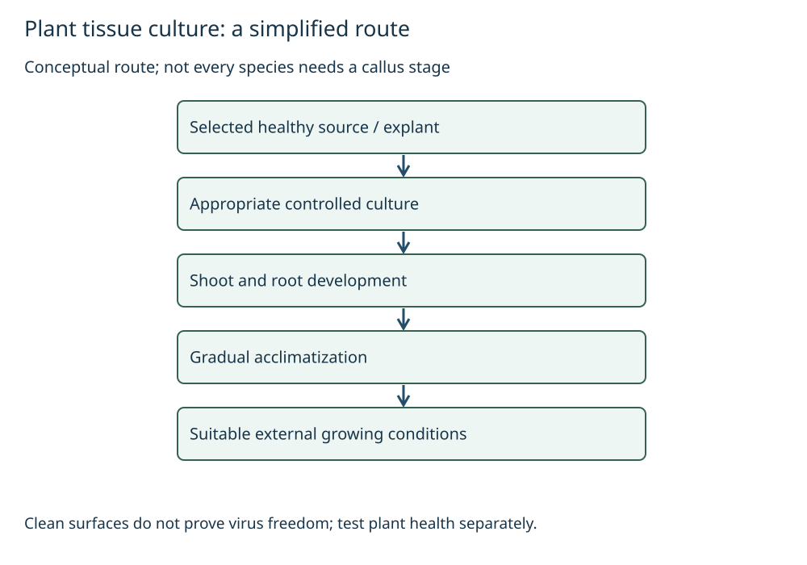
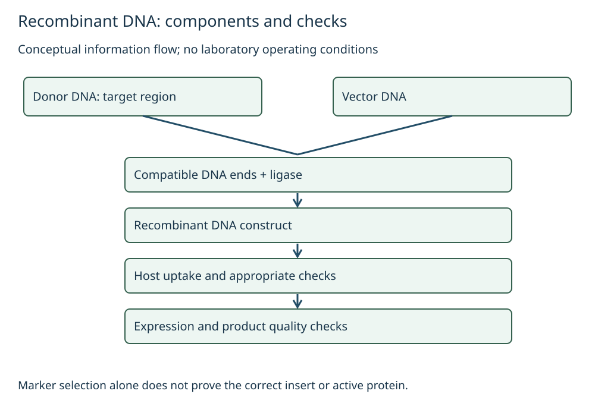
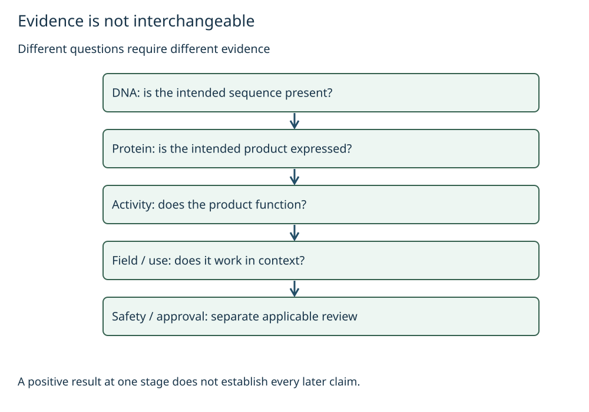

# ১৪শ অধ্যায়: জীবপ্রযুক্তি

> উত্তরসহ পর্যালোচনাধীন খসড়া; সংখ্যাগত লক্ষ্য অপূর্ণ।
> মূল বই ও বিষয়বিশেষজ্ঞের পূর্ণ যাচাই বাকি। বোর্ড/স্কুল/সাল দাবি নেই।

## rebuild-mcq.json

### MCQ 1

জীব বা তার অংশ ব্যবহার করে উপযোগী দ্রব্য বা প্রক্রিয়া তৈরির প্রযুক্তি কী?

A. জীবপ্রযুক্তি
B. শুধু অঙ্গসংস্থান
C. শুধু জীবগণনা
D. শুধু শ্রেণিবিন্যাস

উত্তর: A — জীবপ্রযুক্তি
জীবপ্রযুক্তিতে জীব, কোষ বা জৈব উপাদান কাজে লাগানো হয়।

### MCQ 2

কোনটি প্রচলিত জীবপ্রযুক্তির উদাহরণ?

A. শিলা গুঁড়া করা
B. অণুবীক্ষণে পাতার রং দেখা
C. পাখির নাম লেখা
D. অণুজীবের সাহায্যে দই তৈরি

উত্তর: D — অণুজীবের সাহায্যে দই তৈরি
অণুজীবনির্ভর গাঁজনের খাদ্য উৎপাদন প্রচলিত জীবপ্রযুক্তি।

### MCQ 3

আধুনিক জিন প্রকৌশলের বিশেষ বৈশিষ্ট্য কোনটি?

A. শুধু জমিতে পানি দেওয়া
B. শুধু গাছের উচ্চতা মাপা
C. শুধু ভালো বীজ দেখে বাছাই
D. নির্দিষ্ট DNA পরিবর্তন বা পুনর্বিন্যাস

উত্তর: D — নির্দিষ্ট DNA পরিবর্তন বা পুনর্বিন্যাস
জিন প্রকৌশল সরাসরি জিনগত উপাদান নিয়ে কাজ করে; সব জীবপ্রযুক্তি তা করে না।

### MCQ 4

রুটি তৈরিতে ইস্টের প্রধান অবদান কোনটি?

A. গাঁজনে CO2 তৈরি করে মণ্ড ফোলানো
B. নাইট্রোজেন গ্যাস সংবন্ধন
C. সব গমকে জীবাণুমুক্ত করা
D. মণ্ডে ক্লোরোফিল গঠন

উত্তর: A — গাঁজনে CO2 তৈরি করে মণ্ড ফোলানো
ইস্ট শর্করা ব্যবহার করে গ্যাস ছাড়ে, যা মণ্ডে ফাঁপা গঠন তৈরি করে।

### MCQ 5

দই তৈরিতে দুধের অম্লতা বাড়ে প্রধানত কেন?

A. ল্যাকটিক অ্যাসিড তৈরি হয়
B. দুধে আলোকসংশ্লেষণ হয়
C. সব প্রোটিন DNA হয়
D. সব পানি অক্সিজেন হয়

উত্তর: A — ল্যাকটিক অ্যাসিড তৈরি হয়
ল্যাকটিক অ্যাসিড ব্যাকটেরিয়া শর্করা ব্যবহার করে অম্ল তৈরি করে।

### MCQ 6

প্রচলিত সংকরায়ণ ও জিন প্রকৌশলের সাধারণ লক্ষ্য হতে পারে কোনটি?

A. প্রজনন বন্ধ করা
B. শুধু প্রজাতির নাম বদলানো
C. বাঞ্ছিত বৈশিষ্ট্যসম্পন্ন জীব পাওয়া
D. সব জীবের জিন মুছে ফেলা

উত্তর: C — বাঞ্ছিত বৈশিষ্ট্যসম্পন্ন জীব পাওয়া
পদ্ধতি আলাদা হলেও উন্নত বৈশিষ্ট্য অর্জন উভয়ের লক্ষ্য হতে পারে।

### MCQ 7

সব জীবপ্রযুক্তির ফলকে ট্রান্সজেনিক বলা ভুল কেন?

A. সব অণুজীব উদ্ভিদ
B. গাঁজন বা টিস্যু কালচারে নতুন জিন ঢোকানো আবশ্যক নয়
C. সব জীবের একই জিন
D. সব জীবপ্রযুক্তি শুধু পাথর নিয়ে

উত্তর: B — গাঁজন বা টিস্যু কালচারে নতুন জিন ঢোকানো আবশ্যক নয়
জীবপ্রযুক্তির পরিসর জিন স্থানান্তরের চেয়ে বড়।

### MCQ 8

উদ্ভিদের ক্ষুদ্র অংশ নিয়ন্ত্রিত মাধ্যমে জন্মানোর পদ্ধতি কোনটি?

A. শুধু খাদ্যজাল
B. শুধু পরাগগণনা
C. টিস্যু কালচার
D. শুধু মাটিক্ষয়

উত্তর: C — টিস্যু কালচার
টিস্যু কালচারে জীবাণুমুক্ত নিয়ন্ত্রিত পরিবেশে কোষ/টিস্যু/অঙ্গ আবাদ করা হয়।

### MCQ 9

টিস্যু কালচারের শুরুতে নেওয়া উদ্ভিদাংশের নাম কী?

A. এক্সপ্লান্ট
B. রাইবোসোম
C. লিগেজ
D. ভেক্টর

উত্তর: A — এক্সপ্লান্ট
আবাদ শুরু করার উদ্ভিদাংশ এক্সপ্লান্ট।

### MCQ 10

উপযুক্ত অবস্থায় একটি উদ্ভিদকোষ থেকে পূর্ণ গাছ গঠনের সম্ভাব্য ক্ষমতা কী?

A. শুধু পরাগায়ন
B. শুধু শ্বসন
C. শুধু পরিবহন
D. টোটিপোটেন্সি

উত্তর: D — টোটিপোটেন্সি
টোটিপোটেন্সি পূর্ণ জীবের বিকাশক্ষমতার ধারণা; বাস্তব পুনর্জন্ম শর্তনির্ভর।

### MCQ 11

টোটিপোটেন্সি থাকলেও সব কোষ সব মাধ্যমে গাছ হয় না কেন?

A. সব উদ্ভিদকোষ মৃত
B. মাধ্যমে কখনো পুষ্টি লাগে না
C. সব কোষে নিউক্লিয়াস অনুপস্থিত
D. জিনগত ধরন, কোষের অবস্থা ও আবাদশর্ত গুরুত্বপূর্ণ

উত্তর: D — জিনগত ধরন, কোষের অবস্থা ও আবাদশর্ত গুরুত্বপূর্ণ
পুনর্জন্মের সক্ষমতা ও তার বাস্তব প্রকাশ আলাদা।

### MCQ 12

এক্সপ্লান্ট হিসেবে কোনটি উপযুক্ত উদাহরণ?

A. শুধু পাতিত জল
B. ধাতুর তার
C. স্বাস্থ্যবান উদ্ভিদের মুকুলের অংশ
D. এক টুকরা কাচ

উত্তর: C — স্বাস্থ্যবান উদ্ভিদের মুকুলের অংশ
জীবন্ত উদ্ভিদ টিস্যু থেকে এক্সপ্লান্ট নেওয়া হয়।

### MCQ 13

টিস্যু কালচারে মাতৃগাছ নির্বাচন গুরুত্বপূর্ণ কেন?

A. মাতৃগাছের কোনো জিন নেই
B. রোগ কখনো উদ্ভিদে হয় না
C. বৈশিষ্ট্য ও রোগাবস্থা চারায় প্রভাব ফেলতে পারে
D. সব মাতৃগাছ অভিন্ন

উত্তর: C — বৈশিষ্ট্য ও রোগাবস্থা চারায় প্রভাব ফেলতে পারে
উৎসের গুণমান ও স্বাস্থ্য আবাদফলের গুরুত্বপূর্ণ নিয়ামক।

### MCQ 14

জীবাণুমুক্ত পরিবেশ রক্ষার প্রধান উদ্দেশ্য কী?

A. উদ্ভিদের সব কোষ হত্যা
B. সব খনিজ সরানো
C. আলো সম্পূর্ণ সরানো
D. অবাঞ্ছিত অণুজীবের দূষণ ঠেকানো

উত্তর: D — অবাঞ্ছিত অণুজীবের দূষণ ঠেকানো
চিনি-পুষ্টিসমৃদ্ধ মাধ্যমে দূষক দ্রুত বাড়তে পারে।

### MCQ 15

কালচার মাধ্যমে সুক্রোজ দেওয়ার প্রধান কারণ কী?

A. সব রোগ নিশ্চিত সারানো
B. কার্বন ও শক্তির উৎস সরবরাহ
C. শুধু মাধ্যম জমাট করা
D. কোষের সব DNA কাটা

উত্তর: B — কার্বন ও শক্তির উৎস সরবরাহ
আবাদকৃত টিস্যু পর্যাপ্ত সালোকসংশ্লেষণ নাও করতে পারে, তাই কার্বন উৎস দেওয়া হয়।

### MCQ 16

অ্যাগারের প্রধান কাজ কোনটি?

A. মাধ্যমকে জমাট বা আধা-জমাট রাখা
B. জিন কেটে দেওয়া
C. অক্সিজেনের একমাত্র উৎস হওয়া
D. প্রধান কার্বন উৎস হওয়া

উত্তর: A — মাধ্যমকে জমাট বা আধা-জমাট রাখা
সাধারণ কালচারে অ্যাগার জেল গঠনকারী, সুক্রোজের বিকল্প নয়।

### MCQ 17

খনিজ লবণ ও ভিটামিনের উপযুক্ত মিশ্রণ কেন দরকার?

A. সব উদ্ভিদকে প্রাণী বানাতে
B. শুধু পাত্র রাঙাতে
C. DNA-র সব জিন মুছতে
D. বৃদ্ধি ও বিপাকের প্রয়োজন মেটাতে

উত্তর: D — বৃদ্ধি ও বিপাকের প্রয়োজন মেটাতে
আবাদে কোষের পুষ্টি ও সহায়ক উপাদান নিয়ন্ত্রণ করা হয়।

### MCQ 18

অক্সিন ও সাইটোকাইনিন কোন ধরনের উপাদান?

A. শুধু জীবাণুনাশক
B. কেবল গাঁজনগ্যাস
C. প্লাজমিড
D. উদ্ভিদ বৃদ্ধিনিয়ন্ত্রক

উত্তর: D — উদ্ভিদ বৃদ্ধিনিয়ন্ত্রক
এদের অনুপাত ও মাত্রা অঙ্গগঠনে প্রভাব ফেলতে পারে।

### MCQ 19

ক্যালাস বলতে কী বোঝায়?

A. শুধু শুকনো বীজ
B. অবশ্যই পূর্ণ ফুল
C. অসংগঠিতভাবে বিভাজনশীল কোষপুঞ্জ
D. ব্যাকটেরিয়ার প্লাজমিড

উত্তর: C — অসংগঠিতভাবে বিভাজনশীল কোষপুঞ্জ
উপযুক্ত আবাদে টিস্যু থেকে ক্যালাস তৈরি হতে পারে।

### MCQ 20

টিস্যু কালচারের প্রতিটি পদ্ধতিতে ক্যালাস ধাপ বাধ্যতামূলক কি?

A. হ্যাঁ, ক্যালাস মানেই শিকড়
B. হ্যাঁ, সব জীবনে একই ধাপ
C. না, কখনো কোষ বিভাজন হয় না
D. না, সরাসরি অঙ্গগঠনও হতে পারে

উত্তর: D — না, সরাসরি অঙ্গগঠনও হতে পারে
উদ্ভিদ ও পদ্ধতিভেদে সরাসরি বা ক্যালাসের মাধ্যমে পুনর্জন্ম হয়।

### MCQ 21

অণুবংশবিস্তার বলতে প্রধানত কী বোঝায়?

A. বীজের রং দেখা
B. একটি গাছ মাটিতে সরানো মাত্র
C. ব্যাকটেরিয়ার নাম বদলানো
D. আবাদে অল্প উদ্ভিদাংশ থেকে বহু চারা তৈরি

উত্তর: D — আবাদে অল্প উদ্ভিদাংশ থেকে বহু চারা তৈরি
মাইক্রোপ্রপাগেশন নিয়ন্ত্রিত আবাদে দ্রুত উদ্ভিদসংখ্যা বাড়ায়।

### MCQ 22

অণুচারা মাটিতে দেওয়ার আগে মূল গঠনের ধাপের উদ্দেশ্য কী?

A. পানি ও পুষ্টি গ্রহণে কার্যকর মূল তৈরি
B. জিনমুক্ত গাছ পাওয়া
C. সব কাণ্ড সরিয়ে ফেলা
D. শুধু ফলের রং বদলানো

উত্তর: A — পানি ও পুষ্টি গ্রহণে কার্যকর মূল তৈরি
মূল গঠন পরবর্তী স্বতন্ত্র জীবনধারণে সহায়ক।

### MCQ 23

কালচারপাত্র থেকে সরাসরি রোদে দিলে চারা মরতে পারে কেন?

A. আর্দ্রতা ও পরিবেশের আকস্মিক পরিবর্তন
B. চারায় কোনো কোষ নেই
C. সূর্যালোক সবসময় বিষ
D. সব মাটি জীবহীন

উত্তর: A — আর্দ্রতা ও পরিবেশের আকস্মিক পরিবর্তন
পাত্রের উচ্চ আর্দ্রতা ও নিয়ন্ত্রিত অবস্থা থেকে বাইরের পরিবেশ ভিন্ন।

### MCQ 24

চারা ধীরে বাইরের পরিবেশে মানিয়ে নেওয়ার ধাপ কী?

A. ট্রান্সলেশন
B. DNA লাইগেশন
C. অভিযোজন বা হার্ডেনিং
D. ডিনাইট্রিফিকেশন

উত্তর: C — অভিযোজন বা হার্ডেনিং
হার্ডেনিংয়ে আর্দ্রতা, আলো ও অন্যান্য শর্ত ধীরে সমন্বয় করা হয়।

### MCQ 25

মেরিস্টেম কালচার কোন কাজে সাহায্য করতে পারে?

A. উপযুক্ত পরীক্ষাসহ রোগমুক্ত রোপণ উপাদান পেতে
B. প্রতিটি উদ্ভিদে নতুন প্রাণীজ জিন দিতে
C. সব ভাইরাস ধ্বংসের নিশ্চয়তা
D. শুধু শুকনো কাঠ বানাতে

উত্তর: A — উপযুক্ত পরীক্ষাসহ রোগমুক্ত রোপণ উপাদান পেতে
নির্দিষ্ট মেরিস্টেম পদ্ধতিতে কিছু রোগের ঝুঁকি কমানো যায়; পরীক্ষা দরকার।

### MCQ 26

টিস্যু কালচারের চারা মানেই ভাইরাসমুক্ত—কেন ভুল?

A. ভাইরাস কেবল পাথরে থাকে
B. পদ্ধতি ও উৎসভেদে সংক্রমণ থাকতে পারে
C. সব গাছ একই ভাইরাস তৈরি করে
D. জীবাণুমুক্ত পাত্র মানেই সব কোষের জিন মুছে যায়

উত্তর: B — পদ্ধতি ও উৎসভেদে সংক্রমণ থাকতে পারে
বাহ্যিক দূষণমুক্ত আবাদ অভ্যন্তরীণ সব ভাইরাস অনুপস্থিতির প্রমাণ নয়।

### MCQ 27

ক্লোনজাত চারার প্রত্যাশিত প্রধান মিল কোনটি?

A. সব পরিবেশে অভিন্ন ফলন
B. অবশ্যই একই উচ্চতা প্রতিদিন
C. একই উৎসের সঙ্গে উচ্চ জিনগত সাদৃশ্য
D. সব রোগে সম্পূর্ণ প্রতিরোধ

উত্তর: C — একই উৎসের সঙ্গে উচ্চ জিনগত সাদৃশ্য
ক্লোনগত সাদৃশ্য থাকলেও পরিবেশ ও আবাদজনিত পরিবর্তন ফল বদলাতে পারে।

### MCQ 28

সোমাক্লোনাল ভ্যারিয়েশন কী? (সম্প্রসারিত)

A. মাধ্যমের পানি বাষ্পীভবন
B. পাতার প্রস্বেদনমাত্র
C. সবসময় কাঙ্ক্ষিত নতুন প্রজাতি
D. আবাদজাত উদ্ভিদে সৃষ্ট বা নির্বাচিত ভিন্নতা

উত্তর: D — আবাদজাত উদ্ভিদে সৃষ্ট বা নির্বাচিত ভিন্নতা
টিস্যু কালচারে ভিন্নতা ঘটতে পারে, তাই অভিন্নতার নিশ্চয়তা নয়।

### MCQ 29

দ্রুত অনেক চারা তৈরিতে টিস্যু কালচারের সুবিধা কোনটি?

A. সব চারা নিশ্চয় টিকে থাকে
B. কখনো প্রশিক্ষণ লাগে না
C. সব খরচ শূন্য
D. সীমিত উৎস থেকে নিয়ন্ত্রিত সংখ্যাবৃদ্ধি

উত্তর: D — সীমিত উৎস থেকে নিয়ন্ত্রিত সংখ্যাবৃদ্ধি
দ্রুত বিস্তার সম্ভব, তবে দক্ষতা, অবকাঠামো ও গুণমান নিয়ন্ত্রণ লাগে।

### MCQ 30

বিরল উদ্ভিদে টিস্যু কালচার কীভাবে সহায়ক হতে পারে?

A. সব জিনগত বৈচিত্র্য নিজে সৃষ্টি করে
B. সব বন্যপ্রাণী প্রতিস্থাপনে
C. প্রাকৃতিক আবাসের প্রয়োজন মুছে
D. স্বল্প উৎস থেকে বংশবিস্তার ও সংরক্ষণে

উত্তর: D — স্বল্প উৎস থেকে বংশবিস্তার ও সংরক্ষণে
এটি সহায়ক এক্স-সিটু উপায়, আবাস সংরক্ষণের বিকল্প নয়।

### MCQ 31

একই মাতৃগাছের বহু চারা রক্ষায় কী বৈচিত্র্যগত সীমা থাকতে পারে?

A. প্রতিটি চারা নতুন প্রজাতি
B. জিনগত সম্পর্ক থাকে না
C. সব প্রজাতির সব জিন থাকে
D. মোট জিনগত বৈচিত্র্যের অল্প অংশ সংরক্ষিত হয়

উত্তর: D — মোট জিনগত বৈচিত্র্যের অল্প অংশ সংরক্ষিত হয়
এক উৎসের অনেক কপি বিভিন্ন উৎসের বৈচিত্র্যের সমার্থক নয়।

### MCQ 32

পাত্রে ছত্রাক দেখা গেলে সবচেয়ে যুক্তিযুক্ত পেশাগত পদক্ষেপ কী?

A. অজানা ছত্রাক হাতে চেখে দেখা
B. দূষিত কালচার আলাদা করে নিয়ম অনুযায়ী ব্যবস্থাপনা
C. চারা নিশ্চিত ভালো ঘোষণা
D. সবার মধ্যে খোলা রেখে ছড়ানো

উত্তর: B — দূষিত কালচার আলাদা করে নিয়ম অনুযায়ী ব্যবস্থাপনা
দূষণ নিয়ন্ত্রণে নিরাপদ আলাদা রাখা ও প্রতিষ্ঠিত নিয়ম মানতে হয়।

### MCQ 33

কালচারপাত্র বারবার অপ্রয়োজনে খোলা অনুচিত কেন?

A. বাইরের দূষণ ঢোকার সুযোগ বাড়ে
B. সব আলো নিভে যায়
C. অ্যাগার ধাতু হয়
D. প্রতিবার নতুন জিন তৈরি হয়

উত্তর: A — বাইরের দূষণ ঢোকার সুযোগ বাড়ে
জীবাণুমুক্ত ব্যবস্থায় অনাবশ্যক সংস্পর্শ কমানো হয়।

### MCQ 34

মাধ্যমের pH নিয়ন্ত্রণের তাৎপর্য কী?

A. পুষ্টি-প্রাপ্যতা ও কোষবৃদ্ধিতে প্রভাব
B. সব উদ্ভিদে একই জিন ঢোকানো
C. কোষের পরিচয় মুছে ফেলা
D. শুধু পাত্রের ওজন বাড়ানো

উত্তর: A — পুষ্টি-প্রাপ্যতা ও কোষবৃদ্ধিতে প্রভাব
রাসায়নিক পরিবেশের উপযোগিতা আবাদে গুরুত্বপূর্ণ।

### MCQ 35

নির্দিষ্ট উদ্ভিদের জন্য উপযুক্ত হরমোন অনুপাত অন্যটিতে না চলতে পারে কেন?

A. সব উদ্ভিদ হরমোনহীন
B. প্রজাতি ও জিনগত ধরনভেদে প্রতিক্রিয়া আলাদা
C. সব কোষ একই বিকাশধাপে থাকে
D. হরমোন শুধু পাত্রে কাজ করে

উত্তর: B — প্রজাতি ও জিনগত ধরনভেদে প্রতিক্রিয়া আলাদা
আবাদপ্রোটোকল উদ্ভিদ ও টিস্যুনির্ভরভাবে যাচাই করতে হয়।

### MCQ 36

কাণ্ড তৈরির পরই সফল বাণিজ্যিক চারা উৎপাদন সম্পূর্ণ বলা যায় না কেন?

A. সব কাণ্ড সরাসরি বীজ হয়
B. কাণ্ড কোনো অঙ্গ নয়
C. মূল, অভিযোজন ও পরবর্তী গুণমানও যাচাই বাকি
D. মাটির পরিবেশ লাগে না

উত্তর: C — মূল, অভিযোজন ও পরবর্তী গুণমানও যাচাই বাকি
গণনার পাশাপাশি প্রতিষ্ঠা ও কাঙ্ক্ষিত বৈশিষ্ট্য থাকা দেখতে হয়।

### MCQ 37

কলার টিস্যু কালচার নিয়ে কোন বক্তব্যটি যথাযথ?

A. দ্রুত মানসম্মত চারা পেতে সহায়ক হতে পারে
B. সব জাত একই ফল দেয়
C. কখনো রোগপরীক্ষা লাগে না
D. প্রতিটি চারা সব রোগে অজেয়

উত্তর: A — দ্রুত মানসম্মত চারা পেতে সহায়ক হতে পারে
সুবিধা পেতে উৎস, পদ্ধতি ও মাঠের গুণমান নিয়ন্ত্রণ গুরুত্বপূর্ণ।

### MCQ 38

অর্কিডের অণুবংশবিস্তার কোন প্রয়োজন মেটাতে পারে?

A. সব ফুল নীল করা
B. আলোকসংশ্লেষণ বন্ধ করা
C. অবশ্যই জিন স্থানান্তর
D. বংশবিস্তার কঠিন উৎস থেকে চারা বাড়ানো

উত্তর: D — বংশবিস্তার কঠিন উৎস থেকে চারা বাড়ানো
টিস্যু কালচার নির্বাচিত উদ্ভিদের দ্রুত সংখ্যাবৃদ্ধিতে ব্যবহৃত হয়।

### MCQ 39

টিস্যু কালচারের বড় একটি সীমাবদ্ধতা কোনটি?

A. কোনো পুষ্টি লাগে না
B. দক্ষতা ও দূষণ নিয়ন্ত্রণের খরচ
C. কোনো বিদ্যুৎ/অবকাঠামো লাগে না
D. সব জায়গায় শতভাগ সাফল্য

উত্তর: B — দক্ষতা ও দূষণ নিয়ন্ত্রণের খরচ
নিয়ন্ত্রিত আবাদে প্রশিক্ষণ, সরঞ্জাম ও পর্যবেক্ষণ প্রয়োজন।

### MCQ 40

এক্সপ্লান্টের উপরিভাগ জীবাণুমুক্ত করলেই ভেতরের সব রোগ নেই বলা যায় না কেন?

A. কোষের ভিতর পদার্থ থাকে না
B. সব রোগ কাচের রং
C. সুক্রোজ সব ভাইরাস সারায়
D. অভ্যন্তরীণ রোগজীবাণু থেকে যেতে পারে

উত্তর: D — অভ্যন্তরীণ রোগজীবাণু থেকে যেতে পারে
পৃষ্ঠের দূষণ ও অভ্যন্তরীণ সংক্রমণ ভিন্ন বিষয়।

### MCQ 41

আলাদা কালচারে নাম-তারিখ ও উৎস লেখা কেন প্রয়োজন?

A. শুধু লেখার অনুশীলন
B. আলো শোষণ বন্ধে
C. সনাক্তকরণ ও ট্রেসেবিলিটি বজায় রাখতে
D. জিনের সংখ্যা বাড়াতে

উত্তর: C — সনাক্তকরণ ও ট্রেসেবিলিটি বজায় রাখতে
রেকর্ড ছাড়া ভুল জাত বা দূষণের উৎস নির্ণয় কঠিন।

### MCQ 42

সব টিস্যু কালচার চারা মাঠে একই ফলন দেবে—দাবির ত্রুটি কী?

A. জিনগত বৈশিষ্ট্যের কোনো ভূমিকা নেই
B. মাঠে সব পরিবেশ অভিন্ন
C. সব চারা একই সময়ে মারা যায়
D. মাটি, পানি, রোগ ও ব্যবস্থাপনা ফলন প্রভাবিত করে

উত্তর: D — মাটি, পানি, রোগ ও ব্যবস্থাপনা ফলন প্রভাবিত করে
জিনগত সম্ভাবনার সঙ্গে পরিবেশ ও ব্যবস্থাপনাও ফল নির্ধারণ করে।

### MCQ 43

কোন তুলনা টিস্যু কালচারের সাফল্য ভালোভাবে দেখায়?

A. শুধু পাত্রের রং
B. শুধু ল্যাবের নাম
C. চারা উৎপাদন, অভিযোজনে টিকে থাকা ও জাতের সত্যতা
D. শুধু বিজ্ঞাপনের সংখ্যা

উত্তর: C — চারা উৎপাদন, অভিযোজনে টিকে থাকা ও জাতের সত্যতা
বহু ধাপের গুণমান ও প্রতিষ্ঠা সফলতার সূচক।

### MCQ 44

আবাদে কোষবিভাজনে কোন প্রক্রিয়া প্রধান? 

A. পরাগায়নমাত্র
B. মিয়োসিসমাত্র
C. মাইটোসিস
D. নিষেকমাত্র

উত্তর: C — মাইটোসিস
অঙ্গজ সংখ্যাবৃদ্ধিতে সাধারণত মাইটোটিক বিভাজন গুরুত্বপূর্ণ।

### MCQ 45

টিস্যু কালচার ও বীজের যৌন প্রজননের একটি পার্থক্য কোনটি?

A. দুটিই সবসময় একই জিনগত ফল
B. প্রথমটিতে কোনো কোষবিভাজন নেই
C. প্রথমটিতে সাধারণত গ্যামেটের মিলন লাগে না
D. দ্বিতীয়টিতে বংশগতি নেই

উত্তর: C — প্রথমটিতে সাধারণত গ্যামেটের মিলন লাগে না
অঙ্গজ আবাদে নিষেক ছাড়াই উৎসের অংশ থেকে চারা তৈরি হয়।

### MCQ 46

মাধ্যমে পুষ্টি থাকলেও ছত্রাক দমনে নির্বিচারে বিষ মেশানো উপযুক্ত নয় কেন?

A. সব বিষ উদ্ভিদের খাদ্য
B. সব বিষ শুধু জীবাণু মারে
C. টিস্যু ক্ষতি ও নিরাপত্তার সমস্যা হতে পারে
D. দূষণের উৎস খোঁজা অপ্রয়োজনীয়

উত্তর: C — টিস্যু ক্ষতি ও নিরাপত্তার সমস্যা হতে পারে
দূষণ মোকাবিলায় অনুমোদিত পদ্ধতি ও দক্ষ তত্ত্বাবধান প্রয়োজন।

### MCQ 47

বৃদ্ধিনিয়ন্ত্রককে খনিজ পুষ্টির সম্পূর্ণ বিকল্প ভাবা ভুল কেন?

A. হরমোনই সব পরমাণু দেয়
B. সংকেত ও পুষ্টি সরবরাহের ভূমিকা আলাদা
C. উদ্ভিদের কোনো খনিজ লাগে না
D. খনিজ শুধু প্রাণীর লাগে

উত্তর: B — সংকেত ও পুষ্টি সরবরাহের ভূমিকা আলাদা
উপযুক্ত পুষ্টি ও নিয়ন্ত্রক দুটোই ভিন্ন প্রয়োজন মেটায়।

### MCQ 48

হার্ডেনিংয়ে ধীরে আর্দ্রতা বদলানো কেন সহায়ক?

A. পানি হারানোর নতুন অবস্থায় চারা মানিয়ে নেয়
B. সব চারা ফুলে যায়
C. কোষের সব ক্রোমোজোম হারায়
D. শুধু অ্যাগার জমে

উত্তর: A — পানি হারানোর নতুন অবস্থায় চারা মানিয়ে নেয়
পাত্রের অবস্থা থেকে বাইরের বাষ্পোৎসর্জন ও পানি-চাহিদায় অভিযোজন দরকার।

### MCQ 49

টিস্যু কালচারের উৎস হিসেবে রোগাক্রান্ত গাছ নেওয়ায় কী ঝুঁকি?

A. সব রোগ নিজে থেকেই শেষ
B. বহু চারায় একই সমস্যা ছড়াতে পারে
C. কখনো পরীক্ষা লাগে না
D. প্রতিটি চারা নতুন সুস্থ প্রজাতি

উত্তর: B — বহু চারায় একই সমস্যা ছড়াতে পারে
দ্রুত সংখ্যাবৃদ্ধি ভালো বৈশিষ্ট্যের পাশাপাশি অশনাক্ত সমস্যাও বাড়াতে পারে।

### MCQ 50

পূর্ণ গাছ গঠন না হয়ে কেবল কোষপুঞ্জ বাড়লে কোন সিদ্ধান্ত নিরাপদ?

A. সব কোষ প্রাণী হয়েছে
B. টোটিপোটেন্সি ধারণা সবসময় মিথ্যা
C. সব কোষে জিন নেই
D. আরও উপযুক্ত পুনর্জন্মশর্ত যাচাই দরকার

উত্তর: D — আরও উপযুক্ত পুনর্জন্মশর্ত যাচাই দরকার
ক্যালাস বৃদ্ধি ও পূর্ণ অঙ্গ/গাছ গঠন আলাদা ফল।

### MCQ 51

জিন প্রকৌশলের প্রধান লক্ষ্যবস্তু কোনটি?

A. কেবল কোষের তাপ
B. DNA
C. শুধু লবণ
D. শুধু কোষের পানি

উত্তর: B — DNA
বংশগত তথ্যবাহী DNA পরিবর্তন বা পুনর্বিন্যাস করা হয়।

### MCQ 52

রিকম্বিনেন্ট DNA কী?

A. শুধু যে কোনো পুরোনো প্রোটিন
B. ভিন্ন উৎসের DNA অংশ যুক্ত করে গঠিত DNA
C. সব মৃত কোষের নাম
D. কেবল RNA-র অনুবাদ

উত্তর: B — ভিন্ন উৎসের DNA অংশ যুক্ত করে গঠিত DNA
উপযুক্ত DNA খণ্ড যুক্ত করে নতুন সমন্বয় তৈরি হয়।

### MCQ 53

কাঙ্ক্ষিত বৈশিষ্ট্যের জিন পাওয়া যায় যে উৎস থেকে তাকে কী বলা যায়?

A. শুধু মাধ্যম
B. প্রাপক
C. কেবল পণ্য
D. দাতা

উত্তর: D — দাতা
দাতা উৎস থেকে লক্ষ্য DNA/জিন নেওয়া হয়।

### MCQ 54

জিন বহন করে প্রাপক কোষে পৌঁছানোর উপাদান কী?

A. ভেক্টর
B. শুধু গ্লুকোজ
C. অ্যাগার
D. ক্যালাস

উত্তর: A — ভেক্টর
ভেক্টর লক্ষ্য DNA বহনে সাহায্য করে।

### MCQ 55

ব্যাকটেরিয়ার প্লাজমিড সাধারণত কী?

A. শুধু কোষের প্রোটিনপ্রাচীর
B. নিষিক্ত ডিম্বাণু
C. ক্রোমোজোমের বাইরের ক্ষুদ্র DNA অণু
D. ক্যালাসের ফুল

উত্তর: C — ক্রোমোজোমের বাইরের ক্ষুদ্র DNA অণু
অনেক প্লাজমিড বৃত্তাকার এবং নিজস্ব প্রতিলিপিতে সক্ষম।

### MCQ 56

সব প্লাজমিডকে কোষের প্রধান ক্রোমোজোম বলা যায় না কেন?

A. সব প্লাজমিড RNA
B. ক্রোমোজোমে DNA নেই
C. এরা সাধারণত অতিরিক্ত DNA উপাদান
D. এদের কোনো জিন থাকতে পারে না

উত্তর: C — এরা সাধারণত অতিরিক্ত DNA উপাদান
প্লাজমিড ও প্রধান ক্রোমোজোমের পরিচয় পৃথক।

### MCQ 57

রেস্ট্রিকশন এনজাইমের প্রধান ধারণাগত কাজ কী?

A. প্রোটিন অনুবাদ
B. নির্দিষ্ট সিকোয়েন্স চিনে DNA কাটা
C. DNA-র সব খণ্ড জোড়া
D. মাধ্যম জমাট করা

উত্তর: B — নির্দিষ্ট সিকোয়েন্স চিনে DNA কাটা
নির্দিষ্ট শনাক্তস্থানভিত্তিক কাটার ক্ষমতা জিন প্রকৌশলে কাজে লাগে।

### MCQ 58

DNA লাইগেজের কাজ কোনটি?

A. শুধু প্রোটিন হজম
B. শুধু কোষের আলো তৈরি
C. DNA খণ্ডের শর্করা-ফসফেট মেরুদণ্ড জোড়া
D. DNA থেকে সব বেস মুছে ফেলা

উত্তর: C — DNA খণ্ডের শর্করা-ফসফেট মেরুদণ্ড জোড়া
লাইগেজ উপযুক্ত DNA প্রান্তের মধ্যে সমযোজী বন্ধন গঠনে সাহায্য করে।

### MCQ 59

রেস্ট্রিকশন ও লাইগেজের ভূমিকা কোন জোড়ায় সঠিক?

A. দুটিই শুধু গাঁজন
B. জমাট ও বাষ্পীভবন
C. দুটিই সালোকসংশ্লেষণ
D. কাটা ও জোড়া লাগানো

উত্তর: D — কাটা ও জোড়া লাগানো
ধারণাগতভাবে রেস্ট্রিকশন কাটে, লাইগেজ উপযুক্ত খণ্ড যুক্ত করে।

### MCQ 60

স্টিকি এন্ডের পরিপূরক প্রান্ত কেন সুবিধাজনক? (সম্প্রসারিত)

A. বেসজোড় গঠনে সামঞ্জস্যপূর্ণ খণ্ড পাশাপাশি আসে
B. সব ভুল DNA নিজে ধ্বংস হয়
C. সব কোষে প্রবেশ নিশ্চিত হয়
D. জিন প্রকাশ নিশ্চিত হয়

উত্তর: A — বেসজোড় গঠনে সামঞ্জস্যপূর্ণ খণ্ড পাশাপাশি আসে
সাময়িক পরিপূরক জোড় লাইগেশনে উপকারী; স্থায়ী সংযোগ ও যাচাই আলাদা।

### MCQ 61

শুধু পরিপূরক বেসজোড় হলেই স্থায়ী DNA সংযোগ সম্পূর্ণ নয় কেন? (সম্প্রসারিত)

A. মেরুদণ্ডে সমযোজী সংযোগ দরকার
B. সব প্রান্ত আলো দিয়ে জোড়া
C. কোনো এনজাইমের ভূমিকা নেই
D. সব বেস প্রোটিন

উত্তর: A — মেরুদণ্ডে সমযোজী সংযোগ দরকার
লাইগেজের মাধ্যমে মেরুদণ্ডের ফাঁক যুক্ত হতে পারে।

### MCQ 62

কাঙ্ক্ষিত জিনসহ প্লাজমিড প্রাপক কোষে প্রবেশ করানোর ধারণাটি কী?

A. শুধু বিয়োজন
B. কেবল প্রস্বেদন
C. শুধু পরাগায়ন
D. ট্রান্সফরমেশন

উত্তর: D — ট্রান্সফরমেশন
এখানে ট্রান্সফরমেশন বাহ্যিক DNA গ্রহণের ধারণা বোঝায়।

### MCQ 63

প্রাপক কোষের ভূমিকা কী?

A. এনজাইমের নাম হওয়া
B. প্রবেশকৃত DNA ধারণ ও প্রয়োজনে প্রকাশে সহায়তা
C. শুধু কাচের পাত্র হওয়া
D. সব সময় দাতা উদ্ভিদ হওয়া

উত্তর: B — প্রবেশকৃত DNA ধারণ ও প্রয়োজনে প্রকাশে সহায়তা
হোস্ট বা প্রাপক জীবন্ত কোষীয় ব্যবস্থা সরবরাহ করে।

### MCQ 64

ট্রান্সফরমেশনের পরে সব কোষে কাঙ্ক্ষিত DNA থাকবে না কেন?

A. সব কোষ একই পাত্রে অদৃশ্য হয়
B. সব কোষের একই ভাগ্য নিশ্চিত
C. DNA গ্রহণ ও সঠিক নির্মাণ সব কোষে সফল নয়
D. সব DNA জিনহীন

উত্তর: C — DNA গ্রহণ ও সঠিক নির্মাণ সব কোষে সফল নয়
প্রবেশ ও কাঙ্ক্ষিত সমন্বয়ের সফলতা যাচাই করতে হয়।

### MCQ 65

সিলেক্টেবল মার্কার ব্যবহারের উদ্দেশ্য কী?

A. নির্দিষ্ট বৈশিষ্ট্যসম্পন্ন কোষ বাছাইয়ে সাহায্য
B. সব জিনের কার্যকারিতা নিশ্চিত
C. কাঙ্ক্ষিত পণ্য শতভাগ বিশুদ্ধ করা
D. শুধু DNA-র রং বদলানো

উত্তর: A — নির্দিষ্ট বৈশিষ্ট্যসম্পন্ন কোষ বাছাইয়ে সাহায্য
মার্কার নির্বাচন সহজ করে; সঠিক ইনসার্টের পূর্ণ প্রমাণ নয়।

### MCQ 66

মার্কার-ধনাত্মক কোষেও লক্ষ্য জিন না থাকতে পারে কেন?

A. সব মার্কার প্রোটিনহীন
B. মার্কার থাকলে আর DNA থাকে না
C. সব প্লাজমিড উদ্ভিদ
D. খালি ভেক্টরও মার্কার বহন করতে পারে

উত্তর: D — খালি ভেক্টরও মার্কার বহন করতে পারে
ভেক্টর গ্রহণ ও কাঙ্ক্ষিত জিনের সঠিক সংযোগ আলাদাভাবে যাচাইযোগ্য।

### MCQ 67

লক্ষ্য জিনের উপস্থিতি ও প্রকাশ একই নয় কেন?

A. সব জিন সব কোষে সমান সক্রিয়
B. প্রকাশে কোনো RNA লাগে না
C. উপযুক্ত নিয়ন্ত্রণ ও কোষীয় প্রক্রিয়া দরকার
D. সব DNA-ই সরাসরি প্রোটিন

উত্তর: C — উপযুক্ত নিয়ন্ত্রণ ও কোষীয় প্রক্রিয়া দরকার
DNA থাকলেও সংশ্লিষ্ট RNA/পণ্য যথাযথ নাও হতে পারে।

### MCQ 68

প্রোমোটারের ধারণাগত ভূমিকা কী? (সম্প্রসারিত)

A. পানির স্বাদ বদলানো
B. ক্যালাসের শিকড় কাটা
C. অ্যাগার জমাট করা
D. জিনের ট্রান্সক্রিপশন নিয়ন্ত্রণে অংশ নেওয়া

উত্তর: D — জিনের ট্রান্সক্রিপশন নিয়ন্ত্রণে অংশ নেওয়া
প্রোমোটারসহ নিয়ন্ত্রক অঞ্চল প্রকাশের স্থান ও মাত্রায় গুরুত্বপূর্ণ।

### MCQ 69

ব্যাকটেরিয়ায় মানবজিনের প্রোটিন উৎপাদনে কোষীয় ভিন্নতা কেন বিবেচ্য? (সম্প্রসারিত)

A. সব মানবকোষ ব্যাকটেরিয়া
B. কোনো জীবের রাইবোসোম নেই
C. সব প্রোটিনে একই শর্করা
D. জিন প্রক্রিয়াকরণ ও প্রোটিন পরিমার্জন ভিন্ন হতে পারে

উত্তর: D — জিন প্রক্রিয়াকরণ ও প্রোটিন পরিমার্জন ভিন্ন হতে পারে
হোস্ট নির্বাচন পণ্যের ভাঁজ ও প্রয়োজনীয় পরিবর্তনের সঙ্গে সম্পর্কিত।

### MCQ 70

cDNA বলতে কী বোঝায়? (সম্প্রসারিত)

A. ক্যালাসের কোষপ্রাচীর
B. ক্রোমোজোমের রং
C. RNA ছাঁচ থেকে তৈরি পরিপূরক DNA
D. শুধু কাচে থাকা পানি

উত্তর: C — RNA ছাঁচ থেকে তৈরি পরিপূরক DNA
উপযুক্ত এনজাইমে RNA-ভিত্তিক DNA অনুলিপি তৈরি করা যায়।

### MCQ 71

রিভার্স ট্রান্সক্রিপটেজের ধারণাগত কাজ কোনটি? (সম্প্রসারিত)

A. RNA ছাঁচে DNA তৈরি
B. শুধু কোষবিভাজন
C. DNA খণ্ড জোড়া লাগানো মাত্র
D. মাধ্যমের pH মাপা

উত্তর: A — RNA ছাঁচে DNA তৈরি
এনজাইমটি তথ্যপ্রবাহের RNA থেকে DNA ধাপে অংশ নেয়।

### MCQ 72

PCR-এর সাধারণ উদ্দেশ্য কী? (সম্প্রসারিত)

A. সব প্রোটিন শুদ্ধ করা
B. নির্দিষ্ট DNA অংশের কপি বাড়ানো
C. সরাসরি পূর্ণ গাছ বানানো
D. সব জিন প্রকাশ নিশ্চিত করা

উত্তর: B — নির্দিষ্ট DNA অংশের কপি বাড়ানো
PCR লক্ষ্য অংশের পরিবর্ধন, জৈব জীবের পূর্ণ ক্লোনিং নয়।

### MCQ 73

PCR-এ DNA বেশি পাওয়া মানেই কাঙ্ক্ষিত কার্যকর প্রোটিন পাওয়া নয় কেন?

A. সব DNA খাদ্য
B. কপি বৃদ্ধি ও জিন প্রকাশ আলাদা প্রক্রিয়া
C. প্রোটিনে কোনো কাজ নেই
D. DNA কখনো কপি হয় না

উত্তর: B — কপি বৃদ্ধি ও জিন প্রকাশ আলাদা প্রক্রিয়া
প্রকাশ ও পণ্যের কার্যকারিতা আলাদা পরীক্ষায় দেখতে হয়।

### MCQ 74

জেল ইলেকট্রোফোরেসিসে DNA খণ্ড সাধারণত কোন ভিত্তিতে আলাদা হয়? (সম্প্রসারিত)

A. মাছের পুষ্টিস্তর
B. কেবল দাতার উচ্চতা
C. আকারভিত্তিক চলনের পার্থক্য
D. শুধু পাতার রং

উত্তর: C — আকারভিত্তিক চলনের পার্থক্য
নির্দিষ্ট জেল-শর্তে ছোট খণ্ড সাধারণত বেশি দূর চলে।

### MCQ 75

একই দৈর্ঘ্যের DNA ব্যান্ড পেলেই সিকোয়েন্স অভিন্ন নয় কেন? (সম্প্রসারিত)

A. সব ব্যান্ড শুধু RNA
B. সব DNA একই জিন
C. সমান দৈর্ঘ্যে কোনো বেস থাকে না
D. বেসের ক্রম আলাদা হতে পারে

উত্তর: D — বেসের ক্রম আলাদা হতে পারে
আকার ও বেসক্রম আলাদা তথ্য।

### MCQ 76

সিকোয়েন্স যাচাইয়ের উদ্দেশ্য কী? (সম্প্রসারিত)

A. পাত্রের আয়তন মাপা
B. DNA-র বেসক্রম প্রত্যাশার সঙ্গে মেলানো
C. মাধ্যমের আলো বন্ধ
D. শুধু কোষগণনা

উত্তর: B — DNA-র বেসক্রম প্রত্যাশার সঙ্গে মেলানো
সঠিক ইনসার্ট, ক্রম ও অনাকাঙ্ক্ষিত পরিবর্তন যাচাইয়ে সাহায্য করে।

### MCQ 77

জিন ক্লোনিং ও সম্পূর্ণ প্রাণী ক্লোনিং এক নয় কেন?

A. প্রথমটি DNA অংশের কপি নিয়ে কাজ করে
B. দ্বিতীয়টিতে কোষ নেই
C. প্রথমটিতে DNA নেই
D. দুটিই সবসময় মানুষ তৈরি

উত্তর: A — প্রথমটি DNA অংশের কপি নিয়ে কাজ করে
ক্লোন শব্দের লক্ষ্য জিন, কোষ বা জীব হতে পারে।

### MCQ 78

ট্রান্সজেনিক জীব বলতে সাধারণভাবে কী বোঝায়?

A. সব বন্য উদ্ভিদ
B. শুধু সাধারণ সংকর বীজ
C. সব জীবাণুমুক্ত চারা
D. প্রকৌশলে অন্য উৎসের জিন ধারণকারী জীব

উত্তর: D — প্রকৌশলে অন্য উৎসের জিন ধারণকারী জীব
অন্য উৎসের জিন স্থানান্তর ধারণাটি কেন্দ্রীয়; নিয়ন্ত্রক সংজ্ঞা আলাদা হতে পারে।

### MCQ 79

সব প্রাকৃতিক মিউট্যান্টকে নির্বিচারে ট্রান্সজেনিক বলা যায় না কেন?

A. মিউটেশন মানেই বাইরের জিন প্রবেশ নয়
B. সব মিউটেশন রোগ
C. সব মিউট্যান্ট ব্যাকটেরিয়া
D. জিন কখনো বদলায় না

উত্তর: A — মিউটেশন মানেই বাইরের জিন প্রবেশ নয়
নিজস্ব DNA পরিবর্তন ও বহিরাগত জিন গ্রহণ এক নয়।

### MCQ 80

জিন সম্পাদনা ও বিদেশি জিন প্রবেশের পার্থক্য কী হতে পারে? (সম্প্রসারিত)

A. সম্পাদনায় স্থায়ী বিদেশি জিন না-ও থাকতে পারে
B. সব সম্পাদিত জীব একই
C. দুটিই শুধু পুষ্টি যোগ
D. সম্পাদনায় কখনো DNA বদলায় না

উত্তর: A — সম্পাদনায় স্থায়ী বিদেশি জিন না-ও থাকতে পারে
নিজস্ব নির্দিষ্ট সিকোয়েন্স পরিবর্তনও সম্পাদনার লক্ষ্য হতে পারে।

### MCQ 81

প্লাজমিডে প্রতিলিপি সূচনাস্থানের প্রয়োজন কেন? (সম্প্রসারিত)

A. সব প্রজাতিতে সমান বৃদ্ধি
B. কোষকে আলো দেওয়া
C. উপযুক্ত হোস্টে কপি বজায় রাখতে
D. শুধু প্রোটিনকে কাটা

উত্তর: C — উপযুক্ত হোস্টে কপি বজায় রাখতে
হোস্ট-সামঞ্জস্যপূর্ণ প্রতিলিপি ভেক্টর রক্ষণে গুরুত্বপূর্ণ।

### MCQ 82

এক হোস্টের ভেক্টর সব জীবেই সমান কার্যকর নয় কেন?

A. সব কোষে একই নিয়ন্ত্রণ
B. জীবের কোনো পার্থক্য নেই
C. প্রতিলিপি ও প্রকাশের সামঞ্জস্য ভিন্ন
D. সব ভেক্টর জড় লবণ

উত্তর: C — প্রতিলিপি ও প্রকাশের সামঞ্জস্য ভিন্ন
ভেক্টরের কাজ হোস্টের কোষীয় ব্যবস্থার সঙ্গে সম্পর্কিত।

### MCQ 83

জিন স্থানান্তরের পরে কোষ বাছাই ও পরিচয় নিশ্চিত করা দুটি ধাপ কেন?

A. বাছাই মানেই সব পরীক্ষা শেষ
B. পরিচয় যাচাইয়ে কোনো তথ্য নেই
C. দুই ধাপ একই শব্দমাত্র
D. বাছাই সম্ভাব্য প্রার্থী দেয়, যাচাই সঠিক নির্মাণ চেনে

উত্তর: D — বাছাই সম্ভাব্য প্রার্থী দেয়, যাচাই সঠিক নির্মাণ চেনে
মার্কার ও কাঙ্ক্ষিত DNA উপস্থিতি/ক্রম আলাদা প্রমাণ।

### MCQ 84

একটি রিকম্বিনেন্ট প্রোটিন উৎপাদনের শেষদিকে কোন কাজ প্রয়োজন?

A. সব হোস্ট জীব মুক্ত করা
B. শুধু পাত্রে নাম লেখা
C. পৃথকীকরণ, পরিশোধন ও গুণমান পরীক্ষা
D. সরাসরি অপরিশোধিত কালচার সেবন

উত্তর: C — পৃথকীকরণ, পরিশোধন ও গুণমান পরীক্ষা
প্রয়োগযোগ্য পণ্য পেতে উৎপাদনের পরে নিরাপদ প্রক্রিয়াকরণ দরকার।

### MCQ 85

জিন প্রকৌশলে অনাকাঙ্ক্ষিত পরিবর্তন কখনো হয় না—দাবিটি কেমন?

A. সব পরীক্ষার বিকল্প
B. নিরাপত্তার পূর্ণ প্রমাণ
C. সর্বজনীন নিয়ম
D. অযৌক্তিক নিশ্চয়তা

উত্তর: D — অযৌক্তিক নিশ্চয়তা
অনাকাঙ্ক্ষিত ফলের জন্য জিনগত, পণ্য ও পরিবেশগত যাচাই প্রয়োজন।

### MCQ 86

কাঙ্ক্ষিত জিনের দাতা ও প্রাপক কি একই প্রজাতি হতেই হবে?

A. না, উদ্দেশ্য ও প্রযুক্তিভেদে ভিন্ন হতে পারে
B. হ্যাঁ, সব জিন প্রকৌশল যৌন সংকরায়ণ
C. হ্যাঁ, ভিন্ন হলেই DNA নেই
D. না, প্রাপক সবসময় জড়

উত্তর: A — না, উদ্দেশ্য ও প্রযুক্তিভেদে ভিন্ন হতে পারে
প্রযুক্তিতে প্রাকৃতিক যৌন মিলনের বাইরেও জিন স্থানান্তর সম্ভব।

### MCQ 87

একটি জিন দিয়ে সব জটিল বৈশিষ্ট্য নিয়ন্ত্রণ সম্ভব নয় কেন?

A. পরিবেশ কখনো প্রভাব ফেলে না
B. অনেক বৈশিষ্ট্য বহু জিন ও পরিবেশে নির্ধারিত
C. সব বৈশিষ্ট্য শুধু পাত্রের
D. সব জিন একই কাজ করে

উত্তর: B — অনেক বৈশিষ্ট্য বহু জিন ও পরিবেশে নির্ধারিত
বহুজিন ও নিয়ন্ত্রণজাল জটিল বৈশিষ্ট্যের ভিত্তি হতে পারে।

### MCQ 88

কোষে DNA প্রবেশ ও উত্তরাধিকারে স্থায়ী থাকা আলাদা বিষয় কেন?

A. DNA সবসময় খাদ্য হয়
B. সব প্রজন্ম একই কোষ
C. সব প্রবেশই সব প্রজন্মে থাকে
D. DNA হারিয়ে যেতে বা স্থিতিশীল না হতে পারে

উত্তর: D — DNA হারিয়ে যেতে বা স্থিতিশীল না হতে পারে
স্থিতিশীলতা ও বংশপরম্পরায় স্থানান্তর আলাদা যাচাই লাগে।

### MCQ 89

Agrobacterium-ভিত্তিক প্রযুক্তির পরিচিত ব্যবহার কী? (সম্প্রসারিত)

A. সব প্রাণীর পরাগায়ন
B. কিছু উদ্ভিদে DNA স্থানান্তরে সহায়তা
C. মানুষে সরাসরি ইনসুলিন ইনজেকশন
D. পানির সব ধাতু ধ্বংস

উত্তর: B — কিছু উদ্ভিদে DNA স্থানান্তরে সহায়তা
উদ্ভিদ জিন স্থানান্তরের নির্বাচিত পদ্ধতিতে জীবটির বৈশিষ্ট্য ব্যবহৃত হয়।

### MCQ 90

সব উদ্ভিদে একই জিন স্থানান্তর পদ্ধতি সমান চলে না কেন?

A. সব জিন হরমোন
B. সব পাতার বয়স একই
C. সব উদ্ভিদে কোষপ্রাচীর নেই
D. প্রজাতি ও কোষের পুনর্জন্মক্ষমতা ভিন্ন

উত্তর: D — প্রজাতি ও কোষের পুনর্জন্মক্ষমতা ভিন্ন
প্রবেশের সফলতার সঙ্গে পরে গাছ পুনর্জন্মও দরকার হতে পারে।

### MCQ 91

জিন প্রকৌশলে টিস্যু কালচারের সহায়ক ভূমিকা কী?

A. সকল নিরাপত্তা পরীক্ষা বাতিল
B. জিন কাটা এনজাইমের বিকল্প
C. সব বিদেশি জিন অপসারণ
D. পরিবর্তিত কোষ থেকে পূর্ণ উদ্ভিদ পুনর্জন্ম

উত্তর: D — পরিবর্তিত কোষ থেকে পূর্ণ উদ্ভিদ পুনর্জন্ম
কিছু উদ্ভিদ প্রযুক্তিতে নির্বাচিত কোষ থেকে গাছ গড়তে আবাদ লাগে।

### MCQ 92

DNA-র একই কোডের ব্যাপক ব্যবহার জীবপ্রযুক্তিতে কী সুবিধা দেয়?

A. সব জীব একই প্রজাতি
B. ভিন্ন জীবেও কিছু জিনের পণ্য প্রকাশ সম্ভব
C. কোনো নিয়ন্ত্রক অঞ্চল লাগে না
D. সব জিন সব হোস্টে নিশ্চিত কাজ

উত্তর: B — ভিন্ন জীবেও কিছু জিনের পণ্য প্রকাশ সম্ভব
কোডের ব্যাপক মিল সহায়ক, তবে হোস্ট-প্রক্রিয়াকরণ ও নিয়ন্ত্রণের সীমা থাকে।

### MCQ 93

জিন প্রকৌশলে ভেক্টরের ধারণা ও রোগবাহক ভেক্টর এক প্রসঙ্গ নয় কেন?

A. এখানে সবসময় মশা বোঝায়
B. DNA কেবল মশায় থাকে
C. সব বাহক রোগ ঘটায়
D. এখানে DNA পরিবাহক বোঝায়

উত্তর: D — এখানে DNA পরিবাহক বোঝায়
একই শব্দের অর্থ প্রযুক্তিগত প্রসঙ্গ অনুযায়ী নির্ধারিত হয়।

### MCQ 94

প্রোটিনের ভাঁজ সঠিক না হলে কী হতে পারে?

A. সব প্রোটিন বেশি কার্যকর হয়
B. পরিশোধন অপ্রয়োজনীয় হয়
C. DNA সব হারিয়ে যায়ই
D. উৎপাদন হলেও কার্যকারিতা কমতে পারে

উত্তর: D — উৎপাদন হলেও কার্যকারিতা কমতে পারে
পরিমাণ ও সঠিক জৈব কার্যকারিতা একই সূচক নয়।

### MCQ 95

প্রকাশমাত্রা বেশি হলেই চিকিৎসাপণ্য নিরাপদ বলা যায় না কেন?

A. বিশুদ্ধতা, সক্রিয়তা ও নিরাপত্তাও যাচাই লাগে
B. সব প্রোটিন ওষুধ
C. বেশি মানেই সবসময় ভালো
D. সব অমিশ্রণ পুষ্টি

উত্তর: A — বিশুদ্ধতা, সক্রিয়তা ও নিরাপত্তাও যাচাই লাগে
গুণমান বহু মানদণ্ডে বিচার করা হয়।

### MCQ 96

ঋণাত্মক নিয়ন্ত্রণ নমুনা কেন দরকার? (সম্প্রসারিত)

A. দূষণ বা মিথ্যা ধনাত্মক ফল চেনায়
B. DNA-র রং নিশ্চিত বদলায়
C. হোস্টকে উদ্ভিদ বানায়
D. সঠিক ফল সবসময় মুছে দেয়

উত্তর: A — দূষণ বা মিথ্যা ধনাত্মক ফল চেনায়
নিয়ন্ত্রণ ব্যতীত পরীক্ষার সংকেতের উৎস বোঝা কঠিন।

### MCQ 97

একবার ধনাত্মক পরীক্ষাই পূর্ণ বাণিজ্যিক অনুমোদন নয় কেন?

A. আইন কখনো প্রাসঙ্গিক নয়
B. কার্যকারিতা, স্থায়িত্ব ও প্রযোজ্য নিরাপত্তার প্রমাণও লাগে
C. সব পরীক্ষা একই জিন মাপে
D. উৎপাদনের মান লাগে না

উত্তর: B — কার্যকারিতা, স্থায়িত্ব ও প্রযোজ্য নিরাপত্তার প্রমাণও লাগে
প্রযুক্তিগত সফলতা ও নিয়ন্ত্রিত ব্যবহার পৃথক স্তর।

### MCQ 98

একই ভেক্টরে দুটি খণ্ড যুক্ত হলেও কাঙ্ক্ষিত দিক যাচাই কেন দরকার? (সম্প্রসারিত)

A. অভিমুখ প্রকাশে প্রভাব ফেলতে পারে
B. DNA-র কোনো ক্রম নেই
C. অভিমুখে বেসের সংখ্যা শূন্য
D. সব দিকেই একই নিয়ন্ত্রণ

উত্তর: A — অভিমুখ প্রকাশে প্রভাব ফেলতে পারে
সন্নিবেশের দিক ও অখণ্ডতা কার্যকর নির্মাণে গুরুত্বপূর্ণ হতে পারে।

### MCQ 99

জিনের উপস্থিতি পরীক্ষায় ব্যর্থ হলে সঙ্গে সঙ্গে হোস্ট মৃত বলা যায় না কেন?

A. সব ঋণাত্মক ফল মৃত্যু
B. পরীক্ষার লক্ষ্য ও কোষের জীবনক্ষমতা আলাদা
C. পরীক্ষা সবসময় নির্ভুল
D. সব হোস্ট একই মার্কার

উত্তর: B — পরীক্ষার লক্ষ্য ও কোষের জীবনক্ষমতা আলাদা
নমুনা, পদ্ধতি ও নিয়ন্ত্রণ দেখে নির্দিষ্ট সিদ্ধান্ত নিতে হয়।

### MCQ 100

জিন প্রকৌশলের একটি দায়িত্বশীল নীতি কোনটি?

A. অজানা জীব পরিবেশে ছেড়ে দেওয়া
B. সব ফল গোপন করে বিক্রি
C. নথি, নিয়ন্ত্রণ ও প্রযোজ্য জীবনের নিরাপত্তা বজায় রাখা
D. প্রমাণ ছাড়া সব দাবি মেনে নেওয়া

উত্তর: C — নথি, নিয়ন্ত্রণ ও প্রযোজ্য জীবনের নিরাপত্তা বজায় রাখা
দায়িত্বশীল প্রয়োগে ট্রেসেবিলিটি ও নিরাপত্তা-যাচাই প্রয়োজন।

### MCQ 101

রিকম্বিনেন্ট মানব ইনসুলিন উৎপাদনে জীবপ্রযুক্তির ভূমিকা কী?

A. সরাসরি অপরিশোধিত ব্যাকটেরিয়া খাওয়ানো
B. সব ডায়াবেটিসের কারণ মুছে ফেলা
C. উপযুক্ত কোষ দিয়ে নির্ধারিত প্রোটিন তৈরি
D. সব মানুষের অগ্ন্যাশয় প্রতিস্থাপন

উত্তর: C — উপযুক্ত কোষ দিয়ে নির্ধারিত প্রোটিন তৈরি
প্রকৌশলকৃত উৎপাদনব্যবস্থা ইনসুলিন সরবরাহে ব্যবহৃত হয়; চিকিৎসা আলাদা বিষয়।

### MCQ 102

ইনসুলিন তৈরি হয় বলেই যেকোনো ডায়াবেটিসে একই চিকিৎসা ঠিক নয় কেন?

A. প্রতিটি রোগী একই বয়সী
B. সব ডায়াবেটিস একই
C. ইনসুলিন কখনো প্রোটিন নয়
D. রোগের ধরন ও ব্যক্তির প্রয়োজন আলাদা

উত্তর: D — রোগের ধরন ও ব্যক্তির প্রয়োজন আলাদা
ব্যক্তিগত চিকিৎসা চিকিৎসকের মূল্যায়নভিত্তিক; এই অধ্যায় ডোজের নির্দেশ নয়।

### MCQ 103

টিকা ও ইনসুলিনের প্রধান ভূমিকা আলাদা কেন?

A. টিকা প্রতিরোধী সাড়া গড়ে, ইনসুলিন হরমোনের কাজ করে
B. দুটিই একই শর্করা
C. দুটিই সব জীবাণু মারে
D. কোনোটিই কোষে প্রভাব ফেলে না

উত্তর: A — টিকা প্রতিরোধী সাড়া গড়ে, ইনসুলিন হরমোনের কাজ করে
জৈব পণ্যের উদ্দেশ্য তার নির্দিষ্ট কার্যকারিতানির্ভর।

### MCQ 104

রিকম্বিনেন্ট টিকায় কোনটি ব্যবহার হতে পারে?

A. শুধু অ্যাগার
B. কেবল রোগীর সম্পূর্ণ জিনোম
C. সবসময় সক্রিয় পূর্ণ রোগজীবাণু
D. নির্বাচিত অ্যান্টিজেন

উত্তর: D — নির্বাচিত অ্যান্টিজেন
কিছু টিকা নির্দিষ্ট জৈব অ্যান্টিজেনের মাধ্যমে প্রতিরোধী সাড়া উদ্দীপিত করে।

### MCQ 105

অ্যান্টিজেন ও অ্যান্টিবডি কি একই বস্তু?

A. না, একটির বিরুদ্ধে নির্দিষ্ট প্রতিরোধী সাড়া/অ্যান্টিবডি তৈরি হতে পারে
B. হ্যাঁ, সবসময় একই প্রোটিন
C. হ্যাঁ, দুটিই প্লাজমিডমাত্র
D. না, অ্যান্টিবডি কেবল খনিজ

উত্তর: A — না, একটির বিরুদ্ধে নির্দিষ্ট প্রতিরোধী সাড়া/অ্যান্টিবডি তৈরি হতে পারে
প্রতিরোধব্যবস্থায় এদের ভূমিকা পৃথক।

### MCQ 106

ইন্টারফেরন সম্পর্কে কোন বক্তব্য যুক্তিযুক্ত?

A. সব ক্যান্সার ও AIDS-এর নিশ্চিত নিরাময়
B. সকল মানুষের একই মাত্রার খাদ্য
C. নির্দিষ্ট চিকিৎসায় ব্যবহৃত সংকেতপ্রোটিনের দল
D. সবসময় জীবাণুনাশক সাবান

উত্তর: C — নির্দিষ্ট চিকিৎসায় ব্যবহৃত সংকেতপ্রোটিনের দল
কাজ ও ব্যবহার নির্দিষ্ট; সর্বব্যাধির নিরাময় নয়।

### MCQ 107

বৃদ্ধিহরমোন উৎপাদনের সাফল্য থেকে কোন দাবি করা যায় না?

A. যেকোনো সুস্থ ব্যক্তির উচ্চতা নিরাপদে বাড়বে
B. ব্যবহার চিকিৎসাগত বিবেচ্য
C. গুণমান যাচাই প্রয়োজন
D. প্রোটিন উৎপাদন সম্ভব হয়েছে

উত্তর: A — যেকোনো সুস্থ ব্যক্তির উচ্চতা নিরাপদে বাড়বে
হরমোনের ব্যবহার চিকিৎসকের নির্দিষ্ট মূল্যায়ন ও নিরাপত্তানির্ভর।

### MCQ 108

GM-CSF-জাত পণ্য নিয়ে অতিরঞ্জন কোনটি?

A. নিয়ন্ত্রিত চিকিৎসায় ব্যবহার হতে পারে
B. নিরাপত্তা মূল্যায়ন দরকার
C. সব রোগীর সব ক্যান্সার সারায়
D. নির্দিষ্ট রক্তকোষীয় প্রতিক্রিয়ায় ভূমিকা থাকতে পারে

উত্তর: C — সব রোগীর সব ক্যান্সার সারায়
একটি জৈব প্রতিক্রিয়া উদ্দীপনা সর্বজনীন ক্যান্সার নিরাময়ের সমান নয়।

### MCQ 109

মলিকিউলার রোগনির্ণয়ে DNA/RNA পরীক্ষা কী করতে পারে?

A. সব সংক্রমণ নিজে সারাতে
B. নির্দিষ্ট লক্ষ্য শনাক্তে সাহায্য
C. সব রোগ একবারে বাদ দিতে
D. রোগীর পরিচয় ছাড়া সব সিদ্ধান্ত দিতে

উত্তর: B — নির্দিষ্ট লক্ষ্য শনাক্তে সাহায্য
ফল পরীক্ষার লক্ষ্য, নমুনা ও সংবেদনশীলতার সীমাধীন।

### MCQ 110

ঋণাত্মক জিনগত পরীক্ষা মানেই সব রোগঝুঁকি নেই নয় কেন?

A. পরীক্ষার লক্ষ্য ও শনাক্তসীমা সীমিত
B. নমুনা সবসময় অভিন্ন
C. সব রোগ একই জিনে
D. সব পরীক্ষা কোনো তথ্য দেয় না

উত্তর: A — পরীক্ষার লক্ষ্য ও শনাক্তসীমা সীমিত
কভারেজ, সময় ও নমুনার মান অনুযায়ী সীমা থাকে।

### MCQ 111

জিন থেরাপির সাধারণ লক্ষ্য কী? (সম্প্রসারিত)

A. রক্তে সরাসরি অ্যাগার দেওয়া
B. সকল রোগ একবারে সারানো
C. নির্দিষ্ট রোগে জিনগত কার্যক্রম সংশোধন বা পূরণ
D. ব্যক্তির সব বৈশিষ্ট্য পাল্টানো

উত্তর: C — নির্দিষ্ট রোগে জিনগত কার্যক্রম সংশোধন বা পূরণ
রোগ ও পদ্ধতিনির্ভর লক্ষ্য থাকে; ফল ও ঝুঁকি যাচাই দরকার।

### MCQ 112

বংশগত রোগে জিনের উপস্থিতি জানা ও কার্যকর চিকিৎসা পাওয়া আলাদা কেন?

A. রোগে পরিবেশের ভূমিকা নেই
B. সব জিন থেরাপি স্বয়ংক্রিয়
C. সব শনাক্তকরণই চিকিৎসা
D. জৈব প্রক্রিয়া ও নিরাপদ প্রয়োগ আরও জটিল

উত্তর: D — জৈব প্রক্রিয়া ও নিরাপদ প্রয়োগ আরও জটিল
রোগনির্ণয়, প্রক্রিয়াগত ধারণা ও ক্লিনিক্যাল ফল আলাদা প্রমাণ।

### MCQ 113

বাণিজ্যিক জৈব ওষুধে ব্যাচভিত্তিক পরীক্ষা কেন জরুরি?

A. সব রোগীর জিন এক করতে
B. শুধু বাক্সের রং মেলাতে
C. সব পরীক্ষা এড়াতে
D. পরিমাণ, বিশুদ্ধতা ও সক্রিয়তার মান বজায় রাখতে

উত্তর: D — পরিমাণ, বিশুদ্ধতা ও সক্রিয়তার মান বজায় রাখতে
উৎপাদনপদ্ধতি নিয়ন্ত্রিত হলেও পণ্যের সামঞ্জস্য যাচাই লাগে।

### MCQ 114

জীবপ্রযুক্তিগত ওষুধ গবেষণায় প্রাণী/কোষীয় ফল থেকেই মানুষে সাফল্য নিশ্চিত নয় কেন?

A. নিরাপত্তার কোনো মানদণ্ড নেই
B. জীবতাত্ত্বিক পার্থক্য ও ক্লিনিক্যাল নিরাপত্তা আলাদা
C. মানুষে পরীক্ষা অপ্রাসঙ্গিক
D. সব জীব একই সাড়া দেয়

উত্তর: B — জীবতাত্ত্বিক পার্থক্য ও ক্লিনিক্যাল নিরাপত্তা আলাদা
উপযুক্ত নৈতিক ও নিয়ন্ত্রক ধাপ অনুসরণ করতে হয়।

### MCQ 115

Bt ফসলে জিনপ্রযুক্তির পরিচিত উদ্দেশ্য কী?

A. সব পোকা চিরতরে ধ্বংস
B. কিছু লক্ষ্য পোকার বিরুদ্ধে প্রতিরোধ
C. সকল রোগে প্রতিরোধ
D. কোনো ব্যবস্থাপনা ছাড়াই সর্বোচ্চ ফলন

উত্তর: B — কিছু লক্ষ্য পোকার বিরুদ্ধে প্রতিরোধ
Bt-জাত বৈশিষ্ট্যের কার্যপরিসর নির্দিষ্ট লক্ষ্যভিত্তিক।

### MCQ 116

Bt বৈশিষ্ট্য থাকলেই সব কীটনাশক প্রয়োজন শেষ বলা যায় না কেন?

A. সব বালাই একই পোকা
B. সব Bt ফসলের একই মাত্রার ফল
C. অলক্ষ্য বালাই ও প্রতিরোধক্ষমতার সমস্যা থাকতে পারে
D. কোনো পোকা বিবর্তিত হয় না

উত্তর: C — অলক্ষ্য বালাই ও প্রতিরোধক্ষমতার সমস্যা থাকতে পারে
সমন্বিত বালাই ও প্রতিরোধ ব্যবস্থাপনা প্রাসঙ্গিক থাকে।

### MCQ 117

কীট-প্রতিরোধী ফসলের পাশে নির্ধারিত রিফিউজ রাখার ধারণা কেন? (সম্প্রসারিত)

A. প্রতিরোধক্ষমতা বৃদ্ধির গতি কমাতে সাহায্য
B. বীজের সব জিন মুছতে
C. সব পাখি ঠেকাতে
D. সব পোকা নিশ্চয় বিলুপ্ত করতে

উত্তর: A — প্রতিরোধক্ষমতা বৃদ্ধির গতি কমাতে সাহায্য
প্রজাতি/পণ্যভিত্তিক অনুমোদিত ব্যবস্থাপনায় রিফিউজ ব্যবহার হতে পারে।

### MCQ 118

পোকার প্রতিরোধক্ষমতা গড়ে ওঠার ব্যাখ্যা কোনটি?

A. বংশগত ভিন্নতার উপর নির্বাচনী চাপ
B. সব প্রতিরোধ কেবল রং
C. পোকা ইচ্ছা করে জিন শেখে
D. প্রতিটি ফসল নিজে পোকা বানায়

উত্তর: A — বংশগত ভিন্নতার উপর নির্বাচনী চাপ
সংবেদনশীল ও সহনশীল পোকার ভিন্ন টিকে থাকা অনুপাত বদলাতে পারে।

### MCQ 119

খরা-সহনশীল ফসল সম্পর্কে যথাযথ বক্তব্য কী?

A. শিকড় লাগে না
B. পানি একেবারেই লাগে না
C. নির্দিষ্ট জলস্বল্পতায় তুলনামূলক সুবিধা থাকতে পারে
D. সব খরায় নিশ্চিত সমান ফলন

উত্তর: C — নির্দিষ্ট জলস্বল্পতায় তুলনামূলক সুবিধা থাকতে পারে
সহনশীলতা শর্তনির্ভর, অসীম প্রতিরোধ নয়।

### MCQ 120

লবণসহনশীল জাত পরীক্ষা কেন বিভিন্ন জমিতে দরকার?

A. সব জাত সমান প্রতিক্রিয়াশীল
B. লবণমাত্রা, মাটি ও জলব্যবস্থা ভিন্ন
C. সব জমি অভিন্ন
D. লবণ জড় বলে প্রভাব নেই

উত্তর: B — লবণমাত্রা, মাটি ও জলব্যবস্থা ভিন্ন
স্থানীয় পরিবেশে কার্যকারিতা ও ফলন আলাদাভাবে যাচাই হয়।

### MCQ 121

গোল্ডেন রাইসের আলোচিত পুষ্টিবৈশিষ্ট্য কোনটি?

A. সব রোগের ওষুধ
B. সব খনিজের অসীম মজুত
C. দানায় বিটাক্যারোটিন উৎপাদনের বৈশিষ্ট্য
D. সম্পূর্ণ প্রোটিনের বিকল্প

উত্তর: C — দানায় বিটাক্যারোটিন উৎপাদনের বৈশিষ্ট্য
বিটাক্যারোটিন প্রোভিটামিন A; প্রকৃত পুষ্টিফল আরও নিয়ামকনির্ভর।

### MCQ 122

বিটাক্যারোটিন ও ভিটামিন A এক করে লেখা ঠিক নয় কেন?

A. ভিটামিন A সবসময় DNA
B. দুটির কোনো পুষ্টিসম্পর্ক নেই
C. বিটাক্যারোটিন দেহে রূপান্তরযোগ্য পূর্বসূরি
D. বিটাক্যারোটিন কেবল লোহা

উত্তর: C — বিটাক্যারোটিন দেহে রূপান্তরযোগ্য পূর্বসূরি
প্রোভিটামিনের রূপান্তর ও শোষণ ব্যক্তিভেদে বদলায়।

### MCQ 123

পুষ্টিসমৃদ্ধ ফসলই সবার অপুষ্টি দূর করবে—দাবির সীমা কী?

A. সব ফসল একই পুষ্টি দেয়
B. প্রাপ্যতা, খাদ্যবৈচিত্র্য ও শোষণও গুরুত্বপূর্ণ
C. খাদ্য গ্রহণের প্রয়োজন নেই
D. সব অপুষ্টি একই কারণে

উত্তর: B — প্রাপ্যতা, খাদ্যবৈচিত্র্য ও শোষণও গুরুত্বপূর্ণ
প্রযুক্তি বৃহত্তর খাদ্য ও স্বাস্থ্যব্যবস্থার এক অংশ।

### MCQ 124

বায়োফর্টিফিকেশন বলতে কী বোঝায়? (সম্প্রসারিত)

A. ফসলের পুষ্টিমান উন্নত করা
B. সবসময় শুধু বাইরের লবণ ছিটানো
C. জিন সম্পূর্ণ অপসারণ
D. শুধু পাত্রে আলো দেওয়া

উত্তর: A — ফসলের পুষ্টিমান উন্নত করা
এটি প্রজনন বা জীবপ্রযুক্তিসহ বিভিন্ন পদ্ধতিতে হতে পারে।

### MCQ 125

ভাইরাস-প্রতিরোধী ফসলের দাবি কীভাবে নির্দিষ্ট হওয়া উচিত?

A. পরীক্ষা ছাড়াই সর্বজনীন
B. সব জীবাণুতে একই ফল
C. সব ভাইরাসে চিরস্থায়ী সুরক্ষা
D. লক্ষ্য ভাইরাস ও পরীক্ষিত অবস্থাসহ

উত্তর: D — লক্ষ্য ভাইরাস ও পরীক্ষিত অবস্থাসহ
প্রতিরোধ নির্দিষ্ট জীবাণু, জাত ও পরিবেশের পরিসরে যাচাইযোগ্য।

### MCQ 126

হার্বিসাইড-সহনশীল ও কীট-প্রতিরোধী বৈশিষ্ট্য কি এক?

A. না, প্রথমটিতে কোনো উদ্ভিদ নেই
B. হ্যাঁ, দুটিই অ্যাগার
C. না, লক্ষ্য চাপ আলাদা
D. হ্যাঁ, সবসময় একই জিন

উত্তর: C — না, লক্ষ্য চাপ আলাদা
আগাছানাশক সহনশীলতা ও পোকা প্রতিরোধ ভিন্ন কাজ।

### MCQ 127

হার্বিসাইড সহ্য করে বলেই নির্বিচারে বেশি ব্যবহার নিরাপদ নয় কেন?

A. অলক্ষ্য ক্ষতি ও প্রতিরোধী আগাছার ঝুঁকি থাকে
B. সব রাসায়নিক খাদ্য
C. পরিবেশে পদার্থ যায় না
D. সব আগাছা একই

উত্তর: A — অলক্ষ্য ক্ষতি ও প্রতিরোধী আগাছার ঝুঁকি থাকে
অনুমোদিত ব্যবহার ও সমন্বিত আগাছা ব্যবস্থাপনা দরকার।

### MCQ 128

টিস্যু কালচারের মাধ্যমে কৃষিতে কোনটি পাওয়া সম্ভব?

A. সকল মাটিতে নিশ্চিত সমান ফসল
B. প্রজাতির সব বৈচিত্র্য বাড়ানো নিশ্চিত
C. দ্রুত নির্বাচিত রোপণ উপাদান বৃদ্ধি
D. সব রোগের স্থায়ী অবসান

উত্তর: C — দ্রুত নির্বাচিত রোপণ উপাদান বৃদ্ধি
সাফল্য উৎস, রোগনিরীক্ষা ও মাঠব্যবস্থাপনার উপর নির্ভরশীল।

### MCQ 129

জৈবসারের অণুজীবের পরিচিত ভূমিকা কোনটি?

A. সব রোগ নিরাময়
B. সব রাসায়নিক সারের অবিলম্বে বিকল্প
C. সব খনিজ নিজে সৃষ্টি
D. পুষ্টি-প্রাপ্যতা বা গ্রহণে সাহায্য

উত্তর: D — পুষ্টি-প্রাপ্যতা বা গ্রহণে সাহায্য
উপকারী অণুজীবের ভূমিকা মাটি ও ফসলভেদে বদলায়।

### MCQ 130

জৈবসার জীবন্ত উপাদানযুক্ত হলে সংরক্ষণ কেন গুরুত্বপূর্ণ?

A. মোড়ক সব পুষ্টি বানায়
B. শুধু রংয়ের জন্য
C. তাপ ও সময় জীবনক্ষমতা কমাতে পারে
D. সব অণুজীব অমর

উত্তর: C — তাপ ও সময় জীবনক্ষমতা কমাতে পারে
পণ্যের গুণমান ও ব্যবহারযোগ্যতা জীবের টিকে থাকার সঙ্গে যুক্ত।

### MCQ 131

অণুজীবীয় এনজাইম শিল্পে ব্যবহারের সুবিধা কী হতে পারে?

A. নির্দিষ্ট বিক্রিয়া দক্ষভাবে ঘটানো
B. সব বিক্রিয়ায় একই এনজাইম
C. সব তাপমাত্রায় একই সক্রিয়তা
D. কখনো মান নিয়ন্ত্রণ নয়

উত্তর: A — নির্দিষ্ট বিক্রিয়া দক্ষভাবে ঘটানো
এনজাইমের লক্ষ্য ও কাজের উপযুক্ত শর্ত থাকে।

### MCQ 132

ডিটারজেন্টে প্রোটিয়েজের সম্ভাব্য কাজ কী?

A. সব ব্যাকটেরিয়া খাদ্য বানানো
B. প্রোটিনজাত দাগ ভাঙায় সাহায্য
C. DNA সবসময় জোড়া
D. সব ধাতু গলানো

উত্তর: B — প্রোটিনজাত দাগ ভাঙায় সাহায্য
এনজাইম নির্দিষ্ট পদার্থ ভাঙতে পারে; উপাদানভেদে কাজ আলাদা।

### MCQ 133

ল্যাকটেজ এনজাইমের প্রয়োগে কী পরিবর্তন হতে পারে? (সম্প্রসারিত)

A. দুধে মানবজিন ঢোকানো
B. ল্যাকটোজ ভাঙা
C. সব সংক্রমণ সারানো
D. সব দুধের প্রোটিন অপসারণ

উত্তর: B — ল্যাকটোজ ভাঙা
ল্যাকটেজের লক্ষ্য ল্যাকটোজ শর্করা; ব্যক্তিগত রোগনির্ণয় আলাদা বিষয়।

### MCQ 134

বায়োইথানল উৎপাদনের একটি ভিত্তি কী?

A. সবসময় জিন স্থানান্তর
B. সূর্য সরাসরি তরল হওয়া
C. শর্করার অণুজীবীয় গাঁজন
D. কেবল ধাতু ভাঙা

উত্তর: C — শর্করার অণুজীবীয় গাঁজন
জৈব উৎসের শর্করা গাঁজনে ইথানল পাওয়া যেতে পারে; শিল্পনিরাপত্তা দরকার।

### MCQ 135

জৈব জ্বালানির পরিবেশগত ফল মূল্যায়নে কী বিবেচ্য?

A. সব ক্ষেত্রে শূন্য নির্গমন ধরে নেওয়া
B. শুধু সবুজ নাম
C. শুধু জ্বালানির রং
D. সম্পূর্ণ উৎপাদনচক্রের জমি, শক্তি ও নির্গমন

উত্তর: D — সম্পূর্ণ উৎপাদনচক্রের জমি, শক্তি ও নির্গমন
জীবউৎস বলেই সব প্রভাব শূন্য নয়।

### MCQ 136

বায়োগ্যাসে দাহ্য প্রধান উপাদান কোনটি?

A. মিথেন
B. অক্সিজেন
C. নাইট্রোজেন
D. আর্গন

উত্তর: A — মিথেন
উপযুক্ত বায়বীয় অক্সিজেনহীন বিয়োজনে মিথেনসমৃদ্ধ গ্যাস হতে পারে।

### MCQ 137

বায়োগ্যাস প্ল্যান্টে সব বর্জ্য নিরাপদ হয়ে যায় নিশ্চয় বলা ভুল কেন?

A. কোনো প্রক্রিয়ামান লাগে না
B. অবশিষ্ট পদার্থে স্বাস্থ্যঝুঁকি থাকতে পারে
C. গ্যাস হলেই সব জীবাণু শেষ
D. সব বর্জ্য একই

উত্তর: B — অবশিষ্ট পদার্থে স্বাস্থ্যঝুঁকি থাকতে পারে
প্রক্রিয়া নিয়ন্ত্রণ ও অবশিষ্ট পদার্থের নিরাপদ ব্যবস্থাপনা প্রয়োজন।

### MCQ 138

জৈব পরিশোধন বা বায়োরেমিডিয়েশনের উদ্দেশ্য কী?

A. সব মৌল ধ্বংস করা
B. জীবের সাহায্যে দূষণ কমানো বা রূপ বদলানো
C. শুধু বীজ বোনা
D. সব ক্ষতিকর পদার্থ খাদ্য করা নিশ্চিত

উত্তর: B — জীবের সাহায্যে দূষণ কমানো বা রূপ বদলানো
পদ্ধতি দূষক ও পরিবেশভিত্তিক; সীমা আছে।

### MCQ 139

তেলদূষণে কিছু অণুজীবের সম্ভাব্য ভূমিকা কী?

A. কিছু হাইড্রোকার্বন ভাঙা
B. সমুদ্রের সব লবণ সরানো
C. সব লোহা ধ্বংস
D. সব দূষণ তাৎক্ষণিক শূন্য

উত্তর: A — কিছু হাইড্রোকার্বন ভাঙা
সব তেলজাত অংশ সমান ভাঙে না; পরিবেশশর্ত গুরুত্বপূর্ণ।

### MCQ 140

বায়োরেমিডিয়েশনে ভারী ধাতু ধ্বংস হয় বলা ভুল কেন?

A. সব ধাতু শর্করা
B. অণুজীব সব পরমাণু মুছে ফেলে
C. জৈব প্রক্রিয়ায় মৌল বিলুপ্ত হয় না
D. ধাতুতে ভর নেই

উত্তর: C — জৈব প্রক্রিয়ায় মৌল বিলুপ্ত হয় না
শোষণ, স্থানান্তর বা রাসায়নিক রূপ বদলাতে পারে; মোট মৌল ধ্বংস নয়।

### MCQ 141

দূষক শোষণকারী উদ্ভিদের সংগৃহীত অংশ কীভাবে বিবেচনা করা উচিত?

A. সব ক্ষেত্রে ঘরের জ্বালানি
B. সরাসরি সবার খাদ্য
C. সম্ভাব্য দূষিত বর্জ্য হিসেবে নিরাপদ ব্যবস্থাপনা
D. যেকোনো পুকুরে ফেলা

উত্তর: C — সম্ভাব্য দূষিত বর্জ্য হিসেবে নিরাপদ ব্যবস্থাপনা
দূষক জীবভরে জমে থাকলে পরবর্তী নিষ্পত্তিও গুরুত্বপূর্ণ।

### MCQ 142

বর্জ্যপানি পরিশোধনে অণুজীবের কাজ কোনটি?

A. পানির সব অণু তৈরি
B. সবসময় পানযোগ্যতার নিশ্চয়তা
C. সব ধাতু বিলুপ্ত
D. জৈব পদার্থ ভাঙায় সাহায্য

উত্তর: D — জৈব পদার্থ ভাঙায় সাহায্য
জৈব বোঝা কমলেও অন্যান্য দূষক ও জীবাণুর মান যাচাই লাগে।

### MCQ 143

বায়োসেন্সরের সাধারণ ধারণা কী? (সম্প্রসারিত)

A. সব কোষকে ফুল করা
B. সব প্রজাতি গোনা
C. জৈব শনাক্তকরণকে পরিমাপযোগ্য সংকেতে রূপ দেওয়া
D. শুধু মৃত পাথর দেখা

উত্তর: C — জৈব শনাক্তকরণকে পরিমাপযোগ্য সংকেতে রূপ দেওয়া
নির্দিষ্ট লক্ষ্য শনাক্তে জৈব উপাদান ও সংকেতব্যবস্থা মিলতে পারে।

### MCQ 144

খাদ্যশিল্পে এনজাইম ব্যবহারের আগে কোনটি গুরুত্বপূর্ণ?

A. খাদ্যোপযোগিতা ও মান-নিরাপত্তা যাচাই
B. সব এনজাইম খাওয়া নিরাপদ ধরে নেওয়া
C. শুধু বিজ্ঞাপন
D. উৎস না জেনেই প্রয়োগ

উত্তর: A — খাদ্যোপযোগিতা ও মান-নিরাপত্তা যাচাই
উৎস, অমিশ্রণ ও ব্যবহারের শর্ত পণ্যের নিরাপত্তায় গুরুত্বপূর্ণ।

### MCQ 145

অ্যান্টিবায়োটিক উৎপাদনে জীবপ্রযুক্তি ব্যবহৃত হলেও স্ব-চিকিৎসা অনুচিত কেন?

A. সব সংক্রমণ ব্যাকটেরিয়াল
B. সব অ্যান্টিবায়োটিক একই
C. রোগনির্ণয় ও উপযুক্ত ব্যবহার চিকিৎসাগত বিষয়
D. উৎপাদন মানেই সবার প্রয়োজন

উত্তর: C — রোগনির্ণয় ও উপযুক্ত ব্যবহার চিকিৎসাগত বিষয়
উৎপাদনপ্রযুক্তি শেখা প্রেসক্রিপশনের বিকল্প নয়।

### MCQ 146

অণুজীব থেকে পণ্য উৎপাদনে বৃহৎ আবাদপাত্রের সাধারণ নাম কী?

A. কেবল অণুবীক্ষণ
B. বায়োরিঅ্যাক্টর
C. হরিণের খাদ্যজাল
D. বীজের ভ্রূণ

উত্তর: B — বায়োরিঅ্যাক্টর
বায়োরিঅ্যাক্টরে উপযুক্ত প্রক্রিয়াশর্ত নিয়ন্ত্রণ করা হয়।

### MCQ 147

বায়োরিঅ্যাক্টরে pH ও তাপ পর্যবেক্ষণ কেন?

A. সব জীবের একই সর্বোচ্চ তাপ
B. DNA-র রং মুছতে
C. শুধু পাত্র সাজাতে
D. জীবের বৃদ্ধি ও পণ্য উৎপাদনে প্রভাব ফেলে

উত্তর: D — জীবের বৃদ্ধি ও পণ্য উৎপাদনে প্রভাব ফেলে
প্রক্রিয়ার কার্যকারিতা ও সামঞ্জস্য শর্তনির্ভর।

### MCQ 148

ল্যাবে বেশি পণ্য পেলেই শিল্পে একই ফল নিশ্চিত নয় কেন?

A. বড় পাত্রে কোনো পদার্থ নেই
B. বড় মাপে মিশ্রণ, গ্যাস ও তাপ নিয়ন্ত্রণ আলাদা
C. শিল্পে কোনো কোষ লাগে না
D. ল্যাবের সব তথ্য মিথ্যা

উত্তর: B — বড় মাপে মিশ্রণ, গ্যাস ও তাপ নিয়ন্ত্রণ আলাদা
স্কেল-আপে নতুন প্রকৌশল ও গুণমান চ্যালেঞ্জ থাকে।

### MCQ 149

দুটি সমান আবাদে পণ্যের বিশুদ্ধতা আলাদা হলে শুধু পরিমাণ তুলনা অসম্পূর্ণ কেন?

A. পরিমাণই একমাত্র নিরাপত্তা
B. বিশুদ্ধতা সবসময় অপ্রাসঙ্গিক
C. সব অমিশ্রণ উপকারী
D. কার্যকারিতা ও ব্যবহারযোগ্যতা মানের উপরও নির্ভর করে

উত্তর: D — কার্যকারিতা ও ব্যবহারযোগ্যতা মানের উপরও নির্ভর করে
উৎপাদনফল বহুমাত্রিক সূচকে বিচার করতে হয়।

### MCQ 150

জীবপ্রযুক্তির ব্যবহার সম্পর্কে সবচেয়ে দায়িত্বশীল বক্তব্য কোনটি?

A. সুযোগ ও সীমা নির্দিষ্ট প্রমাণে মূল্যায়ন করতে হবে
B. সব প্রয়োগ নিশ্চিত ক্ষতিকর
C. সব প্রয়োগ নিশ্চিত ভালো
D. নিরাপত্তায় তথ্য লাগে না

উত্তর: A — সুযোগ ও সীমা নির্দিষ্ট প্রমাণে মূল্যায়ন করতে হবে
ফসল, খাদ্য, ওষুধ ও পরিবেশের প্রতিটি প্রয়োগ আলাদা প্রমাণ চায়।

### MCQ 151

জীবনিরাপত্তার প্রধান উদ্দেশ্য কোনটি?

A. সব গবেষণা নিষিদ্ধ
B. সব ফল গোপন
C. জীবপ্রযুক্তির মানুষ-পরিবেশগত ঝুঁকি নিয়ন্ত্রণ
D. সব জিন ধ্বংস

উত্তর: C — জীবপ্রযুক্তির মানুষ-পরিবেশগত ঝুঁকি নিয়ন্ত্রণ
নিরাপদ পরিচালনা, মূল্যায়ন ও দায়িত্বশীল ব্যবহার জীবনিরাপত্তার অংশ।

### MCQ 152

ঝুঁকি মূল্যায়ন ও নিশ্চিত ক্ষতি প্রমাণ একই নয় কেন?

A. সব ঝুঁকি ঘটেই গেছে
B. সব অনিশ্চয়তা শূন্য
C. সম্ভাবনা ও ফলের তীব্রতা বিচার করা হয়
D. ঝুঁকিতে কোনো তথ্য লাগে না

উত্তর: C — সম্ভাবনা ও ফলের তীব্রতা বিচার করা হয়
সম্ভাব্য ক্ষতির পথ ও মাত্রা আগেই মূল্যায়ন করা যায়।

### MCQ 153

একটি GM ফসলের নিরাপত্তা দিয়ে সব GM ফসলের নিরাপত্তা নিশ্চিত নয় কেন?

A. বৈশিষ্ট্য, জীব ও ব্যবহারের প্রেক্ষাপট ভিন্ন
B. সব পরীক্ষা একটাই বিষয় মাপে
C. সব ফসল একই জিন
D. সব খাবার অভিন্ন

উত্তর: A — বৈশিষ্ট্য, জীব ও ব্যবহারের প্রেক্ষাপট ভিন্ন
পণ্যভিত্তিক প্রমাণ ও উপযুক্ত তুলনা দরকার।

### MCQ 154

একটি গবেষণায় ক্ষতি না দেখলে সবচেয়ে সঠিক সিদ্ধান্ত কী?

A. সব অন্য প্রজাতিতেও একই ফল
B. পরীক্ষা অর্থহীন
C. পরীক্ষিত শর্তে শনাক্ত ক্ষতি পাওয়া যায়নি
D. সকল ভবিষ্যৎ ঝুঁকি নেই

উত্তর: C — পরীক্ষিত শর্তে শনাক্ত ক্ষতি পাওয়া যায়নি
ফলের পরিসর ও শনাক্তক্ষমতা স্পষ্ট রাখা উচিত।

### MCQ 155

অ্যালার্জির সম্ভাবনা মূল্যায়নে নতুন প্রোটিনের বৈশিষ্ট্য দেখা হয় কেন?

A. DNA মানেই বিষ
B. কিছু প্রোটিন সংবেদনশীল প্রতিক্রিয়া ঘটাতে পারে
C. সব প্রোটিনই একই অ্যালার্জেন
D. অ্যালার্জিতে কোনো জৈব ভূমিকা নেই

উত্তর: B — কিছু প্রোটিন সংবেদনশীল প্রতিক্রিয়া ঘটাতে পারে
নির্দিষ্ট প্রোটিন ও সংস্পর্শভিত্তিক নিরাপত্তা দেখা হয়।

### MCQ 156

জিনপ্রবাহ বলতে এখানে কী বোঝায়?

A. পরাগ বা প্রজননে জিন অন্য জনসংখ্যায় যাওয়া
B. মাধ্যম শুকানো
C. শুধু পানির প্রবাহ
D. কেবল তাপ চলাচল

উত্তর: A — পরাগ বা প্রজননে জিন অন্য জনসংখ্যায় যাওয়া
স্থানান্তরিত বৈশিষ্ট্যের পরিবেশগত বিস্তার বিবেচনায় এটি গুরুত্বপূর্ণ।

### MCQ 157

GM ও নন-GM ফসলের মধ্যে দূরত্ব/ফুলের সময় বিবেচনা কেন?

A. সব পোকা হত্যা
B. অনাকাঙ্ক্ষিত পরাগমিলনের সুযোগ কমাতে
C. সব পুষ্টি সমান করতে
D. সব বীজ জীবাণুমুক্ত

উত্তর: B — অনাকাঙ্ক্ষিত পরাগমিলনের সুযোগ কমাতে
প্রজাতির প্রজননব্যবস্থা ও স্থানীয় ব্যবস্থাপনাভিত্তিক ব্যবস্থা প্রয়োজন।

### MCQ 158

অলক্ষ্য জীবের উপর প্রভাব দেখা কেন দরকার?

A. খাদ্যজালে অন্য জীব নেই
B. লক্ষ্য বালাই ছাড়াও অন্য জীব আক্রান্ত হতে পারে
C. সব পোকা একই
D. প্রতিটি প্রভাব উপকারী

উত্তর: B — লক্ষ্য বালাই ছাড়াও অন্য জীব আক্রান্ত হতে পারে
পরাগবাহক, প্রাকৃতিক শত্রু ও অন্যান্য প্রাসঙ্গিক জীব বিবেচ্য।

### MCQ 159

বীজের পরিচয় ও উৎস রেকর্ড কেন জরুরি?

A. সব রোগ সারাতে
B. ভুল মিশ্রণ ও সমস্যার উৎস অনুসরণে
C. জিনের সব পরিবর্তন ঠেকাতে
D. কেবল দাম বাড়াতে

উত্তর: B — ভুল মিশ্রণ ও সমস্যার উৎস অনুসরণে
ট্রেসেবিলিটি গুণমান, দায়িত্ব ও ব্যবস্থাপনায় সহায়ক।

### MCQ 160

লেবেলিং একাই বৈজ্ঞানিক নিরাপত্তা প্রমাণ নয় কেন?

A. লেবেলই সব বিষ ভাঙে
B. লেবেল তথ্য দেয়; পরীক্ষা ও মূল্যায়ন আলাদা
C. সব লেবেল মিথ্যা
D. তথ্য কোনো কাজে লাগে না

উত্তর: B — লেবেল তথ্য দেয়; পরীক্ষা ও মূল্যায়ন আলাদা
ভোক্তার তথ্যাধিকার ও পণ্যের নিরাপত্তা পরিপূরক কিন্তু পৃথক।

### MCQ 161

কৃষককে বীজ বিক্রির সময় কোন তথ্য দেওয়া উচিত?

A. পরীক্ষা ছাড়াই অনুমোদন দাবি
B. যাচাইকৃত বৈশিষ্ট্য, সীমা ও ব্যবস্থাপনার শর্ত
C. সব আবহাওয়ায় সর্বোচ্চ ফলনের নিশ্চয়তা
D. সব রোগে অব্যর্থ দাবি

উত্তর: B — যাচাইকৃত বৈশিষ্ট্য, সীমা ও ব্যবস্থাপনার শর্ত
দায়িত্বশীল বিক্রিতে অতিরঞ্জিত নিশ্চয়তা নয়, প্রমাণভিত্তিক তথ্য দরকার।

### MCQ 162

পেটেন্ট ও কৃষকের বীজ ব্যবহারের প্রশ্ন কোন ধরনের বিবেচনাও জড়ায়?

A. শুধু খাদ্যশৃঙ্খল
B. শুধু এনজাইমের রং
C. সামাজিক, অর্থনৈতিক ও নীতিগত
D. শুধু কোষের আকার

উত্তর: C — সামাজিক, অর্থনৈতিক ও নীতিগত
জীবপ্রযুক্তির লাভ, অধিকার ও প্রাপ্যতা সমাজে প্রভাব ফেলে।

### MCQ 163

জিনগত পরীক্ষায় অবহিত সম্মতি কেন প্রয়োজন?

A. সব ফল প্রকাশে বাধ্য করতে
B. চিকিৎসা অপ্রয়োজনীয় বলতে
C. যেকোনো নমুনা চুরি বৈধ করতে
D. ব্যক্তি উদ্দেশ্য, সীমা ও তথ্যব্যবহার বুঝে সিদ্ধান্ত নেন

উত্তর: D — ব্যক্তি উদ্দেশ্য, সীমা ও তথ্যব্যবহার বুঝে সিদ্ধান্ত নেন
স্বেচ্ছা ও তথ্যভিত্তিক সম্মতি নৈতিক ব্যবহারের গুরুত্বপূর্ণ অংশ।

### MCQ 164

পরিচয় মুছে জিনগত তথ্য দিলেই সব গোপনীয়তা ঝুঁকি শূন্য নয় কেন?

A. পুনঃসনাক্তকরণ ও পরিবারের তথ্যের ঝুঁকি থাকতে পারে
B. নাম সরালে DNA ভেঙে যায়
C. গোপনীয়তা অপ্রাসঙ্গিক
D. সব DNA একই

উত্তর: A — পুনঃসনাক্তকরণ ও পরিবারের তথ্যের ঝুঁকি থাকতে পারে
নিয়ন্ত্রিত প্রবেশ ও অনুমোদিত ব্যবহারও দরকার।

### MCQ 165

শিক্ষার্থীর অজান্তে DNA নমুনা নেওয়া অনুচিত কেন?

A. DNA জড় বলে অধিকার নেই
B. সব পরীক্ষা বিনোদন
C. সম্মতি ও গোপনীয়তার লঙ্ঘন
D. নমুনার পরিচয় অপ্রয়োজনীয়

উত্তর: C — সম্মতি ও গোপনীয়তার লঙ্ঘন
শিক্ষাগত আগ্রহ ব্যক্তিগত অধিকার উপেক্ষার অনুমতি নয়।

### MCQ 166

জিনগত ভিন্নতা দিয়ে মানুষের সামাজিক মর্যাদা নির্ধারণ অনুচিত কেন?

A. সব বৈশিষ্ট্য এক জিনে
B. জৈব তথ্য নৈতিক মূল্য বা মানবাধিকারের মাপ নয়
C. পরীক্ষাই পরিচয়ের একমাত্র মান
D. বৈচিত্র্য সবসময় রোগ

উত্তর: B — জৈব তথ্য নৈতিক মূল্য বা মানবাধিকারের মাপ নয়
সমমর্যাদা ও বৈষম্যহীন ব্যবহার জরুরি।

### MCQ 167

মানব ভ্রূণ বা প্রাণীসম্পর্কিত গবেষণায় কী দরকার?

A. যে কোনো স্কুলের অনুমান
B. প্রযোজ্য নৈতিক ও নিয়ন্ত্রক পর্যালোচনা
C. শুধু প্রচার
D. কোনো তত্ত্বাবধান নয়

উত্তর: B — প্রযোজ্য নৈতিক ও নিয়ন্ত্রক পর্যালোচনা
সংবেদনশীল গবেষণায় বিশেষ আইন, সম্মতি ও কল্যাণের বিষয় থাকে।

### MCQ 168

সব ক্লোনের জীবনানুভবও একই হবে—দাবি কেন ভুল?

A. জিন কখনো প্রভাব ফেলে না
B. আচরণ কেবল পাত্রের রং
C. পরিবেশ ও বিকাশের প্রভাব থাকে
D. সব ক্লোন একই কোষে থাকে

উত্তর: C — পরিবেশ ও বিকাশের প্রভাব থাকে
জিনগত সাদৃশ্য সম্পূর্ণ ব্যক্তিগত অভিন্নতা নয়।

### MCQ 169

স্বীকৃত অনুমতি ছাড়া প্রকৌশলকৃত জীব পরিবেশে ছাড়া কেন অনুচিত?

A. জীবনের কোনো সম্পর্ক নেই
B. অনাকাঙ্ক্ষিত বিস্তার ও প্রভাবের ঝুঁকি
C. সব জীব অবশ্যই মারা যায়
D. সব প্রকৌশলকৃত জীব একই

উত্তর: B — অনাকাঙ্ক্ষিত বিস্তার ও প্রভাবের ঝুঁকি
উপযুক্ত সীমাবদ্ধতা, মূল্যায়ন ও অনুমোদন প্রয়োজন।

### MCQ 170

ল্যাবে সফল তেলভাঙা জীব মাঠে ব্যর্থ হতে পারে কেন?

A. তাপ, অক্সিজেন, পুষ্টি ও প্রতিযোগিতা ভিন্ন
B. ল্যাবের সব জীব কাচ
C. সব দূষক একই
D. মাঠে কোনো অণু নেই

উত্তর: A — তাপ, অক্সিজেন, পুষ্টি ও প্রতিযোগিতা ভিন্ন
জৈব কার্যকারিতা পরিবেশগত শর্তে নির্ভর করে।

### MCQ 171

জৈবপ্রযুক্তি বিষয়ে সামাজিক সিদ্ধান্তে কোনটি ভালো প্রমাণ?

A. একটি অস্পষ্ট ছবি
B. শুধু জনপ্রিয়তার ভোট
C. উপযুক্ত তুলনা ও সীমাসহ পর্যালোচিত তথ্য
D. শুধু ভয় বা বিজ্ঞাপন

উত্তর: C — উপযুক্ত তুলনা ও সীমাসহ পর্যালোচিত তথ্য
প্রমাণের মান ও প্রাসঙ্গিকতা বিচার জরুরি।

### MCQ 172

নিয়ন্ত্রণ দল ছাড়া ফসলের বেশি ফলন দেখে প্রযুক্তির ফল নিশ্চিত বলা কঠিন কেন?

A. মাটি ও ব্যবস্থাপনার পার্থক্য কারণ হতে পারে
B. সব ফলন এলোমেলো
C. পরিমাপ কখনো সম্ভব নয়
D. জিনের কোনো কাজ নেই

উত্তর: A — মাটি ও ব্যবস্থাপনার পার্থক্য কারণ হতে পারে
সমতুল্য তুলনা অন্য ব্যাখ্যা পৃথক করতে সাহায্য করে।

### MCQ 173

একাধিক মৌসুমে মাঠপরীক্ষা কেন দরকার?

A. পরীক্ষা শুধু সময় নষ্ট
B. প্রতিবার জিন মুছতে
C. সব বছরে একই আবহাওয়া
D. আবহাওয়া ও বালাইচাপের পরিবর্তন দেখতে

উত্তর: D — আবহাওয়া ও বালাইচাপের পরিবর্তন দেখতে
কার্যকারিতার পরিসর ও স্থায়িত্ব জানতে পুনরাবৃত্তি সহায়ক।

### MCQ 174

100 এক্সপ্লান্টের 80টিতে চারা হলে প্রাথমিক সফলতার হার কত?

A. 125%
B. 80%
C. 20%
D. 8%

উত্তর: B — 80%
80/100 ×100 =80%; পরে অভিযোজনের ফল আলাদা।

### MCQ 175

80 অণুচারার 60টি অভিযোজনে বাঁচলে টিকে থাকার হার কত?

A. 80%
B. 75%
C. 25%
D. 60%

উত্তর: B — 75%
উপযুক্ত হর হলো অভিযোজনে নেওয়া80টি;60/80 ×100=75%।

### MCQ 176

100 এক্সপ্লান্ট থেকে পাওয়া 80 চারার মধ্যে60টি মাঠে বাঁচল। মূল উৎসভিত্তিক হার কত?

A. 140%
B. 75%
C. 80%
D. 60%

উত্তর: D — 60%
চূড়ান্ত60কে প্রাথমিক100দিয়ে ভাগ করলে60%; ধাপভিত্তিক হর আলাদা।

### MCQ 177

200 কালচারের20টিতে দূষণ হলে দূষণমুক্ত কালচার কত?

A. 180
B. 160
C. 220
D. 20

উত্তর: A — 180
200−20=180; দূষণমুক্ত হওয়া মানেই সব ভাইরাসমুক্ত নয়।

### MCQ 178

50 উৎসে গড়ে4টি অঙ্কুর হলে অঙ্কুরের মোট কত?

A. 125
B. 200
C. 46
D. 54

উত্তর: B — 200
50×4=200; প্রতিটি শিকড়সহ প্রতিষ্ঠিত চারা কি না পরে দেখতে হবে।

### MCQ 179

প্রতি চারায়3টি নতুন অঙ্কুর ধরে40 উৎসে এক ধাপে কত হয়?

A. 13
B. 43
C. 120
D. 80

উত্তর: C — 120
এক ধাপের সরল হিসাব40×3=120; বাস্তব ক্ষতি এখানে ধরা হয়নি।

### MCQ 180

10 একক উৎপাদন থেকে12 এককে গেলে শতকরা বৃদ্ধি কত?

A. 120%
B. 2%
C. 20%
D. 200%

উত্তর: C — 20%
বৃদ্ধি2; পূর্বমান10দিয়ে ভাগ করে100গুণে20%।

### MCQ 181

ক-তে90% ও খ-তে75% চারা বাঁচলে পার্থক্য কত শতাংশ-পয়েন্ট?

A. 20
B. 15
C. 165
D. 1.2

উত্তর: B — 15
90−75=15 শতাংশ-পয়েন্ট; আপেক্ষিক বৃদ্ধির হার আলাদা।

### MCQ 182

এক প্রোটিনের উপস্থিতি দেখালেই সক্রিয়তার পরীক্ষা অপ্রয়োজনীয় নয় কেন?

A. সব উপস্থিতি মিথ্যা
B. ভুল ভাঁজ বা পরিবর্তনে কাজ নাও করতে পারে
C. সব প্রোটিন একই কাজ
D. কার্যকারিতা শুধু রং

উত্তর: B — ভুল ভাঁজ বা পরিবর্তনে কাজ নাও করতে পারে
পরিচয়, পরিমাণ ও জৈব কাজ পৃথক সূচক।

### MCQ 183

এক নমুনায় লক্ষ্য DNA পাওয়া গেলে সঠিক ব্যাখ্যা কোনটি?

A. নিশ্চিত চিকিৎসা সফল
B. সবসময় জীবন্ত জীব পাওয়া গেছে
C. ব্যক্তির সব রোগ নির্ণীত
D. নমুনায় পরীক্ষার লক্ষ্য শনাক্ত হয়েছে

উত্তর: D — নমুনায় পরীক্ষার লক্ষ্য শনাক্ত হয়েছে
DNA শনাক্তকরণ একা জীবনক্ষমতা বা রোগের সম্পূর্ণ কারণ প্রমাণ নয়।

### MCQ 184

নমুনা বদলে গেলে উন্নত প্রযুক্তিও ভুল সিদ্ধান্ত দিতে পারে কেন?

A. লেবেল কখনো জরুরি নয়
B. সব নমুনার DNA অভিন্ন
C. যন্ত্র নিজে সব পরিচয় জানে
D. পরীক্ষার ফল ভুল ব্যক্তির সঙ্গে যুক্ত হবে

উত্তর: D — পরীক্ষার ফল ভুল ব্যক্তির সঙ্গে যুক্ত হবে
নমুনার পরিচয় ও হেফাজতের রেকর্ড বৈধ ব্যাখ্যার ভিত্তি।

### MCQ 185

মিডিয়ায় একটি সাফল্যের শতাংশ শুনলে আগে কী জানা দরকার?

A. শুধু বক্তার পোশাক
B. নমুনা, হর, তুলনা ও পরীক্ষার শর্ত
C. শুধু পণ্যের রং
D. শুধু ভিডিওর দৈর্ঘ্য

উত্তর: B — নমুনা, হর, তুলনা ও পরীক্ষার শর্ত
শতকরা সংখ্যার অর্থ তার পরিমাপ ও প্রেক্ষাপটনির্ভর।

### MCQ 186

প্রাকৃতিক উৎসের পণ্য মানেই নিরাপদ নয় কেন?

A. নিরাপত্তা কেবল নাম
B. প্রাকৃতিক পদার্থও বিষাক্ত/দূষিত হতে পারে
C. সব প্রাকৃতিক পদার্থ ওষুধ
D. সব প্রাকৃতিক জিনহীন

উত্তর: B — প্রাকৃতিক পদার্থও বিষাক্ত/দূষিত হতে পারে
উৎসের পাশাপাশি গঠন, মাত্রা ও ব্যবহারের প্রমাণ দরকার।

### MCQ 187

রিকম্বিনেন্ট উৎপাদনের সুবিধা কী হতে পারে?

A. সব পণ্য একই ওষুধ
B. কোনো পরিশোধন নয়
C. সব খরচ ও ঝুঁকি শেষ
D. নিয়ন্ত্রিত মানে নির্দিষ্ট পণ্যের সরবরাহ বাড়ানো

উত্তর: D — নিয়ন্ত্রিত মানে নির্দিষ্ট পণ্যের সরবরাহ বাড়ানো
সুবিধার সঙ্গে গুণমান ও নিয়ন্ত্রিত উৎপাদনের দায় থাকে।

### MCQ 188

একটি প্রযুক্তির খরচ কমলেও সকলের প্রাপ্যতা নিশ্চিত নয় কেন?

A. অবকাঠামো, বিতরণ ও অধিকারও প্রভাব ফেলে
B. দাম ছাড়া কিছু লাগে না
C. পণ্যের সংরক্ষণ অপ্রয়োজনীয়
D. সব মানুষ একই অবস্থায়

উত্তর: A — অবকাঠামো, বিতরণ ও অধিকারও প্রভাব ফেলে
সামাজিক সুবিধা প্রযুক্তির বাইরের ব্যবস্থার সঙ্গেও যুক্ত।

### MCQ 189

জীবপ্রযুক্তি শিক্ষায় কোন কার্যক্রম নিরাপদ?

A. অনুমতি ছাড়া জীব মুক্ত করা
B. প্রকাশিত ধারণাচিত্র ও কাল্পনিক তথ্য বিশ্লেষণ
C. অজানা জীব ঘরে বাড়ানো
D. রোগজীবাণুর জিন বদলানো

উত্তর: B — প্রকাশিত ধারণাচিত্র ও কাল্পনিক তথ্য বিশ্লেষণ
নিয়ন্ত্রিত তত্ত্বাবধান ছাড়া জীব নিয়ে অনিরাপদ পরীক্ষা নয়।

### MCQ 190

দুটি উৎপাদনব্যাচের সমান ফলনেও মান আলাদা হতে পারে কেন?

A. সব ফলন ভরহীন
B. সব ব্যাচ একই
C. পরীক্ষা সবসময় অপ্রয়োজনীয়
D. অমিশ্রণ ও সক্রিয় পণ্যের অনুপাত ভিন্ন

উত্তর: D — অমিশ্রণ ও সক্রিয় পণ্যের অনুপাত ভিন্ন
মোট ভর ও ব্যবহারযোগ্য বিশুদ্ধ কার্যকর পণ্য এক নয়।

### MCQ 191

একজাতির অনেক ক্লোন বনসৃজনের একমাত্র উপায় করলে কী ঝুঁকি?

A. একই রোগ/চাপে যৌথ সংবেদনশীলতা
B. সব বৈচিত্র্য অসীম বৃদ্ধি
C. সব প্রাণীর আবাস নিশ্চিত
D. সব রোগের অবসান

উত্তর: A — একই রোগ/চাপে যৌথ সংবেদনশীলতা
জিনগত ভিত্তি সংকীর্ণ হলে বৈচিত্র্যের সুবিধা কমে।

### MCQ 192

সার্টিফায়েড রোগমুক্ত চারা কিনেও মাঠে নজরদারি কেন দরকার?

A. পরে নতুন সংক্রমণ হতে পারে
B. একবার পরীক্ষা মানেই অমরত্ব
C. সব পরীক্ষা মিথ্যা
D. মাঠে কোনো রোগ নেই

উত্তর: A — পরে নতুন সংক্রমণ হতে পারে
নির্দিষ্ট সময়ের স্বাস্থ্যাবস্থা ভবিষ্যতের সব পরিবেশে নিশ্চয়তা নয়।

### MCQ 193

পণ্যের ওপর একই সঙ্গে নিরাপদ ও কার্যকর লেখা হলে কী যাচাই দরকার?

A. প্রতিটি দাবির পৃথক উপযুক্ত প্রমাণ
B. শুধু উৎপাদকের নাম
C. একই শব্দ হলেই যথেষ্ট
D. শুধু সুন্দর মোড়ক

উত্তর: A — প্রতিটি দাবির পৃথক উপযুক্ত প্রমাণ
কার্যকারিতা ও নিরাপত্তার লক্ষ্য ও পরিমাপ আলাদা।

### MCQ 194

গবেষণার অনিশ্চয়তা জানানো কেন দায়িত্বশীল?

A. তথ্য গোপনের সুযোগ হয়
B. বৈজ্ঞানিক যাচাই বন্ধ হয়
C. ফলের সীমা বোঝা ও সিদ্ধান্তের মান বাড়ে
D. সব ফল বাতিল হয়ে যায়

উত্তর: C — ফলের সীমা বোঝা ও সিদ্ধান্তের মান বাড়ে
অনিশ্চয়তা স্পষ্ট করা সৎ প্রমাণব্যবহারের অংশ।

### MCQ 195

কোন জোড়াটি ভুল মিল?

A. লাইগেজ—খণ্ড জোড়ে
B. অ্যাগার—DNA কাটে
C. এক্সপ্লান্ট—শুরুর টিস্যু
D. হোস্ট—প্রাপক কোষ

উত্তর: B — অ্যাগার—DNA কাটে
অ্যাগার সাধারণত মাধ্যম জমাট করে; DNA কাটে রেস্ট্রিকশন এনজাইম।

### MCQ 196

কোন ধাপটি শুধু টিস্যু কালচার, জিন প্রবেশের প্রমাণ নয়?

A. সঠিক রিকম্বিনেন্ট নির্মাণ চেনা
B. অণুচারা তৈরি
C. জিন উপস্থিতি শনাক্ত
D. লক্ষ্য ইনসার্টের ক্রম যাচাই

উত্তর: B — অণুচারা তৈরি
চারা গঠন ঘটতে পারে জিন প্রকৌশল ছাড়াও।

### MCQ 197

কাঙ্ক্ষিত DNA ছাড়া একই পদ্ধতির নিয়ন্ত্রণ কী তথ্য দেয়?

A. প্রযুক্তি/মাধ্যমজনিত প্রভাব পৃথক করতে সাহায্য
B. সব প্রজাতির ভবিষ্যৎ বলে
C. সব দূষণ সরিয়ে দেয়
D. সঠিক জিন নিজে বানায়

উত্তর: A — প্রযুক্তি/মাধ্যমজনিত প্রভাব পৃথক করতে সাহায্য
উপযুক্ত নিয়ন্ত্রণ বিকল্প ব্যাখ্যা যাচাইয়ে সহায়ক।

### MCQ 198

টিস্যু কালচারের সুবিধা নিয়ে সৎ বিজ্ঞাপন কোনটি?

A. সব গাছে শতভাগ ফলন
B. বিনা যত্নে সব পরিবেশে সমান ফল
C. কখনো রোগ হবে না
D. যাচাইকৃত শর্তে দ্রুত চারা; স্বাস্থ্য ও মাঠফল পর্যবেক্ষণ দরকার

উত্তর: D — যাচাইকৃত শর্তে দ্রুত চারা; স্বাস্থ্য ও মাঠফল পর্যবেক্ষণ দরকার
সৎ দাবিতে সুযোগের পাশাপাশি প্রযোজ্য শর্ত ও সীমা থাকে।

### MCQ 199

জীবপ্রযুক্তির সুফল টেকসই করতে কোন সমন্বয় জরুরি?

A. বিজ্ঞান, নিরাপত্তা, গুণমান ও ন্যায্য প্রাপ্যতা
B. শুধু প্রচার
C. শুধু দ্রুত বিক্রি
D. সব নিয়ম এড়ানো

উত্তর: A — বিজ্ঞান, নিরাপত্তা, গুণমান ও ন্যায্য প্রাপ্যতা
দায়িত্বশীল প্রয়োগে প্রযুক্তিগত ও সামাজিক দুই দিক বিবেচ্য।

### MCQ 200

জিন, পণ্য ও মাঠফল—তিন পর্যায়ের প্রমাণ কেন দরকার?

A. উপস্থিতি, কার্যকারিতা ও বাস্তব ফল আলাদা
B. তিনটিই একই পরিমাপ
C. সব জিন মানেই একই ফলন
D. মাঠে পরিবেশ নেই

উত্তর: A — উপস্থিতি, কার্যকারিতা ও বাস্তব ফল আলাদা
পূর্ণ মূল্যায়নে জৈব নির্মাণ থেকে বাস্তব ব্যবহারের একাধিক ধাপ যাচাই লাগে।

## rebuild-cq.json

### CQ 1

এক কারখানায় অণুজীব দিয়ে দই তৈরি হয়। অন্য প্রতিষ্ঠানে নির্দিষ্ট মানব প্রোটিনের জিন বহনকারী কোষ থেকে পণ্য তৈরি হয়।

ক. জীবপ্রযুক্তি কী? [1]
জীব বা জৈব উপাদান কাজে লাগিয়ে উপযোগী পণ্য/প্রক্রিয়া তৈরির প্রযুক্তি জীবপ্রযুক্তি।

খ. দই তৈরিতে অম্লতা বাড়ে কেন? [2]
ল্যাকটিক অ্যাসিড ব্যাকটেরিয়া দুধের শর্করা ব্যবহার করে অম্ল তৈরি করে। এর ফলে দুধের প্রোটিনের অবস্থাও বদলায়।

গ. দুটি উদ্যোগের প্রযুক্তিগত পার্থক্য বোঝাও। [3]
দইয়ে অণুজীবের প্রচলিত বিপাক কাজে লাগে, নতুন জিন ঢোকানো আবশ্যক নয়। দ্বিতীয়টিতে নির্দিষ্ট DNA সমন্বয় ও প্রকাশ ব্যবহার হচ্ছে; এটি আধুনিক জিন প্রকৌশলের প্রয়োগ।

ঘ. সব জীবপ্রযুক্তি জিন প্রকৌশল—দাবি বিচার করো। [4]
জীবপ্রযুক্তির পরিসর বড়: গাঁজন, এনজাইম ও টিস্যু কালচারও অন্তর্ভুক্ত। এসবের প্রতিটিতে DNA পরিবর্তন অপরিহার্য নয়। জিন প্রকৌশল জীবপ্রযুক্তির একটি বিশেষ উপায়, পুরো পরিসরের সমার্থক নয়।

### CQ 2

এক বেকারিতে ইস্টের সাহায্যে মণ্ড ফোলানো হয়। একজন বললেন, মণ্ড ফোলা মানেই ইস্ট গমে নতুন জিন ঢুকিয়েছে।

ক. গাঁজন কী? [1]
কোষের বিপাকীয় প্রক্রিয়ায় জৈব পদার্থ পরিবর্তন করে শক্তি ও নির্দিষ্ট উৎপাদ গঠনের প্রক্রিয়াকে এখানে গাঁজন বলা হচ্ছে।

খ. মণ্ডে গ্যাসের ভূমিকা কী? [2]
ইস্টের উৎপন্ন CO2 মণ্ডে আটকে ফাঁপা গঠন তৈরি করে। তাই মণ্ডের আয়তন বাড়তে পারে।

গ. এ কাজে জীবপ্রযুক্তির ভিত্তি বিশ্লেষণ করো। [3]
জীবন্ত অণুজীব শর্করা ব্যবহার করে কাঙ্ক্ষিত ভৌত পরিবর্তন ঘটায়। মানুষ সেই বিপাককে খাদ্য উৎপাদনে কাজে লাগায়; নির্দিষ্ট পরিবেশ ও খাদ্যনিরাপত্তা মান দরকার।

ঘ. শিক্ষার্থীর জিন স্থানান্তরের দাবি মূল্যায়ন করো। [4]
গ্যাস ও মণ্ডের আয়তন DNA স্থানান্তরের প্রমাণ নয়। এটি পরিচিত বিপাকীয় ফল। জিন প্রকৌশলের দাবিতে DNA পরিবর্তনের নির্দিষ্ট প্রমাণ দরকার; শুধু দৃশ্যমান পরিবর্তন দেখে প্রযুক্তির ধরন নির্ধারণ অনুচিত।

### CQ 3

এক উদ্যানের স্বাস্থ্যবান মাতৃগাছ থেকে ক্ষুদ্র মুকুল নিয়ে পুষ্টিমাধ্যমে বহু চারা করা হলো। কোনো নতুন জিন প্রবেশ করানো হয়নি।  লিখিত সমতুল্য: উৎসের এক্সপ্লান্ট → উপযুক্ত নিয়ন্ত্রিত আবাদ → কাণ্ড ও মূল → ধীরে অভিযোজন → উপযুক্ত বাহ্যিক পরিবেশ। সব পথে ক্যালাস আবশ্যক নয়; স্বাস্থ্য পরীক্ষা আলাদা।

ক. এক্সপ্লান্ট কী? [1]
আবাদ শুরু করতে নেওয়া জীবন্ত উদ্ভিদাংশ এক্সপ্লান্ট।

খ. অল্প অংশ থেকে গাছ হওয়ার ধারণাগত ভিত্তি কী? [2]
উদ্ভিদকোষের টোটিপোটেন্সি উপযুক্ত অবস্থায় পূর্ণ গাছ গঠনের সম্ভাবনা দেয়। বাস্তব প্রকাশ কোষ ও পরিবেশশর্তনির্ভর।

গ. ঘটনার অণুবংশবিস্তার ব্যাখ্যা করো। [3]
উৎসের মুকুল নিয়ন্ত্রিত মাধ্যমে বিভাজিত ও অঙ্কুরিত হয়; উপযুক্ত ধাপে মূল ও চারা গড়ে। সীমিত উৎস থেকে বহু অঙ্গজ চারা পাওয়া সম্ভব, পরে অভিযোজন দরকার।

ঘ. চারাগুলো ট্রান্সজেনিক—দাবি বিচার করো। [4]
উদ্দীপকে নতুন জিন প্রবেশের কথা নেই। টিস্যু কালচার কোষ/টিস্যু জন্মানোর পদ্ধতি; নিজে ট্রান্সজেনিকতার প্রমাণ নয়। জিনগত পরিবর্তন দাবি করতে নির্দিষ্ট তথ্য লাগে, শুধু দ্রুত সংখ্যাবৃদ্ধি যথেষ্ট নয়।

### CQ 4

কোষপুঞ্জ জন্মানোর পরও একটি কালচার থেকে পূর্ণ গাছ হলো না। গবেষক পুষ্টি ও বৃদ্ধিনিয়ন্ত্রকের উপযুক্ততা পুনরায় যাচাই করলেন।

ক. ক্যালাস কী? [1]
অসংগঠিতভাবে বিভাজনশীল উদ্ভিদকোষের পুঞ্জ ক্যালাস।

খ. ক্যালাস ও পূর্ণ গাছ আলাদা কেন? [2]
ক্যালাসে কোষবৃদ্ধি হলেও কাণ্ড-মূলের সংগঠিত অঙ্গগঠন নাও থাকে। পূর্ণ গাছের জন্য উপযুক্ত বিকাশশর্ত প্রয়োজন।

গ. পুনর্জন্মে কোন তিন বিষয় বিবেচ্য? [3]
উৎসের জিনগত ধরন ও কোষের অবস্থা, পুষ্টি/মাধ্যম এবং বৃদ্ধিনিয়ন্ত্রক ও পরিবেশের সামঞ্জস্য দেখা দরকার। একটি উপাদান বাড়ালেই সব সমস্যার সমাধান নয়।

ঘ. এ ব্যর্থতা কি টোটিপোটেন্সির ধারণা সম্পূর্ণ বাতিল করে? [4]
না। সম্ভাব্য কোষীয় ক্ষমতা ও নির্দিষ্ট পরীক্ষায় সফল প্রকাশ এক নয়। সব কোষ সব শর্তে গাছ হয় না। নিয়ন্ত্রণসহ পুনরাবৃত্ত পর্যবেক্ষণ ও প্রোটোকলের উপযুক্ততা যাচাই করে সীমিত সিদ্ধান্ত নিতে হবে।

### CQ 5

দুটি মাধ্যমে খনিজ সমান। ক-তে সুক্রোজ ও অ্যাগার আছে, খ-তে শুধু অ্যাগার আছে। শিক্ষার্থী বলল, দুটিতে সমান খাদ্যশক্তি আছে।

ক. কালচার মাধ্যম কী? [1]
নিয়ন্ত্রিত আবাদে কোষ/টিস্যুর বৃদ্ধির উপযোগী পুষ্টি ও পরিবেশ সরবরাহকারী ভিত্তি কালচার মাধ্যম।

খ. অ্যাগার কেন দেওয়া হয়? [2]
সাধারণত মাধ্যম জেল বা আধা-জমাট রাখতে দেওয়া হয়। এটি প্রধান কার্বন উৎস সুক্রোজের সমার্থক নয়।

গ. দুই মাধ্যমের প্রাসঙ্গিক পার্থক্য দেখাও। [3]
ক-তে সুক্রোজ কার্বন ও শক্তি দেয়। খ-তে তা অনুপস্থিত; অপর্যাপ্ত সালোকসংশ্লেষী টিস্যুতে বৃদ্ধির সীমা হতে পারে। খনিজ সমান হলেও জৈব কার্বন সরবরাহ সমান নয়।

ঘ. শিক্ষার্থীর বক্তব্য ও তুলনার সীমা মূল্যায়ন করো। [4]
অ্যাগারকে সুক্রোজের বিকল্প ধরে সমান শক্তি বলা ভুল। তবে প্রকৃত বৃদ্ধির ফল টিস্যু, আলো ও অন্যান্য শর্তেরও উপর নির্ভর করে। সমান উৎস ও নিয়ন্ত্রণে পরীক্ষা ছাড়া নির্দিষ্ট বৃদ্ধিমাত্রা ঘোষণা করা যাবে না।

### CQ 6

এক কালচারপাত্রে সাদা ছত্রাক দেখা গেল। সহপাঠী পাত্র খুলে ছত্রাক হাতে নিয়ে দেখার প্রস্তাব করল।

ক. দূষণ কী? [1]
অবাঞ্ছিত জীব বা পদার্থ আবাদে প্রবেশ ও ফলকে প্রভাবিত করাকে এখানে দূষণ বলা হচ্ছে।

খ. মাধ্যমে দূষক দ্রুত বাড়তে পারে কেন? [2]
চিনি ও অন্যান্য পুষ্টি অণুজীবের বৃদ্ধিরও উৎস। তাই উদ্ভিদ টিস্যুর সঙ্গে তারা প্রতিযোগিতা বা ক্ষতি করতে পারে।

গ. দূষণ ফল ব্যাখ্যায় কী সমস্যা করে? [3]
টিস্যুর নিজস্ব বৃদ্ধি ও দূষকের প্রভাব আলাদা করা কঠিন হয়। পুষ্টি ব্যবহার, ক্ষতিকর পদার্থ ও পরিবেশ পরিবর্তনে ভুল আবাদসাফল্য বা ব্যর্থতার সিদ্ধান্ত হতে পারে।

ঘ. সহপাঠীর প্রস্তাবের নিরাপদ বিকল্প লেখো। [4]
পাত্র অপ্রয়োজনে খোলা, স্পর্শ বা স্বাদ নেওয়া অনুচিত। তত্ত্বাবধায়ককে জানিয়ে আলাদা রাখা ও প্রতিষ্ঠিত নিরাপদ নিষ্পত্তি দরকার। রোগ বা জীবের পরিচয় না জেনে ঘরে বাড়ানো/ছড়ানো শিক্ষামূলক অনুসন্ধানের নিরাপদ উপায় নয়।

### CQ 7

পাতার উপরিভাগ পরিষ্কার করে আবাদ করা হলো। পরে স্বাস্থ্যপরীক্ষায় কিছু চারায় ভাইরাস ধরা পড়ল। বিক্রেতা আগে সব চারা ভাইরাসমুক্ত বলেছিলেন।

ক. মেরিস্টেম কী? [1]
উদ্ভিদের বিভাজনক্ষম কোষসমৃদ্ধ বৃদ্ধিশীল টিস্যু মেরিস্টেম।

খ. পৃষ্ঠজীবাণুমুক্তি সব রোগ সরায় না কেন? [2]
ভাইরাস বা অন্য সংক্রমণ টিস্যুর ভিতরে থাকতে পারে। পৃষ্ঠের দূষণ কমা অভ্যন্তরীণ স্বাস্থ্যমানের পূর্ণ প্রমাণ নয়।

গ. রোগমুক্ত চারা পেতে কোন নীতিগুলো প্রাসঙ্গিক? [3]
সঠিক উৎস নির্বাচন, উপযুক্ত মেরিস্টেম/অন্যান্য পদ্ধতি ও লক্ষ্যভিত্তিক স্বাস্থ্যপরীক্ষা দরকার। নমুনা ও পরীক্ষার সীমা রেকর্ড রাখতে হয়; সব উদ্ভিদে এক ফল নয়।

ঘ. বিক্রেতার দাবির মূল্যায়ন করো। [4]
শুধু পরিষ্কার পাত্র বা টিস্যু কালচারের পরিচয় থেকে ভাইরাসমুক্ত নিশ্চয়তা অনুচিত। প্রযোজ্য স্বাস্থ্যপরীক্ষা, তার সময় ও শনাক্তপরিসর জানা দরকার। পরেও মাঠে সংক্রমণ হতে পারে; সৎ দাবি শর্ত ও সীমাসহ দিতে হবে।

### CQ 8

পাত্রে তৈরি চারায় কাণ্ড আছে কিন্তু মূল দুর্বল। দ্রুত বিক্রির জন্য সরাসরি শুষ্ক মাঠে লাগানো হলো; অনেক চারা নষ্ট হলো।

ক. অণুচারা কী? [1]
নিয়ন্ত্রিত আবাদে তৈরি ক্ষুদ্র পূর্ণাঙ্গ বা বিকাশমান চারাকে এখানে অণুচারা বলা হচ্ছে।

খ. মূল গঠন গুরুত্বপূর্ণ কেন? [2]
কার্যকর মূল পরবর্তী পানি ও পুষ্টি গ্রহণে সহায়তা করে। পাত্রের উপর নির্ভরতা কমিয়ে বাইরের পরিবেশে প্রতিষ্ঠায় দরকার।

গ. চারার ক্ষতির সম্ভাব্য ব্যাখ্যা দাও। [3]
দুর্বল মূলের সঙ্গে পাত্র থেকে শুষ্ক বাতাস ও মাটিতে আকস্মিক পরিবর্তনে পানি হারানো বেড়ে যেতে পারে। আলো ও আর্দ্রতার ধীর সমন্বয় না হলে চারা মানিয়ে নিতে ব্যর্থ হতে পারে।

ঘ. কেবল কাণ্ডের সংখ্যা দিয়ে উৎপাদনসাফল্য দাবি বিচার করো। [4]
কাণ্ডগণনা প্রাথমিক অগ্রগতি, ব্যবহারযোগ্য চারার শেষ ফল নয়। মূল, অভিযোজন, টিকে থাকা ও জাতের সত্যতা মাপতে হবে। বিশেষজ্ঞভিত্তিক ধাপ ও গুণমান বজায় না রেখে দ্রুত বিক্রি ব্যর্থতা ও ক্ষতি বাড়াতে পারে।

### CQ 9

একটি উৎস থেকে হাজার চারা গড়া হলো। একই রোগে বহু চারা সংবেদনশীল দেখা গেল; প্রতিষ্ঠান বলল, চারার সংখ্যা বেশি মানেই জিনগত বৈচিত্র্য বেশি।

ক. ক্লোন কী? [1]
এক উৎস থেকে অযৌনভাবে তৈরি উচ্চ জিনগত সাদৃশ্যযুক্ত অনুলিপিকে এখানে ক্লোন বলা হচ্ছে।

খ. বহু কপি ও বহু জিনগত উৎস আলাদা কেন? [2]
একই উৎসের সংখ্যা বাড়লেও নতুন ভিন্ন জিনগত ভিত্তি আবশ্যক নয়। বিভিন্ন উৎসের বংশগত ভিন্নতা সংরক্ষণ আলাদা লক্ষ্য।

গ. রোগসংবেদনশীলতার একটি ব্যাখ্যা দাও। [3]
উৎসে রোগসংবেদনশীল বৈশিষ্ট্য থাকলে বহু ক্লোনে তা মিলতে পারে। একই ব্যবস্থাপনা ও সংক্রমণও প্রভাব ফেলতে পারে; নির্দিষ্ট কারণ পরীক্ষা করে দেখতে হবে।

ঘ. প্রতিষ্ঠানের বৈচিত্র্য দাবি মূল্যায়ন করো। [4]
কেবল চারার মোট সংখ্যা জিনগত বৈচিত্র্যের মাপ নয়। উৎসের সংখ্যা, বংশগত ভিন্নতা ও প্রতিনিধিত্ব দেখতে হবে। উৎপাদনের জন্য অভিন্নতা সুবিধা হতে পারে, কিন্তু সংরক্ষণে এক উৎসের হাজার কপি পুরো প্রজাতির বৈচিত্র্যের বিকল্প নয়।

### CQ 10

এক ব্যাচের কিছু টিস্যু কালচার চারায় মাতৃগাছ থেকে ভিন্ন পাতার বৈশিষ্ট্য দেখা গেল।

ক. সোমাক্লোনাল ভ্যারিয়েশন কী? [1]
আবাদজাত উদ্ভিদে সৃষ্ট বা নির্বাচিত ভিন্নতা সোমাক্লোনাল ভ্যারিয়েশন।

খ. সব চারার দৃশ্যমান পার্থক্য জিনগত নয় কেন? [2]
আলো, পানি, পুষ্টি ও বিকাশের পর্যায়েও পাতার রূপ বদলাতে পারে। শুধু ছবি থেকে DNA পরিবর্তন নিশ্চিত করা যায় না।

গ. ভিন্নতার উৎস যাচাইয়ের নীতি লেখো। [3]
সমতুল্য পরিবেশে মাতৃগাছ ও চারার তুলনা, পুনরাবৃত্ত পর্যবেক্ষণ এবং প্রয়োজনীয় জিনগত/বৈশিষ্ট্য পরীক্ষা দরকার। উৎস ও আবাদধাপের রেকর্ড প্রাসঙ্গিক।

ঘ. সব টিস্যু কালচার চারা সম্পূর্ণ অভিন্ন—দাবি বিচার করো। [4]
উচ্চ সাদৃশ্য প্রত্যাশিত হতে পারে, কিন্তু আবাদজনিত পরিবর্তন ও পরিবেশগত প্রভাব থাকে। জাতের সত্যতা যাচাই ছাড়া শতভাগ অভিন্নতা বলা অনুচিত। ভিন্নতা কখনো উন্নয়নে ব্যবহারযোগ্য হলেও বাণিজ্যিক অভিন্নতার ক্ষেত্রে গুণমান সমস্যা হতে পারে।

### CQ 11

এক বিরল উদ্ভিদের অল্প কিছু অংশ থেকে চারা করে উদ্যানে রাখা হলো। বলা হলো, এখন তার প্রাকৃতিক আবাস নষ্ট হলেও ক্ষতি নেই।

ক. এক্স-সিটু সংরক্ষণ কী? [1]
প্রাকৃতিক আবাসের বাইরে জীবসম্পদ রক্ষা এক্স-সিটু সংরক্ষণ।

খ. টিস্যু কালচার এতে কী সুবিধা দেয়? [2]
অল্প উৎস থেকে বংশবিস্তার করে নির্দিষ্ট জীবসম্পদ ধরে রাখতে পারে। তবে উদ্ভিদভেদে সফলতা ও খরচ আলাদা।

গ. এ উদ্যোগের দুটি সীমা বিশ্লেষণ করো। [3]
অল্প উৎস মোট জিনগত বৈচিত্র্য নাও ধরতে পারে। নিয়ন্ত্রিত আবাদ স্বাভাবিক পরাগবাহক, মাটি ও অন্যান্য সম্পর্ক রক্ষা করে না; মাঠে পুনঃপ্রতিষ্ঠাও নিশ্চিত নয়।

ঘ. প্রাকৃতিক আবাস ধ্বংসের যুক্তিটি বিচার করো। [4]
প্রযুক্তি পরিপূরক সহায়তা, পুরো বাস্তুতন্ত্রের বিকল্প নয়। বিভিন্ন উৎসের বৈচিত্র্য, স্বাস্থ্য, নথি ও আবাসসংরক্ষণ একসঙ্গে দরকার। কয়েকটি উদ্যানে কপি রাখা দিয়ে স্বাভাবিক জনসংখ্যা ও সম্পর্কের ক্ষতি অস্বীকার করা যায় না।

### CQ 12

কাল্পনিক হিসাবে120 এক্সপ্লান্ট থেকে96টি অণুচারা হলো। অভিযোজন শেষে72টি টিকল। প্রতিবেদনে সাফল্য80% ও75% দুইভাবে লেখা হলো।

ক. হার্ডেনিং কী? [1]
চারা ধীরে বাইরের পরিবেশে মানিয়ে নেওয়ার ধাপ হার্ডেনিং।

খ. একই ব্যাচে দুটি হার কেন সম্ভব? [2]
দুই হার ভিন্ন ধাপ ও ভিন্ন হর ব্যবহার করে। প্রাথমিক চারা সৃষ্টি এবং অভিযোজনে টিকে থাকা অভিন্ন পরিমাপ নয়।

গ. তিনটি প্রাসঙ্গিক হার নির্ণয় করো। [3]
চারা সৃষ্টি96/120=80%; অভিযোজনে টিকে থাকা72/96=75%; মূল উৎসের তুলনায় চূড়ান্ত ফল72/120=60%। প্রতিটি ক্ষেত্রে100গুণে শতাংশ পাওয়া যায়।

ঘ. কেবল80% লিখে সব চারা মাঠে সফল বলা যথার্থ কি? [4]
না।80% কেবল প্রথম ধাপের ফল; চূড়ান্ত প্রতিষ্ঠা60% উৎসভিত্তিক। হর, ধাপ ও সময় স্পষ্ট না করলে বিভ্রান্তি হয়। টিকে থাকা ছাড়াও স্বাস্থ্য, জাতের সত্যতা ও দীর্ঘমেয়াদি কর্মক্ষমতা যাচাই দরকার।

### CQ 13

এক দল দাতা DNA থেকে লক্ষ্য অংশ এবং একটি প্লাজমিড নিয়ে নতুন সমন্বয় বানানোর ধারণাচিত্র আঁকল।  লিখিত সমতুল্য: দাতা DNA-র লক্ষ্য অংশ ও ভেক্টর → সামঞ্জস্যপূর্ণ প্রান্তে লাইগেজের সাহায্যে সংযোগ → রিকম্বিনেন্ট DNA → হোস্টে প্রবেশ ও যাচাই → প্রকাশ ও পণ্যের মান যাচাই। মার্কার একা সঠিক সন্নিবেশ বা সক্রিয় পণ্যের প্রমাণ নয়।

ক. রিকম্বিনেন্ট DNA কী? [1]
ভিন্ন উৎসের DNA অংশ যুক্ত করে গড়া নতুন সমন্বিত DNA রিকম্বিনেন্ট DNA।

খ. ভেক্টর কেন প্রয়োজন হতে পারে? [2]
ভেক্টর লক্ষ্য DNA বহন ও উপযুক্ত হোস্টে বজায় রাখায় সহায়তা করে। এর প্রতিলিপি ও নিয়ন্ত্রণ বৈশিষ্ট্য হোস্টসামঞ্জস্যপূর্ণ হতে হয়।

গ. রেস্ট্রিকশন ও লাইগেজের ভূমিকা ব্যাখ্যা করো। [3]
রেস্ট্রিকশন এনজাইম নির্দিষ্ট স্থানে DNA কাটতে পারে; উপযুক্ত প্রান্তে লক্ষ্য অংশ ও ভেক্টর যুক্ত হয়। লাইগেজ DNA মেরুদণ্ডে সংযোগ গঠনে সাহায্য করে।

ঘ. নতুন সমন্বয় আঁকাই কার্যকর পণ্যের প্রমাণ কি? [4]
না। কোষে গ্রহণ, সঠিক নির্মাণ, প্রকাশ ও পণ্যের কাজ আলাদা ধাপ। নিয়ন্ত্রণসহ উপযুক্ত পরীক্ষায় প্রতিটি দাবি যাচাই দরকার। ধারণাচিত্র প্রযুক্তি বোঝায়, কোনো বাস্তব সফলতা বা নিরাপত্তার সনদ নয়।

### CQ 14

দুটি DNA খণ্ডের পরিপূরক স্টিকি এন্ড মিলল। শিক্ষার্থী বলল, শুধু বেসজোড় হওয়ায় স্থায়ী সম্পূর্ণ DNA তৈরি হয়ে গেছে। (সম্প্রসারিত)

ক. স্টিকি এন্ড কী? [1]
কাটা DNA-র প্রান্তে একসূত্রক বর্ধিত অংশকে এখানে স্টিকি এন্ড বলা হচ্ছে।

খ. পরিপূরক প্রান্ত কেন মিলতে পারে? [2]
উপযুক্ত বেসগুলোর মধ্যে জোড় গড়ে খণ্ডগুলো পাশাপাশি আসতে পারে। অসামঞ্জস্যপূর্ণ প্রান্ত একইভাবে মেলার নিশ্চয়তা নেই।

গ. স্থায়ী সংযোগে লাইগেজের ভূমিকা বোঝাও। [3]
খণ্ডের শর্করা-ফসফেট মেরুদণ্ডের ফাঁক সংযুক্ত করতে লাইগেজ সহায়তা করে। বেসজোড়ের পাশাপাশি এই সমযোজী ধারাবাহিকতা গুরুত্বপূর্ণ।

ঘ. শিক্ষার্থীর দাবির সীমা বিচার করো। [4]
সাময়িক পরিপূরক মিল ও সম্পূর্ণ লাইগেশন এক নয়। সঠিক খণ্ড, অভিমুখ ও অখণ্ডতা যাচাই বাকি থাকতে পারে। তাই একটি মিল থেকে কাঙ্ক্ষিত স্থিতিশীল নির্মাণ বা কার্যকর জিন প্রকাশ নিশ্চিত বলা যায় না।

### CQ 15

কিছু প্রাপক কোষে ভেক্টর গেল। মার্কারভিত্তিক বাছাইয়ে কোষ পাওয়া গেলেও পরে কয়েকটিতে লক্ষ্য জিন অনুপস্থিত পাওয়া যায়।

ক. হোস্ট কী? [1]
জিনপ্রযুক্তির প্রসঙ্গে DNA গ্রহণকারী কোষ/জীব হোস্ট।

খ. ট্রান্সফরমেশন বলতে কী বোঝানো হয়েছে? [2]
বাহ্যিক DNA প্রাপক কোষে গ্রহণের ঘটনাকে এখানে ট্রান্সফরমেশন বলা হচ্ছে। গ্রহণ মানেই সঠিক সব সমন্বয় নয়।

গ. মার্কারধনাত্মক কিন্তু লক্ষ্যজিনহীন ফল ব্যাখ্যা করো। [3]
খালি ভেক্টরেও মার্কার থাকতে পারে। ফলে ভেক্টরধারী কোষ বাছাই হলেও কাঙ্ক্ষিত ইনসার্ট নেই; নির্বাচন ও নির্দিষ্ট নির্মাণ যাচাইয়ের লক্ষ্য আলাদা।

ঘ. বাছাইয়ের পর আর পরীক্ষা লাগে না—দাবি বিচার করো। [4]
মার্কার সম্ভাব্য প্রার্থী দেয়, পূর্ণ পরিচয় নয়। লক্ষ্য অংশের উপস্থিতি, ক্রম/অভিমুখ ও প্রয়োজনীয় প্রকাশ যাচাই দরকার। একটি সূচককে পুরো প্রযুক্তির সফলতা বা নিরাপত্তার সমার্থক করা অনুচিত।

### CQ 16

হোস্টে লক্ষ্য DNA শনাক্ত হলো, কিন্তু সংশ্লিষ্ট প্রোটিন খুব কম পাওয়া গেল। গবেষক নিয়ন্ত্রক অঞ্চলের সামঞ্জস্য দেখলেন।

ক. জিন প্রকাশ কী? [1]
জিনের তথ্য অনুযায়ী কার্যকর RNA বা প্রোটিন গঠনের প্রক্রিয়াকে জিন প্রকাশ বলা হয়।

খ. প্রোমোটার কেন গুরুত্বপূর্ণ? [2]
এটি ট্রান্সক্রিপশন নিয়ন্ত্রণের অংশ। হোস্টের ব্যবস্থার সঙ্গে সামঞ্জস্য না হলে যথাযথ প্রকাশ নাও হতে পারে।

গ. DNA উপস্থিতি ও কম প্রোটিনের সম্ভাব্য সম্পর্ক ব্যাখ্যা করো। [3]
DNA থাকলেও ট্রান্সক্রিপশন, অনুবাদ বা প্রোটিন স্থায়িত্ব সীমিত হতে পারে। নিয়ন্ত্রণ, হোস্ট ও জৈব প্রক্রিয়ার পৃথক তথ্য প্রয়োজন; শুধু উপস্থিতি পর্যাপ্ত নয়।

ঘ. প্রোটিন কম মানেই DNA পরীক্ষা ভুল—দাবি মূল্যায়ন করো। [4]
দুটি পরীক্ষা ভিন্ন ধাপ মাপে, তাই ফল একসঙ্গে সত্য হতে পারে। নিয়ন্ত্রণ ও পরীক্ষার মান অবশ্যই দেখা দরকার, কিন্তু সরাসরি একটিকে বাতিল নয়। উপস্থিতি, প্রকাশমাত্রা ও কার্যকারিতা পৃথক করে সিদ্ধান্ত নিতে হবে।

### CQ 17

ব্যাকটেরিয়ায় তৈরি একটি মানব প্রোটিন যথেষ্ট পরিমাণে পাওয়া গেল, কিন্তু তার জৈব কার্যকারিতা কম। (সম্প্রসারিত)

ক. রিকম্বিনেন্ট প্রোটিন কী? [1]
প্রকৌশলকৃত জিনসমন্বয়ের প্রকাশে তৈরি প্রোটিনকে এখানে রিকম্বিনেন্ট প্রোটিন বলা হচ্ছে।

খ. পরিমাণ ও কার্যকারিতা আলাদা কেন? [2]
প্রোটিনের ভাঁজ ও প্রয়োজনীয় পরিবর্তন তার কাজে গুরুত্বপূর্ণ। মোট ভর বেশি হলেও সক্রিয় গঠনের অংশ কম হতে পারে।

গ. হোস্ট-নির্বাচনের তাৎপর্য বিশ্লেষণ করো। [3]
ব্যাকটেরিয়ার প্রক্রিয়াকরণ মানবকোষের মতো নয়; কিছু পরিমার্জন বা ভাঁজ উপযুক্ত নাও হতে পারে। পণ্যের প্রয়োজন অনুযায়ী নির্মাণ, হোস্ট ও পরিশোধন যাচাই করতে হয়।

ঘ. এই প্রোটিন সরাসরি চিকিৎসায় ব্যবহার করার প্রস্তাব বিচার করো। [4]
উৎপাদনমাত্রা চিকিৎসাযোগ্য মানের প্রমাণ নয়। পরিচয়, বিশুদ্ধতা, সক্রিয়তা ও প্রযোজ্য নিরাপত্তা-অনুমোদন দরকার। অপরিশোধিত বা অযাচাইকৃত পণ্য মানুষের ব্যবহারযোগ্য ঘোষণা বিপজ্জনক ও বৈজ্ঞানিকভাবে অযৌক্তিক।

### CQ 18

এক গবেষণায় RNA থেকে DNA কপি নিয়ে প্রকাশযোগ্য অংশের ধারণা বিশ্লেষণ করা হলো। সহপাঠী একে সাধারণ ট্রান্সক্রিপশন বলল। (সম্প্রসারিত)

ক. cDNA কী? [1]
RNA ছাঁচ থেকে তৈরি পরিপূরক DNA হলো cDNA।

খ. রিভার্স ট্রান্সক্রিপটেজের ভূমিকা কী? [2]
এটি RNA ছাঁচে DNA গঠনে সাহায্য করে। তথ্যপ্রবাহের এই দিক DNA থেকে RNA তৈরির বিপরীত।

গ. দুটি প্রক্রিয়ার দিক তুলনা করো। [3]
সাধারণ ট্রান্সক্রিপশনে DNA ছাঁচ থেকে RNA হয়। এখানে RNA থেকে DNA তৈরি হচ্ছে; উপযুক্ত ক্ষেত্রে প্রক্রিয়াজাত জিনাংশের নির্মাণে কাজে লাগতে পারে।

ঘ. cDNA পেলেই কার্যকর পণ্য নিশ্চিত—দাবি বিচার করো। [4]
কপি পাওয়া একটি জিনগত ধাপমাত্র। হোস্টে সঠিক নির্মাণ, নিয়ন্ত্রণ, অনুবাদ ও প্রোটিনের কাজ যাচাই বাকি। সব নিয়ামক বা কাঙ্ক্ষিত পরিমার্জন cDNA-র উপস্থিতি দিয়ে নিশ্চিত হয় না।

### CQ 19

PCR-এ একটি DNA অংশের কপি বেড়েছে। সংবাদে বলা হলো, বিজ্ঞানীরা পুরো প্রাণীর ক্লোন তৈরি করেছেন। (সম্প্রসারিত)

ক. PCR-এর সাধারণ উদ্দেশ্য কী? [1]
নির্দিষ্ট DNA অংশের কপি বাড়ানো PCR-এর সাধারণ উদ্দেশ্য।

খ. জিন ক্লোনিং ও পূর্ণ জীব ক্লোনিং আলাদা কেন? [2]
প্রথমটি DNA অংশের অনুলিপি নিয়ে কাজ করে। পূর্ণ জীব গঠনে সংগঠিত বিকাশ ও বহু অতিরিক্ত শর্ত দরকার।

গ. প্রদত্ত ফল থেকে কী জানা যায়? [3]
পরীক্ষার লক্ষ্য DNA অংশ পরিবর্ধিত হয়েছে বলে উপযুক্ত নিয়ন্ত্রণে বলা যায়। পুরো জিনোম, জীবন্ত কোষ বা সম্পূর্ণ প্রাণী সৃষ্টি হয়েছে—এই তথ্য পাওয়া যায় না।

ঘ. সংবাদের দাবি মূল্যায়ন করো। [4]
একটি DNA অংশের কপিকে পূর্ণ প্রাণী বলা মাত্রাগত ও ধারণাগত ভুল। লক্ষ্য, নিয়ন্ত্রণ, পরিচয় ও ফলের সীমা উল্লেখ করা উচিত। কপি বৃদ্ধি জিন প্রকাশ বা জীবের বিকাশের সমার্থক নয়।

### CQ 20

জেলে প্রত্যাশিত দৈর্ঘ্যের একটি ব্যান্ড দেখা গেল। পরে সিকোয়েন্স যাচাইয়ে কিছু বেস আলাদা পাওয়া গেল। (সম্প্রসারিত)

ক. সিকোয়েন্স কী? [1]
DNA-তে বেসগুলোর ধারাবাহিক ক্রম সিকোয়েন্স।

খ. জেল সাধারণত কী তথ্য দেয়? [2]
উপযুক্ত শর্তে DNA খণ্ডের আকারভিত্তিক চলন ও তুলনামূলক ব্যান্ড দেখা যায়। এটি পূর্ণ বেসক্রম জানায় না।

গ. দুটি ফল সামঞ্জস্যপূর্ণ হতে পারে কীভাবে? [3]
সমান দৈর্ঘ্যের দুটি DNA-তে বেসের ক্রম আলাদা থাকতে পারে। তাই প্রত্যাশিত আকার পাওয়া সঠিক ক্রমের পূর্ণ প্রমাণ নয়।

ঘ. শুধু ব্যান্ড দেখে নির্মাণ শতভাগ সঠিক বলা বিচার করো। [4]
পরিচয় যাচাইয়ের বিভিন্ন পরীক্ষা ভিন্ন তথ্য দেয়। আকার, ক্রম ও প্রয়োজনীয় কার্যকারিতা একত্রে দেখতে হয়। নিয়ন্ত্রণ ও নমুনার মানও প্রাসঙ্গিক; একটি ব্যান্ডকে পুরো বৈশিষ্ট্য বা নিরাপত্তার সনদ বলা যায় না।

### CQ 21

এক উদ্ভিদের নিজস্ব DNA-র নির্দিষ্ট অংশ বদলানো হয়েছে, স্থায়ী বিদেশি জিন নেই বলে পরীক্ষায় পাওয়া গেল। অন্যটিতে অন্য উৎসের জিন ঢোকানো হয়েছে। (সম্প্রসারিত)

ক. জিন সম্পাদনা কী? [1]
নির্দিষ্ট DNA সিকোয়েন্স লক্ষ্য করে পরিবর্তন করার প্রযুক্তিগত পদ্ধতিকে এখানে জিন সম্পাদনা বলা হচ্ছে।

খ. প্রাকৃতিক মিউটেশন মানেই ট্রান্সজেনিক নয় কেন? [2]
নিজস্ব DNA বদলাতে বাইরের জিন প্রবেশ দরকার হয় না। ট্রান্সজেনিক ধারণায় সাধারণভাবে অন্য উৎসের জিন বহন গুরুত্বপূর্ণ।

গ. দুটি উদ্ভিদের পরিবর্তনের ধরন তুলনা করো। [3]
প্রথমটিতে নিজস্ব লক্ষ্য অংশ সম্পাদিত, স্থায়ী বিদেশি জিন নেই বলে তথ্য আছে। দ্বিতীয়টিতে অন্য উৎসের জিন প্রবেশ করেছে; পরিবর্তনের প্রকৃতি আলাদা, নিয়ন্ত্রক সংজ্ঞাও প্রসঙ্গভেদে যাচাই করতে হয়।

ঘ. প্রথমটি সম্পাদিত বলে স্বয়ংক্রিয় নিরাপদ—দাবি বিচার করো। [4]
প্রযুক্তির নাম একাই নিরাপত্তা ঠিক করে না। কী বদলেছে, পণ্যের বৈশিষ্ট্য, অনাকাঙ্ক্ষিত ফল ও পরিবেশগত প্রভাব দেখতে হয়। স্বয়ংক্রিয় নিরাপদ বা ক্ষতিকর দুই চরম সিদ্ধান্তের বদলে নির্দিষ্ট প্রমাণ দরকার।

### CQ 22

পরিবর্তিত উদ্ভিদকোষে লক্ষ্য DNA আছে। কিন্তু কোষ থেকে পূর্ণ চারা গড়ার উপযুক্ত আবাদপদ্ধতি পাওয়া যায়নি।

ক. পুনর্জন্ম কী? [1]
আবাদকৃত কোষ/টিস্যু থেকে সংগঠিত অঙ্গ বা পূর্ণ উদ্ভিদ গঠনের প্রক্রিয়া পুনর্জন্ম।

খ. টিস্যু কালচার এখানে সহায়ক কেন? [2]
পরিবর্তিত কোষ থেকে অঙ্কুর, মূল ও চারা তৈরির পরিবেশ দিতে পারে। কেবল DNA প্রবেশে পুরো গাছ নিজে নিশ্চিত হয় না।

গ. জিনপ্রযুক্তির দুটি পৃথক বাধা বিশ্লেষণ করো। [3]
একটি হলো সঠিক DNA প্রবেশ ও স্থিতিশীল থাকা। অন্যটি হলো উদ্ভিদের বিকাশক্ষমতা ও উপযুক্ত আবাদে পূর্ণ পুনর্জন্ম; প্রজাতিভেদে সফলতা আলাদা।

ঘ. লক্ষ্য DNA পাওয়া মানেই নতুন ফসল প্রস্তুত—দাবি বিচার করো। [4]
পূর্ণ গাছ, বৈশিষ্ট্য প্রকাশ, প্রজন্মে স্থায়িত্ব ও মাঠফল এখনো অযাচাইকৃত। নিরাপত্তা ও প্রযোজ্য অনুমোদনও বাকি। প্রাথমিক আণবিক ফলকে বাজারযোগ্য ফসলের সমাপ্তি বলা অতিরঞ্জিত।

### CQ 23

এক নির্মাণে প্রতিলিপি হয় কিন্তু কাঙ্ক্ষিত পণ্য প্রকাশ হয় না। অন্য নির্মাণে পণ্য হয় কিন্তু পরবর্তী প্রজন্মে DNA ধরে রাখা যায় না।

ক. ভেক্টর কী? [1]
লক্ষ্য DNA পরিবহন ও প্রয়োজনে রক্ষণে ব্যবহৃত উপাদান ভেক্টর।

খ. প্রতিলিপি ও প্রকাশ আলাদা কেন? [2]
প্রতিলিপি DNA-র কপি বাড়ায়। প্রকাশে তথ্য থেকে RNA/পণ্য হয়; নিয়ন্ত্রণ ও কোষীয় প্রয়োজন পৃথক।

গ. দুই নির্মাণের সীমা ব্যাখ্যা করো। [3]
প্রথমটির রক্ষণে সুবিধা থাকলেও কার্যকর প্রকাশ সীমিত। দ্বিতীয়টিতে সাময়িক প্রকাশ হলেও স্থিতিশীল উত্তরাধিকার নেই; দুটি ফলের লক্ষ্য আলাদা।

ঘ. এক ধরনের সফলতা দিয়ে সম্পূর্ণ প্রযুক্তি সফল বলা যায় কি? [4]
না। উদ্দেশ্য অনুযায়ী উপস্থিতি, রক্ষণ, প্রকাশ ও পণ্যের কার্যকারিতা আলাদা মানদণ্ডে যাচাই করতে হবে। সব প্রয়োগে উত্তরাধিকার একই লক্ষ্য নাও হতে পারে, তাই কাঙ্ক্ষিত ব্যবহার স্পষ্ট রেখে সিদ্ধান্ত দরকার।

### CQ 24

একটি ঋণাত্মক নিয়ন্ত্রণেও লক্ষ্য সংকেত দেখা গেল। মূল নমুনাও ধনাত্মক; শিক্ষার্থী মূল ফল নিশ্চয় সফল বলে ঘোষণা করল।

ক. ঋণাত্মক নিয়ন্ত্রণ কী? [1]
লক্ষ্য উপাদান অনুপস্থিত থাকার কথা এমন তুলনামূলক নমুনা ঋণাত্মক নিয়ন্ত্রণ।

খ. নিয়ন্ত্রণে সংকেত উদ্বেগের কারণ কেন? [2]
দূষণ বা অনির্দিষ্ট প্রতিক্রিয়া ঘটতে পারে। তখন মূল সংকেতের উৎস নির্ভরযোগ্যভাবে আলাদা করা কঠিন।

গ. ফল পুনর্মূল্যায়নের নীতি লেখো। [3]
নমুনার পরিচয়, দূষণের সম্ভাবনা ও পরীক্ষার উপযুক্ততা পরীক্ষা করতে হবে। সঠিক নিয়ন্ত্রণসহ পুনরাবৃত্তি ও প্রয়োজনীয় স্বাধীন যাচাই ছাড়া চূড়ান্ত দাবি নয়।

ঘ. শিক্ষার্থীর ঘোষণা মূল্যায়ন করো। [4]
নিয়ন্ত্রণ ব্যর্থ হলে মূল ধনাত্মক ফলের ব্যাখ্যা অনিশ্চিত। এটি মূল লক্ষ্য অবশ্যই নেই প্রমাণও নয়, কিন্তু সফলতা নিশ্চিত বলা যায় না। সীমা স্বীকার করে ত্রুটি অনুসন্ধানই দায়িত্বশীল বৈজ্ঞানিক আচরণ।

### CQ 25

একটি জিন ফলন বাড়ানোর সঙ্গে যুক্ত পাওয়া গেল। প্রতিষ্ঠান সব জমি ও সব আবহাওয়ায় একই ফলন বৃদ্ধির বিজ্ঞাপন দিল।

ক. বহুজিন বৈশিষ্ট্য কী? [1]
একাধিক জিনের প্রভাবে গঠিত বৈশিষ্ট্য বহুজিন বৈশিষ্ট্য।

খ. পরিবেশ ফলন বদলায় কেন? [2]
পানি, মাটি, পুষ্টি ও বালাই ফসলের বৃদ্ধি ও প্রজনন প্রভাবিত করে। জিনগত সম্ভাবনা একই হলেও বাস্তব ফল ভিন্ন হতে পারে।

গ. এক জিনের সম্পর্ক ও মাঠফলের পার্থক্য বোঝাও। [3]
এক জিন গুরুত্বপূর্ণ পথের অংশ হতে পারে; অন্য জিন ও ব্যবস্থাপনাও যুক্ত। কার্যকারণ, প্রকাশ এবং বাস্তব মাঠফল সমতুল্য তুলনায় যাচাই করতে হবে।

ঘ. বিজ্ঞাপনের দাবির মূল্যায়ন করো। [4]
নির্দিষ্ট গবেষণার ফলকে সব পরিবেশে একই মাত্রায় আরোপ অনুচিত। বিভিন্ন স্থান-মৌসুম, নিয়ন্ত্রণ ও ফলের পরিসর দরকার। যাচাইকৃত সীমা ও প্রয়োজনীয় ব্যবস্থাপনার শর্ত না জানিয়ে নিশ্চয়তা দেওয়া বিভ্রান্তিকর।

### CQ 26

এক প্রতিষ্ঠানে প্রকৌশলকৃত কোষ থেকে মানব ইনসুলিন উৎপাদিত হয়। একজন বললেন, উৎপাদন সম্ভব হওয়ায় সব ডায়াবেটিস রোগী একইভাবে ব্যবহার করতে পারবেন।

ক. ইনসুলিন কী? [1]
রক্তের গ্লুকোজ নিয়ন্ত্রণে ভূমিকা রাখা একটি প্রোটিনজাত হরমোন ইনসুলিন।

খ. রিকম্বিনেন্ট উৎপাদন কেন উপকারী? [2]
নির্দিষ্ট মানব প্রোটিনের নিয়ন্ত্রিত সরবরাহে সাহায্য করে। পণ্যের পরিচয় ও মান বজায় রাখার ব্যবস্থা দরকার।

গ. কোষ থেকে ব্যবহারযোগ্য পণ্য হওয়ার ধারণাগত ধাপ লেখো। [3]
কাঙ্ক্ষিত প্রকাশের পরে পণ্য পৃথকীকরণ, পরিশোধন ও গুণমান পরীক্ষা দরকার। সক্রিয়তা ও নিরাপত্তা যাচাই ছাড়া কালচারকে সরাসরি ওষুধ বলা যায় না।

ঘ. বক্তব্যটির চিকিৎসাগত সীমা মূল্যায়ন করো। [4]
ডায়াবেটিসের ধরন ও ব্যক্তির প্রয়োজন ভিন্ন। উৎপাদনপ্রযুক্তি বোঝা ব্যক্তির চিকিৎসা বা মাত্রা নির্ধারণ করে না। উপযুক্ত চিকিৎসকের মূল্যায়ন ও অনুমোদিত পণ্য দরকার; সবার একই ব্যবহার বা রোগমুক্তির নিশ্চয়তা অনুচিত।

### CQ 27

কোষে একটি টিকার অ্যান্টিজেন তৈরি হয়েছে। প্রতিষ্ঠান বলল, অ্যান্টিজেন পাওয়া মানেই মানুষে পূর্ণ নিরাপদ প্রতিরোধ প্রমাণিত।

ক. অ্যান্টিজেন কী? [1]
প্রতিরোধব্যবস্থা নির্দিষ্টভাবে চিনতে পারে এমন উপাদানকে এখানে অ্যান্টিজেন বলা হচ্ছে।

খ. টিকা ও হরমোনের লক্ষ্য ভিন্ন কেন? [2]
টিকা প্রতিরোধী সাড়া গড়তে সাহায্য করে। হরমোন নির্দিষ্ট শারীরবৃত্তীয় সংকেতের কাজ করে; সব জৈব পণ্যের উদ্দেশ্য এক নয়।

গ. উৎপাদন ও সুরক্ষার প্রমাণ পৃথক করো। [3]
কোষে অ্যান্টিজেন পাওয়া উৎপাদনের তথ্য। পণ্যের মান, উপযুক্ত প্রতিরোধী সাড়া, বাস্তব সুরক্ষা ও পার্শ্বপ্রতিক্রিয়া জানতে পৃথক প্রযোজ্য পরীক্ষা দরকার।

ঘ. প্রতিষ্ঠানের দাবি বিচার করো। [4]
আণবিক/কোষীয় সাফল্য মানব নিরাপত্তা ও কার্যকারিতার পূর্ণ সনদ নয়। নৈতিক ও নিয়ন্ত্রক ধাপ এবং উপযুক্ত ক্লিনিক্যাল প্রমাণ প্রয়োজন। দাবির পরিসর সীমিত করে উৎপাদনফল বলা উচিত, অযাচাইকৃত সুরক্ষা নয়।

### CQ 28

এক বিজ্ঞাপনে ইন্টারফেরন, বৃদ্ধিহরমোন ও GM-CSF-কে সব ক্যান্সার, ভাইরাস ও খাটো উচ্চতার নিশ্চিত সমাধান বলা হলো।

ক. জৈব ওষুধ কী? [1]
জীব বা জৈব ব্যবস্থায় তৈরি চিকিৎসাগত পণ্যকে এখানে জৈব ওষুধ বলা হচ্ছে।

খ. নির্দিষ্ট জৈব কাজ মানেই সব রোগ নিরাময় নয় কেন? [2]
রোগের কারণ ও কোষীয় প্রক্রিয়া ভিন্ন। একটি সংকেতপ্রোটিনের উপযোগিতা রোগ, ব্যক্তি ও প্রযোজ্য প্রমাণের সীমাধীন।

গ. তিন পণ্যের দাবি বিশ্লেষণ করো। [3]
ইন্টারফেরন প্রতিরোধী সংকেতের দল, বৃদ্ধিহরমোন বৃদ্ধিসংক্রান্ত এবং GM-CSF নির্দিষ্ট রক্তকোষীয় প্রতিক্রিয়ায় ভূমিকা রাখে। এ ভূমিকা সব রোগ বা সুস্থ ব্যক্তিতে একই লাভের প্রমাণ নয়।

ঘ. বিজ্ঞাপন ও স্বেচ্ছা ব্যবহারের মূল্যায়ন করো। [4]
সর্বব্যাধির নিশ্চয়তা অতিরঞ্জিত। কার্যকারিতা, পার্শ্বপ্রতিক্রিয়া ও অনুমোদিত ব্যবহারের প্রমাণ চাইতে হবে। নিজে হরমোন বা জৈব ওষুধ গ্রহণ অনুচিত; ব্যক্তিগত চিকিৎসা যোগ্য চিকিৎসকের বিষয়, এই পাঠ প্রেসক্রিপশন নয়।

### CQ 29

এক জিনগত পরীক্ষায় লক্ষ্য পরিবর্তন পাওয়া যায়নি। ব্যক্তি বললেন, এখন তাঁর কোনো বংশগত বা অন্য রোগের ঝুঁকি নেই।

ক. আণবিক রোগনির্ণয় কী? [1]
নির্দিষ্ট DNA/RNA বা অন্যান্য আণবিক লক্ষ্য পরীক্ষা করে রোগনির্ণয়ে সাহায্য আণবিক রোগনির্ণয়।

খ. পরীক্ষার কভারেজ গুরুত্বপূর্ণ কেন? [2]
সব পরীক্ষা সব জিন বা পরিবর্তন দেখে না। নমুনা, সময় ও শনাক্তসীমাও ফলের অর্থ প্রভাবিত করে।

গ. ঋণাত্মক ফলের নিরাপদ ব্যাখ্যা দাও। [3]
পরীক্ষিত নমুনায় নির্ধারিত লক্ষ্য শনাক্ত হয়নি বলা যায়। লক্ষ্য ছাড়া অন্য পরিবর্তন, অপরীক্ষিত রোগ বা ভবিষ্যৎ ঝুঁকি এই ফল দিয়ে বাদ যায় না।

ঘ. ব্যক্তির সিদ্ধান্ত ও প্রয়োজনীয় তথ্য মূল্যায়ন করো। [4]
সিদ্ধান্ত পরীক্ষার পরিসর ছাড়িয়েছে। রিপোর্টের লক্ষ্য, সীমা ও চিকিৎসাগত প্রসঙ্গ নিয়ে উপযুক্ত পরামর্শ প্রয়োজন। ব্যক্তির সম্মতি ও গোপনীয়তা বজায় রেখে ফল ব্যবহার করতে হবে; ঋণাত্মক ফলকে সর্বজনীন স্বাস্থ্যসনদ নয়।

### CQ 30

এক ফসলে নির্দিষ্ট পোকার ক্ষতি কমে। পরের বছর অন্য বালাই দেখা দেয় এবং কিছু লক্ষ্য পোকাও টিকে থাকে।

ক. Bt ফসলের পরিচিত লক্ষ্য কী? [1]
কিছু নির্দিষ্ট লক্ষ্য পোকার ক্ষতি প্রতিরোধে সহায়তা Bt বৈশিষ্ট্যের পরিচিত লক্ষ্য।

খ. সব বালাইতে একই ফল নয় কেন? [2]
পোকার জৈব বৈশিষ্ট্য ও সংবেদনশীলতা আলাদা। একটি লক্ষ্যপ্রতিরোধী বৈশিষ্ট্য সব রোগ/পোকায় কাজ করে না।

গ. লক্ষ্য পোকার টিকে থাকার সম্ভাব্য কারণ লেখো। [3]
বিদ্যমান বংশগত ভিন্নতার মধ্যে কম সংবেদনশীল পোকা নির্বাচিত হতে পারে। বৈশিষ্ট্যের প্রকাশ ও ব্যবস্থাপনাও প্রভাব ফেলতে পারে; নির্দিষ্ট তথ্য দরকার।

ঘ. একবার প্রযুক্তি নিলে নজরদারি লাগে না—দাবি বিচার করো। [4]
অলক্ষ্য বালাই ও প্রতিরোধক্ষমতার পরিবর্তন থাকতে পারে। অনুমোদিত প্রতিরোধব্যবস্থাপনা, প্রয়োজনীয় রিফিউজ ও সমন্বিত বালাই পর্যবেক্ষণ প্রাসঙ্গিক। স্থানীয় পণ্যভিত্তিক নিয়ম ছাড়া নির্বিচার ব্যবস্থা নয়; স্থায়ী সর্বসুরক্ষা দাবি অনুচিত।

### CQ 31

খরা-সহনশীল একটি ফসল মাঝারি জলস্বল্পতায় নিয়ন্ত্রণের চেয়ে ভালো ফলল, তীব্র দীর্ঘ খরায় উভয়ের ফলন কমল।

ক. সহনশীলতা কী? [1]
নির্দিষ্ট চাপের মধ্যে তুলনামূলকভাবে জীবনধারণ/কর্মক্ষমতা বজায় রাখার ক্ষমতা সহনশীলতা।

খ. সহনশীল ফসলেও পানি লাগে কেন? [2]
পানি বিপাক, পরিবহন ও কোষীয় অবস্থার জন্য প্রয়োজন। সহনশীলতা প্রয়োজন সম্পূর্ণ বিলোপ করে না।

গ. দুই অবস্থার ফল ব্যাখ্যা করো। [3]
মাঝারি চাপে বৈশিষ্ট্য সুবিধা দিয়েছে। তীব্র চাপ জীবের সীমা ছাড়ালে লাভ কমতে বা ব্যর্থ হতে পারে; পরিবেশ ও ব্যবস্থাপনা ফলন নির্ধারণে যুক্ত।

ঘ. পানি ছাড়াই সব জমিতে চাষের বিজ্ঞাপন বিচার করো। [4]
পরীক্ষার তথ্য সে নিশ্চয়তা সমর্থন করে না। চাপের মাত্রা, সময়, মাটি ও তুলনামূলক ফল উল্লেখ জরুরি। প্রযুক্তিকে উপযুক্ত পানি/মাটি ব্যবস্থাপনার সহায়ক হিসেবে দেখা উচিত, সকল পরিবেশে সীমাহীন সমাধান নয়।

### CQ 32

একটি চালের দানায় বিটাক্যারোটিনের বৈশিষ্ট্য উন্নত করা হয়েছে। প্রচারে বলা হলো, এ চালই সবার সব পুষ্টিঘাটতি সারাবে।

ক. প্রোভিটামিন কী? [1]
দেহে সংশ্লিষ্ট ভিটামিনে রূপান্তরযোগ্য পূর্বসূরি প্রোভিটামিন।

খ. বিটাক্যারোটিনকে সরাসরি সব ভিটামিন বলা যায় না কেন? [2]
এটি ভিটামিন A-র পূর্বসূরি, সব ভিটামিনের উৎস নয়। শোষণ ও রূপান্তরের মাত্রাও ভিন্ন হতে পারে।

গ. সম্ভাব্য পুষ্টিসুযোগ ও নিয়ামক বিশ্লেষণ করো। [3]
নির্দিষ্ট খাদ্যাভ্যাসে ভিটামিন A-সম্পর্কিত পুষ্টিতে অবদান থাকতে পারে। প্রাপ্যতা, খাওয়ার পরিমাণ, প্রস্তুতপ্রণালী ও স্বাস্থ্য শোষণ/ফলকে প্রভাবিত করে।

ঘ. সর্বপুষ্টির প্রচার মূল্যায়ন করো। [4]
এক ফসল সব পুষ্টি বা ব্যক্তির চিকিৎসার বিকল্প নয়। খাদ্যবৈচিত্র্য, সামাজিক প্রাপ্যতা ও স্বাস্থ্যসেবা দরকার। নির্দিষ্ট পুষ্টিফল, নিরাপত্তা ও প্রযোজ্য অনুমোদন প্রমাণে বিচার করতে হবে; বাণিজ্যিক অবস্থা বা নিরাময় নিজে ধরে নেওয়া যাবে না।

### CQ 33

কৃষক একটি আগাছানাশক-সহনশীল জাত কিনে মনে করলেন, সেটি সব পোকা ও রোগও ঠেকাবে।

ক. হার্বিসাইড কী? [1]
আগাছা নিয়ন্ত্রণে ব্যবহৃত পদার্থ হার্বিসাইড বা আগাছানাশক।

খ. সহনশীলতা ও পোকা প্রতিরোধ আলাদা কেন? [2]
একটি নির্দিষ্ট রাসায়নিক চাপ সহ্য করা আর পোকার ক্ষতি প্রতিরোধ ভিন্ন জৈব লক্ষ্য। একই বৈশিষ্ট্য থেকে দুটিই নিশ্চিত নয়।

গ. কৃষকের ব্যবস্থাপনায় কী তথ্য দরকার? [3]
জাতের যাচাইকৃত বৈশিষ্ট্য, লক্ষ্য রাসায়নিক/বালাই, ব্যবহারের শর্ত ও স্থানীয় নিয়ম জানতে হবে। মাটি, আবহাওয়া ও অন্য বালাইও পর্যবেক্ষণযোগ্য।

ঘ. নির্বিচারে বেশি আগাছানাশক প্রয়োগ মূল্যায়ন করো। [4]
ফসল সহ্য করলেও অলক্ষ্য জীব, পানি ও প্রতিরোধী আগাছার ঝুঁকি থাকতে পারে। অনুমোদিত বিশেষজ্ঞনির্ভর ব্যবহার ও সমন্বিত পদ্ধতি দরকার। প্রযুক্তির নাম অতিরিক্ত প্রয়োগ বা অন্য বালাই উপেক্ষার অনুমতি নয়।

### CQ 34

জৈবসার কেনার পরে দীর্ঘদিন অনুপযুক্ত তাপে রাখায় মাঠে প্রত্যাশিত ফল পাওয়া গেল না।

ক. জৈবসার কী? [1]
উপকারী জীবের মাধ্যমে পুষ্টি-প্রাপ্যতা/গ্রহণে সহায়তাকারী উপকরণকে এখানে জৈবসার বলা হচ্ছে।

খ. জীবের জীবনক্ষমতা কেন গুরুত্বপূর্ণ? [2]
উদ্দেশ্যপূর্ণ জীব বাঁচা ও সক্রিয় থাকলে নির্দিষ্ট ভূমিকা রাখতে পারে। তাপ, সময় ও সংরক্ষণে তা কমতে পারে।

গ. কম ফলের সম্ভাব্য কারণ বিশ্লেষণ করো। [3]
সংরক্ষণে কার্যকর জীব কমা একটি সম্ভাবনা। মাটির pH, পুষ্টি, ফসলের সামঞ্জস্য ও ব্যবহারপদ্ধতিও প্রভাব ফেলতে পারে; এক কারণ নিশ্চিত নয়।

ঘ. জৈবসারই সব পুষ্টির চিরস্থায়ী বিকল্প—দাবি বিচার করো। [4]
জীব পুষ্টির প্রাপ্যতা বাড়াতে পারে, সব উপাদান সৃষ্টি করে না। মাটি পরীক্ষা, পণ্যের মান ও ফসলের চাহিদা অনুযায়ী সমন্বিত ব্যবস্থা দরকার। নাম দেখে নিশ্চয়তা নয়, স্থানীয় তুলনা ও গুণমানের প্রমাণ জরুরি।

### CQ 35

এক শিল্পে প্রোটিয়েজ ব্যবহারে নির্দিষ্ট দাগ কমে। অন্য শিল্পে একই এনজাইম ভিন্ন pH-তে কম কাজ করল।

ক. এনজাইম কী? [1]
জৈব বিক্রিয়ার গতি বাড়ানো সাধারণত প্রোটিনজাত অনুঘটক এনজাইম।

খ. প্রোটিয়েজের লক্ষ্য কী? [2]
প্রোটিন ভাঙার বিক্রিয়ায় প্রোটিয়েজ কাজ করে। সব শর্করা বা চর্বিতে একই ভূমিকা নয়।

গ. দুটি পরিবেশের ফল ব্যাখ্যা করো। [3]
এনজাইমের কার্যকারিতা উপযুক্ত pH, তাপ ও লক্ষ্য পদার্থের উপর নির্ভর করে। একই এনজাইম অনুপযুক্ত শর্তে গঠন/কাজ হারাতে বা কম সক্রিয় হতে পারে।

ঘ. সব শিল্পে একই এনজাইম অন্ধভাবে প্রয়োগ বিচার করো। [4]
নির্দিষ্ট কাজ, শর্ত ও পণ্যের নিরাপত্তা অনুযায়ী উপযোগিতা যাচাই দরকার। উৎপাদনফল, খরচ ও অমিশ্রণও গুরুত্বপূর্ণ। এক প্রেক্ষাপটের সাফল্যকে সব প্রক্রিয়া বা খাদ্য ব্যবহারের অনুমোদন হিসেবে ধরা যায় না।

### CQ 36

এক ছোট আবাদে পণ্যের হার ভালো ছিল। বড় বায়োরিঅ্যাক্টরে একই অনুপাতে বাড়লেও তাপ ও গ্যাসের অসমতা দেখা গেল।

ক. বায়োরিঅ্যাক্টর কী? [1]
নিয়ন্ত্রিত জৈব প্রক্রিয়া পরিচালনার আবাদব্যবস্থা বায়োরিঅ্যাক্টর।

খ. মিশ্রণ ও গ্যাস নিয়ন্ত্রণ গুরুত্বপূর্ণ কেন? [2]
জীবের পুষ্টি ও প্রয়োজনীয় গ্যাসের প্রাপ্যতা সমান রাখতে সাহায্য করে। অনুপযুক্ত অংশে বৃদ্ধি/উৎপাদন কমতে পারে।

গ. স্কেল-আপের সমস্যাটি বিশ্লেষণ করো। [3]
আয়তন বাড়ার সঙ্গে তাপ অপসারণ, মিশ্রণ ও পরিবহনের সম্পর্ক একই অনুপাতে বদলায় না। ফলে ছোট আবাদে উপযুক্ত শর্ত বড়টিতে অসম হতে পারে।

ঘ. শুধু বড় পাত্র নিলেই শিল্পসাফল্য—দাবি বিচার করো। [4]
প্রকৌশল নিয়ন্ত্রণ, দূষণ প্রতিরোধ ও পণ্যের মান নতুন মাপে যাচাই করতে হয়। মোট উৎপাদনের পাশাপাশি প্রতি সম্পদে ব্যবহারযোগ্য ফল দরকার। ল্যাবের সম্ভাবনা গুরুত্বপূর্ণ, কিন্তু সরল আয়তনবৃদ্ধি পূর্ণ শিল্পসাফল্যের প্রমাণ নয়।

### CQ 37

এক প্রকল্প ফসলজাত শর্করা থেকে বায়োইথানল তৈরি করে শূন্য পরিবেশগত প্রভাব দাবি করল।

ক. বায়োইথানল কী? [1]
জৈব উৎসের উপাদান থেকে উৎপাদিত ইথানল বায়োইথানল।

খ. গাঁজন কেন প্রাসঙ্গিক? [2]
উপযুক্ত অণুজীব শর্করা ব্যবহার করে ইথানল তৈরি করতে পারে। এটি নিয়ন্ত্রিত শিল্পপ্রক্রিয়ার একটি ভিত্তি।

গ. সম্পূর্ণ উৎপাদনচক্রে কোন বিষয়গুলো দেখতে হবে? [3]
জমি ও খাদ্যসম্পদের ব্যবহার, পানি, প্রক্রিয়াশক্তি ও পরিবহন/নির্গমন দেখতে হবে। কাঁচামাল ও পদ্ধতিভেদে পরিবেশগত ফল বদলায়।

ঘ. শূন্য প্রভাবের দাবি মূল্যায়ন করো। [4]
জীবউৎস হওয়া মানেই সব খরচ ও নির্গমন শূন্য নয়। উপযুক্ত বিকল্পের সঙ্গে জীবনচক্রভিত্তিক তুলনা দরকার। নিশ্চিত সর্বসুফলের বদলে পরীক্ষিত সুবিধা, সীমা ও অনিশ্চয়তা জানানো উচিত।

### CQ 38

জৈব বর্জ্য থেকে গ্যাস উৎপন্ন হলো। পরিচালক অবশিষ্ট পদার্থ পরীক্ষা ছাড়াই নিরাপদ খাদ্যসার বলে ছড়িয়ে দিলেন।

ক. বায়োগ্যাসের প্রধান দাহ্য উপাদান কী? [1]
বায়োগ্যাসের প্রধান দাহ্য উপাদান মিথেন।

খ. গ্যাস তৈরি ও জীবাণুমুক্তি এক নয় কেন? [2]
গ্যাস উৎপাদন নির্দিষ্ট বিপাকের ফল। সব রোগজীবাণু বা দূষক একইভাবে দূর হয়েছে তার প্রমাণ নয়।

গ. অবশিষ্ট পদার্থের সম্ভাব্য ঝুঁকি বোঝাও। [3]
প্রক্রিয়াশর্তভেদে জীবাণু বা ক্ষতিকর পদার্থ থাকতে পারে। গন্ধ/চেহারা বা গ্যাস হওয়া দিয়ে উপযুক্ত ব্যবহারের মান বোঝা যায় না।

ঘ. পরিচালকের ব্যবস্থাপনা বিচার করো। [4]
উপযুক্ত পরীক্ষা ও নিরাপদ ব্যবহারের বিধি ছাড়া ছড়ানো অনুচিত। গ্যাসের অগ্নি/স্বাস্থ্যনিরাপত্তা এবং অবশিষ্ট পদার্থের ব্যবস্থাপনা দুটোই দরকার। বিশেষজ্ঞ ও প্রযোজ্য মান মেনে পদ্ধতি পরিচালনা করা উচিত।

### CQ 39

তেলদূষণের কিছু জৈব যৌগ অণুজীবের সাহায্যে কমল। অন্য দূষিত স্থানে ধাতু উদ্ভিদের দেহে জমল।

ক. বায়োরেমিডিয়েশন কী? [1]
জীব বা জৈব প্রক্রিয়া দিয়ে দূষণ কমানো/রূপান্তরের ব্যবস্থা বায়োরেমিডিয়েশন।

খ. তেল ও ধাতুর প্রকৃতি আলাদা কেন? [2]
তেলের কিছু জৈব অণু ভাঙতে পারে। ধাতু মৌল; জৈব প্রক্রিয়ায় তার পরমাণু বিলুপ্ত হয় না।

গ. দুটি ঘটনার দূষকগত পরিণতি তুলনা করো। [3]
প্রথমে কিছু জৈব দূষক রূপান্তরিত/ভাঙা হয়েছে। দ্বিতীয়তে ধাতু স্থানান্তরিত বা জীবভরে ঘনীভূত; দূষিত উদ্ভিদ নিরাপদভাবে সংগ্রহ/নিষ্পত্তি না করলে ঝুঁকি থাকে।

ঘ. সব দূষক ধ্বংস ও স্থান নিরাপদ—দাবি বিচার করো। [4]
দূষকের রূপ, মোট পরিমাণ ও অবশিষ্ট বিষক্রিয়া পরীক্ষা দরকার। শোষণ মানেই ধ্বংস নয়, ভাঙাও সবসময় নিরীহ উৎপাদ নয়। নির্দিষ্ট পরিবেশ ও ব্যবহারভিত্তিক মান না দেখে পূর্ণ নিরাপত্তা ঘোষণা অনুচিত।

### CQ 40

বর্জ্যপানি পরিশোধনে জৈব বোঝা কমেছে। পানি স্বচ্ছ হওয়ায় শিক্ষার্থীরা স্বাদ নিয়ে পানযোগ্যতা দেখার কথা বলল।

ক. জৈব বোঝা কী? [1]
পানিতে বিয়োজনযোগ্য জৈব পদার্থের চাপকে এখানে জৈব বোঝা বলা হচ্ছে।

খ. অণুজীব পরিশোধনে কীভাবে সাহায্য করে? [2]
জৈব পদার্থ ভেঙে তার পরিমাণ ও সংশ্লিষ্ট অক্সিজেনচাহিদা কমাতে সাহায্য করতে পারে। সব দূষক একইভাবে সরায় না।

গ. স্বচ্ছতার সীমা ব্যাখ্যা করো। [3]
দ্রবীভূত রাসায়নিক বা রোগজীবাণু অদৃশ্য থাকতে পারে। pH ও ব্যবহারভিত্তিক অন্যান্য মানও আলাদা পরীক্ষা দাবি করে।

ঘ. শিক্ষার্থীদের প্রস্তাব মূল্যায়ন করো। [4]
স্বাদ নিয়ে পরীক্ষা অনিরাপদ এবং পানযোগ্যতার প্রমাণ নয়। উপযুক্ত পরীক্ষাগার ও কর্তৃপক্ষের পূর্ণ মান যাচাই প্রয়োজন। পরিশোধনের আংশিক উন্নতি গুরুত্বপূর্ণ হলেও তা সরাসরি পান বা খাদ্যনিরাপত্তার নিশ্চয়তা নয়।

### CQ 41

এক ফসলের মূল্যায়নে লক্ষ্য পোকা কমলেও পরাগবাহক ও প্রাকৃতিক শত্রুর তথ্য রাখা হয়নি।

ক. অলক্ষ্য জীব কী? [1]
যাদের নিয়ন্ত্রণ মূল উদ্দেশ্য নয়, কিন্তু প্রভাবে পড়তে পারে তারা এখানে অলক্ষ্য জীব।

খ. খাদ্যজাল মূল্যায়নে গুরুত্বপূর্ণ কেন? [2]
প্রজাতিগুলো খাদ্য, পরাগায়ন ও অন্যান্য সম্পর্কে যুক্ত। এক জীবের ক্ষতি পরোক্ষভাবে অন্য জীবকে প্রভাবিত করতে পারে।

গ. কোন অতিরিক্ত তথ্য দরকার? [3]
প্রাসঙ্গিক পরাগবাহক, শিকারি ও মাটির জীবের উপর প্রভাব, সংস্পর্শের মাত্রা এবং সময়ভিত্তিক পরিবর্তন দরকার। উপযুক্ত নিয়ন্ত্রণ ও স্থানীয় পরিবেশ প্রাসঙ্গিক।

ঘ. কেবল লক্ষ্য পোকা কমাকে পূর্ণ নিরাপত্তা বলা বিচার করো। [4]
এটি কার্যকারিতার একটি ফল, সব পরিবেশগত নিরাপত্তা নয়। সুবিধার সঙ্গে অলক্ষ্য ক্ষতি ও অনিশ্চয়তা দেখতে হয়। নির্দিষ্ট পণ্য ও ব্যবহারের প্রেক্ষাপটে মূল্যায়ন ছাড়া সব ভালো বা সব ক্ষতিকর সিদ্ধান্ত কোনোটিই যথার্থ নয়।

### CQ 42

এক ফসলের কাছাকাছি প্রজননক্ষম নিকটাত্মীয় গাছ আছে। দুটির ফুল ফোটার সময় মেলে।

ক. জিনপ্রবাহ কী? [1]
প্রজননের মাধ্যমে জনসংখ্যার মধ্যে জিন স্থানান্তর জিনপ্রবাহ।

খ. ফুলের সময় কেন বিবেচ্য? [2]
একই সময়ে পরাগ ও গ্রহণক্ষম ফুল থাকলে উপযুক্ত প্রজাতির মধ্যে পরাগমিলনের সুযোগ থাকতে পারে। সময় না মেলা সুযোগ কমাতে পারে।

গ. ঝুঁকি মূল্যায়নে তিনটি তথ্য দাও। [3]
প্রজননসামঞ্জস্য, পরাগ বিস্তার/পরাগবাহক এবং স্থানান্তরিত বৈশিষ্ট্যের পরিবেশগত ফল দেখতে হবে। শুধু পাশাপাশির অবস্থান সফল জিনপ্রবাহ নিশ্চিত করে না।

ঘ. সব স্থানে একই দূরত্বই পূর্ণ সুরক্ষা—দাবি বিচার করো। [4]
প্রজাতি, পরাগবাহক ও পরিবেশভেদে বিস্তার বদলায়। স্থানীয় মূল্যায়ন ও প্রযোজ্য ব্যবস্থাপনা দরকার; দূরত্ব, সময় ও পর্যবেক্ষণ একসঙ্গে প্রাসঙ্গিক। এক সংখ্যা বা অনুমানকে সর্বজনীন নিরাপত্তার নিশ্চয়তা বলা যাবে না।

### CQ 43

এক পণ্যের পরীক্ষিত অবস্থায় কোনো নির্ধারিত ক্ষতি পাওয়া গেল না। প্রতিবেদনে লেখা হলো, ভবিষ্যতের সব ব্যবহার সম্পূর্ণ ঝুঁকিমুক্ত।

ক. ঝুঁকি কী? [1]
ক্ষতিকর ফলের সম্ভাবনা ও তার তীব্রতার সঙ্গে সম্পর্কিত ধারণা ঝুঁকি।

খ. অনুপস্থিত প্রমাণ ও শূন্য সম্ভাবনা আলাদা কেন? [2]
পরীক্ষার সময়, নমুনা ও শনাক্তক্ষমতা সীমিত। ক্ষতি ধরা না পড়া সব অদেখা অবস্থায় অসম্ভব প্রমাণ করে না।

গ. প্রতিবেদন কীভাবে সীমিত করে লেখা উচিত? [3]
পরীক্ষিত মাত্রা, সময়, জীব ও নির্দিষ্ট ফলের মধ্যে ক্ষতি শনাক্ত হয়নি বলা যায়। নমুনা ও অনিশ্চয়তা জানাতে হবে; উপযোগী পর্যবেক্ষণ চলতে পারে।

ঘ. ভবিষ্যৎ-সর্বজনীন দাবিটি বিচার করো। [4]
দাবি তথ্যের পরিসর ছাড়িয়েছে। একইভাবে তথ্য ছাড়া নিশ্চিত ক্ষতিকর বলাও যথার্থ নয়। নির্দিষ্ট সুবিধা, ঝুঁকিপথ ও সীমা পর্যালোচনা করে ব্যবহারভিত্তিক সিদ্ধান্ত নেওয়াই দায়িত্বশীল বৈজ্ঞানিক নীতি।

### CQ 44

এক গবেষক শিক্ষার্থীর অজান্তে নমুনা নিয়ে জিনগত তথ্য সংগ্রহ করেন। পরে নাম মুছে ফল অনলাইনে দেন।

ক. অবহিত সম্মতি কী? [1]
উদ্দেশ্য, সীমা ও তথ্যব্যবহার বুঝে স্বেচ্ছায় অংশগ্রহণের অনুমতি অবহিত সম্মতি।

খ. জিনগত তথ্য সংবেদনশীল কেন? [2]
ব্যক্তির পাশাপাশি পরিবারের সম্পর্কিত তথ্যও ইঙ্গিত করতে পারে। অপব্যবহারে গোপনীয়তা ও বৈষম্যের ঝুঁকি আছে।

গ. নাম মোছার সীমা বিশ্লেষণ করো। [3]
অন্যান্য তথ্যের সঙ্গে মিলিয়ে পুনঃসনাক্তকরণ হতে পারে। নাম না থাকলেও সম্মতি, ব্যবহারসীমা ও নিয়ন্ত্রিত প্রবেশ প্রয়োজন।

ঘ. গবেষকের আচরণ মূল্যায়ন করো। [4]
শিক্ষাগত উদ্দেশ্য সম্মতি এড়ানোর অনুমতি নয়। গোপন সংগ্রহ ও অননুমোদিত প্রকাশ নৈতিকভাবে অনুচিত। প্রযোজ্য নীতি, গোপনীয়তা ও অংশগ্রহণকারীর অধিকার মেনে গবেষণা করতে হবে; বংশগত তথ্য দিয়ে মর্যাদা নির্ধারণ নয়।

### CQ 45

জীবপ্রযুক্তির উন্নত বীজ আছে, কিন্তু দাম, সরবরাহ ও প্রয়োজনীয় প্রশিক্ষণের কারণে ছোট কৃষক তা ব্যবহার করতে পারছেন না।

ক. প্রাপ্যতা কী? [1]
প্রয়োজনীয় ব্যক্তি উপকরণ বাস্তবে পেতে ও ব্যবহার করতে পারার সুযোগ প্রাপ্যতা।

খ. ল্যাবসাফল্য সামাজিক সুফল নিশ্চিত নয় কেন? [2]
মূল্য, অবকাঠামো, বিতরণ ও দক্ষতা ব্যবহার সীমিত করতে পারে। প্রযুক্তির বাইরেও বাস্তবায়নের শর্ত আছে।

গ. দায়িত্বশীল পরিকল্পনায় বিষয়গুলো সাজাও। [3]
বীজের সত্যতা ও যাচাইকৃত সুবিধার সঙ্গে খরচ, সংরক্ষণ, ব্যবহারের অধিকার ও প্রশিক্ষণ দরকার। স্থানীয় ফসল-পদ্ধতি ও কৃষকের মতামত যুক্ত করা উচিত।

ঘ. শুধু উৎপাদন বাড়লেই সবার উপকার—দাবি বিচার করো। [4]
সুবিধা কার কাছে পৌঁছায় ও খরচ কে বহন করেন তা গুরুত্বপূর্ণ। ন্যায্য প্রবেশ, সৎ তথ্য ও উপযোগী ব্যবস্থাপনা ছাড়া বৈষম্য থাকতে পারে। প্রযুক্তিগত কার্যকারিতা ও সামাজিক ন্যায্যতা আলাদা কিন্তু পরিপূরক মানদণ্ড।

### CQ 46

এক নতুন জাত এক মৌসুমে এক জমিতে নিয়ন্ত্রণের চেয়ে বেশি ফলল। স্থানীয়ভাবে সব জাত বাতিল করার প্রস্তাব এলো।

ক. নিয়ন্ত্রণ দল কী? [1]
প্রযুক্তির প্রভাব তুলতে উপযুক্ত অপরিবর্তিত/প্রচলিত শর্তে রাখা তুলনাদল নিয়ন্ত্রণ দল।

খ. এক মৌসুমের ফল সীমিত কেন? [2]
আবহাওয়া, রোগ ও মাটির বিশেষ অবস্থা ফলকে প্রভাবিত করতে পারে। এক ফল সব স্থান ও সময়ের প্রতিনিধিত্ব নয়।

গ. একটি উন্নত মূল্যায়নের নীতি লেখো। [3]
সমতুল্য জমি ও ব্যবস্থাপনায় পর্যাপ্ত পুনরাবৃত্তি, বিভিন্ন মৌসুম/স্থান এবং ফলন-স্বাস্থ্য-খরচের তথ্য নিতে হবে। স্থানীয় জাতের মূল্য ও বৈচিত্র্যও বিবেচ্য।

ঘ. সব জাত বদলের প্রস্তাব বিচার করো। [4]
প্রাথমিক সম্ভাবনা থাকলেও দীর্ঘমেয়াদি স্থায়িত্ব ও ঝুঁকি অযাচাইকৃত। স্থানীয় জিনগত সম্পদ হারানো ভবিষ্যৎ বিকল্প কমাতে পারে। ধাপভিত্তিক প্রমাণ, প্রযোজ্য অনুমোদন ও কৃষকের অংশগ্রহণ ছাড়া সর্বজনীন বদল যথার্থ নয়।

### CQ 47

200 কালচারের30টি দূষিত। বিক্রেতা বললেন, বাকি170টি নিশ্চয় সব রোগমুক্ত।

ক. দূষণের হার বলতে কী বোঝায়? [1]
মোট পরীক্ষিত কালচারের মধ্যে দূষিতের শতকরা অংশ দূষণের হার।

খ. দূষণমুক্ত দেখার সীমা কী? [2]
চোখে না দেখা বা পরীক্ষায় লক্ষ্য দূষক না পাওয়া সব অভ্যন্তরীণ রোগের অনুপস্থিতি নয়। শনাক্তপদ্ধতির পরিসর গুরুত্বপূর্ণ।

গ. দূষণ ও অবশিষ্টের হিসাব করো। [3]
দূষণের হার30/200 ×100=15%; অবশিষ্ট200−30=170টি, অর্থাৎ85%। এই হিসাব কেবল প্রদত্ত দূষণ শ্রেণির।

ঘ. বিক্রেতার স্বাস্থ্যদাবি মূল্যায়ন করো। [4]
সংখ্যা সঠিক হলেও রোগমুক্ততার সিদ্ধান্ত অতিরিক্ত। উৎস, উপযুক্ত স্বাস্থ্যপরীক্ষা ও পরবর্তী সংক্রমণের ঝুঁকি আলাদা দেখতে হবে। হার, পরীক্ষার লক্ষ্য ও সময় স্পষ্ট রেখে গুণমান জানানো উচিত; শতভাগ ভবিষ্যৎ সুরক্ষা নয়।

### CQ 48

দুটি ব্যাচে মোট প্রোটিন যথাক্রমে12 ও15 গ্রাম। দ্বিতীয় ব্যাচে সক্রিয় বিশুদ্ধ অংশের অনুপাত কম বলে আলাদা পরীক্ষায় দেখা যায়।

ক. বিশুদ্ধতা কী? [1]
পণ্যে কাঙ্ক্ষিত উপাদানের অনুপাত ও অমিশ্রণমুক্ততার মাত্রা বিশুদ্ধতা।

খ. সক্রিয়তা ও মোট ভর আলাদা কেন? [2]
সব মাপা প্রোটিন কাঙ্ক্ষিত বা কার্যকর নাও হতে পারে। ভাঁজ, পরিমার্জন ও অমিশ্রণ ব্যবহারযোগ্যতা বদলায়।

গ. মোট ভরের আপেক্ষিক বৃদ্ধি নির্ণয় করো। [3]
বৃদ্ধি15−12=3 গ্রাম। পূর্বমান12দিয়ে ভাগ করে100গুণ করলে25% বৃদ্ধি; এটি মোট ভরের বৃদ্ধি, সক্রিয় ফলের নয়।

ঘ. দ্বিতীয় ব্যাচই ভালো ওষুধ—দাবি বিচার করো। [4]
শুধু বেশি ভরে মান নির্ধারিত নয়। কাঙ্ক্ষিত সক্রিয় পরিমাণ, বিশুদ্ধতা ও প্রযোজ্য নিরাপত্তা যাচাই করতে হবে। প্রদত্ত তথ্য অপর্যাপ্ত; অপরিশোধিত বা অযাচাইকৃত ব্যাচকে চিকিৎসাযোগ্য বলা অনুচিত।

### CQ 49

শিক্ষার্থীরা বইয়ের ধারণাচিত্র ও কাল্পনিক আবাদতথ্য বিশ্লেষণ করবে। একজন ঘরে অজানা জীব বড় করে পরিবেশে ছাড়ার বিকল্প দিল।

ক. জীবনিরাপত্তা কী? [1]
জীব ও জৈব প্রযুক্তির মানুষ-পরিবেশগত ঝুঁকি নিয়ন্ত্রণের নীতি ও ব্যবস্থা জীবনিরাপত্তা।

খ. কাল্পনিক তথ্য বিশ্লেষণ নিরাপদ সহায়ক কেন? [2]
বাস্তব অজানা জীব পরিচালনা ছাড়াই হার, ধাপ ও প্রমাণের সীমা শেখা যায়। তত্ত্বাবধানে ধারণাগত ভুল চেনা সম্ভব।

গ. উপযুক্ত শিক্ষামূলক পরিকল্পনা দাও। [3]
প্রকাশিত চিত্রে দাতা–ভেক্টর–হোস্ট চেনা, নির্দিষ্ট হিসাব ও নিয়ন্ত্রণের প্রয়োজন তুলনা করা যায়। উৎস ও সীমা লিখতে হবে; বাস্তব জিন পরিবর্তনের প্রোটোকল বা রোগজীবাণু নিয়ে কাজ নয়।

ঘ. বিকল্প প্রস্তাব মূল্যায়ন করো। [4]
অজানা জীব বৃদ্ধি ও অননুমোদিত মুক্তিতে দূষণ, স্বাস্থ্য ও পরিবেশঝুঁকি থাকতে পারে। এটি শিক্ষার্থীর স্বাধীন অনুসন্ধানের উপযুক্ত পথ নয়। প্রশিক্ষিত অনুমোদিত পরিবেশ, প্রযোজ্য নীতি ও নিরাপদ তত্ত্বাবধান ছাড়া এ ধরনের কার্যক্রম করা যাবে না।

### CQ 50

এক গবেষণায় লক্ষ্য জিন, প্রোটিন এবং মাঠফল তিনটি আলাদা পরীক্ষা করা হলো। সংবাদমাধ্যম শুধু প্রথম পরীক্ষাকে পুরো সফলতা হিসেবে তুলে ধরল।  লিখিত সমতুল্য: লক্ষ্য DNA উপস্থিতি → প্রোটিন প্রকাশ → জৈব কার্যকারিতা → বাস্তব পরিবেশে ফল। নিরাপত্তা/অনুমোদনের প্রযোজ্য পর্যালোচনা আলাদা; এক স্তরের সাফল্য সব স্তরের সনদ নয়।

ক. ট্রেসেবিলিটি কী? [1]
উৎস, নমুনা ও প্রক্রিয়ার রেকর্ড ধরে ফল/পণ্য অনুসরণযোগ্যতা ট্রেসেবিলিটি।

খ. নমুনার পরিচয় গুরুত্বপূর্ণ কেন? [2]
ভুল পরিচয়ে নির্ভুল পরীক্ষাও ভুল জীব বা ব্যক্তির সঙ্গে যুক্ত হয়। তাই লেবেল ও হেফাজতের রেকর্ড ব্যাখ্যার ভিত্তি।

গ. তিন পরীক্ষার তথ্যগত ভূমিকা দেখাও। [3]
জিন পরীক্ষা উপস্থিতি/নির্মাণের তথ্য দেয়। প্রোটিন পরীক্ষা প্রকাশ ও কাজের তথ্য, মাঠপরীক্ষা বাস্তব পরিবেশে ফল দেয়; কোনোটিই অন্য সবটির পূর্ণ বিকল্প নয়।

ঘ. সংবাদমাধ্যমের উপস্থাপনা মূল্যায়ন করো। [4]
এক ধাপকে পুরো সফলতা বলা অসম্পূর্ণ। প্রমাণের স্তর, নিয়ন্ত্রণ ও সীমা জানাতে হবে; নিরাপত্তা ও অনুমোদন আলাদা থাকতে পারে। প্রযুক্তির সুফল সৎভাবে দেখাতে উপস্থিতি, কার্যকারিতা ও বাস্তব ব্যবহারের পার্থক্য বজায় রাখা জরুরি।

## rebuild-sq.json

### SQ 1

দই তৈরি জীবপ্রযুক্তি হলেও জিন প্রকৌশল বলা আবশ্যক নয় কেন?

নমুনা উত্তর: অণুজীবের বিপাক ব্যবহার করে দুধের পরিবর্তন ঘটানো জীবপ্রযুক্তি। নির্দিষ্ট DNA কেটে জোড়া বা বদলানো এখানে আবশ্যক নয়; তাই জীবপ্রযুক্তি ও জিন প্রকৌশল সমার্থক নয়।

### SQ 2

প্রচলিত জীবপ্রযুক্তির দুটি উদাহরণ ও সাধারণ ভিত্তি লেখো।

নমুনা উত্তর: দই উৎপাদনে ল্যাকটিক অ্যাসিড ব্যাকটেরিয়া এবং রুটির মণ্ড ফোলাতে ইস্ট ব্যবহৃত হয়। উভয়ে জীবের বিপাকীয় ক্ষমতাকে উপযোগী পণ্য/প্রক্রিয়ায় কাজে লাগায়।

### SQ 3

সংকরায়ণ ও জিন প্রকৌশলের মূল পার্থক্য কী?

নমুনা উত্তর: সংকরায়ণে প্রজননের মাধ্যমে বংশগত উপাদান মেশে ও পরবর্তী বাছাই হয়। জিন প্রকৌশলে নির্দিষ্ট DNA পরিবর্তন বা স্থানান্তর করা হয়; উভয়ের ফলই পরে যাচাই করতে হয়।

### SQ 4

টিস্যু কালচারে এক্সপ্লান্ট বলতে কী বোঝায়? দুটি সম্ভাব্য উৎস দাও।

নমুনা উত্তর: আবাদ শুরুর উদ্ভিদাংশ এক্সপ্লান্ট। মুকুল/মেরিস্টেম বা পাতার উপযুক্ত জীবন্ত টিস্যু উৎস হতে পারে; প্রজাতি ও পদ্ধতি অনুযায়ী নির্বাচন বদলায়।

### SQ 5

টোটিপোটেন্সি ও বাস্তব পুনর্জন্মের মধ্যে পার্থক্য লেখো।

নমুনা উত্তর: টোটিপোটেন্সি উপযুক্ত অবস্থায় পূর্ণ উদ্ভিদ গঠনের সম্ভাব্য কোষীয় ক্ষমতা। বাস্তবে কোষের অবস্থা, জিনগত ধরন, পুষ্টি ও নিয়ন্ত্রক পরিবেশ না মিললে পূর্ণ গাছ নাও হয়।

### SQ 6

সুক্রোজ ও অ্যাগারের কাজ আলাদা করো।

নমুনা উত্তর: সুক্রোজ সাধারণত আবাদে কার্বন ও শক্তির উৎস। অ্যাগার মাধ্যম জমাট বা আধা-জমাট রাখে; এটি সুক্রোজ ও খনিজ পুষ্টির পূর্ণ বিকল্প নয়।

### SQ 7

কালচার মাধ্যমে খনিজ ও বৃদ্ধিনিয়ন্ত্রক দুটোই কেন দরকার হতে পারে?

নমুনা উত্তর: খনিজ কোষের গঠন ও বিপাকের পুষ্টি চাহিদা মেটায়। বৃদ্ধিনিয়ন্ত্রক বিভাজন ও অঙ্গগঠনে সংকেত দেয়; উপযুক্ত অনুপাত ও মাত্রা উদ্ভিদভেদে যাচাইযোগ্য।

### SQ 8

জীবাণুমুক্ত পরিবেশ রক্ষার গুরুত্ব লেখো।

নমুনা উত্তর: পুষ্টিসমৃদ্ধ মাধ্যমে অবাঞ্ছিত ব্যাকটেরিয়া/ছত্রাক দ্রুত বাড়তে পারে। দূষণ টিস্যুর ক্ষতি ও ফলের বিভ্রান্তি ঘটায়; নিরাপদ, প্রশিক্ষিত ও প্রতিষ্ঠিত আবাদব্যবস্থা দরকার।

### SQ 9

ক্যালাস কী? পূর্ণ গাছ গঠনের সঙ্গে তার সম্পর্ক লেখো।

নমুনা উত্তর: ক্যালাস হলো বিভাজনশীল অসংগঠিত কোষপুঞ্জ। উপযুক্ত নিয়ন্ত্রণে সেখান থেকে অঙ্গ ও গাছ হতে পারে, কিন্তু সব ক্যালাস নিশ্চিত গাছ হয় না; সরাসরি অঙ্গগঠনেও চারা সম্ভব।

### SQ 10

মাইক্রোপ্রপাগেশনে দ্রুত বহু চারা পেলেই গুণমান নিশ্চিত নয় কেন?

নমুনা উত্তর: সংখ্যার সঙ্গে জাতের সত্যতা, রোগাবস্থা, মূল গঠন ও অভিযোজনে টিকে থাকা দেখতে হয়। আবাদজনিত ভিন্নতা বা অশনাক্ত সংক্রমণও ছড়াতে পারে।

### SQ 11

মেরিস্টেম কালচার ভাইরাসমুক্ত চারা পেতে সহায়ক হলেও নিশ্চয়তা নয় কেন?

নমুনা উত্তর: নির্দিষ্ট উৎস ও পদ্ধতিতে কিছু ভাইরাসের ঝুঁকি কমানো যায়। সব ভাইরাস/উদ্ভিদে একই ফল হয় না; উপযুক্ত স্বাস্থ্যপরীক্ষা ছাড়া সর্বজনীন রোগমুক্ত দাবি অনুচিত।

### SQ 12

পৃষ্ঠজীবাণুমুক্তকরণ ও অভ্যন্তরীণ রোগমুক্তি এক নয় কেন?

নমুনা উত্তর: পৃষ্ঠের দূষক কমানো টিস্যুর ভেতরের ভাইরাস বা অন্য রোগজীবাণুর অনুপস্থিতি প্রমাণ করে না। উৎস নির্বাচন ও লক্ষ্যভিত্তিক স্বাস্থ্যপরীক্ষা আলাদাভাবে দরকার।

### SQ 13

হার্ডেনিং কেন প্রয়োজন?

নমুনা উত্তর: পাত্রের উচ্চ আর্দ্রতা, আলো ও পুষ্টির অবস্থা বাইরের পরিবেশ থেকে ভিন্ন। ধীরে মানিয়ে নিলে পানির ভারসাম্য ও স্বতন্ত্র বৃদ্ধিতে প্রতিষ্ঠা সহজ হতে পারে; সরাসরি রোদে দিলে ক্ষতি হতে পারে।

### SQ 14

ক্লোনজাত চারা মানেই প্রতিদিন অভিন্ন উচ্চতা নয় কেন?

নমুনা উত্তর: জিনগত সাদৃশ্য থাকলেও পানি, আলো, পুষ্টি, রোগ ও বিকাশের পার্থক্যে বৃদ্ধি বদলায়। কিছু আবাদে সোমাক্লোনাল ভিন্নতাও ঘটতে পারে।

### SQ 15

সোমাক্লোনাল ভ্যারিয়েশন কী এবং কেন বিবেচ্য? (সম্প্রসারিত)

নমুনা উত্তর: টিস্যু কালচারজাত উদ্ভিদে সৃষ্ট বা নির্বাচিত ভিন্নতা সোমাক্লোনাল ভ্যারিয়েশন। জাতের অভিন্নতা চাইলে এটি সীমা; নির্বাচিত উন্নয়নে কিছু ভিন্নতা কাজে লাগতে পারে, তবে যাচাই প্রয়োজন।

### SQ 16

এক বিরল উদ্ভিদের এক উৎস থেকে হাজার চারা করা কি তার সব জিনগত বৈচিত্র্য রক্ষা করে?

নমুনা উত্তর: না। এক উৎসের বহু কপি মোট বৈচিত্র্যের সীমিত অংশ ধরে রাখে। উপযুক্ত বিভিন্ন উৎস, রেকর্ড ও স্বাভাবিক আবাস সংরক্ষণের সমন্বয় দরকার।

### SQ 17

টিস্যু কালচারের দুটি সুবিধা ও দুটি সীমা লেখো।

নমুনা উত্তর: সীমিত উৎস থেকে দ্রুত চারা ও উপযুক্ত পদ্ধতিতে স্বাস্থ্যমান নিয়ন্ত্রণ সুবিধা। দক্ষতা/খরচ, দূষণ ও অভিযোজনজনিত ক্ষতি সীমা; সব প্রজাতিতে একই পদ্ধতি চলে না।

### SQ 18

মাতৃগাছের পরিচয় ও প্রতিটি পাত্রের রেকর্ড গুরুত্বপূর্ণ কেন?

নমুনা উত্তর: ভুল জাত বা উৎস মিশলে কাঙ্ক্ষিত চারার পরিচয় হারায়। নাম, উৎস, সময় ও ধাপের রেকর্ড দূষণ অনুসন্ধান ও গুণমান যাচাইয়ে সাহায্য করে।

### SQ 19

মূল গঠন ও অভিযোজনে টিকে থাকা আলাদা সূচক কেন?

নমুনা উত্তর: পাত্রে শিকড় থাকা পরবর্তী পানি গ্রহণের প্রস্তুতি দেখায়। বাইরের মাটি, আর্দ্রতা ও আলোতে বাঁচা স্বতন্ত্র প্রতিষ্ঠার ফল; এক ধাপের সফলতা পরেরটি নিশ্চিত করে না।

### SQ 20

কালচারে ছত্রাক দেখা গেলে শিক্ষার্থীর নিরাপদ নীতি কী হবে?

নমুনা উত্তর: পাত্র খুলে ছড়ানো বা অজানা জীব স্পর্শ/স্বাদ নয়। তত্ত্বাবধায়ককে জানিয়ে দূষিত কালচার আলাদা রাখা ও প্রতিষ্ঠিত নিরাপদ নিষ্পত্তি অনুসরণ করা উচিত।

### SQ 21

রিকম্বিনেন্ট DNA ও সাধারণ DNA প্রতিলিপি এক নয় কেন?

নমুনা উত্তর: প্রতিলিপিতে ছাঁচ অনুযায়ী DNA কপি হয়। রিকম্বিনেন্ট নির্মাণে উপযুক্ত ভিন্ন উৎসের অংশ যুক্ত করে নতুন সমন্বয় তৈরি হয়; পরে তার কপি বাড়ানো যেতে পারে।

### SQ 22

দাতা, ভেক্টর ও হোস্টের ভূমিকা পৃথক করো।

নমুনা উত্তর: দাতা লক্ষ্য জিনের উৎস, ভেক্টর DNA বহনের উপাদান এবং হোস্ট গ্রহণকারী কোষ। একই প্রসঙ্গে এরা ভিন্ন ভূমিকা; কোষে প্রবেশ ও প্রকাশ পরে যাচাইযোগ্য।

### SQ 23

প্লাজমিড ভেক্টর হিসেবে কাজে লাগতে পারে কেন?

নমুনা উত্তর: অনেক প্লাজমিড ক্ষুদ্র ক্রোমোজোম-বহির্ভূত DNA এবং উপযুক্ত হোস্টে প্রতিলিপি হয়। উপযুক্ত বৈশিষ্ট্যসম্পন্ন নির্মাণ লক্ষ্য DNA বহনে ব্যবহার করা যায়; সব প্লাজমিড সব হোস্টে চলে না।

### SQ 24

রেস্ট্রিকশন এনজাইম ও লাইগেজ তুলনা করো।

নমুনা উত্তর: রেস্ট্রিকশন এনজাইম নির্দিষ্ট DNA শনাক্তস্থান কেটে খণ্ড তৈরি করতে পারে। লাইগেজ উপযুক্ত খণ্ডের মেরুদণ্ডে সংযোগ গড়ে; কাজ যথাক্রমে কাটা ও জোড়া।

### SQ 25

স্টিকি এন্ডের বেসজোড় ও লাইগেশনের পার্থক্য কী? (সম্প্রসারিত)

নমুনা উত্তর: পরিপূরক প্রান্ত বেসজোড় করে খণ্ড পাশাপাশি আনতে পারে। স্থায়ী মেরুদণ্ডের সংযোগ লাইগেজে সম্পন্ন হতে পারে; সাময়িক বেসজোড় একাই পূর্ণ সংযোগ নয়।

### SQ 26

ট্রান্সফরমেশন সফল হলেই কাঙ্ক্ষিত জিন সঠিক আছে বলা যায় না কেন?

নমুনা উত্তর: কোষ খালি ভেক্টর বা ভুল নির্মাণ গ্রহণ করতে পারে। প্রার্থী নির্বাচন শেষে লক্ষ্য অংশের উপস্থিতি, ক্রম ও প্রয়োজনীয় কার্যকারিতা আলাদাভাবে যাচাই করতে হয়।

### SQ 27

সিলেক্টেবল মার্কার ও লক্ষ্য জিনের যাচাই আলাদা কেন?

নমুনা উত্তর: মার্কার ভেক্টরধারী বা নির্দিষ্ট বৈশিষ্ট্যের কোষ বাছতে সাহায্য করে। খালি ভেক্টরেও মার্কার থাকতে পারে; তাই সঠিক ইনসার্টের স্বাধীন প্রমাণ দরকার।

### SQ 28

প্রোমোটার জিন প্রকাশে কী ভূমিকা রাখে? (সম্প্রসারিত)

নমুনা উত্তর: প্রোমোটার ট্রান্সক্রিপশন শুরুর নিয়ন্ত্রণের অংশ। হোস্টের সঙ্গে সামঞ্জস্য ও অন্যান্য নিয়ন্ত্রণের উপর নির্ভর করে প্রকাশ; শুধু লক্ষ্য DNA থাকাই পর্যাপ্ত নয়।

### SQ 29

জিনের উপস্থিতি, RNA প্রকাশ ও কার্যকর প্রোটিন—কেন পৃথক প্রমাণ?

নমুনা উত্তর: DNA পরীক্ষা উপস্থিতি জানায়, RNA পরীক্ষা ট্রান্সক্রিপশন জানাতে পারে। প্রোটিনের পরিমাণ, ভাঁজ ও জৈব কাজ আলাদা; কোনো একটি ফল থেকেই সব ধাপ নিশ্চিত নয়।

### SQ 30

সব মানব প্রোটিন ব্যাকটেরিয়ায় একইভাবে উৎপাদন করা যায় না কেন? (সম্প্রসারিত)

নমুনা উত্তর: ব্যাকটেরিয়ার জিন প্রক্রিয়াকরণ ও প্রোটিন পরিমার্জন মানবকোষের মতো নয়। প্রোটিনের ভাঁজ ও প্রয়োজনীয় পরিবর্তন বিবেচনায় হোস্ট ও নির্মাণ নির্বাচন করতে হয়।

### SQ 31

cDNA ব্যবহারের ধারণাগত তাৎপর্য কী? (সম্প্রসারিত)

নমুনা উত্তর: প্রক্রিয়াজাত RNA থেকে পরিপূরক DNA তৈরি করা যায়। উপযুক্ত ক্ষেত্রে এটি প্রকাশযোগ্য জিনাংশের নির্মাণে সহায়ক; সব নিয়ন্ত্রণ বা কার্যকারিতা নিজে নিশ্চিত করে না।

### SQ 32

PCR ও জিন প্রকাশের পার্থক্য লেখো। (সম্প্রসারিত)

নমুনা উত্তর: PCR নির্দিষ্ট DNA অংশের কপি বাড়ায়। প্রকাশে জিনের তথ্য অনুযায়ী RNA এবং প্রয়োজনে প্রোটিন তৈরি হয়; বেশি কপি মানেই কার্যকর পণ্য নয়।

### SQ 33

জেলে একই দৈর্ঘ্যের ব্যান্ড ও সিকোয়েন্স অভিন্নতা এক নয় কেন? (সম্প্রসারিত)

নমুনা উত্তর: জেল সাধারণত আকারভিত্তিক পৃথকীকরণ দেয়। সমদৈর্ঘ্য DNA-তে বেসক্রম ভিন্ন হতে পারে; সিকোয়েন্স পরিচয় যাচাইয়ে অন্য প্রমাণ দরকার।

### SQ 34

নিয়ন্ত্রণ নমুনা ও পুনরাবৃত্তির প্রয়োজন বোঝাও।

নমুনা উত্তর: নিয়ন্ত্রণ দূষণ বা পদ্ধতিজনিত সংকেত আলাদা করতে সাহায্য করে। পুনরাবৃত্তি ফলের সামঞ্জস্য ও অনিশ্চয়তা বোঝায়; একটি অস্পষ্ট ধনাত্মক ফলই চূড়ান্ত নয়।

### SQ 35

ট্রান্সজেনিক ও প্রাকৃতিক মিউট্যান্টকে এক করা অনুচিত কেন?

নমুনা উত্তর: ট্রান্সজেনিক বলতে সাধারণভাবে অন্য উৎসের জিন প্রকৌশলে বহন করা বোঝায়। প্রাকৃতিক মিউটেশনে নিজস্ব DNA বদলাতে পারে, বাইরের জিন থাকা আবশ্যক নয়; নিয়ন্ত্রক সংজ্ঞা প্রসঙ্গনির্ভর।

### SQ 36

জিন সম্পাদনায় সবসময় স্থায়ী বহিরাগত জিন থাকে কি? (সম্প্রসারিত)

নমুনা উত্তর: না। কিছু পদ্ধতিতে নিজস্ব নির্দিষ্ট সিকোয়েন্স পরিবর্তন করা হয়, স্থায়ী বহিরাগত জিন নাও থাকে। প্রযুক্তির নামের বদলে প্রকৃত পরিবর্তন ও প্রযোজ্য নিয়ম দেখে মূল্যায়ন করতে হয়।

### SQ 37

উদ্ভিদ জিন প্রকৌশলে টিস্যু কালচার সহায়ক হলেও দুটো অভিন্ন নয় কেন?

নমুনা উত্তর: টিস্যু কালচার পরিবর্তিত কোষ থেকে উদ্ভিদ পুনর্জন্মে সাহায্য করতে পারে। কিন্তু সাধারণ অণুবংশবিস্তারে নতুন জিন ঢোকানো লাগে না; একটি কৌশল অন্যটির সহায়ক হতে পারে।

### SQ 38

জিনের কাজ শনাক্ত করলেই জটিল ফলন বৈশিষ্ট্য পুরো নিয়ন্ত্রণ সম্ভব নয় কেন?

নমুনা উত্তর: ফলনে বহু জিন, নিয়ন্ত্রক সম্পর্ক ও পরিবেশ প্রভাব ফেলে। একটি জিনের ভূমিকা গুরুত্বপূর্ণ হলেও মাঠের পানি, মাটি ও বালাইয়ের প্রভাব থাকে।

### SQ 39

রিকম্বিনেন্ট ইনসুলিন উৎপাদন ও রোগীর চিকিৎসা আলাদা দায়িত্ব কেন?

নমুনা উত্তর: উৎপাদনে সঠিক প্রোটিন, পরিশোধন ও মান যাচাই করা হয়। রোগীর প্রয়োজন, ওষুধের ধরন ও মাত্রা চিকিৎসকের মূল্যায়ননির্ভর; প্রযুক্তি শেখা নিজে চিকিৎসা নেওয়ার নির্দেশ নয়।

### SQ 40

জৈব ওষুধে পরিশোধন ও সক্রিয়তা পরীক্ষা কেন লাগে?

নমুনা উত্তর: কালচারে হোস্ট উপাদান ও অন্যান্য অমিশ্রণ থাকতে পারে। সঠিক পণ্য আলাদা করে বিশুদ্ধতা ও জৈব কাজ যাচাই করতে হয়; অপরিশোধিত কালচার ওষুধের সমান নয়।

### SQ 41

রিকম্বিনেন্ট টিকার ধারণা ও সীমা লেখো।

নমুনা উত্তর: নির্বাচিত অ্যান্টিজেন উৎপাদন করে উপযুক্ত প্রতিরোধী সাড়া গঠনে ব্যবহার করা যায়। কার্যকারিতা, নিরাপত্তা ও উপযুক্ত ব্যবহারের ক্লিনিক্যাল/নিয়ন্ত্রক প্রমাণ প্রয়োজন; সব টিকা সব রোগ ঠেকায় না।

### SQ 42

ইন্টারফেরনকে সর্বব্যাধির নিরাময় বলা ভুল কেন?

নমুনা উত্তর: ইন্টারফেরন বিভিন্ন প্রতিরোধী সংকেতে কাজ করা প্রোটিনের দল। নির্দিষ্ট রোগে ব্যবহারের উপযোগিতা ও সীমা থাকে; সব ক্যান্সার, ভাইরাস বা AIDS সারানোর নিশ্চয়তা নয়।

### SQ 43

বৃদ্ধিহরমোনের উৎপাদন শিখে সুস্থ শিক্ষার্থীর স্বেচ্ছা ব্যবহার অনুচিত কেন?

নমুনা উত্তর: বৃদ্ধি বয়স, স্বাস্থ্য ও বহু জৈব নিয়ামকনির্ভর। হরমোনের ঝুঁকি ও নির্দিষ্ট চিকিৎসাগত ব্যবহার আছে; নিজে উচ্চতা বাড়াতে গ্রহণ নিরাপদ নয়।

### SQ 44

Bt ফসলের সুবিধা ও একটি সীমা লেখো।

নমুনা উত্তর: নির্দিষ্ট লক্ষ্য পোকায় ক্ষতি কমাতে পারে। সব পোকা/রোগ ঠেকায় না এবং প্রতিরোধক্ষমতা গড়ার ঝুঁকি থাকে; অনুমোদিত সমন্বিত ব্যবস্থাপনা দরকার।

### SQ 45

খরা-সহনশীল জাত মানেই পানিবিহীন চাষ নয় কেন?

নমুনা উত্তর: সহনশীলতা নির্দিষ্ট জলস্বল্পতায় তুলনামূলক সুবিধা। জীবের পানি প্রয়োজন থাকে; খরার তীব্রতা, মাটি ও ব্যবস্থাপনাভেদে ফল বদলায়।

### SQ 46

বিটাক্যারোটিনসমৃদ্ধ চাল ও সব অপুষ্টির চিকিৎসা এক নয় কেন?

নমুনা উত্তর: বিটাক্যারোটিন প্রোভিটামিন A; শোষণ ও রূপান্তরসহ বহু বিষয় পুষ্টিফল নির্ধারণ করে। খাদ্যবৈচিত্র্য, প্রাপ্যতা ও স্বাস্থ্যসেবার বিকল্প হিসেবে কোনো এক ফসলকে দেখা যায় না।

### SQ 47

হার্বিসাইড-সহনশীলতা ও পোকা-প্রতিরোধ আলাদা করো।

নমুনা উত্তর: প্রথমটি নির্দিষ্ট আগাছানাশকের উপস্থিতি সহ্য করার বৈশিষ্ট্য। দ্বিতীয়টি লক্ষ্য পোকার ক্ষতি প্রতিরোধের বৈশিষ্ট্য; একটি থাকলেই অন্যটি হয় না।

### SQ 48

জৈবসারকে সব মাটিতে রাসায়নিক পুষ্টির সম্পূর্ণ বিকল্প বলা যায় না কেন?

নমুনা উত্তর: উপকারী অণুজীব পুষ্টি-প্রাপ্যতায় সাহায্য করতে পারে, কিন্তু সব উপাদান সৃষ্টি করে না। মাটি, ফসল ও জীবের জীবনক্ষমতা অনুযায়ী পরীক্ষা ও সমন্বিত পুষ্টি ব্যবস্থাপনা দরকার।

### SQ 49

শিল্পে অণুজীবীয় এনজাইমের একটি উদাহরণ ও শর্ত লেখো।

নমুনা উত্তর: প্রোটিয়েজ ডিটারজেন্টে প্রোটিনজাত দাগ ভাঙতে সাহায্য করতে পারে। এনজাইমভেদে উপযুক্ত pH, তাপ ও লক্ষ্য পদার্থ আলাদা; সব এনজাইম সব কাজে চলে না।

### SQ 50

বায়োরিঅ্যাক্টরে বড় মাপের উৎপাদন ল্যাবের অনুলিপি নয় কেন?

নমুনা উত্তর: বড় পাত্রে তাপ, গ্যাস ও মিশ্রণের সমবণ্টন কঠিন হতে পারে। স্কেল-আপে জীবের চাহিদা, দূষণ ও পণ্যের গুণমান বজায় রাখার নতুন নিয়ন্ত্রণ দরকার।

### SQ 51

বায়োইথানল পরিবেশবান্ধব কি না বিচার করতে শুধু জীবউৎস যথেষ্ট নয় কেন?

নমুনা উত্তর: জমি, খাদ্যের সঙ্গে প্রতিযোগিতা, পানি, শক্তি ও পুরো উৎপাদনচক্রের নির্গমন দেখতে হয়। জীবউৎস হওয়া নিজে শূন্য প্রভাবের প্রমাণ নয়।

### SQ 52

বায়োগ্যাস ও তার অবশিষ্ট পদার্থের নিরাপত্তা আলাদা কেন?

নমুনা উত্তর: উপযুক্ত বিয়োজনে মিথেনসমৃদ্ধ গ্যাস হতে পারে। কিন্তু অবশিষ্ট পদার্থে জীবাণু বা অন্যান্য ঝুঁকি থেকে যেতে পারে; নিয়ন্ত্রিত পরিচালনা ও নিরাপদ ব্যবহার/নিষ্পত্তি দরকার।

### SQ 53

বায়োরেমিডিয়েশনে তেল ও ভারী ধাতু একইভাবে ধ্বংস হয় না কেন?

নমুনা উত্তর: কিছু অণুজীব তেলজাত জৈব যৌগ ভাঙতে পারে। ধাতু মৌল; তা শোষণ বা রাসায়নিক রূপান্তরিত হতে পারে, জৈব প্রক্রিয়ায় মৌল বিলুপ্ত হয় না।

### SQ 54

দূষক শোষণকারী উদ্ভিদ সংগ্রহের পরে কী বিবেচনা দরকার?

নমুনা উত্তর: দূষক জীবভরে জমা থাকতে পারে, তাই খাদ্য বা সাধারণ বর্জ্য হিসেবে ছড়ানো অনুচিত। সংশ্লিষ্ট নিরাপত্তা মান অনুযায়ী আলাদা নিষ্পত্তি/প্রক্রিয়াকরণ দরকার।

### SQ 55

বর্জ্যপানির জৈব বোঝা কমলেই পানযোগ্য বলা যায় না কেন?

নমুনা উত্তর: অন্য দ্রবীভূত দূষক, জীবাণু ও রাসায়নিক মান অনুপযুক্ত থাকতে পারে। ব্যবহারভিত্তিক পূর্ণ পরীক্ষা দরকার; স্বাদ নিয়ে নিরাপত্তা পরীক্ষা নয়।

### SQ 56

একটি GM পণ্যের ফল দিয়ে সব GM পণ্য বিচার করার সীমা লেখো।

নমুনা উত্তর: ভিন্ন জিন, পণ্য, হোস্ট ও ব্যবহারভেদে কার্যকারিতা ও ঝুঁকি বদলায়। প্রতিটি নির্দিষ্ট পরিবর্তন ও প্রাসঙ্গিক তুলনা ধরে মূল্যায়ন করা উচিত; সব ভালো বা সব ক্ষতিকর দুই নিশ্চয়তাই অনুচিত।

### SQ 57

জিনপ্রবাহের সম্ভাবনা মূল্যায়নে কোন তথ্য দরকার?

নমুনা উত্তর: প্রজাতির প্রজনন, নিকটাত্মীয় জীব, ফুলের সময় ও পরাগ বিস্তার দেখতে হয়। পরিবেশে বৈশিষ্ট্য ছড়ালে কী ফল হতে পারে সেটিও প্রাসঙ্গিক; শুধু দূরত্বের একটি সংখ্যা সব স্থানে যথেষ্ট নয়।

### SQ 58

অলক্ষ্য জীবের উপর প্রভাব কেন পরীক্ষার অংশ হওয়া উচিত?

নমুনা উত্তর: লক্ষ্য পোকা ছাড়াও পরাগবাহক, শিকারি ও অন্যান্য জীব খাদ্যজালে যুক্ত। তাদের ক্ষতি হলে পরোক্ষ পরিবেশগত ফল হতে পারে; প্রভাব নির্দিষ্ট প্রমাণে যাচাই করতে হয়।

### SQ 59

একটি নিরাপত্তা পরীক্ষায় ক্ষতি দেখা যায়নি—এই ফল কীভাবে লেখা উচিত?

নমুনা উত্তর: পরীক্ষিত মাত্রা, সময় ও শর্তে নির্ধারিত ক্ষতি শনাক্ত হয়নি বলা যায়। সব ভবিষ্যৎ পরিস্থিতিতে কোনো ঝুঁকি নেই বলা ফলের পরিসর ছাড়িয়ে যায়।

### SQ 60

জিনগত পরীক্ষায় অবহিত সম্মতি ও গোপনীয়তা কেন জরুরি?

নমুনা উত্তর: ব্যক্তি উদ্দেশ্য, সীমা ও তথ্যব্যবহার বুঝে স্বেচ্ছায় সিদ্ধান্ত নেন। তথ্য পরিবার সম্পর্কেও ইঙ্গিত দিতে পারে; নিয়ন্ত্রিত প্রবেশ ও অনুমোদিত ব্যবহার ছাড়া প্রকাশ ক্ষতিকর।

### SQ 61

জিনগত তথ্যের নাম মুছলেই ঝুঁকি শূন্য নয় কেন?

নমুনা উত্তর: অন্যান্য তথ্যের সঙ্গে মিলিয়ে পুনঃসনাক্তকরণ সম্ভব হতে পারে। তাই ডি-আইডেন্টিফিকেশনের পাশাপাশি ব্যবহারসীমা, সম্মতি ও নিরাপত্তা দরকার।

### SQ 62

জিনের পার্থক্য দিয়ে মানুষের মর্যাদা বা অধিকার কমানো অনুচিত কেন?

নমুনা উত্তর: জৈব বৈচিত্র্য নৈতিক মূল্য বা সামাজিক যোগ্যতার মাপ নয়। পরীক্ষার তথ্য বৈষম্য, পরিবারকে দোষ দেওয়া বা গোপনীয়তা ভাঙার অজুহাত হতে পারে না।

### SQ 63

প্রযুক্তির লাভ কৃষকের কাছে পৌঁছাতে কোন সামাজিক বিষয় প্রাসঙ্গিক?

নমুনা উত্তর: দাম, বীজের অধিকার, সংরক্ষণ, সরবরাহ ও প্রয়োজনীয় প্রশিক্ষণ বিবেচ্য। শুধু ল্যাবসাফল্য ন্যায্য প্রাপ্যতা নিশ্চিত করে না; স্থানীয় প্রয়োজন ও অংশগ্রহণ গুরুত্বপূর্ণ।

### SQ 64

একটি মাঠপরীক্ষায় সমতুল্য নিয়ন্ত্রণ ও একাধিক মৌসুম দরকার কেন?

নমুনা উত্তর: মাটি, আবহাওয়া ও বালাইচাপ নিজেই ফলন বদলায়। সমতুল্য তুলনা ও পুনরাবৃত্ত মৌসুম প্রযুক্তির প্রভাব ও স্থিতিশীলতা পৃথক করতে সাহায্য করে।

### SQ 65

120 এক্সপ্লান্টে96 অণুচারা হলো; তার72টি অভিযোজনে বাঁচল। দুই ধাপের হার লেখো।

নমুনা উত্তর: প্রথম হার96/120 ×100=80%; অভিযোজনহার72/96 ×100=75%। মূল উৎসভিত্তিক চূড়ান্ত হার72/120 ×100=60%; হর বদলালে অর্থও বদলায়।

### SQ 66

এক ব্যাচের200 কালচারের30টি দূষিত হলে দূষণের হার ও বাকি সংখ্যা কত?

নমুনা উত্তর: দূষণের হার30/200 ×100=15%। দূষণমুক্ত দেখা কালচার200−30=170টি; এই তথ্য সব অভ্যন্তরীণ রোগ অনুপস্থিতির সনদ নয়।

### SQ 67

ফলন20 থেকে25 একক হলে বৃদ্ধি কত শতাংশ? শতাংশ-পয়েন্ট কি একই ধারণা?

নমুনা উত্তর: বৃদ্ধি(25−20)/20 ×100=25%। শতাংশ-পয়েন্ট দুটি শতকরা হারের সরাসরি পার্থক্য; এখানে সাধারণ ফলনের আপেক্ষিক বৃদ্ধি হিসাব করা হয়েছে।

### SQ 68

প্রোটিন উৎপাদন12 থেকে15 গ্রাম হলেও বিশুদ্ধ সক্রিয় অংশ কমতে পারে কীভাবে?

নমুনা উত্তর: মোট ভরের সঙ্গে অমিশ্রণের অনুপাত ও কার্যকর প্রোটিনের অংশ বদলাতে পারে। পরিমাণের পাশাপাশি বিশুদ্ধতা ও সক্রিয়তা না মাপলে ব্যবহারযোগ্য ফল জানা যায় না।

### SQ 69

বিজ্ঞাপনে শতভাগ রোগমুক্ত ও সব পরিবেশে সমান ফলন দাবির মূল্যায়ন কীভাবে করবে?

নমুনা উত্তর: রোগপরীক্ষার পরিসর, নমুনা, মাঠতথ্য, সময় ও ব্যবস্থাপনার শর্ত চাইতে হবে। একটি পরীক্ষার সাফল্য ভবিষ্যতের সব সংক্রমণ বা পরিবেশের নিশ্চয়তা নয়।

### SQ 70

জীবপ্রযুক্তি বিষয়ে নিরাপদ শিক্ষামূলক অনুসন্ধানের দুটি উপায় লেখো।

নমুনা উত্তর: কাল্পনিক ফলের সারণি বিশ্লেষণ এবং প্রকাশিত ধারণাচিত্রে ধাপ/প্রমাণ তুলনা করা যায়। অজানা জীব বাড়ানো, অননুমোদিত জিন পরিবর্তন বা পরিবেশে জীব ছাড়া শিক্ষার্থীর স্বতন্ত্র কার্যক্রম হওয়া উচিত নয়।
