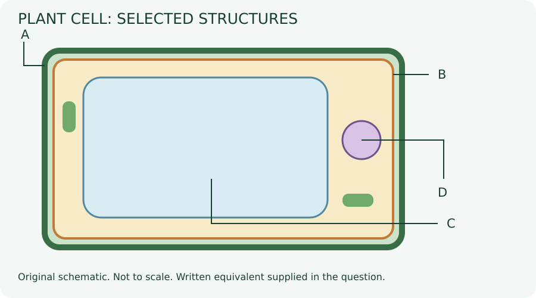
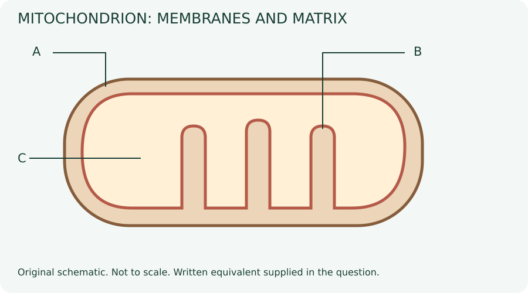
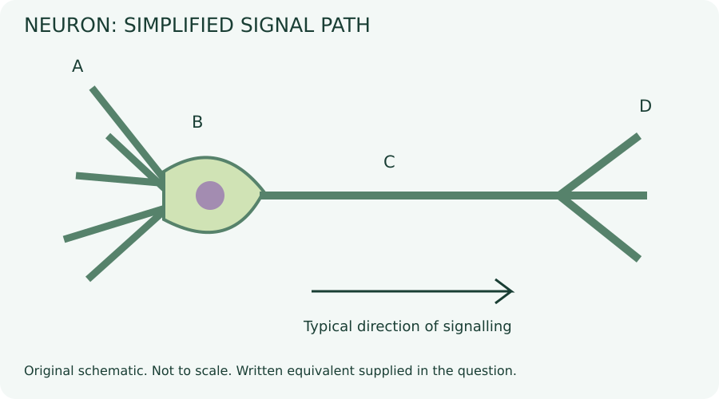

# ২য় অধ্যায়: জীবকোষ ও টিস্যু

> উত্তরসহ পর্যালোচনাধীন খসড়া; নির্ধারিত সংখ্যার উত্তরসহ খসড়া সম্পূর্ণ; বিষয়বস্তু পর্যালোচনা বাকি।
> মূল বই ও বিষয়বিশেষজ্ঞের পূর্ণ যাচাই বাকি। বোর্ড/স্কুল/সাল দাবি নেই।

## rebuild-mcq.json

### MCQ 1

“লিপিড ও প্রোটিনসমৃদ্ধ বৈষম্যভেদ্য আবরণ”—বর্ণনাটি কোন ধারণা বা গঠন নির্দেশ করে?

A. পেশি টিস্যু
B. কোষঝিল্লি
C. ক্রোমোপ্লাস্ট
D. জাইলেম

উত্তর: B — কোষঝিল্লি
কোষঝিল্লি: কোষে পদার্থের প্রবেশ ও নির্গমন নিয়ন্ত্রণ করে। সীমা: এটি উদ্ভিদের কোষপ্রাচীর নয়।

### MCQ 2

“উদ্ভিদকোষের বাইরের দৃঢ় আবরণ”—বর্ণনাটি কোন ধারণা বা গঠন নির্দেশ করে?

A. ফ্লোয়েম
B. নিউক্লিয়াস
C. কোষপ্রাচীর
D. পেশি টিস্যু

উত্তর: C — কোষপ্রাচীর
কোষপ্রাচীর: কোষকে আকৃতি ও সমর্থন দেয়। সীমা: প্রাণিকোষে কোষপ্রাচীর নেই।

### MCQ 3

“প্রকৃতকোষের পর্দাবেষ্টিত বংশগতীয় কেন্দ্র”—বর্ণনাটি কোন ধারণা বা গঠন নির্দেশ করে?

A. নিউক্লিয়াস
B. জাইলেম
C. এন্ডোপ্লাজমিক জালিকা
D. ক্রোমোপ্লাস্ট

উত্তর: A — নিউক্লিয়াস
নিউক্লিয়াস: জিনগত নির্দেশনার মাধ্যমে কার্যক্রমে ভূমিকা রাখে। সীমা: সব সজীব কোষে সুগঠিত নিউক্লিয়াস থাকে না।

### MCQ 4

“ঝিল্লিবিহীন প্রোটিন সংশ্লেষণকারী কণিকা”—বর্ণনাটি কোন ধারণা বা গঠন নির্দেশ করে?

A. প্যারেনকাইমা
B. গলজি বস্তু
C. আবরণী টিস্যু
D. রাইবোজোম

উত্তর: D — রাইবোজোম
রাইবোজোম: অ্যামাইনো অ্যাসিড দিয়ে প্রোটিন তৈরি করে। সীমা: আদিকোষেও রাইবোজোম থাকে।

### MCQ 5

“দ্বিঝিল্লিবেষ্টিত কোষীয় শ্বসনের অঙ্গাণু”—বর্ণনাটি কোন ধারণা বা গঠন নির্দেশ করে?

A. মাইটোকন্ড্রিয়া
B. ভাজক টিস্যু
C. প্যারেনকাইমা
D. ফ্লোয়েম

উত্তর: A — মাইটোকন্ড্রিয়া
মাইটোকন্ড্রিয়া: বায়বীয় শ্বসনের বহু ধাপে ATP উৎপন্ন করে। সীমা: গ্লাইকোলাইসিস সাইটোসলে ঘটে।

### MCQ 6

“ক্লোরোফিলযুক্ত সবুজ প্লাস্টিড”—বর্ণনাটি কোন ধারণা বা গঠন নির্দেশ করে?

A. ক্লোরোপ্লাস্ট
B. কোষগহ্বর
C. কোষঝিল্লি
D. জাইলেম

উত্তর: A — ক্লোরোপ্লাস্ট
ক্লোরোপ্লাস্ট: সালোকসংশ্লেষণে আলোকশক্তি ব্যবহার করে। সীমা: উদ্ভিদের সব কোষে এটি থাকে না।

### MCQ 7

“অনেক ফুল ও ফলে রঙিন প্লাস্টিড”—বর্ণনাটি কোন ধারণা বা গঠন নির্দেশ করে?

A. পেশি টিস্যু
B. প্যারেনকাইমা
C. ক্রোমোপ্লাস্ট
D. ফ্লোয়েম

উত্তর: C — ক্রোমোপ্লাস্ট
ক্রোমোপ্লাস্ট: রঙের মাধ্যমে পরাগবাহক আকর্ষণে সহায়তা করে। সীমা: সব রঙের উৎস শুধু ক্রোমোপ্লাস্ট নয়।

### MCQ 8

“বর্ণহীন সঞ্চয়ী প্লাস্টিড”—বর্ণনাটি কোন ধারণা বা গঠন নির্দেশ করে?

A. মাইটোকন্ড্রিয়া
B. লিউকোপ্লাস্ট
C. ক্রোমোপ্লাস্ট
D. রাইবোজোম

উত্তর: B — লিউকোপ্লাস্ট
লিউকোপ্লাস্ট: শ্বেতসারের মতো খাদ্য সঞ্চয় করে। সীমা: ক্লোরোপ্লাস্টের প্রধান কাজ থেকে আলাদা।

### MCQ 9

“ঝিল্লিবেষ্টিত চ্যাপ্টা থলির সমষ্টি”—বর্ণনাটি কোন ধারণা বা গঠন নির্দেশ করে?

A. কোষঝিল্লি
B. পেশি টিস্যু
C. গলজি বস্তু
D. ফ্লোয়েম

উত্তর: C — গলজি বস্তু
গলজি বস্তু: কোষীয় পদার্থ পরিবর্তন ও প্যাকেটজাত করে। সীমা: এটি সরাসরি রাইবোজোমের বিকল্প নয়।

### MCQ 10

“সাইটোপ্লাজমের ঝিল্লিময় জালক”—বর্ণনাটি কোন ধারণা বা গঠন নির্দেশ করে?

A. এন্ডোপ্লাজমিক জালিকা
B. ফ্লোয়েম
C. পেশি টিস্যু
D. ক্রোমোপ্লাস্ট

উত্তর: A — এন্ডোপ্লাজমিক জালিকা
এন্ডোপ্লাজমিক জালিকা: কোষের অভ্যন্তরীণ পরিবহণে সাহায্য করে। সীমা: অমসৃণ অংশে রাইবোজোম যুক্ত থাকে।

### MCQ 11

“টোনোপ্লাস্টবেষ্টিত রসপূর্ণ অংশ”—বর্ণনাটি কোন ধারণা বা গঠন নির্দেশ করে?

A. ক্রোমোপ্লাস্ট
B. কোষগহ্বর
C. গলজি বস্তু
D. লিউকোপ্লাস্ট

উত্তর: B — কোষগহ্বর
কোষগহ্বর: সঞ্চয় ও কোষের স্ফীতিতে সহায়তা করে। সীমা: গহ্বর একেবারে খালি নয়।

### MCQ 12

“বিভাজনক্ষম কোষের উদ্ভিদ টিস্যু”—বর্ণনাটি কোন ধারণা বা গঠন নির্দেশ করে?

A. কোলেনকাইমা
B. আবরণী টিস্যু
C. ভাজক টিস্যু
D. ফ্লোয়েম

উত্তর: C — ভাজক টিস্যু
ভাজক টিস্যু: নতুন কোষ সৃষ্টিতে বৃদ্ধি ঘটায়। সীমা: স্থায়ী টিস্যুর সব কোষ সমানভাবে বিভাজিত নয়।

### MCQ 13

“সাধারণত পাতলা প্রাচীরযুক্ত জীবিত উদ্ভিদ টিস্যু”—বর্ণনাটি কোন ধারণা বা গঠন নির্দেশ করে?

A. ক্রোমোপ্লাস্ট
B. ফ্লোয়েম
C. কোষগহ্বর
D. প্যারেনকাইমা

উত্তর: D — প্যারেনকাইমা
প্যারেনকাইমা: সঞ্চয় ও কিছু ক্ষেত্রে খাদ্য প্রস্তুত করে। সীমা: সব প্যারেনকাইমায় ক্লোরোপ্লাস্ট থাকে না।

### MCQ 14

“অসমভাবে পুরু প্রাচীরযুক্ত জীবিত টিস্যু”—বর্ণনাটি কোন ধারণা বা গঠন নির্দেশ করে?

A. প্যারেনকাইমা
B. আবরণী টিস্যু
C. জাইলেম
D. কোলেনকাইমা

উত্তর: D — কোলেনকাইমা
কোলেনকাইমা: কচি উদ্ভিদাংশকে নমনীয় সমর্থন দেয়। সীমা: স্ক্লেরেনকাইমার মতো সাধারণত মৃত নয়।

### MCQ 15

“পুরু লিগনিনযুক্ত প্রাচীরের দৃঢ় টিস্যু”—বর্ণনাটি কোন ধারণা বা গঠন নির্দেশ করে?

A. নিউরন
B. নিউক্লিয়াস
C. জাইলেম
D. স্ক্লেরেনকাইমা

উত্তর: D — স্ক্লেরেনকাইমা
স্ক্লেরেনকাইমা: উদ্ভিদে যান্ত্রিক শক্তি দেয়। সীমা: পরিণত কোষ সাধারণত মৃত।

### MCQ 16

“পানি ও খনিজ পরিবাহী জটিল টিস্যু”—বর্ণনাটি কোন ধারণা বা গঠন নির্দেশ করে?

A. স্ক্লেরেনকাইমা
B. নিউক্লিয়াস
C. ক্লোরোপ্লাস্ট
D. জাইলেম

উত্তর: D — জাইলেম
জাইলেম: মূল থেকে ওপরের অংশে পানি পৌঁছায়। সীমা: খাদ্য পরিবহণের প্রধান টিস্যু নয়।

### MCQ 17

“জৈব খাদ্য পরিবাহী জটিল টিস্যু”—বর্ণনাটি কোন ধারণা বা গঠন নির্দেশ করে?

A. গলজি বস্তু
B. ফ্লোয়েম
C. নিউক্লিয়াস
D. কোষগহ্বর

উত্তর: B — ফ্লোয়েম
ফ্লোয়েম: উৎস থেকে খাদ্য প্রয়োজনের স্থানে নেয়। সীমা: খাদ্য পরিবহণ শুধু নিচমুখী নয়।

### MCQ 18

“দেহপৃষ্ঠ ও অঙ্গের আবরণ গঠনকারী টিস্যু”—বর্ণনাটি কোন ধারণা বা গঠন নির্দেশ করে?

A. কোষঝিল্লি
B. আবরণী টিস্যু
C. কোলেনকাইমা
D. কোষগহ্বর

উত্তর: B — আবরণী টিস্যু
আবরণী টিস্যু: সুরক্ষা ও শোষণের মতো কাজ করে। সীমা: সব আবরণী একই কাজ করে না।

### MCQ 19

“স্নায়ুতন্ত্রের সংকেতবাহী কোষ”—বর্ণনাটি কোন ধারণা বা গঠন নির্দেশ করে?

A. নিউরন
B. জাইলেম
C. প্যারেনকাইমা
D. ক্রোমোপ্লাস্ট

উত্তর: A — নিউরন
নিউরন: স্নায়ু-উদ্দীপনা গ্রহণ ও পরিবহণ করে। সীমা: রক্তকণিকার সঙ্গে কাজ এক নয়।

### MCQ 20

“সংকোচনক্ষম কোষের প্রাণী টিস্যু”—বর্ণনাটি কোন ধারণা বা গঠন নির্দেশ করে?

A. এন্ডোপ্লাজমিক জালিকা
B. পেশি টিস্যু
C. গলজি বস্তু
D. নিউক্লিয়াস

উত্তর: B — পেশি টিস্যু
পেশি টিস্যু: সংকোচনের মাধ্যমে নড়াচড়া ঘটায়। সীমা: সব পেশি ইচ্ছাধীন নয়।

### MCQ 21

ঝিল্লিতে কোনো নির্দিষ্ট পরিবাহক নষ্ট হলে তার উপযোগী পদার্থের প্রবেশ কমল, কিন্তু পানি চলাচল পুরো বন্ধ নয়। কোন ব্যাখ্যাটি যুক্তিসংগত?

A. কোষপ্রাচীরই সব বাছাই করে
B. পানি কখনও ঝিল্লি পেরোয় না
C. বিভিন্ন পদার্থ ভিন্ন পথে ঝিল্লি পার হতে পারে
D. সব পদার্থ কেবল এক ছিদ্র দিয়ে যায়

উত্তর: C — বিভিন্ন পদার্থ ভিন্ন পথে ঝিল্লি পার হতে পারে
ঝিল্লির পরিবাহক ও সরাসরি পারাপারের পথ পদার্থভেদে আলাদা হতে পারে।

### MCQ 22

অতিরিক্ত নিঃসরণকারী কোষে প্রোটিন তৈরি ও প্যাকেটজাত করার প্রধান যুগল কোনটি?

A. কোষপ্রাচীর ও লিউকোপ্লাস্ট
B. ক্রোমোপ্লাস্ট ও শ্বেতসারকণা
C. রাইবোজোম ও গলজি বস্তু
D. কোষগহ্বর ও সেলুলোজ

উত্তর: C — রাইবোজোম ও গলজি বস্তু
রাইবোজোম প্রোটিন সংশ্লেষণ করে; গলজি নিঃসরণপথে পরিবর্তন ও প্যাকেটজাতকরণে অংশ নেয়।

### MCQ 23

পেঁয়াজের বাল্বের আবরণী কোষে ক্লোরোপ্লাস্ট না দেখলে সবচেয়ে সতর্ক সিদ্ধান্ত কোনটি?

A. সেখানে কোনো সজীব কোষ নেই
B. ওই কোষে ক্লোরোপ্লাস্ট না থাকলেও উদ্ভিদকোষ হতে পারে
C. সব উদ্ভিদে ক্লোরোপ্লাস্ট অনুপস্থিত
D. কোষটি নিশ্চয় ব্যাকটেরিয়া

উত্তর: B — ওই কোষে ক্লোরোপ্লাস্ট না থাকলেও উদ্ভিদকোষ হতে পারে
উদ্ভিদের সব অংশ আলোকসংশ্লেষণ করে না; পরিচয় নির্ধারণে অন্য বৈশিষ্ট্যও প্রয়োজন।

### MCQ 24

কোষগহ্বরের বড় অংশ পানি হারালে উদ্ভিদকোষের স্ফীতি কমার সঙ্গে কোন কাজটি সম্পর্কিত?

A. নিউক্লিয়াসের সরাসরি পানি উৎপাদন
B. সেলুলোজে ATP তৈরির কাজ
C. রাইবোজোমের আলো শোষণ
D. রসপূর্ণ অংশের অসমোটিক ভূমিকা

উত্তর: D — রসপূর্ণ অংশের অসমোটিক ভূমিকা
কোষগহ্বরের দ্রবণ ও পানি ভারসাম্য স্ফীতিচাপের সঙ্গে সম্পর্কিত।

### MCQ 25

জাইলেমে পানি পরিবাহিত হলেও ফ্লোয়েমে প্রস্তুত খাদ্য যেতে পারছে না। কোন পরিবহণটি সরাসরি বেশি বাধাগ্রস্ত?

A. পাতার ওপর আলো পড়া
B. পাতা থেকে বর্ধনশীল ফলে শর্করা পৌঁছানো
C. মূল থেকে পাতায় পানি ওঠা
D. পত্ররন্ধ্রে গ্যাসের ব্যাপন

উত্তর: B — পাতা থেকে বর্ধনশীল ফলে শর্করা পৌঁছানো
জৈব খাদ্য উৎস থেকে গ্রাহক অংশে পৌঁছাতে ফ্লোয়েম প্রয়োজন।

### MCQ 26

দুটি আবরণীর একটিতে সব কোষ ভিত্তিপর্দা ছুঁয়েছে কিন্তু নিউক্লিয়াস ভিন্ন উচ্চতায়। কোনটি সম্ভাব্য?

A. সিউডোস্ট্র্যাটিফাইড আবরণী
B. বহুস্তরী ছত্রাকীয় টিস্যু
C. সাধারণ অস্থি টিস্যু
D. রক্তের তরল মাতৃকা

উত্তর: A — সিউডোস্ট্র্যাটিফাইড আবরণী
একস্তরীয় কোষ অসম উচ্চতায় থাকায় আপাত বহুস্তরীয় মনে হতে পারে।

### MCQ 27

শ্বাসনালির সিলিয়া অচল হলে কোন কাজটি সরাসরি কমতে পারে?

A. শ্লেষ্মাসহ আটকা কণা সরানো
B. অস্থিতে ক্যালসিয়াম জমা
C. হিমোগ্লোবিনে অক্সিজেন বাঁধা
D. ভিলাসে গ্লুকোজ শোষণ

উত্তর: A — শ্লেষ্মাসহ আটকা কণা সরানো
শ্বাসনালির সিলিয়া শ্লেষ্মা ও আটকা কণা সরাতে সহায়তা করে।

### MCQ 28

মানব অণুচক্রিকা সম্পর্কে নির্ভুল বক্তব্য কোনটি?

A. হিমোগ্লোবিনযুক্ত প্রধান অক্সিজেনবাহক
B. পূর্ণাঙ্গ স্নায়ুকোষ
C. ক্লোরোপ্লাস্টযুক্ত শ্বেতকণিকা
D. রক্তজমাটে অংশ নেওয়া কোষখণ্ড

উত্তর: D — রক্তজমাটে অংশ নেওয়া কোষখণ্ড
মানুষের প্লেটলেট কোষখণ্ড; সব রক্তের উপাদান একই গঠন নয়।

### MCQ 29

অন্তঃক্ষরা ও বহিঃক্ষরা গ্রন্থির নিঃসরণপথের পার্থক্য কোনটি?

A. প্রথমটির নির্দিষ্ট বহির্গামী নালি নেই, দ্বিতীয়টির সাধারণত থাকে
B. দুটিই কেবল কোষপ্রাচীরে নিঃসরণ করে
C. প্রথমটি সবসময় মৃত, দ্বিতীয়টি জীবিত
D. দুটির সব রস একই হরমোন

উত্তর: A — প্রথমটির নির্দিষ্ট বহির্গামী নালি নেই, দ্বিতীয়টির সাধারণত থাকে
অন্তঃক্ষরা নিঃসরণ আন্তঃকোষীয় তরল হয়ে রক্তে যায়; বহিঃক্ষরায় নালি থাকে।

### MCQ 30

চোখে দেখার কোণ বড় করা ও কাছের দুটি বিন্দু আলাদা দেখার ক্ষমতা কি একই?

A. না, বিভেদনে কোনো সীমা নেই
B. হ্যাঁ, বড় করলেই সব সূক্ষ্ম গঠন স্পষ্ট
C. না, বিবর্ধন ও বিভেদন পৃথক
D. হ্যাঁ, লেন্সের মান অপ্রাসঙ্গিক

উত্তর: C — না, বিবর্ধন ও বিভেদন পৃথক
খালি বিবর্ধন বাড়িয়ে বিভেদনসীমার বাইরে নতুন বিস্তারিত পাওয়া যায় না।

### MCQ 31

প্রাণীর চার প্রধান টিস্যুর মধ্যে কোনটি নেই?

A. স্নায়ু
B. জাইলেম
C. আবরণী
D. যোজক

উত্তর: B — জাইলেম
জাইলেম উদ্ভিদের পরিবহন টিস্যু।

### MCQ 32

আবরণী টিস্যুতে কোষগুলো সাধারণত কেমন?

A. কোষবিহীন
B. ঘনসন্নিবিষ্ট
C. শুধু রক্তরসে ভাসমান
D. প্রচুর কঠিন মাতৃকায় বিচ্ছিন্ন

উত্তর: B — ঘনসন্নিবিষ্ট
ঘন কোষস্তর পৃষ্ঠ ঢাকে।

### MCQ 33

আবরণী কোষের নিচের সহায়ক পাতলা স্তর কী?

A. সিভপ্লেট
B. টোনোপ্লাস্ট
C. ভিত্তিপর্দা
D. ক্রিস্টি

উত্তর: C — ভিত্তিপর্দা
ভিত্তিপর্দার ওপর আবরণী বিন্যস্ত থাকে।

### MCQ 34

চ্যাপ্টা পাতলা আবরণী কোষের শ্রেণি কোনটি?

A. কলামনার
B. কিউবয়ডাল
C. স্ক্লেরাইড
D. স্কোয়ামাস

উত্তর: D — স্কোয়ামাস
স্কোয়ামাস কোষ চ্যাপ্টা।

### MCQ 35

দৈর্ঘ্য-প্রস্থ-উচ্চতা প্রায় সমান আবরণী কোনটি?

A. স্নায়ু
B. কলামনার
C. কিউবয়ডাল
D. স্কোয়ামাস

উত্তর: C — কিউবয়ডাল
ঘনাকার কোষ কিউবয়ডাল।

### MCQ 36

স্তম্ভাকার উঁচু আবরণী কোষের নাম কী?

A. কলামনার
B. এরিথ্রোসাইট
C. ফাইবার
D. স্কোয়ামাস

উত্তর: A — কলামনার
কোষের আকৃতি নামটির ভিত্তি।

### MCQ 37

একস্তরী পাতলা আবরণ গ্যাস ব্যাপন সহজ করে কেন?

A. এতে অবশ্যই বেশি লিগনিন
B. অতিক্রমের দূরত্ব কম
C. এটি মৃত প্রাচীর
D. এতে সবসময় হাড় আছে

উত্তর: B — অতিক্রমের দূরত্ব কম
পাতলা আবরণ ব্যাপনদূরত্ব কমায়।

### MCQ 38

ত্বকের বহিঃস্তরে বহুস্তরী আবরণীর সুবিধা কী?

A. অক্সিজেনকে হিমোগ্লোবিনে বাঁধা
B. স্নায়ুবার্তা বহন
C. ঘর্ষণ ও আঘাত থেকে সুরক্ষা
D. খাদ্য নলে ঠেলা

উত্তর: C — ঘর্ষণ ও আঘাত থেকে সুরক্ষা
বহুস্তর প্রতিরক্ষায় সহায়ক।

### MCQ 39

মূত্রথলির প্রসারণযোগ্য বিশেষ আবরণীর নাম কী?

A. কঙ্কালপেশি
B. ট্রানজিশনাল
C. ক্লোরেনকাইমা
D. অস্থি

উত্তর: B — ট্রানজিশনাল
ইউরোথেলিয়াম প্রসারণের সঙ্গে আকৃতি বদলায়।

### MCQ 40

সিলিয়া ও মাইক্রোভিলাইয়ের সঠিক পার্থক্য কোনটি?

A. দুটিই রক্তকণিকা
B. চলনসহায়ক ও পৃষ্ঠবর্ধক ভূমিকা পৃথক
C. দুটির কোনো গঠন নেই
D. দুটিই কেবল প্রাচীরের কূপ

উত্তর: B — চলনসহায়ক ও পৃষ্ঠবর্ধক ভূমিকা পৃথক
সিলিয়া কণা সরায়, মাইক্রোভিলাই শোষণপৃষ্ঠ বাড়ায়।

### MCQ 41

অন্ত্রের শোষক আবরণে মাইক্রোভিলাই থাকার সুবিধা কী?

A. পৃষ্ঠতল বৃদ্ধি
B. কোষসংখ্যা শূন্য
C. খাদ্যকে রক্তকণিকা করা
D. সব এনজাইম ধ্বংস

উত্তর: A — পৃষ্ঠতল বৃদ্ধি
শোষণের সংস্পর্শপৃষ্ঠ বাড়ে।

### MCQ 42

গ্রন্থিময় আবরণীর বিশেষ কাজ কী?

A. যান্ত্রিক আঁশ তৈরি
B. নিঃসরণ
C. শুধু পানি ওঠানো
D. শুধু বৈদ্যুতিক সংকেত

উত্তর: B — নিঃসরণ
আবরণী কোষ নিঃসরণে বিশেষায়িত হতে পারে।

### MCQ 43

আকৃতি ও স্তরসংখ্যা দুটি পৃথক মানদণ্ড কেন?

A. দুটিই রাজ্য
B. দুটিই শুধু রং
C. একটি কোষের রূপ, অন্যটি বিন্যাস বোঝায়
D. স্তরসংখ্যা মানেই কোষের বয়স

উত্তর: C — একটি কোষের রূপ, অন্যটি বিন্যাস বোঝায়
একই আবরণীকে দুই দিক থেকে বর্ণনা করা যায়।

### MCQ 44

যোজক টিস্যুতে তুলনামূলকভাবে কোনটি বেশি থাকে?

A. গ্রানা
B. বহিঃকোষীয় মাতৃকা
C. ক্লোরোপ্লাস্ট
D. সিভপ্লেট

উত্তর: B — বহিঃকোষীয় মাতৃকা
কোষের বাইরের মাতৃকা বৈশিষ্ট্যপূর্ণ।

### MCQ 45

যোজক টিস্যুর তন্তু ও মাতৃকা কী নির্দেশ করে?

A. কোষ ছাড়া সবই অকার্যকর
B. সব তন্তু স্নায়ু
C. সব মাতৃকা তরল
D. কোষ ছাড়াও নিঃসৃত উপাদান কাজ করে

উত্তর: D — কোষ ছাড়াও নিঃসৃত উপাদান কাজ করে
মাতৃকা সমর্থন ও পরিবহনে ভূমিকা রাখে।

### MCQ 46

কানের পিনার নমনীয় সমর্থনের উপাদান কোনটি?

A. সিভনল
B. কঙ্কালপেশিমাত্র
C. ভেসেল
D. কোমলাস্থি

উত্তর: D — কোমলাস্থি
কোমলাস্থি নমনীয় যোজক টিস্যু।

### MCQ 47

অস্থির কঠিন মাতৃকায় কোন জমা গুরুত্বপূর্ণ?

A. শ্বেতসার
B. ক্লোরোফিল
C. হিমোগ্লোবিন
D. ক্যালসিয়াম লবণ

উত্তর: D — ক্যালসিয়াম লবণ
খনিজ জমা দৃঢ়তা বাড়ায়।

### MCQ 48

করোটি মস্তিষ্ক রক্ষা করে কোনভাবে?

A. খাদ্য পরিপাকে
B. রাইবোজোমে গ্যাস ভরে
C. ফ্লোয়েমের স্রোতে
D. দৃঢ় অস্থির আবরণে

উত্তর: D — দৃঢ় অস্থির আবরণে
অস্থি সুরক্ষা ও কাঠামো দেয়।

### MCQ 49

রক্তের তরল মাতৃকা কোনটি?

A. রক্তরস
B. লোহিত কণিকা
C. অণুচক্রিকা
D. নিউরন

উত্তর: A — রক্তরস
রক্তরসে কণিকাগুলো থাকে।

### MCQ 50

লোহিত কণিকার অক্সিজেন পরিবহনে প্রধান অণু কোনটি?

A. হিমোগ্লোবিন
B. সেলুলোজ
C. কোলাজেন
D. ক্লোরোফিল

উত্তর: A — হিমোগ্লোবিন
হিমোগ্লোবিন অক্সিজেনের সঙ্গে যুক্ত হতে পারে।

### MCQ 51

শ্বেত রক্তকণিকার প্রধান সমষ্টিগত ভূমিকা কী?

A. প্রধান অক্সিজেনবাহক হওয়া
B. অস্থির খনিজ হওয়া
C. খাদ্য তৈরি
D. দেহরক্ষা

উত্তর: D — দেহরক্ষা
বিভিন্ন শ্বেতকণিকার প্রতিরক্ষামূলক ভূমিকা আছে।

### MCQ 52

ক্ষতস্থানে রক্তজমাটের প্রাথমিক প্রক্রিয়ায় কোন উপাদান সহায়ক?

A. ডেনড্রাইট
B. ক্লোরোপ্লাস্ট
C. সিভনল
D. অণুচক্রিকা

উত্তর: D — অণুচক্রিকা
প্লেটলেট রক্তক্ষরণ বন্ধে অংশ নেয়।

### MCQ 53

কোষের মধ্যবর্তী তরল কোন পথে ঢোকার পর লসিকা নামে পরিচিত?

A. লসিকানালিতে
B. শুধু লোহিত কণিকা
C. একটি কঠিন অস্থি
D. সবসময় বিশুদ্ধ পানি

উত্তর: A — লসিকানালিতে
আন্তঃকোষীয় তরল ও লসিকার অবস্থানগত পার্থক্য আছে।

### MCQ 54

রক্ত তরল হলেও টিস্যু কেন?

A. কোষীয় উপাদান ও মাতৃকা মিলে কাজ করে
B. সব তরলই টিস্যু
C. এটি একক অণু
D. টিস্যুতে কোষ থাকা নিষিদ্ধ

উত্তর: A — কোষীয় উপাদান ও মাতৃকা মিলে কাজ করে
টিস্যু মানেই কঠিন স্তর নয়।

### MCQ 55

পেশি সংকোচনের প্রত্যক্ষ ফল কী?

A. কোষপ্রাচীর গড়া
B. প্রজাতিনাম বদল
C. বল সৃষ্টি
D. ক্লোরোফিল তৈরি

উত্তর: C — বল সৃষ্টি
পেশি সংকোচনে চলন বা চাপ সৃষ্টি হয়।

### MCQ 56

কঙ্কালপেশির সাধারণ কোষরূপ কোনটি?

A. শাখাযুক্ত ডিস্কসমৃদ্ধ
B. চ্যাপ্টা আবরণী
C. দীর্ঘ শাখাবিহীন বহুনিউক্লিয়াসযুক্ত
D. মাকু আকৃতির একনিউক্লিয়াসযুক্ত

উত্তর: C — দীর্ঘ শাখাবিহীন বহুনিউক্লিয়াসযুক্ত
কঙ্কালপেশির তন্তুর স্বাভাবিক লক্ষণ এগুলো।

### MCQ 57

অন্ত্রের প্রাচীরের পেশি সচেতন ইচ্ছা ছাড়াই কাজ করে। কোনটি প্রাসঙ্গিক?

A. বহিস্ত্বক
B. কঙ্কালপেশি
C. জাইলেম
D. মসৃণ পেশি

উত্তর: D — মসৃণ পেশি
অন্ত্রের চলনে অনৈচ্ছিক মসৃণ পেশি আছে।

### MCQ 58

মসৃণ পেশির কোষে কোনটি সাধারণত অনুপস্থিত?

A. সাইটোপ্লাজম
B. আড়াআড়ি ডোরা
C. কোষঝিল্লি
D. নিউক্লিয়াস

উত্তর: B — আড়াআড়ি ডোরা
ডোরা না থাকা এর গাঠনিক লক্ষণ।

### MCQ 59

ইন্টারক্যালাটেড ডিস্ক কোন টিস্যুর বিশেষ লক্ষণ?

A. হৃৎপেশি
B. ক্লোরেনকাইমা
C. অস্থি
D. কলামনার আবরণী

উত্তর: A — হৃৎপেশি
হৃৎপেশির কোষসংযোগের বিশেষ অঞ্চল এটি।

### MCQ 60

হৃৎপেশির সমন্বিত কাজের জন্য কী গুরুত্বপূর্ণ?

A. ক্লোরোফিল
B. কোষগুলোর সম্পূর্ণ বিচ্ছিন্নতা
C. সিভপ্লেট
D. কোষের কার্যগত সংযোগ

উত্তর: D — কোষের কার্যগত সংযোগ
সংযোগ সংকোচনের সমন্বয়ে সহায়ক।

### MCQ 61

ঐচ্ছিক-অনৈচ্ছিক ও ডোরাকাটা-ডোরাবিহীন ভাগের সম্পর্ক কী?

A. সব ডোরাকাটা ঐচ্ছিক
B. দুটিই শুধু অবস্থান
C. দুটি ভিন্ন মানদণ্ড
D. সব অনৈচ্ছিক ডোরাবিহীন

উত্তর: C — দুটি ভিন্ন মানদণ্ড
হৃৎপেশি ডোরাকাটা কিন্তু অনৈচ্ছিক।

### MCQ 62

হাত ভাঁজ করার পেশি কোন শ্রেণির সাধারণ উদাহরণ?

A. মসৃণ পেশি
B. কঙ্কালপেশি
C. স্কোয়ামাস
D. হৃৎপেশি

উত্তর: B — কঙ্কালপেশি
কঙ্কালপেশি অস্থির সঙ্গে যুক্ত হয়ে কাজ করে।

### MCQ 63

নিউরনের কোষদেহে সাধারণত কোনটি থাকে?

A. গ্রানা
B. নিউক্লিয়াস
C. সিভপ্লেট
D. লিগনিন প্রাচীর

উত্তর: B — নিউক্লিয়াস
কোষদেহ বিপাকীয় কেন্দ্র।

### MCQ 64

আদর্শ নিউরনে সংকেত গ্রহণের শাখাবিশিষ্ট অংশ কোনটি?

A. সিভনল
B. ভেসেল
C. অণুচক্রিকা
D. ডেনড্রাইট

উত্তর: D — ডেনড্রাইট
ডেনড্রাইট সাধারণত কোষদেহের দিকে তথ্য আনে।

### MCQ 65

নিউরনের দীর্ঘ বহির্মুখী সংকেতবাহী প্রলম্বন কোনটি?

A. ক্রিস্টি
B. প্লাজমোডেজমাটা
C. মাইক্রোভিলাই
D. অ্যাক্সন

উত্তর: D — অ্যাক্সন
অ্যাক্সন কোষদেহ থেকে সংকেত বহন করে।

### MCQ 66

নিউরনের মধ্যে তথ্য আদানপ্রদানের বিশেষ সংযোগ কোনটি?

A. গ্রানাম
B. সিভপ্লেট
C. সিন্যাপস
D. ভেসেল প্লেট

উত্তর: C — সিন্যাপস
সিন্যাপস কোষীয় যোগাযোগস্থল।

### MCQ 67

স্নায়ু টিস্যুতে নিউরন ছাড়া সহায়ক কোষের নাম কী?

A. স্ক্লেরাইড
B. সিভকোষ
C. নিউরোগ্লিয়া
D. ট্রাকিড

উত্তর: C — নিউরোগ্লিয়া
স্নায়ু টিস্যু শুধু নিউরন নয়।

### MCQ 68

মস্তিষ্কের সব অংশ সবসময় সমান সক্রিয় নয়—এর সঠিক অর্থ কী?

A. কাজভেদে সক্রিয়তার ধারা বদলায়
B. শতভাগ কোষ একই সময়ে সর্বোচ্চ কাজ করে
C. মাত্র দশ শতাংশ কখনও কাজে লাগে
D. বাকি অংশ মৃত

উত্তর: A — কাজভেদে সক্রিয়তার ধারা বদলায়
দশ শতাংশ ব্যবহারের জনপ্রিয় ধারণা ভুল।

### MCQ 69

কোষ → টিস্যু → অঙ্গ → তন্ত্র ক্রম কী বোঝায়?

A. কোষের বয়স
B. সংগঠনের ক্রমবর্ধমান স্তর
C. শ্রেণিবিন্যাসের সাত ধাপ
D. খাদ্যশৃঙ্খল

উত্তর: B — সংগঠনের ক্রমবর্ধমান স্তর
বহুকোষী দেহে শ্রমবিভাগের সংগঠন।

### MCQ 70

একটি পাকস্থলীতে আবরণী ও পেশি থাকার অর্থ কী?

A. দুটি আলাদা রাজ্য
B. টিস্যুতে অঙ্গ থাকে
C. পাকস্থলী একটি কোষ
D. এক অঙ্গে একাধিক টিস্যু কাজ করে

উত্তর: D — এক অঙ্গে একাধিক টিস্যু কাজ করে
অঙ্গের কাজ টিস্যুগুলোর সমন্বয়ে হয়।

### MCQ 71

নিচের কোনটি তন্ত্র নয়, অঙ্গ?

A. রেচনতন্ত্র
B. হৃৎপিণ্ড
C. পরিপাকতন্ত্র
D. স্নায়ুতন্ত্র

উত্তর: B — হৃৎপিণ্ড
হৃৎপিণ্ড একটি সংগঠিত দেহাংশ।

### MCQ 72

পৌষ্টিক নালি ও পৌষ্টিক গ্রন্থি মিলে কোন তন্ত্র?

A. স্নায়ুতন্ত্র
B. পরিপাকতন্ত্র
C. রেচনতন্ত্র
D. ত্বকতন্ত্র

উত্তর: B — পরিপাকতন্ত্র
গ্রহণ, পরিপাক ও শোষণে সমন্বিত কাজ হয়।

### MCQ 73

পৌষ্টিক নালির অংশ নয় কোনটি?

A. ইলিয়াম
B. যকৃৎ
C. পাকস্থলী
D. অন্ননালি

উত্তর: B — যকৃৎ
যকৃৎ সংশ্লিষ্ট গ্রন্থি, নালির ধারাবাহিক অংশ নয়।

### MCQ 74

ফুসফুসের গ্যাসবিনিময় ও কোষীয় শ্বসন সম্পর্কে কোনটি সঠিক?

A. দুটির মধ্যে অক্সিজেনের সম্পর্ক নেই
B. দুটিই শুধু ফুসফুসে ATP তৈরি
C. দুটিই সালোকসংশ্লেষণ
D. সম্পর্কিত কিন্তু পৃথক প্রক্রিয়া

উত্তর: D — সম্পর্কিত কিন্তু পৃথক প্রক্রিয়া
তন্ত্র গ্যাস দেয়; কোষে বিপাকীয় জারণ হয়।

### MCQ 75

ট্রাকিয়া থেকে ফুসফুসের দিকে বায়ুপথে কোনটি থাকে?

A. ইলিয়াম
B. ইউরেটার
C. ব্রঙ্কাস
D. মূত্রনালি

উত্তর: C — ব্রঙ্কাস
ব্রঙ্কাস ও ব্রঙ্কিওল বায়ুপথের অংশ।

### MCQ 76

বিপাকীয় বর্জ্য অপসারণ কোন তন্ত্রের প্রধান ভূমিকা?

A. কেবল আবরণী গ্রন্থি
B. কেবল জননতন্ত্র
C. কেবল পরিপাকনালি
D. রেচনতন্ত্র

উত্তর: D — রেচনতন্ত্র
রেচন ও অপাচ্য খাদ্য ত্যাগ এক প্রক্রিয়া নয়।

### MCQ 77

বৃক্ক থেকে মূত্রথলিতে মূত্র পৌঁছায় কোন পথে?

A. অন্ননালি
B. ইউরেথ্রা
C. ব্রঙ্কাস
D. ইউরেটার

উত্তর: D — ইউরেটার
ইউরেটার বৃক্ক ও মূত্রথলি যুক্ত করে।

### MCQ 78

মূত্রথলি থেকে বাইরে যাওয়ার পথ কোনটি?

A. ট্রাকিয়া
B. সিভনল
C. ইউরেটার
D. ইউরেথ্রা

উত্তর: D — ইউরেথ্রা
ইউরেথ্রা মূত্রনালি।

### MCQ 79

দেহের জলীয় অংশ ধরে রাখতে কোন তন্ত্র গুরুত্বপূর্ণ আবরণ দেয়?

A. কেবল পৌষ্টিক নালি
B. ত্বকতন্ত্র
C. জাইলেম তন্ত্র
D. কেবল জননতন্ত্র

উত্তর: B — ত্বকতন্ত্র
ত্বক অতিরিক্ত পানি হারানো কমায়।

### MCQ 80

থাইরয়েড কোন তন্ত্রের গ্রন্থি?

A. অন্তঃক্ষরা
B. মূত্র
C. অস্থিপরিবহন
D. শ্বসন

উত্তর: A — অন্তঃক্ষরা
থাইরয়েড রক্তে হরমোন দেয়।

### MCQ 81

অগ্ন্যাশয়কে শুধু অন্তঃক্ষরা গ্রন্থি বলার সীমা কী?

A. এতে কোনো কোষ নেই
B. এটি শুধু অস্থি
C. এর বহিঃক্ষরা কাজও আছে
D. এটি শুধু স্নায়ু

উত্তর: C — এর বহিঃক্ষরা কাজও আছে
অগ্ন্যাশয়ের হরমোন ও পরিপাকরসের পথ পৃথক।

### MCQ 82

হরমোন দূরের অঙ্গে গেলে কোন তন্ত্র পরিবহনে সাহায্য করে?

A. শুধু অস্থি
B. শুধু আবরণী চুল
C. রক্তসংবহনতন্ত্র
D. শুধু সেন্ট্রোজোম

উত্তর: C — রক্তসংবহনতন্ত্র
রক্তে বাহিত হয়ে লক্ষ্যকোষে হরমোন পৌঁছায়।

### MCQ 83

জননতন্ত্রের সমষ্টিগত গুরুত্ব কী?

A. নতুন প্রজন্মের মাধ্যমে প্রজাতির ধারাবাহিকতা
B. প্রতিটি ব্যক্তির তাৎক্ষণিক শ্বাস
C. সব নাইট্রোজেন বর্জ্য ছাঁকা
D. সব খাদ্য শোষণ

উত্তর: A — নতুন প্রজন্মের মাধ্যমে প্রজাতির ধারাবাহিকতা
প্রজনন ও ব্যক্তির অন্য জীবনকাজ পৃথক।

### MCQ 84

মস্তিষ্ক ও সুষুম্নাকাণ্ড কোন তন্ত্রের কেন্দ্রীয় অংশ?

A. স্নায়ুতন্ত্র
B. রেচনতন্ত্র
C. পৌষ্টিকতন্ত্র
D. ত্বকতন্ত্র

উত্তর: A — স্নায়ুতন্ত্র
তথ্য গ্রহণ ও সমন্বয়ে কাজ করে।

### MCQ 85

এক অঙ্গের সমস্যা অন্য তন্ত্রে প্রভাব ফেলতে পারে কেন?

A. তন্ত্রগুলো পরস্পরনির্ভর
B. সব অঙ্গ আলাদা জীব
C. তন্ত্রে কোষ থাকে না
D. সব অঙ্গ একই কাজ

উত্তর: A — তন্ত্রগুলো পরস্পরনির্ভর
অক্সিজেন, পুষ্টি ও সংকেতের বিনিময় যুক্ত।

### MCQ 86

যৌগিক আলোক অণুবীক্ষণে প্রধান বিবর্ধক যুগল কী?

A. ডায়াফ্রাম ও আর্ম
B. ক্লিপ ও স্টেজ
C. অবজেকটিভ ও আইপিস
D. আর্ম ও বেজ

উত্তর: C — অবজেকটিভ ও আইপিস
দুটি লেন্সব্যবস্থা ধারাবাহিক বিবর্ধন দেয়।

### MCQ 87

অণুবীক্ষণে স্লাইড রাখা হয় কোথায়?

A. আইপিসের ওপর
B. আর্মের শীর্ষে
C. স্টেজে
D. নোজপিসে

উত্তর: C — স্টেজে
স্টেজে ক্লিপ দিয়ে স্লাইড আটকানো যায়।

### MCQ 88

অবজেকটিভ বদলানোর ঘূর্ণনশীল অংশ কোনটি?

A. কনডেন্সর
B. নোজপিস
C. বেজ
D. কভার স্লিপ

উত্তর: B — নোজপিস
নোজপিসে বিভিন্ন অবজেকটিভ লাগানো থাকে।

### MCQ 89

প্রথমে কম ক্ষমতার লেন্স নেওয়ার সুবিধা কী?

A. বিভেদন অসীম হয়
B. সব অঙ্গাণু দেখা যায়
C. বিস্তৃত ক্ষেত্র থেকে নমুনা খোঁজা সহজ
D. রঞ্জক লাগে না

উত্তর: C — বিস্তৃত ক্ষেত্র থেকে নমুনা খোঁজা সহজ
কম ক্ষমতায় অবস্থান নির্ধারণ সহজ।

### MCQ 90

উচ্চ ক্ষমতায় ফোকাসের সূক্ষ্ম সংশোধনে কোন নব ব্যবহারযোগ্য?

A. ফাইন অ্যাডজাস্টমেন্ট
B. শুধু নোজপিস খুলে ফেলা
C. কোর্স নব দ্রুত ঘোরানো
D. বেজ ঢিলা করা

উত্তর: A — ফাইন অ্যাডজাস্টমেন্ট
শিক্ষকের তত্ত্বাবধানে সূক্ষ্ম ফোকাস নিরাপদ।

### MCQ 91

উচ্চ ক্ষমতায় কোর্স নব বেপরোয়া ঘোরানো ঝুঁকিপূর্ণ কেন?

A. ইটালিক নাম মুছে যায়
B. কোষ রাজ্য বদলায়
C. লেন্স স্লাইডে ঠেকে ক্ষতি হতে পারে
D. রাইবোজোম বড় হয়

উত্তর: C — লেন্স স্লাইডে ঠেকে ক্ষতি হতে পারে
কাজের দূরত্ব কম থাকায় সতর্কতা দরকার।

### MCQ 92

নমুনায় আলোর পরিমাণ নিয়ন্ত্রণে কোন অংশ সাহায্য করে?

A. আর্ম
B. ক্লিপ
C. ডায়াফ্রাম
D. বেজ

উত্তর: C — ডায়াফ্রাম
কনডেন্সর আলো কেন্দ্রীভূত করে, ডায়াফ্রাম পরিমাণ নিয়ন্ত্রণ করে।

### MCQ 93

নমুনার দিকে আলো কেন্দ্রীভূত করার অংশ কোনটি?

A. কনডেন্সর
B. আইপিসের আবরণ
C. স্লাইড ক্লিপ
D. আর্ম

উত্তর: A — কনডেন্সর
কনডেন্সরের কাজ ও বিবর্ধন এক নয়।

### MCQ 94

আইপিস 10× এবং অবজেকটিভ 40× হলে মোট বিবর্ধন কত?

A. 400×
B. 4×
C. 50×
D. 30×

উত্তর: A — 400×
মোট বিবর্ধন দুই ক্ষমতার গুণফল।

### MCQ 95

বিবর্ধন বাড়লেও বিবরণ না বাড়ার কারণ কী হতে পারে?

A. নমুনার ভাষা
B. বিভেদনসীমা
C. স্লাইডে কোষের নাম
D. প্রজাতির রং

উত্তর: B — বিভেদনসীমা
শুধু বড় করলে কাছাকাছি বিন্দু পৃথক হয় না।

### MCQ 96

ইলেকট্রন অণুবীক্ষণে ছবির জন্য কী ব্যবহৃত হয়?

A. ইলেকট্রন রশ্মি
B. কেবল পানি
C. কেবল শব্দ
D. শুধু দৃশ্যমান আলো

উত্তর: A — ইলেকট্রন রশ্মি
কাচের লেন্সের পরিবর্তে তড়িৎচুম্বকীয় নিয়ন্ত্রণও থাকে।

### MCQ 97

সাধারণ ইলেকট্রন অণুবীক্ষণে নমুনা জীবন্ত অবস্থায় দেখা কঠিন কেন?

A. সব কোষ খুব বড়
B. প্রস্তুতি ও শূন্যস্থানের শর্ত
C. নিউক্লিয়াস নেই
D. ইলেকট্রনে কোনো ছবি হয় না

উত্তর: B — প্রস্তুতি ও শূন্যস্থানের শর্ত
সাধারণ প্রস্তুতি জীবন্ত প্রক্রিয়া বজায় রাখে না।

### MCQ 98

রঞ্জনের প্রধান উদ্দেশ্য কী?

A. বৈসাদৃশ্য বাড়িয়ে গঠন আলাদা দেখা
B. বিবর্ধন অসীম করা
C. সব অঙ্গাণু নতুন তৈরি
D. কোষকে বড় অঙ্গ করা

উত্তর: A — বৈসাদৃশ্য বাড়িয়ে গঠন আলাদা দেখা
স্টেইন নির্দিষ্ট উপাদান দৃশ্যমান করতে সাহায্য করে।

### MCQ 99

কোষ রঞ্জনের রং কি সবসময় তার প্রাকৃতিক রং?

A. না; প্রস্তুতির কৃত্রিম রং হতে পারে
B. হ্যাঁ; সব কোষ লাল
C. না; রং মানেই DNA
D. হ্যাঁ; সবসময়

উত্তর: A — না; প্রস্তুতির কৃত্রিম রং হতে পারে
পর্যবেক্ষণে রঞ্জক ব্যবহারের তথ্য রাখতে হয়।

### MCQ 100

কভার স্লিপ ধীরে কাত করে রাখার সুবিধা কী?

A. বিবর্ধন দ্বিগুণ
B. বায়ুবুদবুদ কমানো
C. সব DNA ধ্বংস
D. স্লাইড অন্ধকার করা

উত্তর: B — বায়ুবুদবুদ কমানো
সমতল প্রস্তুতি পর্যবেক্ষণ সহজ করে।

### MCQ 101

মোটা ভাঁজপড়া পেঁয়াজের আবরণে কোষ অস্পষ্ট হলে করণীয় কী?

A. আইপিসে আঙুল রাখা
B. কভার স্লিপ ভেঙে চাপা
C. পাতলা সমতল স্তর প্রস্তুত
D. শুধু সর্বোচ্চ লেন্স নেওয়া

উত্তর: C — পাতলা সমতল স্তর প্রস্তুত
নমুনার পুরুত্ব ও প্রস্তুতি ছবির মানে প্রভাব ফেলে।

### MCQ 102

পেঁয়াজের বাল্বের কোষে সবুজ দানা না দেখলেও কোনটি দেখা যেতে পারে?

A. ইন্টারক্যালাটেড ডিস্ক
B. প্রাচীর ও নিউক্লিয়াস
C. অবশ্যই ক্রিস্টির সূক্ষ্ম গঠন
D. হিমোগ্লোবিন

উত্তর: B — প্রাচীর ও নিউক্লিয়াস
আলোক অণুবীক্ষণের দৃশ্যমানতার সীমা মানতে হয়।

### MCQ 103

বুদবুদকে কোষ মনে না করতে কী দেখা জরুরি?

A. শুধু কাচের রং
B. সীমানা ও অভ্যন্তরীণ গঠনের মিল
C. শুধু বেশি বিবর্ধন
D. শুধু গোল আকৃতি

উত্তর: B — সীমানা ও অভ্যন্তরীণ গঠনের মিল
গোল হলেই জীবকোষ নয়।

### MCQ 104

দেখা কোষের চিত্র অঙ্কনে কোনটি উপযুক্ত?

A. সব কোষে একই সাজানো রং
B. না দেখা অঙ্গাণু দেখেছি বলা
C. যা দেখা গেছে স্পষ্ট লেবেলে দেখানো
D. ছবির সঙ্গে মাপের তথ্য বাদ

উত্তর: C — যা দেখা গেছে স্পষ্ট লেবেলে দেখানো
পর্যবেক্ষণ ও আদর্শ পাঠ্যচিত্র আলাদা রাখতে হয়।

### MCQ 105

অণুবীক্ষণ বহনে নিরাপদ পদ্ধতি কোনটি?

A. শুধু আইপিস ধরে
B. শুধু স্টেজ ধরে
C. আর্ম ও বেজ দুই হাতে সমর্থন
D. তার টেনে

উত্তর: C — আর্ম ও বেজ দুই হাতে সমর্থন
দুই হাতে সমর্থনে যন্ত্র স্থিতিশীল থাকে।

### MCQ 106

লেন্স পরিষ্কারে সাধারণ রুক্ষ কাপড়ের বদলে কী ব্যবহার করা উচিত?

A. কঠিন ব্রাশ
B. আঙুল
C. বালি
D. নির্দেশিত লেন্স পেপার

উত্তর: D — নির্দেশিত লেন্স পেপার
লেন্সে আঁচড় এড়াতে উপযুক্ত উপকরণ লাগে।

### MCQ 107

অণুবীক্ষণের আয়নায় সরাসরি সূর্যালোক প্রতিফলিত করে দেখা অনিরাপদ কেন?

A. শুধু রং বদলায়
B. চোখের ক্ষতি হতে পারে
C. কোষ নতুন রাজ্য হয়
D. সব লেন্স বরফ হয়

উত্তর: B — চোখের ক্ষতি হতে পারে
নিরাপদ আলো ও শিক্ষকের নির্দেশ মানতে হয়।

### MCQ 108

একই নমুনার আলোক ও ইলেকট্রন ছবিতে বিস্তারিত আলাদা কেন?

A. নাম আলাদা
B. সব ছবি কৃত্রিম বলে মূল্যহীন
C. নমুনা অবশ্যই আলাদা প্রজাতি
D. বিভেদন ও প্রস্তুতি আলাদা

উত্তর: D — বিভেদন ও প্রস্তুতি আলাদা
পদ্ধতির সামর্থ্য ও সীমা ছবির তথ্য বদলায়।

### MCQ 109

প্রাণী পর্যবেক্ষণের জন্য পুকুরের অজানা পানির নমুনা কীভাবে ধরবে?

A. পানি চেখে
B. মুখ দিয়ে টেনে
C. ক্ষতে লাগিয়ে
D. তত্ত্বাবধানে, মুখে পিপেট নয়, পরে হাত ধুয়ে

উত্তর: D — তত্ত্বাবধানে, মুখে পিপেট নয়, পরে হাত ধুয়ে
অজানা জীবযুক্ত নমুনায় মৌলিক নিরাপত্তা জরুরি।

### MCQ 110

আদর্শ কোষচিত্রের মতো সব অঙ্গাণু আলোক ছবিতে না দেখা গেলে কী সিদ্ধান্ত ঠিক?

A. অবশ্যই ভুল রাজ্য
B. সব অঙ্গাণু নেই
C. অনুপস্থিতি নয়, দৃশ্যমানতার সীমাও বিবেচ্য
D. সব কোষ মৃত

উত্তর: C — অনুপস্থিতি নয়, দৃশ্যমানতার সীমাও বিবেচ্য
পদ্ধতির সীমা ও নমুনার প্রকৃতি দুটোই দেখতে হয়।

### MCQ 111

জীবদেহের গঠন ও কাজের মৌলিক একক কোনটি?

A. অঙ্গ
B. অণু
C. তন্ত্র
D. কোষ

উত্তর: D — কোষ
কোষ স্তরেই সংগঠিত জীবীয় কার্যক্রম ঘটে।

### MCQ 112

এককোষী জীবের পুষ্টি ও রেচন কে সম্পন্ন করে?

A. পৃথক বৃক্ক
B. পৃথক ফুসফুস
C. পৃথক পাকস্থলী
D. একই কোষ

উত্তর: D — একই কোষ
এককোষী জীবে পৃথক অঙ্গ নেই।

### MCQ 113

কোষের আদিকোষী পরিচয় কোন তথ্যটি সমর্থন করে?

A. রাইবোজোম নেই
B. নিউক্লিয়ার পর্দা নেই
C. কোষঝিল্লি নেই
D. DNA নেই

উত্তর: B — নিউক্লিয়ার পর্দা নেই
আদিকোষে DNA আছে, কিন্তু পর্দাবেষ্টিত নিউক্লিয়াস নেই।

### MCQ 114

প্রকৃতকোষী দেহের বিশেষায়িত কোষে অঙ্গাণুর সংখ্যা কেন ভিন্ন হয়?

A. সব কোষ একই কাজ করে
B. সব কোষ মৃত
C. বংশগতীয় বস্তু নেই
D. কাজ ও চাহিদা ভিন্ন

উত্তর: D — কাজ ও চাহিদা ভিন্ন
কাজের উপযোগী অঙ্গাণুর প্রাচুর্য বদলায়।

### MCQ 115

নিউক্লিয়াসহীন মানব লোহিত কণিকাকে ব্যাকটেরিয়া বলা ভুল কেন?

A. এটি বিশেষায়িত প্রাণিকোষ
B. এটি একটি রাজ্য
C. এতে ক্লোরোপ্লাস্ট আছে
D. এটি কোষপ্রাচীরযুক্ত

উত্তর: A — এটি বিশেষায়িত প্রাণিকোষ
পরিণত অবস্থায় নিউক্লিয়াস হারানো ও আদিকোষিতা ভিন্ন।

### MCQ 116

যৌন প্রজননে শুক্রাণু ও ডিম্বাণুর মিলনে প্রথম কোন কোষ হয়?

A. প্লেটলেট
B. নিউরন
C. জাইগোট
D. সঙ্গীকোষ

উত্তর: C — জাইগোট
নিষেকে জাইগোট সৃষ্টি হয়।

### MCQ 117

দেহকোষের কাজের উদাহরণ কোনটি?

A. ত্বকের আবরণ গঠন
B. শুধু গ্যামেট হওয়া
C. শুধু নিষেকে মিলন
D. শুধু পরাগনালি গঠন

উত্তর: A — ত্বকের আবরণ গঠন
দেহকোষ অঙ্গ ও দেহগঠনে অংশ নেয়।

### MCQ 118

কোনটি ঝিল্লিবিহীন গঠন?

A. লাইসোজোম
B. রাইবোজোম
C. গলজি
D. মাইটোকন্ড্রিয়া

উত্তর: B — রাইবোজোম
রাইবোজোম পর্দাবেষ্টিত নয়।

### MCQ 119

উদ্ভিদকোষে প্রাচীরের ঠিক ভেতরে কোন আবরণ থাকে?

A. সেন্ট্রিওল
B. গ্রানাম
C. কোষঝিল্লি
D. নিউক্লিওলাস

উত্তর: C — কোষঝিল্লি
কোষঝিল্লি প্রোটোপ্লাস্টের সীমা তৈরি করে।

### MCQ 120

সেলুলোজের প্রধান কাঠামোগত ভূমিকা কোথায়?

A. হিমোগ্লোবিনে
B. উদ্ভিদের কোষপ্রাচীরে
C. প্রাণীর নিউক্লিয়াসে
D. রাইবোজোমে

উত্তর: B — উদ্ভিদের কোষপ্রাচীরে
সেলুলোজ উদ্ভিদের প্রাচীরের প্রধান উপাদান।

### MCQ 121

পাশাপাশি উদ্ভিদকোষের সাইটোপ্লাজমিক যোগাযোগের পথ কোনটি?

A. ক্রিস্টি
B. সিভপ্লেটের নামই সব ক্ষেত্রে
C. সিন্যাপস
D. প্লাজমোডেজমাটা

উত্তর: D — প্লাজমোডেজমাটা
প্লাজমোডেজমাটা প্রাচীর পেরিয়ে যোগাযোগ করে।

### MCQ 122

কোষপ্রাচীর ও ঝিল্লির প্রধান পার্থক্য কোনটি?

A. দৃঢ় সমর্থন ও নির্বাচিত পারাপারের ভূমিকা পৃথক
B. ঝিল্লি শুধু উদ্ভিদে
C. প্রাচীরই একমাত্র সজীব অংশ
D. উভয়ই কেবল প্রোটিন

উত্তর: A — দৃঢ় সমর্থন ও নির্বাচিত পারাপারের ভূমিকা পৃথক
ঝিল্লি বাছাই করে; প্রাচীর যান্ত্রিক সমর্থন দেয়।

### MCQ 123

কোষঝিল্লির প্রধান রাসায়নিক যুগল কোনটি?

A. লিপিড ও প্রোটিন
B. কাইটিন ও শ্বেতসার
C. সেলুলোজ ও লিগনিন
D. ক্যালসিয়াম ও হিমোগ্লোবিন

উত্তর: A — লিপিড ও প্রোটিন
লিপিড দ্বিস্তরে বিভিন্ন প্রোটিন থাকে।

### MCQ 124

ঝিল্লির বৈষম্যভেদ্যতা বলতে কী বোঝায়?

A. শুধু আলো পার হয়
B. যেকোনো পদার্থ একই হারে যায়
C. সব পদার্থ সম্পূর্ণ আটকায়
D. সব পদার্থ সমানভাবে পার হয় না

উত্তর: D — সব পদার্থ সমানভাবে পার হয় না
পারাপার পদার্থ ও পথভেদে বদলায়।

### MCQ 125

অভিস্রবণ সরাসরি কোন পদার্থের চলাচল?

A. পানি
B. সব খনিজ আয়ন
C. সব প্রোটিন
D. সেলুলোজ

উত্তর: A — পানি
অভিস্রবণ পানি চলাচলের বিশেষ প্রক্রিয়া।

### MCQ 126

নিউক্লিয়াস বাদে কোষঝিল্লির ভেতরের অঞ্চলকে সাধারণত কী বলা হয়?

A. কোষপ্রাচীর
B. ক্রোমাটিন
C. নিউক্লিওপ্লাজম
D. সাইটোপ্লাজম

উত্তর: D — সাইটোপ্লাজম
সাইটোপ্লাজমে সাইটোসল ও অঙ্গাণু থাকে।

### MCQ 127

সাইটোসল ও সাইটোপ্লাজম সম্পর্কে সঠিকটি কোনটি?

A. সাইটোসল সাইটোপ্লাজমের তরল অংশ
B. সাইটোসল কেবল ক্রোমোজোম
C. দুটি কেবল নিউক্লিয়াস
D. দুটি কোষপ্রাচীর

উত্তর: A — সাইটোসল সাইটোপ্লাজমের তরল অংশ
সাইটোপ্লাজমে তরলের পাশাপাশি অঙ্গাণুও অন্তর্ভুক্ত।

### MCQ 128

মাইটোকন্ড্রিয়ার ভেতরের ঝিল্লির ভাঁজের নাম কী?

A. সিভপ্লেট
B. টোনোপ্লাস্ট
C. ক্রিস্টি
D. গ্রানা

উত্তর: C — ক্রিস্টি
ক্রিস্টি ভেতরের ঝিল্লির পৃষ্ঠ বৃদ্ধি করে।

### MCQ 129

মাইটোকন্ড্রিয়ার ভেতরের রসপূর্ণ অঞ্চলের নাম কী?

A. সেন্ট্রোস্ফিয়ার
B. স্ট্রোমা
C. ম্যাট্রিক্স
D. নিউক্লিওলাস

উত্তর: C — ম্যাট্রিক্স
দ্বিঝিল্লির ভেতরের অঞ্চল ম্যাট্রিক্স।

### MCQ 130

মাইটোকন্ড্রিয়ার দ্বিঝিল্লি বলতে কী বোঝায়?

A. পৃথক বাইরের ও ভেতরের ঝিল্লি
B. প্রাচীর ও সাইটোপ্লাজম
C. এক ঝিল্লিতে দুটি ছিদ্র
D. দুটি নিউক্লিয়াস

উত্তর: A — পৃথক বাইরের ও ভেতরের ঝিল্লি
মাইটোকন্ড্রিয়ার দুটি পৃথক আবরণী ঝিল্লি আছে।

### MCQ 131

ক্রিস্টির ভাঁজ বেশি হলে কোন সুবিধা হতে পারে?

A. কোষ DNA হারায়
B. ক্লোরোফিল অবশ্যই বাড়ে
C. সেলুলোজ উৎপাদন বন্ধ
D. শ্বসনসংশ্লিষ্ট ঝিল্লিপৃষ্ঠ বেশি

উত্তর: D — শ্বসনসংশ্লিষ্ট ঝিল্লিপৃষ্ঠ বেশি
ভেতরের ঝিল্লিতে শক্তি রূপান্তরের উপাদান থাকে।

### MCQ 132

সাধারণ ব্যাকটেরিয়ায় মাইটোকন্ড্রিয়া না থাকলেও কোন বক্তব্য ঠিক?

A. কোনো বিপাক হয় না
B. DNA থাকে না
C. অন্য স্থানে শক্তি রূপান্তর ঘটে
D. রাইবোজোম থাকে না

উত্তর: C — অন্য স্থানে শক্তি রূপান্তর ঘটে
মাইটোকন্ড্রিয়াহীন মানে সব শক্তিপ্রক্রিয়াহীন নয়।

### MCQ 133

মাইটোকন্ড্রিয়াকে শক্তিঘর বলা হলে কোন সতর্কতা দরকার?

A. গ্লাইকোলাইসিস এখানেই হয়
B. এটি শক্তি শূন্য থেকে বানায়
C. এটি খাদ্যের বিকল্প
D. সব ATP শুধু এখানেই হয় না

উত্তর: D — সব ATP শুধু এখানেই হয় না
গ্লাইকোলাইসিস সাইটোসলে ঘটে।

### MCQ 134

সক্রিয় পেশিকোষে বহু মাইটোকন্ড্রিয়া কীসের সঙ্গে সামঞ্জস্যপূর্ণ?

A. আলোকসংশ্লেষণ
B. লিগনিন সঞ্চয়
C. খাদ্য গলাধঃকরণ
D. ATP-র উচ্চ চাহিদা

উত্তর: D — ATP-র উচ্চ চাহিদা
সংকোচনে ব্যবহারযোগ্য শক্তি প্রয়োজন।

### MCQ 135

ক্লোরোপ্লাস্টের থাইলাকয়েডের স্তূপকে কী বলে?

A. নিউক্লিওলাস
B. লাইসোজোম
C. ক্রিস্টি
D. গ্রানাম

উত্তর: D — গ্রানাম
একাধিক গ্রানামকে গ্রানা বলা হয়।

### MCQ 136

ক্লোরোপ্লাস্টে গ্রানার চারপাশের তরল অঞ্চল কোনটি?

A. স্ট্রোমা
B. নিউক্লিওপ্লাজম
C. রক্তরস
D. ম্যাট্রিক্স নামের মাইটোকন্ড্রিয়াল অঞ্চল

উত্তর: A — স্ট্রোমা
স্ট্রোমা ক্লোরোপ্লাস্টের অভ্যন্তরীণ তরল অঞ্চল।

### MCQ 137

থাইলাকয়েড ঝিল্লিতে কোন রঞ্জক আলোকশোষণে গুরুত্বপূর্ণ?

A. মেলানিন
B. ক্লোরোফিল
C. কোলাজেন
D. হিমোগ্লোবিন

উত্তর: B — ক্লোরোফিল
ক্লোরোফিল সালোকসংশ্লেষণে আলো শোষণ করে।

### MCQ 138

ক্লোরোপ্লাস্টে আলোকশক্তির পরিণতি কী?

A. শুধু দেহতাপ হয়
B. শক্তি ধ্বংস হয়
C. শক্তি শূন্য থেকে হয়
D. রাসায়নিক শক্তিতে রূপান্তরে অংশ নেয়

উত্তর: D — রাসায়নিক শক্তিতে রূপান্তরে অংশ নেয়
সালোকসংশ্লেষণ শক্তি রূপান্তরের প্রক্রিয়া।

### MCQ 139

গাজরের কমলা রঙে কোন প্লাস্টিডের ক্যারোটিনয়েড গুরুত্বপূর্ণ?

A. লিউকোপ্লাস্ট
B. সেন্ট্রোজোম
C. রাইবোজোম
D. ক্রোমোপ্লাস্ট

উত্তর: D — ক্রোমোপ্লাস্ট
ক্রোমোপ্লাস্টে ক্যারোটিনয়েড জমতে পারে।

### MCQ 140

রঙিন ফুলের সব রঞ্জককে ক্রোমোপ্লাস্টে রাখার দাবি ভুল কেন?

A. ফুলে কোষ নেই
B. রং মানেই DNA
C. সব রঞ্জক নিউক্লিওলাসে
D. কিছু রঞ্জক কোষরসেও থাকে

উত্তর: D — কিছু রঞ্জক কোষরসেও থাকে
সব রঙের কোষীয় উৎস এক নয়।

### MCQ 141

আলুর সঞ্চয়ী কোষে শ্বেতসারধারী বর্ণহীন প্লাস্টিড কোন ধরনের?

A. লিউকোপ্লাস্ট
B. ক্রোমোপ্লাস্ট
C. গলজি
D. লাইসোজোম

উত্তর: A — লিউকোপ্লাস্ট
অ্যামাইলোপ্লাস্ট এক ধরনের সঞ্চয়ী লিউকোপ্লাস্ট।

### MCQ 142

আলোয় আলুর অংশ সবুজ হওয়া কোন পরিবর্তনের সঙ্গে সম্পর্কিত?

A. DNA সম্পূর্ণ লোপ
B. ক্লোরোফিলযুক্ত প্লাস্টিডের বিকাশ
C. রাইবোজোম প্রাচীর হওয়া
D. নতুন প্রাণিকোষ সৃষ্টি

উত্তর: B — ক্লোরোফিলযুক্ত প্লাস্টিডের বিকাশ
প্লাস্টিডের প্রকৃতি পরিবেশে বদলাতে পারে; সবুজ আলু খাওয়ার নির্দেশ নয়।

### MCQ 143

ফুলের রং পরাগবাহককে আকৃষ্ট করলে কোন ফলিত ভূমিকা ঘটে?

A. প্রাণীর রক্তজমাট
B. মূলের সব পানি উৎপাদন
C. পরাগায়নে সহায়তা
D. নিউক্লিয়াস বিলোপ

উত্তর: C — পরাগায়নে সহায়তা
আকর্ষণ পরাগবাহকের আগমন বাড়াতে পারে।

### MCQ 144

গলজির চ্যাপ্টা থলিগুলোকে কী বলা হয়?

A. অ্যাক্সন
B. সিস্টার্নি
C. ক্রিস্টি
D. সিভনল

উত্তর: B — সিস্টার্নি
চ্যাপ্টা ঝিল্লিবেষ্টিত থলি গলজির গঠনের অংশ।

### MCQ 145

গলজির পাশে ক্ষুদ্র ভেসিকল বেশি দেখা গেলে কোন কাজের ইঙ্গিত মেলে?

A. বায়বীয় শ্বসনের সব ধাপ
B. আলো শোষণ
C. পদার্থ পরিবহন ও নিঃসরণ
D. নটোকর্ড গঠন

উত্তর: C — পদার্থ পরিবহন ও নিঃসরণ
ভেসিকলে পদার্থ বহন ও প্যাকেটজাত হয়।

### MCQ 146

গলজি প্রোটিন সংশ্লেষণের একমাত্র স্থান নয় কেন?

A. গলজিতে ঝিল্লি নেই
B. সংশ্লেষণ রাইবোজোমে হয়
C. প্রোটিনে অ্যামাইনো অ্যাসিড নেই
D. সকল প্রোটিন প্রাচীরে হয়

উত্তর: B — সংশ্লেষণ রাইবোজোমে হয়
গলজি পরবর্তী পরিবর্তন ও বাছাইয়ে অংশ নেয়।

### MCQ 147

অমসৃণ ER-এর রুক্ষ দেখানোর কারণ কী?

A. বহু সেন্ট্রিওল
B. ক্লোরোফিলের স্তূপ
C. লিগনিন প্রাচীর
D. গায়ে রাইবোজোম যুক্ত

উত্তর: D — গায়ে রাইবোজোম যুক্ত
যুক্ত রাইবোজোম অমসৃণ চেহারা দেয়।

### MCQ 148

মসৃণ ER ও অমসৃণ ER পৃথক করার সরাসরি লক্ষণ কোনটি?

A. প্রজাতির বয়স
B. কোষপ্রাচীরের রং
C. পৃষ্ঠে রাইবোজোমের উপস্থিতি
D. উভয়ের নিউক্লিয়াসের সংখ্যা

উত্তর: C — পৃষ্ঠে রাইবোজোমের উপস্থিতি
মসৃণ ER-এ যুক্ত রাইবোজোম নেই।

### MCQ 149

চর্বিজাত পদার্থ সংশ্লেষণের সঙ্গে কোনটি বেশি সম্পর্কিত?

A. সিভপ্লেট
B. মসৃণ ER
C. নিউক্লিওলাস
D. সেন্ট্রিওল

উত্তর: B — মসৃণ ER
মসৃণ ER লিপিড বিপাকে অংশ নেয়।

### MCQ 150

নিঃসরণযোগ্য প্রোটিনের সরলীকৃত পথ কোনটি?

A. সেন্ট্রিওল → লিগনিন → রক্তরস
B. অমসৃণ ER → গলজি → ভেসিকল
C. কোষপ্রাচীর → ক্রিস্টি → গ্রানা
D. গ্রানা → নিউরন → সিভপ্লেট

উত্তর: B — অমসৃণ ER → গলজি → ভেসিকল
নিঃসরণপথে অঙ্গাণুর শ্রমবিভাগ আছে।

### MCQ 151

উদ্ভিদের বড় কোষগহ্বরের আবরণ কোনটি?

A. নিউক্লিয়ার ঝিল্লি
B. টোনোপ্লাস্ট
C. প্লাজমালেমা
D. সিভপ্লেট

উত্তর: B — টোনোপ্লাস্ট
টোনোপ্লাস্ট কোষরসকে সাইটোপ্লাজম থেকে আলাদা রাখে।

### MCQ 152

কোষরসে কোনটি থাকতে পারে?

A. শুধু ক্রোমোজোম
B. পানি ও দ্রবীভূত পদার্থ
C. শুধু বাতাস
D. শুধু শূন্যস্থান

উত্তর: B — পানি ও দ্রবীভূত পদার্থ
কোষগহ্বর আপাত ফাঁকা হলেও রসপূর্ণ।

### MCQ 153

পরিণত উদ্ভিদকোষে নিউক্লিয়াস একপাশে সরে থাকার একটি কারণ কী?

A. প্রাচীরের বাইরে জন্ম
B. ক্লোরোফিলের অনুপস্থিতিই একমাত্র কারণ
C. বড় কেন্দ্রীয় কোষগহ্বর
D. সব DNA লোপ

উত্তর: C — বড় কেন্দ্রীয় কোষগহ্বর
বড় কোষগহ্বর সাইটোপ্লাজমকে প্রান্তে ঠেলে দিতে পারে।

### MCQ 154

লাইসোজোমের পরিপাককারী এনজাইম আলাদা রাখা প্রয়োজন কেন?

A. অনিয়ন্ত্রিত সংস্পর্শ সীমিত করতে
B. আলো শোষণ বাড়াতে
C. সেলুলোজ গঠন করতে
D. নিউক্লিয়াস মুছতে

উত্তর: A — অনিয়ন্ত্রিত সংস্পর্শ সীমিত করতে
ঝিল্লিবেষ্টন নিয়ন্ত্রিত পরিপাকের সহায়ক।

### MCQ 155

কোষের জীর্ণ অংশ পুনর্ব্যবহারে কোন অঙ্গাণু ভূমিকা রাখতে পারে?

A. লিউকোপ্লাস্ট
B. লাইসোজোম
C. সেন্ট্রিওল
D. কোষপ্রাচীর

উত্তর: B — লাইসোজোম
লাইসোজোম কোষীয় উপাদান ভাঙতে অংশ নেয়।

### MCQ 156

কোষকঙ্কালের প্রধান উপাদান কোনটি?

A. কেবল শ্বেতসার
B. প্রোটিন তন্তু
C. রক্তরস
D. সেলুলোজ পাথর

উত্তর: B — প্রোটিন তন্তু
মাইক্রোটিউবিউল ও অন্যান্য প্রোটিন তন্তু জালক গড়ে।

### MCQ 157

টিউবিউলিন কোন গঠন তৈরিতে অংশ নেয়?

A. সিভপ্লেটের কলস
B. সেলুলোজ প্রাচীর
C. মাইক্রোটিউবিউল
D. হিমোগ্লোবিন

উত্তর: C — মাইক্রোটিউবিউল
কোষকঙ্কালের নালিকাসদৃশ তন্তু টিউবিউলিন দিয়ে তৈরি।

### MCQ 158

কোষকঙ্কালকে স্থির মৃত খাঁচা বলা অনির্ভুল কেন?

A. এতে কোনো প্রোটিন নেই
B. এটি কোষের বাইরে পাথর
C. এটি গতিশীল এবং চলাচলেও অংশ নেয়
D. এটি কেবল নিউক্লিওলাস

উত্তর: C — এটি গতিশীল এবং চলাচলেও অংশ নেয়
আকৃতি বজায় রাখা ছাড়াও কোষীয় পরিবহনে ভূমিকা আছে।

### MCQ 159

রাইবোজোম কোন অণুশৃঙ্খল গঠনে সরাসরি অংশ নেয়?

A. পলিপেপটাইড
B. শ্বেতসার দানা
C. ফসফোলিপিড দ্বিস্তর
D. সেলুলোজ তন্তু

উত্তর: A — পলিপেপটাইড
অ্যামাইনো অ্যাসিডের সংযোগে প্রোটিন তৈরি হয়।

### MCQ 160

একটি কোষে ER না থাকলেও রাইবোজোম থাকলে কোন ক্ষমতা থাকতে পারে?

A. প্রোটিন তৈরি
B. গলজিতে প্যাকেট করা নিশ্চিত
C. ক্লোরোপ্লাস্ট তৈরি নিশ্চিত
D. নিউক্লিয়ার আবরণ গড়া নিশ্চিত

উত্তর: A — প্রোটিন তৈরি
আদিকোষেও রাইবোজোমে প্রোটিন হয়।

### MCQ 161

প্রাণিকোষের সেন্ট্রোজোমের সঙ্গে কোন কাজ সম্পর্কিত?

A. সেলুলোজ প্রাচীর গঠন
B. বিভাজনে মাইক্রোটিউবিউল সংগঠন
C. শ্বেতসার সঞ্চয়
D. সালোকসংশ্লেষণ

উত্তর: B — বিভাজনে মাইক্রোটিউবিউল সংগঠন
সেন্ট্রোজোম মাইক্রোটিউবিউল সংগঠক কেন্দ্র।

### MCQ 162

উচ্চতর উদ্ভিদে সাধারণ সেন্ট্রিওল না থাকলেও বিভাজন হয় কেন?

A. উদ্ভিদে ক্রোমোজোম নেই
B. রাইবোজোমই গ্যামেট
C. উদ্ভিদ কখনও কোষ বাড়ায় না
D. স্পিন্ডল সংগঠনের অন্য ব্যবস্থা আছে

উত্তর: D — স্পিন্ডল সংগঠনের অন্য ব্যবস্থা আছে
সেন্ট্রিওল সব বিভাজিত কোষের বাধ্যতামূলক অংশ নয়।

### MCQ 163

নিউক্লিয়ার আবরণে রন্ধ্রের কাজ কী?

A. আলো সরাসরি বাঁধা
B. খাদ্য শোষণমাত্র
C. সব জিন নষ্ট করা
D. নিয়ন্ত্রিত আদানপ্রদান

উত্তর: D — নিয়ন্ত্রিত আদানপ্রদান
নিউক্লিয়াস ও সাইটোপ্লাজমে পদার্থ চলাচল হয়।

### MCQ 164

নিউক্লিয়াসের ভেতরের রসের নাম কী?

A. নিউক্লিওপ্লাজম
B. সাইটোসল
C. কোষরস
D. রক্তরস

উত্তর: A — নিউক্লিওপ্লাজম
অঞ্চলভেদে রসের পরিভাষা ভিন্ন।

### MCQ 165

নিউক্লিওলাস কোন গঠনের উপএকক তৈরিতে অংশ নেয়?

A. কোলাজেন তন্তু
B. রাইবোজোম
C. কোষপ্রাচীর
D. ক্রিস্টি

উত্তর: B — রাইবোজোম
নিউক্লিওলাসে রাইবোজোমের উপএকক সমাবেশ ঘটে।

### MCQ 166

ক্রোমাটিন ও দৃশ্যমান ক্রোমোজোমের সম্পর্ক কোনটি?

A. ক্রোমোজোম কেবল রঞ্জক
B. ক্রোমাটিন কেবল চর্বি
C. একই বংশগতীয় উপাদানের সংগঠনভেদ
D. দুটি ভিন্ন রাজ্য

উত্তর: C — একই বংশগতীয় উপাদানের সংগঠনভেদ
বিভাজনে ক্রোমাটিন ঘনীভূত হয়।

### MCQ 167

বংশগতির একক জিন প্রধানত কোথায় বিন্যস্ত থাকে?

A. ক্রোমোজোমে
B. কোষপ্রাচীরের কূপে
C. রক্তরসে মুক্ত আঁশে
D. সেন্ট্রোস্ফিয়ারের বাতাসে

উত্তর: A — ক্রোমোজোমে
জিন DNA-র নির্দিষ্ট অংশ।

### MCQ 168

নিউক্লিয়াস কোষের কাজকে কীভাবে প্রভাবিত করে?

A. প্রাচীর হয়ে
B. সরাসরি সব কাজ নিজেই করে
C. সব ATP একা বানিয়ে
D. জিনের প্রকাশ ও নির্দেশনার মাধ্যমে

উত্তর: D — জিনের প্রকাশ ও নির্দেশনার মাধ্যমে
নিয়ন্ত্রণ মানে সব বিক্রিয়ার একমাত্র স্থান নয়।

### MCQ 169

আদর্শ উদ্ভিদ ও প্রাণিকোষের কোন গঠন উভয়টিতে থাকে?

A. কোষঝিল্লি
B. ক্লোরোপ্লাস্ট
C. বড় কেন্দ্রীয় কোষগহ্বর
D. সেলুলোজ প্রাচীর

উত্তর: A — কোষঝিল্লি
উভয় কোষের নির্বাচিত সীমানা ঝিল্লি।

### MCQ 170

প্রাচীর নেই বলেই কোষের কোনো সমর্থন নেই—কেন ভুল?

A. প্রাণিকোষে সাইটোপ্লাজম নেই
B. ঝিল্লি মানেই প্রাচীর
C. কোষকঙ্কালও সমর্থন দেয়
D. সব প্রাণিকোষে লিগনিন আছে

উত্তর: C — কোষকঙ্কালও সমর্থন দেয়
সমর্থন শুধু সেলুলোজ প্রাচীরনির্ভর নয়।

### MCQ 171

প্লাস্টিড ও মাইটোকন্ড্রিয়ার সাধারণ গঠনগত মিল কোনটি?

A. কোনো অভ্যন্তর নেই
B. উভয়ের গ্রানা আছে
C. কেবল একক প্রোটিন
D. দ্বিঝিল্লিবেষ্টিত

উত্তর: D — দ্বিঝিল্লিবেষ্টিত
দুটি অঙ্গাণুর ঝিল্লি সংগঠন এক নয়, তবে দুটিই দ্বিঝিল্লিযুক্ত।

### MCQ 172

সবুজ কোষে ক্লোরোপ্লাস্ট থাকলে মাইটোকন্ড্রিয়ার প্রয়োজন শেষ হয় না কেন?

A. ক্লোরোপ্লাস্টই প্রাচীর
B. কোষে আর শক্তি লাগে না
C. আলোয় সব ATP চিরস্থায়ী
D. কোষে শ্বসনও চলে

উত্তর: D — কোষে শ্বসনও চলে
খাদ্য তৈরি ও তার বিপাক পৃথক প্রক্রিয়া।

### MCQ 173

যে উদ্ভিদ টিস্যুতে সক্রিয়ভাবে নতুন কোষ তৈরি হয় সেটি কোনটি?

A. শুকনো কর্ক
B. পরিণত স্ক্লেরেনকাইমা
C. ভাজক টিস্যু
D. পরিণত ভেসেল

উত্তর: C — ভাজক টিস্যু
ভাজক কোষে সক্রিয় বিভাজন হয়।

### MCQ 174

মূলের অগ্রভাগে বৃদ্ধির সঙ্গে কোন টিস্যু সরাসরি যুক্ত?

A. আবরণী পেশি
B. অগ্রস্থ ভাজক টিস্যু
C. ফ্লোয়েম ফাইবার
D. অস্থি

উত্তর: B — অগ্রস্থ ভাজক টিস্যু
অগ্রস্থ ভাজক টিস্যু দৈর্ঘ্য বৃদ্ধিতে অংশ নেয়।

### MCQ 175

বিভাজনক্ষম কোষে বড় গহ্বরের বদলে ঘন সাইটোপ্লাজম কী সমর্থন করে?

A. সম্পূর্ণ মৃত অবস্থা
B. প্রাচীরের অনুপস্থিতি
C. সক্রিয় কোষীয় কাজ
D. ক্লোরোপ্লাস্টই একমাত্র কাজ

উত্তর: C — সক্রিয় কোষীয় কাজ
ভাজক কোষের ঘন প্রোটোপ্লাজম কাজের সঙ্গে সামঞ্জস্যপূর্ণ।

### MCQ 176

এক ধরনের প্রধান কোষে গঠিত স্থায়ী টিস্যু কোন শ্রেণির?

A. সরল টিস্যু
B. নিউরন
C. জটিল টিস্যু
D. অঙ্গতন্ত্র

উত্তর: A — সরল টিস্যু
সরল ও জটিল টিস্যুর পার্থক্য কোষের বৈচিত্র্যে।

### MCQ 177

জাইলেমকে জটিল বলা হয় কেন?

A. সব কোষ একই আকৃতি
B. বিভিন্ন ধরনের কোষ একত্রে কাজ করে
C. সব কোষ জীবিত
D. কোনো প্রাচীর নেই

উত্তর: B — বিভিন্ন ধরনের কোষ একত্রে কাজ করে
ট্রাকিড, ভেসেল, প্যারেনকাইমা ও তন্তু আছে।

### MCQ 178

পাতার সবুজ প্যারেনকাইমার বিশেষ নাম কী?

A. অ্যারেনকাইমা
B. স্ক্লেরাইড
C. বাস্ট ফাইবার
D. ক্লোরেনকাইমা

উত্তর: D — ক্লোরেনকাইমা
ক্লোরোপ্লাস্টযুক্ত প্যারেনকাইমা ক্লোরেনকাইমা।

### MCQ 179

জলজ উদ্ভিদে বড় বায়ুকুঠুরি কোন টিস্যুতে দেখা যায়?

A. হৃৎপেশি
B. সিভপ্লেট
C. কোলাজেন
D. অ্যারেনকাইমা

উত্তর: D — অ্যারেনকাইমা
বায়ুকুঠুরিযুক্ত প্যারেনকাইমা অ্যারেনকাইমা।

### MCQ 180

প্যারেনকাইমায় আন্তঃকোষীয় ফাঁক বলতে কী বোঝায়?

A. কোষের সব DNA
B. প্রতিটি নিউক্লিয়াসের রন্ধ্র
C. সংলগ্ন কোষগুলোর মাঝের স্থান
D. মাইটোকন্ড্রিয়ার ক্রিস্টি

উত্তর: C — সংলগ্ন কোষগুলোর মাঝের স্থান
কোষের মাঝের ফাঁক ও কোষগহ্বর এক নয়।

### MCQ 181

কোলেনকাইমার কোণায় পুরুত্বে কোন পদার্থ ভূমিকা রাখে?

A. হিমোগ্লোবিন
B. কাইটিনমাত্র
C. সেলুলোজ ও পেকটিন
D. ক্যালসিয়াম ফসফেটমাত্র

উত্তর: C — সেলুলোজ ও পেকটিন
প্রাথমিক প্রাচীর অসমভাবে পুরু হয়।

### MCQ 182

নাশপাতির দানাদার শক্ত অংশে কোন কোষের উদাহরণ মেলে?

A. শ্বেতকণিকা
B. সঙ্গীকোষ
C. স্ক্লেরাইড
D. নিউরন

উত্তর: C — স্ক্লেরাইড
স্টোন সেল বা স্ক্লেরাইড দৃঢ় অনুভূতি দেয়।

### MCQ 183

স্ক্লেরেনকাইমার দীর্ঘ সরুপ্রান্ত কোষ কোনটি?

A. গ্রানাম
B. ডেনড্রাইট
C. ফাইবার
D. সিভপ্লেট

উত্তর: C — ফাইবার
তন্তু ও স্ক্লেরাইড স্ক্লেরেনকাইমার দুটি প্রধান রূপ।

### MCQ 184

পরিণত স্ক্লেরেনকাইমায় দৃঢ়তার প্রধান ভিত্তি কী?

A. রক্তরস
B. বড় জীবিত নিউক্লিয়াস
C. পুরু লিগনিনযুক্ত প্রাচীর
D. সবুজ গ্রানা

উত্তর: C — পুরু লিগনিনযুক্ত প্রাচীর
মৃত কোষের প্রাচীরও যান্ত্রিক কাজ করে।

### MCQ 185

স্থায়ী টিস্যুর সব কোষ চিরতরে বিভাজনে অক্ষম—সতর্কতা কী?

A. সব স্থায়ী কোষ মৃত
B. কিছু জীবিত কোষ পুনরায় বিভাজনক্ষম হতে পারে
C. সব স্থায়ী কোষ নিয়মিত ভাগ হয়
D. সব পেশি উদ্ভিদে

উত্তর: B — কিছু জীবিত কোষ পুনরায় বিভাজনক্ষম হতে পারে
সাধারণ পরিণত অবস্থা ও সর্বজনীন অক্ষমতা এক নয়।

### MCQ 186

ট্রাকিডে পাশের কোষে পানি চলাচলের পথ কোনটি?

A. ইন্টারক্যালাটেড ডিস্ক
B. সিন্যাপস
C. নিউক্লিওলাস
D. কূপ অঞ্চল

উত্তর: D — কূপ অঞ্চল
কূপ অঞ্চলে প্রাচীরের পুরুত্ব কম থাকে।

### MCQ 187

ভেসেল উপাদানের প্রান্তীয় ছিদ্রের কার্যগত সুবিধা কী?

A. হরমোন উৎপাদন
B. আলো শোষণ
C. ধারাবাহিক পানি পরিবহণপথ
D. স্নায়ু সঞ্চালন

উত্তর: C — ধারাবাহিক পানি পরিবহণপথ
প্রান্তীয় সংযোগ দীর্ঘ নালির পথ দেয়।

### MCQ 188

ট্রাকিড ও ভেসেলের সাধারণ পরিণত অবস্থা কোনটি?

A. প্রোটোপ্লাস্টবিহীন
B. উভয়েই বহুনিউক্লিয়াসযুক্ত
C. উভয়েই পেশি
D. উভয়েই ক্লোরোপ্লাস্টপূর্ণ

উত্তর: A — প্রোটোপ্লাস্টবিহীন
পরিণত পরিবাহী উপাদান সাধারণত মৃত।

### MCQ 189

জাইলেমের জীবিত সঞ্চয়ী উপাদান কোনটি?

A. জাইলেম প্যারেনকাইমা
B. ভেসেল
C. পরিণত ট্রাকিড
D. জাইলেম ফাইবার

উত্তর: A — জাইলেম প্যারেনকাইমা
জাইলেমের সব কোষ মৃত নয়।

### MCQ 190

জাইলেম ফাইবারের সবচেয়ে সরাসরি ভূমিকা কী?

A. যান্ত্রিক সমর্থন
B. হিমোগ্লোবিন বহন
C. সিন্যাপস তৈরি
D. গ্যামেট তৈরি

উত্তর: A — যান্ত্রিক সমর্থন
সমগ্র জাইলেমের সব কাজ প্রতিটি উপাদানের নয়।

### MCQ 191

প্রাথমিক জাইলেমের আগে গঠিত অংশ কোনটি?

A. প্রোটোজাইলেম
B. কর্ক
C. মেটাজাইলেম
D. গৌণ ফ্লোয়েম

উত্তর: A — প্রোটোজাইলেম
প্রোটোজাইলেম আগে ও মেটাজাইলেম পরে পরিণত হয়।

### MCQ 192

বর্ধনশীল অঙ্গে সর্পিল প্রাচীরের ব্যবহারিক সুবিধা কী?

A. হরমোনের নাম বদল
B. কিছু প্রসারণের সুযোগসহ সমর্থন
C. সব পানি আটকানো
D. ক্লোরোফিল তৈরি

উত্তর: B — কিছু প্রসারণের সুযোগসহ সমর্থন
প্রাচীরের পুরুত্বের বিন্যাস কাজের সঙ্গে যুক্ত।

### MCQ 193

ফ্লোয়েমের পরিণত সিভনল উপাদান সম্পর্কে সঠিকটি কোনটি?

A. অস্থির কোষ
B. ক্লোরোপ্লাস্টের গ্রানা
C. জীবিত কিন্তু সাধারণত নিউক্লিয়াসহীন
D. মৃত এবং লিগনিনে সম্পূর্ণ ভরা

উত্তর: C — জীবিত কিন্তু সাধারণত নিউক্লিয়াসহীন
সিভনল উপাদান সঙ্গীকোষের সহযোগিতা পায়।

### MCQ 194

সিভপ্লেটের ছিদ্রের কাজ কী?

A. অক্সিজেন উৎপাদন
B. নিউক্লিয়াস সৃষ্টি
C. শুধু দৃঢ় আঁশ তৈরি
D. পাশাপাশি সিভনল উপাদানে পরিবহণ

উত্তর: D — পাশাপাশি সিভনল উপাদানে পরিবহণ
ছিদ্র দিয়ে ফ্লোয়েম রস চলতে পারে।

### MCQ 195

সঙ্গীকোষের বড় নিউক্লিয়াস ও ঘন সাইটোপ্লাজম কোন কাজের উপযোগী?

A. সিভনলের বিপাকীয় সহযোগিতা
B. সেলুলোজে মৃত নালি হওয়া
C. অস্থির খনিজ সঞ্চয়
D. ক্লোরোফিলের একমাত্র উৎস

উত্তর: A — সিভনলের বিপাকীয় সহযোগিতা
সিভনল ও সঙ্গীকোষ কার্যগতভাবে যুক্ত।

### MCQ 196

পাটের ব্যবহৃত আঁশ কোন টিস্যুর উপাদানের উদাহরণ?

A. কোলেনকাইমামাত্র
B. সিভনলমাত্র
C. ক্লোরেনকাইমা
D. ফ্লোয়েম ফাইবার

উত্তর: D — ফ্লোয়েম ফাইবার
বাস্ট ফাইবার যান্ত্রিক তন্তু।

### MCQ 197

ফ্লোয়েমের সব উপাদান জীবিত বলা যায় না কেন?

A. ফ্লোয়েম ফাইবার সাধারণত মৃত
B. সব সিভনল মৃত
C. প্যারেনকাইমা কেবল প্রাচীর
D. সঙ্গীকোষে নিউক্লিয়াস নেই

উত্তর: A — ফ্লোয়েম ফাইবার সাধারণত মৃত
টিস্যুতে জীবিত ও মৃত উপাদান একত্রে থাকতে পারে।

### MCQ 198

একই সময়ে ফ্লোয়েমে ভিন্নমুখী খাদ্য পরিবহণের ব্যাখ্যা কোনটি?

A. সব নলে সবসময় একই সঙ্গে দুই বিপরীত স্রোত
B. ভিন্ন নলে উৎস-গ্রাহক সম্পর্ক ভিন্ন হতে পারে
C. শুধু অভিকর্ষই চালায়
D. খাদ্য শুধু নিচে যায়

উত্তর: B — ভিন্ন নলে উৎস-গ্রাহক সম্পর্ক ভিন্ন হতে পারে
উৎস থেকে গ্রাহক নির্ধারণে দিক বদলায়।

### MCQ 199

জাইলেম ও ফ্লোয়েম একত্রে কী গঠন করে?

A. পরিবহন টিস্যুগুচ্ছ
B. আবরণী গ্রন্থি
C. নিউক্লিওলাস
D. পেশিতন্ত্র

উত্তর: A — পরিবহন টিস্যুগুচ্ছ
ভাসকুলার বান্ডলে দুই পরিবহন টিস্যু থাকে।

### MCQ 200

জটিল টিস্যু ও অঙ্গের সম্পর্ক কোনটি?

A. জটিল টিস্যু অঙ্গের একটি অংশ হতে পারে
B. টিস্যুতে কোষ থাকে না
C. ফ্লোয়েমই সব উদ্ভিদ
D. একটি ভেসেলই গোটা তন্ত্র

উত্তর: A — জটিল টিস্যু অঙ্গের একটি অংশ হতে পারে
স্তরভেদে সংগঠন পৃথক।

## rebuild-sq.json

### SQ 1

কিছু পদার্থ কোষে ঢোকে অন্যগুলো বাধা পায়। সংশ্লিষ্ট ধারণা বা গঠনটি শনাক্ত করে তার ভূমিকা এবং একটি গুরুত্বপূর্ণ সীমা লেখো।

নমুনা উত্তর: প্রাসঙ্গিক ধারণা: কোষঝিল্লি। ভূমিকা: কোষে পদার্থের প্রবেশ ও নির্গমন নিয়ন্ত্রণ করে। সতর্কতা: এটি উদ্ভিদের কোষপ্রাচীর নয়।

### SQ 2

উদ্ভিদকোষ দৃঢ় আকৃতি বজায় রাখে। সংশ্লিষ্ট ধারণা বা গঠনটি শনাক্ত করে তার ভূমিকা এবং একটি গুরুত্বপূর্ণ সীমা লেখো।

নমুনা উত্তর: প্রাসঙ্গিক ধারণা: কোষপ্রাচীর। ভূমিকা: কোষকে আকৃতি ও সমর্থন দেয়। সতর্কতা: প্রাণিকোষে কোষপ্রাচীর নেই।

### SQ 3

প্রকৃতকোষে DNA সংগঠিত অবস্থায় আছে। সংশ্লিষ্ট ধারণা বা গঠনটি শনাক্ত করে তার ভূমিকা এবং একটি গুরুত্বপূর্ণ সীমা লেখো।

নমুনা উত্তর: প্রাসঙ্গিক ধারণা: নিউক্লিয়াস। ভূমিকা: জিনগত নির্দেশনার মাধ্যমে কার্যক্রমে ভূমিকা রাখে। সতর্কতা: সব সজীব কোষে সুগঠিত নিউক্লিয়াস থাকে না।

### SQ 4

কোষে নতুন প্রোটিন তৈরি হচ্ছে। সংশ্লিষ্ট ধারণা বা গঠনটি শনাক্ত করে তার ভূমিকা এবং একটি গুরুত্বপূর্ণ সীমা লেখো।

নমুনা উত্তর: প্রাসঙ্গিক ধারণা: রাইবোজোম। ভূমিকা: অ্যামাইনো অ্যাসিড দিয়ে প্রোটিন তৈরি করে। সতর্কতা: আদিকোষেও রাইবোজোম থাকে।

### SQ 5

সক্রিয় কোষে শক্তির চাহিদা বাড়ে। সংশ্লিষ্ট ধারণা বা গঠনটি শনাক্ত করে তার ভূমিকা এবং একটি গুরুত্বপূর্ণ সীমা লেখো।

নমুনা উত্তর: প্রাসঙ্গিক ধারণা: মাইটোকন্ড্রিয়া। ভূমিকা: বায়বীয় শ্বসনের বহু ধাপে ATP উৎপন্ন করে। সতর্কতা: গ্লাইকোলাইসিস সাইটোসলে ঘটে।

### SQ 6

পাতার সবুজ কোষ আলোয় খাদ্য তৈরি করে। সংশ্লিষ্ট ধারণা বা গঠনটি শনাক্ত করে তার ভূমিকা এবং একটি গুরুত্বপূর্ণ সীমা লেখো।

নমুনা উত্তর: প্রাসঙ্গিক ধারণা: ক্লোরোপ্লাস্ট। ভূমিকা: সালোকসংশ্লেষণে আলোকশক্তি ব্যবহার করে। সতর্কতা: উদ্ভিদের সব কোষে এটি থাকে না।

### SQ 7

ফুলের উজ্জ্বল রঙিন অংশ পরীক্ষা হলো। সংশ্লিষ্ট ধারণা বা গঠনটি শনাক্ত করে তার ভূমিকা এবং একটি গুরুত্বপূর্ণ সীমা লেখো।

নমুনা উত্তর: প্রাসঙ্গিক ধারণা: ক্রোমোপ্লাস্ট। ভূমিকা: রঙের মাধ্যমে পরাগবাহক আকর্ষণে সহায়তা করে। সতর্কতা: সব রঙের উৎস শুধু ক্রোমোপ্লাস্ট নয়।

### SQ 8

ভূগর্ভস্থ সঞ্চয়ী অংশে খাদ্য জমেছে। সংশ্লিষ্ট ধারণা বা গঠনটি শনাক্ত করে তার ভূমিকা এবং একটি গুরুত্বপূর্ণ সীমা লেখো।

নমুনা উত্তর: প্রাসঙ্গিক ধারণা: লিউকোপ্লাস্ট। ভূমিকা: শ্বেতসারের মতো খাদ্য সঞ্চয় করে। সতর্কতা: ক্লোরোপ্লাস্টের প্রধান কাজ থেকে আলাদা।

### SQ 9

নিঃসরণযোগ্য পদার্থ প্যাকেট হচ্ছে। সংশ্লিষ্ট ধারণা বা গঠনটি শনাক্ত করে তার ভূমিকা এবং একটি গুরুত্বপূর্ণ সীমা লেখো।

নমুনা উত্তর: প্রাসঙ্গিক ধারণা: গলজি বস্তু। ভূমিকা: কোষীয় পদার্থ পরিবর্তন ও প্যাকেটজাত করে। সতর্কতা: এটি সরাসরি রাইবোজোমের বিকল্প নয়।

### SQ 10

কোষের ভেতর পদার্থ স্থানান্তর হয়। সংশ্লিষ্ট ধারণা বা গঠনটি শনাক্ত করে তার ভূমিকা এবং একটি গুরুত্বপূর্ণ সীমা লেখো।

নমুনা উত্তর: প্রাসঙ্গিক ধারণা: এন্ডোপ্লাজমিক জালিকা। ভূমিকা: কোষের অভ্যন্তরীণ পরিবহণে সাহায্য করে। সতর্কতা: অমসৃণ অংশে রাইবোজোম যুক্ত থাকে।

### SQ 11

উদ্ভিদকোষে বড় রসপূর্ণ স্থান দেখা গেল। সংশ্লিষ্ট ধারণা বা গঠনটি শনাক্ত করে তার ভূমিকা এবং একটি গুরুত্বপূর্ণ সীমা লেখো।

নমুনা উত্তর: প্রাসঙ্গিক ধারণা: কোষগহ্বর। ভূমিকা: সঞ্চয় ও কোষের স্ফীতিতে সহায়তা করে। সতর্কতা: গহ্বর একেবারে খালি নয়।

### SQ 12

মূলের অগ্রভাগে দ্রুত কোষ বাড়ছে। সংশ্লিষ্ট ধারণা বা গঠনটি শনাক্ত করে তার ভূমিকা এবং একটি গুরুত্বপূর্ণ সীমা লেখো।

নমুনা উত্তর: প্রাসঙ্গিক ধারণা: ভাজক টিস্যু। ভূমিকা: নতুন কোষ সৃষ্টিতে বৃদ্ধি ঘটায়। সতর্কতা: স্থায়ী টিস্যুর সব কোষ সমানভাবে বিভাজিত নয়।

### SQ 13

উদ্ভিদের নরম অংশে খাদ্য জমা আছে। সংশ্লিষ্ট ধারণা বা গঠনটি শনাক্ত করে তার ভূমিকা এবং একটি গুরুত্বপূর্ণ সীমা লেখো।

নমুনা উত্তর: প্রাসঙ্গিক ধারণা: প্যারেনকাইমা। ভূমিকা: সঞ্চয় ও কিছু ক্ষেত্রে খাদ্য প্রস্তুত করে। সতর্কতা: সব প্যারেনকাইমায় ক্লোরোপ্লাস্ট থাকে না।

### SQ 14

কচি ডাঁটা ভাঙা ছাড়াই বাঁকে। সংশ্লিষ্ট ধারণা বা গঠনটি শনাক্ত করে তার ভূমিকা এবং একটি গুরুত্বপূর্ণ সীমা লেখো।

নমুনা উত্তর: প্রাসঙ্গিক ধারণা: কোলেনকাইমা। ভূমিকা: কচি উদ্ভিদাংশকে নমনীয় সমর্থন দেয়। সতর্কতা: স্ক্লেরেনকাইমার মতো সাধারণত মৃত নয়।

### SQ 15

পাটের শক্ত আঁশ পরীক্ষা করা হলো। সংশ্লিষ্ট ধারণা বা গঠনটি শনাক্ত করে তার ভূমিকা এবং একটি গুরুত্বপূর্ণ সীমা লেখো।

নমুনা উত্তর: প্রাসঙ্গিক ধারণা: স্ক্লেরেনকাইমা। ভূমিকা: উদ্ভিদে যান্ত্রিক শক্তি দেয়। সতর্কতা: পরিণত কোষ সাধারণত মৃত।

### SQ 16

পাতায় মূলের শোষিত পানি পৌঁছায়। সংশ্লিষ্ট ধারণা বা গঠনটি শনাক্ত করে তার ভূমিকা এবং একটি গুরুত্বপূর্ণ সীমা লেখো।

নমুনা উত্তর: প্রাসঙ্গিক ধারণা: জাইলেম। ভূমিকা: মূল থেকে ওপরের অংশে পানি পৌঁছায়। সতর্কতা: খাদ্য পরিবহণের প্রধান টিস্যু নয়।

### SQ 17

পাতার প্রস্তুত শর্করা ফলে যায়। সংশ্লিষ্ট ধারণা বা গঠনটি শনাক্ত করে তার ভূমিকা এবং একটি গুরুত্বপূর্ণ সীমা লেখো।

নমুনা উত্তর: প্রাসঙ্গিক ধারণা: ফ্লোয়েম। ভূমিকা: উৎস থেকে খাদ্য প্রয়োজনের স্থানে নেয়। সতর্কতা: খাদ্য পরিবহণ শুধু নিচমুখী নয়।

### SQ 18

অঙ্গের পৃষ্ঠে ঘনসন্নিবিষ্ট কোষ আছে। সংশ্লিষ্ট ধারণা বা গঠনটি শনাক্ত করে তার ভূমিকা এবং একটি গুরুত্বপূর্ণ সীমা লেখো।

নমুনা উত্তর: প্রাসঙ্গিক ধারণা: আবরণী টিস্যু। ভূমিকা: সুরক্ষা ও শোষণের মতো কাজ করে। সতর্কতা: সব আবরণী একই কাজ করে না।

### SQ 19

উদ্দীপনার খবর এক অংশ থেকে অন্য অংশে যায়। সংশ্লিষ্ট ধারণা বা গঠনটি শনাক্ত করে তার ভূমিকা এবং একটি গুরুত্বপূর্ণ সীমা লেখো।

নমুনা উত্তর: প্রাসঙ্গিক ধারণা: নিউরন। ভূমিকা: স্নায়ু-উদ্দীপনা গ্রহণ ও পরিবহণ করে। সতর্কতা: রক্তকণিকার সঙ্গে কাজ এক নয়।

### SQ 20

দেহের অঙ্গ সংকোচনের কারণে নড়ে। সংশ্লিষ্ট ধারণা বা গঠনটি শনাক্ত করে তার ভূমিকা এবং একটি গুরুত্বপূর্ণ সীমা লেখো।

নমুনা উত্তর: প্রাসঙ্গিক ধারণা: পেশি টিস্যু। ভূমিকা: সংকোচনের মাধ্যমে নড়াচড়া ঘটায়। সতর্কতা: সব পেশি ইচ্ছাধীন নয়।

### SQ 21

কোষকে গঠনগত ও কার্যগত একক বলার যুক্তি কী?

নমুনা উত্তর: জীবদেহ কোষ দিয়ে গঠিত। পুষ্টি গ্রহণ, শক্তি রূপান্তর ও অন্যান্য জীবীয় কাজ কোষীয় সংগঠনের মাধ্যমে হয়। বহুকোষী দেহে কোষগুলো সমন্বিতভাবে কাজ করে।

### SQ 22

আদিকোষে সুগঠিত নিউক্লিয়াস নেই মানে বংশগতীয় বস্তু নেই নয় কেন?

নমুনা উত্তর: আদিকোষে DNA আছে, কিন্তু নিউক্লিয়ার পর্দায় আবদ্ধ নয়। তাই সংগঠনের পার্থক্যকে DNA-র অনুপস্থিতি বলা যাবে না।

### SQ 23

পরিণত লোহিত কণিকার নিউক্লিয়াস না থাকলেও তাকে আদিকোষী বলা যায় না কেন?

নমুনা উত্তর: এটি প্রাণিদেহের প্রকৃতকোষী পূর্বসূরি থেকে বিশেষায়িত হয়। পরিণতিতে নিউক্লিয়াস হারানো এবং আদিকোষী সংগঠন এক নয়। উৎস ও অন্যান্য বৈশিষ্ট্য বিবেচ্য।

### SQ 24

দেহকোষ ও গ্যামেটের ভূমিকা পৃথক করো।

নমুনা উত্তর: দেহকোষ অঙ্গ গঠন ও দেহের নানা কাজে অংশ নেয়। গ্যামেট নিষেকে মিলিত হয়ে নতুন জীবের প্রথম কোষ জাইগোট গঠন করে। সব দেহকোষ সরাসরি নিষেকে অংশ নেয় না।

### SQ 25

এককোষী জীবকে একটি কোষের অঙ্গ বলা অনুচিত কেন?

নমুনা উত্তর: কোষটিই সম্পূর্ণ জীবের জীবনকাজ সম্পন্ন করে; তার পৃথক বহুকোষী অঙ্গ নেই। কোষের অঙ্গাণু ও বহুকোষী দেহের অঙ্গ ভিন্ন সংগঠনস্তর।

### SQ 26

কোষপ্রাচীর ও কোষঝিল্লি একই আবরণ নয়—ব্যাখ্যা করো।

নমুনা উত্তর: উদ্ভিদের প্রাচীর বাইরের দৃঢ় সমর্থন দেয়। তার ভেতরের লিপিড-প্রোটিন ঝিল্লি পদার্থের নির্বাচিত পারাপারে ভূমিকা রাখে। প্রাণিকোষে ঝিল্লি থাকলেও সেলুলোজ প্রাচীর নেই।

### SQ 27

প্লাজমোডেজমাটা উদ্ভিদকোষের সহযোগিতায় কীভাবে কাজে লাগে?

নমুনা উত্তর: প্রাচীর অতিক্রমকারী সরু সাইটোপ্লাজমিক সংযোগ পাশাপাশি কোষকে যুক্ত করে। এর মাধ্যমে কিছু পদার্থ ও সংকেত চলাচল করতে পারে। প্রাচীর থাকলেই কোষ সম্পূর্ণ বিচ্ছিন্ন নয়।

### SQ 28

ঝিল্লির আয়ন পরিবহণকে সবসময় অভিস্রবণ বলা যাবে না কেন?

নমুনা উত্তর: অভিস্রবণ নির্বাচিত পর্দা দিয়ে পানির চলাচল। আয়ন ভিন্ন পথে, যেমন পরিবাহক বা চ্যানেলে যেতে পারে। পানির পথ ও সব দ্রবের পথ এক নয়।

### SQ 29

সাইটোসল, সাইটোপ্লাজম ও নিউক্লিওপ্লাজম আলাদা করো।

নমুনা উত্তর: সাইটোসল সাইটোপ্লাজমের তরল অংশ। সাইটোপ্লাজমে ওই তরলসহ নিউক্লিয়াসের বাইরের অঙ্গাণু থাকে। নিউক্লিওপ্লাজম নিউক্লিয়ার আবরণের ভেতরের রস।

### SQ 30

ক্রিস্টির গঠন ও কাজের সম্পর্ক লেখো।

নমুনা উত্তর: ক্রিস্টি মাইটোকন্ড্রিয়ার ভেতরের ঝিল্লির ভাঁজ। ভাঁজে পৃষ্ঠতল বাড়ে এবং শ্বসনসংশ্লিষ্ট ঝিল্লি-উপাদান ধারণে সুবিধা হয়। তাই গঠন শক্তি রূপান্তরে সহায়ক।

### SQ 31

মাইটোকন্ড্রিয়ার ম্যাট্রিক্স ও ক্লোরোপ্লাস্টের স্ট্রোমা কীভাবে পৃথক?

নমুনা উত্তর: ম্যাট্রিক্স মাইটোকন্ড্রিয়ার ভেতরের অঞ্চল, শ্বসনসংশ্লিষ্ট বিক্রিয়ায় অংশ নেয়। স্ট্রোমা ক্লোরোপ্লাস্টের গ্রানার চারপাশের অঞ্চল, কার্বন স্থিতিকরণের মতো প্রক্রিয়ায় অংশ নেয়। অঙ্গাণু ও ভূমিকা আলাদা।

### SQ 32

পাতার সবুজ কোষেও শ্বসনের প্রয়োজন কেন?

নমুনা উত্তর: সালোকসংশ্লেষণে তৈরি জৈব খাদ্য থেকে জীবীয় কাজে ব্যবহারযোগ্য শক্তি দরকার। কোষে দিন-রাত শ্বসন চলতে পারে। খাদ্য তৈরি ও তার শক্তি ব্যবহার একই প্রক্রিয়া নয়।

### SQ 33

ক্লোরোপ্লাস্টে গ্রানা ও স্ট্রোমার বিন্যাস বর্ণনা করো।

নমুনা উত্তর: থাইলাকয়েডের স্তূপ গ্রানাম; একাধিক স্তূপ গ্রানা। এগুলোর চারপাশে তরল স্ট্রোমা থাকে। এটি একটি দ্বিঝিল্লিবেষ্টিত অঙ্গাণুর অভ্যন্তরীণ সংগঠন।

### SQ 34

ক্রোমোপ্লাস্ট ও লিউকোপ্লাস্টের ভূমিকা তুলনা করো।

নমুনা উত্তর: ক্রোমোপ্লাস্টে ক্যারোটিনয়েডের মতো রঞ্জক জমে রং প্রকাশ করতে পারে। লিউকোপ্লাস্ট বর্ণহীন এবং বিভিন্ন খাদ্য সঞ্চয়ে বিশেষায়িত। সব উদ্ভিদরঞ্জক ক্রোমোপ্লাস্টে থাকে না।

### SQ 35

প্রোটিন নিঃসরণে রাইবোজোম, ER ও গলজির সহযোগিতা লেখো।

নমুনা উত্তর: রাইবোজোমে প্রোটিন তৈরি হয়। নিঃসরণপথের প্রোটিন অমসৃণ ER হয়ে গলজিতে যায়; সেখানে পরিবর্তন, বাছাই ও ভেসিকলে প্যাকেটজাত হয়। সব কাজ একটি অঙ্গাণু করে না।

### SQ 36

মসৃণ ও অমসৃণ ER-এর গঠনগত পার্থক্য কী?

নমুনা উত্তর: অমসৃণ ER-এর পৃষ্ঠে রাইবোজোম যুক্ত থাকে, মসৃণ ER-এ থাকে না। উভয়ই ঝিল্লিময় ব্যবস্থা; কাজেও প্রোটিন ও লিপিড বিপাকের ভিন্ন বিশেষায়ন আছে।

### SQ 37

কোষগহ্বরকে খালি গর্ত বলা ভুল কেন?

নমুনা উত্তর: এতে পানি, লবণ, শর্করা, রঞ্জকসহ কোষরস থাকে। টোনোপ্লাস্ট তাকে সাইটোপ্লাজম থেকে আলাদা করে। সঞ্চয় ও স্ফীতিতে এর ভূমিকা আছে।

### SQ 38

লাইসোজোমের এনজাইম ও আবরণীর সমন্বয়ের গুরুত্ব কী?

নমুনা উত্তর: এনজাইম জৈব উপাদান ভাঙে। আবরণী সেই প্রক্রিয়াকে পৃথক স্থানে রাখতে সাহায্য করে। নিয়ন্ত্রিত পরিপাক ও জীর্ণ অংশ পুনর্ব্যবহারে এ সংগঠন উপযোগী।

### SQ 39

কোষকঙ্কালকে শুধু আকৃতি ধরে রাখার কাঠামো বলা অসম্পূর্ণ কেন?

নমুনা উত্তর: প্রোটিন তন্তুর জালক আকৃতি ছাড়াও কোষীয় চলাচল, অঙ্গাণুর অবস্থান ও অন্তঃকোষীয় পরিবহনে ভূমিকা রাখে। এটি স্থির জড় খাঁচা নয়, পরিবর্তনশীল ব্যবস্থা।

### SQ 40

রাইবোজোম আদিকোষী ও প্রকৃতকোষী উভয়ের জন্য গুরুত্বপূর্ণ কেন?

নমুনা উত্তর: উভয়ের প্রোটিন প্রয়োজন এবং রাইবোজোমে পলিপেপটাইড তৈরি হয়। নিউক্লিয়ার আবরণ না থাকলেও প্রোটিন সংশ্লেষণের প্রয়োজন ও রাইবোজোম থাকতে পারে।

### SQ 41

নিউক্লিয়ার রন্ধ্র ও নিউক্লিওলাসের কাজ পৃথক করো।

নমুনা উত্তর: রন্ধ্র দিয়ে নিউক্লিয়াস ও সাইটোপ্লাজমের মধ্যে নিয়ন্ত্রিত পদার্থ আদানপ্রদান হয়। নিউক্লিওলাস রাইবোজোমের উপএকক গঠনে অংশ নেয়। দুটো এক গঠন নয়।

### SQ 42

ক্রোমাটিনকে বিভাজনের সময় আলাদা ক্রোমোজোম হিসেবে দেখা যায় কেন?

নমুনা উত্তর: ক্রোমাটিন ঘনীভূত ও সংগঠিত হয়ে খাটো-মোটা দৃশ্যমান রূপ নেয়। এটি হঠাৎ অন্য কোনো অণুতে রূপান্তর নয়। DNA-সহ বংশগতীয় সংগঠন বজায় থাকে।

### SQ 43

অগ্রস্থ ভাজক টিস্যু ও পরিণত পরিবাহী কোষের কাজ আলাদা কেন?

নমুনা উত্তর: অগ্রস্থ ভাজক কোষ বিভাজনে নতুন কোষ দিয়ে বৃদ্ধি ঘটায়। পরিণত ভেসেল পানি পরিবহণে বিশেষায়িত ও সাধারণত মৃত। নতুন কোষ উৎপাদন ও পরিণত কাজের শ্রমবিভাগ আছে।

### SQ 44

সরল ও জটিল টিস্যুর পার্থক্য উদাহরণসহ লেখো।

নমুনা উত্তর: প্যারেনকাইমার মতো সরল টিস্যুতে একটি প্রধান ধরনের কোষ থাকে। জাইলেমের মতো জটিল টিস্যুতে বিভিন্ন কোষ একত্রে কাজ করে। জটিল মানে শুধু আকারে বড় নয়।

### SQ 45

ক্লোরেনকাইমা ও অ্যারেনকাইমা কীভাবে প্যারেনকাইমার বিশেষ রূপ?

নমুনা উত্তর: ক্লোরেনকাইমায় ক্লোরোপ্লাস্ট থাকায় সালোকসংশ্লেষণে সাহায্য করে। অ্যারেনকাইমায় বড় বায়ুকুঠুরি থাকে, যা জলজ পরিবেশে গ্যাস চলাচল ও ভাসমানতায় সহায়ক হতে পারে।

### SQ 46

কোলেনকাইমার প্রাচীরের অসম পুরুত্ব ও জীবিত অবস্থার গুরুত্ব কী?

নমুনা উত্তর: প্রাচীর সমর্থন দেয় এবং কিছু নমনীয়তা বজায় রাখে। তাই কচি বাড়ন্ত অঙ্গে উপযোগী। জীবিত হওয়ায় তাকে মৃত স্ক্লেরেনকাইমার সঙ্গে অভিন্ন বলা যায় না।

### SQ 47

ফাইবার ও স্ক্লেরাইড তুলনা করো।

নমুনা উত্তর: উভয়ই স্ক্লেরেনকাইমার প্রধান রূপ, সাধারণত পরিণতিতে মৃত ও পুরু লিগনিনযুক্ত। ফাইবার দীর্ঘ সরু; স্ক্লেরাইড অনেক ক্ষেত্রে খাটো বা অনিয়মিত, শক্ত বীজত্বক ও ফলেও থাকতে পারে।

### SQ 48

জাইলেমের প্রতিটি কোষকে মৃত নালি বলা ভুল কেন?

নমুনা উত্তর: ট্রাকিড ও ভেসেল পরিণতিতে সাধারণত মৃত পরিবাহী উপাদান। কিন্তু জাইলেম প্যারেনকাইমা জীবিত ও সঞ্চয়ে সহায়ক। টিস্যুর সব উপাদানের অবস্থা ও কাজ অভিন্ন নয়।

### SQ 49

ট্রাকিড ও ভেসেলের সংযোগপদ্ধতির পার্থক্য কী?

নমুনা উত্তর: ট্রাকিড লম্বা সরুপ্রান্তবিশিষ্ট; পানি কূপ অঞ্চল দিয়ে পাশের কোষে যায়। ভেসেল উপাদানের প্রান্তীয় ছিদ্রযুক্ত সংযোগ ধারাবাহিক নালি তৈরি করে। উভয়ই জাইলেমে পরিবাহী।

### SQ 50

সিভনল জীবিত অথচ নিউক্লিয়াসহীন হতে পারে কীভাবে?

নমুনা উত্তর: আবৃতবীজীর পরিণত সিভনল উপাদান বিশেষায়নে নিউক্লিয়াস হারালেও প্রোটোপ্লাজম বজায় রাখে। সংশ্লিষ্ট সঙ্গীকোষের বিপাকীয় সহযোগিতা পায়। নিউক্লিয়াসহীন মানেই সবসময় মৃত নয়।

### SQ 51

ফ্লোয়েম ফাইবার ও সিভনলের কাজ গুলিয়ে ফেলা যাবে না কেন?

নমুনা উত্তর: ফাইবারের প্রধান ভূমিকা যান্ত্রিক সমর্থন; পরিণতিতে সাধারণত মৃত। সিভনল জীবিত পরিবাহী উপাদান, জৈব খাদ্য পরিবহণে অংশ নেয়। একই টিস্যুর ভিন্ন উপাদানে শ্রমবিভাগ থাকে।

### SQ 52

গাছের মূল গ্রাহক ও উৎস উভয়ই হতে পারে কেন?

নমুনা উত্তর: বৃদ্ধির সময় মূল পাতার খাদ্যের গ্রাহক হতে পারে। সঞ্চিত খাদ্য অন্য অংশে সরবরাহ করলে উৎস হতে পারে। তাই ফ্লোয়েমের দিক শুধু ওপর-নিচ দিয়ে স্থির করা যায় না।

### SQ 53

কোষগহ্বর ও আন্তঃকোষীয় ফাঁককে পৃথক করো।

নমুনা উত্তর: কোষগহ্বর কোষের ভেতরে টোনোপ্লাস্টবেষ্টিত রসপূর্ণ অংশ। আন্তঃকোষীয় ফাঁক পাশাপাশি কোষের মাঝের স্থান। অবস্থান ও আবরণীভিত্তিক পরিচয় আলাদা।

### SQ 54

আবরণীর আকৃতি ও স্তরসংখ্যার ভিত্তিতে শ্রেণি পৃথক রাখার প্রয়োজন কী?

নমুনা উত্তর: স্কোয়ামাস বা কলামনার কোষের আকৃতি জানায়। একস্তরী বা বহুস্তরী স্তরসংখ্যা জানায়। একটি টিস্যুকে দুটি মানদণ্ডে বর্ণনা করা যায়; তাদের বিকল্প ধরে নেওয়া যাবে না।

### SQ 55

সিউডোস্ট্র্যাটিফাইড ও সত্যিকারের বহুস্তরী আবরণীর পার্থক্য কী?

নমুনা উত্তর: আপাত বহুস্তরীতে সব কোষ ভিত্তিপর্দা ছোঁয়, কিন্তু উচ্চতা ভিন্ন। সত্যিকারের বহুস্তরীতে শুধু নিচের স্তর ভিত্তিপর্দার ওপর থাকে। শুধু নিউক্লিয়াসের উচ্চতা গুনে সিদ্ধান্ত ভুল হতে পারে।

### SQ 56

মূত্রথলির ট্রানজিশনাল আবরণীকে ত্বকের সাধারণ আবরণীর সমার্থক বলা যাবে না কেন?

নমুনা উত্তর: মূত্রথলির আবরণ প্রসারণের সঙ্গে কোষের আকৃতি বদলে মানিয়ে নেয়। ত্বকের বহিস্ত্বক প্রধানত সুরক্ষামূলক বহুস্তরী স্কোয়ামাস আবরণী। অবস্থান ও বিশেষায়ন আলাদা।

### SQ 57

সিলিয়া ও মাইক্রোভিলাইয়ের কার্যগত পার্থক্য লেখো।

নমুনা উত্তর: শ্বাসপথের সিলিয়া শ্লেষ্মা ও কণা সরাতে সহায়তা করে। অন্ত্রের মাইক্রোভিলাই শোষণের পৃষ্ঠ বাড়ায়। সব ক্ষুদ্র প্রলম্বন একই কাজ করে না।

### SQ 58

অস্থি ও কোমলাস্থি একই সঙ্গে যোজক হলেও যান্ত্রিক গুণ ভিন্ন কেন?

নমুনা উত্তর: মাতৃকার গঠন ও খনিজীকরণ আলাদা। অস্থি বেশি দৃঢ়, কোমলাস্থি তুলনামূলক নমনীয়। উভয়ের কোষ ও নিঃসৃত মাতৃকা সমর্থনের কাজে অংশ নেয়।

### SQ 59

রক্তে লোহিত, শ্বেত কণিকা ও অণুচক্রিকার শ্রমবিভাগ দেখাও।

নমুনা উত্তর: লোহিত কণিকা হিমোগ্লোবিনের সাহায্যে অক্সিজেন বহন করে। শ্বেতকণিকা দেহরক্ষায় এবং মানব অণুচক্রিকা রক্তজমাটে অংশ নেয়। অণুচক্রিকা পূর্ণাঙ্গ কোষ নয়, কোষখণ্ড।

### SQ 60

টিস্যুতরল ও লসিকার সম্পর্ক কী?

নমুনা উত্তর: কোষের মধ্যবর্তী তরল থেকে পদার্থ আদানপ্রদান হয়। এর একটি অংশ লসিকানালিতে প্রবেশ করলে লসিকা নামে পরিচিত হয়। তাই অবস্থান না দেখে সব আন্তঃকোষীয় তরলকে লসিকা বলা নির্ভুল নয়।

### SQ 61

কঙ্কাল, মসৃণ ও হৃৎপেশিকে নিয়ন্ত্রণ ও ডোরার ভিত্তিতে তুলনা করো।

নমুনা উত্তর: কঙ্কালপেশি সাধারণত ঐচ্ছিক ও ডোরাকাটা। মসৃণ পেশি অনৈচ্ছিক ও ডোরাবিহীন। হৃৎপেশি অনৈচ্ছিক হলেও ডোরাকাটা। তাই ডোরা ও নিয়ন্ত্রণ দুটি পৃথক মানদণ্ড।

### SQ 62

নিউরনের ডেনড্রাইট, কোষদেহ ও অ্যাক্সনের সাধারণ ভূমিকা কী?

নমুনা উত্তর: ডেনড্রাইটে তথ্য গ্রহণ, কোষদেহে বিপাকীয় সহায়তা ও সংকেত সমন্বয় হয়। অ্যাক্সন সাধারণত কোষদেহ থেকে দূরে সংকেত বহন করে। এটি আদর্শ নিউরনের সরলীকৃত বিবরণ।

### SQ 63

স্নায়ু টিস্যুকে কেবল নিউরনের সমষ্টি বলা অসম্পূর্ণ কেন?

নমুনা উত্তর: নিউরন তথ্য পরিবহণ করে। সহায়ক নিউরোগ্লিয়াও স্নায়ু টিস্যুতে আছে এবং পরিবেশ, পুষ্টি ও সুরক্ষায় বিভিন্ন ভূমিকা রাখে। সব কোষের ভূমিকা অভিন্ন নয়।

### SQ 64

রেচন ও অপাচ্য খাদ্য ত্যাগ আলাদা করো।

নমুনা উত্তর: রেচনে বিপাকজাত অপ্রয়োজনীয় পদার্থ অপসারিত হয়। অপাচ্য খাদ্য ত্যাগে পরিপাকনালির অবশিষ্ট অংশ বের হয়। দুটি বর্জ্যত্যাগ হলেও উৎস ও পথ ভিন্ন।

### SQ 65

শ্বসনতন্ত্র ও কোষীয় শ্বসনের সম্পর্ক বোঝাও।

নমুনা উত্তর: শ্বসনতন্ত্র অক্সিজেন গ্রহণ ও কার্বন ডাইঅক্সাইড ত্যাগের গ্যাসবিনিময়ে অংশ নেয়। কোষীয় শ্বসনে কোষে খাদ্যের শক্তি রূপান্তর হয়। সংশ্লিষ্ট হলেও ফুসফুসই সব কোষের ATP তৈরির স্থান নয়।

### SQ 66

অগ্ন্যাশয়ের অন্তঃক্ষরা ও বহিঃক্ষরা কাজ পৃথক কীভাবে?

নমুনা উত্তর: অন্তঃক্ষরা অংশের হরমোন রক্তে যায়। বহিঃক্ষরা অংশের পরিপাকরস নালি দিয়ে অন্ত্রে পৌঁছায়। একই অঙ্গে ভিন্ন টিস্যু ও নিঃসরণপথ থাকতে পারে।

### SQ 67

যৌগিক অণুবীক্ষণে কম ক্ষমতা থেকে বেশি ক্ষমতায় যাওয়ার যুক্তি লেখো।

নমুনা উত্তর: কম ক্ষমতায় ক্ষেত্র বড় হওয়ায় নমুনা খুঁজে কেন্দ্রে আনা সহজ। এরপর শিক্ষকের তত্ত্বাবধানে বেশি ক্ষমতা ও সূক্ষ্ম ফোকাসে বিস্তারিত দেখা যায়। বেপরোয়া কোর্স নব চালালে লেন্স-স্লাইডে আঘাত হতে পারে।

### SQ 68

বিবর্ধন ও বিভেদন পৃথক করো।

নমুনা উত্তর: বিবর্ধন দৃশ্যমান আকৃতির আপাত আকার বাড়ায়। বিভেদন কাছের দুটি বিন্দুকে পৃথক দেখার ক্ষমতা। বিভেদনসীমা না বাড়িয়ে শুধু বড় করলে নতুন সূক্ষ্ম তথ্য পাওয়া যায় না।

### SQ 69

রঞ্জনের উপকার ও ব্যাখ্যার একটি সীমা লেখো।

নমুনা উত্তর: রঞ্জন বৈসাদৃশ্য বাড়িয়ে কোষ বা উপাদান আলাদা করে দেখায়। কিন্তু রংটি প্রাকৃতিক নাও হতে পারে এবং প্রস্তুতি জীবন্ত অবস্থা বদলাতে পারে। তাই রঞ্জক ও পদ্ধতি উল্লেখ করা প্রয়োজন।

### SQ 70

অণুবীক্ষণে কোষচিত্র নথিভুক্ত করার সময় তিনটি তথ্য কেন দরকার?

নমুনা উত্তর: নমুনার উৎস পরিচয় নিশ্চিত করে। ব্যবহৃত লেন্স বা বিবর্ধন ছবির মাত্রা বোঝায়। রঞ্জন ও প্রস্তুতপদ্ধতি দৃশ্যমানতা ও কৃত্রিম পরিবর্তন বিচার করতে সাহায্য করে। যা দেখা যায়নি তাকে দেখা হিসেবে লেখা যাবে না।

## rebuild-cq.json

### CQ 1

এক কোষে রাইবোজোম ও DNA আছে কিন্তু নিউক্লিয়ার আবরণ নেই। অন্য কোষে নিউক্লিয়ার আবরণ, মাইটোকন্ড্রিয়া ও রাইবোজোম আছে। শিক্ষার্থী শুধু রাইবোজোমের মিল দেখে দুটিকে একই ধরনের কোষ বলল।

ক. আদিকোষী কোষ কী? [1]
যে কোষের বংশগতীয় পদার্থ নিউক্লিয়ার আবরণে ঘেরা সুগঠিত নিউক্লিয়াসে আবদ্ধ নয়, তা আদিকোষী কোষ।

খ. রাইবোজোমের উপস্থিতি একা কেন যথেষ্ট নয়? [2]
রাইবোজোম আদিকোষী ও প্রকৃতকোষী উভয় কোষেই থাকে। তাই এটি ওই দুই সংগঠন আলাদা করার নির্ণায়ক নয়।

গ. নিউক্লিয়াসের সংগঠন অনুসারে দুটি কোষ পৃথক করো। [3]
প্রথমটি নিউক্লিয়ার আবরণবিহীন হওয়ায় আদিকোষী। দ্বিতীয়টি পর্দাবেষ্টিত নিউক্লিয়াস ও মাইটোকন্ড্রিয়াযুক্ত হওয়ায় প্রকৃতকোষী। DNA থাকার মিল এ পার্থক্য মুছে দেয় না।

ঘ. দ্বিতীয় কোষকে নিশ্চিতভাবে উদ্ভিদকোষ বলা যাবে কি না বিচার করো। [4]
প্রদত্ত তথ্য থেকে তা নিশ্চিত নয়। নিউক্লিয়াস ও মাইটোকন্ড্রিয়া উদ্ভিদ এবং প্রাণী উভয় কোষেই থাকতে পারে। প্রাচীর, প্লাস্টিড ও অন্যান্য প্রাসঙ্গিক বৈশিষ্ট্য দরকার। প্রকৃতকোষী পরিচয় ও উদ্ভিদকোষ পরিচয় এক স্তরের সিদ্ধান্ত নয়।

### CQ 2

একটি সবুজ পাতার কোষে ক্লোরোপ্লাস্ট দেখা গেল। একই গাছের সাধারণ ভূগর্ভস্থ মূলের শোষক কোষে তা দেখা গেল না, কিন্তু মাইটোকন্ড্রিয়া আছে। সহপাঠী মূলের কোষটিকে শক্তি উৎপাদনে অক্ষম বলল।

ক. প্লাস্টিড কী? [1]
উদ্ভিদ ও কিছু প্রকৃতকোষী জীবে খাদ্য তৈরি, সঞ্চয় বা রঞ্জকের সঙ্গে সম্পর্কিত অঙ্গাণুগোষ্ঠী প্লাস্টিড।

খ. এক গাছের সব কোষে ক্লোরোপ্লাস্ট থাকা জরুরি নয় কেন? [2]
কোষের বিশেষায়িত কাজ ভিন্ন। সাধারণ ভূগর্ভস্থ শোষক কোষ আলোকসংশ্লেষণের প্রধান স্থান নয়, তাই সেখানে ক্লোরোপ্লাস্ট না থাকাই স্বাভাবিক হতে পারে।

গ. পাতা ও মূলের শক্তিসংক্রান্ত কাজ তুলনা করো। [3]
পাতার সবুজ কোষে ক্লোরোপ্লাস্ট আলো ব্যবহার করে খাদ্য তৈরিতে অংশ নেয়। মূলের কোষ প্রস্তুত খাদ্য পেয়ে শ্বসনের মাধ্যমে ATP তৈরি করে। মাইটোকন্ড্রিয়া বায়বীয় শ্বসনের বহু ধাপে কাজ করে।

ঘ. সহপাঠীর সিদ্ধান্ত মূল্যায়ন করো। [4]
ক্লোরোপ্লাস্ট না থাকা আলোকসংশ্লেষণ না-করার সঙ্গে সম্পর্কিত, ATP তৈরির সব পথ না-থাকার সঙ্গে নয়। মূলের সজীব কোষে শ্বসন চলে; গ্লাইকোলাইসিস সাইটোসলে এবং বায়বীয় শ্বসনের বহু ধাপ মাইটোকন্ড্রিয়ায় হয়। খাদ্য তৈরি ও খাদ্য থেকে ব্যবহারযোগ্য শক্তি আহরণ পৃথক।

### CQ 3

কচি ডাঁটার এক টিস্যুর জীবিত কোষে প্রাচীর অসমভাবে পুরু। অন্য নমুনার পরিণত কোষ মৃত এবং লিগনিনযুক্ত পুরু প্রাচীরবিশিষ্ট। প্রথমটি সহজে বাঁকে, দ্বিতীয়টি শক্ত আঁশ তৈরি করে।

ক. স্থায়ী টিস্যু কী? [1]
ভাজক কোষ থেকে পরিণত হয়ে সাধারণত বিশেষ কাজের জন্য গঠিত উদ্ভিদ টিস্যু স্থায়ী টিস্যু।

খ. সব সমর্থনকারী টিস্যু মৃত নয় কেন? [2]
কোলেনকাইমার জীবিত কোষও অসম পুরু প্রাচীরের সাহায্যে সমর্থন দেয়। সমর্থনের কাজ ও কোষের জীবিত অবস্থা পৃথক বিবেচ্য বৈশিষ্ট্য।

গ. দুটি টিস্যু শনাক্ত করে যুক্তি দাও। [3]
প্রথমটি কোলেনকাইমা; জীবিত কোষ ও অসম পুরু প্রাচীর নমনীয় সমর্থন দেয়। দ্বিতীয়টি স্ক্লেরেনকাইমা; সাধারণত মৃত পরিণত কোষ ও পুরু লিগনিনযুক্ত প্রাচীর দৃঢ়তা দেয়।

ঘ. কচি ডাঁটার জন্য প্রথম টিস্যুর উপযোগিতা বিশ্লেষণ করো। [4]
বর্ধনশীল ডাঁটায় সমর্থনের পাশাপাশি কিছু নমনীয়তা দরকার। কোলেনকাইমা বাঁক সহ্য করে সমর্থন দিতে পারে। শক্ত আঁশের ভূমিকা আলাদা; তাই সব স্থানে সবচেয়ে কঠিন টিস্যুই সর্বোত্তম নয়। গঠন ও অবস্থানের উপযোগিতা একসঙ্গে দেখতে হয়।

### CQ 4

এক নমুনায় লম্বা শাখাবিহীন বহুনিউক্লিয়াসযুক্ত আড়াআড়ি ডোরাকাটা তন্তু দেখা যায়। অন্যটিতে শাখাবিশিষ্ট ডোরাকাটা কোষ ও ইন্টারক্যালাটেড ডিস্ক আছে। দ্বিতীয় নমুনা হৃৎপিণ্ড থেকে নেওয়া।

ক. পেশি টিস্যুর প্রধান বৈশিষ্ট্য কী? [1]
উদ্দীপনায় সংকোচনের মাধ্যমে বল ও সঞ্চালন তৈরির ক্ষমতা পেশি টিস্যুর প্রধান বৈশিষ্ট্য।

খ. ডোরাকাটা হলেই পেশি ঐচ্ছিক নয় কেন? [2]
কঙ্কালপেশি ও হৃৎপেশি উভয়ই ডোরাকাটা। কিন্তু হৃৎপেশির কাজ সচেতন ইচ্ছাধীন নয়। তাই ডোরার সঙ্গে অবস্থান ও সংগঠনও দেখতে হয়।

গ. দুটি নমুনার পরিচয় ব্যাখ্যা করো। [3]
প্রথমটি কঙ্কাল বা ঐচ্ছিক পেশির সাধারণ বৈশিষ্ট্য দেখায়। দ্বিতীয়টি হৃৎপেশি; শাখা ও ইন্টারক্যালাটেড ডিস্ক তার উপযোগী বৈশিষ্ট্য। অবস্থানও সিদ্ধান্ত সমর্থন করে।

ঘ. হৃৎপেশিকে কেবল মসৃণ পেশি বলা কেন অনির্ভুল? [4]
উভয়ের কাজ অনৈচ্ছিক হলেও গঠন এক নয়। মসৃণ পেশি সাধারণত মাকু আকৃতির ও ডোরাবিহীন। হৃৎপেশি ডোরাকাটা, শাখাবিশিষ্ট এবং কোষসংযোগে সমন্বিত সংকোচন ঘটায়। কাজের একটি মিল সব গাঠনিক পার্থক্য মুছে দেয় না।

### CQ 5

কোনো অঙ্গের আবরণে ঘনসন্নিবেশিত কোষ, ভেতরে রক্তনালি এবং প্রাচীরে পেশি আছে। শিক্ষার্থী বলল, অঙ্গটি একটি মাত্র টিস্যুর সমার্থক।

ক. অঙ্গ কী? [1]
নির্দিষ্ট কাজের জন্য সংগঠিত একাধিক টিস্যুর সমন্বয়ে গঠিত দেহাংশ অঙ্গ।

খ. রক্তকে তরল যোজক টিস্যু বলা হয় কেন? [2]
রক্তে তরল মাতৃকা রক্তরসে বিভিন্ন কণিকা থাকে। এটি দেহে পরিবহণ ও সংযোগমূলক ভূমিকা রাখে; কঠিন না হওয়াই টিস্যু পরিচয়ের বাধা নয়।

গ. প্রদত্ত অঙ্গে টিস্যুর শ্রমবিভাগ দেখাও। [3]
আবরণী টিস্যু পৃষ্ঠ গঠন ও রক্ষণ বা শোষণ করতে পারে। রক্ত পরিবহণ করে এবং পেশি সংকোচনে চলন ঘটায়। সুনির্দিষ্ট কাজ অঙ্গের ধরনভেদে বদলালেও এগুলো পৃথক ভূমিকা।

ঘ. শিক্ষার্থীর বক্তব্য সংশোধন করে সংগঠনের স্তর ব্যাখ্যা করো। [4]
কোষ সংগঠিত হয়ে টিস্যু এবং বিভিন্ন টিস্যু সমন্বিত হয়ে অঙ্গ গড়ে। একাধিক অঙ্গ মিলে তন্ত্রের কাজ সম্পন্ন হয়। অঙ্গের কাজ তার টিস্যুগুলোর সমন্বয়ের ফল, একটি টিস্যুর নাম দিয়ে পুরো সংগঠন বোঝানো যায় না।

### CQ 6

এক আবরণীতে সব কোষ ভিত্তিপর্দা ছোঁয় কিন্তু নিউক্লিয়াসগুলো বিভিন্ন উচ্চতায়। আরেক আবরণীতে অনেক কোষ ওপরের স্তরে থাকে ও ভিত্তিপর্দা ছোঁয় না। পর্যবেক্ষক উভয়কে শুধু অনেক নিউক্লিয়াস দেখে একই ধরনের বললেন।

ক. ভিত্তিপর্দা কী? [1]
আবরণী টিস্যুর নিচের সহায়ক বহিঃকোষীয় পাতলা স্তর ভিত্তিপর্দা।

খ. নিউক্লিয়াসের উচ্চতা দিয়ে স্তর গোনা যথেষ্ট নয় কেন? [2]
বিভিন্ন উচ্চতার কোষ এক স্তরেও থাকতে পারে। ভিত্তিপর্দার সঙ্গে প্রতিটি কোষের সম্পর্ক দেখতে হয়।

গ. দুটি আবরণী শনাক্ত করো। [3]
প্রথমটি সিউডোস্ট্র্যাটিফাইড বা আপাত বহুস্তরী। দ্বিতীয়টি সত্যিকারের বহুস্তরী। ভিত্তিপর্দায় সংযুক্তির পার্থক্য সিদ্ধান্তের ভিত্তি।

ঘ. সঠিক তুলনার পর্যবেক্ষণপদ্ধতি প্রস্তাব করো। [4]
পাতলা উপযুক্ত ছেদে কোষের সীমানা ও ভিত্তিপর্দা শনাক্ত করতে হবে। কোন কোষ কোথায় পৌঁছায় তা দেখতে হবে। শুধু নিউক্লিয়াসের সারি গুনলে ভুল হতে পারে। প্রস্তুতির ভাঁজ বা মোটা স্তরের প্রভাবও বাদ দিতে হবে।

### CQ 7

ফুসফুসের গ্যাসবিনিময়ের পৃষ্ঠে পাতলা একস্তরী আবরণ, আর ত্বকের বহিঃস্তরে বহুস্তরী সুরক্ষামূলক আবরণ আছে। ডিজাইনের অনুশীলনে দুই অবস্থানের আবরণ অদলবদল করার প্রস্তাব দেওয়া হলো।

ক. স্কোয়ামাস কোষের আকৃতি কেমন? [1]
স্কোয়ামাস আবরণী কোষ চ্যাপ্টা ও পাতলা।

খ. পাতলা আবরণ গ্যাসবিনিময়ে সুবিধা দেয় কেন? [2]
ব্যাপনের অতিক্রমদূরত্ব কম থাকে। এতে গ্যাস বিনিময় সহজ হয়।

গ. দুটি স্থানে গঠন ও কাজের সম্পর্ক দাও। [3]
গ্যাসবিনিময় পৃষ্ঠে পাতলা আবরণ দ্রুত ব্যাপন সমর্থন করে। ত্বকে বহুস্তর ঘর্ষণ ও আঘাত থেকে সুরক্ষা বাড়ায়। পরিবেশগত চাপ অনুযায়ী বিশেষায়ন ভিন্ন।

ঘ. অদলবদলের সম্ভাব্য সীমা বিশ্লেষণ করো। [4]
গ্যাসবিনিময় পৃষ্ঠ মোটা হলে ব্যাপনদূরত্ব বাড়ে। ত্বক অতিরিক্ত পাতলা হলে সুরক্ষা দুর্বল হতে পারে। তাই সবচেয়ে মোটা বা পাতলা আবরণ সর্বত্র শ্রেষ্ঠ নয়। অবস্থান ও কাজ মিলিয়ে গঠন উপযোগিতা বিচার করতে হবে।

### CQ 8

অন্ত্রের আবরণে ঘন ক্ষুদ্র পৃষ্ঠপ্রলম্বন, শ্বাসনালির আবরণে সঞ্চালনক্ষম সিলিয়া দেখা যায়। প্রদর্শনীতে উভয়কে একইভাবে শ্লেষ্মা ঠেলে সরানো অংশ বলা হলো।

ক. মাইক্রোভিলাইয়ের প্রধান সুবিধা কী? [1]
মাইক্রোভিলাই কোষের কার্যকর পৃষ্ঠতল বাড়ায়।

খ. সব ক্ষুদ্র প্রলম্বন একই গঠন নয় কেন? [2]
অভ্যন্তরীণ সংগঠন, চলনক্ষমতা ও অবস্থান ভিন্ন হতে পারে। চেহারার কিছু মিল সব কাজের মিল নয়।

গ. দুটি আবরণীতে প্রলম্বনের উপযোগিতা বোঝাও। [3]
অন্ত্রে মাইক্রোভিলাই শোষণপৃষ্ঠ বাড়ায়। শ্বাসপথের সিলিয়া শ্লেষ্মা ও আটকা কণা সরাতে সহায়তা করে। কাজভেদে বিশেষায়ন স্পষ্ট।

ঘ. প্রদর্শনীর ব্যাখ্যা সংশোধন করো। [4]
একটিকে পৃষ্ঠবর্ধক ও অন্যটিকে সঞ্চালনসহায়ক হিসেবে দেখাতে হবে। দুই অবস্থানের উদ্দেশ্য এক নয়। সিলিয়া নষ্ট হলে কণা অপসারণ, মাইক্রোভিলাই ক্ষতিগ্রস্ত হলে শোষণপৃষ্ঠে প্রভাব পড়ে। নির্দিষ্ট ফলকে নির্দিষ্ট গঠনের সঙ্গে যুক্ত করতে হবে।

### CQ 9

মূত্রথলি পূর্ণ হলে তার আবরণীর কোষের চেহারা প্রসারিত হয়; খালি অবস্থায় ভিন্ন দেখায়। অন্য স্লাইডে ত্বকের সুরক্ষামূলক বহুস্তর দেখা যায়। দুটিকে একই অবস্থানের নমুনা ধরে লেবেল দেওয়া হলো।

ক. ট্রানজিশনাল আবরণী কোথায় পাওয়া যায়? [1]
মূত্রথলিসহ মূত্রপথের নির্দিষ্ট অংশে ট্রানজিশনাল আবরণী পাওয়া যায়।

খ. পূর্ণ ও খালি অবস্থায় চেহারা বদলানো নতুন কোষ তৈরির প্রমাণ নয় কেন? [2]
বিদ্যমান কোষের আকৃতি ও বিন্যাস প্রসারণে বদলাতে পারে। প্রতিটি পরিবর্তনে নতুন স্তর সৃষ্টি হতে হবে এমন নয়।

গ. দুটি স্লাইডের কাজভিত্তিক পরিচয় পৃথক করো। [3]
মূত্রথলির আবরণ প্রসারণ সহ্য করতে বিশেষায়িত। ত্বকের বহিস্ত্বক ঘর্ষণ ও বহিরাগত প্রভাব থেকে সুরক্ষায় বিশেষায়িত। সাধারণ বহুস্তরী পরিচয় থাকলেও নির্দিষ্ট রূপ আলাদা।

ঘ. ভুল লেবেলের ফল ও সংশোধনের উপায় বিচার করো। [4]
ভুল অবস্থান দিলে গঠন-কার্য সম্পর্কও ভুল শেখা হবে। উৎস, প্রস্তুতি ও অঙ্গের পূর্ণ-খালি অবস্থা জানতে হবে। নির্ভরযোগ্য বিবরণের সঙ্গে কোষরূপ মিলিয়ে লেবেল ঠিক করতে হবে। চেহারার মিল থেকে অঙ্গের অভিন্নতা ধরা যাবে না।

### CQ 10

কানের পিনার নমনীয় অংশ এবং হাতের দৃঢ় অস্থির ছেদ রাখা আছে। দুইটিতেই কোষের বাইরে মাতৃকা আছে। ছাত্র বলল, যেটি নমনীয় সেটি যোজক টিস্যু হতে পারে না।

ক. মাতৃকা কী? [1]
কোষের বাইরে নিঃসৃত অ-কোষীয় পরিবেষ্টক উপাদানকে মাতৃকা বলে।

খ. সমর্থন মানেই সর্বোচ্চ কঠিনতা নয় কেন? [2]
কিছু স্থানে নমনীয় সমর্থন দরকার। উপযোগী যান্ত্রিক গুণ কাজ ও অবস্থানভেদে আলাদা।

গ. দুটি নমুনার যোজক পরিচয় ব্যাখ্যা করো। [3]
পিনায় কোমলাস্থি নমনীয় সমর্থন দেয়। অস্থির খনিজীকৃত মাতৃকা বেশি দৃঢ়। উভয়েই কোষ ও বহিঃকোষীয় মাতৃকার সংগঠন দিয়ে সমর্থন করে।

ঘ. ছাত্রের সিদ্ধান্ত মূল্যায়ন করো। [4]
যোজক টিস্যুর মাতৃকা তরল, নমনীয় বা কঠিন হতে পারে। নমনীয়তা তার পরিচয় বাতিল করে না। রক্তও তরল যোজক টিস্যু। তাই কেবল কঠিনতা নয়, গঠন, মাতৃকা ও কাজের সমন্বয় দেখতে হবে।

### CQ 11

করোটির অস্থি দৃঢ় আবরণ, অস্থির সঙ্গে যুক্ত পেশি সংকোচনক্ষম এবং কোষের মধ্যে তন্তুময় যোজক অংশ আছে। পর্যবেক্ষক সমর্থনকারী সব অংশকে সংকোচনক্ষম পেশি লিখলেন।

ক. অস্থি কোন প্রধান টিস্যুগোষ্ঠীর? [1]
অস্থি যোজক টিস্যুগোষ্ঠীর সদস্য।

খ. সমর্থন ও সক্রিয় সংকোচন পৃথক কাজ কেন? [2]
সমর্থন কাঠামো ও দৃঢ়তা দেয়। পেশির সংকোচন বল তৈরি করে, যদিও উভয় মিলে চলনে সাহায্য করে।

গ. উদ্দীপকের অস্থি ও পেশির সহযোগিতা বোঝাও। [3]
অস্থি কাঠামো ও পেশির সংযুক্তিস্থল দেয়। পেশি সংকুচিত হয়ে সংশ্লিষ্ট অস্থিকে সরাতে পারে। করোটির মতো অস্থি আবার নরম অঙ্গও রক্ষা করে।

ঘ. সব সমর্থনকারী অংশকে পেশি বলার ত্রুটি বিশ্লেষণ করো। [4]
অস্থিতে খনিজীকৃত মাতৃকা, পেশিতে সংকোচনক্ষম কোষ রয়েছে। তন্তুময় যোজক অংশের গঠনও আলাদা। একই সামগ্রিক চলনে অংশ নিলেও উপাদান ও প্রত্যক্ষ কাজ এক নয়। তাই তন্ত্রের সম্মিলিত কাজকে প্রতিটি টিস্যুর অভিন্ন কাজ বলা যাবে না।

### CQ 12

এক রক্তনমুনায় অক্সিজেনবাহী কণিকা, কয়েক ধরনের প্রতিরক্ষামূলক কোষ এবং ক্ষুদ্র কোষখণ্ড দেখা গেল। তরল অংশে দ্রবীভূত উপাদান আছে। প্রতিবেদনে সবটিকে পূর্ণাঙ্গ লোহিত কোষ বলা হলো।

ক. রক্তের তরল মাতৃকা কী? [1]
রক্তের তরল মাতৃকা রক্তরস বা প্লাজমা।

খ. সব দৃশ্যমান রক্তীয় উপাদান পূর্ণাঙ্গ কোষ নয় কেন? [2]
মানব অণুচক্রিকা কোষখণ্ড। অন্য কণিকার গঠন ও নিউক্লিয়াসের অবস্থাও ভিন্ন।

গ. তিন ধরনের গঠিত উপাদানকে কাজসহ শনাক্ত করো। [3]
লোহিত কণিকা অক্সিজেন বহন করে। শ্বেতকণিকা বিভিন্ন উপায়ে দেহরক্ষায় এবং অণুচক্রিকা রক্তজমাটে সাহায্য করে। তরল মাতৃকা অন্য পরিবহণেও অংশ নেয়।

ঘ. প্রতিবেদনের ভুল সমষ্টিগত কাজ বোঝায় কী প্রভাব ফেলে? [4]
দেহরক্ষা ও রক্তজমাটকে অক্সিজেনবাহকের কাজ মনে হবে। কোষ ও কোষখণ্ডের পার্থক্যও হারাবে। সঠিক প্রতিবেদনে গঠন, ভূমিকা ও মাতৃকা পৃথক রাখতে হবে। টিস্যুর কাজ হলো এসব অংশের সম্মিলিত ফল।

### CQ 13

কোষের মধ্যবর্তী তরল থেকে একটি অংশ ক্ষুদ্র লসিকানালিতে ঢোকে। সেই তরলে কিছু প্রতিরক্ষামূলক কোষ পাওয়া যায়। ছাত্র সব তরলকে বিশুদ্ধ পানি এবং সমস্তটিকেই রক্তরস বলল।

ক. লসিকা কী? [1]
লসিকানালিতে প্রবেশ করা টিস্যুতরলকে লসিকা বলা হয়।

খ. তরল মানেই বিশুদ্ধ পানি নয় কেন? [2]
এতে দ্রবীভূত পদার্থ ও কোষীয় উপাদান থাকতে পারে। রাসায়নিক উপাদান ও অবস্থান পরিচয়ের অংশ।

গ. টিস্যুতরল, লসিকা ও রক্তরসের স্থানগত সম্পর্ক বোঝাও। [3]
রক্তরস রক্তনালির ভেতরের তরল মাতৃকা। কোষের মধ্যবর্তী অঞ্চলে টিস্যুতরল থাকে। তার অংশ লসিকানালিতে গেলে লসিকা নামে পরিচিত হয়।

ঘ. ছাত্রের নামকরণ সংশোধনের প্রয়োজন বিচার করো। [4]
পৃথক অঞ্চলের তরল সম্পর্কিত হলেও সম্পূর্ণ সমার্থক নয়। অবস্থান ও প্রবাহপথ উপাদান বিনিময় ও প্রত্যাবর্তন বোঝায়। সবকিছুকে রক্তরস বললে টিস্যু-লসিকাপথের ধারণা হারায়। তাই অবস্থান ও উপাদানের তথ্য রাখতে হবে।

### CQ 14

হাতের পেশিতে দীর্ঘ শাখাবিহীন বহু নিউক্লিয়াসযুক্ত ডোরাকাটা তন্তু, অন্ত্রে মাকু আকৃতির ডোরাবিহীন কোষ এবং হৃৎপিণ্ডে শাখাবিশিষ্ট ডোরাকাটা কোষ দেখা গেল।

ক. হৃৎপেশির বিশেষ কোষসংযোগের নাম কী? [1]
হৃৎপেশির বিশেষ কোষসংযোগ অঞ্চল ইন্টারক্যালাটেড ডিস্ক।

খ. ডোরা ও ঐচ্ছিকতা পৃথক মানদণ্ড কেন? [2]
হৃৎপেশি ডোরাকাটা হলেও অনৈচ্ছিক। গঠন ও নিয়ন্ত্রণ সবসময় এক জোড়ায় মেলে না।

গ. তিন নমুনার পরিচয় ও নিয়ন্ত্রণ দাও। [3]
হাতেরটি কঙ্কালপেশি, সাধারণত ঐচ্ছিক। অন্ত্রেরটি মসৃণ পেশি, অনৈচ্ছিক। হৃৎপিণ্ডেরটি হৃৎপেশি, এটিও অনৈচ্ছিক।

ঘ. কেবল ডোরা দেখে পেশির সব কাজ নির্ধারণের সীমা বিশ্লেষণ করো। [4]
ডোরা একটি গাঠনিক লক্ষণ। শাখা, নিউক্লিয়াস, সংযোগ ও অবস্থানও দেখতে হয়। হৃদয়ের অবিরাম সমন্বিত কাজ ও হাতের নিয়ন্ত্রিত সঞ্চালন এক নয়। তাই এক লক্ষণের বদলে বহু তথ্যের ভিত্তিতে পরিচয় ও উপযোগিতা বিচার করতে হবে।

### CQ 15

এক শিক্ষার্থী গরম বস্তু থেকে হাত সরানোর ঘটনায় সংবেদী কোষ, স্নায়ুপথ ও পেশির ভূমিকা আলাদা করল। অন্যজন বলল, পেশি নড়েছে বলে তথ্য পরিবহণের কোনো প্রয়োজন ছিল না।

ক. উদ্দীপনা কী? [1]
জীবের সাড়া সৃষ্টি করতে সক্ষম পরিবেশগত বা অভ্যন্তরীণ পরিবর্তন উদ্দীপনা।

খ. পেশির সংকোচন ও স্নায়ুসংকেত এক ঘটনা নয় কেন? [2]
স্নায়ু তথ্য বহন করে; পেশি সংকুচিত হয়ে বল তৈরি করে। সমন্বিত প্রতিক্রিয়ায় দুটি পৃথক ভূমিকা।

গ. ঘটনায় কোষগুলোর শ্রমবিভাগ বোঝাও। [3]
সংবেদী ব্যবস্থা তাপের তথ্য নেয়, স্নায়ুপথ তথ্য ও নির্দেশ বহন করে এবং পেশি সাড়া দেয়। অঙ্গ ও কোষগুলোর সহযোগিতায় প্রতিক্রিয়া সম্পন্ন হয়।

ঘ. দ্বিতীয় ব্যক্তির বক্তব্য বিচার করো। [4]
দৃশ্যমান চলন পুরো প্রক্রিয়ার শেষ অংশ। তথ্য গ্রহণ ও সঞ্চালন ছাড়া সমন্বিত প্রতিক্রিয়ার ব্যাখ্যা অসম্পূর্ণ। সব ধাপ চোখে সমান দৃশ্যমান নয়। তাই কেবল ফল দেখে মধ্যবর্তী কার্যকর ভূমিকা বাতিল করা যায় না।

### CQ 16

এক পোস্টারে লেখা, মানুষ জীবনে মস্তিষ্কের মাত্র দশ শতাংশ ব্যবহার করে, বাকি অংশ চিরতরে নিষ্ক্রিয়। একই পাশে বিভিন্ন কাজের সময় বিভিন্ন অঞ্চলের কার্যক্রম বদলানোর তথ্য দেওয়া আছে।

ক. স্নায়ুতন্ত্রের একটি প্রধান কাজ কী? [1]
উদ্দীপনার তথ্য গ্রহণ ও দেহের কাজের সমন্বয় স্নায়ুতন্ত্রের প্রধান কাজ।

খ. সমান সক্রিয় না থাকা ও চিরনিষ্ক্রিয় থাকা এক নয় কেন? [2]
কাজভেদে সক্রিয়তা সময় ও অঞ্চল অনুসারে বদলায়। একটি মুহূর্তে কম সক্রিয় অংশ অন্য সময়ে কাজে লাগতে পারে।

গ. প্রদত্ত তথ্য দিয়ে পোস্টারের অসংগতি দেখাও। [3]
বিভিন্ন কাজে অঞ্চলগত সক্রিয়তা বদলানো স্থায়ী দশ শতাংশ সীমাকে সমর্থন করে না। মস্তিষ্কের অংশগুলোর কাজ ভিন্ন ও পরস্পরসম্পর্কিত। সব অংশ একসঙ্গে সমান সর্বোচ্চ সক্রিয়ও থাকে না।

ঘ. বৈজ্ঞানিক প্রচারপত্রের সংশোধিত বক্তব্য দাও। [4]
দশ শতাংশ ব্যবহারের জনপ্রিয় ধারণা সঠিক নয়। স্বাভাবিক কার্যক্রমে বিভিন্ন অংশ বিভিন্নভাবে কাজে লাগে। সময়, কাজ ও মাপার পদ্ধতি উল্লেখ করে তথ্য বলতে হবে। একটি মুহূর্তের ছবি দিয়ে আজীবন নিষ্ক্রিয়তার সিদ্ধান্ত দেওয়া যাবে না।

### CQ 17

এক পাকস্থলীর প্রাচীরে আবরণী, যোজক, পেশি ও স্নায়ুর উপস্থিতি আছে। পুরো পরিপাকতন্ত্রে পাকস্থলীর সঙ্গে অন্ত্র ও গ্রন্থিও কাজ করে। ছাত্র অঙ্গ ও তন্ত্রকে একই স্তর বলল।

ক. অঙ্গ কী? [1]
বিশেষ কাজের জন্য সংগঠিত বিভিন্ন টিস্যুর দেহাংশ অঙ্গ।

খ. কোষের মিল থাকলেই অঙ্গ ও টিস্যু এক নয় কেন? [2]
অঙ্গে বিভিন্ন টিস্যুর বিন্যাস ও সমন্বয় থাকে। টিস্যু তার গঠনকারী নিম্নতর সংগঠনস্তর।

গ. উদ্দীপকে কোষ থেকে তন্ত্রের ক্রম দেখাও। [3]
পেশিকোষ → পেশি টিস্যু → পাকস্থলী অঙ্গ → পরিপাকতন্ত্র। একই অঙ্গে অন্য টিস্যুও সহযোগিতা করে এবং তন্ত্রে অন্য অঙ্গ আছে।

ঘ. অঙ্গ ও তন্ত্র এক ধরা হলে কাজের ব্যাখ্যায় কী সীমা হয়? [4]
পাকস্থলী একা সব পরিপাক ও শোষণ করে না। অন্ত্র ও গ্রন্থির ভিন্ন ভূমিকা আছে। অঙ্গের অভ্যন্তরীণ টিস্যুসমন্বয় এবং অঙ্গগুলোর পারস্পরিক সহযোগিতা পৃথকভাবে দেখা দরকার। তাই স্তরগুলো এক করলে শ্রমবিভাগ অস্পষ্ট হয়।

### CQ 18

শ্রেণিচর্চায় অন্ননালি, পাকস্থলী ও ইলিয়ামকে ধারাবাহিক পথ এবং যকৃৎ ও অগ্ন্যাশয়কে সংশ্লিষ্ট গ্রন্থি হিসেবে দেখানো হলো। এক শিক্ষার্থী খাদ্য সরাসরি যকৃতের ভেতর দিয়েই নালির মতো যায় আঁকল।

ক. পৌষ্টিক নালি কী? [1]
খাদ্য চলাচল, পরিপাক ও অবশিষ্টাংশ ত্যাগের ধারাবাহিক নালি পৌষ্টিক নালি।

খ. সংশ্লিষ্ট গ্রন্থি নালির সমার্থক নয় কেন? [2]
গ্রন্থি রস বা উপাদান সরবরাহ করে। খাদ্যকে তার ভেতর দিয়ে ধারাবাহিক নালির মতো যেতে হয় না।

গ. দেওয়া অঙ্গগুলোকে দুই দলে সাজাও। [3]
অন্ননালি, পাকস্থলী ও ইলিয়াম পৌষ্টিক নালির অংশ। যকৃৎ ও অগ্ন্যাশয় পরিপাকের সহযোগী গ্রন্থিযুক্ত অঙ্গ। তাদের নিঃসরণ পরিপাকে সাহায্য করে।

ঘ. আঁকার সংশোধন ও তার প্রয়োজন ব্যাখ্যা করো। [4]
খাদ্যপথ ও গ্রন্থির রসপথ আলাদাভাবে দেখাতে হবে। যকৃৎকে খাদ্যবাহী নালি আঁকা ভুল। সংযোগ থাকা মানেই একই ভূমিকা নয়। সঠিক চিত্রে অঙ্গগুলোর অবস্থান ও সমন্বিত কাজ বোঝা সহজ হবে।

### CQ 19

ফুসফুসে বায়ু থেকে অক্সিজেন আসে, রক্ত তা বহন করে এবং কোষে খাদ্যের শক্তি রূপান্তরের কাজে ব্যবহার হয়। ছাত্র লিখল, সব কোষের ATP কেবল ফুসফুসেই তৈরি।

ক. অ্যালভিওলাই কী? [1]
ফুসফুসের ক্ষুদ্র গ্যাসবিনিময় থলি অ্যালভিওলাই।

খ. গ্যাসবিনিময় ও কোষীয় শ্বসন আলাদা কেন? [2]
একটিতে গ্যাসের আদানপ্রদান, অন্যটিতে কোষে বিপাকীয় শক্তি রূপান্তর হয়। স্থান ও সরাসরি প্রক্রিয়া ভিন্ন।

গ. তিন ব্যবস্থার সহযোগিতা দেখাও। [3]
শ্বসনতন্ত্র অক্সিজেন গ্রহণ করে, রক্তসংবহন তা টিস্যুতে নেয় এবং কোষ শ্বসনপ্রক্রিয়ায় ব্যবহার করে। উৎপন্ন কার্বন ডাইঅক্সাইড বিপরীত পথে অপসারণে যায়।

ঘ. ছাত্রের বক্তব্য সংশোধন করো। [4]
ফুসফুস প্রধান গ্যাসবিনিময় অঙ্গ, সব দেহকোষের ATP কারখানা নয়। নিজ নিজ কোষে শ্বসনের ধাপ ঘটে। মাইটোকন্ড্রিয়া ও সাইটোসলে সংশ্লিষ্ট প্রক্রিয়া আছে। তাই তন্ত্রের সরবরাহকাজ ও কোষের শক্তি রূপান্তর পৃথক করে বলতে হবে।

### CQ 20

মানবদেহের এক পথে বৃক্ক থেকে ইউরেটার হয়ে মূত্রথলিতে তরল যায়, পরে মূত্রনালি দিয়ে বের হয়। অন্য পথে অপাচ্য খাদ্যাংশ ত্যাগ হয়। খাতায় দুটি ঘটনাকেই একই উৎসের মলত্যাগ লেখা হলো।

ক. রেচন কী? [1]
বিপাকজাত অপ্রয়োজনীয় পদার্থ দেহ থেকে অপসারণ রেচন।

খ. মূত্রথলি বৃক্কের বিকল্প নয় কেন? [2]
বৃক্ক মূত্র গঠনে অংশ নেয়, মূত্রথলি সঞ্চয় করে। একই পথের অঙ্গ হলেও কাজ আলাদা।

গ. মূত্রের চলার পথ ও অঙ্গগুলোর ভূমিকা দাও। [3]
বৃক্কে গঠিত মূত্র ইউরেটার দিয়ে মূত্রথলিতে যায়। সেখানে জমে পরে ইউরেথ্রা দিয়ে বাইরে যায়। নালি ও সঞ্চয়অঙ্গের ভূমিকা পৃথক।

ঘ. দুটি বর্জ্যত্যাগকে একই উৎসের বলা কতটা সঠিক? [4]
বিপাকীয় বর্জ্য ও অপাচ্য খাদ্যাংশের উৎস এক নয়। রেচনতন্ত্র ও পরিপাকনালির পথও ভিন্ন। উভয়ই অপ্রয়োজনীয় উপাদান ছাড়লেও প্রক্রিয়াগত পরিচয় পৃথক রাখা দরকার। শুধু বাইরে বের হওয়া দেখে সমার্থক করা যাবে না।

### CQ 21

অগ্ন্যাশয়ের এক অংশের হরমোন রক্তে যায়। অন্য অংশের রস নির্দিষ্ট নালি দিয়ে অন্ত্রে যায়। একই অঙ্গে দুই পথ দেখে একজন একটিকে ভুল নথিভুক্তি বললেন।

ক. অন্তঃক্ষরা গ্রন্থি কী? [1]
নির্দিষ্ট বহির্গামী নালি ছাড়া অভ্যন্তরীণ তরল ও রক্তে নিঃসরণকারী গ্রন্থি অন্তঃক্ষরা।

খ. নিঃসরণ মানেই একই গন্তব্য নয় কেন? [2]
পদার্থ, কোষ ও পরিবহণপথ অনুযায়ী গন্তব্য ভিন্ন হয়। হরমোন ও পরিপাকরসের কাজও আলাদা।

গ. দুই পথের প্রকৃতি শনাক্ত করো। [3]
হরমোনের পথ অন্তঃক্ষরা। পরিপাকরসের নালিযুক্ত পথ বহিঃক্ষরা। একই অঙ্গের বিশেষায়িত অংশ ভিন্ন কাজ সম্পন্ন করে।

ঘ. একটিকে ভুল বলে বাদ দেওয়ার সিদ্ধান্ত বিচার করো। [4]
অগ্ন্যাশয়ে দুই ধরনের কাজই থাকতে পারে। অঙ্গ মানে একটিমাত্র কোষরূপ বা এক পথ নয়। পর্যবেক্ষণ, নিঃসরণের প্রকৃতি ও পথ যাচাই করে দুটোই নথিভুক্ত করতে হবে। ভিন্নতা নিজে ভুলের প্রমাণ নয়।

### CQ 22

ত্বক বাইরের আবরণ দেয়, পানি হারানো কমায় এবং কিছু গ্রন্থির নিঃসরণ বহন করে। আহত জায়গায় প্রতিরক্ষার পাশাপাশি অন্য তন্ত্রও কাজ করে। এক পোস্টারে ত্বককে শুধু রঙের স্তর বলা হলো।

ক. ত্বকতন্ত্রের একটি সুরক্ষামূলক কাজ কী? [1]
বাহ্যিক আঘাত ও জীবাণুর অনুপ্রবেশ থেকে সুরক্ষা দেওয়া ত্বকতন্ত্রের কাজ।

খ. ত্বক শুধু আবরণ নয় কেন? [2]
সুরক্ষার পাশাপাশি পানি ধরে রাখা, সংবেদন ও গ্রন্থিসংশ্লিষ্ট কাজ আছে। একটি অঙ্গে বহু টিস্যু সহযোগিতা করে।

গ. উদ্দীপকের তিনটি ভূমিকাকে কোষীয় বিশেষায়নের সঙ্গে যুক্ত করো। [3]
আবরণী কোষ সীমানা ও রক্ষাকাজে, গ্রন্থিকোষ নিঃসরণে এবং সংবেদী স্নায়ু তথ্য গ্রহণে যুক্ত। যোজক অংশ সমর্থন দেয়।

ঘ. পোস্টারের সীমা বিশ্লেষণ করো। [4]
রং ত্বকের দৃশ্যমান একটি বৈশিষ্ট্য, পূর্ণ কাজ নয়। জীবরক্ষা ও ভারসাম্যে তার বহু ভূমিকা আছে। ক্ষতস্থানে রক্ত ও প্রতিরক্ষামূলক কোষের সহযোগিতাও লাগে। তাই শুধু বাহ্যিক চেহারা দিয়ে অঙ্গের গুরুত্ব নির্ধারণ করা যাবে না।

### CQ 23

অণুবীক্ষণে পেঁয়াজের স্তর মোটা ও ভাঁজপড়া; ছবিতে কোষ ও বুদবুদ মিশে আছে। ছাত্র সঙ্গে সঙ্গে সর্বোচ্চ অবজেকটিভ নিল এবং কোর্স নব দ্রুত ঘোরাল।

ক. স্টেজের কাজ কী? [1]
স্টেজ পর্যবেক্ষণের স্লাইড ধারণ করে।

খ. কম ক্ষমতা দিয়ে শুরু করা সুবিধাজনক কেন? [2]
দৃশ্যক্ষেত্র বড় থাকায় নমুনা খুঁজে কেন্দ্রস্থ করা সহজ। প্রথমে সঠিক অবস্থান ও ফোকাস পাওয়া যায়।

গ. ছবি উন্নত করতে প্রস্তুতি ও ফোকাসের সংশোধন দাও। [3]
তত্ত্বাবধানে পাতলা সমতল আবরণ নিতে হবে, কভার স্লিপ ধীরে বসিয়ে বুদবুদ কমাতে হবে। কম ক্ষমতায় ফোকাসের পরে বেশি ক্ষমতায় সূক্ষ্ম ফোকাস করতে হবে।

ঘ. ছাত্রের পদ্ধতির ঝুঁকি বিচার করো। [4]
মোটা নমুনা শুধু বিবর্ধন বাড়িয়ে স্পষ্ট হয় না। উচ্চ ক্ষমতায় কাজের দূরত্ব কম; দ্রুত কোর্স নব চালালে স্লাইড ও লেন্সে আঘাত লাগতে পারে। তাই প্রস্তুতি, আলো ও নিরাপদ ফোকাস সব ঠিক করা দরকার।

### CQ 24

এক ছবিতে নমুনা বড় হয়েছে, কিন্তু পাশাপাশি দুটি সূক্ষ্ম বিন্দু আলাদা দেখা যায়নি। অন্য পদ্ধতির ছবিতে তাদের পৃথক দেখা গেল। প্রথম শিক্ষার্থী বড় ছবিকেই সর্বোচ্চ বিস্তারিত বলল।

ক. বিভেদন কী? [1]
পাশাপাশি দুটি বিন্দুকে পৃথকভাবে দেখার ক্ষমতা বিভেদন।

খ. বিবর্ধন বাড়লেই নতুন তথ্য আসে না কেন? [2]
পদ্ধতির বিভেদনসীমা অতিক্রম করলে ঝাপসা গঠন বড় হয়। মূল সূক্ষ্ম পার্থক্য আলাদা হয় না।

গ. দুই ছবির তথ্যগত পার্থক্য ব্যাখ্যা করো। [3]
প্রথমটিতে আপাত আকার বাড়লেও দুটি বিন্দু মিশে আছে। দ্বিতীয়টিতে বিভেদন ভালো হওয়ায় আলাদা বোঝা যাচ্ছে। ছবির আকার ও বিস্তারিত আলাদা মাপকাঠি।

ঘ. শিক্ষার্থীর মূল্যায়ন সংশোধন করো। [4]
ভালো ছবি বলতে উপযুক্ত বিবর্ধন, বিভেদন ও বৈসাদৃশ্য বিবেচনা করতে হবে। শুধু বড় হওয়া যথেষ্ট নয়। নমুনার প্রস্তুতি ও পদ্ধতির সীমাও লিখতে হবে। যেটি প্রাসঙ্গিক সূক্ষ্ম পার্থক্য দেখায় সেটি ওই প্রশ্নে বেশি তথ্যবহুল।

### CQ 25

এক নমুনা রঞ্জিত আলোক অণুবীক্ষণে এবং অন্য প্রস্তুতি ইলেকট্রন অণুবীক্ষণে দেখা হলো। দ্বিতীয়টিতে ঝিল্লির সূক্ষ্মতা বেশি বোঝা যায়। প্রতিবেদনে দ্বিতীয় ছবির রং ও সব অবস্থা জীবন্ত কোষের সরাসরি অবস্থা বলা হলো।

ক. ইলেকট্রন অণুবীক্ষণ কী ব্যবহার করে? [1]
ইলেকট্রন অণুবীক্ষণ ছবির তথ্য পেতে ইলেকট্রন রশ্মি ব্যবহার করে।

খ. রঞ্জিত ছবি প্রাকৃতিক রঙের নিশ্চয়তা নয় কেন? [2]
রঞ্জক বা প্রদর্শনপ্রক্রিয়ায় কৃত্রিম রং যোগ হতে পারে। ছবি তৈরির পদ্ধতি জানতে হয়।

গ. দুটি পদ্ধতিতে বিস্তারিত ভিন্ন হওয়ার কারণ দাও। [3]
বিভেদন, ব্যবহৃত রশ্মি ও নমুনা প্রস্তুতি ভিন্ন। ইলেকট্রন পদ্ধতিতে সূক্ষ্ম গঠন দেখা যেতে পারে, কিন্তু সাধারণ প্রস্তুতি জীবন্ত অবস্থা বজায় রাখে না।

ঘ. প্রতিবেদনের সংশোধিত সীমা নির্ধারণ করো। [4]
পদ্ধতি ও প্রস্তুতি উল্লেখ করে কোন গঠন দেখা গেছে বলতে হবে। কৃত্রিম রংকে স্বাভাবিক রং বলা যাবে না। স্থির প্রস্তুতি থেকে সব জীবন্ত কার্যক্রম সরাসরি দেখা হয়েছে দাবিও ভুল। পর্যবেক্ষণ ও ব্যাখ্যা আলাদা রাখতে হবে।

### CQ 26

পর্যবেক্ষণ খাতায় ছাত্র আদর্শ বইয়ের কোষচিত্র কপি করে সব অঙ্গাণু দেখেছি লিখল। বাস্তবে সাধারণ আলোক যন্ত্রে পেঁয়াজের প্রাচীর, রঞ্জিত নিউক্লিয়াস ও বড় গহ্বর দেখা গিয়েছিল।

ক. আইপিস কোন অংশ? [1]
আইপিস চোখের কাছের বিবর্ধক লেন্সব্যবস্থা।

খ. আদর্শ চিত্র ও পর্যবেক্ষণচিত্র আলাদা কেন? [2]
আদর্শ চিত্র বহু উৎসের ধারণা একত্রে দেখায়। পর্যবেক্ষণচিত্র নির্দিষ্ট নমুনা ও যন্ত্রে দৃশ্যমান তথ্য নথিভুক্ত করে।

গ. খাতার গ্রহণযোগ্য নথি কী হবে? [3]
দেখা প্রাচীর, নিউক্লিয়াস ও কোষগহ্বর স্পষ্টভাবে আঁকতে হবে। নমুনা, রঞ্জন ও ব্যবহৃত লেন্স লিখতে হবে। না দেখা সূক্ষ্ম অঙ্গাণুকে দেখা হিসেবে চিহ্নিত করা যাবে না।

ঘ. সব অঙ্গাণু না দেখা মানেই অনুপস্থিত—দাবি বিচার করো। [4]
পদ্ধতির বিভেদন ও বৈসাদৃশ্যের সীমা আছে। প্রস্তুতি ও কোষের বিশেষায়নও দৃশ্যমানতায় প্রভাব ফেলে। তাই অদেখাকে সরাসরি অনুপস্থিত বলা যায় না। তবে সাধারণ পাঠ্যচিত্র দেখে নিজের প্রত্যক্ষ পর্যবেক্ষণ বাড়িয়ে দাবিও করা যাবে না।

### CQ 27

ব্যবহারিক দলে অণুবীক্ষণ এক হাতে আইপিস ধরে বহন, সরাসরি সূর্যালোক আয়নায় নেওয়া ও অজানা পানি মুখে পিপেট করার প্রস্তাব উঠল। শিক্ষক নিরাপদ বিকল্প চাইলেন।

ক. কনডেন্সরের কাজ কী? [1]
কনডেন্সর নমুনার দিকে আলো কেন্দ্রীভূত করে।

খ. যন্ত্র আর্ম ও বেজে ধরে বহন ভালো কেন? [2]
দুটি সমর্থনে ভার স্থিতিশীল থাকে। আলগা লেন্স বা নাজুক অংশে পুরো যন্ত্রের ওজন পড়ে না।

গ. তিন প্রস্তাবের নিরাপদ বিকল্প দাও। [3]
আর্ম ও বেজ দুই হাতে ধরতে হবে। নির্দেশিত নিরাপদ আলোর উৎস নিতে হবে, সরাসরি সূর্যালোক নয়। নমুনা নেওয়ার উপযুক্ত ড্রপার বা যন্ত্র ব্যবহার করতে হবে, মুখে টানা নয়।

ঘ. সঠিক পর্যবেক্ষণে নিরাপত্তা ও তথ্যের মানের সম্পর্ক বিচার করো। [4]
ভাঙা যন্ত্র, দূষিত নমুনা ও আঘাত পর্যবেক্ষণ ব্যাহত করে। নিরাপদ প্রস্তুতি নমুনা ও যন্ত্র অক্ষত রাখতে সাহায্য করে। তত্ত্বাবধান ও পরিচ্ছন্নতা ব্যক্তির ঝুঁকি কমায়। তবে নিরাপত্তা মানলেই বৈজ্ঞানিক ব্যাখ্যা স্বয়ংক্রিয় ঠিক হয় না; নথি ও যাচাইও দরকার।

### CQ 28

প্রাণিকোষের একটি আদর্শ চিত্রে নিউক্লিয়াসের কাছে সেন্ট্রিওলযুগল দেখা যায়। একটি উচ্চতর উদ্ভিদকোষে ওই আদর্শ সেন্ট্রিওল নেই, কিন্তু বিভাজনে স্পিন্ডল তৈরি হয়। ছাত্র বলল, উদ্ভিদে যেহেতু সেন্ট্রিওল নেই তাই বৃদ্ধি অসম্ভব।

ক. সেন্ট্রোজোম কী ধরনের কেন্দ্র? [1]
প্রাণিকোষে সেন্ট্রোজোম একটি প্রধান মাইক্রোটিউবিউল সংগঠক কেন্দ্র।

খ. সেন্ট্রিওল ও পুরো স্পিন্ডল একই বস্তু নয় কেন? [2]
সেন্ট্রিওল সংগঠনে অংশ নিতে পারে, কিন্তু স্পিন্ডল বহু মাইক্রোটিউবিউলের ব্যবস্থা। অংশ ও পুরো যন্ত্র এক নয়।

গ. দুটি কোষে বিভাজনসংক্রান্ত সংগঠন ব্যাখ্যা করো। [3]
প্রাণিকোষের আদর্শ সেন্ট্রোজোমে সেন্ট্রিওল থাকে। উচ্চতর উদ্ভিদে সাধারণ সেন্ট্রিওল ছাড়াও মাইক্রোটিউবিউল সংগঠনের ব্যবস্থা আছে। ফলে স্পিন্ডল তৈরি ও বিভাজন সম্ভব।

ঘ. ছাত্রের সিদ্ধান্তের সাধারণীকরণ বিচার করো। [4]
প্রাণিকোষের একটি আদর্শ গঠনকে সব কোষের অপরিহার্য রূপ ধরা হয়েছে। একই কাজ ভিন্ন সংগঠনে হতে পারে। উদ্দীপকেই উদ্ভিদের স্পিন্ডল তৈরির প্রমাণ আছে। তাই একটি নির্দিষ্ট গঠনের অনুপস্থিতি থেকে সম্পূর্ণ বিভাজন বা বৃদ্ধি অস্বীকার করা ভুল।

### CQ 29

নিজস্ব সরলীকৃত চিত্র:  লিখিত সমতুল্য: A দৃঢ় বহিঃপ্রাচীর, B তার ভেতরের কোষঝিল্লি, C বড় রসপূর্ণ কোষগহ্বর, D নিউক্লিয়াস; সবুজ ছোট অংশ ক্লোরোপ্লাস্ট। চিত্র মাপানুগ নয়।

ক. প্লাজমালেমা কী? [1]
কোষের লিপিড-প্রোটিনসমৃদ্ধ বৈষম্যভেদ্য সীমানা কোষঝিল্লি বা প্লাজমালেমা।

খ. C-কে খালি স্থান বলা ভুল কেন? [2]
এতে পানি ও দ্রবীভূত পদার্থের কোষরস থাকে। আবরণী টোনোপ্লাস্ট তাকে সাইটোপ্লাজম থেকে পৃথক করে।

গ. A ও B-এর কাজ তুলনা করো। [3]
A কোষকে দৃঢ়তা ও আকৃতি দেয়। B পদার্থের নির্বাচিত পারাপার নিয়ন্ত্রণ করে। উদ্ভিদকোষে দুটি পাশাপাশি থাকলেও উপাদান ও ভূমিকা অভিন্ন নয়।

ঘ. একই গাছের মূলকোষে সবুজ অংশ না দেখলে উদ্ভিদপরিচয় বাতিল করা যাবে কি? [4]
না। মূলের কাজ ও আলোর পরিবেশ পাতার মতো নয়। প্রাচীর, কোষগহ্বর ও অন্য নির্ণায়ক তথ্য মিলিয়ে পরিচয় বুঝতে হবে। ক্লোরোপ্লাস্ট সব উদ্ভিদকোষে বাধ্যতামূলক নয়; খাদ্য তৈরির অভাব মানেই শ্বসনের অভাবও নয়।

### CQ 30

নিজস্ব গঠনচিত্র:  লিখিত সমতুল্য: A বাইরের ঝিল্লি, B ভাঁজযুক্ত ভেতরের ঝিল্লি, C তার ভেতরের ম্যাট্রিক্স। শিক্ষার্থী বলল, এখানে কোষের সব শক্তি শূন্য থেকে সৃষ্টি হয়।

ক. ক্রিস্টি কী? [1]
মাইটোকন্ড্রিয়ার ভেতরের ঝিল্লির অভ্যন্তরমুখী ভাঁজ ক্রিস্টি।

খ. দুটি ঝিল্লি মানে দুটি কোষ নয় কেন? [2]
এগুলো একটি অঙ্গাণুর আবরণ ও অভ্যন্তরীণ সংগঠন। কোষের পূর্ণ সংগঠন ও অঙ্গাণুর ঝিল্লি এক জিনিস নয়।

গ. B-এর গঠনকে শক্তি রূপান্তরের সঙ্গে যুক্ত করো। [3]
ভাঁজে ঝিল্লির পৃষ্ঠ বাড়ে। সেখানে শ্বসনসংশ্লিষ্ট উপাদান অবস্থান করে এবং ATP উৎপাদনের প্রক্রিয়ায় অংশ নেয়। পৃষ্ঠবৃদ্ধি কাজের উপযোগী সংগঠন।

ঘ. শিক্ষার্থীর দাবি সংশোধন করো। [4]
শক্তি শূন্য থেকে তৈরি হয় না; খাদ্যের রাসায়নিক শক্তি রূপান্তরিত হয়। মাইটোকন্ড্রিয়ায় বায়বীয় শ্বসনের বহু ধাপ ঘটে। তবে গ্লাইকোলাইসিস সাইটোসলে হয় এবং সব কোষে সব ATP এখানেই হয় না। শক্তিঘর কথাটি তাই কার্যগত উপমা।

### CQ 31

নিজস্ব চিত্র:  লিখিত সমতুল্য: A শাখাবিশিষ্ট ডেনড্রাইট, B নিউক্লিয়াসসহ কোষদেহ, C দীর্ঘ অ্যাক্সন, D প্রান্তীয় শাখা। সাধারণ সংকেতের দিক A থেকে B হয়ে C ও D-এর দিকে দেখানো।

ক. সিন্যাপস কী? [1]
নিউরন ও পরবর্তী কোষের মধ্যে সংকেত আদানপ্রদানের বিশেষ সংযোগস্থল সিন্যাপস।

খ. C-কে রক্তনালি বলা অনুচিত কেন? [2]
এটি একটি কোষের প্রলম্বন, রক্তবাহী অঙ্গ নয়। এখানে স্নায়ুসংকেত পরিবাহিত হয়, রক্তের স্রোত নয়।

গ. A, B ও C-এর শ্রমবিভাগ বোঝাও। [3]
A সাধারণত সংকেত গ্রহণ করে। B বিপাকীয় সহায়তা ও তথ্য সমন্বয়ে ভূমিকা রাখে। C কোষদেহ থেকে দূরে সংকেত বহন করে। চিত্রটি আদর্শ নিউরনের সরলীকৃত রূপ।

ঘ. শুধু নিউরন দিয়েই স্নায়ু টিস্যুর সম্পূর্ণ বর্ণনা হয় কি? [4]
না। নিউরন সংকেতের কাজে বিশেষায়িত হলেও সহায়ক নিউরোগ্লিয়াও আছে। পুষ্টি, পরিবেশ ও সুরক্ষায় তাদের বিভিন্ন ভূমিকা থাকে। তাই একটি কোষচিত্র পুরো টিস্যুর সব উপাদান দেখায় না; কোষ ও টিস্যুর সংগঠনস্তর পৃথক।

### CQ 32

একটি এককোষী জীব খাদ্য নেয়, বর্জ্য ছাড়ে ও বংশবৃদ্ধি করে। অন্যদিকে মানুষের অন্ত্রে আবরণী, পেশি ও স্নায়ুকোষ ভিন্ন কাজ করে। কেউ বলল, এককোষী জীব কোনো জীবনকাজই স্বাধীনভাবে করে না।

ক. কোষ কী ধরনের একক? [1]
কোষ জীবদেহের গঠন ও কাজের মৌলিক একক।

খ. মানুষের সব কোষের কাজ অভিন্ন নয় কেন? [2]
বহুকোষী দেহে বিশেষায়ন ও শ্রমবিভাগ আছে। গঠন ও অঙ্গাণুর প্রাচুর্য কাজের উপযোগী হয়।

গ. দুটি উদাহরণে জীবনকাজ সম্পাদনের পার্থক্য দেখাও। [3]
এককোষী জীব একই কোষে জীবনকাজ সম্পন্ন করে। মানুষের কোষগুলো নির্দিষ্ট দায়িত্বে বিশেষায়িত এবং টিস্যু-অঙ্গের মাধ্যমে সমন্বিত। এখানে একক কোষ ও কোষসমষ্টির সংগঠন পৃথক।

ঘ. উল্লিখিত দাবির সীমা বিচার করো। [4]
প্রদত্ত এককোষী জীব নিজ কোষীয় সংগঠনে পুষ্টি, রেচন ও প্রজনন করে। তবে সব জীবই পরিবেশ থেকে উপাদান নেয়; স্বাধীন মানে পরিবেশনিরপেক্ষ নয়। মানুষের বিশেষায়িত কোষের পারস্পরিক নির্ভরতাকে সব এককোষীর ওপর চাপানো ভুল।

### CQ 33

পরীক্ষার কার্ডে ব্যাকটেরিয়া ও মানুষের পরিণত লোহিত কণিকা উভয়ের নিউক্লিয়ার আবরণ অনুপস্থিত বলা আছে। প্রথমটিতে DNA ও রাইবোজোম আছে; দ্বিতীয়টি প্রকৃতকোষী পূর্বসূরি থেকে তৈরি বিশেষায়িত কণিকা।

ক. আদিকোষী বলতে কী বোঝায়? [1]
নিউক্লিয়ার আবরণবিহীন বংশগতীয় সংগঠনবিশিষ্ট কোষ আদিকোষী।

খ. নিউক্লিয়াস না থাকা ও DNA না থাকা এক নয় কেন? [2]
আদিকোষে DNA নিউক্লিয়ার পর্দায় ঘেরা নয়। আবরণীর অনুপস্থিতি বস্তুটির অনুপস্থিতির প্রমাণ নয়।

গ. দুটি কার্ডে একই লক্ষণের ভিন্ন প্রেক্ষাপট বোঝাও। [3]
ব্যাকটেরিয়ায় এটি আদিকোষী সংগঠন। লোহিত কণিকায় বিশেষায়নের সময় নিউক্লিয়াস হারায়। দ্বিতীয়টির উৎপত্তি ও অন্যান্য বৈশিষ্ট্য প্রাণিকোষের।

ঘ. শুধু একটি লক্ষণ দিয়ে দুটিকে একই কোষধরন বলার সমস্যা বিশ্লেষণ করো। [4]
লক্ষণটি দেখতে একই হলেও বিকাশ ও সংগঠনের ইতিহাস আলাদা। জীবের সামগ্রিক পরিচয়, DNA-র অবস্থা ও অঙ্গাণুর তথ্য দেখতে হয়। বিশেষায়িত ব্যতিক্রমকে আদিকোষিতার সমার্থক ধরা যাবে না। তাই বহু বৈশিষ্ট্যভিত্তিক বিচার প্রয়োজন।

### CQ 34

এক উদ্ভিদকোষে রঙিন দৃঢ় বাইরের স্তর অক্ষত, কিন্তু ভেতরের লিপিড-প্রোটিন ঝিল্লি ক্ষতিগ্রস্ত হওয়ায় পদার্থের ভারসাম্য নষ্ট। পরীক্ষক বললেন, বাইরের স্তর অক্ষত থাকলেই কোষের সব কাজ ঠিক থাকবে।

ক. বৈষম্যভেদ্যতা কী? [1]
বিভিন্ন পদার্থের অসম বা নির্বাচিত পারাপারের বৈশিষ্ট্য বৈষম্যভেদ্যতা।

খ. প্রাচীর ঝিল্লির বিকল্প নয় কেন? [2]
প্রাচীর দৃঢ়তা দেয়; ঝিল্লির সংগঠন পদার্থের নির্বাচিত প্রবেশ-নির্গমনে প্রয়োজন। দুই কাজ সম্পূর্ণ অভিন্ন নয়।

গ. নমুনায় ক্ষতির কার্যগত ব্যাখ্যা দাও। [3]
ঝিল্লির নিয়ন্ত্রিত সীমানা নষ্ট হলে পদার্থের অনিয়ন্ত্রিত আদানপ্রদানে কোষীয় পরিবেশ বদলায়। প্রাচীর আকৃতি ধরে রাখলেও স্বাভাবিক বিপাকের শর্ত বজায় নাও থাকতে পারে।

ঘ. পরীক্ষকের দাবি মূল্যায়ন করো। [4]
আকৃতি অক্ষত থাকা জীবনকাজের সব প্রমাণ নয়। প্রাচীর, ঝিল্লি ও ভেতরের অঙ্গাণু পরস্পরকে সহযোগিতা করে। ঝিল্লির নির্বাচিত পারাপার ছাড়া কোষের ভারসাম্য ক্ষতিগ্রস্ত হতে পারে। তাই দৃশ্যমান বাহ্যিক অক্ষততাই কার্যকারিতার যথেষ্ট মানদণ্ড নয়।

### CQ 35

এক কোষে আয়নবাহী প্রোটিনের কাজ কমেছে, কিন্তু পানি চলাচল কিছুটা বজায় আছে। ছাত্র সব ধরনের চলাচলকে অভিস্রবণ লিখল এবং কোষপ্রাচীরকে একমাত্র বাছাইকারী বলল।

ক. অভিস্রবণে কোন পদার্থ চলে? [1]
অভিস্রবণে পানি চলাচল করে।

খ. দ্রবীভূত আয়ন ও পানির পথ আলাদা হতে পারে কেন? [2]
ঝিল্লিতে বিভিন্ন প্রোটিন ও সরাসরি চলাচলের পথ আছে। পদার্থভেদে প্রযোজ্য পথ ও শর্ত আলাদা।

গ. পর্যবেক্ষণ থেকে ঝিল্লির ভূমিকা ব্যাখ্যা করো। [3]
নির্দিষ্ট প্রোটিন ক্ষতিগ্রস্ত হলে তার মাধ্যমে যাওয়া আয়নের চলাচল কমতে পারে। পানির অন্য পথ পুরো বন্ধ না-ও হতে পারে। এটি ঝিল্লির কার্যগত বৈচিত্র্য দেখায়।

ঘ. ছাত্রের দুটি বক্তব্য সংশোধন করো। [4]
আয়নের সব পরিবহণকে অভিস্রবণ বলা যাবে না। অভিস্রবণ পানি চলাচলের বিশেষ প্রক্রিয়া। প্রাচীর প্রধান যান্ত্রিক সমর্থন দিলেও নির্বাচিত পারাপারের মূল ভূমিকা ঝিল্লির। তাই পদার্থ ও আবরণীর ভূমিকা পৃথক রাখতে হবে।

### CQ 36

এক সবুজ কোষে দিনের আলোতে খাদ্য তৈরি হয়, কিন্তু অন্ধকারেও কোষ জীবীয় কাজ চালায়। এতে ক্লোরোপ্লাস্ট ও মাইটোকন্ড্রিয়া দুইটিই আছে। পোস্টারে বলা হলো, একটি অঙ্গাণু থাকলে অন্যটির প্রয়োজন নেই।

ক. গ্রানাম কী? [1]
ক্লোরোপ্লাস্টে থাইলাকয়েডের স্তূপ গ্রানাম।

খ. আলো না থাকলেও কিছু সময় কোষ কাজ করতে পারে কেন? [2]
সঞ্চিত জৈব খাদ্য থেকে শ্বসনে ব্যবহারযোগ্য শক্তি পাওয়া যায়। সব কাজ সরাসরি চলমান সালোকসংশ্লেষণের ওপর তাৎক্ষণিকভাবে নির্ভর করে না।

গ. দুটি অঙ্গাণুর কাজের সম্পর্ক বোঝাও। [3]
ক্লোরোপ্লাস্ট আলো ব্যবহার করে জৈব খাদ্য তৈরিতে অংশ নেয়। মাইটোকন্ড্রিয়া ওই খাদ্যের শক্তি রূপান্তরের বহু ধাপে কাজ করে। একটি উৎপাদন ও অন্যটি ব্যবহারের সংশ্লিষ্ট পথে ভূমিকা রাখে।

ঘ. পোস্টারের বক্তব্য মূল্যায়ন করো। [4]
অঙ্গাণু দুটি সমার্থক নয়, পরস্পরসম্পর্কিত শ্রমবিভাগ আছে। উদ্ভিদকোষেও শ্বসন প্রয়োজন। শুধু সবুজ হওয়া মাইটোকন্ড্রিয়ার কাজ বাতিল করে না। তবে সব কোষে অঙ্গাণুর প্রাচুর্য এক হবে এমন দাবিও করা যাবে না।

### CQ 37

ফুলের পাপড়িতে রঙিন প্লাস্টিড, আলুর সঞ্চয়ী অংশে বর্ণহীন প্লাস্টিড এবং পাতায় সবুজ প্লাস্টিড দেখা গেল। একজন সব রঙিন কোষকেই শুধু খাদ্যপ্রস্তুতকারী বললেন।

ক. লিউকোপ্লাস্ট কী? [1]
বর্ণহীন, সাধারণত সঞ্চয়কাজে বিশেষায়িত প্লাস্টিড লিউকোপ্লাস্ট।

খ. উজ্জ্বল রং মানেই ক্লোরোফিল নয় কেন? [2]
রং বিভিন্ন রঞ্জক থেকে আসে। ক্যারোটিনয়েড বা কোষরসের রঞ্জকও রং দিতে পারে।

গ. তিন অংশে প্লাস্টিডের ভূমিকা প্রয়োগ করো। [3]
পাপড়ির ক্রোমোপ্লাস্ট রং দিয়ে আকর্ষণে সহায়ক হতে পারে। আলুর লিউকোপ্লাস্ট সঞ্চয়ে এবং পাতার ক্লোরোপ্লাস্ট সালোকসংশ্লেষণে অংশ নেয়। নির্দিষ্ট কোষের তথ্য অনুযায়ী কাজ ভিন্ন।

ঘ. প্রদত্ত সাধারণীকরণের ত্রুটি বিশ্লেষণ করো। [4]
সব রঞ্জক আলোকসংশ্লেষণের প্রধান ক্লোরোফিল নয়। সব প্লাস্টিডও একই কাজ করে না। স্থান, রঞ্জকের প্রকৃতি ও অঙ্গাণুর সংগঠন মিলিয়ে কাজ বলতে হবে। শুধু রং দেখে সব কোষে খাদ্য তৈরির অভিন্ন ক্ষমতা আরোপ করা ভুল।

### CQ 38

নিঃসরণকারী কোষে ER-সংযুক্ত রাইবোজোমে তৈরি প্রোটিন পরে গলজিতে ও ছোট ভেসিকলে পাওয়া গেল। গলজির বাছাইব্যবস্থা বাধাগ্রস্ত হলে বাইরে নিঃসরণ কমে যায়।

ক. ভেসিকল কী? [1]
পদার্থ ধারণ ও পরিবহণে ব্যবহৃত ছোট ঝিল্লিবেষ্টিত থলি ভেসিকল।

খ. প্রোটিন তৈরি ও প্যাকেটজাত করা আলাদা কাজ কেন? [2]
প্রথমটিতে অ্যামাইনো অ্যাসিডের শৃঙ্খল তৈরি হয়। পরের ধাপে পরিবর্তন, বাছাই ও গন্তব্যে পাঠানোর ব্যবস্থা হয়।

গ. পর্যবেক্ষণের ভিত্তিতে নিঃসরণপথ লেখো। [3]
রাইবোজোমে সংশ্লেষণ → অমসৃণ ER-এর পথে প্রবেশ → গলজিতে প্রক্রিয়াকরণ → ভেসিকলে গন্তব্যে যাত্রা। এটি নিঃসরণযোগ্য প্রোটিনের সরলীকৃত পথ।

ঘ. গলজিতে বাধা মানেই রাইবোজোম প্রোটিন তৈরি করতে পারছে না—দাবি বিচার করো। [4]
নিঃসরণ কমার কারণ পরবর্তী বাছাই বা পরিবহণেও হতে পারে। সংশ্লেষণ ও নিঃসরণ একই পরিমাপ নয়। কোন ধাপে প্রোটিন জমছে বা কাজ থামছে তা আলাদা পরীক্ষা দরকার। তাই পুরো পথকে একটি অঙ্গাণুর কাজ ধরে সিদ্ধান্ত দেওয়া যাবে না।

### CQ 39

দুটি কোষের একটিতে রাইবোজোমযুক্ত ঝিল্লিজাল বেশি, অন্যটিতে রাইবোজোমবিহীন জাল বেশি। প্রথমটি প্রচুর নিঃসরণযোগ্য প্রোটিন এবং দ্বিতীয়টি লিপিড সংশ্লেষণে সক্রিয়।

ক. ER-এর পূর্ণ নাম কী? [1]
ER-এর পূর্ণ নাম Endoplasmic Reticulum বা এন্ডোপ্লাজমিক জালিকা।

খ. পৃষ্ঠের রাইবোজোম গঠন চেনাতে সাহায্য করে কেন? [2]
রাইবোজোমযুক্ত অঞ্চল অমসৃণ ও যুক্ত রাইবোজোমবিহীন অঞ্চল মসৃণ হিসেবে চিহ্নিত হয়। এটি দৃশ্যমান গঠনগত পার্থক্য।

গ. দুটি কোষের গঠন-কার্য সম্পর্ক বোঝাও। [3]
প্রথমটিতে অমসৃণ ER প্রোটিনের নিঃসরণপথের সঙ্গে সামঞ্জস্যপূর্ণ। দ্বিতীয়টিতে মসৃণ ER-এর লিপিড বিপাকীয় ভূমিকা বেশি প্রাসঙ্গিক। কাজভেদে জালের প্রাচুর্য বদলাতে পারে।

ঘ. পার্থক্য থেকে দুটি সম্পূর্ণ অসংশ্লিষ্ট ব্যবস্থা বলা যায় কি? [4]
না। উভয়ই কোষের ঝিল্লিব্যবস্থার অংশ এবং কাজ সমন্বিত হতে পারে। প্রাচুর্যের পার্থক্য বিশেষায়ন বোঝায়, সব অন্য কাজের অনুপস্থিতি নয়। কোষের সম্পূর্ণ সংগঠন ও উৎপাদও বিবেচনা করতে হবে।

### CQ 40

পাতার একটি কোষে বড় কোষগহ্বর পানি হারিয়ে ছোট হলো। প্রাচীর রইল, কিন্তু কোষের স্ফীতি কমল। আঁকায় শিক্ষার্থী কোষগহ্বরকে বায়ুভরা গর্ত এবং তার আবরণকে কোষপ্রাচীর লিখল।

ক. টোনোপ্লাস্ট কী? [1]
কোষগহ্বরকে ঘিরে থাকা ঝিল্লি টোনোপ্লাস্ট।

খ. প্রাচীর থাকা সত্ত্বেও স্ফীতি বদলায় কেন? [2]
স্ফীতিতে ভেতরের পানি ও দ্রবণের অবস্থাও গুরুত্বপূর্ণ। দৃঢ় প্রাচীর একা পানির পরিমাণ স্থির রাখে না।

গ. আঁকার দুটি পরিচয় সংশোধন করো। [3]
কোষগহ্বর রসপূর্ণ অঞ্চল, শুধু বায়ুভরা গর্ত নয়। তার আবরণ টোনোপ্লাস্ট; কোষপ্রাচীর কোষের বাইরের স্বতন্ত্র দৃঢ় স্তর।

ঘ. কোষগহ্বরের কাজকে শুধু সঞ্চয়ে সীমিত করা কতটা যুক্তিযুক্ত? [4]
সঞ্চয় গুরুত্বপূর্ণ, তবে পানি-দ্রবণের ভারসাম্য ও উদ্ভিদকোষের স্ফীতিতেও ভূমিকা আছে। উদ্দীপকে পানি হারানোর সঙ্গে আকৃতিগত প্রভাব দেখা যায়। তাই অবস্থান, আবরণী ও দ্রবণের তথ্যসহ বহুমুখী ভূমিকা বুঝতে হবে।

### CQ 41

এক প্রতিরক্ষামূলক প্রাণিকোষে গৃহীত উপাদান ঝিল্লিবেষ্টিত পরিপাকস্থানে ভাঙে। পাশের সুস্থ অঙ্গাণুগুলো সাধারণত অক্ষত থাকে। গবেষক কাজের সঙ্গে আবরণীর সম্পর্ক পরীক্ষা করেন।

ক. লাইসোজোমের এনজাইমের সাধারণ কাজ কী? [1]
লাইসোজোমের এনজাইম বিভিন্ন জৈব উপাদান ভাঙতে সাহায্য করে।

খ. এনজাইমকে পৃথক স্থানে রাখা উপকারী কেন? [2]
এতে পরিপাকক্রিয়া স্থানিকভাবে নিয়ন্ত্রিত হয়। অন্য কোষীয় অংশের সঙ্গে অনিয়ন্ত্রিত সংস্পর্শ সীমিত থাকে।

গ. কোষে এনজাইম ও ঝিল্লির সহযোগিতা ব্যাখ্যা করো। [3]
এনজাইম ভাঙনের রাসায়নিক কাজ করে, আবরণী পরিপাকস্থল আলাদা রাখে। গ্রহণ করা উপাদান বা জীর্ণ অংশ নির্দিষ্ট পথে সেখানে পৌঁছায়। গঠন ও কাজ পরিপূরক।

ঘ. এনজাইম থাকলেই কোষ সবসময় নিজেকে হজম করবে—দাবির সীমা বোঝাও। [4]
সুস্থ কোষে বিচ্ছিন্নতা ও নিয়ন্ত্রণ আছে বলে সব এনজাইম সব উপাদানের সঙ্গে মেশে না। আবরণী বা নিয়ন্ত্রণ ক্ষতিগ্রস্ত হলে অবস্থা ভিন্ন হতে পারে। তাই এনজাইমের উপস্থিতি থেকে অনিবার্য আত্মধ্বংসের সিদ্ধান্ত ভুল। স্বাভাবিক ও ক্ষতিগ্রস্ত অবস্থা পৃথক রাখতে হবে।

### CQ 42

জীবন্ত কোষে প্রোটিন তন্তুর জালকের সাহায্যে অঙ্গাণুর অবস্থান বজায় থাকে এবং ক্ষুদ্র ভেসিকল স্থানান্তরিত হয়। একটি মডেলে এই জালককে স্থায়ী পাথরের খাঁচা হিসেবে দেখানো হলো।

ক. মাইক্রোটিউবিউলের প্রধান প্রোটিন কী? [1]
মাইক্রোটিউবিউলের প্রধান গাঠনিক প্রোটিন টিউবিউলিন।

খ. কোষের আকৃতি ধরে রাখা মানে গঠন স্থির নয় কেন? [2]
জীবীয় তন্তু তৈরি, ভাঙা ও পুনর্বিন্যস্ত হতে পারে। আকৃতি ও চলাচল বজায় রাখতে গতিশীল সংগঠন দরকার।

গ. ভেসিকল স্থানান্তর ও সমর্থনে জালকের ভূমিকা বোঝাও। [3]
কোষকঙ্কাল অভ্যন্তরীণ সমর্থন দেয়। কিছু তন্তু কোষীয় পরিবহনের পথ হিসেবে কাজ করে। তাই অঙ্গাণুর অবস্থান ও পদার্থ চলাচল একই কাঠামোর ভিন্ন ভূমিকা।

ঘ. পাথরের খাঁচা মডেলের উপযোগিতা ও সীমা মূল্যায়ন করো। [4]
সমর্থন বোঝাতে খাঁচার উপমা কিছুটা সহায়ক। কিন্তু পাথরের স্থিরতা গতিশীল তন্তুর প্রকৃতি আড়াল করে। পরিবহন, পুনর্বিন্যাস ও কাজভিত্তিক পরিবর্তন দেখাতে চলমান মডেল দরকার। উপমাকে বাস্তব গঠনের পূর্ণ সমার্থক ধরা যাবে না।

### CQ 43

এক কোষে নিউক্লিয়ার রন্ধ্র দিয়ে উপাদান চলাচল করে; ভেতরে ঘন নিউক্লিওলাস ও সূক্ষ্ম ক্রোমাটিন দেখা যায়। ছাত্র সব তিনটিকেই একই কাজের ভিন্ন নাম বলল।

ক. ক্রোমাটিন কী? [1]
নিউক্লিয়াসে DNA ও সংশ্লিষ্ট প্রোটিনের সংগঠন ক্রোমাটিন।

খ. রন্ধ্র ও ঘন বস্তু আলাদা গঠন কেন? [2]
রন্ধ্র আবরণীর পথ; নিউক্লিওলাস ভেতরের সংগঠিত অঞ্চল। অবস্থান ও কাজের ধরন পৃথক।

গ. তিনটির কার্যগত পরিচয় দাও। [3]
রন্ধ্র নিয়ন্ত্রিত আদানপ্রদানে, নিউক্লিওলাস রাইবোজোমের উপএকক গঠনে এবং ক্রোমাটিন বংশগতীয় তথ্য ধারণে যুক্ত। একই অঙ্গাণুর ভেতর শ্রমবিভাগ আছে।

ঘ. ছাত্রের ধারণা কোষের নিয়ন্ত্রণ বোঝায় কী সমস্যা করে? [4]
সব কাজ এক করলে তথ্যধারণ, উপএকক তৈরি ও পরিবহণের পৃথক ধাপ বোঝা যায় না। নিউক্লিয়াস নিয়ন্ত্রণে যুক্ত হলেও সব বিক্রিয়া একই স্থানে হয় না। তাই অংশের পরিচয়, অবস্থান ও কার্যগত সম্পর্ক আলাদাভাবে শেখা প্রয়োজন।

### CQ 44

মূলের অগ্রভাগে ঘন সাইটোপ্লাজমযুক্ত ছোট কোষ নিয়মিত বিভাজিত হয়। কিছু দূরের পরিণত অঞ্চলে বড় বিশেষায়িত কোষ পাওয়া যায়। সংগ্রাহক দুই অঞ্চলের সব কোষকে একই বৃদ্ধির হার দিয়েছেন।

ক. ভাজক টিস্যু কী? [1]
সক্রিয় বিভাজনক্ষম উদ্ভিদকোষের টিস্যু ভাজক টিস্যু।

খ. পরিণত অঞ্চলে সব কোষ সমানভাবে বিভাজিত হয় না কেন? [2]
বিশেষায়নের সঙ্গে কাজ ও বিভাজনপ্রবণতা বদলায়। অনেক পরিণত কোষের প্রধান ভূমিকা আর নতুন কোষ সৃষ্টি নয়।

গ. দুই অঞ্চলের বৃদ্ধিসংশ্লিষ্ট ভূমিকা তুলনা করো। [3]
অগ্রভাগের ভাজক টিস্যু নতুন কোষ সরবরাহ করে। পরে কোষ প্রসারিত ও বিশেষায়িত হয়ে বিভিন্ন কাজ নেয়। কোষসংখ্যা বৃদ্ধি ও পরিণত গঠন সৃষ্টি সম্পর্কিত পৃথক পর্যায়।

ঘ. একই হার আরোপের পরিবর্তে পর্যবেক্ষণ পরিকল্পনা দাও। [4]
সমান সময়ে নির্দিষ্ট অঞ্চলে বিভাজিত ও মোট কোষের তুলনা করতে হবে। বয়স ও অবস্থান নথিভুক্ত করা দরকার। এক অঞ্চলের হার অন্য অঞ্চলে স্বয়ংক্রিয় প্রয়োগ করা যাবে না। ফলে বৃদ্ধির স্থানিক পার্থক্য ধরা পড়বে।

### CQ 45

পাতার সবুজ নরম টিস্যু এবং জলজ উদ্ভিদের বায়ুকুঠুরিযুক্ত নরম টিস্যু তুলনা করা হলো। উভয়ের জীবিত পাতলা প্রাচীরযুক্ত কোষ আছে, কিন্তু বিশেষ গঠন আলাদা।

ক. প্যারেনকাইমা কোন ধরনের স্থায়ী টিস্যু? [1]
প্যারেনকাইমা এক ধরনের সরল স্থায়ী টিস্যু।

খ. সব প্যারেনকাইমা সালোকসংশ্লেষণ করে না কেন? [2]
কেবল ক্লোরোপ্লাস্টযুক্ত কোষে এ ভূমিকা সম্ভব। অন্য প্যারেনকাইমা সঞ্চয় বা অন্য কাজে বিশেষায়িত হতে পারে।

গ. দুটি বিশেষ রূপ শনাক্ত করে কাজ দাও। [3]
সবুজ রূপ ক্লোরেনকাইমা, খাদ্য তৈরিতে সাহায্য করে। বায়ুকুঠুরিযুক্ত রূপ অ্যারেনকাইমা, গ্যাস চলাচল ও ভাসমানতায় সহায়ক হতে পারে।

ঘ. উভয়কে একই টিস্যুগোষ্ঠীতে রেখেও ভিন্ন নাম দেওয়া যুক্তিযুক্ত কেন? [4]
জীবিত পাতলা প্রাচীরযুক্ত সাধারণ সংগঠনে মিল আছে। বিশেষায়িত অংশে রঞ্জক বা ফাঁকের প্রকৃতি আলাদা। তাই সাধারণ পরিচয়ের অধীনে কার্যগত বিশেষ রূপ চিহ্নিত করা যায়। মিল মানে সব কাজে অভিন্নতা নয়।

### CQ 46

এক শক্ত ফলের দানাদার অংশে খাটো পুরুপ্রাচীর কোষ এবং একটি আঁশে দীর্ঘ সরুপ্রান্ত পুরুপ্রাচীর কোষ দেখা যায়। উভয়ের পরিণত কোষে প্রোটোপ্লাস্ট নেই।

ক. স্ক্লেরাইডের আরেক নাম কী? [1]
স্ক্লেরাইডকে স্টোন সেল বা প্রস্তরকোষ বলা হয়।

খ. মৃত কোষও সমর্থন দিতে পারে কেন? [2]
পুরু দৃঢ় প্রাচীর পরিণত অবস্থায় বজায় থাকে। যান্ত্রিক ভূমিকা পালনে সবসময় জীবিত প্রোটোপ্লাস্ট প্রয়োজন হয় না।

গ. দুটি কোষরূপের মিল-পার্থক্য দাও। [3]
দুটিই স্ক্লেরেনকাইমা, সাধারণত লিগনিনযুক্ত ও মৃত। খাটো অনিয়মিতটি স্ক্লেরাইড, দীর্ঘ সরুপ্রান্তটি ফাইবার। আকৃতি ও বিন্যাস সমর্থনের ধরনে ভিন্নতা দেয়।

ঘ. কেবল কঠিন বলে দুটিকে অস্থি বলা যাবে কি? [4]
না। এরা উদ্ভিদকোষের লিগনিনযুক্ত প্রাচীরবিশিষ্ট গঠন। অস্থি প্রাণীর খনিজীকৃত মাতৃকাযুক্ত যোজক টিস্যু। কঠিনতার কাজ মিললেও উপাদান, উৎস ও সংগঠন এক নয়। তাই কার্যগত মিলকে পরিচয়ের অভিন্নতা করা যাবে না।

### CQ 47

এক জাইলেম নমুনায় সরুপ্রান্ত কূপযুক্ত ট্রাকিড, প্রান্তীয় ছিদ্রযুক্ত ভেসেল, জীবিত প্যারেনকাইমা ও দৃঢ় তন্তু আছে। চারটি ভিন্ন কোষ মিলেও একটি টিস্যু হিসেবে নথিভুক্ত।

ক. জটিল টিস্যু কী? [1]
বিভিন্ন ধরনের কোষের সমন্বয়ে কাজ করা স্থায়ী উদ্ভিদ টিস্যু জটিল টিস্যু।

খ. সব উপাদানের কাজ এক হওয়া জরুরি নয় কেন? [2]
সমষ্টিগত কাজের জন্য ভিন্ন উপাদান পরিবহণ, সঞ্চয় ও সমর্থনে বিশেষ ভূমিকা নিতে পারে। এটিই শ্রমবিভাগ।

গ. চার উপাদানের প্রধান ভূমিকা প্রয়োগ করো। [3]
ট্রাকিড ও ভেসেল পানি পরিবহণে, প্যারেনকাইমা সঞ্চয় ও পার্শ্বীয় চলাচলে, তন্তু যান্ত্রিক সমর্থনে ভূমিকা রাখে। সমগ্র টিস্যুর কাজ সম্মিলিত ফল।

ঘ. জাইলেম মানেই একটি মৃত ফাঁপা নালি—বিবৃতি মূল্যায়ন করো। [4]
এতে পরিবাহী মৃত উপাদান থাকলেও জীবিত প্যারেনকাইমাও আছে। সব কোষ একই আকৃতির নালি নয়। সমর্থন ও সঞ্চয়ের কাজও রয়েছে। তাই পুরো টিস্যুকে এক ধরনের কোষের সংজ্ঞায় সীমিত করা অসঠিক।

### CQ 48

আবৃতবীজীর পরিবাহী অংশে নিউক্লিয়াসহীন জীবিত সিভনল উপাদানের পাশে নিউক্লিয়াসযুক্ত সঙ্গীকোষ আছে। একই টিস্যুর তন্তু পরিণতিতে মৃত। ছাত্র বলল, এসব একটি টিস্যু হতে পারে না।

ক. সিভপ্লেট কী? [1]
পরপর সিভনল উপাদানের মধ্যে ছিদ্রযুক্ত প্রান্তীয় অঞ্চল সিভপ্লেট।

খ. নিউক্লিয়াসহীন হলেই কোষ মৃত নয় কেন? [2]
বিশেষায়িত সিভনল উপাদানে প্রোটোপ্লাজম থাকে ও সঙ্গীকোষের সহযোগিতা মেলে। নিউক্লিয়াসের অনুপস্থিতি একা সব ক্ষেত্রে মৃত্যুর পরীক্ষা নয়।

গ. উদ্দীপকের কার্যগত সহযোগিতা ব্যাখ্যা করো। [3]
সিভনল জৈব খাদ্য পরিবহণ করে। সঙ্গীকোষ বিপাকীয় সহযোগিতা দেয় এবং তন্তু সমর্থন দেয়। বিভিন্ন কোষ একত্রে ফ্লোয়েমের সমষ্টিগত কাজ সম্পন্ন করে।

ঘ. ছাত্রের যুক্তি জটিল টিস্যুর ধারণায় সংশোধন করো। [4]
জটিল টিস্যুতে ভিন্ন কোষ থাকাই স্বাভাবিক। জীবিত-মৃত অবস্থা ও নির্দিষ্ট কাজ আলাদা হতে পারে। একই সামগ্রিক ব্যবস্থায় সংযুক্ত ভূমিকা টিস্যুপরিচয়ের সঙ্গে সামঞ্জস্যপূর্ণ। তাই ভিন্নতা দেখেই আলাদা টিস্যু ধরে নেওয়া যাবে না।

### CQ 49

বসন্তে সঞ্চয়ী মূল থেকে নতুন কুঁড়িতে খাদ্য যায়। পরে সবুজ পাতা থেকে একই মূলে খাদ্য জমে। পানি পরিবহণের জাইলেম ও খাদ্য পরিবহণের ফ্লোয়েম আলাদাভাবে শনাক্ত করা হয়েছে।

ক. খাদ্যের উৎস বলতে কী বোঝায়? [1]
যে অংশ অন্য অংশে সরবরাহের জন্য খাদ্য মুক্ত বা সরবরাহ করে তা উৎস।

খ. মূল সবসময় গ্রাহক নয় কেন? [2]
মূল সঞ্চিত খাদ্য অন্য অংশে দিলে উৎস হয়। ভূমিকা মৌসুম ও শারীরবৃত্তীয় চাহিদায় বদলায়।

গ. দুই সময়ে উৎস-গ্রাহক সম্পর্ক দেখাও। [3]
প্রথমে মূল উৎস ও কুঁড়ি গ্রাহক। পরে পাতা উৎস ও মূল গ্রাহক। ফ্লোয়েমে জৈব খাদ্যের পরিবহণ এই সম্পর্ক অনুসরণ করে।

ঘ. খাদ্য কেবল অভিকর্ষে নিচে নামে—বক্তব্য বিচার করো। [4]
প্রথম ঘটনাতেই মূলে সঞ্চিত খাদ্য ওপরের কুঁড়িতে যাচ্ছে। দিক উৎস ও গ্রাহকের অবস্থাননির্ভর। ভিন্ন সিভনলে একসময়ে ভিন্নমুখী চলাচল হতে পারে। তাই শুধু নিচমুখী বলা কিংবা একই নলে সবসময় বিপরীত স্রোত ধরা অনুচিত।

### CQ 50

এক পরিবহন টিস্যুতে সর্পিল পুরু প্রাচীরযুক্ত প্রাথমিক উপাদান ও পরে গঠিত অপেক্ষাকৃত প্রশস্ত উপাদান আছে। অঙ্গটি তখনও দৈর্ঘ্যে বাড়ছে। সমস্ত পরিণত পরিবাহী উপাদানকে বিভাজনক্ষম বলা হলো।

ক. প্রোটোজাইলেম কী? [1]
প্রাথমিক জাইলেমের আগে পরিণত হওয়া অংশ প্রোটোজাইলেম।

খ. প্রাচীরের পুরুত্বের বিন্যাস কাজের সঙ্গে যুক্ত কেন? [2]
প্রসারণ ও সমর্থনের প্রয়োজন অঙ্গের বয়সে বদলায়। সর্পিল বা বলয়াকার বিন্যাস কিছু বৃদ্ধির সুযোগ দিতে পারে।

গ. প্রথম ও পরের উপাদানের নাম ও সম্পর্ক লেখো। [3]
আগে পরিণত অংশ প্রোটোজাইলেম এবং পরে পরিণত অংশ মেটাজাইলেম। উভয় প্রাথমিক জাইলেমের অংশ; পরিণত পরিবাহী সংগঠনে পার্থক্য আছে।

ঘ. পরিণত পরিবাহী উপাদানকে ভাজক বলার দাবি মূল্যায়ন করো। [4]
ট্রাকিড ও ভেসেল পরিণতিতে সাধারণত মৃত ও পরিবহণে বিশেষায়িত। নতুন কোষ উৎপাদন ভাজক অঞ্চলের কাজ। গঠন সৃষ্টি ও পরিণত কার্যকারিতা একই নয়। তাই টিস্যুর উৎস ও বর্তমান অবস্থা আলাদা করে বিচার করতে হবে।
