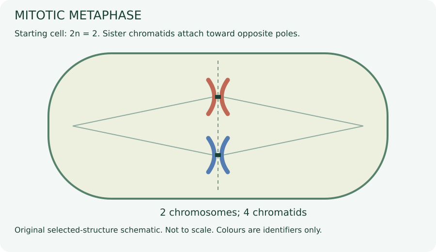
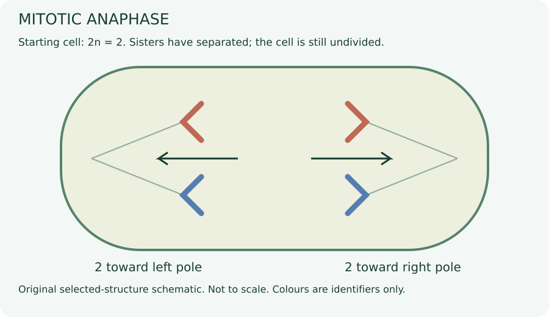
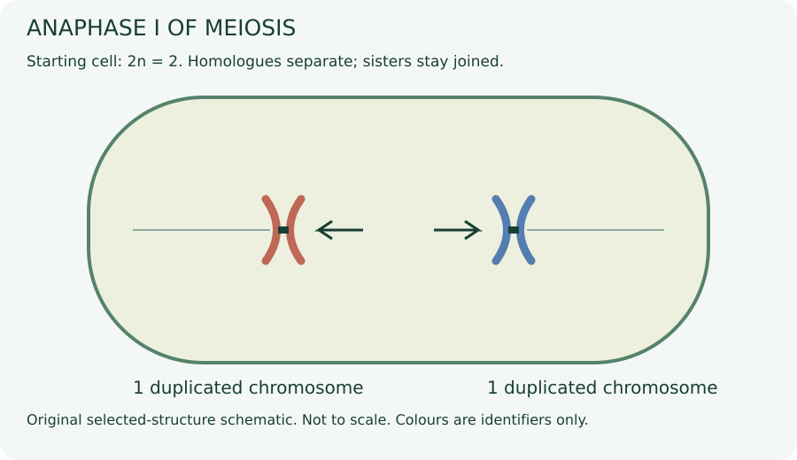

# ৩য় অধ্যায়: কোষ বিভাজন

> উত্তরসহ পর্যালোচনাধীন খসড়া; নির্ধারিত সংখ্যার উত্তরসহ খসড়া সম্পূর্ণ; বিষয়বস্তু পর্যালোচনা বাকি।
> মূল বই ও বিষয়বিশেষজ্ঞের পূর্ণ যাচাই বাকি। বোর্ড/স্কুল/সাল দাবি নেই।

## rebuild-mcq.json

### MCQ 1

“ক্রোমোজোম সংখ্যা বজায় রাখা নিউক্লীয় বিভাজন”—বর্ণনাটি কোন ধারণা বা গঠন নির্দেশ করে?

A. মাইটোসিস
B. স্পিন্ডল তন্তু
C. মিয়োসিস-I
D. প্রোমেটাফেজ

উত্তর: A — মাইটোসিস
মাইটোসিস: বৃদ্ধি ও ক্ষয়পূরণে নতুন কোষ দেয়। সীমা: স্বাভাবিক বিভাজনে অপত্যে সংখ্যা অর্ধেক হয় না।

### MCQ 2

“দুই দফা বিভাজনে সেটসংখ্যা হ্রাসকারী প্রক্রিয়া”—বর্ণনাটি কোন ধারণা বা গঠন নির্দেশ করে?

A. মাইটোসিস
B. মিয়োসিস
C. মিয়োসিস-II
D. মেটাফেজ

উত্তর: B — মিয়োসিস
মিয়োসিস: যৌন জীবনচক্রে হ্যাপ্লয়েড কোষ তৈরি করে। সীমা: সব জীবের গ্যামেট সরাসরি মিয়োসিসে হয় না।

### MCQ 3

“বিভাজনের মধ্যবর্তী সক্রিয় প্রস্তুতিপর্ব”—বর্ণনাটি কোন ধারণা বা গঠন নির্দেশ করে?

A. মিয়োসিস
B. কোষপ্লেট
C. ইন্টারফেজ
D. টেলোফেজ

উত্তর: C — ইন্টারফেজ
ইন্টারফেজ: বৃদ্ধি ও DNA প্রতিলিপির প্রস্তুতি সম্পন্ন হয়। সীমা: এটি সম্পূর্ণ বিশ্রামের পর্যায় নয়।

### MCQ 4

“কোষচক্রে DNA প্রতিলিপির পর্যায়”—বর্ণনাটি কোন ধারণা বা গঠন নির্দেশ করে?

A. মিয়োসিস-II
B. S পর্যায়
C. বিভাজন নিয়ন্ত্রণ
D. মেটাফেজ

উত্তর: B — S পর্যায়
S পর্যায়: বংশগতীয় উপাদানের অনুলিপি তৈরি করে। সীমা: DNA বাড়া মানেই তখনই কোষসংখ্যা বাড়া নয়।

### MCQ 5

“ক্রোমোজোম ঘনীভবনের প্রাথমিক মাইটোটিক ধাপ”—বর্ণনাটি কোন ধারণা বা গঠন নির্দেশ করে?

A. প্রোফেজ
B. মিয়োসিস
C. সেন্ট্রোমিয়ার
D. সাইটোকাইনেসিস

উত্তর: A — প্রোফেজ
প্রোফেজ: ক্রোমোজোম দৃশ্যমান হতে সাহায্য করে। সীমা: DNA প্রতিলিপি সাধারণত এর আগেই হয়।

### MCQ 6

“নিউক্লিয়ার আবরণ ভাঙা ও স্পিন্ডল সংযোগের ধাপ”—বর্ণনাটি কোন ধারণা বা গঠন নির্দেশ করে?

A. সাইটোকাইনেসিস
B. সিন্যাপসিস
C. S পর্যায়
D. প্রোমেটাফেজ

উত্তর: D — প্রোমেটাফেজ
প্রোমেটাফেজ: ক্রোমোজোমের গতির সংযোগ প্রতিষ্ঠা করে। সীমা: বিভাজন একটি অবিচ্ছিন্ন প্রক্রিয়া।

### MCQ 7

“ক্রোমোজোম বিষুবীয় অঞ্চলে সাজানোর ধাপ”—বর্ণনাটি কোন ধারণা বা গঠন নির্দেশ করে?

A. মিয়োসিস
B. ক্রসিং ওভার
C. মেটাফেজ
D. প্রোফেজ

উত্তর: C — মেটাফেজ
মেটাফেজ: বণ্টনের আগে সুশৃঙ্খল অবস্থান তৈরি করে। সীমা: এখানে অপত্যকোষ পুরো পৃথক হয় না।

### MCQ 8

“মাইটোসিসে সিস্টার ক্রোমাটিড বিচ্ছেদের ধাপ”—বর্ণনাটি কোন ধারণা বা গঠন নির্দেশ করে?

A. অ্যানাফেজ
B. সেন্ট্রোমিয়ার
C. স্পিন্ডল তন্তু
D. সিন্যাপসিস

উত্তর: A — অ্যানাফেজ
অ্যানাফেজ: বিপরীত মেরুতে অপত্য ক্রোমোজোম সরায়। সীমা: মিয়োসিস-I-এ সমসংস্থ ক্রোমোজোম পৃথক হয়।

### MCQ 9

“অপত্য নিউক্লিয়াস পুনর্গঠনের ধাপ”—বর্ণনাটি কোন ধারণা বা গঠন নির্দেশ করে?

A. অ্যানাফেজ
B. ক্রসিং ওভার
C. মাইটোসিস
D. টেলোফেজ

উত্তর: D — টেলোফেজ
টেলোফেজ: নিউক্লিয়ার আবরণ আবার গঠিত হয়। সীমা: নিউক্লীয় ও সাইটোপ্লাজমীয় বিভাজন পৃথক ধারণা।

### MCQ 10

“সাইটোপ্লাজমের বিভাজন”—বর্ণনাটি কোন ধারণা বা গঠন নির্দেশ করে?

A. প্রোমেটাফেজ
B. সাইটোকাইনেসিস
C. টেলোফেজ
D. মেটাফেজ

উত্তর: B — সাইটোকাইনেসিস
সাইটোকাইনেসিস: অপত্য কোষের পৃথকীকরণ সম্পন্ন করে। সীমা: ক্যারিওকাইনেসিস নিউক্লিয়াসের বিভাজন।

### MCQ 11

“উদ্ভিদকোষে মধ্যবর্তী নতুন বিভাজক অংশ”—বর্ণনাটি কোন ধারণা বা গঠন নির্দেশ করে?

A. সিন্যাপসিস
B. কোষপ্লেট
C. মাইটোসিস
D. S পর্যায়

উত্তর: B — কোষপ্লেট
কোষপ্লেট: দুটি অপত্য কোষের মধ্যে প্রাচীর গঠনে সহায়তা করে। সীমা: প্রাণিকোষে সাধারণত ক্লিভেজ খাঁজ হয়।

### MCQ 12

“প্রাণিকোষের সংকোচনজনিত বিভাজক খাঁজ”—বর্ণনাটি কোন ধারণা বা গঠন নির্দেশ করে?

A. মিয়োসিস
B. স্পিন্ডল তন্তু
C. ক্রসিং ওভার
D. ক্লিভেজ খাঁজ

উত্তর: D — ক্লিভেজ খাঁজ
ক্লিভেজ খাঁজ: বাইর থেকে ভেতরে কোষকে পৃথক করে। সীমা: উদ্ভিদের শক্ত প্রাচীরের বিভাজনরীতি আলাদা।

### MCQ 13

“সিস্টার ক্রোমাটিডের সংযোগাঞ্চল”—বর্ণনাটি কোন ধারণা বা গঠন নির্দেশ করে?

A. সেন্ট্রোমিয়ার
B. মেটাফেজ
C. সাইটোকাইনেসিস
D. মিয়োসিস-II

উত্তর: A — সেন্ট্রোমিয়ার
সেন্ট্রোমিয়ার: বণ্টনে ক্রোমোজোমের সংগঠন বজায় রাখে। সীমা: অবস্থানভেদে ক্রোমোজোমের আকৃতি বদলায়।

### MCQ 14

“মাইক্রোটিউবিউলভিত্তিক বিভাজনযন্ত্রের তন্তু”—বর্ণনাটি কোন ধারণা বা গঠন নির্দেশ করে?

A. মেটাফেজ
B. অ্যানাফেজ
C. স্পিন্ডল তন্তু
D. ক্লিভেজ খাঁজ

উত্তর: C — স্পিন্ডল তন্তু
স্পিন্ডল তন্তু: ক্রোমোজোমের সুশৃঙ্খল চলনে সহায়তা করে। সীমা: প্রতিটি তন্তুর সব ভূমিকা এক নয়।

### MCQ 15

“সমসংস্থ ক্রোমোজোমের জোড়া বাঁধা”—বর্ণনাটি কোন ধারণা বা গঠন নির্দেশ করে?

A. ইন্টারফেজ
B. কায়াজমা
C. সিন্যাপসিস
D. অ্যানাফেজ

উত্তর: C — সিন্যাপসিস
সিন্যাপসিস: মিয়োসিসের প্রোফেজ-I-এ যুগল গঠন করে। সীমা: মাইটোসিসের নিয়মিত বৈশিষ্ট্য নয়।

### MCQ 16

“নন-সিস্টার ক্রোমাটিডে অংশবিনিময়”—বর্ণনাটি কোন ধারণা বা গঠন নির্দেশ করে?

A. মেটাফেজ
B. S পর্যায়
C. সেন্ট্রোমিয়ার
D. ক্রসিং ওভার

উত্তর: D — ক্রসিং ওভার
ক্রসিং ওভার: অ্যালিলের নতুন সমন্বয় তৈরি করে। সীমা: এটি সব জিনকে নতুন করে সৃষ্টি করে না।

### MCQ 17

“সমসংস্থ যুগলে বিনিময়ের দৃশ্যমান সংযোগস্থান”—বর্ণনাটি কোন ধারণা বা গঠন নির্দেশ করে?

A. সাইটোকাইনেসিস
B. ইন্টারফেজ
C. কায়াজমা
D. মেটাফেজ

উত্তর: C — কায়াজমা
কায়াজমা: ক্রসিং ওভারের চিহ্ন শনাক্তে সাহায্য করে। সীমা: কায়াজমা ও সেন্ট্রোমিয়ার এক নয়।

### MCQ 18

“সমসংস্থ ক্রোমোজোম পৃথককারী প্রথম বিভাজন”—বর্ণনাটি কোন ধারণা বা গঠন নির্দেশ করে?

A. মিয়োসিস-I
B. মিয়োসিস
C. সাইটোকাইনেসিস
D. ক্রসিং ওভার

উত্তর: A — মিয়োসিস-I
মিয়োসিস-I: ক্রোমোজোমের সেটসংখ্যা কমায়। সীমা: সিস্টার ক্রোমাটিড সাধারণত একসঙ্গে থাকে।

### MCQ 19

“সিস্টার ক্রোমাটিড পৃথককারী দ্বিতীয় বিভাজন”—বর্ণনাটি কোন ধারণা বা গঠন নির্দেশ করে?

A. ক্লিভেজ খাঁজ
B. মিয়োসিস-II
C. টেলোফেজ
D. মিয়োসিস-I

উত্তর: B — মিয়োসিস-II
মিয়োসিস-II: প্রথম বিভাজনের কোষগুলো আবার বিভক্ত করে। সীমা: এর আগে আবার S পর্যায় হয় না।

### MCQ 20

“কোষচক্রের সুশৃঙ্খল অগ্রগতি নিয়ন্ত্রণ”—বর্ণনাটি কোন ধারণা বা গঠন নির্দেশ করে?

A. স্পিন্ডল তন্তু
B. মাইটোসিস
C. সিন্যাপসিস
D. বিভাজন নিয়ন্ত্রণ

উত্তর: D — বিভাজন নিয়ন্ত্রণ
বিভাজন নিয়ন্ত্রণ: অনিয়ন্ত্রিত কোষবৃদ্ধি প্রতিরোধে সহায়তা করে। সীমা: শুধু দ্রুত বৃদ্ধি দেখেই ক্যান্সার নির্ণয় নয়।

### MCQ 21

G1 ও G2 তুলনায় কোন পরিবর্তনটি সাধারণ কোষচক্রের সঙ্গে সঙ্গতিপূর্ণ?

A. DNA দ্বিগুণ, সেটসংখ্যা অপরিবর্তিত
B. প্রতিটি ক্রোমোজোম স্বাধীন চার সেট
C. DNA অর্ধেক, সেটসংখ্যা দ্বিগুণ
D. নিউক্লিয়াসের সব DNA হারানো

উত্তর: A — DNA দ্বিগুণ, সেটসংখ্যা অপরিবর্তিত
S পর্যায়ের প্রতিলিপি অনুলিপি বাড়ায়, সমসংস্থ সেটসংখ্যা নয়।

### MCQ 22

একই কোষে দুটি নিউক্লিয়াস কিন্তু কোষদেহ অবিভক্ত। কোনটি নিশ্চিত নয়?

A. কোষে একাধিক নিউক্লিয়াস আছে
B. কোষসীমা এখনও এক থাকতে পারে
C. নিউক্লিয়ার ও কোষদেহের বিভাজন আলাদা
D. সাইটোকাইনেসিস সম্পন্ন হয়েছে

উত্তর: D — সাইটোকাইনেসিস সম্পন্ন হয়েছে
শুধু নিউক্লিয়াস গণনা দিয়ে পৃথক অপত্য কোষ সৃষ্টি নিশ্চিত করা যায় না।

### MCQ 23

প্রোফেজে মোটা খাটো ক্রোমোজোম দেখা দেওয়ার মূল ব্যাখ্যা কোনটি?

A. প্রতিটি নিউক্লিয়াস নতুন রাজ্য হয়
B. সব DNA তখনই শূন্য থেকে তৈরি হয়
C. আগের ক্রোমাটিন ঘনীভূত হয়
D. ক্রোমোজোম সেলুলোজে বদলায়

উত্তর: C — আগের ক্রোমাটিন ঘনীভূত হয়
দৃশ্যমানতা ঘনীভবনে বাড়ে; সাধারণ DNA প্রতিলিপি আগের S পর্যায়ে।

### MCQ 24

অ্যানাফেজে সেন্ট্রোমিয়ার আগে এবং বাহু পরে এগোলে আকৃতির পার্থক্য কোন তথ্য দিতে পারে?

A. রাইবোজোমের সঠিক সংখ্যা
B. সেন্ট্রোমিয়ারের আপেক্ষিক অবস্থান
C. খাদ্যের মোট ক্যালরি
D. জীবের সব জিনের বানান

উত্তর: B — সেন্ট্রোমিয়ারের আপেক্ষিক অবস্থান
বাহুর দৈর্ঘ্য ও সংযোগস্থানের অবস্থান দৃশ্যমান বিন্যাসকে প্রভাবিত করে।

### MCQ 25

চার ক্রোমাটিডযুক্ত একটি বাইভ্যালেন্টে কয়টি সমসংস্থ ক্রোমোজোম থাকে?

A. আটটি
B. দুটি
C. চারটি
D. একটি

উত্তর: B — দুটি
দুই প্রতিলিপিকৃত সমসংস্থ সদস্যে দুইটি করে মোট চার ক্রোমাটিড থাকে।

### MCQ 26

সমসংস্থ ক্রোমোজোম ও সহোদর ক্রোমাটিডের পার্থক্য কোনটি?

A. সমসংস্থে কোনো জিন নেই
B. সমসংস্থ জোড়া ভিন্ন পিতামাতৃ উৎসের হতে পারে; সহোদর একই ক্রোমোজোমের অনুলিপি
C. দুটিই সবসময় পৃথক রাজ্যের জীব
D. সহোদর শব্দ সবসময় ভিন্ন গ্যামেট বোঝায়

উত্তর: B — সমসংস্থ জোড়া ভিন্ন পিতামাতৃ উৎসের হতে পারে; সহোদর একই ক্রোমোজোমের অনুলিপি
প্রতিলিপিগত সম্পর্ক ও সমসংস্থ জোড়ার সম্পর্ক এক নয়।

### MCQ 27

মিয়োসিস-I শেষে প্রতিটি কোষ হ্যাপ্লয়েড হলেও ক্রোমোজোম প্রতিলিপিকৃত থাকে কেন?

A. হ্যাপ্লয়েড কোষে DNA থাকে না
B. সব ক্রোমাটিড অদৃশ্য হয়েছে
C. নতুন S পর্যায় অবশ্যই ঘটেছে
D. সমসংস্থ আলাদা হয়েছে, সহোদর এখনও যুক্ত

উত্তর: D — সমসংস্থ আলাদা হয়েছে, সহোদর এখনও যুক্ত
প্রথম বিভাজন সেট কমায়; দ্বিতীয় বিভাজনে সহোদর পৃথক হয়।

### MCQ 28

মিয়োসিসের চারটি নিউক্লিয়াস মানেই চারটি সমান কার্যকর ডিম্বাণু নয় কেন?

A. সাইটোপ্লাজম বণ্টন ও পরবর্তী বিকাশ অসম হতে পারে
B. সব বিভাজনই ব্যর্থ
C. মিয়োসিসে কোনো DNA থাকে না
D. ডিম্বাণুতে কখনও নিউক্লিয়াস থাকে না

উত্তর: A — সাইটোপ্লাজম বণ্টন ও পরবর্তী বিকাশ অসম হতে পারে
প্রাণীর ডিম্বাণু গঠনে সাধারণত একটি বড় কার্যকর কোষ ও পোলার বডি হয়।

### MCQ 29

সপুষ্পক উদ্ভিদে রেণু মাতৃকোষের মিয়োসিসের প্রত্যক্ষ ফল কোনটি?

A. সরাসরি পরিণত ফল
B. সম্পূর্ণ নতুন বীজ
C. হ্যাপ্লয়েড রেণু
D. নিষিক্ত ডিপ্লয়েড জাইগোট

উত্তর: C — হ্যাপ্লয়েড রেণু
রেণু থেকে গ্যামেটোফাইটের বিকাশের পরে গ্যামেট তৈরি হয়; রেণু ও গ্যামেট এক নয়।

### MCQ 30

একটি ক্ষত দ্রুত সারছে বলেই ক্যান্সার বলা অনুচিত কেন?

A. নিয়ন্ত্রিত মাইটোসিস স্বাভাবিক মেরামতেও হয়
B. ক্ষতে কখনও নতুন কোষ হয় না
C. সব দ্রুত বিভাজন মিয়োসিস
D. সব ক্যান্সারে বিভাজন বন্ধ

উত্তর: A — নিয়ন্ত্রিত মাইটোসিস স্বাভাবিক মেরামতেও হয়
বিভাজনের হার একা রোগনির্ণয় নয়; নিয়ন্ত্রণ ও কোষের আচরণ গুরুত্বপূর্ণ।

### MCQ 31

2n=10 কোষের G1-এ ক্রোমোজোম ও DNA অণু যথাক্রমে কত?

A. 20 ও 10
B. 10 ও 20
C. 5 ও 10
D. 10 ও 10

উত্তর: D — 10 ও 10
S-পূর্ব প্রতিটি ক্রোমোজোমে এক DNA অণু থাকে; শুধু নিউক্লিয়ার DNA ধরা হয়েছে।

### MCQ 32

এক ডিপ্লয়েড নিউক্লিয়াসে S শেষে 24 ক্রোমাটিড। তার 2n কত?

A. 48
B. 24
C. 6
D. 12

উত্তর: D — 12
সহোদর পৃথক না হলে প্রতি ক্রোমোজোমে দুই ক্রোমাটিড।

### MCQ 33

2n=6 কোষের মাইটোটিক মেটাফেজে সেন্ট্রোমিয়ার অঞ্চলের গণনা কত?

A. 12
B. 6
C. 3
D. 24

উত্তর: B — 6
প্রতিলিপিকৃত সহোদরদ্বয়কে এক ক্রোমোজোম হিসেবে গোনা হয়।

### MCQ 34

2n=4 কোষের অ্যানাফেজে একই অবিভক্ত কোষে মোট স্বাধীন ক্রোমোজোম কত?

A. 16
B. 4
C. 2
D. 8

উত্তর: D — 8
সহোদর বিচ্ছেদের পরে প্রতিটি স্বাধীন ক্রোমোজোম; প্রতি মেরুতে 4 যায়।

### MCQ 35

মাইটোসিসে অ্যানাফেজে মোট 16 অপত্য ক্রোমোজোম সমান ভাগে গেলে প্রতিটি মেরুতে কত?

A. 16
B. 8
C. 32
D. 4

উত্তর: B — 8
মোট ও প্রতি মেরুর হিসাব আলাদা; 16-এর অর্ধেক 8।

### MCQ 36

G1-এর DNA পরিমাণ 2C হলে সাধারণ মাইটোসিসের পর প্রতি অপত্যে কত?

A. 2C
B. 8C
C. 4C
D. 1C

উত্তর: A — 2C
S-এ 4C হলেও সমান বণ্টনের পরে প্রতি অপত্যে আগের পরিমাণ ফেরে।

### MCQ 37

এক ডিপ্লয়েড কোষে G2-তে 4C DNA থাকলে তার প্লয়ডি কী?

A. 2n
B. n
C. DNA-বিহীন
D. 4n

উত্তর: A — 2n
C পরিমাণের সূচক, n সেটসংখ্যার সূচক।

### MCQ 38

2n=12 জননমাতৃকোষের প্রোফেজ-I-এ বাইভ্যালেন্ট সংখ্যা কত?

A. 3
B. 6
C. 12
D. 24

উত্তর: B — 6
প্রতি সমসংস্থ জোড়া একটি বাইভ্যালেন্ট।

### MCQ 39

মেটাফেজ-I-এ পাঁচটি বাইভ্যালেন্ট থাকলে মোট ক্রোমাটিড কত?

A. 40
B. 5
C. 20
D. 10

উত্তর: C — 20
প্রতি বাইভ্যালেন্টে চার ক্রোমাটিড থাকে।

### MCQ 40

2n=8 কোষে মিয়োসিস-I শেষে প্রতি কোষে DNA অণু কত?

A. 4
B. 2
C. 16
D. 8

উত্তর: D — 8
চার প্রতিলিপিকৃত ক্রোমোজোমে দুইটি করে DNA অণু থাকে।

### MCQ 41

মিয়োসিস-I শেষে n=7 কোষে সেন্ট্রোমিয়ার অঞ্চলের ভিত্তিতে ক্রোমোজোম কত?

A. 3.5
B. 28
C. 7
D. 14

উত্তর: C — 7
হ্যাপ্লয়েড হলেও প্রতিটি এখনও দুই ক্রোমাটিডযুক্ত।

### MCQ 42

মিয়োসিস-II শেষে প্রতি নিউক্লিয়াসে 9 ক্রোমোজোম হলে মূল ডিপ্লয়েড কোষের 2n কত?

A. 9
B. 4.5
C. 18
D. 36

উত্তর: C — 18
স্বাভাবিক হ্রাসে অপত্যের সংখ্যা মূল ডিপ্লয়েডের অর্ধেক।

### MCQ 43

এক ডিপ্লয়েড কোষে মিয়োসিস শুরুর আগে 4C DNA। মিয়োসিস-II শেষে প্রতি নিউক্লিয়াসে কত?

A. 1C
B. 8C
C. 4C
D. 2C

উত্তর: A — 1C
একবার প্রতিলিপির পর দুইবার বণ্টনে 4C থেকে প্রতি চূড়ান্ত নিউক্লিয়াসে 1C হয়।

### MCQ 44

নিষেকে দুটি স্বাভাবিক n=11 গ্যামেট মিললে জাইগোটে কত ক্রোমোজোম?

A. 44
B. 22
C. 11
D. 5.5

উত্তর: B — 22
দুটি হ্যাপ্লয়েড সেটের মিলনে ডিপ্লয়েড 22 হয়।

### MCQ 45

মিয়োসিস-II-এর অ্যানাফেজে এক অবিভক্ত n=3 কোষে স্বাধীন ক্রোমোজোম মোট কত?

A. 1.5
B. 6
C. 12
D. 3

উত্তর: B — 6
সহোদর বিচ্ছেদে তখন মোট ছয়, প্রতিটি মেরুতে তিন।

### MCQ 46

চার চূড়ান্ত মিয়োটিক নিউক্লিয়াসের DNA যোগফল সাধারণত কিসের সমান?

A. শূন্য
B. সম্পূর্ণ জীবের DNA
C. প্রতিলিপি-পরবর্তী মাতৃনিউক্লিয়াসের DNA
D. প্রতিটি গ্যামেটের অর্ধেক

উত্তর: C — প্রতিলিপি-পরবর্তী মাতৃনিউক্লিয়াসের DNA
স্বাভাবিক বণ্টনে মূল 4C চারটি 1C হিসেবে ভাগ হয়।

### MCQ 47

এক কোষের সব অপত্য তিন দফা মাইটোসিস করলে কোষসংখ্যা কত?

A. 3
B. 9
C. 6
D. 8

উত্তর: D — 8
প্রতি দফায় সব কোষ বিভাজিত হলে 2³=8; বাস্তবে সব কোষ এমন সমলয় নয়।

### MCQ 48

একটি কোষ বিভক্ত হয়ে দুইটির মধ্যে শুধু একটি আবার ভাগ হলো। মোট কয়টি কোষ?

A. 3
B. 8
C. 2
D. 4

উত্তর: A — 3
কেবল বিভাজিত শাখায় একটি অতিরিক্ত কোষ যোগ হয়েছে।

### MCQ 49

শুরুতে 5 কোষের প্রত্যেকটি একবার মিয়োসিসে চার কোষ দিলে মোট কত?

A. 10
B. 5
C. 20
D. 40

উত্তর: C — 20
পাঁচটি পৃথক মিয়োসিসে 5×4 কোষ; অসম গ্যামেটবিকাশ এখানে ধরা হয়নি।

### MCQ 50

স্বাধীন বিন্যাসমাত্র বিবেচনায় তিন জোড়া ক্রোমোজোম কত রকম পিতৃ-মাতৃ সমাবেশ দিতে পারে?

A. 8
B. 3
C. 6
D. 9

উত্তর: A — 8
2³ সম্ভাব্য সমাবেশ; ক্রসিং ওভার বা অন্য বৈচিত্র্য এতে গণনা হয়নি।

### MCQ 51

মানব দেহকোষে 46 ক্রোমোজোম থাকলে স্বাভাবিক শুক্রাণুতে কত?

A. 12
B. 46
C. 23
D. 92

উত্তর: C — 23
স্বাভাবিক হ্যাপ্লয়েড গ্যামেটে ডিপ্লয়েডের অর্ধেক থাকে।

### MCQ 52

মানব G2 কোষে 92 নিউক্লিয়ার DNA অণু থাকলেই 92 ক্রোমোজোম বলা ভুল কেন?

A. G2 হলো নিষেক
B. DNA সবসময় অনুপস্থিত
C. সহোদরদ্বয় যুক্ত থাকায় ক্রোমোজোম 46
D. ক্রোমোজোম গণনায় কোষপ্রাচীর গোনা হয়

উত্তর: C — সহোদরদ্বয় যুক্ত থাকায় ক্রোমোজোম 46
DNA অণু ও সেন্ট্রোমিয়ারভিত্তিক ক্রোমোজোমসংখ্যা ভিন্ন সূচক।

### MCQ 53

স্বাভাবিক মাইটোটিক টেলোফেজে দুটি অপত্য নিউক্লিয়াসের সংখ্যা তুলনায় কী আশা করা হয়?

A. প্রত্যেকটিতে মাতৃসংখ্যার এক-চতুর্থাংশ
B. একটিতে সব DNA, অন্যটিতে শূন্য
C. প্রত্যেকটিতে মাতৃ G1-এর ক্রোমোজোমসংখ্যা
D. প্রতিটিতে চারগুণ সেট

উত্তর: C — প্রত্যেকটিতে মাতৃ G1-এর ক্রোমোজোমসংখ্যা
সুশৃঙ্খল বণ্টনে সমান ক্রোমোজোমসমষ্টি যায়।

### MCQ 54

অ্যানাফেজ-I-এ সমসংস্থ যুগল না ছাড়লে কী ঝুঁকি?

A. শুধু কোষগহ্বরের রং বদল
B. সবসময় নতুন S পর্যায়
C. স্বাভাবিক সংখ্যার নিশ্চয়তা
D. অপত্যে অসম ক্রোমোজোম বণ্টন

উত্তর: D — অপত্যে অসম ক্রোমোজোম বণ্টন
বিচ্ছেদ ব্যর্থতা ননডিসজাংশন ঘটাতে পারে।

### MCQ 55

মিয়োসিস-I-এ একটি যুগলের ননডিসজাংশনের পর স্বাভাবিক দ্বিতীয় বিভাজনে ফল কী হতে পারে?

A. সব চূড়ান্ত কোষে ওই ক্রোমোজোমের সংখ্যা অস্বাভাবিক
B. সকল জিন অনুপস্থিত
C. সব চারটি একসঙ্গে জাইগোট
D. সব চারটি নিশ্চিত স্বাভাবিক

উত্তর: A — সব চূড়ান্ত কোষে ওই ক্রোমোজোমের সংখ্যা অস্বাভাবিক
দুটি n+1 ও দুটি n−1 কোষ হতে পারে; স্বাভাবিক হিসাব নয়।

### MCQ 56

শুধু একটি মিয়োসিস-II কোষে সহোদর বিচ্ছেদ ব্যর্থ হলে কোন ফল সম্ভব?

A. চারটি স্বাভাবিকই বাধ্যতামূলক
B. দুটি মিয়োসিস-I আবার শুরু
C. সব কোষে 4n
D. দুটি স্বাভাবিক ও দুটি অসমসংখ্যক কোষ

উত্তর: D — দুটি স্বাভাবিক ও দুটি অসমসংখ্যক কোষ
অন্য প্রথম-বিভাজনোত্তর কোষ স্বাভাবিক ভাগ হতে পারে।

### MCQ 57

ক্রোমোজোমের একটি বেশি বা কম থাকা ও পুরো সেট বাড়ার পার্থক্য কী?

A. অ্যানিউপ্লয়ডি ও পলিপ্লয়ডি পৃথক
B. দুটিই শুধু রঞ্জন
C. দুটিতে DNA থাকে না
D. দুটিই সবসময় একই

উত্তর: A — অ্যানিউপ্লয়ডি ও পলিপ্লয়ডি পৃথক
নির্দিষ্ট সদস্যের অমিল ও পূর্ণ সেটের গুণিতক ভিন্ন।

### MCQ 58

উদ্ভিদে পলিপ্লয়ডি থাকলেই সবসময় নতুন প্রজাতি নিশ্চিত নয় কেন?

A. প্রতিটি বড় ফল আলাদা রাজ্য
B. উদ্ভিদে ক্রোমোজোম নেই
C. প্রজনন ও বিবর্তনীয় বিচ্ছিন্নতাও বিচার্য
D. সব পলিপ্লয়েড গ্যামেট একই

উত্তর: C — প্রজনন ও বিবর্তনীয় বিচ্ছিন্নতাও বিচার্য
সেটবৃদ্ধি প্রজাতি গঠনে ভূমিকা রাখতে পারে, একক নিশ্চয়তা নয়।

### MCQ 59

অক্ষত মূলের সব কোষকে মিয়োসিসকারী বলা যায় না কেন?

A. মিয়োসিসেই সব কোষের সংখ্যা সমান থাকে
B. মূলের কোনো কোষ বাঁচে না
C. অগ্রভাগের বৃদ্ধি সাধারণত মাইটোসিসনির্ভর
D. সব কোষ গ্যামেট

উত্তর: C — অগ্রভাগের বৃদ্ধি সাধারণত মাইটোসিসনির্ভর
অঙ্গ ও কোষের ভূমিকা অনুযায়ী বিভাজনের ধরন বুঝতে হয়।

### MCQ 60

জননাঙ্গের প্রতিটি কোষ মিয়োসিস করে—দাবির সীমা কী?

A. কখনও মাইটোসিস হয় না
B. সহায়ক দেহকোষও থাকে
C. সব কোষ ইতিমধ্যে গ্যামেট
D. জননাঙ্গে কোনো টিস্যু নেই

উত্তর: B — সহায়ক দেহকোষও থাকে
অঙ্গের অবস্থান একা প্রতিটি কোষের বিভাজনধরন নির্ধারণ করে না।

### MCQ 61

পরাগরেণু ও পুংগ্যামেটকে অভিন্ন বলা ভুল কেন?

A. পরাগে DNA নেই
B. দুটিই পূর্ণ ফল
C. গ্যামেট সবসময় ডিপ্লয়েড
D. পরাগরেণু গ্যামেটোফাইট, গ্যামেট তার বিশেষ কোষ

উত্তর: D — পরাগরেণু গ্যামেটোফাইট, গ্যামেট তার বিশেষ কোষ
উদ্ভিদের রেণু ও গ্যামেটের সংগঠনস্তর আলাদা।

### MCQ 62

ডিম্বক ও ডিম্বাণুর তুলনায় কোনটি ঠিক?

A. ডিম্বকে কখনও মিয়োসিস-সংশ্লিষ্ট কোষ নেই
B. দুটিই পুরুষ গ্যামেট
C. দুটি একই এক কোষ
D. ডিম্বক বহু কোষের গঠন, ডিম্বাণু একটি গ্যামেট

উত্তর: D — ডিম্বক বহু কোষের গঠন, ডিম্বাণু একটি গ্যামেট
অঙ্গগঠন ও তার বিশেষ কোষকে পৃথক রাখতে হয়।

### MCQ 63

হ্যাপ্লয়েড রেণুর পরবর্তী মাইটোসিসে সেটসংখ্যা কী হয়?

A. সবসময় 4n হয়
B. n বজায় থাকে
C. অবশ্যই শূন্য হয়
D. অবশ্যই 2n হয়

উত্তর: B — n বজায় থাকে
মাইটোসিসে বিদ্যমান সেটসংখ্যা সাধারণত অক্ষুণ্ণ থাকে।

### MCQ 64

স্বাধীন বিন্যাসের 2ⁿ সূত্রে n কী বোঝায়?

A. সমসংস্থ জোড়ার সংখ্যা
B. মোট ক্রোমাটিডের সংখ্যা
C. সব অ্যালিলের সংখ্যা
D. চার কোষের যোগফল

উত্তর: A — সমসংস্থ জোড়ার সংখ্যা
সূত্রে ক্রসিং ওভার বাদ দিয়ে যুগলভিত্তিক সমাবেশ গণনা হয়।

### MCQ 65

কোন ঘটনাটি নিষেকের বৈচিত্র্য, মিয়োসিসের নয়?

A. প্রথম বিভাজনে সদস্য বণ্টন
B. কোন শুক্রাণু কোন ডিম্বাণুর সঙ্গে মেলে
C. অসহোদর অংশবিনিময়
D. সমসংস্থের স্বাধীন বিন্যাস

উত্তর: B — কোন শুক্রাণু কোন ডিম্বাণুর সঙ্গে মেলে
গ্যামেট তৈরির বৈচিত্র্য ও তাদের মিলনের বৈচিত্র্য আলাদা।

### MCQ 66

একই সমসংস্থ যুগলের সব ক্রোমাটিডে সবসময় একই বিনিময় ঘটে না কেন?

A. চারটি সবসময় একটি অণু
B. বিনিময়ে নির্দিষ্ট অসহোদর ক্রোমাটিড অংশ নেয়
C. সবসময় কোষদেহ অর্ধেক হয়
D. কোনোটিতেই DNA নেই

উত্তর: B — বিনিময়ে নির্দিষ্ট অসহোদর ক্রোমাটিড অংশ নেয়
একটি বিনিময়ে চারটির মধ্যে দুটি অংশ নিতে পারে।

### MCQ 67

সমদৈর্ঘ্য ক্রোমোজোম দেখলেই সমসংস্থ বলা যথেষ্ট নয় কেন?

A. দৈর্ঘ্যই একমাত্র বৈশিষ্ট্য
B. সব ক্রোমোজোম একই অ্যালিল
C. জিনের অবস্থানসহ অন্যান্য সাদৃশ্যও প্রয়োজন
D. সমসংস্থ সবসময় ভিন্ন দৈর্ঘ্যের

উত্তর: C — জিনের অবস্থানসহ অন্যান্য সাদৃশ্যও প্রয়োজন
শুধু বাইরের আকারে অভিন্নতা পূর্ণ পরিচয় নিশ্চিত করে না।

### MCQ 68

একটি মডেলে দুটি সহোদরকে একটি পিতৃ ও একটি মাতৃ ক্রোমোজোম বলা ভুল কেন?

A. প্রতিলিপিতে নতুন পিতামাতা তৈরি হয়
B. সহোদর একই ক্রোমোজোমের প্রতিলিপি
C. মাতৃ উৎস মানে কোষপ্রাচীর
D. সমসংস্থে কখনও অ্যালিল থাকে না

উত্তর: B — সহোদর একই ক্রোমোজোমের প্রতিলিপি
সহোদর সম্পর্ক অনুলিপিগত; সমসংস্থ সম্পর্ক ভিন্ন উৎসের সদস্যের।

### MCQ 69

কোষের মাঝখানে দুটি X যুগল পাশাপাশি। শুধু এ তথ্য দিয়ে মাইটোটিক মেটাফেজ নিশ্চিত নয় কেন?

A. X কেবল ব্যাকটেরিয়ায়
B. X মানেই চার জীব
C. সমসংস্থ যুগল হলে মেটাফেজ-I হতে পারে
D. বিষুবীয় অবস্থান কখনও হয় না

উত্তর: C — সমসংস্থ যুগল হলে মেটাফেজ-I হতে পারে
কাদের যুগল ও কীভাবে বিন্যস্ত তা শনাক্ত করা দরকার।

### MCQ 70

ক্রোমোজোম মেরুতে গেলেও সহোদর যুক্ত আছে—কোন দশার সঙ্গে বেশি মেলে?

A. G1
B. মাইটোটিক অ্যানাফেজ
C. অ্যানাফেজ-I
D. অ্যানাফেজ-II

উত্তর: C — অ্যানাফেজ-I
প্রথম মিয়োটিক বিচ্ছেদে সমসংস্থ সদস্য আলাদা হয়।

### MCQ 71

হ্যাপ্লয়েড কোষে সহোদর বিচ্ছেদ ও দুই মেরুতে গমন ঘটছে। আগের ইতিহাস না জানলে কোন দুটি সম্ভাবনা থাকে?

A. কেবল মিয়োসিস-I
B. কেবল নিষেক বা পরাগায়ন
C. মাইটোসিস বা মিয়োসিস-II
D. শুধু সিন্যাপসিস

উত্তর: C — মাইটোসিস বা মিয়োসিস-II
হ্যাপ্লয়েড জীবকোষেও মাইটোসিস হতে পারে; বিচ্ছেদ একা ইতিহাস বলে না।

### MCQ 72

একাধিক প্রোফেজ ছবিতে ঘনীভবনের মাত্রা ভিন্ন হওয়া কী নির্দেশ করতে পারে?

A. সব ছবি ভুল
B. সবসময় ভিন্ন প্রজাতি
C. DNA পরিমাণ প্রতিবার শূন্য
D. একই পর্যায়ের ভিন্ন সময়

উত্তর: D — একই পর্যায়ের ভিন্ন সময়
পর্যায়টি সময়জুড়ে পরিবর্তিত হয়; সীমানা বর্ণনামূলক।

### MCQ 73

মেরুপ্রান্তে ঘনীভূত ক্রোমোজোম দেখেই টেলোফেজ নিশ্চিত করার আগে কী দেখা ভালো?

A. শুধু নমুনার নাম
B. নিউক্লিয়ার আবরণ পুনর্গঠনের লক্ষণ
C. রঞ্জকের দাম
D. শুধু কাচের পুরুত্ব

উত্তর: B — নিউক্লিয়ার আবরণ পুনর্গঠনের লক্ষণ
শেষ অ্যানাফেজ ও শুরুর টেলোফেজ আলাদা করতে একাধিক লক্ষণ দরকার।

### MCQ 74

নিউক্লিয়ার আবরণ অদৃশ্য মানে DNA অদৃশ্য নয় কেন?

A. DNA শুধু কোষরসে
B. DNA কেবল কোষপ্রাচীর
C. ক্রোমোজোমে DNA এখনও আছে
D. আবরণই সব DNA

উত্তর: C — ক্রোমোজোমে DNA এখনও আছে
আবরণীর সংগঠন ও বংশগতীয় বস্তুর উপস্থিতি ভিন্ন।

### MCQ 75

উচ্চতর উদ্ভিদে সেন্ট্রিওল না থাকলেও কী সম্ভব?

A. সব কোষ ব্যাকটেরিয়া হওয়া
B. মাইটোটিক স্পিন্ডল গঠন
C. বংশগতীয় বণ্টন চিরতরে অসম্ভব
D. কেবল নিষেক

উত্তর: B — মাইটোটিক স্পিন্ডল গঠন
মাইক্রোটিউবিউল সংগঠনের বিকল্প কেন্দ্র ও ব্যবস্থা আছে।

### MCQ 76

প্রাণিকোষের অ্যাস্টার-রে চেনায় কোন স্থানটি প্রাসঙ্গিক?

A. বিভাজনের মেরুর সেন্ট্রোজোম অঞ্চল
B. প্রাচীরের মধ্যপর্দা
C. স্ট্রোমা
D. কোষপ্লেটের মাঝখান

উত্তর: A — বিভাজনের মেরুর সেন্ট্রোজোম অঞ্চল
এগুলো রশ্মিসদৃশ মাইক্রোটিউবিউল বিন্যাস।

### MCQ 77

নিউক্লিওলাস ফের দেখা যাওয়ার সঙ্গে কোন পর্যায় মেলে?

A. টেলোফেজ
B. অ্যানাফেজের সূচনা
C. S-এর প্রথম অনুলিপি
D. মেটাফেজের পূর্ণ সারিবদ্ধতা

উত্তর: A — টেলোফেজ
টেলোফেজে অপত্য নিউক্লিয়াস পুনর্গঠিত হয়।

### MCQ 78

দুটি কোষে DNA সমান মাপা গেলেও একই দশা বলা যায় না কেন?

A. প্লয়ডি ও ক্রোমাটিডের সংগঠন ভিন্ন হতে পারে
B. কোষচক্র নেই
C. সব কোষে একই আয়তন
D. DNA পরিমাণ সবসময় পরিচয় বলে

উত্তর: A — প্লয়ডি ও ক্রোমাটিডের সংগঠন ভিন্ন হতে পারে
উদাহরণে ডিপ্লয়েড G1 ও মিয়োসিস-I-পরবর্তী হ্যাপ্লয়েডে 2C হতে পারে।

### MCQ 79

দেহকোষ ও গ্যামেটের সংখ্যা তুলনায় কোন শর্ত লিখতে হয়?

A. শুধু দিনের তাপমাত্রা
B. শুধু কোষের রং
C. প্রজাতি ও স্বাভাবিক প্লয়ডি
D. কেবল অঙ্গের ওজন

উত্তর: C — প্রজাতি ও স্বাভাবিক প্লয়ডি
সব জীবকে একই ক্রোমোজোমসংখ্যার ধরে হিসাব করা যায় না।

### MCQ 80

কোষচক্রের চিত্রে M পর্যায়ের বাইরে S রাখা হয় কেন?

A. DNA প্রতিলিপি মাইটোসিসের প্রস্তুতিপর্বে
B. S মানে সবসময় নিষেক
C. S কেবল কোষপ্রাচীর তৈরি
D. মাইটোসিসে DNA নেই

উত্তর: A — DNA প্রতিলিপি মাইটোসিসের প্রস্তুতিপর্বে
প্রতিলিপি ও বণ্টনের পর্যায় আলাদা দেখানো হয়।

### MCQ 81

কোন কোষচক্র-লিপিটি স্বাভাবিক মিয়োসিসের সঙ্গে অসংগত?

A. S → I → S → II
B. সমসংস্থ বিচ্ছেদের পরে সহোদর বিচ্ছেদ
C. S → I → II
D. এক প্রতিলিপি ও দুই বিভাজন

উত্তর: A — S → I → S → II
দুই বিভাজনের মাঝখানে নতুন S স্বাভাবিক নিয়ম নয়।

### MCQ 82

মাইটোটিক সূচক গণনায় লবের উপাদান কী?

A. শুধু মৃত কোষ
B. কেবল গ্যামেটের সংখ্যা
C. সব ক্রোমাটিডের যোগফল
D. বিভাজনরত কোষসংখ্যা

উত্তর: D — বিভাজনরত কোষসংখ্যা
সূচক হলো মোট পর্যবেক্ষিত কোষের মধ্যে বিভাজনরত অংশ; এটি সম্প্রসারিত অনুশীলন।

### MCQ 83

100 কোষের মধ্যে 20টি মাইটোসিসে থাকলে মাইটোটিক সূচক কত?

A. 20%
B. 200%
C. 80%
D. 5%

উত্তর: A — 20%
20÷100×100=20%; এটি কোষের ভগ্নাংশ, সরাসরি বিভাজনগতির পরিমাপ নয়।

### MCQ 84

এক পর্যায়ে বেশি কোষ থাকলেই সেই পর্যায় দ্রুততম বলা ভুল কেন?

A. স্থির নমুনায় বেশি ভগ্নাংশ দীর্ঘ স্থায়িত্বও নির্দেশ করতে পারে
B. দ্রুততম দশায় DNA থাকে না
C. সব পর্যায় অবশ্যই সমান
D. ভগ্নাংশের সঙ্গে সময়ের সম্পর্ক অসম্ভব

উত্তর: A — স্থির নমুনায় বেশি ভগ্নাংশ দীর্ঘ স্থায়িত্বও নির্দেশ করতে পারে
সময় অনুমানে স্থিতিশীল জনসংখ্যাসহ কিছু শর্ত প্রয়োজন।

### MCQ 85

বিভাজন-প্রতিরোধী পদার্থে মেটাফেজ কোষ জমলে সম্ভাব্য ব্যাখ্যা কী?

A. সব কোষ দ্রুত টেলোফেজে গেছে
B. পরবর্তী অগ্রগতি বাধাগ্রস্ত
C. সব ক্রোমোজোম দ্বিগুণ সেট
D. সব কোষ নিষিক্ত

উত্তর: B — পরবর্তী অগ্রগতি বাধাগ্রস্ত
এক দশায় জমা হওয়া থেমে থাকার ফলও হতে পারে।

### MCQ 86

চিকিৎসায় বিভাজনরোধী পদার্থের স্বাভাবিক টিস্যুতে প্রভাবের কারণ কী?

A. সুস্থ কিছু কোষও নিয়মিত বিভাজিত হয়
B. সব স্বাভাবিক কোষ মৃত
C. ওষুধ সবসময় শুধু ক্ষতিগ্রস্ত কোষ চেনে
D. শুধু রোগীর DNA আছে

উত্তর: A — সুস্থ কিছু কোষও নিয়মিত বিভাজিত হয়
কোষবিভাজনভিত্তিক চিকিৎসার প্রভাব পেশাগতভাবে মূল্যায়ন করতে হয়।

### MCQ 87

শিক্ষার্থীর রঞ্জন-পরীক্ষায় অ্যাসিড ও উত্তাপ ব্যবহারে কী প্রয়োজন?

A. খাদ্যের পাত্রে রাসায়নিক রাখা
B. মুখে পিপেট
C. খালি হাতে গরম পাত্র ধরা
D. শিক্ষকের তত্ত্বাবধান ও সুরক্ষাসামগ্রী

উত্তর: D — শিক্ষকের তত্ত্বাবধান ও সুরক্ষাসামগ্রী
বিপজ্জনক ধাপ নিজে করার নির্দেশ নয়; নিরাপদ ব্যবহারিক নীতি জরুরি।

### MCQ 88

মূলের অগ্রভাগ ও পরিণত অঞ্চলের তুলনায় সঠিক নমুনায়ন কী?

A. ভিন্ন বিবর্ধনে শুধু চোখে অনুমান
B. একটি সুবিধাজনক কোষ বেছে সিদ্ধান্ত
C. প্রতিটি অঞ্চলের সমমানের বহু ক্ষেত্র গণনা
D. সীমা ছাড়া একই কোষ বারবার গোনা

উত্তর: C — প্রতিটি অঞ্চলের সমমানের বহু ক্ষেত্র গণনা
তুলনার জন্য অঞ্চল, ক্ষেত্র ও গণনার পদ্ধতি একরূপ রাখা দরকার।

### MCQ 89

একই কোষ বারবার গণনা এড়াতে কী করা যায়?

A. অস্পষ্ট কোষকে সবসময় মিয়োসিস বলা
B. নির্ধারিত ধারায় ক্ষেত্র সরানো ও সীমার নিয়ম রাখা
C. শুধু উজ্জ্বল কোষ গোনা
D. যেকোনো দিকে এলোমেলো ফিরে আসা

উত্তর: B — নির্ধারিত ধারায় ক্ষেত্র সরানো ও সীমার নিয়ম রাখা
মানসম্মত গণনা তথ্যের পুনরুৎপাদনযোগ্যতা বাড়ায়।

### MCQ 90

অস্পষ্ট ক্রোমোজোমের ছবিতে অনুমানের বদলে কোন নথি সৎ?

A. সবসময় অ্যানাফেজ বলা
B. সর্বোচ্চ নম্বরের দশা লেখা
C. বইয়ের ছবি নিজের দেখা দাবি
D. পর্যায় অনির্ণীত লিখে সীমা জানানো

উত্তর: D — পর্যায় অনির্ণীত লিখে সীমা জানানো
পর্যবেক্ষণ থেকে যতটুকু সমর্থিত ততটুকুই দাবি করা উচিত।

### MCQ 91

বিভাজনরত কোষে সব অঙ্গাণু সম্পূর্ণ শূন্য হয়ে যায়—কেন ভুল?

A. সব অঙ্গাণু কেবল গ্যামেট
B. স্পিন্ডল কখনও প্রোটিন নয়
C. কোষীয় উপাদানের পুনর্বিন্যাস ও বণ্টন হয়
D. DNA থাকলেই সাইটোপ্লাজম নেই

উত্তর: C — কোষীয় উপাদানের পুনর্বিন্যাস ও বণ্টন হয়
নিউক্লিয়ার আবরণ ভাঙা মানে পুরো কোষসংগঠন বিলুপ্ত নয়।

### MCQ 92

মাইটোসিসশেষে অপত্যের কাজ ভিন্ন হতে পারে কেন?

A. প্রত্যেকটি আলাদা রাজ্য
B. পরবর্তী বিশেষায়ন ও পরিবেশগত সংকেত ভিন্ন
C. দুই কোষে DNA কখনও থাকে না
D. সব অপত্যে অর্ধেক জিন অনিবার্য

উত্তর: B — পরবর্তী বিশেষায়ন ও পরিবেশগত সংকেত ভিন্ন
সমান বণ্টন মানে ভবিষ্যৎ ভূমিকা সম্পূর্ণ অভিন্ন নয়।

### MCQ 93

একই দেহে কিছু কোষ ভাগ হয় আর কিছু হয় না—এর অর্থ কী?

A. কোষের ধরন ও নিয়ন্ত্রিত অবস্থার পার্থক্য
B. সব কোষে মিয়োসিস
C. সব ভাগ হওয়া কোষ ক্যান্সার
D. সব অবিভাজিত কোষ মৃত

উত্তর: A — কোষের ধরন ও নিয়ন্ত্রিত অবস্থার পার্থক্য
বিভাজনক্ষমতা বিশেষায়ন ও সংকেতের ওপর নির্ভর করে।

### MCQ 94

G0 বলতে সাধারণভাবে কোন অবস্থা বোঝানো হয়?

A. সকল কোষের নিশ্চিত মৃত্যু
B. সক্রিয় বিভাজনচক্রের বাইরে থাকা অবস্থা
C. মিয়োসিসের তৃতীয় বিভাজন
D. নতুন DNA প্রতিলিপির একমাত্র ধাপ

উত্তর: B — সক্রিয় বিভাজনচক্রের বাইরে থাকা অবস্থা
কিছু কোষ পরে ফিরে আসতে পারে; G0 মানেই নিষ্ক্রিয় মৃত কোষ নয়।

### MCQ 95

কোষ বিভাজনের হার কমলেই কোষপ্রসারণ বন্ধ প্রমাণ হয় না কেন?

A. সংখ্যাবৃদ্ধি ও একক কোষের আকারবৃদ্ধি আলাদা
B. আকার ও সংখ্যা একই শব্দ
C. কোষ কখনও বড় হয় না
D. কোষে বিপাক নেই

উত্তর: A — সংখ্যাবৃদ্ধি ও একক কোষের আকারবৃদ্ধি আলাদা
দুটি সূচক আলাদা করে মাপতে হবে।

### MCQ 96

মিউটেশন ও ক্রসিং ওভারকে একই ঘটনা বলা ঠিক নয় কেন?

A. দুটিতে DNA নেই
B. দুটিই শুধু কোষপ্লেট
C. দুটিই কেবল নিষেক
D. অনুক্রমের পরিবর্তন ও অংশের পুনঃসমন্বয় পৃথক

উত্তর: D — অনুক্রমের পরিবর্তন ও অংশের পুনঃসমন্বয় পৃথক
সাধারণ ক্রসিং ওভারে বিদ্যমান অ্যালিলের বিন্যাস বদলায়।

### MCQ 97

স্বাভাবিক মিয়োসিসে ক্রসিং ওভার না ধরলেও কোন উৎসে বৈচিত্র্য সম্ভব?

A. সমসংস্থ যুগলের স্বাধীন বিন্যাস
B. মৃত কোষের আয়তন
C. শুধু রঞ্জকের রং
D. কেবল কোষপ্লেটের পুরুত্ব

উত্তর: A — সমসংস্থ যুগলের স্বাধীন বিন্যাস
একাধিক যুগলের ভিন্ন সমাবেশ বৈচিত্র্য দিতে পারে।

### MCQ 98

মিয়োসিস-I ও মিয়োসিস-II তুলনায় কোনটি সঠিক জোড়া?

A. DNA প্রতিলিপি — পরাগায়ন
B. সহোদর বিচ্ছেদ — নিষেক
C. কোষপ্রাচীর বিলোপ — রক্তজমাট
D. সমসংস্থ বিচ্ছেদ — সহোদর বিচ্ছেদ

উত্তর: D — সমসংস্থ বিচ্ছেদ — সহোদর বিচ্ছেদ
দুটি দফায় বণ্টনের একক পৃথক।

### MCQ 99

দুটি n কোষ পাশাপাশি দেখা গেলেই 2n কোষ বলা যায় না কেন?

A. সেটসংখ্যা প্রতি নিউক্লিয়াসে বিচার্য
B. প্রতিটি কোষে চার সেট
C. সকল n কোষ মৃত
D. পাশাপাশি মানেই নিষেক সম্পন্ন

উত্তর: A — সেটসংখ্যা প্রতি নিউক্লিয়াসে বিচার্য
দুটি আলাদা কোষের সংখ্যা যোগ করে একটির প্লয়ডি বলা যায় না।

### MCQ 100

মিয়োসিসের পর চারটি n নিউক্লিয়াস মানেই প্রতিটি 4n নয় কেন?

A. n মানে কোনো DNA নেই
B. মোট নিউক্লিয়াসসংখ্যা ও প্রতি নিউক্লিয়াসের সেট ভিন্ন
C. প্রতিটি ক্রোমাটিড একটি সমসংস্থ সেট
D. চার নিউক্লিয়াস সবসময় একসঙ্গে নিষিক্ত

উত্তর: B — মোট নিউক্লিয়াসসংখ্যা ও প্রতি নিউক্লিয়াসের সেট ভিন্ন
প্রতি কোষের বংশগতীয় সংগঠন আলাদা গণনা করতে হয়।

### MCQ 101

নিষেক ও মিয়োসিসের ভারসাম্য ভিন্ন জীবের চক্রে কোথায় দেখা হয়?

A. শুধু পাতার রং
B. কেবল গ্যামেটের গতিতে
C. সম্পূর্ণ জীবনচক্রের হ্যাপ্লয়েড-ডিপ্লয়েড পর্যায়ে
D. শুধু একটি কোষের আয়তনে

উত্তর: C — সম্পূর্ণ জীবনচক্রের হ্যাপ্লয়েড-ডিপ্লয়েড পর্যায়ে
বিভিন্ন জীবের মিয়োসিসের সময় ভিন্ন হলেও সেট হ্রাস ও পুনরুদ্ধার সম্পর্কিত।

### MCQ 102

মানুষের স্নায়ুকোষের সংকেত বহনকে মিয়োসিস বলা যায় না কেন?

A. স্নায়ুতে বংশগতীয় বস্তু নেই
B. এটি কোষের কাজ, হ্রাসমূলক বিভাজন নয়
C. মানুষে মিয়োসিস নেই
D. সব সংকেতে চার কোষ হয়

উত্তর: B — এটি কোষের কাজ, হ্রাসমূলক বিভাজন নয়
কোষের প্রতিটি সক্রিয়তা কোষবিভাজন নয়।

### MCQ 103

প্রতিরক্ষায় লিম্ফোসাইটের বংশবৃদ্ধি কোন উদাহরণ?

A. বিশেষ কোষের নিয়ন্ত্রিত মাইটোসিস
B. সমস্ত রক্তকণিকার মিয়োসিস
C. প্রতি কোষের সেট অর্ধেক
D. কোষহীন রক্তরসের নিষেক

উত্তর: A — বিশেষ কোষের নিয়ন্ত্রিত মাইটোসিস
বংশবৃদ্ধি দেহরক্ষাতেও প্রয়োজন হতে পারে; সব বৃদ্ধি রোগ নয়।

### MCQ 104

ক্ষতপূরণে শুধু নতুন কোষের সংখ্যা জানলেই সম্পূর্ণ আরোগ্য বলা যায় না কেন?

A. বিন্যাস, বিশেষায়ন ও টিস্যুর কার্যকারিতাও প্রয়োজন
B. সব নতুন কোষ গ্যামেট
C. কোনো ক্ষতে মাইটোসিস হয় না
D. ক্ষতপূরণ মানেই নতুন প্রজাতি

উত্তর: A — বিন্যাস, বিশেষায়ন ও টিস্যুর কার্যকারিতাও প্রয়োজন
কোষ সরবরাহের পাশাপাশি কার্যকর টিস্যু পুনর্গঠনও জরুরি।

### MCQ 105

ভ্রূণের বৃদ্ধি ব্যাখ্যায় 2ᵏ কোষসংখ্যার মডেলের সীমা কী?

A. এটি নিষেকের সংজ্ঞা
B. এতে গণিত ব্যবহার নিষিদ্ধ
C. সব কোষ বাস্তবে একই সময়ে মরে
D. সব কোষ সমলয়ে বাঁচে ও ভাগ হয়—এমন অনুমান আছে

উত্তর: D — সব কোষ সমলয়ে বাঁচে ও ভাগ হয়—এমন অনুমান আছে
বাস্তবে চক্রের সময়, কোষমৃত্যু ও বিশেষায়ন ভিন্ন।

### MCQ 106

ক্রোমোজোম গণনার প্রতিবেদনে মেটাফেজ না অ্যানাফেজ লেখা জরুরি কেন?

A. সব অ্যানাফেজ কোষ 4n স্থায়ী জীব
B. পর্যায়ের সঙ্গে সংখ্যা কখনও সম্পর্কিত নয়
C. মেটাফেজে DNA শূন্য
D. বিচ্ছিন্ন সহোদর গণনার একক বদলায়

উত্তর: D — বিচ্ছিন্ন সহোদর গণনার একক বদলায়
একই অবিভক্ত কোষে বিচ্ছেদের পরে স্বাধীন ক্রোমোজোম দ্বিগুণ গোনা হয়।

### MCQ 107

প্রতিলিপিকৃত সমসংস্থ যুগল ও দুটি অপ্রতিলিপিকৃত ক্রোমোজোমে পার্থক্য কী?

A. দুটিতেই শূন্য DNA
B. প্রথমটিতে চার, দ্বিতীয়টিতে দুই DNA অণু
C. প্রথমটিতে সবসময় চার সেট
D. দ্বিতীয়টি কখনও হ্যাপ্লয়েড নয়

উত্তর: B — প্রথমটিতে চার, দ্বিতীয়টিতে দুই DNA অণু
ক্রোমোজোম সংখ্যা সমান হলেও প্রতিলিপিগত অবস্থা DNA পরিমাণ বদলায়।

### MCQ 108

মিয়োসিসের হ্রাসকে প্রতিটি ক্রোমোজোম লম্বালম্বি অর্ধেক করে বাদ দেওয়া বলা ভুল কেন?

A. সব জিন কাটা পড়ে
B. পূর্ণ সমসংস্থ সদস্য পৃথক হয়
C. অপত্যে ক্রোমোজোম থাকে না
D. শুধু কোষের পানি অর্ধেক

উত্তর: B — পূর্ণ সমসংস্থ সদস্য পৃথক হয়
এক সেটে প্রতিটি ধরনের একটি পূর্ণ সদস্য যায়।

### MCQ 109

স্পিন্ডল ত্রুটিতে শুধু একটি ক্রোমোজোম ভুল মেরুতে গেলে কোন বর্ণনা ঠিক?

A. সব DNA একসঙ্গে নতুন রাজ্য
B. সমস্ত ক্রোমোজোম অবশ্যই দ্বিগুণ সেট
C. স্বাভাবিক সমীকরণিক ফল নিশ্চিত
D. বণ্টনে নির্দিষ্ট সংখ্যাগত ত্রুটি হতে পারে

উত্তর: D — বণ্টনে নির্দিষ্ট সংখ্যাগত ত্রুটি হতে পারে
নিয়ন্ত্রণ ও পৃথকীকরণের সঠিকতা বংশগতীয় স্থিতির জন্য জরুরি।

### MCQ 110

মাইটোসিস ও মিয়োসিস কোন সাধারণ কাজে অংশ নেয়?

A. উভয়েই দুটি ডিপ্লয়েড কোষ দেয়
B. উভয়েই দুইবার প্রতিলিপি করে
C. বংশগতীয় বস্তু অপত্যে বণ্টন
D. উভয়েই সবসময় সংখ্যা অর্ধেক

উত্তর: C — বংশগতীয় বস্তু অপত্যে বণ্টন
বণ্টন সাধারণ হলেও ধাপ, ফল ও তাৎপর্য পৃথক।

### MCQ 111

বহুকোষী জীবের দেহে বিভাজনের মাধ্যমে সরাসরি কী বাড়ে?

A. সেন্ট্রোমিয়ারের স্থান
B. প্রতিটি ক্রোমোজোমের সেট
C. কোষসংখ্যা
D. প্রতিটি কোষের রাজ্য

উত্তর: C — কোষসংখ্যা
কোষ বিভাজন নতুন কোষ দেয়; পুরো দেহবৃদ্ধিতে কোষের প্রসারণও যুক্ত।

### MCQ 112

একটি অ্যামিবা বিভক্ত হয়ে দুটি জীব হলে বিভাজনের ভূমিকা কী?

A. রেণু থেকে বীজ সৃষ্টি
B. নিষেক
C. অযৌন বংশবৃদ্ধি
D. পরাগায়ন

উত্তর: C — অযৌন বংশবৃদ্ধি
এখানে পৃথক গ্যামেটের মিলন ছাড়াই জীবসংখ্যা বাড়ে।

### MCQ 113

মানুষের স্বাভাবিক দেহবৃদ্ধি ও গ্যামেট গঠনের তুলনায় কোনটি ঠিক?

A. সব কোষে শুধু মিয়োসিস
B. প্রতিটি দেহকোষ নিষিক্ত হয়
C. বৃদ্ধি মানেই ক্রোমোজোমের সেট বাড়া
D. কাজভেদে বিভাজনের ধরন ভিন্ন

উত্তর: D — কাজভেদে বিভাজনের ধরন ভিন্ন
বৃদ্ধিতে মাইটোসিস ও যৌন জীবনচক্রে হ্রাসমূলক বিভাজনের ভূমিকা পৃথক।

### MCQ 114

সাধারণ ব্যাকটেরিয়ার দ্বিবিভাজনকে মাইটোসিস বলা যথাযথ নয় কেন?

A. সুগঠিত নিউক্লিয়াস ও মাইটোটিক স্পিন্ডল নেই
B. নতুন কোষ হয় না
C. কোনো ঝিল্লি নেই
D. কোনো DNA নেই

উত্তর: A — সুগঠিত নিউক্লিয়াস ও মাইটোটিক স্পিন্ডল নেই
দুটি কোষ হওয়া একা মাইটোটিক নিউক্লীয় বিভাজনের প্রমাণ নয়।

### MCQ 115

জাইগোট থেকে বহুকোষী ভ্রূণ গঠনে কোনটি প্রয়োজন?

A. প্রতি কোষে ক্রোমোজোম অর্ধেক করা
B. বংশগতীয় তথ্য বিলোপ
C. প্রতি ধাপে নিষেক
D. ধারাবাহিক কোষ বিভাজন ও বিকাশ

উত্তর: D — ধারাবাহিক কোষ বিভাজন ও বিকাশ
মাইটোসিস কোষ দেয়; বিকাশে বিশেষায়নও প্রয়োজন।

### MCQ 116

বিভাজনে উত্তরাধিকারী তথ্য বণ্টনের আগে কোন কাজ জরুরি?

A. কোষপ্রাচীরের সব লিগনিন ধ্বংস
B. নিউক্লিওলাসকে গ্যামেট করা
C. ক্রোমোজোমের সব জিন মুছে ফেলা
D. DNA-র যথাযথ অনুলিপি

উত্তর: D — DNA-র যথাযথ অনুলিপি
স্বাভাবিক বিভাজনের প্রস্তুতিতে DNA প্রতিলিপি প্রয়োজন।

### MCQ 117

ইন্টারফেজকে নিষ্ক্রিয় বিরতি বলা অনুচিত কেন?

A. বিপাক, বৃদ্ধি ও প্রস্তুতি চলে
B. এতে কোনো রাসায়নিক বিক্রিয়া হয় না
C. শুধু শুষ্ক প্রাচীর থাকে
D. এটি মৃত কোষ

উত্তর: A — বিপাক, বৃদ্ধি ও প্রস্তুতি চলে
ইন্টারফেজ সক্রিয় কোষচক্রের অংশ।

### MCQ 118

ইন্টারফেজের স্বাভাবিক ক্রম কোনটি?

A. S → G2 → G1
B. G1 → S → G2
C. G2 → G1 → S
D. M → G2 → S

উত্তর: B — G1 → S → G2
DNA প্রতিলিপির আগে G1 এবং পরে G2 থাকে।

### MCQ 119

DNA প্রতিলিপি শেষ, কিন্তু মাইটোসিস শুরু হয়নি—কোন পর্যায় মেলে?

A. G2
B. G1
C. সাইটোকাইনেসিস
D. অ্যানাফেজ

উত্তর: A — G2
G2 হলো S-এর পরের প্রস্তুতিপর্ব।

### MCQ 120

G1-এ ডিপ্লয়েড কোষের ক্রোমোজোমের সাধারণ অবস্থা কী?

A. প্রতিটি এক ক্রোমাটিডযুক্ত
B. প্রতিটি চার সমসংস্থযুক্ত
C. প্রতিটি আট গ্যামেটযুক্ত
D. সবসময় DNA-বিহীন

উত্তর: A — প্রতিটি এক ক্রোমাটিডযুক্ত
S-এর আগে একটি ক্রোমোজোমে একটি DNA অণুসমৃদ্ধ ক্রোমাটিড থাকে।

### MCQ 121

S-এর শেষে সহোদর ক্রোমাটিড তৈরি হলেও প্লয়ডি কেন বাড়ে না?

A. সব জিন নষ্ট হয়
B. প্রতিটি অনুলিপি আলাদা জীব
C. সমসংস্থ সেটের সংখ্যা বাড়ে না
D. DNA প্রতিলিপি হয়নি

উত্তর: C — সমসংস্থ সেটের সংখ্যা বাড়ে না
অনুলিপি বৃদ্ধি ও সমসংস্থ সেট বৃদ্ধি পৃথক।

### MCQ 122

এক কোষে DNA প্রতিলিপি হয়েছে—কোন সিদ্ধান্তটি শুধু এ তথ্য থেকে নয়?

A. বংশগতীয় অনুলিপি বেড়েছে
B. সংশ্লেষণ ঘটেছে
C. বিভাজনের প্রস্তুতি হয়েছে
D. দুটি পৃথক কোষ তৈরি হয়েছে

উত্তর: D — দুটি পৃথক কোষ তৈরি হয়েছে
DNA প্রতিলিপি নিজে কোষদেহকে ভাগ করে না।

### MCQ 123

মাইটোসিসের প্রাথমিক ঘনীভবনে কোন পরিবর্তন দৃশ্যমান হয়?

A. সব DNA প্রাচীর হয়
B. সব ক্রোমোজোম বিলুপ্ত হয়
C. ক্রোমোজোম খাটো ও মোটা হয়
D. রক্তকণিকা জন্মায়

উত্তর: C — ক্রোমোজোম খাটো ও মোটা হয়
আগের ক্রোমাটিন সংগঠিত ও ঘনীভূত হয়ে স্পষ্ট হয়।

### MCQ 124

প্রোফেজে দেখা দুই ক্রোমাটিডের উৎপত্তি কখন?

A. সেন্ট্রোমিয়ার কেটে ফেলার ফলে
B. টেলোফেজের পরে প্রতিবার
C. আগের S পর্যায়ে
D. অ্যানাফেজে প্রথমবার

উত্তর: C — আগের S পর্যায়ে
দৃশ্যমান হওয়া ও DNA অনুলিপি তৈরি হওয়া এক সময়ের ঘটনা নয়।

### MCQ 125

নিউক্লিয়ার আবরণ ভাঙা স্পিন্ডল সংযোগে কী সুবিধা দেয়?

A. প্রাচীর দ্বিগুণ হয়
B. ক্রোমোজোমের সঙ্গে তন্তুর যোগাযোগ সম্ভব হয়
C. সব ATP শেষ হয়
D. জিন সম্পূর্ণ অকার্যকর হয়

উত্তর: B — ক্রোমোজোমের সঙ্গে তন্তুর যোগাযোগ সম্ভব হয়
উন্মুক্ত মাইটোসিসে আবরণ ভাঙায় স্পিন্ডল ক্রোমোজোমে পৌঁছায়।

### MCQ 126

বিভাজনের সময় স্পিন্ডল তৈরি হয় মূলত কোন তন্তুতে?

A. কোলাজেন রজ্জু
B. শ্বেতসার শৃঙ্খল
C. সেলুলোজ ফাইব্রিল
D. মাইক্রোটিউবিউল

উত্তর: D — মাইক্রোটিউবিউল
মাইক্রোটিউবিউল প্রোটিনভিত্তিক কোষকঙ্কালের অংশ।

### MCQ 127

কাইনেটোকোর কোথায় গঠিত হয়?

A. স্ট্রোমায়
B. কোষরসে
C. সেন্ট্রোমিয়ার অঞ্চলে
D. কোষপ্রাচীরের বাইরে

উত্তর: C — সেন্ট্রোমিয়ার অঞ্চলে
স্পিন্ডলের নির্দিষ্ট তন্তু কাইনেটোকোরে যুক্ত হয়।

### MCQ 128

স্পিন্ডলের সব তন্তু সরাসরি ক্রোমোজোমে যুক্ত—দাবি ভুল কেন?

A. সব তন্তু DNA
B. কিছু তন্তু মেরুর বিন্যাসেও ভূমিকা রাখে
C. তন্তুতে প্রোটিন নেই
D. সব তন্তু খাদ্যনালি

উত্তর: B — কিছু তন্তু মেরুর বিন্যাসেও ভূমিকা রাখে
স্পিন্ডলে বিভিন্ন ভূমিকার মাইক্রোটিউবিউল থাকে।

### MCQ 129

মেটাফেজ প্লেট বলতে কী বোঝায়?

A. ক্রোমোজোম সাজানোর কাল্পনিক বিষুবীয় তল
B. সেন্ট্রিওলের আবরণ
C. উদ্ভিদের নতুন প্রাচীরমাত্র
D. একটি হাড়ের পাত

উত্তর: A — ক্রোমোজোম সাজানোর কাল্পনিক বিষুবীয় তল
এটি বাস্তব কঠিন কোষপ্লেটের সমার্থক নয়।

### MCQ 130

মাইটোসিসের মেটাফেজে সহোদরদ্বয়ের সংযোগ সাধারণত কেমন?

A. সিভপ্লেটে যুক্ত
B. বিপরীত মেরুর সঙ্গে বিন্যস্ত
C. একই মেরুতে দুটিই আবদ্ধ
D. কোনো তন্তু নেই

উত্তর: B — বিপরীত মেরুর সঙ্গে বিন্যস্ত
বিপরীতমুখী সংযোগ সুশৃঙ্খল পৃথকীকরণে সহায়ক।

### MCQ 131

ক্রোমোজোমের দৈর্ঘ্য ও আকৃতি পর্যবেক্ষণে মেটাফেজ সুবিধাজনক কেন?

A. সাইটোপ্লাজম পুরো কালো
B. ক্রোমোজোম ঘনীভূত ও পৃথকভাবে স্পষ্ট
C. সব কোষ ফেটে যায়
D. DNA একেবারে নেই

উত্তর: B — ক্রোমোজোম ঘনীভূত ও পৃথকভাবে স্পষ্ট
ঘনীভূত ক্রোমোজোম গুনতে ও তুলনা করতে সুবিধা হয়।

### MCQ 132

অ্যানাফেজের সূচনার নির্ণায়ক ঘটনা কোনটি?

A. চারটি গ্যামেটের নিষেক
B. সমগ্র কোষপ্রাচীর গলে যাওয়া
C. সহোদর ক্রোমাটিডের সংযোগ মুক্ত হওয়া
D. নতুন DNA প্রতিলিপি

উত্তর: C — সহোদর ক্রোমাটিডের সংযোগ মুক্ত হওয়া
মাইটোসিসে সহোদর পৃথক হয়ে অপত্য ক্রোমোজোম হয়।

### MCQ 133

বিচ্ছিন্ন সহোদর ক্রোমাটিডকে অপত্য ক্রোমোজোম বলে কেন?

A. এরা খাদ্য তৈরি করে
B. এদের DNA থাকে না
C. প্রতিটি পৃথক সেন্ট্রোমিয়ারসহ স্বাধীন গঠন
D. প্রতিটি পূর্ণ নতুন জীব

উত্তর: C — প্রতিটি পৃথক সেন্ট্রোমিয়ারসহ স্বাধীন গঠন
বিচ্ছেদের পরে ক্রোমোজোম গণনায় পৃথক একক হিসেবে ধরা হয়।

### MCQ 134

অ্যানাফেজে ক্রোমোজোম চলার সময় কোন অঞ্চল সাধারণত অগ্রগামী?

A. যেকোনো একটি জিনের শেষ অক্ষর
B. সেন্ট্রোমিয়ার অঞ্চল
C. নিউক্লিওলাস
D. কোষপ্লেট

উত্তর: B — সেন্ট্রোমিয়ার অঞ্চল
স্পিন্ডল সংযোগের অঞ্চল সামনে থাকায় বাহু পেছনে থাকে।

### MCQ 135

মেটাসেন্ট্রিক ক্রোমোজোমে দুই বাহুর দৈর্ঘ্য সাধারণত কেমন?

A. দুটিই অন্য প্রজাতির
B. একটিতে কখনও DNA নেই
C. একটি সবসময় শূন্য
D. প্রায় সমান

উত্তর: D — প্রায় সমান
সেন্ট্রোমিয়ার প্রায় মাঝখানে থাকে।

### MCQ 136

সাবমেটাসেন্ট্রিক ক্রোমোজোমে সেন্ট্রোমিয়ারের অবস্থান কী?

A. মাঝ থেকে কিছুটা সরে
B. একেবারে প্রান্তে
C. বাইরের কোষঝিল্লিতে
D. প্রতিটি জিনের মাঝে

উত্তর: A — মাঝ থেকে কিছুটা সরে
কেন্দ্র থেকে সরে যাওয়ায় বাহুর দৈর্ঘ্য অসম হয়।

### MCQ 137

অ্যাক্রোসেন্ট্রিক গঠনে কোনটি বেশি প্রযোজ্য?

A. সেন্ট্রোমিয়ার অনুপস্থিত
B. চারটি সমসংস্থ সেট
C. দুই বাহু সম্পূর্ণ সমান
D. একটি বাহু অনেক ছোট

উত্তর: D — একটি বাহু অনেক ছোট
সেন্ট্রোমিয়ার প্রান্তের কাছে, তবে একেবারে প্রান্তে নয়।

### MCQ 138

টেলোসেন্ট্রিক বলতে কী বোঝানো হয়?

A. চার নিউক্লিয়াসযুক্ত কোষ
B. সবুজ ক্রোমোজোম
C. সেন্ট্রোমিয়ারহীন অণু
D. প্রান্তীয় সেন্ট্রোমিয়ারযুক্ত ক্রোমোজোম

উত্তর: D — প্রান্তীয় সেন্ট্রোমিয়ারযুক্ত ক্রোমোজোম
এটি সেন্ট্রোমিয়ারের আপেক্ষিক অবস্থানভিত্তিক নাম।

### MCQ 139

V বা J-সদৃশ ক্রোমোজোমের ছবি তুলনায় কোন তথ্য লেখা উচিত?

A. বিভাজনের দশা ও সেন্ট্রোমিয়ারের স্থান
B. কেবল স্লাইডের রং
C. শুধু নমুনার দাম
D. শুধু শিক্ষার্থীর বয়স

উত্তর: A — বিভাজনের দশা ও সেন্ট্রোমিয়ারের স্থান
আকৃতি দশা ও বিন্যাসনির্ভর; অক্ষরের সঙ্গে পরিচয় সম্পূর্ণ অভিন্ন নয়।

### MCQ 140

টেলোফেজে নিউক্লিয়ার আবরণের সঙ্গে কী ঘটে?

A. দুটি অপত্য গুচ্ছ ঘিরে পুনর্গঠিত হয়
B. সবসময় চারটি প্রাচীর হয়
C. প্রথমবার DNA তৈরি হয়
D. সব ক্রোমোজোম বের হয়ে যায়

উত্তর: A — দুটি অপত্য গুচ্ছ ঘিরে পুনর্গঠিত হয়
অপত্য নিউক্লিয়াস গঠিত হওয়া এ পর্যায়ের বৈশিষ্ট্য।

### MCQ 141

ক্রোমোজোমের শিথিল হওয়া টেলোফেজে কী বোঝায়?

A. ক্রোমাটিনের কম ঘনীভূত রূপে ফেরা
B. সমসংস্থ সেট দ্বিগুণ
C. প্রাণী থেকে উদ্ভিদ হওয়া
D. বংশগতীয় বস্তু পুরো নষ্ট

উত্তর: A — ক্রোমাটিনের কম ঘনীভূত রূপে ফেরা
দৃশ্যমান আকৃতি বদলালেও DNA হঠাৎ অনুপস্থিত হয় না।

### MCQ 142

প্রোফেজ ও টেলোফেজে আবরণীর পরিবর্তন কীভাবে সম্পর্কিত?

A. ভাঙা ও পুনর্গঠনের বিপরীত ধারা
B. দুটিতেই নতুন S পর্যায়
C. দুটিতেই নিষেক
D. দুটিই শুধু গ্যামেটের মিলন

উত্তর: A — ভাঙা ও পুনর্গঠনের বিপরীত ধারা
প্রাথমিক ও শেষ পর্যায়ের কিছু ঘটনা বিপরীতমুখী।

### MCQ 143

ক্যারিওকাইনেসিসের সরাসরি ফল কী?

A. অপত্য নিউক্লিয়াসে বংশগতীয় বণ্টন
B. সমস্ত টিস্যুর মৃত্যু
C. সর্বক্ষেত্রে আলাদা চার কোষ
D. প্রতিটি কোষে প্রাচীর সৃষ্টি

উত্তর: A — অপত্য নিউক্লিয়াসে বংশগতীয় বণ্টন
নিউক্লীয় বিভাজন ও কোষদেহ পৃথক হওয়া ভিন্ন ধাপ।

### MCQ 144

প্রাণিকোষে ক্লিভেজ খাঁজের অগ্রগতির দিক কী?

A. কেবল ওপর থেকে নিচে
B. বাইর থেকে ভেতরে
C. নিউক্লিয়াস থেকে আইপিসে
D. কেন্দ্র থেকে বাইরে প্রাচীর গড়া

উত্তর: B — বাইর থেকে ভেতরে
ঝিল্লির খাঁজ ভেতরে গভীর হয়ে কোষদেহ ভাগ করে।

### MCQ 145

উদ্ভিদের সাইটোকাইনেসিসে কেন্দ্র থেকে কী বিস্তৃত হয়?

A. ক্লিভেজ খাঁজ
B. ডিম্বাণুর লেজ
C. নিউরনের অ্যাক্সন
D. কোষপ্লেট

উত্তর: D — কোষপ্লেট
ভেসিকল মিলে নতুন বিভাজক গঠন করে, যা পাশের প্রাচীরের দিকে বাড়ে।

### MCQ 146

কোষপ্লেটের উপাদান সরবরাহে কোনটি গুরুত্বপূর্ণ?

A. লাইসোজোমের সব আত্মধ্বংস
B. সেন্ট্রোমিয়ার খণ্ড
C. গলজি-উৎপন্ন ভেসিকল
D. হিমোগ্লোবিন কণিকা

উত্তর: C — গলজি-উৎপন্ন ভেসিকল
গলজির ভেসিকল কোষপ্লেট গঠনে অবদান রাখে।

### MCQ 147

শক্ত প্রাচীরের উদ্ভিদকোষ প্রাণিকোষের মতো খাঁজে না ভাগ হওয়ার কারণ কী?

A. DNA-র সম্পূর্ণ অভাব
B. কোষে পানি নেই
C. বাইরের দৃঢ় প্রাচীরের সীমা
D. স্পিন্ডল কখনও হয় না

উত্তর: C — বাইরের দৃঢ় প্রাচীরের সীমা
নতুন ভেতরের বিভাজক গঠন উদ্ভিদীয় পদ্ধতির উপযোগী।

### MCQ 148

এক নিউক্লিয়াস থেকে দুটি হলো কিন্তু কোষদেহ ভাগ হলো না। ফল কী হতে পারে?

A. দ্বিনিউক্লিয়াসযুক্ত কোষ
B. DNA-বিহীন ব্যাকটেরিয়া
C. অবশ্যই দুটি পূর্ণ কোষ
D. অবশ্যই চার গ্যামেট

উত্তর: A — দ্বিনিউক্লিয়াসযুক্ত কোষ
সাইটোকাইনেসিস ছাড়া নিউক্লিয়াস বাড়লেও কোষসংখ্যা নাও বাড়তে পারে।

### MCQ 149

একই স্লাইডে ভিন্ন মাইটোটিক পর্যায় দেখার কারণ কী হতে পারে?

A. প্রতিটি আলাদা রাজ্যের
B. কোষগুলো একই সময়ে একই দশায় নেই
C. সব কোষ এক মুহূর্তে একই দশা পার হয়
D. স্লাইডে কোনো বাস্তব কোষ নেই

উত্তর: B — কোষগুলো একই সময়ে একই দশায় নেই
কোষচক্র সাধারণত সম্পূর্ণ সমলয় নয়।

### MCQ 150

পর্যায়গুলোকে পৃথক নাম দিলেও মাইটোসিসের প্রকৃতি কেমন?

A. পাঁচটি সম্পর্কহীন জীবন
B. পাঁচবার নিষেক
C. পাঁচবার DNA প্রতিলিপি
D. অবিচ্ছিন্ন পরিবর্তনের ধারা

উত্তর: D — অবিচ্ছিন্ন পরিবর্তনের ধারা
নামগুলো বর্ণনার সুবিধার জন্য ব্যবহৃত।

### MCQ 151

পেঁয়াজের মূলের অগ্রভাগ বিভাজন দেখতে উপযোগী কেন?

A. সেখানে সক্রিয় ভাজক কোষ থাকে
B. প্রতিটি কোষে গ্যামেট থাকে
C. প্রাচীর সম্পূর্ণ অনুপস্থিত
D. সব কোষ মিয়োসিস করে

উত্তর: A — সেখানে সক্রিয় ভাজক কোষ থাকে
ভাজক অঞ্চলে মাইটোটিক কোষ পাওয়ার সম্ভাবনা বেশি।

### MCQ 152

শুধু রঞ্জক বেশি দিলে ক্রোমোজোম সবসময় পরিষ্কার হয় না কেন?

A. রঞ্জনই নিষেক
B. অতিরিক্ত রং ও মোটা নমুনা বিবরণ আড়াল করতে পারে
C. রং সব কোষকে এক দশায় আনে
D. রং DNA-র সংখ্যা ঠিক করে

উত্তর: B — অতিরিক্ত রং ও মোটা নমুনা বিবরণ আড়াল করতে পারে
প্রস্তুতি, পুরুত্ব, আলো ও বৈসাদৃশ্য সমন্বয় দরকার।

### MCQ 153

স্থির স্লাইডে একটি কোষ দেখে কী সরাসরি মাপা যায় না?

A. সেই কোষের পুরো বিভাজনকালের দৈর্ঘ্য
B. নমুনায় কোষসীমা
C. রঞ্জিত ক্রোমোজোমের অবস্থান
D. সেই মুহূর্তের দৃশ্যমান বিন্যাস

উত্তর: A — সেই কোষের পুরো বিভাজনকালের দৈর্ঘ্য
একটি স্থির মুহূর্ত সময়ধারার প্রত্যক্ষ পরিমাপ নয়।

### MCQ 154

নতুন কোষ তৈরি হলেও পুরো অঙ্গের আয়তন সঙ্গে সঙ্গে দ্বিগুণ নয় কেন?

A. প্রথমে বিদ্যমান উপাদান ভাগ হতে পারে
B. সব DNA লোপ পায়
C. মাইটোসিসে জড় পদার্থ হয়
D. প্রতিটি কোষ সঙ্গে সঙ্গে নিষিক্ত হয়

উত্তর: A — প্রথমে বিদ্যমান উপাদান ভাগ হতে পারে
কোষবৃদ্ধি, পদার্থসঞ্চয় ও বিভাজন এক কাজ নয়।

### MCQ 155

ক্ষয়িষ্ণু আবরণী কোষের পরিবর্তে নতুন কোষ সরবরাহে কোনটি মুখ্য?

A. সব কোষে নিষেক
B. বিভাজনক্ষম পূর্বসূরির মাইটোসিস
C. শুধু প্রাচীরের রং
D. প্রতিটি পরিণত RBC-র মাইটোসিস

উত্তর: B — বিভাজনক্ষম পূর্বসূরির মাইটোসিস
সব পরিণত কোষ ভাগ না হলেও পূর্বসূরি নতুন কোষ দিতে পারে।

### MCQ 156

মানব পরিণত লোহিত কণিকা নিজে মাইটোসিস করে না কেন?

A. এতে হিমোগ্লোবিন নেই
B. এটি ব্যাকটেরিয়া
C. নিউক্লিয়াস ও স্বাভাবিক বিভাজনসংগঠন নেই
D. এর কোষঝিল্লি নেই

উত্তর: C — নিউক্লিয়াস ও স্বাভাবিক বিভাজনসংগঠন নেই
নতুন লোহিত কণিকা অস্থিমজ্জার পূর্বসূরি কোষ থেকে আসে।

### MCQ 157

অঙ্গজ প্রজননে মাইটোসিসের ভূমিকা কী?

A. একই জীবের অংশ থেকে নতুন কোষ সরবরাহ
B. সব জিন নতুন সৃষ্টি
C. প্রতিবার দুই গ্যামেট মেলানো
D. প্রতিটি কোষকে হ্যাপ্লয়েড করা

উত্তর: A — একই জীবের অংশ থেকে নতুন কোষ সরবরাহ
অযৌন বৃদ্ধিতে জিনগত সাদৃশ্য বজায় থাকতে পারে।

### MCQ 158

ক্লোনজাত উদ্ভিদেও নতুন বৈশিষ্ট্য দেখা অসম্ভব নয় কেন?

A. বংশগতীয় বস্তু থাকে না
B. মাইটোসিস মানেই প্রতিবার মিয়োসিস
C. সব ক্লোন আলাদা প্রজাতি
D. মিউটেশন ও পরিবেশের প্রভাব থাকতে পারে

উত্তর: D — মিউটেশন ও পরিবেশের প্রভাব থাকতে পারে
সাধারণ সাদৃশ্য মানে প্রতিটি অবস্থায় সম্পূর্ণ অভিন্নতা নয়।

### MCQ 159

একই DNA-সমৃদ্ধ দেহকোষের গঠন ভিন্ন হওয়ার যুক্তি কী?

A. সব বিভাজনে ক্রোমোজোম অর্ধেক
B. জিনের প্রকাশ ও বিশেষায়ন আলাদা
C. শুধু নিউক্লিয়াসের রং
D. সব কোষে আলাদা রাজ্য

উত্তর: B — জিনের প্রকাশ ও বিশেষায়ন আলাদা
বংশগতীয় তথ্য মিললেও সব কোষে সব জিন সমানভাবে সক্রিয় নয়।

### MCQ 160

মাইটোসিসকে সাধারণত সমীকরণিক বলা হয় কোন মানদণ্ডে?

A. সব কোষে আয়তন হুবহু সমান
B. সব টিস্যু একই রং
C. অপত্য নিউক্লিয়াসে ক্রোমোজোমসংখ্যা বজায় থাকে
D. সব জীবের বয়স সমান

উত্তর: C — অপত্য নিউক্লিয়াসে ক্রোমোজোমসংখ্যা বজায় থাকে
সমীকরণিক শব্দটি কোষের সব দৃশ্যমান গুণের সমতা বোঝায় না।

### MCQ 161

মাইটোসিস কি শুধু ডিপ্লয়েড কোষেই সম্ভব?

A. হ্যাঁ, অন্য সব কোষ মৃত
B. না, শুধু ব্যাকটেরিয়ায় হয়
C. না, হ্যাপ্লয়েড প্রকৃতকোষেও হতে পারে
D. হ্যাঁ, কেবল মানুষে

উত্তর: C — না, হ্যাপ্লয়েড প্রকৃতকোষেও হতে পারে
মাইটোসিস সাধারণত বিদ্যমান সেটসংখ্যা বজায় রাখে।

### MCQ 162

হ্যাপ্লয়েড উদ্ভিদ গ্যামেটোফাইটে মাইটোসিসের ফল কী?

A. DNA-শূন্য কোষ
B. অবশ্যই চার সমসংস্থ সেট
C. হ্যাপ্লয়েড কোষ বৃদ্ধি
D. অবশ্যই ডিপ্লয়েড জাইগোট

উত্তর: C — হ্যাপ্লয়েড কোষ বৃদ্ধি
সেটসংখ্যা বজায় রেখেই কোষসংখ্যা বাড়তে পারে।

### MCQ 163

কোষচক্রে পরীক্ষা-নিয়ন্ত্রণের সাধারণ উপকার কী?

A. সব DNA বারবার নষ্ট
B. ত্রুটিযুক্ত অগ্রগতি সীমিত করা
C. সব কোষের বৃদ্ধি চিরতরে বন্ধ
D. সকল কোষকে গ্যামেট করা

উত্তর: B — ত্রুটিযুক্ত অগ্রগতি সীমিত করা
DNA ও স্পিন্ডল-সংযোগের সঠিকতা বজায় রাখা গুরুত্বপূর্ণ।

### MCQ 164

স্পিন্ডল সংযোগ অসম্পূর্ণ অবস্থায় বিভাজন থামা কী নির্দেশ করতে পারে?

A. কোষ অবশ্যই ক্যান্সার
B. সব অঙ্গাণু প্রাচীর হয়েছে
C. বণ্টনের আগে নিয়ন্ত্রণ সক্রিয়
D. কোষে কোনো DNA নেই

উত্তর: C — বণ্টনের আগে নিয়ন্ত্রণ সক্রিয়
বণ্টনের আগে ত্রুটি ধরা স্বাভাবিক নিয়ন্ত্রণের অংশ হতে পারে।

### MCQ 165

DNA ক্ষতিগ্রস্ত হলে সঙ্গে সঙ্গে বিভাজন চালানো ঝুঁকিপূর্ণ কেন?

A. ত্রুটি অপত্যে ছড়াতে পারে
B. সবসময় কোষের রং সবুজ হয়
C. সব জিন ভালো হয়ে যায়
D. প্লয়ডি অবশ্যই এক

উত্তর: A — ত্রুটি অপত্যে ছড়াতে পারে
মেরামত বা নিয়ন্ত্রিত বিরতি বংশগতীয় স্থিতিতে সহায়ক।

### MCQ 166

ধূমপান-সংশ্লিষ্ট ক্ষতিকর পদার্থের সঙ্গে ক্যান্সারের ঝুঁকির সম্পর্ক কী?

A. সব অঙ্গের বিভাজন বন্ধ
B. প্রতিবার একই দিনে ক্যান্সার নিশ্চিত
C. প্রতিটি বিভাজন মিয়োসিস হয়
D. DNA ও নিয়ন্ত্রণব্যবস্থায় ক্ষতি হতে পারে

উত্তর: D — DNA ও নিয়ন্ত্রণব্যবস্থায় ক্ষতি হতে পারে
ঝুঁকি বৃদ্ধি ও ব্যক্তির নিশ্চিত রোগনির্ণয় পৃথক কথা।

### MCQ 167

সৌম্য ও ম্যালিগন্যান্ট টিউমারের পার্থক্যে কোনটি গুরুত্বপূর্ণ?

A. কেবল কোষের গোল আকৃতি
B. আশপাশে অনুপ্রবেশ ও বিস্তারের আচরণ
C. শুধু রোগীর উচ্চতা
D. শুধু পিণ্ডের নামের দৈর্ঘ্য

উত্তর: B — আশপাশে অনুপ্রবেশ ও বিস্তারের আচরণ
ম্যালিগন্যান্ট আচরণ ক্যান্সারের পরিচয়ের গুরুত্বপূর্ণ দিক।

### MCQ 168

মেটাস্টেসিস বলতে কী বোঝায়?

A. কেবল DNA প্রতিলিপি
B. গ্যামেটের মিলন
C. স্বাভাবিক ক্ষতে নতুন চামড়া
D. ক্যান্সার কোষের দূরস্থ স্থানে ছড়িয়ে নতুন বৃদ্ধি

উত্তর: D — ক্যান্সার কোষের দূরস্থ স্থানে ছড়িয়ে নতুন বৃদ্ধি
এটি স্বাভাবিক মেরামতের সমার্থক নয়।

### MCQ 169

ক্যান্সার নিয়ে কোষচক্রের পাঠ থেকে কোন আচরণ যুক্তিযুক্ত?

A. সব পিণ্ডকে সংক্রামক বলা
B. স্লাইড ছাড়া নিজেই রোগ নিশ্চিত করা
C. সব দ্রুত বৃদ্ধিকে একই চিকিৎসা দেওয়া
D. সন্দেহজনক উপসর্গে চিকিৎসকের মূল্যায়ন নেওয়া

উত্তর: D — সন্দেহজনক উপসর্গে চিকিৎসকের মূল্যায়ন নেওয়া
পাঠের সাধারণ ধারণা পেশাগত রোগনির্ণয়ের বিকল্প নয়।

### MCQ 170

কিছু ভাইরাস কোষচক্রের নিয়ন্ত্রণে প্রভাব ফেলতে পারে—এর সীমা কী?

A. DNA নেই বলে ভাইরাস প্রভাব ফেলে না
B. সব ভাইরাস বা সব সংক্রমণে ক্যান্সার হয় না
C. সব ভাইরাস গাছ
D. সব ক্যান্সার একই ভাইরাস

উত্তর: B — সব ভাইরাস বা সব সংক্রমণে ক্যান্সার হয় না
ঝুঁকির কারণকে সর্বজনীন অনিবার্য ফল বলা যাবে না।

### MCQ 171

অ্যানাফেজে সেন্ট্রোমিয়ার বিচ্ছেদ ও DNA প্রতিলিপির সময় সম্পর্কে কোনটি সঠিক?

A. বিচ্ছেদের পরেই প্রথম DNA হয়
B. প্রতিলিপি কেবল টেলোফেজে
C. বিচ্ছেদ পরে, প্রতিলিপি আগে
D. দুটি সবসময় একই মুহূর্তে

উত্তর: C — বিচ্ছেদ পরে, প্রতিলিপি আগে
S পর্যায় ও অ্যানাফেজের কাজ আলাদা।

### MCQ 172

মেটাফেজে X-আকৃতির প্রতিটি গঠনকে কেন এক ক্রোমোজোম ধরা হয়?

A. X মানে সবসময় চার কোষ
B. প্রতিটিতে চারটি সেট আছে
C. সহোদরদ্বয় এখনও সেন্ট্রোমিয়ার অঞ্চলে যুক্ত
D. এতে DNA নেই

উত্তর: C — সহোদরদ্বয় এখনও সেন্ট্রোমিয়ার অঞ্চলে যুক্ত
গণনার একক ও দৃশ্যমান বাহুর সংখ্যা এক নয়।

### MCQ 173

একটি X-আকৃতির ক্রোমোজোমের চার বাহু মানে কী নয়?

A. দুটি সহোদর ক্রোমাটিডের অংশ
B. সেন্ট্রোমিয়ারের দুই পাশের অংশ
C. ঘনীভূত গঠনের বাহু
D. চারটি পৃথক ক্রোমোজোম

উত্তর: D — চারটি পৃথক ক্রোমোজোম
দুটি ক্রোমাটিডের প্রতিটিতে সেন্ট্রোমিয়ারের দুপাশের বাহু থাকে।

### MCQ 174

সমসংস্থ জোড়ায় একই অবস্থানে জিন থাকা মানেই কী নয়?

A. একই ধরনের বৈশিষ্ট্যের জিন থাকা
B. একটি পিতৃ ও অন্যটি মাতৃ উৎসের হওয়া সম্ভব
C. অ্যালিল সবসময় অভিন্ন
D. জোড়ার কাঠামোগত সাদৃশ্য

উত্তর: C — অ্যালিল সবসময় অভিন্ন
সমসংস্থ সদস্যে ভিন্ন অ্যালিল থাকতে পারে।

### MCQ 175

মিয়োসিসের আগে একটি ডিপ্লয়েড কোষে DNA কতবার অনুলিপি হয়?

A. দুই বিভাজনের আগে মোট দুবার
B. চারবার বাধ্যতামূলক
C. একবার
D. একবারও নয়

উত্তর: C — একবার
একটি প্রতিলিপির পরে পরপর দুটি নিউক্লীয় বিভাজন হয়।

### MCQ 176

দুটি নিউক্লীয় বিভাজনের মধ্যে সংক্ষিপ্ত বিরতির নাম কী?

A. সিন্যাপসিস
B. ক্যারিওটাইপ
C. নিষেক
D. ইন্টারকাইনেসিস

উত্তর: D — ইন্টারকাইনেসিস
এতে সাধারণত নতুন S পর্যায় থাকে না।

### MCQ 177

মিয়োসিসের প্রথম প্রোফেজে জোড়া বাঁধে কারা?

A. দুটি পৃথক গ্যামেট
B. যেকোনো দুই অঙ্গাণু
C. দুটি কোষপ্রাচীর
D. সমসংস্থ ক্রোমোজোম

উত্তর: D — সমসংস্থ ক্রোমোজোম
সিন্যাপসিস সমসংস্থ সদস্যকে পাশাপাশি আনে।

### MCQ 178

বাইভ্যালেন্ট ও টেট্রাড শব্দ দুটি একই যুগলের কোন দুই দিক বোঝায়?

A. দুই প্রজাতি ও চার রাজ্য
B. দুই কোষ ও চার অঙ্গ
C. দুই জিন ও চার প্রোটিন
D. দুই ক্রোমোজোম ও চার ক্রোমাটিড

উত্তর: D — দুই ক্রোমোজোম ও চার ক্রোমাটিড
গণনার একক আলাদা হলেও একই প্রতিলিপিকৃত সমসংস্থ যুগল বর্ণিত হতে পারে।

### MCQ 179

ক্রসিং ওভার সাধারণত কাদের মধ্যে ঘটে?

A. একই ক্রোমোজোমের কেবল সহোদরদ্বয়
B. সমসংস্থ জোড়ার অসহোদর ক্রোমাটিড
C. মাইটোকন্ড্রিয়া ও গলজি
D. দুটি কোষঝিল্লি

উত্তর: B — সমসংস্থ জোড়ার অসহোদর ক্রোমাটিড
ভিন্ন সমসংস্থ সদস্যের ক্রোমাটিডে অংশবিনিময় হয়।

### MCQ 180

ক্রসিং ওভারে কোনটি পুনর্বিন্যস্ত হয়?

A. সব কোষপ্রাচীরের রং
B. সমস্ত ক্রোমোজোমের সংখ্যা
C. সবসময় নতুন রাজ্য
D. বিদ্যমান অ্যালিলের সমন্বয়

উত্তর: D — বিদ্যমান অ্যালিলের সমন্বয়
অংশবিনিময় সাধারণত অ্যালিলের বিন্যাস বদলায়, সেটসংখ্যা নয়।

### MCQ 181

কায়াজমাকে নিউক্লিয়াসের স্থায়ী অঙ্গাণু বলা অনুচিত কেন?

A. এটি গলজির আরেক নাম
B. এটি শুধু কোষপ্রাচীর
C. এটি বিনিময়-সংশ্লিষ্ট দৃশ্যমান সংযোগ
D. এতে কখনও DNA নেই

উত্তর: C — এটি বিনিময়-সংশ্লিষ্ট দৃশ্যমান সংযোগ
মিয়োসিসের সমসংস্থ যুগলের অস্থায়ী বিন্যাসের অংশ।

### MCQ 182

মেটাফেজ-I-এ বিষুবীয় অঞ্চলে কী বিন্যস্ত হয়?

A. পৃথক গ্যামেটের জোড়া
B. কেবল দুটি কোষপ্লেট
C. কেবল একক অণু
D. সমসংস্থ ক্রোমোজোমের যুগল

উত্তর: D — সমসংস্থ ক্রোমোজোমের যুগল
সাধারণ মাইটোটিক মেটাফেজে এভাবে সমসংস্থ যুগল সাজে না।

### MCQ 183

অ্যানাফেজ-I-এ কোনটি সাধারণত অক্ষত থাকে?

A. কোষের আগের সব নিউক্লিয়ার আবরণ
B. সমসংস্থ যুগলের সম্পূর্ণ পাশাপাশি অবস্থান
C. দুই কোষের নিষেক
D. সহোদর ক্রোমাটিডের সেন্ট্রোমিয়ার-সংযোগ

উত্তর: D — সহোদর ক্রোমাটিডের সেন্ট্রোমিয়ার-সংযোগ
সমসংস্থ সদস্য আলাদা হলেও সহোদরদ্বয় তখনও যুক্ত থাকে।

### MCQ 184

মিয়োসিস-I-এ হ্রাসের প্রধান কারণ কী?

A. প্রতিটি জিন অর্ধেক কেটে ফেলা
B. নতুন S পর্যায়
C. প্রত্যেক কোষের মৃত্যু
D. সমসংস্থ জোড়ার সদস্য আলাদা কোষে যাওয়া

উত্তর: D — সমসংস্থ জোড়ার সদস্য আলাদা কোষে যাওয়া
এক কোষে প্রতি জোড়ার একটি সদস্য থাকায় সেটসংখ্যা কমে।

### MCQ 185

মিয়োসিস-II-এর বিচ্ছেদ মাইটোসিসের সঙ্গে কোন দিক থেকে মেলে?

A. ডিপ্লয়েড অবস্থা সবসময় ফিরে আসে
B. প্রতিবার নতুন S হয়
C. সমসংস্থ জোড়া প্রথমবার বাঁধে
D. সহোদর ক্রোমাটিড পৃথক হয়

উত্তর: D — সহোদর ক্রোমাটিড পৃথক হয়
দুটিতে সহোদর বিচ্ছেদ থাকলেও আগের ইতিহাস ও প্লয়ডি ভিন্ন।

### MCQ 186

মিয়োসিস-II-কে সমীকরণিক বলার যুক্তি কী?

A. ক্রসিং ওভার প্রথম হয়
B. প্রথম বিভাজনোত্তর সেটসংখ্যা বজায় থাকে
C. নিষেকে দুটি সেট মেলে
D. চার কোষ মিলিয়ে এক হয়

উত্তর: B — প্রথম বিভাজনোত্তর সেটসংখ্যা বজায় থাকে
দ্বিতীয় বিভাজন প্রতি নিউক্লিয়াসে হ্যাপ্লয়েড সেট বজায় রাখে।

### MCQ 187

মিয়োসিসশেষের চার নিউক্লিয়াস সবসময় চার সমান আকারের কোষ নয় কেন?

A. সাইটোকাইনেসিস অসম হতে পারে
B. চার মানেই দুই
C. সবসময় দুটি নিউক্লিয়াস মরে
D. প্রথমে কোনো DNA ছিল না

উত্তর: A — সাইটোকাইনেসিস অসম হতে পারে
প্রাণীর ডিম্বাণু গঠনে অসম কোষদেহ বণ্টন ঘটে।

### MCQ 188

বড় ডিম্বাণু ও ছোট পোলার বডির পার্থক্য মূলত কীতে স্পষ্ট?

A. সব জিনের অনুপস্থিতিতে
B. জীবের রাজ্যে
C. সাইটোপ্লাজমের পরিমাণে
D. অবশ্যই ক্রোমোজোমের সেটে

উত্তর: C — সাইটোপ্লাজমের পরিমাণে
স্বাভাবিক হ্রাস বজায় রেখেও কোষদেহের ভাগ অসম হতে পারে।

### MCQ 189

পরাগধানীর মাইক্রোস্পোর মাতৃকোষ থেকে সরাসরি কী তৈরি হয়?

A. চারটি ফল
B. মাইক্রোস্পোরের টেট্রাড
C. চারটি ডিপ্লয়েড জাইগোট
D. চারটি পরিণত বীজ

উত্তর: B — মাইক্রোস্পোরের টেট্রাড
রেণু গঠনের পরে পুরুষ গ্যামেটোফাইটের বিকাশ ঘটে।

### MCQ 190

সপুষ্পক উদ্ভিদের ডিম্বকে হ্রাসমূলক বিভাজনের সূচনাকারী কোষ কোনটি?

A. কোষপ্রাচীর
B. মেগাস্পোর মাতৃকোষ
C. পরিণত ডিম্বাণুমাত্র
D. ফ্লোয়েম ফাইবার

উত্তর: B — মেগাস্পোর মাতৃকোষ
মাতৃকোষে মিয়োসিসে মেগাস্পোর তৈরি হয়।

### MCQ 191

মস ও ফার্নের জীবনচক্রে মিয়োসিসে সাধারণত কোনটি হয়?

A. সমস্ত দেহকোষে প্রতিদিন সেট হ্রাস
B. গ্যামেটের নিষেক
C. প্রতিটি পাতায় সরাসরি বীজ
D. স্পোরোফাইটে হ্যাপ্লয়েড রেণু

উত্তর: D — স্পোরোফাইটে হ্যাপ্লয়েড রেণু
গ্যামেটোফাইটে পরবর্তী মাইটোসিস ও গ্যামেট গঠন আলাদা ধাপ।

### MCQ 192

হ্যাপ্লয়েড গ্যামেট মিলে ডিপ্লয়েড জাইগোট হওয়া কোন প্রক্রিয়া?

A. সাইটোকাইনেসিস
B. নিষেক
C. সিন্যাপসিস
D. ক্রসিং ওভার

উত্তর: B — নিষেক
দুটি কোষের সেট একত্র হয়; এটি বিভাজনের বিপরীত সংগঠনগত ফল।

### MCQ 193

মিয়োসিস ছাড়াই প্রতিবার ডিপ্লয়েড গ্যামেট মিললে কী প্রবণতা হবে?

A. প্রতিবার সেট অর্ধেক হবে
B. প্রজন্মে সেটসংখ্যা বাড়বে
C. সব প্রজন্ম অবশ্যই অভিন্ন থাকবে
D. প্রতিবার DNA শূন্য হবে

উত্তর: B — প্রজন্মে সেটসংখ্যা বাড়বে
হ্রাস ও পুনর্মিলনের ভারসাম্য ভাঙলে সংখ্যা স্থিত থাকে না।

### MCQ 194

সমসংস্থ যুগলের স্বাধীন অভিমুখিতা বৈচিত্র্য দেয় কীভাবে?

A. শুধু কোষদেহ বড় করে
B. সবসময় নতুন জিন সৃষ্টি করে
C. পিতৃ-মাতৃ সদস্যের ভিন্ন সমাবেশে
D. সব ক্রোমোজোম নষ্ট করে

উত্তর: C — পিতৃ-মাতৃ সদস্যের ভিন্ন সমাবেশে
ভিন্ন যুগল স্বাধীনভাবে মেরুমুখী বিন্যাস নিতে পারে।

### MCQ 195

ক্রসিং ওভার ও স্বাধীন বিন্যাসের মৌলিক পার্থক্য কী?

A. দুটিই শুধু নিষেক
B. অংশবিনিময় ও গোটা সদস্যের সমাবেশ আলাদা
C. দুটিতেই DNA বিলুপ্ত
D. দুটিই কেবল কোষঝিল্লির খাঁজ

উত্তর: B — অংশবিনিময় ও গোটা সদস্যের সমাবেশ আলাদা
বৈচিত্র্যের দুটি সম্পর্কিত কিন্তু ভিন্ন উৎস।

### MCQ 196

অ্যালিল একই থাকলে বিনিময় ঘটেও নির্দিষ্ট লক্ষণে বৈচিত্র্য না দেখা যেতে পারে কেন?

A. চিহ্নিত জিনে সমন্বয়ের পার্থক্য বোঝা যায় না
B. সব ক্রোমোজোম ভাঙা
C. মিয়োসিস কখনও হয়নি
D. কোষ অবশ্যই মৃত

উত্তর: A — চিহ্নিত জিনে সমন্বয়ের পার্থক্য বোঝা যায় না
বিনিময়ের ঘটনা ও পর্যবেক্ষণযোগ্য বৈচিত্র্য এক নিশ্চয়তা নয়।

### MCQ 197

বৈচিত্র্য থাকলেই প্রতিটি সদস্য নতুন পরিবেশে টিকে যাবে—এটি ভুল কেন?

A. বৈচিত্র্য মানেই নতুন প্রজাতি
B. উপযোগিতা নির্দিষ্ট পরিবেশে নির্ভরশীল
C. সব সদস্য একই অ্যালিলের
D. সব বৈচিত্র্য ক্ষতিকর

উত্তর: B — উপযোগিতা নির্দিষ্ট পরিবেশে নির্ভরশীল
বৈচিত্র্য সম্ভাবনা বাড়াতে পারে, প্রত্যেক সদস্যের নিশ্চয়তা নয়।

### MCQ 198

মিয়োসিসে অপত্যের ক্রোমোজোমসংখ্যা কমলেও বংশগতীয় তথ্য থাকে কেন?

A. প্রতি সমসংস্থ জোড়ার একটি সেট থাকে
B. সব জিন অর্ধেক অক্ষরে লেখা
C. কোনো DNA প্রয়োজন হয় না
D. সব তথ্য কোষপ্রাচীরে যায়

উত্তর: A — প্রতি সমসংস্থ জোড়ার একটি সেট থাকে
হ্যাপ্লয়েড মানে এক সেট, তথ্যশূন্য নয়।

### MCQ 199

একই পিতামাতার সহোদর সন্তান সবসময় অভিন্ন না হওয়ার একটি কারণ কী?

A. সব অঙ্গ মিয়োসিসে গঠিত
B. সব সন্তান আলাদা রাজ্যের
C. প্রতিটি জাইগোটে DNA নেই
D. মিয়োসিসে ও নিষেকে ভিন্ন সমাবেশ

উত্তর: D — মিয়োসিসে ও নিষেকে ভিন্ন সমাবেশ
যৌন প্রজননে বংশগতীয় সমন্বয় বিভিন্ন হতে পারে।

### MCQ 200

ক্রোমোজোমের সংখ্যা স্থিত অথচ গুণগত বৈচিত্র্য বাড়া সম্ভব কেন?

A. বৈচিত্র্য মানেই সংখ্যাবৃদ্ধি
B. নিষেক কখনও হয় না
C. সংখ্যা না বদলিয়েও অ্যালিলের সমাবেশ বদলায়
D. সব জিন প্রোটিন নয় বলে সংখ্যা নেই

উত্তর: C — সংখ্যা না বদলিয়েও অ্যালিলের সমাবেশ বদলায়
সংখ্যাগত স্থিতি ও বিন্যাসগত অভিন্নতা পৃথক।

## rebuild-sq.json

### SQ 1

ক্ষতস্থানে নতুন দেহকোষ তৈরি হচ্ছে। সংশ্লিষ্ট ধারণা বা গঠনটি শনাক্ত করে তার ভূমিকা এবং একটি গুরুত্বপূর্ণ সীমা লেখো।

নমুনা উত্তর: প্রাসঙ্গিক ধারণা: মাইটোসিস। ভূমিকা: বৃদ্ধি ও ক্ষয়পূরণে নতুন কোষ দেয়। সতর্কতা: স্বাভাবিক বিভাজনে অপত্যে সংখ্যা অর্ধেক হয় না।

### SQ 2

ডিপ্লয়েড জননমাতৃকোষ থেকে হ্যাপ্লয়েড কোষ হয়। সংশ্লিষ্ট ধারণা বা গঠনটি শনাক্ত করে তার ভূমিকা এবং একটি গুরুত্বপূর্ণ সীমা লেখো।

নমুনা উত্তর: প্রাসঙ্গিক ধারণা: মিয়োসিস। ভূমিকা: যৌন জীবনচক্রে হ্যাপ্লয়েড কোষ তৈরি করে। সতর্কতা: সব জীবের গ্যামেট সরাসরি মিয়োসিসে হয় না।

### SQ 3

বিভাজনের আগে কোষ সক্রিয় থাকে। সংশ্লিষ্ট ধারণা বা গঠনটি শনাক্ত করে তার ভূমিকা এবং একটি গুরুত্বপূর্ণ সীমা লেখো।

নমুনা উত্তর: প্রাসঙ্গিক ধারণা: ইন্টারফেজ। ভূমিকা: বৃদ্ধি ও DNA প্রতিলিপির প্রস্তুতি সম্পন্ন হয়। সতর্কতা: এটি সম্পূর্ণ বিশ্রামের পর্যায় নয়।

### SQ 4

বিভাজনের আগে DNA-এর পরিমাণ বাড়ে। সংশ্লিষ্ট ধারণা বা গঠনটি শনাক্ত করে তার ভূমিকা এবং একটি গুরুত্বপূর্ণ সীমা লেখো।

নমুনা উত্তর: প্রাসঙ্গিক ধারণা: S পর্যায়। ভূমিকা: বংশগতীয় উপাদানের অনুলিপি তৈরি করে। সতর্কতা: DNA বাড়া মানেই তখনই কোষসংখ্যা বাড়া নয়।

### SQ 5

ক্রোমাটিন মোটা ও খাটো হয়ে দেখা যায়। সংশ্লিষ্ট ধারণা বা গঠনটি শনাক্ত করে তার ভূমিকা এবং একটি গুরুত্বপূর্ণ সীমা লেখো।

নমুনা উত্তর: প্রাসঙ্গিক ধারণা: প্রোফেজ। ভূমিকা: ক্রোমোজোম দৃশ্যমান হতে সাহায্য করে। সতর্কতা: DNA প্রতিলিপি সাধারণত এর আগেই হয়।

### SQ 6

স্পিন্ডল ক্রোমোজোমে যুক্ত হচ্ছে। সংশ্লিষ্ট ধারণা বা গঠনটি শনাক্ত করে তার ভূমিকা এবং একটি গুরুত্বপূর্ণ সীমা লেখো।

নমুনা উত্তর: প্রাসঙ্গিক ধারণা: প্রোমেটাফেজ। ভূমিকা: ক্রোমোজোমের গতির সংযোগ প্রতিষ্ঠা করে। সতর্কতা: বিভাজন একটি অবিচ্ছিন্ন প্রক্রিয়া।

### SQ 7

ক্রোমোজোম কোষের মাঝখানে সারিবদ্ধ। সংশ্লিষ্ট ধারণা বা গঠনটি শনাক্ত করে তার ভূমিকা এবং একটি গুরুত্বপূর্ণ সীমা লেখো।

নমুনা উত্তর: প্রাসঙ্গিক ধারণা: মেটাফেজ। ভূমিকা: বণ্টনের আগে সুশৃঙ্খল অবস্থান তৈরি করে। সতর্কতা: এখানে অপত্যকোষ পুরো পৃথক হয় না।

### SQ 8

পৃথক ক্রোমাটিড দুই মেরুতে যায়। সংশ্লিষ্ট ধারণা বা গঠনটি শনাক্ত করে তার ভূমিকা এবং একটি গুরুত্বপূর্ণ সীমা লেখো।

নমুনা উত্তর: প্রাসঙ্গিক ধারণা: অ্যানাফেজ। ভূমিকা: বিপরীত মেরুতে অপত্য ক্রোমোজোম সরায়। সতর্কতা: মিয়োসিস-I-এ সমসংস্থ ক্রোমোজোম পৃথক হয়।

### SQ 9

দুই মেরুতে নতুন নিউক্লিয়াস দেখা যায়। সংশ্লিষ্ট ধারণা বা গঠনটি শনাক্ত করে তার ভূমিকা এবং একটি গুরুত্বপূর্ণ সীমা লেখো।

নমুনা উত্তর: প্রাসঙ্গিক ধারণা: টেলোফেজ। ভূমিকা: নিউক্লিয়ার আবরণ আবার গঠিত হয়। সতর্কতা: নিউক্লীয় ও সাইটোপ্লাজমীয় বিভাজন পৃথক ধারণা।

### SQ 10

এক কোষের দেহ দুই ভাগে ভাগ হয়। সংশ্লিষ্ট ধারণা বা গঠনটি শনাক্ত করে তার ভূমিকা এবং একটি গুরুত্বপূর্ণ সীমা লেখো।

নমুনা উত্তর: প্রাসঙ্গিক ধারণা: সাইটোকাইনেসিস। ভূমিকা: অপত্য কোষের পৃথকীকরণ সম্পন্ন করে। সতর্কতা: ক্যারিওকাইনেসিস নিউক্লিয়াসের বিভাজন।

### SQ 11

উদ্ভিদকোষের মাঝখানে নতুন বিভাজক জমে। সংশ্লিষ্ট ধারণা বা গঠনটি শনাক্ত করে তার ভূমিকা এবং একটি গুরুত্বপূর্ণ সীমা লেখো।

নমুনা উত্তর: প্রাসঙ্গিক ধারণা: কোষপ্লেট। ভূমিকা: দুটি অপত্য কোষের মধ্যে প্রাচীর গঠনে সহায়তা করে। সতর্কতা: প্রাণিকোষে সাধারণত ক্লিভেজ খাঁজ হয়।

### SQ 12

কোষঝিল্লি মাঝবরাবর ভেতরে ঢোকে। সংশ্লিষ্ট ধারণা বা গঠনটি শনাক্ত করে তার ভূমিকা এবং একটি গুরুত্বপূর্ণ সীমা লেখো।

নমুনা উত্তর: প্রাসঙ্গিক ধারণা: ক্লিভেজ খাঁজ। ভূমিকা: বাইর থেকে ভেতরে কোষকে পৃথক করে। সতর্কতা: উদ্ভিদের শক্ত প্রাচীরের বিভাজনরীতি আলাদা।

### SQ 13

বিচ্ছেদের আগে ক্রোমাটিড দুটি যুক্ত থাকে। সংশ্লিষ্ট ধারণা বা গঠনটি শনাক্ত করে তার ভূমিকা এবং একটি গুরুত্বপূর্ণ সীমা লেখো।

নমুনা উত্তর: প্রাসঙ্গিক ধারণা: সেন্ট্রোমিয়ার। ভূমিকা: বণ্টনে ক্রোমোজোমের সংগঠন বজায় রাখে। সতর্কতা: অবস্থানভেদে ক্রোমোজোমের আকৃতি বদলায়।

### SQ 14

বিভাজনে ক্রোমোজোমের চলন ব্যাহত হলো। সংশ্লিষ্ট ধারণা বা গঠনটি শনাক্ত করে তার ভূমিকা এবং একটি গুরুত্বপূর্ণ সীমা লেখো।

নমুনা উত্তর: প্রাসঙ্গিক ধারণা: স্পিন্ডল তন্তু। ভূমিকা: ক্রোমোজোমের সুশৃঙ্খল চলনে সহায়তা করে। সতর্কতা: প্রতিটি তন্তুর সব ভূমিকা এক নয়।

### SQ 15

সমসংস্থ ক্রোমোজোম পাশাপাশি যুক্ত হয়। সংশ্লিষ্ট ধারণা বা গঠনটি শনাক্ত করে তার ভূমিকা এবং একটি গুরুত্বপূর্ণ সীমা লেখো।

নমুনা উত্তর: প্রাসঙ্গিক ধারণা: সিন্যাপসিস। ভূমিকা: মিয়োসিসের প্রোফেজ-I-এ যুগল গঠন করে। সতর্কতা: মাইটোসিসের নিয়মিত বৈশিষ্ট্য নয়।

### SQ 16

সমসংস্থ যুগলের মধ্যে অংশ বদল হয়। সংশ্লিষ্ট ধারণা বা গঠনটি শনাক্ত করে তার ভূমিকা এবং একটি গুরুত্বপূর্ণ সীমা লেখো।

নমুনা উত্তর: প্রাসঙ্গিক ধারণা: ক্রসিং ওভার। ভূমিকা: অ্যালিলের নতুন সমন্বয় তৈরি করে। সতর্কতা: এটি সব জিনকে নতুন করে সৃষ্টি করে না।

### SQ 17

যুগল ক্রোমোজোমে ক্রস-সদৃশ যোগ আছে। সংশ্লিষ্ট ধারণা বা গঠনটি শনাক্ত করে তার ভূমিকা এবং একটি গুরুত্বপূর্ণ সীমা লেখো।

নমুনা উত্তর: প্রাসঙ্গিক ধারণা: কায়াজমা। ভূমিকা: ক্রসিং ওভারের চিহ্ন শনাক্তে সাহায্য করে। সতর্কতা: কায়াজমা ও সেন্ট্রোমিয়ার এক নয়।

### SQ 18

জোড়ার দুই সদস্য দুই মেরুতে যায়। সংশ্লিষ্ট ধারণা বা গঠনটি শনাক্ত করে তার ভূমিকা এবং একটি গুরুত্বপূর্ণ সীমা লেখো।

নমুনা উত্তর: প্রাসঙ্গিক ধারণা: মিয়োসিস-I। ভূমিকা: ক্রোমোজোমের সেটসংখ্যা কমায়। সতর্কতা: সিস্টার ক্রোমাটিড সাধারণত একসঙ্গে থাকে।

### SQ 19

দ্বিতীয় দফায় ক্রোমাটিড আলাদা হয়। সংশ্লিষ্ট ধারণা বা গঠনটি শনাক্ত করে তার ভূমিকা এবং একটি গুরুত্বপূর্ণ সীমা লেখো।

নমুনা উত্তর: প্রাসঙ্গিক ধারণা: মিয়োসিস-II। ভূমিকা: প্রথম বিভাজনের কোষগুলো আবার বিভক্ত করে। সতর্কতা: এর আগে আবার S পর্যায় হয় না।

### SQ 20

কোষ অস্বাভাবিকভাবে বাড়তে থাকে। সংশ্লিষ্ট ধারণা বা গঠনটি শনাক্ত করে তার ভূমিকা এবং একটি গুরুত্বপূর্ণ সীমা লেখো।

নমুনা উত্তর: প্রাসঙ্গিক ধারণা: বিভাজন নিয়ন্ত্রণ। ভূমিকা: অনিয়ন্ত্রিত কোষবৃদ্ধি প্রতিরোধে সহায়তা করে। সতর্কতা: শুধু দ্রুত বৃদ্ধি দেখেই ক্যান্সার নির্ণয় নয়।

### SQ 21

এককোষী ও বহুকোষী জীবে কোষবিভাজনের ফলের পার্থক্য লেখো।

নমুনা উত্তর: অ্যামিবার মতো এককোষী জীবে বিভাজন নতুন জীব দিতে পারে। বহুকোষীর দেহে বিভাজন সাধারণত বৃদ্ধি, বিকাশ ও ক্ষয়পূরণে নতুন কোষ দেয়। একই সংখ্যাবৃদ্ধির তাৎপর্য সংগঠনভেদে ভিন্ন।

### SQ 22

দুটি কোষ তৈরি হওয়াই কেন মাইটোসিস চেনার যথেষ্ট শর্ত নয়?

নমুনা উত্তর: ব্যাকটেরিয়ার দ্বিবিভাজনেও দুটি কোষ হয়, কিন্তু সুগঠিত নিউক্লিয়াসের মাইটোটিক বিভাজন হয় না। ক্রোমোজোমের সংগঠন, নিউক্লীয় পরিবর্তন ও স্পিন্ডলসহ অন্য তথ্য প্রয়োজন।

### SQ 23

জাইগোটের বিভাজন হলেই পূর্ণাঙ্গ জীবের সব কাজ তৈরি হয় না কেন?

নমুনা উত্তর: বিভাজন কোষসংখ্যা বাড়ায়। পূর্ণাঙ্গ দেহের জন্য কোষপ্রসারণ, বিশেষায়ন, টিস্যুর বিন্যাস ও সমন্বয়ও দরকার। সংখ্যাবৃদ্ধি বিকাশের প্রয়োজনীয় অংশ, পুরো বিকাশের সমার্থক নয়।

### SQ 24

দেহের সব জীবিত কোষ সমান হারে বিভাজিত হয় না কেন?

নমুনা উত্তর: বিশেষায়ন, কোষচক্রের অবস্থা ও পরিবেশগত সংকেত ভিন্ন। কিছু কোষ নিয়মিত ভাগ হয়, কিছু বিভাজনচক্রের বাইরে থাকে। ভাগ না হওয়া একা মৃত্যুর প্রমাণ নয়।

### SQ 25

G1, S ও G2-এ DNA-র পরিবর্তন সংক্ষেপে লেখো।

নমুনা উত্তর: G1-এ প্রতিলিপির আগের পরিমাণ থাকে। S-এ DNA অনুলিপি হয়। G2-এ অনুলিপিকৃত DNA নিয়ে কোষ বিভাজনের প্রস্তুতি চালায়; স্বাভাবিকভাবে সেটসংখ্যা অপরিবর্তিত থাকে।

### SQ 26

DNA অনুলিপি ও ক্রোমোজোম ঘনীভবনের মধ্যে পার্থক্য কী?

নমুনা উত্তর: অনুলিপিতে DNA-র প্রতিরূপ তৈরি হয়ে পরিমাণ বাড়ে। ঘনীভবনে আগে থাকা DNA-প্রোটিন সংগঠন খাটো-মোটা হয়। প্রোফেজে স্পষ্ট দেখা মানে তখনই অনুলিপি শুরু নয়।

### SQ 27

S-পরবর্তী X-আকৃতির গঠনে কয়টি ক্রোমাটিড এবং কেন একটি ক্রোমোজোম বলা হয়?

নমুনা উত্তর: দুটি সহোদর ক্রোমাটিড থাকে। তারা সেন্ট্রোমিয়ার অঞ্চলে যুক্ত বলে পৃথক হওয়ার আগে একটি প্রতিলিপিকৃত ক্রোমোজোম হিসেবে গোনা হয়। চার বাহু মানে চার ক্রোমোজোম নয়।

### SQ 28

ক্যারিওকাইনেসিস ও সাইটোকাইনেসিসকে পৃথক রাখার ব্যবহারিক কারণ কী?

নমুনা উত্তর: প্রথমটি নিউক্লিয়ার বস্তুর বণ্টন, দ্বিতীয়টি কোষদেহ ভাগ। নিউক্লিয়াস ভাগ হলেও কোষদেহ অবিভক্ত থাকতে পারে। তাই দুটি নিউক্লিয়াস দেখেই দুটি পূর্ণ কোষ গণনা করা যায় না।

### SQ 29

স্পিন্ডল তন্তুর উপাদান ও সাধারণ কাজ লেখো।

নমুনা উত্তর: মাইক্রোটিউবিউলভিত্তিক প্রোটিন তন্তু স্পিন্ডল গঠন করে। তারা ক্রোমোজোমের সংযোগ, মেরুর বিন্যাস ও সুশৃঙ্খল পৃথকীকরণে ভূমিকা রাখে। সব তন্তু একইভাবে সরাসরি ক্রোমোজোমে যুক্ত নয়।

### SQ 30

কাইনেটোকোর ও সেন্ট্রোমিয়ারের সম্পর্ক কী?

নমুনা উত্তর: সেন্ট্রোমিয়ার ক্রোমোজোমের বিশেষ অঞ্চল। সেখানে কাইনেটোকোর নামের প্রোটিন সংগঠন গড়ে, যার সঙ্গে নির্দিষ্ট স্পিন্ডল তন্তু যুক্ত হয়। অঞ্চল ও সংযোগকারী সংগঠন সম্পূর্ণ সমার্থক নয়।

### SQ 31

প্রোমেটাফেজ ও মেটাফেজে ক্রোমোজোমের অবস্থান কীভাবে আলাদা?

নমুনা উত্তর: প্রোমেটাফেজে নিউক্লিয়ার আবরণ ভাঙে ও স্পিন্ডল-সংযোগ স্থাপিত হয়ে ক্রোমোজোম সরতে থাকে। মেটাফেজে তারা বিষুবীয় তলে সুশৃঙ্খলভাবে বিন্যস্ত হয়। এটি ধারাবাহিক প্রক্রিয়ার দুই বর্ণনামূলক অংশ।

### SQ 32

মেটাফেজ প্লেটকে কোষপ্লেটের সঙ্গে গুলিয়ে ফেলা যাবে না কেন?

নমুনা উত্তর: মেটাফেজ প্লেট কাল্পনিক বিষুবীয় তল যেখানে ক্রোমোজোম সাজে। কোষপ্লেট উদ্ভিদকোষের সাইটোকাইনেসিসে বাস্তব নতুন বিভাজক গঠন। অবস্থান কাছাকাছি হলেও পরিচয় ও সময় আলাদা।

### SQ 33

অ্যানাফেজে প্রতিটি বিচ্ছিন্ন ক্রোমাটিডের নতুন পরিচয় কী?

নমুনা উত্তর: পৃথক হওয়ার পরে প্রতিটি নিজ সেন্ট্রোমিয়ারসহ অপত্য ক্রোমোজোম হিসেবে গোনা হয়। প্রতি মেরুর সংখ্যা এবং তখনও অবিভক্ত পুরো কোষের মোট সংখ্যা আলাদা করে বলতে হবে।

### SQ 34

মেটাসেন্ট্রিক ও অ্যাক্রোসেন্ট্রিক ক্রোমোজোম তুলনা করো।

নমুনা উত্তর: মেটাসেন্ট্রিকে সেন্ট্রোমিয়ার প্রায় মাঝখানে, দুই বাহু প্রায় সমান। অ্যাক্রোসেন্ট্রিকে প্রান্তের কাছে, একটি বাহু অনেক ছোট। এটি সেন্ট্রোমিয়ারের অবস্থানভিত্তিক শ্রেণি, জিনের গুণের শ্রেষ্ঠত্ব নয়।

### SQ 35

টেলোফেজে ক্রোমোজোম অস্পষ্ট হতে থাকলেও DNA হারায় না কেন?

নমুনা উত্তর: ক্রোমোজোম শিথিল হয়ে কম ঘনীভূত ক্রোমাটিনে ফেরে। দৃশ্যমানতার পরিবর্তন বস্তুর অনুপস্থিতি নয়। নতুন নিউক্লিয়ার আবরণের ভেতরে বংশগতীয় সংগঠন থাকে।

### SQ 36

উদ্ভিদে কোষপ্লেটের উৎপত্তি ও বিস্তার লেখো।

নমুনা উত্তর: গলজি-সংশ্লিষ্ট ভেসিকল কোষের মাঝখানে মিলতে থাকে। নতুন কোষপ্লেট কেন্দ্র থেকে পাশের প্রাচীরের দিকে বিস্তৃত হয়। পরে দুটি অপত্যের নতুন ঝিল্লি ও বিভাজক প্রাচীর সংগঠনে অংশ নেয়।

### SQ 37

প্রাণী ও উচ্চতর উদ্ভিদের সাইটোকাইনেসিসের দিক পৃথক করো।

নমুনা উত্তর: প্রাণীতে ঝিল্লির ক্লিভেজ খাঁজ বাইরে থেকে ভেতরে গভীর হয়। উদ্ভিদে ভেতর থেকে কোষপ্লেট বাইরের দিকে বাড়ে। দৃঢ় উদ্ভিদপ্রাচীরের কারণে একই খাঁজপদ্ধতি সরাসরি প্রযোজ্য নয়।

### SQ 38

পেঁয়াজের মূলের অগ্রভাগ ও বাল্বের আবরণীর নমুনা একই উদ্দেশ্যে সমান উপযোগী নয় কেন?

নমুনা উত্তর: মূলের অগ্রভাগে সক্রিয় ভাজক কোষ বেশি পাওয়া যায়, তাই বিভাজন পর্যবেক্ষণে উপযোগী। বাল্বের আবরণী সাধারণ কোষের গঠন দেখতে কাজে লাগে। নমুনা নির্বাচন প্রশ্নের উদ্দেশ্যনির্ভর।

### SQ 39

একটি স্থির স্লাইড থেকে সময়ের ক্রম কীভাবে অনুমান করা হয়?

নমুনা উত্তর: ভিন্ন কোষের নির্ণায়ক বৈশিষ্ট্যকে পরিচিত বিভাজনধারার সঙ্গে মেলানো হয়। কিন্তু একই কোষের চলমান পরিবর্তন প্রত্যক্ষ করা হয় না। সময়ের দৈর্ঘ্য জানতে অতিরিক্ত পরিমাপ দরকার।

### SQ 40

বিভাজন পর্যবেক্ষণে অতিরিক্ত চাপ দিয়ে কভার স্লিপ বসানোর ঝুঁকি কী?

নমুনা উত্তর: নমুনা বিকৃত ও কাচ ভেঙে আঘাত হতে পারে। কোষীয় বিন্যাসও নষ্ট হয়ে ভুল ব্যাখ্যা তৈরি করতে পারে। প্রস্তুতি শিক্ষকের তত্ত্বাবধানে নির্দিষ্ট নিরাপদ পদ্ধতিতে করতে হবে।

### SQ 41

মাইটোটিক সূচক কী এবং সরাসরি কী বলে না?

নমুনা উত্তর: মোট পর্যবেক্ষিত কোষের মধ্যে মাইটোসিসে থাকা কোষের শতকরা অংশ। এটি এক মুহূর্তের ভগ্নাংশ; একা কোষের বিভাজনগতির সরাসরি পরিমাপ নয়। পর্যায়ের স্থায়িত্ব ও নমুনার অবস্থা প্রভাব ফেলে।

### SQ 42

একটি দশায় বেশি কোষ দেখা গেলে সময় সম্পর্কে সিদ্ধান্তের সীমা কী?

নমুনা উত্তর: স্থিতিশীল অসমলয় জনসংখ্যায় বেশি কোষ দীর্ঘ স্থায়িত্বের ইঙ্গিত হতে পারে। কিন্তু দশায় আটকে থাকা, নমুনায়ন ও কোষমৃত্যুও ভগ্নাংশ বদলায়। তাই শর্ত ছাড়া নিশ্চিত সময় বলা যাবে না।

### SQ 43

স্বাভাবিক মাইটোসিসে ক্রোমোজোমসংখ্যা বজায় থাকার গুরুত্ব কী?

নমুনা উত্তর: বৃদ্ধি ও ক্ষয়পূরণে অপত্য নিউক্লিয়াসগুলো উপযুক্ত বংশগতীয় সেট পায়। ফলে দেহের সংগঠন বজায় রাখা সহজ হয়। তবে একই সংখ্যা মানেই সব কোষ একই কাজ করে না।

### SQ 44

হ্যাপ্লয়েড কোষও মাইটোসিস করলে ডিপ্লয়েড হয় না কেন?

নমুনা উত্তর: মাইটোসিস নতুন সমসংস্থ সেট যোগ করে না। আগে DNA অনুলিপি হলেও তা অপত্যে বণ্টিত হয়। তাই হ্যাপ্লয়েড গ্যামেটোফাইটে সাধারণ মাইটোসিসে n অবস্থা থাকে।

### SQ 45

বিভাজনের পরে কোষসংখ্যা দ্বিগুণ হলেও মোট দেহভর সঙ্গে সঙ্গে দ্বিগুণ হয় না কেন?

নমুনা উত্তর: মাতৃকোষের উপাদান অপত্যে ভাগ হয়। ভর বাড়াতে নতুন পদার্থ সঞ্চয় ও কোষবৃদ্ধি দরকার। সংখ্যা, আকার ও মোট ভর পৃথক পরিমাপ।

### SQ 46

ক্ষয়পূরণে পরিণত RBC-র বদলে পূর্বসূরি কোষের প্রয়োজন কেন?

নমুনা উত্তর: মানব পরিণত RBC-তে নিউক্লিয়াস নেই বলে স্বাভাবিক মাইটোসিস সম্ভব নয়। অস্থিমজ্জার নিউক্লিয়াসযুক্ত পূর্বসূরির বিভাজন ও বিকাশ নতুন RBC সরবরাহ করে।

### SQ 47

মিউটেশন থাকা সত্ত্বেও মাইটোসিসকে সাদৃশ্যরক্ষাকারী বলা হয় কেন?

নমুনা উত্তর: সাধারণ সঠিক প্রতিলিপি ও বণ্টনে বংশগতীয় সংগঠন বজায় থাকে। তবে বিরল ত্রুটি বা মিউটেশন ঘটতে পারে। সাধারণ নিয়মটি প্রতিটি অনুলিপির সম্পূর্ণ ত্রুটিহীনতার নিশ্চয়তা নয়।

### SQ 48

বিভাজন নিয়ন্ত্রণ ব্যর্থ হওয়া ও সবসময় দ্রুত বিভাজনকে সমার্থক বলা যায় না কেন?

নমুনা উত্তর: নিয়ন্ত্রণ কোষের সময়, প্রয়োজন, DNA ও সংযোগের সঠিকতা যাচাই করে। স্বাভাবিক ক্ষতপূরণেও দ্রুত বিভাজন হয়। তাই দ্রুততা একা নিয়ন্ত্রণহীনতা বা ক্যান্সারের নির্ণয় নয়।

### SQ 49

সৌম্য টিউমার ও ক্যান্সারের মধ্যে মূল পার্থক্যের একটি দিক লেখো।

নমুনা উত্তর: সৌম্য টিউমার সাধারণত স্থানীয়ভাবে সীমাবদ্ধ। ক্যান্সারে ম্যালিগন্যান্ট অনুপ্রবেশ ও দূরে ছড়ানোর ক্ষমতা গুরুত্বপূর্ণ। সব পিণ্ড বা অস্বাভাবিক বৃদ্ধি একই শ্রেণির নয়; চিকিৎসা মূল্যায়ন প্রয়োজন।

### SQ 50

কিছু ভাইরাস কীভাবে ক্যান্সারের ঝুঁকির সঙ্গে যুক্ত হতে পারে?

নমুনা উত্তর: ভাইরাল উপাদান কোষচক্রের নিয়ন্ত্রক প্রোটিনের কাজে বাধা দিতে পারে। তবে সব ভাইরাস বা সব সংক্রমণ ক্যান্সার ঘটায় না। ঝুঁকির সম্পর্ক ও ব্যক্তির নিশ্চিত রোগ এক বিষয় নয়।

### SQ 51

সমসংস্থ ক্রোমোজোমে মিল ও অমিলের ভিত্তি কী?

নমুনা উত্তর: তাদের আকৃতি ও একই অবস্থানে একই ধরনের জিন থাকার সাদৃশ্য থাকে। কিন্তু ওই জিনের অ্যালিল ভিন্ন হতে পারে। তাই সমসংস্থ মানে বংশগতীয় অনুক্রমের সম্পূর্ণ অভিন্নতা নয়।

### SQ 52

মিয়োসিসে একবার প্রতিলিপির পর দুই বিভাজন কেন তাৎপর্যপূর্ণ?

নমুনা উত্তর: প্রথমে অনুলিপি তৈরি হয়ে পর্যাপ্ত ক্রোমাটিড থাকে। প্রথম বিভাজনে সমসংস্থ সেট কমে, দ্বিতীয়টিতে সহোদর বণ্টিত হয়। মাঝখানে আবার S হলে স্বাভাবিক হ্রাসের হিসাব বজায় থাকত না।

### SQ 53

মিয়োসিস-I শেষে কোষ হ্যাপ্লয়েড কিন্তু ক্রোমাটিডসংখ্যা দ্বিগুণ কেন?

নমুনা উত্তর: প্রতি সমসংস্থ জোড়ার একটি সদস্য এসেছে বলে এক সেট থাকে। ওই সদস্য এখনও প্রতিলিপিকৃত দুই সহোদরযুক্ত। সেটসংখ্যা ও প্রতিলিপির অবস্থা তাই আলাদা।

### SQ 54

বাইভ্যালেন্ট ও দুটি সহোদর ক্রোমাটিডের জোড়ার পার্থক্য কী?

নমুনা উত্তর: বাইভ্যালেন্ট দুই সমসংস্থ ক্রোমোজোমের যুগল, সাধারণত চার ক্রোমাটিডযুক্ত। সহোদরদ্বয় একটি প্রতিলিপিকৃত ক্রোমোজোমের অংশ। দুটি জোড়ার গাণিতিক একক এক নয়।

### SQ 55

সিন্যাপসিস, ক্রসিং ওভার ও কায়াজমার সম্পর্ক লেখো।

নমুনা উত্তর: সিন্যাপসিসে সমসংস্থ সদস্য পাশাপাশি জোড়া বাঁধে। অসহোদর ক্রোমাটিডে অংশবিনিময় ক্রসিং ওভার। পরবর্তী দৃশ্যমান ক্রস-সংযোগ কায়াজমা হিসেবে চিহ্নিত হয়; এটি সেন্ট্রোমিয়ার নয়।

### SQ 56

ক্রসিং ওভার সবসময় নতুন অ্যালিল তৈরি করে না কেন?

নমুনা উত্তর: সাধারণ অংশবিনিময়ে আগে থাকা অ্যালিলের সমন্বয় বদলায়। অ্যালিলের অনুক্রম নতুনভাবে পরিবর্তন হওয়া মিউটেশনের ধারণা। পুনঃসমন্বয় ও নতুন অনুক্রম সৃষ্টি পৃথক।

### SQ 57

মেটাফেজ-I ও মাইটোটিক মেটাফেজে সারিবদ্ধতার পার্থক্য কী?

নমুনা উত্তর: প্রথমটিতে সমসংস্থ যুগল বিষুবীয় তলে সাজে। দ্বিতীয়টিতে প্রতিলিপিকৃত ক্রোমোজোমগুলো স্বতন্ত্রভাবে বিন্যস্ত হয়, সহোদর বিপরীত মেরুমুখী। যুগল ও একক বিন্যাস আলাদা।

### SQ 58

অ্যানাফেজ-I ও অ্যানাফেজ-II-এ কী পৃথক হয়?

নমুনা উত্তর: প্রথমটিতে সমসংস্থ ক্রোমোজোম আলাদা হয়, সহোদরদ্বয় যুক্ত থাকে। দ্বিতীয়টিতে সহোদর ক্রোমাটিড পৃথক হয়ে অপত্য ক্রোমোজোম হয়। হ্রাস প্রথম বণ্টনের মূল ফল।

### SQ 59

ইন্টারকাইনেসিসকে নতুন পূর্ণ ইন্টারফেজ বলা বিভ্রান্তিকর কেন?

নমুনা উত্তর: দুটি মিয়োটিক বিভাজনের মাঝের বিরতিতে সাধারণত DNA প্রতিলিপির S পর্যায় নেই। তাই আগের পূর্ণ প্রস্তুতিচক্রকে হুবহু পুনরাবৃত্ত ভাবা ভুল।

### SQ 60

মিয়োসিস-II সমীকরণিক হলেও পুরো মিয়োসিস হ্রাসমূলক কেন?

নমুনা উত্তর: দ্বিতীয় দফায় প্রথম-পরবর্তী n অবস্থা বজায় থাকে। কিন্তু সম্পূর্ণ প্রক্রিয়ায় ডিপ্লয়েড মাতৃকোষ থেকে হ্যাপ্লয়েড নিউক্লিয়াস হয়েছে। অংশ ও পুরো প্রক্রিয়ার তুলনার ভিত্তি আলাদা।

### SQ 61

স্বাধীন বিন্যাস ও দৈব নিষেককে বৈচিত্র্যের পৃথক উৎস বলা হয় কেন?

নমুনা উত্তর: স্বাধীন বিন্যাস গ্যামেট তৈরির সময় সমসংস্থ সদস্যের সমাবেশ বদলায়। দৈব নিষেকে আগে তৈরি দুটি গ্যামেটের মিলনের সমাবেশ ভিন্ন হয়। সময় ও সংশ্লিষ্ট একক পৃথক।

### SQ 62

n ও C প্রতীক কেন আলাদা রাখা হয়?

নমুনা উত্তর: n সমসংস্থ ক্রোমোজোমের সেটসংখ্যা বোঝায়। C DNA পরিমাণের তুলনামূলক একক। ডিপ্লয়েড G1 ও মিয়োসিস-I-শেষ উভয়েই 2C হতে পারে, কিন্তু প্লয়ডি ভিন্ন।

### SQ 63

মিয়োটিক অপত্যকে চারটি সমান কার্যকর শুক্রাণু বা ডিম্বাণু বলা সর্বত্র সঠিক নয় কেন?

নমুনা উত্তর: নিউক্লিয়ার বণ্টনের পরে বিকাশ ও কোষদেহের ভাগ আলাদা হতে পারে। ডিম্বাণু গঠনে সাধারণত বড় কার্যকর কোষ ও ছোট পোলার বডি হয়। উদ্ভিদে মিয়োসিসে সরাসরি রেণুও হয়।

### SQ 64

ডিম্বক, মেগাস্পোর ও ডিম্বাণুর সংগঠনস্তর পৃথক করো।

নমুনা উত্তর: ডিম্বক বহু কোষের গঠন। মেগাস্পোর মাতৃকোষের মিয়োসিসে হ্যাপ্লয়েড রেণু হয়। তার পরবর্তী গ্যামেটোফাইটের বিকাশে ডিম্বাণু গঠিত হয়; তিনটি অভিন্ন নয়।

### SQ 65

মস ও ফার্নে মিয়োসিসের ফলকে সরাসরি গ্যামেট বলা ঠিক নয় কেন?

নমুনা উত্তর: ডিপ্লয়েড স্পোরোফাইটে মিয়োসিসে হ্যাপ্লয়েড রেণু হয়। রেণুর মাইটোসিসে গ্যামেটোফাইট বাড়ে এবং গ্যামেট তৈরি হয়। হ্রাস ও গ্যামেট গঠনের মাঝে জীবনচক্রের পর্যায় আছে।

### SQ 66

বিচ্ছেদ ব্যর্থতা ক্রোমোজোমসংখ্যায় কী ধরনের প্রভাব ফেলতে পারে?

নমুনা উত্তর: সমসংস্থ বা সহোদর সঠিকভাবে আলাদা না হলে অপত্যে নির্দিষ্ট ক্রোমোজোম বেশি বা কম হতে পারে। এটি সাধারণ অর্ধেক বণ্টনের নিয়মের ব্যতিক্রম। সব ক্ষেত্রে পুরো সেট সমানভাবে বাড়ে না।

### SQ 67

পলিপ্লয়ডি ও অ্যানিউপ্লয়ডির পার্থক্য লেখো।

নমুনা উত্তর: পলিপ্লয়ডিতে পূর্ণ ক্রোমোজোম সেটের সংখ্যা বাড়ে। অ্যানিউপ্লয়ডিতে নির্দিষ্ট ক্রোমোজোমের সংখ্যা বাড়া-কমা হয়। একটি অতিরিক্ত সদস্যকে পূর্ণ নতুন সেট বলা যায় না।

### SQ 68

বৈচিত্র্যের সংরক্ষণ প্রজাতির টিকে থাকার সম্ভাবনায় কী ভূমিকা রাখে?

নমুনা উত্তর: পরিবেশ বদলালে ভিন্ন বৈশিষ্ট্যের কিছু সদস্য উপযোগী হতে পারে। তাদের বেঁচে থাকা ও বংশবৃদ্ধিতে জনসমষ্টির ধারাবাহিকতা সহায়তা পায়। তবে সব বৈচিত্র্য উপকারী বা প্রতিটি সদস্যের বেঁচে থাকা নিশ্চিত নয়।

### SQ 69

নিষেক ও মিয়োসিস বংশপরম্পরায় সংখ্যা স্থিত রাখে কীভাবে?

নমুনা উত্তর: মিয়োসিসে ডিপ্লয়েড থেকে হ্যাপ্লয়েড অবস্থা হয়। নিষেকে দুটি হ্যাপ্লয়েড সেট মিলে ডিপ্লয়েড ফেরে। সম্পূর্ণ যৌন জীবনচক্রে এই হ্রাস ও পুনরুদ্ধার নিয়মিত দ্বিগুণ হওয়া রোধ করে।

### SQ 70

ক্রোমোজোম গণনার উত্তরে কোন চারটি বিষয় স্পষ্ট করা উচিত?

নমুনা উত্তর: প্রজাতি বা প্রদত্ত সংখ্যা, বিভাজনের ধরন, দশা এবং প্রতি কোষ না প্রতি মেরু গণনা—এই চারটি লিখতে হয়। প্রয়োজনে ক্রোমাটিড ও DNA অণু আলাদা দিতে হয়। নইলে একই সংখ্যার ভিন্ন অর্থ হতে পারে।

## rebuild-cq.json

### CQ 1

একটি 2n=8 কোষে DNA প্রতিলিপি হয়েছে কিন্তু সহোদর ক্রোমাটিড পৃথক হয়নি। পরে সাধারণ মাইটোসিস ও সাইটোকাইনেসিস সম্পন্ন হলো। শিক্ষার্থী প্রতিলিপির পরেই 16 ক্রোমোজোম লিখল।

ক. ক্রোমাটিড কী? [1]
একটি প্রতিলিপিকৃত ক্রোমোজোমের সমান্তরাল অনুলিপিগুলোর প্রতিটিকে ক্রোমাটিড বলা হয়।

খ. প্রতিলিপির পরে ক্রোমোজোমসংখ্যা সঙ্গে সঙ্গে দ্বিগুণ নয় কেন? [2]
সংখ্যা সাধারণত সেন্ট্রোমিয়ারভিত্তিক। সহোদর ক্রোমাটিড যুক্ত থাকা অবস্থায় প্রতিলিপিকৃত গঠন এক ক্রোমোজোম হিসেবে গণ্য হয়।

গ. প্রতিলিপির পর এবং অপত্য নিউক্লিয়াসে সংখ্যা নির্ণয় করো। [3]
প্রতিলিপির পর 8 ক্রোমোজোমে 16 ক্রোমাটিড থাকবে। সাধারণ সমান বণ্টনের পরে প্রতিটি অপত্য নিউক্লিয়াসে 8 ক্রোমোজোম থাকবে। ক্রোমাটিড বিচ্ছেদের পর্যায় আলাদা করে গণনা করতে হয়।

ঘ. শিক্ষার্থীর ভুল থেকে DNA পরিমাণ ও সেটসংখ্যার পার্থক্য ব্যাখ্যা করো। [4]
DNA প্রতিলিপিতে DNA পরিমাণ বাড়ে, কিন্তু সমসংস্থ সেটের সংখ্যা বাড়ে না। ক্রোমাটিডের সংখ্যা বেড়েছে বলে ডিপ্লয়েড কোষ টেট্রাপ্লয়েড হয় না। ক্রোমোজোম, ক্রোমাটিড, DNA পরিমাণ ও প্লয়ডি পৃথক সূচক।

### CQ 2

স্থির স্লাইডে P কোষে ক্রোমোজোম নিরক্ষীয় অঞ্চলে, Q কোষে বিচ্ছিন্ন সহোদর বিপরীত মেরুতে এবং R কোষে দুটি নিউক্লিয়ার আবরণ পুনর্গঠিত হচ্ছে। তিনটি একই মাইটোটিক ধারার উদাহরণ।

ক. ক্যারিওকাইনেসিস কী? [1]
নিউক্লিয়ার উপাদানকে অপত্য নিউক্লিয়াসে বণ্টনের বিভাজন ক্যারিওকাইনেসিস।

খ. একটি স্থির ছবি সময়ের পুরো ধারা নয় কেন? [2]
ছবিটি পর্যবেক্ষণের একটি অবস্থা দেখায়। এক পর্যায় থেকে অন্যটিতে যাওয়ার গতিবিধি সরাসরি নয়; বিভিন্ন বৈশিষ্ট্য ও অন্য তথ্য মিলিয়ে তা ব্যাখ্যা করা হয়।

গ. P, Q ও R-এর পর্যায় ও ক্রম নির্ণয় করো। [3]
P মেটাফেজ, Q অ্যানাফেজ ও R টেলোফেজের সঙ্গে মিলে। ধারায় P-এর পরে Q এবং তারপর R আসে। এ পরিচয় দেওয়া বৈশিষ্ট্যের ভিত্তিতে, কোনো অদেখা চিত্রের ওপর নয়।

ঘ. R-এ দুটি নিউক্লিয়াস মানেই দুটি সম্পূর্ণ কোষ হয়েছে কি না বিচার করো। [4]
নিশ্চিত নয়। নিউক্লিয়ার বিভাজন ও সাইটোপ্লাজমীয় বিভাজন পৃথক। কোষসীমা বা কোষপাতের সম্পূর্ণ বিভাজন না-জেনে দুটি পৃথক অপত্য কোষ বলা যায় না। একই সাইটোপ্লাজমে একাধিক নিউক্লিয়াসও থাকতে পারে।

### CQ 3

2n=6 জনন মাতৃকোষে একবার DNA প্রতিলিপির পরে দুইবার নিউক্লিয়ার বিভাজন হলো। প্রথমটিতে সমসংস্থ এবং দ্বিতীয়টিতে সহোদর ক্রোমাটিড পৃথক হয়। সব বণ্টন স্বাভাবিক ধরা হলো।

ক. হ্যাপ্লয়েড কী? [1]
এক সেট সমসংস্থ ক্রোমোজোমযুক্ত অবস্থা হ্যাপ্লয়েড।

খ. দুই বিভাজনের মাঝখানে নতুন S পর্যায় থাকে না কেন গুরুত্বপূর্ণ? [2]
প্রথম বিভাজনের পরে ক্রোমোজোমগুলো এখনও দুই ক্রোমাটিডযুক্ত। দ্বিতীয় বিভাজনে সেই অনুলিপি পৃথক হয়; নতুন প্রতিলিপি স্বাভাবিক হ্রাসের DNA হিসাব বদলে দিত।

গ. প্রথম ও দ্বিতীয় বিভাজনশেষের প্রতি নিউক্লিয়াসের হিসাব দাও। [3]
প্রথম শেষে 3 ক্রোমোজোমে 6 ক্রোমাটিড থাকবে। দ্বিতীয় শেষে প্রতিটি অপত্যে 3 ক্রোমোজোমে 3 ক্রোমাটিড থাকবে। স্বাভাবিক এক মাতৃকোষ থেকে চারটি হ্যাপ্লয়েড নিউক্লিয়াস পাওয়া যায়।

ঘ. যৌন জীবনচক্রে এ প্রক্রিয়া ও নিষেকের যৌথ গুরুত্ব ব্যাখ্যা করো। [4]
মিয়োসিস সেটসংখ্যা কমায়, আর দুই হ্যাপ্লয়েড সেটের নিষেকে ডিপ্লয়েড অবস্থা ফেরে। ফলে নিয়মিত যৌন প্রজন্মে সংখ্যা অনবরত দ্বিগুণ হয় না। মিয়োসিসে পুনঃসমন্বয়ও হতে পারে, তাই সংখ্যা স্থিত মানেই সব বংশগতীয় বিন্যাস অপরিবর্তিত নয়।

### CQ 4

সমসংস্থ জোড়ার চার ক্রোমাটিডের মধ্যে ভিন্ন সদস্যের দুটি ক্রোমাটিডে অংশবিনিময় হলো। অন্য একটি কোষে শুধু দুই মেরুতে মাতৃ ও পিতৃ ক্রোমোজোমের সমাবেশ বদলাল।

ক. সিন্যাপসিস কী? [1]
মিয়োসিসের প্রোফেজ-I-এ সমসংস্থ ক্রোমোজোমের জোড়া বাঁধা সিন্যাপসিস।

খ. বাইভ্যালেন্টে চার ক্রোমাটিড থাকে কেন? [2]
দুই সমসংস্থ ক্রোমোজোমের প্রত্যেকটি প্রতিলিপিকৃত হয়ে দুই সহোদর ক্রোমাটিডযুক্ত থাকে। তাই জোড়াটিতে মোট চারটি হয়।

গ. দুটি বৈচিত্র্য তৈরির প্রক্রিয়া পৃথক করো। [3]
প্রথমটি অসহোদর ক্রোমাটিডের ক্রসিং ওভার। দ্বিতীয়টি সমসংস্থ জোড়ার স্বাধীন বিন্যাসের ফল। একটিতে ক্রোমোজোমের অংশ বিনিময়, অন্যটিতে গোটা সদস্যের সমাবেশ বদলায়।

ঘ. ক্রসিং ওভার সবসময় নতুন জিন তৈরি করে—দাবি মূল্যায়ন করো। [4]
সাধারণ ক্রসিং ওভারে বিদ্যমান জিন বা অ্যালিলের সমাবেশ বদলায়। এটিকে সব জিন নতুন করে তৈরি হওয়া বলা যায় না। সমসংস্থে অ্যালিল একই হলে বিনিময় হলেও সংশ্লিষ্ট স্থানে দৃশ্যমান বৈচিত্র্য নাও পাওয়া যেতে পারে।

### CQ 5

এক শিশুর ক্ষতস্থানে নিয়ন্ত্রিত কোষবৃদ্ধি হলো। অন্য ঘটনায় কোষবৃদ্ধির নিয়ন্ত্রণ নষ্ট হওয়ার ঝুঁকি আলোচনা করা হলো। শিক্ষার্থী সব দ্রুত মাইটোসিসকে ক্যান্সার বলল।

ক. মাইটোসিসের একটি স্বাভাবিক ভূমিকা লেখো। [1]
বিভাজনক্ষম কোষ থেকে নতুন কোষ দিয়ে বৃদ্ধি ও ক্ষয়পূরণে সহায়তা করা মাইটোসিসের স্বাভাবিক ভূমিকা।

খ. দ্রুত বৃদ্ধি একা ক্যান্সারের প্রমাণ নয় কেন? [2]
ভ্রূণের বিকাশ ও ক্ষতপূরণেও দ্রুত বিভাজন হতে পারে। নিয়ন্ত্রণ, কোষের আচরণ ও নির্ণায়ক পরীক্ষা বিবেচনা করতে হয়।

গ. ক্ষতপূরণে বিভাজনের ভূমিকা বিশ্লেষণ করো। [3]
নতুন কোষ হারানো অংশ পূরণে সাহায্য করে এবং স্থানীয় নিয়ন্ত্রণে বাড়ে। সব কোষ সমানভাবে বিভাজনক্ষম নয়; টিস্যুর ধরন ও ক্ষতির মাত্রায় পূরণের ক্ষমতা ভিন্ন।

ঘ. শিক্ষার্থীর সিদ্ধান্ত ও সব টিউমার ক্যান্সার—দাবি বিচার করো। [4]
দুটিই অতিসাধারণীকরণ। স্বাভাবিক নিয়ন্ত্রিত দ্রুত বৃদ্ধি ক্যান্সার নয় এবং সৌম্য টিউমারও আছে। ক্যান্সারে ম্যালিগন্যান্ট আচরণ গুরুত্বপূর্ণ; কেবল বৃদ্ধি বা পিণ্ড দেখে আত্মনির্ণয় করা উচিত নয়।

### CQ 6

এক জননমাতৃকোষে আগে DNA প্রতিলিপি হলো। পরে দুই দফা নিউক্লীয় বিভাজন ঘটে; প্রথমে সমসংস্থ সদস্য ও পরে সহোদর আলাদা হয়। একজন প্রতিটি বিভাজনের আগেই নতুন S লিখল।

ক. ইন্টারকাইনেসিস কী? [1]
দুটি মিয়োটিক নিউক্লীয় বিভাজনের মধ্যবর্তী বিরতি ইন্টারকাইনেসিস।

খ. দ্বিতীয় দফার আগে অনুলিপি কেন দরকার নেই? [2]
প্রথম বিভাজনশেষে প্রতিটি ক্রোমোজোম এখনও দুই সহোদরযুক্ত। দ্বিতীয়টিতে সেগুলোই পৃথক হয়।

গ. সম্পূর্ণ ক্রমটি প্রতিলিপি ও বণ্টনসহ লেখো। [3]
প্রথমে একটি S-এ DNA অনুলিপি হয়। মিয়োসিস-I-এ সমসংস্থ সদস্য বণ্টিত হয়। নতুন S ছাড়া মিয়োসিস-II-এ সহোদর আলাদা হয়ে সাধারণত চার হ্যাপ্লয়েড নিউক্লিয়াস দেয়।

ঘ. দ্বিতীয় S যোগ করলে সাধারণ হ্রাসের ব্যাখ্যায় কী সমস্যা হবে? [4]
নতুন প্রতিলিপি DNA অণু ও ক্রোমাটিডের হিসাব বদলে দেবে। স্বাভাবিক মিয়োসিসের এক প্রতিলিপি-দুই বণ্টনের মডেলের সঙ্গে তা মিলবে না। দ্বিতীয় দফাকে সাধারণ মাইটোসিসের মতো বললেও পূর্বের S হুবহু পুনরাবৃত্ত নয়। প্রক্রিয়ার সাদৃশ্য ও সম্পূর্ণ ইতিহাস আলাদা রাখতে হবে।

### CQ 7

প্রোফেজ-I-এর এক কোষে দুই সমসংস্থ সদস্য পাশাপাশি এসেছে। প্রতিটি সদস্য দুই অনুলিপিযুক্ত। মডেলে এক যুগলকে দুটি ক্রোমাটিড ও চার ক্রোমোজোম লেখা হয়েছে।

ক. বাইভ্যালেন্ট কী? [1]
দুটি সমসংস্থ ক্রোমোজোমের জোড়া বাইভ্যালেন্ট।

খ. টেট্রাড নামটি একই যুগলে ব্যবহার করা যায় কেন? [2]
দুটি প্রতিলিপিকৃত ক্রোমোজোমে দুইটি করে মোট চার ক্রোমাটিড থাকে। টেট্রাড ক্রোমাটিডসংখ্যার দিকটি বোঝায়।

গ. মডেলের গণনা সংশোধন করো। [3]
এক বাইভ্যালেন্টে দুই ক্রোমোজোম এবং চার ক্রোমাটিড। প্রতিটি ক্রোমাটিডে এক DNA অণু ধরে নিউক্লিয়ার DNA অণু চারটি। গণনার একক আলাদা করে লেবেল দিতে হবে।

ঘ. এ যুগলকে একটি মাইটোটিক X-এর সমান বলা কতটা ঠিক? [4]
মাইটোটিক X সাধারণত একটি প্রতিলিপিকৃত ক্রোমোজোমের দুই সহোদর। বাইভ্যালেন্টে দুই সমসংস্থ সদস্য আছে। ফলে উৎস, গঠন ও বিচ্ছেদের নিয়ম ভিন্ন। শুধু জোড়া শব্দ শুনে দুই সংগঠনকে অভিন্ন করলে মিয়োসিসের হ্রাস ব্যাখ্যা করা যাবে না।

### CQ 8

এক সমসংস্থ যুগলের চার ক্রোমাটিডের মধ্যে শুধু দুই অসহোদর অংশবিনিময় করল। ছাত্র ভাবল, চারটিই একইভাবে বদলেছে এবং চারটি সম্পূর্ণ নতুন জিন তৈরি হয়েছে।

ক. ক্রসিং ওভার কী? [1]
সমসংস্থ জোড়ার অসহোদর ক্রোমাটিডে সমস্থানিক অংশবিনিময় ক্রসিং ওভার।

খ. এক বিনিময়ে সব ক্রোমাটিড বাধ্যতামূলক অংশ নেয় না কেন? [2]
নির্দিষ্ট বিনিময় দুই ক্রোমাটিডের মধ্যে হতে পারে। অন্য দুইটি ওই ঘটনার সরাসরি অংশীদার নাও হতে পারে।

গ. চার ক্রোমাটিডের সম্ভাব্য বিন্যাস ব্যাখ্যা করো। [3]
উল্লিখিত এক বিনিময়ে অংশগ্রহণকারী দুইটি পুনঃসমন্বিত হতে পারে। অপর দুইটি পূর্বের বিন্যাসে থাকতে পারে। অ্যালিলের ভিন্নতা থাকলে নতুন সমন্বয় চিহ্নিত করা যায়।

ঘ. নতুন জিন সৃষ্টির দাবি মূল্যায়ন করো। [4]
সাধারণ ক্রসিং ওভার বিদ্যমান অ্যালিলের সমন্বয় বদলায়। একে প্রতিবার নতুন অনুক্রম বা নতুন জিন তৈরির নিশ্চয়তা বলা যাবে না। একই অ্যালিল থাকলে বিনিময়েও চিহ্নিত পার্থক্য নাও দেখা যায়। তাই ঘটনা ও দৃশ্যমান ফলের সম্পর্ক শর্তসহ ব্যাখ্যা করতে হবে।

### CQ 9

একটি সমসংস্থ যুগলে রঙিন দড়ির আদানপ্রদান বোঝানো হলো। পরের ছবিতে ক্রস-আকৃতির যোগ আছে। অন্য পাশে প্রতিটি ক্রোমোজোমের সেন্ট্রোমিয়ারও চিহ্নিত। কেউ দুই যোগকে একই নাম দিল।

ক. কায়াজমা কী? [1]
সমসংস্থ যুগলে অংশবিনিময়-সংশ্লিষ্ট দৃশ্যমান ক্রস-যোগস্থান কায়াজমা।

খ. কায়াজমা ও সেন্ট্রোমিয়ার এক নয় কেন? [2]
সেন্ট্রোমিয়ার একটি ক্রোমোজোমের বিশেষ অঞ্চল। কায়াজমা সমসংস্থ যুগলের বিনিময়-সম্পর্কিত দৃশ্যমান সংযোগ।

গ. মডেলের অংশগুলো পৃথক লেবেল করো। [3]
বিনিময়ের ক্রস-যোগে কায়াজমা এবং প্রতিটি সহোদরজোড়ার নিজস্ব সংযোগাঞ্চলে সেন্ট্রোমিয়ার লিখতে হবে। দুটি সমসংস্থে পৃথক সেন্ট্রোমিয়ার থাকে, বিনিময় তাদের একটি ক্রোমোজোম করে না।

ঘ. দড়ির মডেল থেকে সব অ্যালিলের পরিচয় পাওয়া যাবে কি? [4]
রং কেবল নির্বাচিত উৎস বা খণ্ডের প্রতীক। DNA-র অনুক্রম, সব জিন ও বাস্তব বিনিময়যন্ত্র এতে নেই। তাই লিখিত সংকেত ও সীমা দিতে হবে। কোনো রঙিন অঞ্চল দেখেই বাস্তব প্রাকৃতিক রং বা সব জিনের কার্যকারিতা বলা যাবে না।

### CQ 10

দুটি সমসংস্থ জোড়া থাকা কোষে প্রতিটি যুগল মেটাফেজ-I-এ স্বাধীনভাবে অভিমুখ নেয়। একটিতে ক্রসিং ওভার উপেক্ষা করে সম্ভাব্য পিতৃ-মাতৃ সমাবেশ গণনার অনুশীলন দেওয়া হলো।

ক. স্বাধীন বিন্যাস কোন সংগঠনের অভিমুখের সঙ্গে যুক্ত? [1]
স্বাধীন বিন্যাস ভিন্ন সমসংস্থ যুগলের মেরুমুখী অভিমুখের সঙ্গে যুক্ত।

খ. এটি অংশবিনিময় নয় কেন? [2]
এখানে গোটা সমসংস্থ সদস্য কোন মেরুতে যাবে তার সমাবেশ বদলায়। ক্রসিং ওভারে ক্রোমাটিডের খণ্ড বিনিময় হয়।

গ. সম্ভাব্য সমাবেশের সংখ্যা ও অর্থ দাও। [3]
দুই যুগলের জন্য 2²=4 ধরনের সমাবেশ সম্ভব। এটি অনেক মিয়োসিসজুড়ে সম্ভাব্য সমাবেশ; একটি কোষের প্রতিটি নির্দিষ্ট মিয়োসিসে সব ধরন অবশ্যই পাওয়া যাবে এমন নয়।

ঘ. এই গণনাই যৌন বৈচিত্র্যের সম্পূর্ণ পরিমাণ কি? [4]
না। ক্রসিং ওভার, মিউটেশন ও গ্যামেটের মিলনও বৈচিত্র্যের উৎস। সূত্রটি শুধু স্বাধীন যুগলবিন্যাস ধরে। পিতৃ-মাতৃ উৎসের পার্থক্য ও অ্যালিল চিহ্নিতকরণের সীমাও আছে। তাই নির্দিষ্ট মডেলের সংখ্যা দিয়ে বাস্তব সব বৈচিত্র্য শেষ করা যাবে না।

### CQ 11

এক ডিপ্লয়েড জননমাতৃকোষে 2n=10। মিয়োসিস-I সম্পন্ন হয়েছে কিন্তু সহোদর এখনও যুক্ত। শিক্ষার্থী প্রতিটি অপত্যে 10 ক্রোমোজোম লিখে কারণ হিসেবে 10 DNA অণু দেখাল।

ক. হ্যাপ্লয়েডের প্রতীক কী? [1]
হ্যাপ্লয়েডের প্রতীক n।

খ. DNA অণু ও ক্রোমোজোম সংখ্যা এখানে এক নয় কেন? [2]
প্রতিটি প্রতিলিপিকৃত ক্রোমোজোমে দুই DNA অণুসমৃদ্ধ সহোদর থাকে। তাই দুটি গণনার ফল ভিন্ন।

গ. প্রথম দফাশেষে প্রতি কোষের সঠিক হিসাব দাও। [3]
প্রতি কোষ n=5; পাঁচ ক্রোমোজোমে দশ ক্রোমাটিড ও দশ নিউক্লিয়ার DNA অণু। সমসংস্থ জোড়ার একটি করে সদস্য এসেছে।

ঘ. দ্বিতীয় দফাশেষের সঙ্গে তুলনা করে ভুলটি বিচার করো। [4]
দ্বিতীয় দফায় সহোদর পৃথক হলে প্রতি নিউক্লিয়াসে পাঁচ ক্রোমোজোম ও পাঁচ DNA অণু হয়। n=5 দুই অবস্থাতেই থাকে। প্রথম দফায় অনুলিপি বেশি থাকা সেটসংখ্যা বেশি হওয়ার প্রমাণ নয়। তাই প্রতিটি দশায় গণনার ভিত্তি নির্দিষ্ট করতে হবে।

### CQ 12

একই পরিমাণ DNA-সহ দুটি নিউক্লিয়াস পাওয়া গেল। P ডিপ্লয়েড কোষের G1, Q মিয়োসিস-I-শেষ হ্যাপ্লয়েড কোষ। উভয়ের পরিমাণ 2C বলা হয়েছে।

ক. প্লয়ডি কী নির্দেশ করে? [1]
প্লয়ডি সমসংস্থ ক্রোমোজোমের সেটসংখ্যা নির্দেশ করে।

খ. একই C থেকে একই n নিশ্চিত নয় কেন? [2]
প্রতিলিপির অবস্থায় DNA পরিমাণ বদলায়। এক সেট প্রতিলিপিকৃত ও দুই সেট অপ্রতিলিপিকৃত অবস্থায় একই পরিমাণ হতে পারে।

গ. P ও Q-এর সংগঠন তুলনা করো। [3]
P-তে দুই সেট এক-ক্রোমাটিডবিশিষ্ট ক্রোমোজোম। Q-তে এক সেট দুই-ক্রোমাটিডবিশিষ্ট ক্রোমোজোম। DNA পরিমাণ একই হলেও সেট ও প্রতিলিপিগত অবস্থা আলাদা।

ঘ. একটি DNA-মাপ দিয়ে দশা শনাক্তের সীমা নির্ধারণ করো। [4]
পরিমাণ একটি প্রয়োজনীয় তথ্য হতে পারে, যথেষ্ট নয়। ক্রোমোজোমসংখ্যা, সহোদরসংযোগ, কোষের উৎস ও পূর্ববর্তী বিভাজন জানতে হবে। একই সংখ্যার ভিন্ন জৈব অর্থ থাকতে পারে। তাই একাধিক নির্ণায়ক তথ্য মিলিয়ে কোষচক্রের অবস্থান বলতে হবে।

### CQ 13

একটি হ্যাপ্লয়েড কোষে সহোদর বিচ্ছেদ হচ্ছে। আরেক পরীক্ষায় জানা গেল, সেটি আগে মিয়োসিস-I করেছে। তৃতীয় পর্যবেক্ষণে শুধু একই রকম ছবি আছে, আগের ইতিহাস নেই।

ক. মিয়োসিস-II-এ কী আলাদা হয়? [1]
মিয়োসিস-II-এ সহোদর ক্রোমাটিড আলাদা হয়।

খ. হ্যাপ্লয়েড কোষে সহোদর বিচ্ছেদ একা মিয়োসিস-II নিশ্চিত নয় কেন? [2]
হ্যাপ্লয়েড প্রকৃতকোষে মাইটোসিসও হতে পারে। একই বণ্টনরূপ ভিন্ন জীবনচক্রে সম্ভব।

গ. ইতিহাস জানা কোষটি শনাক্ত করো। [3]
মিয়োসিস-I-এর পরে নতুন S ছাড়া সহোদর বিচ্ছেদ মিয়োসিস-II নির্দেশ করে। প্রথম দফায় সেট কমেছে, দ্বিতীয়টিতে অনুলিপি বণ্টিত হচ্ছে।

ঘ. ইতিহাস অজানা ছবির গ্রহণযোগ্য রিপোর্ট কী হবে? [4]
সহোদর বিচ্ছেদের পর্যবেক্ষণ লিখতে হবে, কিন্তু মাইটোসিস না মিয়োসিস-II তা অনির্ণীত রাখা যায়। উৎস ও পূর্ববর্তী বিভাজনের তথ্য চাইতে হবে। ছবি যা দেখায় তার চেয়ে বেশি দাবি করা উচিত নয়। অনিশ্চয়তা জানানো বৈজ্ঞানিক নথির শক্তি।

### CQ 14

এক ডিম্বাণু মাতৃকোষে মিয়োসিসের পরে বড় কোষ ও ক্ষুদ্র পোলার বডি তৈরি হলো। অন্য শুক্রাণু মাতৃকোষ থেকে চার হ্যাপ্লয়েড কোষ পাওয়া গেল, যাদের পরিণত হতে আরও পরিবর্তন দরকার।

ক. পোলার বডি কী? [1]
ডিম্বাণু গঠনের অসম মিয়োটিক কোষদেহ বণ্টনে তৈরি ক্ষুদ্র কোষ পোলার বডি।

খ. চার নিউক্লিয়াস মানেই চার সমান গ্যামেট নয় কেন? [2]
সাইটোপ্লাজম অসম বণ্টিত হতে পারে এবং পরবর্তী বিকাশ ভিন্ন। নিউক্লীয় ফল ও পূর্ণ গ্যামেটের কার্যকারিতা একই মাপকাঠি নয়।

গ. দুটি ঘটনার মিল ও পার্থক্য লেখো। [3]
উভয়ে হ্যাপ্লয়েড বংশগতীয় সমষ্টি তৈরি হয়। ডিম্বাণু গঠনে বৃহৎ কোষদেহ একটিতে কেন্দ্রীভূত থাকে। শুক্রাণু গঠনে চার কোষ পরবর্তী রূপান্তরে কার্যকর শুক্রাণু হতে পারে।

ঘ. মিয়োসিসের সংজ্ঞায় সমান আয়তনের চার গ্যামেট বাধ্যতামূলক করা কতটা ঠিক? [4]
এটি অতিসংকীর্ণ ও ভুল সাধারণীকরণ। মূল বৈশিষ্ট্য এক প্রতিলিপি, দুই বিভাজন ও সেট হ্রাস। কোষদেহের ভাগ, টিকে থাকা ও পরিণতি জীব ও লিঙ্গভেদে বদলায়। তাই সাধারণ নিউক্লীয় ফলকে প্রতিটি প্রজননব্যবস্থার অভিন্ন গ্যামেট-ফল হিসেবে লেখা যাবে না।

### CQ 15

পরাগধানীর মাইক্রোস্পোর মাতৃকোষ মিয়োসিসে চার রেণু দিল। রেণুর পরবর্তী বিকাশে পুরুষ গ্যামেট তৈরি হলো। খাতায় রেণু ও গ্যামেটকে একই কোষ হিসেবে দেখিয়ে মাঝের ধাপ বাদ দেওয়া হয়েছে।

ক. মাইক্রোস্পোরের প্লয়ডি কী? [1]
স্বাভাবিক মিয়োসিসে মাইক্রোস্পোর হ্যাপ্লয়েড।

খ. রেণু ও পরিণত গ্যামেট অভিন্ন নয় কেন? [2]
রেণু পুরুষ গ্যামেটোফাইটের সূচনাকারী কোষ। পরবর্তী মাইটোটিক বিকাশ ও বিশেষায়নে গ্যামেট হয়।

গ. সঠিক কোষীয় ধারাটি লেখো। [3]
ডিপ্লয়েড মাইক্রোস্পোর মাতৃকোষ → মিয়োসিস → হ্যাপ্লয়েড মাইক্রোস্পোর → মাইটোটিক বিকাশ → পুরুষ গ্যামেটোফাইটের গ্যামেট। প্রতিটি তীরে প্রক্রিয়া ভিন্ন হতে পারে।

ঘ. জননাঙ্গে সব কোষ মিয়োসিস করে—এই চিত্রে এমন সিদ্ধান্তের সমস্যা কী? [4]
পরাগধানীতে মাতৃকোষ ছাড়াও সহায়ক দেহকোষ থাকে। পরবর্তী হ্যাপ্লয়েড বিকাশে মাইটোসিসও প্রয়োজন। তাই অঙ্গের নাম দিয়ে সব কোষের প্রক্রিয়া স্থির করা যায় না। কোষের নির্দিষ্ট পরিচয় ও জীবনচক্রের সময় জানতে হবে।

### CQ 16

ডিম্বকের মধ্যে মেগাস্পোর মাতৃকোষের হ্রাসমূলক বিভাজনের পর হ্যাপ্লয়েড রেণু সৃষ্টি হলো। সাধারণ আবৃতবীজীর উদাহরণে একটি রেণু থেকে স্ত্রী গ্যামেটোফাইট বিকশিত হয়ে ডিম্বাণু দেয়।

ক. ডিম্বক কি একটি গ্যামেট? [1]
না, ডিম্বক বহু কোষের উদ্ভিদীয় গঠন; ডিম্বাণু একটি গ্যামেট।

খ. সব মেগাস্পোরকে চারটি ডিম্বাণু বলা যাবে না কেন? [2]
সব রেণু একইভাবে টেকে না এবং রেণু থেকে গ্যামেটোফাইটের বিকাশ লাগে। রেণু ও গ্যামেট অভিন্ন নয়।

গ. বর্ণিত ধারায় মিয়োসিস ও মাইটোসিসের ভূমিকা দাও। [3]
মাতৃকোষের মিয়োসিস সেট কমিয়ে মেগাস্পোর দেয়। নির্বাচিত রেণুর পরবর্তী মাইটোটিক বিভাজনে গ্যামেটোফাইটের নিউক্লিয়াস ও কোষ সংগঠিত হয়। ডিম্বাণু ওই সংগঠনের অংশ।

ঘ. এ উদাহরণে মিয়োসিস সরাসরি সব গ্যামেট তৈরি করে—দাবি বিচার করো। [4]
প্রাণীর কিছু উদাহরণ থেকে উদ্ভিদে নিয়ম হুবহু বসানো হয়েছে। এখানে হ্রাস ও গ্যামেট গঠনের মাঝে পৃথক হ্যাপ্লয়েড বিকাশ আছে। তাই সম্পূর্ণ জীবনচক্র না দেখে একটি সাধারণ বাক্যকে সর্বজনীন করা যায় না। নির্দিষ্ট উদাহরণের সীমা উল্লেখ করা প্রয়োজন।

### CQ 17

ফার্নের ডিপ্লয়েড স্পোরোফাইটে রেণু তৈরি হয়। সেই রেণু অঙ্কুরিত হয়ে হ্যাপ্লয়েড গ্যামেটোফাইট দেয়। গ্যামেটের মিলনে আবার ডিপ্লয়েড সূচনা হয়।

ক. স্পোরোফাইটের স্বাভাবিক প্লয়ডি কী? [1]
ফার্নের স্পোরোফাইট ডিপ্লয়েড।

খ. গ্যামেটোফাইটের বৃদ্ধিতে আবার হ্রাস দরকার নেই কেন? [2]
সেট ইতিমধ্যে এক। সাধারণ মাইটোসিস সেই সেট বজায় রেখে কোষসংখ্যা বাড়াতে পারে।

গ. জীবনচক্রে হ্রাস ও পুনরুদ্ধারের স্থান দেখাও। [3]
স্পোরোফাইটের রেণু মাতৃকোষে মিয়োসিসে n রেণু হয়। গ্যামেটোফাইটে n অবস্থা বজায় থাকে। দুটি n গ্যামেটের নিষেকে 2n জাইগোট হয়।

ঘ. প্রতিটি দেহকোষের বৃদ্ধিতেই মিয়োসিস—এই ধারণা কেন চক্রটিকে ভাঙে? [4]
প্রতি বৃদ্ধিতে হ্রাস হলে স্বাভাবিক সেটের ধারাবাহিকতা ব্যাখ্যা করা যাবে না। স্পোরোফাইট ও গ্যামেটোফাইট উভয়ের অনেক বৃদ্ধিতে মাইটোসিস লাগে। হ্রাস একটি নির্দিষ্ট কোষপর্যায়ের ঘটনা। তাই প্রজন্ম ও বিভাজনের ভূমিকা আলাদা মানচিত্রে দেখাতে হবে।

### CQ 18

একটি যৌন জীবনচক্রে গ্যামেট হ্যাপ্লয়েড ও জাইগোট ডিপ্লয়েড। কাল্পনিক বিকল্পে সব গ্যামেট দেহকোষের সমান সেট ধরে নিষেক হচ্ছে।

ক. নিষেক কী? [1]
দুটি গ্যামেটের মিলনে জাইগোট সৃষ্টি নিষেক।

খ. হ্রাস ছাড়া নিয়মিত নিষেকে সেট স্থিত থাকে না কেন? [2]
দুই পূর্ণ সমষ্টি একত্রে যোগ হয়। পরবর্তী প্রজন্মেও একই নিয়ম চললে সংখ্যা বারবার বাড়বে।

গ. স্বাভাবিক ও কাল্পনিক ধারার তুলনা করো। [3]
স্বাভাবিকভাবে 2n থেকে মিয়োসিসে n, নিষেকে n+n=2n। বিকল্পে 2n+2n=4n, আবার একইভাবে পূর্ণ সেটের গ্যামেট মিললে পরের ধাপে আরও বৃদ্ধি হবে।

ঘ. সংখ্যা স্থিত থাকলেই বৈচিত্র্য নেই—ধারণা বিচার করো। [4]
মিয়োসিসে সমাবেশ ও অংশবিনিময়ে সংখ্যা না বদলিয়েও অ্যালিলের বিন্যাস বদলায়। নিষেকেও মিলনের সমন্বয় ভিন্ন। তাই সংখ্যা রক্ষা ও বৈচিত্র্য সৃষ্টি বিরোধী নয়। যৌন জীবনচক্রে দুটো ভূমিকা একসঙ্গে গুরুত্বপূর্ণ।

### CQ 19

এক পরীক্ষায় সমসংস্থ জোড়া একই মেরুতে গেল, পরে দ্বিতীয় বিভাজন স্বাভাবিক হলো। অন্য পরীক্ষায় প্রথম বিভাজন ঠিক, শুধু একটি দ্বিতীয় বিভাজনরত কোষে সহোদর বিচ্ছেদ ব্যর্থ হলো।

ক. ননডিসজাংশন কী? [1]
বিভাজনে সংশ্লিষ্ট ক্রোমোজোম বা সহোদরের স্বাভাবিক বিচ্ছেদ ব্যর্থতা ননডিসজাংশন।

খ. বিচ্ছেদের সময় ভিন্ন হলে ফলও ভিন্ন কেন? [2]
প্রথম দফার ভুল দুই পরবর্তী শাখাকে প্রভাবিত করে। দ্বিতীয় দফার এক শাখার ভুল অন্য স্বাভাবিক শাখাকে একইভাবে বদলায় না।

গ. দুটি ক্ষেত্রে সম্ভাব্য চূড়ান্ত ফল তুলনা করো। [3]
প্রথমটিতে দুটি n+1 ও দুটি n−1 হতে পারে। দ্বিতীয়টিতে দুটি স্বাভাবিক n এবং একটি n+1 ও একটি n−1 হতে পারে। একটি যুগলের ত্রুটি ও অন্য বণ্টন স্বাভাবিক ধরা হয়েছে।

ঘ. এ ফলকে সবসময় পূর্ণ সেট দ্বিগুণ বলা কেন ভুল? [4]
এখানে নির্দিষ্ট ক্রোমোজোম বেশি বা কম হয়েছে। পূর্ণ নতুন সমসংস্থ সেট যোগ হওয়া পলিপ্লয়ডি থেকে এটি আলাদা। ত্রুটির ধরন, সময় ও প্রভাব পৃথকভাবে বলতে হবে। সব সংখ্যাগত পরিবর্তনকে একই শ্রেণিতে ফেলা যায় না।

### CQ 20

এক উদ্ভিদে পূর্ণ সেটের গুণিতক বৃদ্ধি, অন্যটিতে মাত্র একটি ক্রোমোজোম বেশি পাওয়া গেল। উভয়কে কেবল বড় আকার দেখে নতুন প্রজাতি ঘোষণা করা হলো।

ক. পলিপ্লয়ডি কী? [1]
ডিপ্লয়েডের চেয়ে বেশি পূর্ণ ক্রোমোজোম সেটের অবস্থা পলিপ্লয়ডি।

খ. একটি সদস্য বেশি থাকা নতুন পূর্ণ সেট নয় কেন? [2]
পূর্ণ সেটে প্রতিটি ধরনের সদস্য প্রয়োজন। শুধু একটি বেশি হলে সদস্যগুলোর অনুপাতগত অমিল হয়।

গ. দুটি ঘটনার সংখ্যাগত প্রকৃতি পৃথক করো। [3]
প্রথমটি পূর্ণ সেট বৃদ্ধি, পলিপ্লয়ডির সঙ্গে মেলে। দ্বিতীয়টি অ্যানিউপ্লয়ডি। উভয় পরিবর্তন একই ফল বা একই প্রজননক্ষমতা দেবে এমন নয়।

ঘ. নতুন প্রজাতি ঘোষণার দাবি মূল্যায়ন করো। [4]
সেট পরিবর্তন কিছু উদ্ভিদে প্রজনন বিচ্ছিন্নতায় ভূমিকা রাখে। কিন্তু আকার একা যথেষ্ট নয়। বংশগতি, প্রজননক্ষমতা ও জনসমষ্টির সম্পর্ক জানতে হয়। শ্রেণির এই অনুশীলন প্রজাতি নির্ণয়ের পূর্ণ প্রমাণ নয়; এটি সম্প্রসারিত ধারণাগত তুলনা।

### CQ 21

একই পিতামাতার দুই সন্তান কিছু বংশগতীয় লক্ষণে আলাদা। পরিবারে কেউ বললেন, স্বাভাবিক মিয়োসিসে সংখ্যা সমান হলে এমন পার্থক্য সম্ভব নয়।

ক. অ্যালিল কী? [1]
একই জিনের বিকল্প রূপ অ্যালিল।

খ. সমান সংখ্যা মানেই একই অ্যালিল-সমাবেশ নয় কেন? [2]
ক্রোমোজোমের সংখ্যা না বদলে কোন উৎসের সদস্য ও খণ্ড এসেছে তা বদলাতে পারে। সংখ্যাগত ও বিন্যাসগত পরিচয় আলাদা।

গ. দুই সন্তানের পার্থক্যের দুটি বংশগতীয় উৎস দাও। [3]
মিয়োসিসে স্বাধীন যুগলবিন্যাস ও ক্রসিং ওভারে গ্যামেট আলাদা হতে পারে। পরে কোন গ্যামেটের সঙ্গে কোনটি নিষিক্ত হয়েছে তাতেও সমাবেশ বদলায়।

ঘ. পরিবারের বক্তব্য সংশোধন করো। [4]
স্বাভাবিক হ্যাপ্লয়েড সংখ্যা একই থাকলেও অ্যালিলের সমন্বয় ভিন্ন হয়। তাই সহোদররা একই প্রজাতির ও স্বাভাবিক সংখ্যা নিয়েও অভিন্ন নাও হতে পারে। পরিবেশও প্রকাশিত কিছু লক্ষণ বদলায়। শুধু চেহারার মিল-অমিল থেকে সংখ্যা বা প্রক্রিয়ার ত্রুটি নিশ্চিত করা যাবে না।

### CQ 22

পরিবেশের পরিবর্তনে এক জনসমষ্টির কিছু সদস্য টিকে রইল, অন্যরা কম সফল হলো। বৈশিষ্ট্যের বৈচিত্র্যে মিয়োসিসের ভূমিকা আলোচনা করে ছাত্র বলল, প্রতিটি নতুন সমাবেশ অবশ্যই উপকারী।

ক. পুনঃসমন্বয় কী বোঝায়? [1]
বিদ্যমান বংশগতীয় উপাদানের নতুন সমাবেশকে পুনঃসমন্বয় বলা হয়।

খ. উপকারিতা পরিবেশনির্ভর কেন? [2]
এক পরিবেশে সুবিধার বৈশিষ্ট্য অন্য পরিবেশে সুবিধা নাও দিতে পারে। টিকে থাকা ও প্রজননের শর্ত বদলায়।

গ. মিয়োসিস থেকে জনসমষ্টির বৈচিত্র্যের সম্পর্ক বোঝাও। [3]
অংশবিনিময় ও স্বাধীন বিন্যাস ভিন্ন গ্যামেট দিতে পারে। নিষেকে তা ভিন্ন সমন্বয় তৈরি করে। জনসমষ্টিতে বিকল্প বৈশিষ্ট্য থাকার ফলে পরিবর্তিত পরিবেশে কিছু সদস্য উপযোগী হতে পারে।

ঘ. ছাত্রের অবশ্যই উপকারী দাবির সীমা বিশ্লেষণ করো। [4]
সব সমাবেশ উপকারী নয়; কিছু নিরপেক্ষ বা ক্ষতিকরও হতে পারে। মিয়োসিস প্রত্যেক সদস্যের বেঁচে থাকা নিশ্চিত করে না। এটি বৈচিত্র্যের সম্ভাব্য উৎস, অভিযোজনের নিশ্চয়তা নয়। ফল বিচার করতে বাস্তব পরিবেশ ও প্রজননসাফল্য দেখতে হবে।

### CQ 23

এক মডেলে মাইটোসিস ও মিয়োসিস উভয়ের আগে DNA অনুলিপি দেখানো হয়েছে। মাইটোসিসে দুই এবং মিয়োসিসে চার অপত্য নিউক্লিয়াস। সব ধাপ স্বাভাবিক এবং সমান সাইটোপ্লাজম বণ্টন ধরা হয়েছে।

ক. সমীকরণিক বিভাজন কোন মানদণ্ডের নাম? [1]
অপত্য নিউক্লিয়াসে ক্রোমোজোমসংখ্যা বজায় থাকার মানদণ্ডে সমীকরণিক বলা হয়।

খ. শুধু অনুলিপির মিল থেকে প্রক্রিয়াদুটি অভিন্ন নয় কেন? [2]
পরবর্তী বিভাজনসংখ্যা ও বণ্টনের একক আলাদা। একটিতে সহোদর এক দফায়, অন্যটিতে সমসংস্থ ও সহোদর পৃথক দফায় বণ্টিত হয়।

গ. দুটি প্রক্রিয়ার ফল তুলনা করো। [3]
ডিপ্লয়েড মাইটোসিসে দুটি ডিপ্লয়েড নিউক্লিয়াস পাওয়া যায়। সাধারণ মিয়োসিসে চার হ্যাপ্লয়েড নিউক্লিয়াস হয়। প্রথমটি সেট বজায় রাখে, দ্বিতীয়টি সেট হ্রাস করে এবং পুনঃসমন্বয় দিতে পারে।

ঘ. একটি অন্যটির সম্পূর্ণ বিকল্প হতে পারে কি? [4]
না। দেহবৃদ্ধিতে নিয়মিত সেট হ্রাস ক্ষতিকর হবে, আবার যৌন জীবনচক্রে হ্রাস ছাড়া নিষেকের সংখ্যা-ভারসাম্য নষ্ট হবে। ভূমিকা পরিপূরক, অভিন্ন নয়। উদ্ভিদে হ্যাপ্লয়েড মাইটোসিসের মতো প্রেক্ষাপটও আছে, তাই নির্দিষ্ট জীবনচক্রের তথ্যসহ তুলনা করতে হবে।

### CQ 24

এক মূলের ছেদে কোষ-নিউক্লিয়াসের সীমানা দেখা যাচ্ছে, কিন্তু ক্রোমোজোমের অবস্থান অস্পষ্ট। সহপাঠী বইয়ের স্পষ্ট অ্যানাফেজ কপি করে নিজের প্রত্যক্ষ ফল হিসেবে জমা দিতে বলল।

ক. পর্যবেক্ষণচিত্র কী ধারণ করে? [1]
নির্দিষ্ট নমুনা ও পদ্ধতিতে যা দেখা গেছে তার নথি পর্যবেক্ষণচিত্র।

খ. আদর্শ চিত্র কপি করা ও দেখা নথিভুক্ত করা এক নয় কেন? [2]
আদর্শ চিত্র ধারণাগত বিবরণ দেয়। নিজের ছবি নির্দিষ্ট যন্ত্রের বাস্তব দৃশ্যমানতার সীমাবদ্ধ তথ্য বহন করে।

গ. সৎ খাতা তৈরির পদ্ধতি দাও। [3]
দৃশ্যমান সীমানা আঁকতে হবে এবং পর্যায় অনির্ণীত লিখতে হবে। নমুনা, রঞ্জন, বিবর্ধন ও অস্পষ্টতার সীমা দিতে হবে। আদর্শ চিত্র আলাদা করে উৎসসহ ব্যাখ্যার কাজে রাখা যায়।

ঘ. সহপাঠীর প্রস্তাবের বৈজ্ঞানিক ক্ষতি বিচার করো। [4]
অদেখাকে দেখা দাবি করলে তথ্য যাচাই ও তুলনা অসম্ভব হয়। প্রস্তুতির ত্রুটি আড়াল হয় এবং ভুল আত্মবিশ্বাস তৈরি হয়। পরিষ্কার নতুন স্লাইড বা বহু ক্ষেত্র পর্যবেক্ষণ করা ভালো বিকল্প। সীমা স্বীকার করা কম নম্বরের ভয় থেকে তথ্য বানানোর চেয়ে বৈজ্ঞানিকভাবে গ্রহণযোগ্য।

### CQ 25

বিভাজনের স্লাইড বানানোর তালিকায় উত্তাপ, রঞ্জক ও ধারালো উপকরণ আছে। নতুন শিক্ষার্থী একা অ্যাসিড গরম করে নমুনা প্রস্তুত করতে চাইল; স্কুলে শিক্ষক তত্ত্বাবধানের নিয়ম রয়েছে।

ক. রঞ্জনের সাধারণ উদ্দেশ্য কী? [1]
বৈসাদৃশ্য বাড়িয়ে কোষীয় গঠন আলাদা করে দেখানো রঞ্জনের উদ্দেশ্য।

খ. উত্তাপ ও অ্যাসিডে তত্ত্বাবধান দরকার কেন? [2]
দাহ, রাসায়নিক ক্ষতি ও যন্ত্রভাঙার ঝুঁকি আছে। নিরাপদ উপকরণ ও পদ্ধতি না জানলে আঘাত হতে পারে।

গ. নিরাপদ বিকল্প কর্মপরিকল্পনা দাও। [3]
প্রস্তুত স্লাইড দিয়ে পর্যবেক্ষণ শুরু করা যায়। রাসায়নিক ধাপ শিক্ষক করবেন বা সরাসরি তত্ত্বাবধান করবেন। সুরক্ষাসামগ্রী, উপযুক্ত যন্ত্র ও বর্জ্যব্যবস্থা রাখতে হবে; মুখে পিপেট নয়।

ঘ. নিরাপত্তা মানলেই ফল বৈজ্ঞানিকভাবে নিশ্চিত সঠিক কি? [4]
না। নিরাপত্তা মানুষ ও নমুনাকে রক্ষা করে, কিন্তু ব্যাখ্যার যথার্থতা আলাদা পরীক্ষা চায়। পর্যায় শনাক্তে নির্ণায়ক লক্ষণ ও যথাযথ নথি দরকার। অক্ষত যন্ত্র ও মানসম্মত প্রস্তুতি তথ্যের মানে সাহায্য করে। তাই নিরাপত্তা ও যুক্তিসংগত যাচাই পরিপূরক।

### CQ 26

এক জনসমষ্টির হ্যাপ্লয়েড দেহে মাইটোসিসে বৃদ্ধি, পরে গ্যামেট মিলনে ডিপ্লয়েড সূচনা দেখা গেল। কেউ দাবি করল, মাইটোসিস শুধু ডিপ্লয়েড প্রাণীতে হয়, তাই প্রথম পর্যবেক্ষণ অসম্ভব।

ক. হ্যাপ্লয়েডে কয় সেট ক্রোমোজোম থাকে? [1]
হ্যাপ্লয়েডে এক সেট ক্রোমোজোম থাকে।

খ. মাইটোসিসে ডিপ্লয়েড হওয়া বাধ্যতামূলক নয় কেন? [2]
মাইটোসিস বিদ্যমান সেট সাধারণত বজায় রাখে। নতুন সমসংস্থ সেট যোগ করা তার সংজ্ঞা নয়।

গ. হ্যাপ্লয়েড দেহের বৃদ্ধির হিসাব ব্যাখ্যা করো। [3]
n কোষে আগে DNA অনুলিপি হয়ে সহোদর তৈরি হয়। মাইটোসিসে অনুলিপি বণ্টিত হয়ে দুটি n নিউক্লিয়াস হয়। কোষসংখ্যা বাড়ে, প্লয়ডি n থাকে।

ঘ. দাবিটি কেন প্রেক্ষাপটহীন সাধারণীকরণ? [4]
পাঠের ডিপ্লয়েড প্রাণিকোষ একটি উদাহরণ মাত্র। প্রকৃতকোষী হ্যাপ্লয়েড পর্যায়েও মাইটোসিস সম্ভব। জীবের জীবনচক্র না জেনে এক উদাহরণকে সবক্ষেত্রে প্রয়োগ ভুল। বিভাজনের নির্ণায়ক বৈশিষ্ট্য ও প্রাথমিক প্লয়ডি আলাদা রাখতে হবে।

### CQ 27

একই দেহের কিছু কোষ বিভাজনচক্রের বাইরে থেকে বিশেষ কাজ করছে। অন্য কিছু কোষ প্রয়োজনীয় সংকেত পেলে আবার চক্রে ঢোকে। সবগুলোকে মৃত ঘোষণা করে গণনা বাদ দেওয়ার প্রস্তাব এলো।

ক. G0 কী ধরনের অবস্থা? [1]
G0 সক্রিয় বিভাজনচক্রের বাইরে থাকার অবস্থা।

খ. চক্রের বাইরে থাকা মানেই মৃত নয় কেন? [2]
বিপাক ও বিশেষ কাজ চলতে পারে। বিভাজনক্ষমতার অবস্থা ও জীবনকাজের উপস্থিতি আলাদা তথ্য।

গ. দুটি কোষদলের সম্ভাব্য পার্থক্য ব্যাখ্যা করো। [3]
কিছু বিশেষায়িত কোষ দীর্ঘ সময় চক্রের বাইরে থাকে। অন্য দল সংকেত পেলে আবার প্রবেশ করতে পারে। সব কোষ একই নিয়মে ফিরে আসবে এমন নয়।

ঘ. মৃত হিসেবে বাদ দেওয়ার প্রস্তাব মূল্যায়ন করো। [4]
মৃত্যু নির্ণয়ে পৃথক নির্ভরযোগ্য মানদণ্ড দরকার। মাইটোসিস না দেখা একা যথেষ্ট নয়। বাদ দিলে মোট জীবিত কোষ ও বিভাজনরত ভগ্নাংশের হিসাব বিকৃত হবে। তাই কোষের ধরন, কার্যকারিতা ও চক্রাবস্থা আলাদা কলামে নথিভুক্ত করা উচিত।

### CQ 28

মিয়োসিসের শেষে চারটি n নিউক্লিয়াস পেয়েছে একটি দল। তারা সবগুলো যোগ করে প্রতিটি অপত্যের প্লয়ডি 4n লিখল। অন্য দল দুইটি পাশাপাশি n কোষ দেখে নিষেক সম্পন্ন হয়েছে বলল।

ক. প্লয়ডি গণনার সাধারণ ক্ষেত্র কী? [1]
প্লয়ডি সাধারণত একটি নিউক্লিয়াসের সমসংস্থ সেটভিত্তিক পরিচয়।

খ. পাশাপাশি থাকা ও নিষেক সম্পন্ন হওয়া পৃথক কেন? [2]
নিষেকে গ্যামেটের বংশগতীয় সমষ্টি এক নতুন সংগঠনে যুক্ত হয়। শুধু কাছে থাকা একত্রিত হওয়ার প্রমাণ নয়।

গ. দুই দলের হিসাব সংশোধন করো। [3]
চারটি আলাদা নিউক্লিয়াসের প্রত্যেকটি n, প্রতিটি 4n নয়। একইভাবে দুই পৃথক n কোষের প্রত্যেকটি n থাকে, যতক্ষণ যথাযথ নিষেকে একটি 2n জাইগোট গঠিত না হয়।

ঘ. মোট সমষ্টি ও এককের পরিচয় গুলিয়ে ফেললে কী সমস্যা হয়? [4]
চার কোষের যোগকে একটি কোষের সেট ভাবলে হ্রাস ও নিষেকের সম্পূর্ণ যুক্তি ভেঙে যায়। মোট DNA পরিমাণ, কোষসংখ্যা ও প্রতি নিউক্লিয়াসের সেট তিনটি পৃথক মাত্রা। তাই প্রশ্নের গণনাক্ষেত্র আগে স্থির করতে হবে। এককের পরিচয় ছাড়া সংখ্যার যোগ যথাযথ জৈব ব্যাখ্যা নয়।

### CQ 29

নিজস্ব সরলীকৃত চিত্র:  লিখিত সমতুল্য: 2n=2 কোষে দুটি প্রতিলিপিকৃত X-আকৃতির ক্রোমোজোম বিষুবীয় তলে স্বতন্ত্রভাবে আছে; প্রতিটির সহোদর বিপরীত মেরুর সঙ্গে যুক্ত। মাপানুগ নয়।

ক. বিষুবীয় তল কী? [1]
বিভাজনের দুই মেরুর মাঝের কাল্পনিক তল বিষুবীয় তল।

খ. প্রতিটি X-কে চার ক্রোমোজোম বলা যাবে না কেন? [2]
একটি X-এ দুটি সহোদর ক্রোমাটিড সেন্ট্রোমিয়ার অঞ্চলে যুক্ত। দৃশ্যমান বাহুর সংখ্যা ক্রোমোজোম গণনার একক নয়।

গ. চিত্রের দশা ও ক্রোমোজোম-ক্রোমাটিডসংখ্যা নির্ণয় করো। [3]
এটি মাইটোটিক মেটাফেজ। দুটি স্বতন্ত্র প্রতিলিপিকৃত ক্রোমোজোমে চার ক্রোমাটিড আছে। সমসংস্থ যুগল হিসেবে পাশাপাশি বাঁধা নয়; সহোদরদ্বয় পরবর্তী বিচ্ছেদের জন্য বিপরীতমুখী।

ঘ. এই বিন্যাসকে মিয়োসিস-I-এর মেটাফেজ বললে কী সংশোধন লাগবে? [4]
মেটাফেজ-I-এ দুই সমসংস্থ সদস্য যুগল হিসেবে বিষুবীয় তলে সাজে। এখানে স্বতন্ত্র ক্রোমোজোমে সহোদর বিপরীত মেরুমুখী, যা মাইটোসিসের সঙ্গে মেলে। শুধু X আকৃতি বা মধ্যবর্তী অবস্থান যথেষ্ট নয়; কোন সদস্য কাদের সঙ্গে যুক্ত তা জরুরি। তাই দশা শনাক্তে বিন্যাস ও পূর্ববর্তী ইতিহাস মিলিয়ে বিচার করতে হবে।

### CQ 30

নিজস্ব গঠনচিত্র:  লিখিত সমতুল্য: S-পূর্ব 2n=2 কোষের অ্যানাফেজে চার স্বাধীন এক-ক্রোমাটিডবিশিষ্ট ক্রোমোজোম; দুইটি করে বিপরীত মেরুর দিকে যাচ্ছে। কোষদেহ এখনও এক।

ক. অপত্য ক্রোমোজোম কী? [1]
বিচ্ছেদের পরে স্বতন্ত্র সেন্ট্রোমিয়ারসহ পৃথক হওয়া পূর্বতন ক্রোমাটিড অপত্য ক্রোমোজোম।

খ. মোট সংখ্যা ও প্রতি মেরুর সংখ্যা পৃথক কেন? [2]
মোটে দুই মেরুমুখী সমষ্টি একত্রে গোনা হয়। প্রতি মেরুতে শুধু একটি ভবিষ্যৎ অপত্য নিউক্লিয়াসের সমষ্টি থাকে।

গ. অ্যানাফেজে মোট এবং বিভাজনশেষে প্রতি কোষের সংখ্যা দাও। [3]
অবিভক্ত কোষে চারটি স্বাধীন ক্রোমোজোম। প্রতি মেরুতে দুইটি যাচ্ছে। সুশৃঙ্খল মাইটোসিস ও সাইটোকাইনেসিস শেষে প্রতিটি অপত্যে দুইটি থাকবে।

ঘ. সাময়িক চার ক্রোমোজোম দেখে জীবটি স্থায়ী টেট্রাপ্লয়েড হয়েছে—দাবি মূল্যায়ন করো। [4]
বিচ্ছেদে গণনার একক বদলেছে, নতুন পূর্ণ সেট স্থায়ীভাবে যুক্ত হয়নি। দুই সমষ্টি আলাদা অপত্যে বণ্টিত হবে। একটি অবিভক্ত অ্যানাফেজ কোষের মোটকে অপত্যের প্লয়ডি বলা বিভ্রান্তিকর। তাই দশা, কোষসীমা ও গণনার ভিত্তি উল্লেখ করে সিদ্ধান্ত দিতে হবে।

### CQ 31

নিজস্ব চিত্র:  লিখিত সমতুল্য: মূল 2n=2; প্রতিটি দুই সহোদরযুক্ত একটি করে X বিপরীত মেরুর দিকে যাচ্ছে। সহোদর সংযোগ অক্ষত। রং পিতৃ-মাতৃ পরিচয় বোঝায়, প্রাকৃতিক রং নয়।

ক. সমসংস্থ ক্রোমোজোম কী? [1]
আকৃতি ও সংশ্লিষ্ট অবস্থানে একই ধরনের জিনবিশিষ্ট জোড়ার সদস্য সমসংস্থ ক্রোমোজোম।

খ. X-গুলো মেরুমুখী হলেও সাধারণ মাইটোটিক অ্যানাফেজ নয় কেন? [2]
এখানে পুরো সমসংস্থ সদস্য আলাদা হচ্ছে কিন্তু সহোদর যুক্ত। মাইটোসিসের অ্যানাফেজে সহোদরদ্বয় পৃথক হয়।

গ. দশা শনাক্ত করে প্রথম বিভাজনশেষের হিসাব দাও। [3]
এটি অ্যানাফেজ-I। প্রতিটি মেরুতে একটি প্রতিলিপিকৃত ক্রোমোজোম যাচ্ছে। প্রথম বিভাজনশেষে প্রতিটি কোষ n=1, ক্রোমাটিড দুইটি।

ঘ. এই ফলেই মিয়োসিস পুরো শেষ হয়েছে কি? [4]
না। সহোদর পৃথক করতে দ্বিতীয় নিউক্লীয় বিভাজন বাকি। তার আগে সাধারণত নতুন S হয় না। দ্বিতীয় বিভাজনশেষে প্রতিটি নিউক্লিয়াসে এক ক্রোমাটিডযুক্ত একটি ক্রোমোজোম থাকবে। প্রথম দফা সেট কমায় এবং দ্বিতীয় দফা অনুলিপি বণ্টন করে।

### CQ 32

অ্যামিবা বিভক্ত হয়ে দুইটি জীব হলো। একই সময় শিশুর ক্ষতস্থানে নতুন কোষ এবং একটি ব্যাকটেরিয়ার দ্বিবিভাজন দেখা গেল। তিন ক্ষেত্রেই নতুন কোষ এসেছে বলে শিক্ষার্থী সবগুলোকে একই নিউক্লীয় প্রক্রিয়া লিখল।

ক. এককোষী জীব কী? [1]
যে জীবের জীবনকাজ একটি কোষের সংগঠনে সম্পন্ন হয় সে এককোষী জীব।

খ. কোষসংখ্যা বৃদ্ধি মানেই একই প্রক্রিয়া নয় কেন? [2]
ভিন্ন জীবের নিউক্লীয় সংগঠন ও বণ্টনপদ্ধতি ভিন্ন। ফলের সংখ্যাগত মিল থেকে যন্ত্রের অভিন্নতা নিশ্চিত হয় না।

গ. অ্যামিবা ও ক্ষতস্থানের ক্ষেত্রে তাৎপর্য তুলনা করো। [3]
অ্যামিবায় বিভাজন নতুন জীব দিয়ে অযৌন বংশবৃদ্ধি ঘটায়। ক্ষতস্থানে নতুন দেহকোষ টিস্যু পুনর্গঠনে অংশ নেয়। প্রথমটিতে জীবসংখ্যা, দ্বিতীয়টিতে দেহের কোষসংখ্যা বৃদ্ধির প্রাধান্য।

ঘ. ব্যাকটেরিয়ার ঘটনাসহ শিক্ষার্থীর সিদ্ধান্ত সংশোধন করো। [4]
ব্যাকটেরিয়ায় সুগঠিত নিউক্লিয়াস ও মাইটোটিক স্পিন্ডল নেই। তার দ্বিবিভাজনকে প্রকৃতকোষের মাইটোসিস বলা যাবে না। কোষ সৃষ্টি সাধারণ ফল হলেও কোষীয় সংগঠন ও জীবীয় ভূমিকা আলাদা। তাই পর্যবেক্ষণে প্রক্রিয়া এবং ফলের স্তর পৃথকভাবে নথিভুক্ত করতে হবে।

### CQ 33

এক ডিপ্লয়েড কোষের G1-এ DNA 2C, S শেষে 4C এবং সাধারণ বিভাজনের পর প্রতিটি অপত্যে আবার 2C। ছাত্র S শেষেই দুটি কোষ ও চার সেট লিখল।

ক. S পর্যায়ের প্রধান ঘটনা কী? [1]
S পর্যায়ে নিউক্লিয়ার DNA প্রতিলিপি হয়।

খ. C ও n একই সূচক নয় কেন? [2]
C DNA পরিমাণ বোঝায়; n সমসংস্থ সেটসংখ্যা। অনুলিপি বাড়লেও সেটসংখ্যা অপরিবর্তিত থাকতে পারে।

গ. দেওয়া ধারায় DNA বণ্টন ব্যাখ্যা করো। [3]
G1-এ 2C থেকে S-এ অনুলিপি হয়ে 4C হয়। মাইটোসিসে সেই অনুলিপি সমান বণ্টিত হয়ে প্রতি অপত্যে 2C হয়। কোষদেহ আলাদা হওয়ার বিষয় সাইটোকাইনেসিসে নির্ধারিত।

ঘ. ছাত্রের দুটি ভুল নির্দিষ্ট করো। [4]
প্রতিলিপি DNA বাড়ায়, কোষদেহকে সঙ্গে সঙ্গে দুই ভাগ করে না। একই সঙ্গে সহোদর বৃদ্ধি নতুন সমসংস্থ সেট নয়; কোষ এখনও 2n। তাই কোষসংখ্যা, DNA পরিমাণ এবং প্লয়ডি তিনটি স্বতন্ত্র তথ্য হিসেবে লিখতে হবে। একটি সূচকের পরিবর্তন থেকে অন্যটির অযাচিত সিদ্ধান্ত দেওয়া যাবে না।

### CQ 34

একটি কোষে অনুলিপিকৃত DNA ছিল কিন্তু পাতলা ক্রোমাটিন আলাদা করে গোনা যাচ্ছিল না। পরে খাটো-মোটা ক্রোমোজোম দৃশ্যমান হলো। প্রতিবেদনে পরে দেখা যাওয়াকেই DNA তৈরির সূচনা বলা হলো।

ক. প্রোফেজের একটি গাঠনিক লক্ষণ লেখো। [1]
ক্রোমাটিন ঘনীভূত হয়ে খাটো-মোটা ক্রোমোজোম দৃশ্যমান হয়।

খ. দৃশ্যমানতা ও উপস্থিতি এক বিষয় নয় কেন? [2]
কম ঘনীভূত বা কম বৈসাদৃশ্যের গঠন সহজে দেখা নাও যেতে পারে। অদেখা মানেই আগে তা ছিল না নয়।

গ. দুই সময়ের গঠনগত পার্থক্য ব্যাখ্যা করো। [3]
আগে অনুলিপিকৃত DNA কম ঘনীভূত ক্রোমাটিনে ছিল। পরে সংগঠন ঘনীভূত হওয়ায় আলাদা ক্রোমোজোম স্পষ্ট হয়েছে। DNA পরিমাণ বাড়া নয়, দৃশ্যমান সংগঠনের পরিবর্তন এখানে প্রধান।

ঘ. প্রতিবেদনের সংশোধন ও প্রয়োজনীয় প্রমাণ দাও। [4]
DNA প্রতিলিপির সময় জানতে S পর্যায়ের তথ্য বা DNA পরিমাণের মাপ দরকার। শুধু প্রোফেজের ছবি থেকে সংশ্লেষণের সূচনা বলা যাবে না। প্রতিবেদনে দেখা গঠন ও অনুমিত প্রক্রিয়া আলাদা করতে হবে। সাধারণ কোষচক্রে অনুলিপি প্রোফেজের আগে হয়।

### CQ 35

প্রাণিকোষে নিউক্লিয়ার আবরণ ভাঙার সঙ্গে স্পিন্ডল তন্তু সেন্ট্রোমিয়ার অঞ্চলের প্রোটিন গঠনে যুক্ত হলো। কিছু তন্তু ক্রোমোজোমে না লেগে অন্য মাইক্রোটিউবিউলের সঙ্গে বিন্যস্ত।

ক. কাইনেটোকোর কী? [1]
সেন্ট্রোমিয়ার অঞ্চলে স্পিন্ডল-সংযোগকারী প্রোটিন সংগঠন কাইনেটোকোর।

খ. আবরণ ভাঙা সংযোগে সাহায্য করে কেন? [2]
উন্মুক্ত মাইটোসিসে আবরণ অপসারিত হলে স্পিন্ডল ক্রোমোজোমে পৌঁছাতে পারে। আবরণ ও DNA পৃথক গঠন।

গ. পর্যায় ও স্পিন্ডলের দুই ভূমিকা চিহ্নিত করো। [3]
বর্ণনা প্রোমেটাফেজের সঙ্গে মেলে। কাইনেটোকোর-সংযুক্ত তন্তু ক্রোমোজোমের চলন-বণ্টনে কাজ করে। অন্য তন্তু মেরুর বিন্যাস ও স্পিন্ডলের সংগঠনে ভূমিকা রাখতে পারে।

ঘ. সব তন্তু সরাসরি DNA-র সঙ্গে বাঁধা—বক্তব্য বিচার করো। [4]
সরাসরি নগ্ন DNA-তে সব তন্তু বাঁধে না; বিশেষ প্রোটিন সংযোগ আছে। কিছু মাইক্রোটিউবিউলের কাজ অন্য তন্তু বা কোষীয় অঞ্চলের সঙ্গে সম্পর্কিত। তাই স্পিন্ডলকে একটি অভিন্ন দড়ির গুচ্ছ ভাবা অসম্পূর্ণ। গঠন, সংযোগ ও কাজ আলাদা রাখতে হবে।

### CQ 36

রঙিন দড়ির দুটি সমান টুকরা মাঝখানে বেঁধে একটি প্রতিলিপিকৃত ক্রোমোজোমের মডেল বানানো হলো। অন্যটিতে গিঁট প্রান্তের কাছে। শিক্ষার্থী প্রতিটি দড়িকে সমসংস্থ যুগল বলল।

ক. ক্রোমাটিড কী? [1]
প্রতিলিপিকৃত ক্রোমোজোমের দুটি অনুলিপির প্রতিটি ক্রোমাটিড।

খ. গিঁটের অবস্থান বদলে বাহুর দৈর্ঘ্য বদলায় কেন? [2]
গিঁট সেন্ট্রোমিয়ার বোঝালে তার দুই পাশ বাহু। মাঝখান থেকে সরে গেলে দুই পাশ অসম হয়।

গ. দুটি মডেলের সেন্ট্রোমিয়ারভিত্তিক পরিচয় দাও। [3]
মাঝখানে গিঁটেরটি মেটাসেন্ট্রিক। প্রান্তের কাছেরটি অ্যাক্রোসেন্ট্রিক। দুই দড়ি সহোদর ক্রোমাটিডের সরলীকৃত মডেল, প্রতিটি আলাদা পূর্ণ যুগল নয়।

ঘ. মডেলের শিক্ষণমূল্য ও সীমা বিশ্লেষণ করো। [4]
বাহু ও সেন্ট্রোমিয়ারের অবস্থান সহজে বোঝায়। তবে দড়ি DNA-প্রোটিনের পূর্ণ গঠন বা স্পিন্ডল গতিবিদ্যা দেখায় না। সহোদর এবং সমসংস্থ সম্পর্ক লেবেলে আলাদা করতে হবে। আকৃতির উপমা থেকে বংশগতীয় সব বৈশিষ্ট্য নির্ণয় করা যাবে না।

### CQ 37

একটি কোষে স্বতন্ত্র ক্রোমোজোম বিষুবীয় তলে স্থির। পরে সহোদর দুই মেরুতে সরে গেল। এক শিক্ষার্থী প্রথম অবস্থাকেই কোষপ্লেট এবং দ্বিতীয়টিকে নতুন DNA তৈরির ধাপ লিখল।

ক. মেটাফেজ প্লেট কী? [1]
ক্রোমোজোম সারিবদ্ধ হওয়ার কাল্পনিক বিষুবীয় তল মেটাফেজ প্লেট।

খ. কোষপ্লেটের সঙ্গে এটি অভিন্ন নয় কেন? [2]
কোষপ্লেট উদ্ভিদের নতুন বিভাজক বস্তু। মেটাফেজ প্লেট অবস্থানগত তল, শক্ত দেয়াল নয়।

গ. দুটি অবস্থার নাম ও প্রধান পরিবর্তন দাও। [3]
প্রথমটি মেটাফেজ, দ্বিতীয়টি মাইটোসিসের অ্যানাফেজ। প্রথমে বণ্টনের উপযোগী সারিবদ্ধতা, পরে সহোদর সংযোগ মুক্ত হয়ে অপত্য ক্রোমোজোমের মেরুগমন ঘটে।

ঘ. শিক্ষার্থীর ব্যাখ্যা সংশোধন করো। [4]
DNA অনুলিপি আগের S পর্যায়ে হয়েছিল। অ্যানাফেজে নতুন অনুলিপি নয়, তৈরি অনুলিপির বণ্টন হচ্ছে। মেটাফেজের তলকে কোষপ্লেট বললে ক্রোমোজোম বিন্যাস ও কোষদেহ বিভাজন গুলিয়ে যায়। তাই নাম, সময় ও কাজ তিনটি আলাদা করে লিখতে হবে।

### CQ 38

অ্যানাফেজের পরে দুই মেরুতে নতুন নিউক্লিয়ার আবরণ ও নিউক্লিওলাস দেখা গেল। ক্রোমোজোম পাতলা হলো। কোষের বাইরে দৃঢ় প্রাচীর আছে কিন্তু মাঝের বিভাজক এখনও পুরো হয়নি।

ক. টেলোফেজ কোন ধরনের বিভাজনের পর্যায়? [1]
টেলোফেজ নিউক্লীয় বিভাজনের শেষদিকের পর্যায়।

খ. ক্রোমোজোম পাতলা হওয়া DNA ক্ষয় নয় কেন? [2]
ঘনীভবন কমে ক্রোমাটিনের শিথিল রূপ ফিরে আসে। আকৃতির পরিবর্তন মানেই উপাদান বিলুপ্ত নয়।

গ. নমুনার পর্যায় ও অসম্পূর্ণ প্রক্রিয়া শনাক্ত করো। [3]
নতুন নিউক্লিয়াস গঠন টেলোফেজ নির্দেশ করে। দৃঢ় প্রাচীর ও ভেতরের নতুন বিভাজক উদ্ভিদীয় সাইটোকাইনেসিসের সঙ্গে মেলে। মাঝের বিভাজক অসম্পূর্ণ হলে পুরো পৃথকীকরণ এখনও শেষ নাও হতে পারে।

ঘ. দুটি নিউক্লিয়াস দেখে দুটি পূর্ণ কোষ গণনার যথার্থতা বিচার করো। [4]
নিউক্লিয়াসের সংখ্যা ও পৃথক কোষসীমা পৃথক তথ্য। সম্পূর্ণ কোষপ্লেট ও স্বাধীন কোষদেহের প্রমাণ ছাড়া দুই কোষ নিশ্চিত নয়। নিউক্লীয় বিভাজন আগে অগ্রসর হতে পারে। তাই পর্যবেক্ষণ খাতায় নিউক্লিয়াস ও কোষসংখ্যা আলাদা লিখতে হবে।

### CQ 39

দুটি কোষের একটিতে মাঝখান থেকে ভেসিকল মিলে বাইরে বিভাজক বাড়ছে। অন্যটিতে মাঝবরাবর বাইরের ঝিল্লি ভেতরে ঢুকে খাঁজ করছে। উভয়ের নিউক্লীয় বণ্টন স্বাভাবিক।

ক. সাইটোকাইনেসিস কী? [1]
সাইটোপ্লাজম বা কোষদেহের বিভাজন সাইটোকাইনেসিস।

খ. নতুন ভেতরের বিভাজক দৃঢ় প্রাচীরযুক্ত কোষে উপযোগী কেন? [2]
দৃঢ় বাইরের প্রাচীর প্রাণিকোষের মতো সরাসরি খাঁজে সংকুচিত হতে বাধা দেয়। নতুন ভেতরের সীমানা গড়ে পৃথকীকরণ হয়।

গ. দুটি পদ্ধতি জীবকোষের ধরনসহ তুলনা করো। [3]
প্রথমটি সাধারণ উদ্ভিদকোষে কোষপ্লেট গঠন, কেন্দ্র থেকে বাইরে অগ্রসর। দ্বিতীয়টি প্রাণিকোষের ক্লিভেজ খাঁজ, বাইরে থেকে ভেতরে যায়। উপাদান ও গতির দিক পৃথক।

ঘ. দুই পদ্ধতির ফল সমান হলে যন্ত্রও একই—দাবি বিচার করো। [4]
উভয়ে কোষদেহ পৃথক করলেও গঠনপ্রণালি ভিন্ন। উদ্ভিদে ভেসিকল ও নতুন প্রাচীর, প্রাণীতে ঝিল্লির সংকোচন প্রাসঙ্গিক। একই উদ্দেশ্যে ভিন্ন কোষীয় সীমা অনুযায়ী ভিন্ন ব্যবস্থা হতে পারে। ফলের মিল থেকে উপাদানের অভিন্নতা টানা যাবে না।

### CQ 40

উচ্চতর উদ্ভিদের মূলকোষে সাধারণ সেন্ট্রিওলযুগল পাওয়া গেল না, কিন্তু স্পিন্ডল ও মেরুমুখী ক্রোমোজোম দেখা গেল। আরেক প্রাণিকোষে সেন্ট্রোজোমের পাশে অ্যাস্টার-রে আছে।

ক. স্পিন্ডলের প্রধান তন্তু কী? [1]
স্পিন্ডলের প্রধান তন্তু মাইক্রোটিউবিউল।

খ. সেন্ট্রিওল না থাকা মানেই মাইক্রোটিউবিউল নেই নয় কেন? [2]
মাইক্রোটিউবিউল সংগঠনের বিকল্প ব্যবস্থা আছে। সেন্ট্রিওল একটি নির্দিষ্ট গঠন, পুরো সংগঠনব্যবস্থা নয়।

গ. দুটি কোষে মিল ও অমিল দাও। [3]
উভয়ে স্পিন্ডল দিয়ে বংশগতীয় বণ্টন করতে পারে। প্রাণিকোষে আদর্শ সেন্ট্রোজোম-অ্যাস্টার বিন্যাস আছে, উচ্চতর উদ্ভিদে সাধারণ সেন্ট্রিওল ছাড়াই সংগঠন হয়।

ঘ. প্রাণিকোষের আদর্শ চিত্রকে সর্বজনীন করা কতটা ঠিক? [4]
প্রোটিন তন্তুর বণ্টনভূমিকা সাধারণ হলেও সংগঠক কাঠামো জীবভেদে ভিন্ন। উদ্ভিদের প্রত্যক্ষ বিভাজন-প্রমাণ অস্বীকার করা যাবে না। তাই আদর্শ চিত্র শিক্ষণসহায়ক, সব কোষের অবিকল প্রতিরূপ নয়। ব্যতিক্রম ও নির্দিষ্ট কোষপরিচয় জানাতে হবে।

### CQ 41

শিক্ষার্থীরা বিভাজন দেখতে একটি পেঁয়াজের বাল্বের পরিণত আবরণী ও আরেকটি মূলের অগ্রভাগ সংগ্রহ করল। অগ্রভাগে বেশি বিভাজনরত কোষ পেল, কিন্তু পরিণত আবরণীতে সাধারণ প্রাচীর বেশি স্পষ্ট।

ক. ভাজক টিস্যু কী? [1]
সক্রিয় বিভাজনক্ষম উদ্ভিদকোষের টিস্যু ভাজক টিস্যু।

খ. দুটি নমুনায় ভিন্ন ফল আসা স্বাভাবিক কেন? [2]
কোষের অবস্থান, বয়স ও কাজ আলাদা। সব জীবিত উদ্ভিদকোষ সমানভাবে চক্রে প্রবেশ করে না।

গ. বিভাজন ও সাধারণ কোষগঠন দেখতে নমুনা নির্বাচন করো। [3]
মাইটোসিসের বিভিন্ন দশার জন্য মূলের অগ্রভাগ উপযোগী। সাধারণ প্রাচীর ও কোষের বিন্যাসের জন্য বাল্বের আবরণী কাজে লাগে। উদ্দেশ্য অনুযায়ী নমুনা নির্বাচন করতে হবে।

ঘ. কোনো দশা না দেখা মানেই ওই গাছে মাইটোসিস নেই—বক্তব্য বিচার করো। [4]
অনুপযুক্ত অঞ্চল বা অল্প নমুনায় দশা না-ও মিলতে পারে। সক্রিয় ভাজক অঞ্চল, উপযুক্ত প্রস্তুতি ও বহু ক্ষেত্র দেখা দরকার। পর্যবেক্ষণের সীমা পুরো জীবের অনুপস্থিতির প্রমাণ নয়। ফলে নেতিবাচক ফলের ব্যাখ্যায় পদ্ধতি জানাতে হবে।

### CQ 42

ব্যবহারিক খাতায় 200 কোষের মধ্যে 30টি মাইটোসিসে পাওয়া গেল। সহপাঠী বলল, প্রতিটি কোষ 15 মিনিটে ভাগ হয়। সময়ের কোনো পর্যবেক্ষণ করা হয়নি।

ক. মাইটোটিক সূচকের হর কী? [1]
মোট পর্যবেক্ষিত কোষসংখ্যা মাইটোটিক সূচকের হর।

খ. সূচক সময়ের একক নয় কেন? [2]
এটি একটি ভগ্নাংশ বা শতাংশ। কোনো নির্দিষ্ট কোষের শুরু থেকে শেষ পর্যন্ত সময় এখানে মাপা হয়নি।

গ. প্রদত্ত সূচক নির্ণয় করো। [3]
মাইটোটিক সূচক = 30÷200×100 = 15%। অর্থাৎ ওই নমুনায় 15 শতাংশ কোষ পর্যবেক্ষণমুহূর্তে মাইটোসিসে ছিল। এটি সম্প্রসারিত তথ্য-অনুশীলন।

ঘ. সহপাঠীর সিদ্ধান্ত ও ভালো পরিমাপপদ্ধতি বিচার করো। [4]
15% থেকে 15 মিনিট পাওয়া যায় না। সময় জানতে উপযুক্ত ধারাবাহিক পর্যবেক্ষণ বা যাচাইকৃত সময়মডেল দরকার। বহু ক্ষেত্রের প্রতিনিধি নমুনা, একই গণনানীতি ও অনিশ্চয়তা উল্লেখ করা উচিত। শতাংশকে সময় বলা এককের ভুল।

### CQ 43

দুটি সমজাতীয় মূলের অগ্রভাগে একটিতে মেটাফেজ কোষ জমেছে, অন্যটিতে দশাগুলো ছড়ানো। প্রথমটিতে একটি পদার্থ স্পিন্ডল-সংক্রান্ত অগ্রগতি বাধাগ্রস্ত করেছে বলে জানা গেল।

ক. মেটাফেজের পর কোন দশা আসে? [1]
সাধারণ মাইটোসিসে মেটাফেজের পরে অ্যানাফেজ আসে।

খ. এক দশায় জমা হওয়া দ্রুত অগ্রগতির প্রমাণ নয় কেন? [2]
পরবর্তী ধাপে যেতে না পারলেও কোষ ওই দশায় বেশি পাওয়া যায়। স্থির ছবিতে প্রবেশহার ও বেরোনোর হার আলাদা বোঝা যায় না।

গ. পদার্থের সম্ভাব্য প্রভাব ব্যাখ্যা করো। [3]
স্পিন্ডল সংযোগ বা বণ্টনের প্রস্তুতি বাধাপ্রাপ্ত হলে কোষ অ্যানাফেজে যেতে বিলম্ব করতে পারে। ফলে মেটাফেজ ভগ্নাংশ বাড়ে। শুধু বেশি কোষ দেখে দ্রুত বিভাজন বলা যাবে না।

ঘ. প্রয়োগের সিদ্ধান্তের আগে পরীক্ষার কী শর্ত দরকার? [4]
সমান বয়সের নমুনা, অপরিবর্তিত আলো-পুষ্টি ও নিয়ন্ত্রণদল দরকার। কোষমৃত্যু ও মোট কোষসংখ্যাও দেখতে হবে। পুনরাবৃত্তি ছাড়া একটি স্লাইড থেকে সব প্রভাব নির্ণয় নয়। শ্রেণিকক্ষে অজানা রাসায়নিক প্রয়োগ নয়, তত্ত্বাবধানে নিরাপদ পদ্ধতি অনুসরণ করতে হবে।

### CQ 44

একটি কোষ থেকে সব অপত্য সমলয়ে তিন দফা মাইটোসিস করল বলে আদর্শ মডেল ধরা হলো। বাস্তব টিস্যুতে কিছু কোষ চক্র ছাড়ল এবং কিছু কোষ মারা গেল।

ক. মাইটোসিসে সাধারণত কয়টি অপত্য নিউক্লিয়াস হয়? [1]
এক মাতৃনিউক্লিয়াস থেকে সাধারণত দুটি অপত্য নিউক্লিয়াস হয়।

খ. মডেলের সব অপত্য ভাগ হওয়া একটি অনুমান কেন? [2]
বাস্তবে কোষচক্রের সময়, বিশেষায়ন ও পরিবেশ ভিন্ন। সব কোষ একই সঙ্গে বিভাজিত হয় না।

গ. আদর্শ মডেলে কোষসংখ্যা নির্ণয় করো। [3]
শুরুতে একটি থেকে প্রথমে 2, পরে 4 ও তৃতীয় দফায় 8 কোষ। সূত্র 2³=8, যেখানে মৃত্যু নেই ও প্রতিটি কোষ প্রতি দফায় একবার ভাগ হয়।

ঘ. বাস্তব টিস্যুর সংখ্যা কম হলে মাইটোসিসের নিয়ম ভুল বলা যাবে কি? [4]
না। সমীকরণটি নির্দিষ্ট অনুমানের ফল। কোষমৃত্যু বা চক্রত্যাগে নিট সংখ্যা কমতে পারে। বাস্তবে জন্ম, মৃত্যু ও বিভাজনের সময় মাপতে হবে। তাই মডেলের শর্ত ও জীবদেহের বহুমুখী প্রক্রিয়া পৃথক রেখে ব্যাখ্যা করা প্রয়োজন।

### CQ 45

ক্ষতস্থানে নতুন আবরণী কোষ বাড়ছে, পাশাপাশি তাদের বিন্যাস ও সংযোগ পুনর্গঠিত হচ্ছে। গবেষক কোষসংখ্যা বাড়লেও টিস্যুর সুরক্ষাকাজ এখনও পুরো ফেরেনি দেখলেন।

ক. ক্ষয়পূরণে মাইটোসিসের সরাসরি অবদান কী? [1]
নতুন কোষ সরবরাহ করা মাইটোসিসের সরাসরি অবদান।

খ. কোষসংখ্যাই পুরো টিস্যুর কাজ নির্ধারণ করে না কেন? [2]
সঠিক বিন্যাস, বিশেষায়ন ও সংযোগও প্রয়োজন। বিচ্ছিন্ন কোষের সংখ্যা এবং কার্যকর টিস্যুর সংগঠন এক নয়।

গ. ক্ষতপূরণে বিভাজন ও বিকাশের সহযোগিতা দেখাও। [3]
বিভাজনক্ষম কোষ নতুন কোষ দেয়। পরে সেগুলোর বৃদ্ধি, স্থানিক বিন্যাস ও সংযোগ আবরণীর ধারাবাহিকতা ফিরিয়ে আনে। উভয় ধারা মিলেই কার্যকর মেরামত হয়।

ঘ. দ্রুত কোষবৃদ্ধিকে রোগ বা সম্পূর্ণ আরোগ্যের একক সূচক বলা কতটা ঠিক? [4]
দ্রুততা একা ক্যান্সার নয়, আবার সম্পূর্ণ আরোগ্যও প্রমাণ করে না। নিয়ন্ত্রণ, টিস্যুর গঠন ও কাজের প্রত্যাবর্তন দেখতে হবে। প্রতিটি টিস্যুর পুনরুদ্ধারক্ষমতাও সমান নয়। তাই সাধারণ কোষচক্রের তথ্য থেকে ব্যক্তিগত চিকিৎসার সিদ্ধান্ত দেওয়া যাবে না।

### CQ 46

এক গাছের অঙ্গজ প্রজননে তৈরি চার চারা একই বংশগতীয় উৎসের। ভিন্ন আলো ও পানিতে তাদের উচ্চতা বদলেছে। ছাত্র বলল, উচ্চতা বদলেছে মানেই প্রতিবার মিয়োসিস হয়েছে।

ক. অঙ্গজ প্রজনন কী? [1]
গ্যামেটের মিলন ছাড়া দেহের অঙ্গ বা অংশ থেকে নতুন উদ্ভিদ গঠন অঙ্গজ প্রজনন।

খ. সাদৃশ্য মানেই সব পরিবেশে একই চেহারা নয় কেন? [2]
একই বংশগতীয় সংগঠনের প্রকাশ পরিবেশে বদলাতে পারে। জিনগত উৎস ও প্রকাশিত বৈশিষ্ট্য আলাদা দিক।

গ. চারার কোষসৃষ্টিতে কোন বিভাজন প্রাসঙ্গিক ব্যাখ্যা করো। [3]
মাইটোসিস দেহাংশে নতুন কোষ সরবরাহ করে। সাধারণভাবে সেটসংখ্যা বজায় থাকে। আলো-পানির প্রভাবের জন্য নতুন হ্রাসমূলক বিভাজন অনুমান করা প্রয়োজন নেই।

ঘ. ছাত্রের দাবি ও বিকল্প ব্যাখ্যা মূল্যায়ন করো। [4]
উচ্চতা একা বিভাজনের ধরন বলে না। পরিবেশগত প্রভাব ও কখনও মিউটেশনও পার্থক্য দিতে পারে। মিয়োসিসের প্রমাণে সমসংস্থ জোড়াবাঁধা ও হ্রাসের তথ্য লাগবে। তাই বৈশিষ্ট্যের পার্থক্য থেকে কারণ নিশ্চিত না করে তুলনামূলক পরীক্ষা করতে হবে।

### CQ 47

মানব অস্থিমজ্জায় পূর্বসূরি কোষ বিভাজিত হয়ে রক্তকণিকা দেয়। পরিণত লোহিত কণিকা নিজে ভাগ হয় না। শ্রেণির একজন বলল, জীবিত হলেই সব কোষের মাইটোসিস করতে হবে।

ক. পরিণত মানব লোহিত কণিকায় কোন গঠন নেই? [1]
পরিণত মানব লোহিত কণিকায় নিউক্লিয়াস নেই।

খ. নতুন RBC থাকা মানেই পুরোনো RBC ভাগ হয়েছে নয় কেন? [2]
নিউক্লিয়াসযুক্ত পূর্বসূরি থেকে নতুন কণিকা তৈরি হতে পারে। উৎপাদনের উৎস ও পরিণত কোষ আলাদা।

গ. নতুন কণিকা তৈরির ঘটনাকে শ্রমবিভাগে ব্যাখ্যা করো। [3]
পূর্বসূরি কোষ বিভাজনে সংখ্যা বাড়ায়। পরিণত বিশেষায়িত কণিকা অক্সিজেন পরিবহনে কাজ করে। বিভাজন ও বিশেষ কাজ দুই ভিন্ন পর্যায়ের ভূমিকা।

ঘ. শ্রেণির বক্তব্য সংশোধন করো। [4]
কোষের জীবনকাজ ও বিভাজনক্ষমতা অভিন্ন নয়। বিশেষায়িত কিছু জীবিত কোষ স্বাভাবিকভাবে ভাগ হয় না। তাদের পূর্বসূরি সরবরাহ ব্যবস্থা থাকতে পারে। তাই সব জীবিত কোষকে একই চক্রে বাধ্যতামূলক ভাগ হওয়া বললে দেহের বিশেষায়ন বোঝা যাবে না।

### CQ 48

এক কোষে DNA ক্ষতির পরে বিভাজন সাময়িক থেমে মেরামত হলো। আরেক কোষে নিয়ন্ত্রণ উপেক্ষা করে ক্ষতিগ্রস্ত DNA-সহ বিভাজন চলল। পর্যবেক্ষক প্রথমটির থামাকে সবসময় ক্ষতিকর বললেন।

ক. কোষচক্র নিয়ন্ত্রণের একটি উদ্দেশ্য কী? [1]
সঠিক সময়ে যথাযথ বংশগতীয় বণ্টন নিশ্চিত করতে সাহায্য করা।

খ. সাময়িক বিরতি উপকারী হতে পারে কেন? [2]
মেরামতের সময় পেলে ত্রুটি অপত্যে ছড়ানো কমে। অগ্রগতি সবসময় দ্রুত হওয়াই নিরাপদ নয়।

গ. দুটি কোষে সম্ভাব্য ফলের পার্থক্য দেখাও। [3]
প্রথমটিতে মেরামতের পরে তুলনামূলক সঠিক বণ্টন সম্ভব। দ্বিতীয়টিতে ক্ষতিগ্রস্ত তথ্য অপত্যে পৌঁছানোর ঝুঁকি আছে। ফল নিশ্চিত করতে পরবর্তী পর্যবেক্ষণ দরকার।

ঘ. পর্যবেক্ষকের সিদ্ধান্ত বিচার করো। [4]
কোষচক্রে থামা নিয়ন্ত্রণের স্বাভাবিক সুরক্ষাও হতে পারে। তবে সব বিরতির কারণ এক নয়। DNA-র অবস্থা, মেরামত ও পরবর্তী ফল পরীক্ষা করতে হবে। শুধু গতির ওপর ভালো-মন্দ নির্ধারণ বৈজ্ঞানিক নয়; সঠিকতা ও দেহের প্রয়োজনও গুরুত্বপূর্ণ।

### CQ 49

সচেতনতামূলক আলোচনায় একটি স্থানীয় সৌম্য পিণ্ড, অনুপ্রবেশক্ষম ম্যালিগন্যান্ট বৃদ্ধি এবং স্বাভাবিক ভ্রূণের দ্রুত বিভাজন তুলনা করা হলো। পোস্টারে তিনটিকে সমান সংক্রামক ক্যান্সার বলা হয়েছে।

ক. ম্যালিগন্যান্ট বৃদ্ধির একটি লক্ষণ কী? [1]
আশপাশের টিস্যুতে অনুপ্রবেশ ম্যালিগন্যান্ট বৃদ্ধির একটি গুরুত্বপূর্ণ লক্ষণ।

খ. ভ্রূণের দ্রুত বিভাজন ক্যান্সারের যথেষ্ট প্রমাণ নয় কেন? [2]
বিকাশে নিয়ন্ত্রিত দ্রুত কোষবৃদ্ধি স্বাভাবিক। গতি ছাড়া নিয়ন্ত্রণ ও আচরণ বিবেচ্য।

গ. প্রদত্ত তিন ঘটনাকে আলাদা করো। [3]
সৌম্য বৃদ্ধি সাধারণত সীমাবদ্ধ। ম্যালিগন্যান্ট বৃদ্ধি ক্যান্সারের বৈশিষ্ট্য বহন করে। ভ্রূণের বৃদ্ধি স্বাভাবিক বিকাশের অংশ; শুধু দ্রুত বলে রোগ নয়।

ঘ. পোস্টারের সংশোধিত বার্তা দাও। [4]
সব পিণ্ড ক্যান্সার নয় এবং ক্যান্সারকে সাধারণভাবে সংক্রামক রোগ বলা ঠিক নয়। কিছু সংক্রমণ ঝুঁকিতে ভূমিকা রাখলেও সেটি ক্যান্সার সরাসরি ছড়ানোর সমার্থক নয়। সন্দেহে চিকিৎসকের মূল্যায়ন দরকার। শিক্ষামূলক তুলনা আত্মনির্ণয় বা চিকিৎসা-পরামর্শের বিকল্প নয়।

### CQ 50

দুটি DNA-সমৃদ্ধ দেহকোষে ক্রোমোজোমসংখ্যা একই। একটির কাজ সংকোচন, অন্যটির কাজ নিঃসরণ। একজন বলল, মাইটোসিস সঠিক হলে এদের গঠন ও কাজও অবিকল এক হওয়া উচিত।

ক. বিশেষায়ন কী? [1]
নির্দিষ্ট কাজের উপযোগী কোষীয় গঠন ও কার্যগত পার্থক্য সৃষ্টি বিশেষায়ন।

খ. একই জিনসমষ্টি মানেই সব জিন সমান সক্রিয় নয় কেন? [2]
কাজভেদে জিনের প্রকাশ নিয়ন্ত্রিত হয়। প্রয়োজনীয় প্রোটিন ও অঙ্গাণুর প্রাচুর্য বদলায়।

গ. দুটি কোষের পার্থক্য ব্যাখ্যা করো। [3]
সাধারণ সঠিক মাইটোসিস বংশগতীয় সেট বজায় রাখে। পরবর্তী বিশেষায়নে একটি সংকোচনকারী ও অন্যটি নিঃসরণকারী প্রোটিনব্যবস্থায় সমৃদ্ধ হয়। একই সংখ্যা ভিন্ন কার্যগত সংগঠনের সঙ্গে সামঞ্জস্যপূর্ণ।

ঘ. ব্যক্তির বক্তব্যে সমতার অর্থ সংশোধন করো। [4]
সমীকরণিক বিভাজন ক্রোমোজোমসংখ্যার স্থিতির কথা বলে, সব কোষের ভবিষ্যৎ ভূমিকার নয়। বৃদ্ধি, বিকাশ ও পরিবেশগত সংকেত কাজ নির্ধারণে যুক্ত। তাই জিনগত বণ্টনের সাদৃশ্যকে গঠন-কার্যের বাধ্যতামূলক অভিন্নতা বলা যাবে না। এতে বহুকোষী দেহের শ্রমবিভাগ আড়াল হয়।
