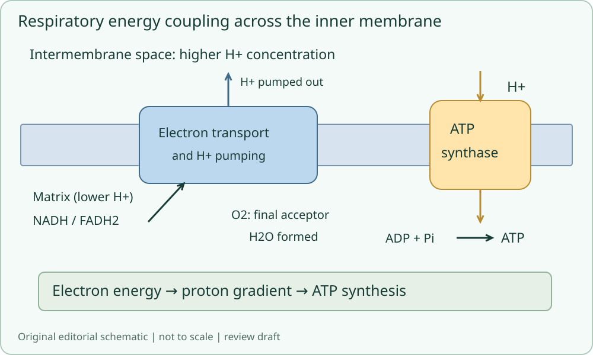
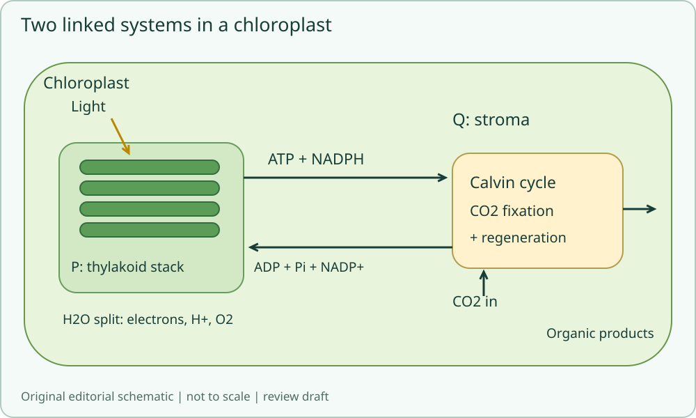
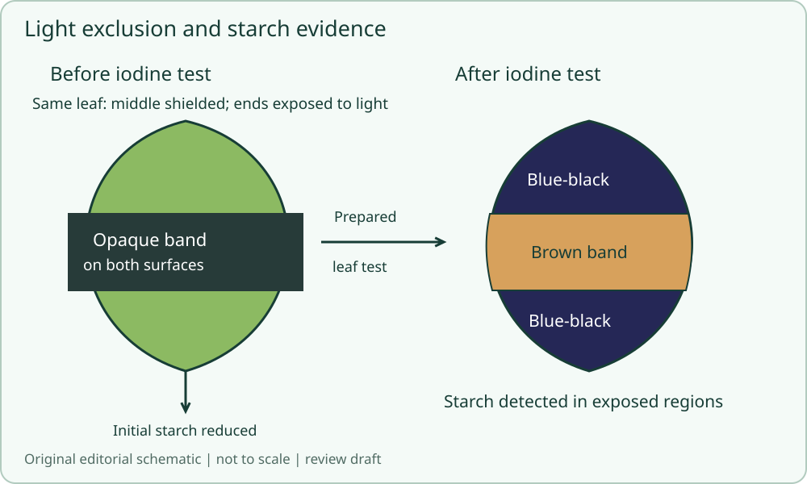

# ৪র্থ অধ্যায়: জীবনীশক্তি

> উত্তরসহ পর্যালোচনাধীন খসড়া; নির্ধারিত সংখ্যার উত্তরসহ খসড়া সম্পূর্ণ; বিষয়বস্তু পর্যালোচনা বাকি।
> মূল বই ও বিষয়বিশেষজ্ঞের পূর্ণ যাচাই বাকি। বোর্ড/স্কুল/সাল দাবি নেই।

## rebuild-mcq.json

### MCQ 1

“অ্যাডেনোসিন ট্রাইফসফেট শক্তিবাহী অণু”—বর্ণনাটি কোন ধারণা বা গঠন নির্দেশ করে?

A. ক্যালভিন চক্র
B. গ্লাইকোলাইসিস
C. ATP
D. ফসফোরাইলেশন

উত্তর: C — ATP
ATP: কোষীয় কাজে শক্তি স্থানান্তর করে। সীমা: দীর্ঘমেয়াদি খাদ্যসঞ্চয়ের প্রধান রূপ নয়।

### MCQ 2

“ফসফেট যুক্ত হওয়ার প্রক্রিয়া”—বর্ণনাটি কোন ধারণা বা গঠন নির্দেশ করে?

A. কোষীয় শ্বসন
B. ফসফোরাইলেশন
C. ATP
D. ল্যাকটিক গাঁজন

উত্তর: B — ফসফোরাইলেশন
ফসফোরাইলেশন: ADP থেকে ATP তৈরিতে অংশ নেয়। সীমা: ফসফেট যুক্ত হওয়া শক্তি ছাড়া হয় না।

### MCQ 3

“আলো ব্যবহার করে জৈব খাদ্য গঠন”—বর্ণনাটি কোন ধারণা বা গঠন নির্দেশ করে?

A. ল্যাকটিক গাঁজন
B. সবাত শ্বসন
C. ফসফোরাইলেশন
D. সালোকসংশ্লেষণ

উত্তর: D — সালোকসংশ্লেষণ
সালোকসংশ্লেষণ: আলোকশক্তি রাসায়নিক শক্তিতে ধরে। সীমা: উদ্ভিদও দিনরাত শ্বসন করে।

### MCQ 4

“আলো শোষণকারী সবুজ রঞ্জক”—বর্ণনাটি কোন ধারণা বা গঠন নির্দেশ করে?

A. ATP
B. সবাত শ্বসন
C. ক্লোরোফিল
D. ক্রেবস চক্র

উত্তর: C — ক্লোরোফিল
ক্লোরোফিল: আলোকনির্ভর বিক্রিয়ায় শক্তি গ্রহণ করে। সীমা: সব তরঙ্গদৈর্ঘ্য সমানভাবে শোষিত হয় না।

### MCQ 5

“আলোর সহায়তায় পানির বিযোজন”—বর্ণনাটি কোন ধারণা বা গঠন নির্দেশ করে?

A. ফটোলাইসিস
B. আলোকনির্ভর পর্যায়
C. ইলেকট্রন পরিবহণ
D. সীমাবদ্ধ প্রভাবক

উত্তর: A — ফটোলাইসিস
ফটোলাইসিস: অক্সিজেন ও ইলেকট্রন সরবরাহ করে। সীমা: নির্গত অক্সিজেনের উৎস CO2 নয়।

### MCQ 6

“আলোর প্রত্যক্ষ প্রয়োজনের বিক্রিয়াসমষ্টি”—বর্ণনাটি কোন ধারণা বা গঠন নির্দেশ করে?

A. ATP
B. ATP সিনথেজ
C. ইস্টের গাঁজন
D. আলোকনির্ভর পর্যায়

উত্তর: D — আলোকনির্ভর পর্যায়
আলোকনির্ভর পর্যায়: ATP ও NADPH তৈরিতে অংশ নেয়। সীমা: ক্যালভিন চক্রের সঙ্গে স্থান এক নয়।

### MCQ 7

“কার্বন স্থিতিকরণের চক্রাকার পথ”—বর্ণনাটি কোন ধারণা বা গঠন নির্দেশ করে?

A. সীমাবদ্ধ প্রভাবক
B. C3 পথ
C. ক্যালভিন চক্র
D. ATP সিনথেজ

উত্তর: C — ক্যালভিন চক্র
ক্যালভিন চক্র: ATP ও NADPH ব্যবহার করে কার্বন স্থির করে। সীমা: আলোকনিরপেক্ষ মানে শুধু রাতে নয়।

### MCQ 8

“প্রথম স্থায়ী পদার্থ তিন কার্বনের পথ”—বর্ণনাটি কোন ধারণা বা গঠন নির্দেশ করে?

A. আলোকনির্ভর পর্যায়
B. সালোকসংশ্লেষণ
C. C3 পথ
D. সবাত শ্বসন

উত্তর: C — C3 পথ
C3 পথ: PGA তৈরি করে কার্বন স্থিতিকরণ শুরু করে। সীমা: সব উদ্ভিদের পথ এক নয়।

### MCQ 9

“প্রথম স্থায়ী পদার্থ চার কার্বনের পথ”—বর্ণনাটি কোন ধারণা বা গঠন নির্দেশ করে?

A. C4 পথ
B. ATP সিনথেজ
C. শ্বেতসার পরীক্ষা
D. ATP

উত্তর: A — C4 পথ
C4 পথ: CO2 কেন্দ্রীভূতকরণে সহায়তা করে। সীমা: C4 উদ্ভিদেও ক্যালভিন চক্র থাকে।

### MCQ 10

“যে ঘাটতি বিক্রিয়ার হার আটকে রাখে”—বর্ণনাটি কোন ধারণা বা গঠন নির্দেশ করে?

A. সীমাবদ্ধ প্রভাবক
B. আলোকনির্ভর পর্যায়
C. ATP
D. সালোকসংশ্লেষণ

উত্তর: A — সীমাবদ্ধ প্রভাবক
সীমাবদ্ধ প্রভাবক: সালোকসংশ্লেষণের হার নিয়ন্ত্রণ করে। সীমা: এক প্রভাবক বাড়ালে হার অনন্ত বাড়ে না।

### MCQ 11

“আয়োডিনে শ্বেতসারের উপস্থিতি দেখা”—বর্ণনাটি কোন ধারণা বা গঠন নির্দেশ করে?

A. আলোকনির্ভর পর্যায়
B. শ্বেতসার পরীক্ষা
C. ক্যালভিন চক্র
D. ক্রেবস চক্র

উত্তর: B — শ্বেতসার পরীক্ষা
শ্বেতসার পরীক্ষা: নীলচে-কালো রঙ দিয়ে সঞ্চয় শনাক্ত করে। সীমা: শ্বেতসারের উপস্থিতি সরাসরি গ্যাস মাপে না।

### MCQ 12

“খাদ্যের জারণে ব্যবহারযোগ্য শক্তি পাওয়া”—বর্ণনাটি কোন ধারণা বা গঠন নির্দেশ করে?

A. ফটোলাইসিস
B. কোষীয় শ্বসন
C. ইলেকট্রন পরিবহণ
D. সবাত শ্বসন

উত্তর: B — কোষীয় শ্বসন
কোষীয় শ্বসন: ATP উৎপাদনে খাদ্যশক্তি কাজে লাগায়। সীমা: শ্বাস-প্রশ্বাস ও কোষীয় শ্বসন এক নয়।

### MCQ 13

“সাইটোসলে গ্লুকোজ ভাঙার প্রথম ধাপ”—বর্ণনাটি কোন ধারণা বা গঠন নির্দেশ করে?

A. ATP সিনথেজ
B. আলোকনির্ভর পর্যায়
C. শ্বেতসার পরীক্ষা
D. গ্লাইকোলাইসিস

উত্তর: D — গ্লাইকোলাইসিস
গ্লাইকোলাইসিস: পাইরুভেট ও নিট দুই ATP দেয়। সীমা: মোট চার ATP তৈরি ও নিট দুই পাওয়া পৃথক।

### MCQ 14

“পাইরুভেট থেকে ক্রেবস-প্রবেশযোগ্য যৌগ গঠন”—বর্ণনাটি কোন ধারণা বা গঠন নির্দেশ করে?

A. অ্যাসিটাইল কো-এ গঠন
B. ATP সিনথেজ
C. ATP
D. ইস্টের গাঁজন

উত্তর: A — অ্যাসিটাইল কো-এ গঠন
অ্যাসিটাইল কো-এ গঠন: শর্করা ভাঙার ধাপগুলো সংযুক্ত করে। সীমা: এটি গ্লাইকোলাইসিসের সমার্থক নয়।

### MCQ 15

“মাইটোকন্ড্রিয়ার ম্যাট্রিক্সের চক্রাকার বিক্রিয়া”—বর্ণনাটি কোন ধারণা বা গঠন নির্দেশ করে?

A. গ্লাইকোলাইসিস
B. ক্রেবস চক্র
C. ইস্টের গাঁজন
D. সীমাবদ্ধ প্রভাবক

উত্তর: B — ক্রেবস চক্র
ক্রেবস চক্র: ইলেকট্রনবাহী অণু ও CO2 উৎপন্ন করে। সীমা: সবচেয়ে বেশি ATP সরাসরি এই চক্রে নয়।

### MCQ 16

“ঝিল্লিতে ইলেকট্রনের ধারাবাহিক স্থানান্তর”—বর্ণনাটি কোন ধারণা বা গঠন নির্দেশ করে?

A. ক্রেবস চক্র
B. আলোকনির্ভর পর্যায়
C. কোষীয় শ্বসন
D. ইলেকট্রন পরিবহণ

উত্তর: D — ইলেকট্রন পরিবহণ
ইলেকট্রন পরিবহণ: প্রোটন ঢাল গঠনে সহায়তা করে। সীমা: সবাত শ্বসনে অক্সিজেন চূড়ান্ত গ্রাহক।

### MCQ 17

“প্রোটনপ্রবাহ ব্যবহারকারী এনজাইম”—বর্ণনাটি কোন ধারণা বা গঠন নির্দেশ করে?

A. ক্যালভিন চক্র
B. ATP সিনথেজ
C. ফটোলাইসিস
D. সালোকসংশ্লেষণ

উত্তর: B — ATP সিনথেজ
ATP সিনথেজ: ADP ও ফসফেট থেকে ATP গঠন করে। সীমা: কেবল বন্ধন ভাঙলেই সব শক্তি মেলে বলা অসম্পূর্ণ।

### MCQ 18

“অক্সিজেন-নির্ভর পূর্ণতর জারণ”—বর্ণনাটি কোন ধারণা বা গঠন নির্দেশ করে?

A. সবাত শ্বসন
B. ফটোলাইসিস
C. ATP সিনথেজ
D. ইস্টের গাঁজন

উত্তর: A — সবাত শ্বসন
সবাত শ্বসন: খাদ্যশক্তির তুলনামূলক বেশি অংশ আহরণ করে। সীমা: সকল কোষে নির্দিষ্ট একই ATP সংখ্যা নয়।

### MCQ 19

“অক্সিজেন ছাড়া ইথানল ও CO2 উৎপাদন”—বর্ণনাটি কোন ধারণা বা গঠন নির্দেশ করে?

A. ইস্টের গাঁজন
B. সবাত শ্বসন
C. ক্যালভিন চক্র
D. ইলেকট্রন পরিবহণ

উত্তর: A — ইস্টের গাঁজন
ইস্টের গাঁজন: NAD+ পুনর্গঠন করে গ্লাইকোলাইসিস চালায়। সীমা: গ্যাসে ফোলা ও ATP তৈরি আলাদা ফল।

### MCQ 20

“পাইরুভেট থেকে ল্যাকটেট তৈরির পথ”—বর্ণনাটি কোন ধারণা বা গঠন নির্দেশ করে?

A. ক্যালভিন চক্র
B. C3 পথ
C. আলোকনির্ভর পর্যায়
D. ল্যাকটিক গাঁজন

উত্তর: D — ল্যাকটিক গাঁজন
ল্যাকটিক গাঁজন: NAD+ পুনর্গঠনে সহায়তা করে। সীমা: সব গাঁজনে ইথানল তৈরি হয় না।

### MCQ 21

ATP পুনর্গঠনের চক্র শক্তি সৃষ্টি করে না কেন?

A. ATP তৈরি সবসময় শক্তিহীন
B. ফসফেট সব শক্তি ধ্বংস করে
C. ADP থেকে ATP তৈরিতে অন্য উৎসের শক্তি লাগে
D. ADP একটি আলোককণা

উত্তর: C — ADP থেকে ATP তৈরিতে অন্য উৎসের শক্তি লাগে
চক্রে শক্তির রূপান্তর ও স্থানান্তর হয়, বিনা উৎসে শক্তি সৃষ্টি নয়।

### MCQ 22

মুক্ত O2 ও শর্করার কার্বনের উৎস যথাক্রমে কোন যুগল?

A. শর্করা ও O2
B. CO2 ও পানি
C. পিত্ত ও প্রোটিন
D. পানি ও CO2

উত্তর: D — পানি ও CO2
অক্সিজেনীয় সালোকসংশ্লেষণে মুক্ত অক্সিজেন পানি থেকে এবং কার্বন CO2 থেকে আসে।

### MCQ 23

সবুজ আলোতে পাতা সবুজ দেখায়—এ থেকে কোনটি বলা অনুচিত?

A. সবুজ আলোই সর্বাধিক শোষিত
B. দৃশ্যমান রং ও শোষণবর্ণালি আলাদা
C. রঞ্জকের শোষণ তরঙ্গদৈর্ঘ্যনির্ভর
D. কিছু সবুজ আলো প্রতিফলিত হয়

উত্তর: A — সবুজ আলোই সর্বাধিক শোষিত
প্রতিফলিত বা সঞ্চারিত রংকে সর্বাধিক শোষণের রং বলা যায় না।

### MCQ 24

আলোকনিরপেক্ষ ধাপকে শুধু রাতের ধাপ বলা যায় না কেন?

A. CO2 শুধু রাতে থাকে
B. ক্যালভিন চক্র কেবল প্রাণীতে
C. এটি আলোতেও চলে এবং আলোকবিক্রিয়ার উৎপাদের ওপর নির্ভরশীল
D. এতে কখনও এনজাইম লাগে না

উত্তর: C — এটি আলোতেও চলে এবং আলোকবিক্রিয়ার উৎপাদের ওপর নির্ভরশীল
সরাসরি আলো না-লাগা মানে শুধু অন্ধকারে হওয়া নয়।

### MCQ 25

CO2 কম থাকায় হার স্থির হলে শুধু আলো আরও বাড়ালে কী হতে পারে?

A. হার সীমাহীন বাড়বেই
B. সব এনজাইম শূন্য হবে
C. CO2 নতুন করে সৃষ্টি হবে
D. CO2 সীমা থাকায় হার আর নাও বাড়তে পারে

উত্তর: D — CO2 সীমা থাকায় হার আর নাও বাড়তে পারে
সীমাবদ্ধ প্রভাবক দূর না হলে অন্য উপকরণ বাড়িয়েই লাভ হয় না।

### MCQ 26

দিনে পাতার নিট CO2 গ্রহণ দেখা গেলেও কোন প্রক্রিয়া বন্ধ ধরে নেওয়া যাবে না?

A. কার্বন গ্রহণ
B. কোষীয় শ্বসন
C. আলোকশক্তি শোষণ
D. পানির সরবরাহ

উত্তর: B — কোষীয় শ্বসন
বাইরের নিট গ্যাসবিনিময় সালোকসংশ্লেষণ ও শ্বসনের সম্মিলিত ফল।

### MCQ 27

গ্লাইকোলাইসিসে দুই ATP খরচ ও চার উৎপাদ হলে নিট লাভ কত?

A. দুই ATP
B. ছয় ATP
C. চার ATP
D. শূন্য ATP

উত্তর: A — দুই ATP
নিট লাভ হলো উৎপাদ থেকে খরচ বাদ দেওয়া: 4−2=2।

### MCQ 28

প্রকৃতকোষে পাইরুভেট জারণের সাধারণ স্থান কোনটি?

A. কোষের সেলুলোজ প্রাচীর
B. মাইটোকন্ড্রিয়ার ম্যাট্রিক্স
C. ক্লোরোপ্লাস্টের বাইরের শূন্যস্থান
D. নিউক্লিওলাসের কেন্দ্র

উত্তর: B — মাইটোকন্ড্রিয়ার ম্যাট্রিক্স
মাইটোকন্ড্রিয়াযুক্ত প্রকৃতকোষে অ্যাসিটাইল-CoA তৈরির ধাপ সাধারণত ম্যাট্রিক্সে ঘটে।

### MCQ 29

গাঁজনে NAD+ ফিরে আসার প্রধান তাৎপর্য কী?

A. সরাসরি সব কার্বনকে O2 করা
B. গ্লাইকোলাইসিস অব্যাহত রাখতে সাহায্য করা
C. সমস্ত ATP খরচ বন্ধ করা
D. নতুন ক্লোরোপ্লাস্ট বানানো

উত্তর: B — গ্লাইকোলাইসিস অব্যাহত রাখতে সাহায্য করা
NAD+ দরকার হয় গ্লাইকোলাইসিসের জারণধাপে; গাঁজন এটি পুনর্গঠন করে।

### MCQ 30

আয়োডিনে নীল-কালো না হলে কোন সিদ্ধান্তটি অতিরিক্ত দাবি?

A. পরীক্ষার শনাক্তসীমা প্রাসঙ্গিক
B. শ্বেতসার পরীক্ষায় শনাক্ত হয়নি
C. নমুনায় কোনো জৈব পদার্থ নেই
D. দ্রবণীয় শর্করা আলাদাভাবে পরীক্ষা করা যায়

উত্তর: C — নমুনায় কোনো জৈব পদার্থ নেই
আয়োডিনের নির্দিষ্ট পরীক্ষা সব ধরনের জৈব যৌগের উপস্থিতি জানায় না।

### MCQ 31

শ্বাস-প্রশ্বাস ও কোষীয় শ্বসনের পার্থক্য কী?

A. কোষীয় শ্বসন শুধু প্রাণীতে হয়
B. দুটিই শুধু O2 গ্রহণের নাম
C. দুটিই কেবল ফুসফুসের ঘটনা
D. গ্যাস চলাচল ও বিপাকীয় শক্তি আহরণ পৃথক

উত্তর: D — গ্যাস চলাচল ও বিপাকীয় শক্তি আহরণ পৃথক
তন্ত্রের গ্যাসসরবরাহ ও কোষের বিপাক সম্পর্কিত কিন্তু অভিন্ন নয়।

### MCQ 32

সবুজ পাতার কোষে রাতের ATP চাহিদা কীভাবে পূরণ হতে পারে?

A. সঞ্চিত খাদ্যের কোষীয় শ্বসনে
B. মূলের খনিজ সরাসরি ATP হয়ে
C. রাতেই ক্যালভিন চক্র আলো তৈরি করে
D. শুধু দিনের জমা ATP অসীমকাল চলে

উত্তর: A — সঞ্চিত খাদ্যের কোষীয় শ্বসনে
আলো না থাকলেও জীবিত কোষে শক্তি প্রয়োজন।

### MCQ 33

উদ্ভিদের মূলের কোষেও শ্বসন দরকার কেন?

A. শোষণ, বৃদ্ধি ও বিপাকের শক্তি লাগে
B. শুধু আলোপ্রাপ্ত কোষেই বিপাক আছে
C. খনিজ উপস্থিত থাকলে ATP লাগে না
D. মূলেই সব গ্লুকোজ সালোকসংশ্লেষণে তৈরি

উত্তর: A — শোষণ, বৃদ্ধি ও বিপাকের শক্তি লাগে
অসবুজ কোষেও শক্তিনির্ভর কাজ চলে।

### MCQ 34

শ্বসনিক বস্তু হিসেবে শুধু শর্করাই ব্যবহৃত হয়—দাবি ভুল কেন?

A. শুধু অজৈব লবণই শ্বসনিক বস্তু
B. চর্বি ও প্রোটিনের উপাদানও ব্যবহৃত হতে পারে
C. প্রোটিনের উপাদান বিপাকপথে ঢোকে না
D. চর্বি শুধু প্রাচীর তৈরি করে, জারিত হয় না

উত্তর: B — চর্বি ও প্রোটিনের উপাদানও ব্যবহৃত হতে পারে
বিভিন্ন জৈব পদার্থ বিপাকপথে প্রবেশ করতে পারে।

### MCQ 35

এক গ্লুকোজ গ্লাইকোলাইসিসে কয়টি পাইরুভেট দেয়?

A. দুই
B. চার
C. ছয়
D. এক

উত্তর: A — দুই
ছয় কার্বন দুইটি তিন-কার্বন উৎপাদে ভাগ হয়।

### MCQ 36

গ্লাইকোলাইসিসে সরাসরি O2 লাগে কি?

A. কেবল CO2 অপসারণে লাগে
B. শুধু ATP তৈরির শেষ ধাপে লাগে
C. প্রতিটি ধাপে সরাসরি লাগে
D. না

উত্তর: D — না
অক্সিজেন ছাড়া পথটি চলতে পারে যদি প্রয়োজনীয় NAD+ মেলে।

### MCQ 37

গ্লাইকোলাইসিস সাইটোসলে হওয়ায় কোন সিদ্ধান্ত সঠিক?

A. মাইটোকন্ড্রিয়াহীন কোষেও পথটি থাকতে পারে
B. সব ATP কেবল ক্রিস্টিতে হয়
C. সবাত পথের প্রতিটি ধাপ ম্যাট্রিক্সে হয়
D. শুধু ক্লোরোপ্লাস্টে গ্লাইকোলাইসিস হয়

উত্তর: A — মাইটোকন্ড্রিয়াহীন কোষেও পথটি থাকতে পারে
স্থানগত পার্থক্য শক্তি আহরণের সম্ভাবনা ব্যাখ্যা করে।

### MCQ 38

গ্লাইকোলাইসিসে এক গ্লুকোজ থেকে মোট ATP উৎপাদ কয়টি?

A. আট
B. ছয়
C. দুই
D. চার

উত্তর: D — চার
মোট চার তৈরি হলেও দুই খরচ বাদে নিট দুই থাকে।

### MCQ 39

গ্লাইকোলাইসিসের শুরুতে ATP ব্যয়ের তাৎপর্য কী?

A. পরবর্তী ভাঙনের জন্য পদার্থ সক্রিয়করণ
B. NADH-কে O2 দিয়ে জারিত করা
C. ইলেকট্রন পরিবহণশৃঙ্খল গঠন
D. সব কার্বন প্রথমেই CO2 করা

উত্তর: A — পরবর্তী ভাঙনের জন্য পদার্থ সক্রিয়করণ
শক্তি বিনিয়োগ ও পরবর্তী শক্তি আহরণ একই পথের অংশ।

### MCQ 40

গ্লাইকোলাইসিসে NAD+ কোন রূপে বিজারিত হয়?

A. FADH2
B. NADH
C. NADP+
D. ADP

উত্তর: B — NADH
ইলেকট্রন গ্রহণে NADH তৈরি হয়।

### MCQ 41

গ্লাইকোলাইসিসে ছয় কার্বনের হিসাব কী?

A. এক তিন-কার্বন পাইরুভেটে থাকে
B. দুই CO2 ও দুই অ্যাসিটাইল অংশে থাকে
C. ছয় CO2 হয়ে বের হয়
D. দুই তিন-কার্বন পাইরুভেটে থাকে

উত্তর: D — দুই তিন-কার্বন পাইরুভেটে থাকে
এ ধাপে সাধারণত CO2 নির্গত হয় না।

### MCQ 42

পাইরুভেট থেকে অ্যাসিটাইল-CoA গঠনে প্রতি পাইরুভেটে কত CO2 বের হয়?

A. ছয়
B. দুই
C. তিন
D. এক

উত্তর: D — এক
তিন কার্বনের মধ্যে এক কার্বন CO2 হিসেবে যায়।

### MCQ 43

অ্যাসিটাইল-CoA-র অ্যাসিটাইল অংশে কয় কার্বন?

A. ছয়
B. দুই
C. চার
D. তিন

উত্তর: B — দুই
CoA বাহক; চক্রে প্রবেশকারী অ্যাসিটাইল অংশ দুই কার্বনের।

### MCQ 44

এক গ্লুকোজের দুই পাইরুভেট থেকে মোট অ্যাসিটাইল অংশ কতটি?

A. এক
B. ছয়
C. চার
D. দুই

উত্তর: D — দুই
প্রতিটি পাইরুভেট একটি অ্যাসিটাইল-CoA দেয়।

### MCQ 45

পাইরুভেট জারণকে গ্লাইকোলাইসিসের সমার্থক বলা যায় না কেন?

A. কার্বন অপসারণ ও স্থানসহ পৃথক ধাপ
B. দুটির সব এনজাইম ও উৎপাদ অভিন্ন
C. পাইরুভেট জারণে কোনো বাহক হয় না
D. গ্লাইকোলাইসিসেই অ্যাসিটাইল-CoA শেষ উৎপাদ

উত্তর: A — কার্বন অপসারণ ও স্থানসহ পৃথক ধাপ
গ্লাইকোলাইসিস পাইরুভেট দেয়; পরের ধাপ অ্যাসিটাইল অংশ তৈরি করে।

### MCQ 46

একবার ক্রেবস চক্রে এক অ্যাসিটাইল অংশের জন্য মোট CO2 উৎপাদ কত?

A. চার
B. ছয়
C. এক
D. দুই

উত্তর: D — দুই
চক্রের কার্বনসমতা অনুযায়ী দুই CO2 বের হয়।

### MCQ 47

এক গ্লুকোজের জন্য ক্রেবস চক্র সাধারণত কয়বার ঘোরে?

A. দুই
B. তিন
C. এক
D. ছয়

উত্তর: A — দুই
দুইটি অ্যাসিটাইল অংশের প্রত্যেকের জন্য এক দফা চক্র।

### MCQ 48

এক দফা ক্রেবস চক্রে NADH উৎপাদের প্রচলিত হিসাব কত?

A. দুই
B. এক
C. তিন
D. ছয়

উত্তর: C — তিন
এক অ্যাসিটাইল অংশে তিন NADH এবং অন্য উৎপাদ পাওয়া যায়।

### MCQ 49

ক্রেবস চক্রে FAD কোন রূপে বিজারিত হয়?

A. NADH
B. GTP
C. FAD+
D. FADH2

উত্তর: D — FADH2
এটি অন্য এক ধরনের বিজারিত ইলেকট্রনবাহক।

### MCQ 50

চক্রে স্বল্প পরিমাণ GTP হলে তার তাৎপর্য কী?

A. এটি NADH-র মতো ইলেকট্রনবাহক
B. ATP-সমতুল্য শক্তি স্থানান্তরে অংশ নিতে পারে
C. এটি চক্রের চার-কার্বন গ্রাহী
D. এটিই চূড়ান্ত ইলেকট্রনগ্রাহক

উত্তর: B — ATP-সমতুল্য শক্তি স্থানান্তরে অংশ নিতে পারে
চক্রের সরাসরি শক্তি উৎপাদ ও পরবর্তী বাহকনির্ভর উৎপাদ আলাদা।

### MCQ 51

ক্রেবস চক্র চক্রাকার হওয়ার ভিত্তি কী?

A. সমস্ত ATP হুবহু ফেরত আসে
B. সব CO2 আবার একই দফায় যুক্ত হয়
C. অ্যাসিটাইল অংশ বিনা পরিবর্তনে ঘোরে
D. প্রাথমিক গ্রাহী যৌগ পুনর্গঠিত হয়

উত্তর: D — প্রাথমিক গ্রাহী যৌগ পুনর্গঠিত হয়
অক্সালোঅ্যাসিটেট পুনর্গঠন পরবর্তী অ্যাসিটাইল অংশ গ্রহণে সহায়ক।

### MCQ 52

মাইটোকন্ড্রিয়ার কোন ঝিল্লিতে শ্বসনীয় ইলেকট্রন পরিবহণ সংগঠিত?

A. নিউক্লিয়ার অন্তঃঝিল্লি
B. বাইরের ঝিল্লি
C. ভেতরের ঝিল্লি
D. টোনোপ্লাস্ট

উত্তর: C — ভেতরের ঝিল্লি
ক্রিস্টিসহ ভেতরের ঝিল্লিতে পরিবাহক ও ATP-সংশ্লেষণ ব্যবস্থা থাকে।

### MCQ 53

NADH ও FADH2 পরবর্তী ধাপে কী সরবরাহ করে?

A. কার্বন স্থিতিকরণের প্রধান গ্রাহী
B. অক্সিজেন অণুর ভান্ডার
C. উচ্চশক্তির ইলেকট্রন
D. অ্যাসিটাইল অংশের দুই কার্বন

উত্তর: C — উচ্চশক্তির ইলেকট্রন
জারণে মুক্ত ইলেকট্রন শক্তি রূপান্তরের পথে যায়।

### MCQ 54

সবাত শ্বসনে শেষ ইলেকট্রনগ্রাহক কোনটি?

A. পাইরুভেট
B. অক্সিজেন
C. CO2
D. NAD+

উত্তর: B — অক্সিজেন
অক্সিজেন ইলেকট্রন ও প্রোটন নিয়ে পানি গঠনে অংশ নেয়।

### MCQ 55

অক্সিজেন কমলে ইলেকট্রন পরিবহণ আটকে যেতে পারে কেন?

A. O2 থেকে সব ATP-র ফসফেট আসে
B. চূড়ান্ত গ্রাহকের ঘাটতি হয়
C. O2 না থাকলে সব NADH অদৃশ্য
D. O2-ই গ্লাইকোলাইসিসের প্রথম খাদ্য

উত্তর: B — চূড়ান্ত গ্রাহকের ঘাটতি হয়
বাহক জারণ ও প্রোটন ঢাল রক্ষণে বাধা আসতে পারে।

### MCQ 56

ইলেকট্রন পরিবহণে মুক্ত শক্তির গুরুত্বপূর্ণ ব্যবহার কী?

A. পাইরুভেট থেকে অ্যাসিটাইল অংশ ছাঁটাই
B. ক্যালভিন চক্রে CO2 স্থিতিকরণ
C. গ্লুকোজের সরাসরি ছয় CO2-তে ভাঙন
D. ঝিল্লির দুই পাশে প্রোটন ঢাল তৈরি

উত্তর: D — ঝিল্লির দুই পাশে প্রোটন ঢাল তৈরি
প্রোটনচালিত ATP সংশ্লেষণে এই ঢাল ব্যবহৃত হয়।

### MCQ 57

ATP সিনথেজে ATP তৈরির শক্তি সরাসরি কোন প্রবাহের সঙ্গে যুক্ত?

A. ইলেকট্রনের সরাসরি ATP অণুতে জমা
B. CO2-র ঘনত্বমুখী প্রবাহমাত্র
C. প্রোটনের ঢালমুখী প্রবাহ
D. পাইরুভেটের ক্রিস্টি দিয়ে ব্যাপন

উত্তর: C — প্রোটনের ঢালমুখী প্রবাহ
ইলেকট্রন পরিবহণ ও ATP সংশ্লেষণের মাঝে প্রোটন ঢাল সংযোগ দেয়।

### MCQ 58

ঝিল্লি প্রোটনের জন্য অনিয়ন্ত্রিতভাবে ভেদ্য হলে কী সমস্যা?

A. ঢাল ভাঙলে সর্বদা বেশি ATP হয়
B. ভেদ্যতা বাড়লে NADH তৈরি বাধ্যতামূলক শূন্য
C. ঢাল ছাড়াই ATP সিনথেজ একই হারে চলে
D. ঢাল কমে ATP সংশ্লেষণ কমতে পারে

উত্তর: D — ঢাল কমে ATP সংশ্লেষণ কমতে পারে
প্রোটন ঢাল অক্ষুণ্ণ রাখা শক্তি সংযোজনের জন্য গুরুত্বপূর্ণ।

### MCQ 59

প্রতি গ্লুকোজে সব প্রকৃতকোষে নির্দিষ্ট 38 ATP বলা সতর্কতাহীন কেন?

A. সব NADH সব কোষে সমান পথ নেয়
B. সব ATP শুধু গ্লাইকোলাইসিসে হয়
C. পরিবহণ ও সংযোজনদক্ষতা ভিন্ন
D. প্রতিটি জীবের পরিবহণব্যয় শূন্য

উত্তর: C — পরিবহণ ও সংযোজনদক্ষতা ভিন্ন
পুরোনো আদর্শ হিসাবকে সব জীবের অবিকল বাস্তব ফল বলা যায় না।

### MCQ 60

পূর্ণ গ্লুকোজ জারণে মোট CO2-র সামগ্রিক সংখ্যা কত?

A. বারো
B. ছয়
C. দুই
D. চার

উত্তর: B — ছয়
পাইরুভেট জারণে দুই ও ক্রেবস চক্রে মোট চার CO2-এর কার্বনসমতা মেলে।

### MCQ 61

ইলেকট্রন পরিবহণে CO2-র নতুন সরাসরি উৎপাদ সাধারণত কেন নেই?

A. সব CO2 পরে গ্লাইকোলাইসিসে হবে
B. পরিবহণে অক্সিজেন সরাসরি কার্বন দেয়
C. কার্বন অপসারণ আগের ধাপগুলোতে হয়েছে
D. কার্বনহীন ইলেকট্রনই CO2 হয়

উত্তর: C — কার্বন অপসারণ আগের ধাপগুলোতে হয়েছে
ইলেকট্রন ও প্রোটন স্থানান্তরকে কার্বনচ্যুতি থেকে আলাদা করতে হয়।

### MCQ 62

গাঁজনের উৎপাদে শক্তি রয়ে যাওয়ার প্রমাণ কোনটি?

A. গাঁজনে সব শক্তি ATP-তে আসে
B. ইথানলে আর কোনো রাসায়নিক শক্তি নেই
C. ইথানল বা ল্যাকটেট আরও জারিত হতে পারে
D. ল্যাকটেটের সব কার্বন আগেই CO2

উত্তর: C — ইথানল বা ল্যাকটেট আরও জারিত হতে পারে
অসম্পূর্ণ জারণে জৈব উৎপাদে রাসায়নিক শক্তি অবশিষ্ট থাকে।

### MCQ 63

ইস্টের অ্যালকোহলীয় গাঁজনে গ্যাসীয় উৎপাদ কোনটি?

A. CO2
B. O2
C. H2O-বাষ্পমাত্র
D. N2

উত্তর: A — CO2
রুটি ফাঁপায় CO2, গাঁজন আলো ছাড়া ঘটতে পারে।

### MCQ 64

সাধারণ ল্যাকটেট গাঁজনে পাইরুভেটের কার্বনের ফল কী?

A. এক কার্বন ল্যাকটেটে, দুই O2-তে
B. তিন কার্বন ল্যাকটেটে থাকে
C. সব তিন কার্বন CO2
D. দুই কার্বন ইথানলে ও এক CO2

উত্তর: B — তিন কার্বন ল্যাকটেটে থাকে
এই ধাপে CO2 বের হয় না।

### MCQ 65

ইথানল গঠনের কার্বনসমতায় এক গ্লুকোজে কোন যুগল মেলে?

A. চার ইথানল ও দুই CO2
B. দুই ল্যাকটেট ও দুই CO2
C. এক ইথানল ও এক CO2
D. দুই ইথানল ও দুই CO2

উত্তর: D — দুই ইথানল ও দুই CO2
2×2+2×1=6 কার্বন থাকে।

### MCQ 66

NADH থেকে NAD+ ফিরে আসা গাঁজনে কী বাঁচায়?

A. ক্যালভিন চক্রের RuBP
B. গ্লাইকোলাইসিসের জারণক্ষমতা
C. ক্রেবস চক্রের সরাসরি অক্সিজেন উৎপাদ
D. অক্সিজেনীয় পরিবহণের শেষ গ্রাহক

উত্তর: B — গ্লাইকোলাইসিসের জারণক্ষমতা
NAD+ না ফিরলে ধারাবাহিক গ্লাইকোলাইসিস বাধাগ্রস্ত হবে।

### MCQ 67

গাঁজনের অতিরিক্ত ধাপে স্বাভাবিক নিট ATP লাভ কেমন?

A. সাধারণত বাড়ে না, ATP গ্লাইকোলাইসিসে মেলে
B. ইথানল ধাপেই সব 38 ATP
C. প্রতি গ্লুকোজে আরও চার ATP
D. প্রতি পাইরুভেটে আরও দুই ATP

উত্তর: A — সাধারণত বাড়ে না, ATP গ্লাইকোলাইসিসে মেলে
ল্যাকটেট বা ইথানল ধাপের প্রধান ভূমিকা NAD+ পুনর্গঠন।

### MCQ 68

দই তৈরির জৈব পরিবর্তনে কোনটি প্রাসঙ্গিক?

A. ব্যাকটেরিয়ার ল্যাকটিক গাঁজন
B. ইস্টের ক্যালভিন চক্র
C. শুধু অ্যাসিটাইল-CoA গঠন
D. দুধের ফটোলাইসিস

উত্তর: A — ব্যাকটেরিয়ার ল্যাকটিক গাঁজন
ল্যাকটিক অ্যাসিড উৎপাদে অম্লত্ব বাড়ে।

### MCQ 69

রুটির মণ্ড ফোলার গ্যাসকে ATP বলা যায় না কেন?

A. CO2 ও ATP একই অণুর দুই নাম
B. ATP-ই ইস্টের নিঃসৃত প্রধান গ্যাস
C. শুধু ATP-র তাপেই সব গহ্বর
D. CO2 একটি পদার্থ, ATP শক্তি স্থানান্তরকারী অণু

উত্তর: D — CO2 একটি পদার্থ, ATP শক্তি স্থানান্তরকারী অণু
গ্যাসে ফাঁপা ও কোষের শক্তি লাভ দুটি ফল।

### MCQ 70

ইস্টে সবসময় শুধু গাঁজনই হয়—দাবির সমস্যা কী?

A. ইস্টে মাইটোকন্ড্রিয়া থাকতে পারে না
B. সব শর্তে একই উৎপাদ বাধ্যতামূলক
C. অক্সিজেন ও পরিবেশে শ্বসনপথ বদলাতে পারে
D. ইস্টে কখনও O2 ব্যবহৃত হয় না

উত্তর: C — অক্সিজেন ও পরিবেশে শ্বসনপথ বদলাতে পারে
ইস্ট উপযুক্ত শর্তে বায়বীয় শ্বসনও করতে পারে।

### MCQ 71

মানব পেশিতে ল্যাকটেট উৎপাদ হতে পারে কোন প্রেক্ষাপটে?

A. কেবল পেশিকোষ মারা যাওয়ার পরে
B. শুধু CO2 স্থিতিকরণ বাড়লে
C. দ্রুত গ্লাইকোলাইসিসে NAD+ ফেরানো প্রয়োজন হলে
D. ATP চাহিদা সম্পূর্ণ শূন্য হলে

উত্তর: C — দ্রুত গ্লাইকোলাইসিসে NAD+ ফেরানো প্রয়োজন হলে
এ পথ কেবল অণুজীবের একচেটিয়া নয়।

### MCQ 72

গাঁজন ও প্রকৃত অবাত শ্বসনের আধুনিক পার্থক্য কী?

A. গাঁজনে O2-ই শেষ গ্রাহক
B. দ্বিতীয়টিতে O2 ছাড়া অন্য চূড়ান্ত গ্রাহকসহ পরিবহণশৃঙ্খল থাকে
C. প্রকৃত অবাত শ্বসনে কোনো পরিবহণশৃঙ্খল নেই
D. উভয়ের যন্ত্র ও ATP লাভ অবিকল এক

উত্তর: B — দ্বিতীয়টিতে O2 ছাড়া অন্য চূড়ান্ত গ্রাহকসহ পরিবহণশৃঙ্খল থাকে
স্কুলের সরল অবাত শব্দ ব্যবহারের সঙ্গে এই সম্প্রসারিত পার্থক্য জানা উপকারী।

### MCQ 73

কিছু জীব O2 ছাড়া শক্তি পেতে পারে—এ থেকে কী বলা যাবে না?

A. কিছু কোষ গাঁজন করতে পারে
B. সব জীবের সব পরিস্থিতিতে O2 অপ্রয়োজনীয়
C. সব জীবের বিপাক অভিন্ন নয়
D. বিভিন্ন শক্তি আহরণপথ আছে

উত্তর: B — সব জীবের সব পরিস্থিতিতে O2 অপ্রয়োজনীয়
একটি জীবের পথকে সব জীবের সর্বজনীন নিয়ম করা ভুল।

### MCQ 74

অঙ্কুরিত বীজে শ্বসন বেশি হওয়ার সঙ্গে কী সামঞ্জস্যপূর্ণ?

A. বৃদ্ধি ও নতুন সংশ্লেষণের শক্তিচাহিদা
B. সঞ্চিত খাদ্য জারিত হতে পারে না
C. সকল অঙ্কুরিত কোষে বিপাক বন্ধ
D. শুধু পানির তাপই বৃদ্ধি ঘটায়

উত্তর: A — বৃদ্ধি ও নতুন সংশ্লেষণের শক্তিচাহিদা
বর্ধনশীল টিস্যুতে সক্রিয় বিপাক শক্তি চায়।

### MCQ 75

শুকনো বীজে শ্বসন কম হলেও কেন মৃত বলা যাবে না?

A. শুধু ক্লোরোফিল থাকলেই বীজ জীবিত
B. কম হার সবসময় শূন্য হার
C. সুপ্ত জীবিত অবস্থায় বিপাক ধীর হতে পারে
D. সব বীজই শুকালে মৃত

উত্তর: C — সুপ্ত জীবিত অবস্থায় বিপাক ধীর হতে পারে
উপযুক্ত পানিতে বিপাক ও অঙ্কুরোদ্গম বাড়তে পারে।

### MCQ 76

জলাবদ্ধ মাটিতে মূল ক্ষতিগ্রস্ত হওয়ার একটি কারণ কী?

A. পানি বাড়লেই এনজাইমের সব সীমা দূর
B. জলাবদ্ধতায় O2 ব্যাপন সবসময় বাড়ে
C. মূলের শক্তির সব উৎস আলো
D. অক্সিজেনের প্রাপ্যতা কমে

উত্তর: D — অক্সিজেনের প্রাপ্যতা কমে
বায়ুস্থান ভরে গেলে বায়বীয় শক্তি আহরণ বাধাগ্রস্ত হয়।

### MCQ 77

শ্বসনে খুব কম পানির সমস্যা কী?

A. এনজাইম শুধু শুকনো অবস্থায় সক্রিয়
B. জল কমলে সব বিক্রিয়া সবসময় দ্রুত
C. পানির ঘাটতিতে ATP প্রয়োজন থাকে না
D. এনজাইমীয় কাজ ও দ্রবীভূত উপাদান চলাচল বাধে

উত্তর: D — এনজাইমীয় কাজ ও দ্রবীভূত উপাদান চলাচল বাধে
উপযুক্ত জলীয় পরিবেশ বিপাকের জন্য জরুরি।

### MCQ 78

শ্বসনহারের তাপমাত্রা-সম্পর্ক সাধারণত সরলরৈখিক অসীম নয় কেন?

A. এনজাইমের অনুকূল সীমা থাকে
B. সব প্রজাতির ঠিক একই তাপসীমা
C. তাপমাত্রা শুধু পাতার রঙে প্রভাব ফেলে
D. সব এনজাইম যত গরম তত ভালো

উত্তর: A — এনজাইমের অনুকূল সীমা থাকে
অতিরিক্ত তাপ ক্ষতি করতে পারে, কম তাপে হার ধীর হয়।

### MCQ 79

শীতল সংরক্ষণে অনেক ফলের বিপাক ধীর হলে কী সুবিধা হতে পারে?

A. খাদ্যক্ষয় ও পাকার গতি কমা
B. সব ফলে যেকোনো নিম্ন তাপ সমান নিরাপদ
C. সমস্ত শ্বসন স্থায়ী শূন্য হওয়া
D. সব জীবাণু নিশ্চিত মারা যাওয়া

উত্তর: A — খাদ্যক্ষয় ও পাকার গতি কমা
উপযুক্ত তাপ প্রজাতিনির্ভর; ঠান্ডাই সর্বক্ষেত্রে নিরাপদ নয়।

### MCQ 80

একই ভরের দুই টিস্যুর শ্বসনহার ভিন্ন হওয়ার কারণ কী হতে পারে?

A. বয়স, কাজ ও এনজাইমীয় অবস্থা ভিন্ন
B. প্রতিটি টিস্যুর সব এনজাইমের পরিমাণ এক
C. নমুনার বয়স কখনও হারে প্রভাব ফেলে না
D. ভর সমান হলেই জীবিত কোষের কাজ একই

উত্তর: A — বয়স, কাজ ও এনজাইমীয় অবস্থা ভিন্ন
ভর একা বিপাকীয় অবস্থা নির্ধারণ করে না।

### MCQ 81

শ্বসনের হার তুলনায় প্রতি গ্রাম ভিত্তি কেন ব্যবহার করা যায়?

A. সব কোষের এনজাইম এক করতে
B. নমুনার পরিমাণের প্রভাব কমাতে
C. তাপমাত্রা নিয়ন্ত্রণ অপ্রয়োজনীয় করতে
D. গ্যাসের দ্রবীভবন পুরো বাদ দিতে

উত্তর: B — নমুনার পরিমাণের প্রভাব কমাতে
প্রতি একক ভরের হার ন্যায্য তুলনায় সহায়ক, সব পার্থক্য দূর নয়।

### MCQ 82

অঙ্কুরিত বীজের তাপ পরীক্ষায় প্রাথমিক তাপমাত্রা সমান রাখা হয় কেন?

A. নিয়ন্ত্রণে নতুন ATP তৈরি করতে
B. দুই নমুনার শেষ তাপ বাধ্যতামূলক এক করতে
C. শুরু থেকেই থাকা তাপের পার্থক্য কমাতে
D. জীবিত বীজে শ্বসন বন্ধ করতে

উত্তর: C — শুরু থেকেই থাকা তাপের পার্থক্য কমাতে
পরিবর্তিত তাপকে পরীক্ষার ফল হিসেবে তুলনা সহজ হয়।

### MCQ 83

তাপ পরীক্ষায় সেদ্ধ-ঠান্ডা বীজের নিয়ন্ত্রণের উদ্দেশ্য কী?

A. উভয় নমুনায় সমান জীবিত বিপাক নিশ্চিত করতে
B. জীবিত বিপাকের ভূমিকার সঙ্গে তুলনা
C. সেদ্ধ বীজের বাড়তি ATP মাপতে
D. প্রাথমিক তাপ ভিন্ন রাখতেই

উত্তর: B — জীবিত বিপাকের ভূমিকার সঙ্গে তুলনা
শিক্ষক-প্রস্তুত নিয়ন্ত্রণ ব্যবহার করা যায়; বিষাক্ত মারকিউরিক ক্লোরাইড নয়।

### MCQ 84

নিয়ন্ত্রণ বীজে পরে তাপ বাড়লে কোন বিভ্রান্তি পরীক্ষা দরকার?

A. নিয়ন্ত্রণে তাপ বাড়া অসম্ভব
B. অণুজীবের বৃদ্ধি বা বাইরের তাপ
C. অবশ্যই বীজের পুনর্জীবন
D. অবশ্যই বাইরের O2-তে তাপ নেই

উত্তর: B — অণুজীবের বৃদ্ধি বা বাইরের তাপ
সেদ্ধ-ঠান্ডা নমুনাও পরে দূষিত হতে পারে।

### MCQ 85

বন্ধ ব্যবস্থায় অক্সিজেন ফুরিয়ে গেলে তাপের ফলের সীমা কী?

A. বীজ শ্বসনে O2 তৈরি করে
B. বন্ধ পাত্রে O2 সর্বদা স্থির থাকে
C. বায়বীয় শ্বসনের হার সময়ের সঙ্গে বদলাতে পারে
D. O2 কমলে ATP সবসময় বেশি হয়

উত্তর: C — বায়বীয় শ্বসনের হার সময়ের সঙ্গে বদলাতে পারে
পরীক্ষার সময়, বায়ুপ্রাপ্যতা ও নিরাপদ নকশা গুরুত্বপূর্ণ।

### MCQ 86

শুধু CO2 মাপলে সব কোষের সমান ATP লাভ জানা যায় না কেন?

A. পূর্ণতর শ্বসন ও গাঁজন উভয়েই CO2 দিতে পারে
B. সব পথে প্রতি CO2-তে একই ATP
C. CO2 শুধু ক্যালভিন চক্রে হয়
D. CO2-ই ATP-র সরাসরি সমতুল্য

উত্তর: A — পূর্ণতর শ্বসন ও গাঁজন উভয়েই CO2 দিতে পারে
গ্যাসের পরিমাণ একা সম্পূর্ণ বিপাকপথ বলে না।

### MCQ 87

দুটি প্রস্তুত নমুনায় গ্যাস উৎপাদ তুলনায় কী স্থির রাখা ভালো?

A. একটিতে সময় দ্বিগুণ রাখা
B. নিয়ন্ত্রণবিহীন ভিন্ন পাত্র ব্যবহার
C. সমান সময়, তাপ ও নমুনার ভিত্তি
D. তাপমাত্রা ও নমুনা দুটোই বদলানো

উত্তর: C — সমান সময়, তাপ ও নমুনার ভিত্তি
নিয়ন্ত্রণ ছাড়া কারণ নির্ধারণ দুর্বল হয়।

### MCQ 88

শ্বসনে পাওয়া ATP মূলের খনিজ গ্রহণে কীভাবে সহায়ক?

A. ঝিল্লির পরিবাহক অপ্রয়োজনীয় করে
B. সক্রিয় পরিবহণ চালাতে পারে
C. সমস্ত আয়ন গ্রহণকে সরল ব্যাপন করে
D. খনিজকে সরাসরি শর্করায় বদলায়

উত্তর: B — সক্রিয় পরিবহণ চালাতে পারে
সব খনিজ গ্রহণ একই পথের নয়; শক্তিনির্ভর অংশে ATP দরকার।

### MCQ 89

শ্বসনের মধ্যবর্তী যৌগ শুধু বর্জ্য নয় কেন?

A. কোনো যৌগ অন্য পথে ঢুকতে পারে না
B. অন্য জৈব সংশ্লেষণের উপাদানও হতে পারে
C. সব কার্বন প্রথম ধাপেই CO2
D. সব মধ্যবর্তী যৌগ কোষের বাইরে যায়

উত্তর: B — অন্য জৈব সংশ্লেষণের উপাদানও হতে পারে
বিপাকপথ শক্তি ও গাঠনিক উপাদান সরবরাহে সম্পর্কিত।

### MCQ 90

উদ্ভিদের বৃদ্ধি ব্যাখ্যায় সালোকসংশ্লেষণ ও শ্বসনের সম্পর্ক কী?

A. আলোতে শ্বসন সম্পূর্ণ বন্ধ
B. দুটিই একই এনজাইম উল্টো চালায়
C. জৈব উৎপাদ ও ব্যবহারযোগ্য শক্তির আহরণ পরিপূরক
D. সঞ্চিত খাদ্য থেকে ATP আহরণ অপ্রয়োজনীয়

উত্তর: C — জৈব উৎপাদ ও ব্যবহারযোগ্য শক্তির আহরণ পরিপূরক
খাদ্য তৈরি হলেই তার শক্তি সব কাজে সরাসরি ব্যবহারযোগ্য হয় না।

### MCQ 91

দিনে পাতার O2 ত্যাগ মাপলে কোন হার পাওয়া যায়?

A. শুধু ক্যালভিন চক্রের O2 ব্যবহার
B. সামগ্রিক নিট ফল
C. শুধু শ্বসনের মোট হার
D. অবশ্যই মোট সালোকসংশ্লেষণ

উত্তর: B — সামগ্রিক নিট ফল
একই সঙ্গে শ্বসনে O2 ব্যবহৃত হলে মোট উৎপাদ থেকে তা বাদ পড়ে।

### MCQ 92

সালোকসংশ্লেষণের মোট O2 উৎপাদ 9 ও শ্বসনে ব্যবহার 3 একক হলে নিট কত?

A. 6 একক ত্যাগ
B. 9 একক ত্যাগ
C. 12 একক ত্যাগ
D. 3 একক গ্রহণ

উত্তর: A — 6 একক ত্যাগ
একই সময় ও এককে 9−3=6।

### MCQ 93

অন্ধকারে পাতা O2 গ্রহণ করলে সবচেয়ে সরল ব্যাখ্যা কী?

A. শ্বসন চলছে, আলোকবিক্রিয়া নেই
B. শুধু রাতেই শ্বসন শুরু হয়
C. ATP চাহিদা অন্ধকারে শূন্য হয়
D. অন্ধকারেই O2-উৎপাদী আলোকবিক্রিয়া চলে

উত্তর: A — শ্বসন চলছে, আলোকবিক্রিয়া নেই
আলো ছাড়া অক্সিজেনীয় আলোকবিক্রিয়া বন্ধ হলেও বিপাক চলতে পারে।

### MCQ 94

শ্বসন ও সালোকসংশ্লেষণের সমীকরণ উল্টো দেখালেও তারা একই পথ নয় কেন?

A. সমীকরণ উল্টো মানেই সব এনজাইম একই
B. সালোকসংশ্লেষণে ATP কখনও লাগে না
C. এনজাইম, মধ্যবর্তী ধাপ ও শক্তির সংগঠন ভিন্ন
D. উভয়ে একই স্থানে CO2 জারিত করে

উত্তর: C — এনজাইম, মধ্যবর্তী ধাপ ও শক্তির সংগঠন ভিন্ন
সামগ্রিক বিক্রিয়ক-উৎপাদ সম্পর্ক যন্ত্রের অভিন্নতা প্রমাণ করে না।

### MCQ 95

ATP সিনথেজ ক্লোরোপ্লাস্ট ও মাইটোকন্ড্রিয়ায় থাকলে কোন সাধারণ নীতি বোঝায়?

A. উভয়েই কেবল ক্যালভিন চক্র চালায়
B. প্রোটন ঢালের শক্তি কাজে লাগানো
C. উভয়েই সবসময় O2 শেষ গ্রাহক
D. উভয়েই পানি ভেঙে ইলেকট্রন পায়

উত্তর: B — প্রোটন ঢালের শক্তি কাজে লাগানো
ঢাল তৈরির উৎস ও ঝিল্লিবিন্যাস ভিন্ন হতে পারে।

### MCQ 96

NADH ও NADPH-এর নাম কাছাকাছি হলেও সতর্কতা কী?

A. দুটি সব এনজাইমে অবাধে বিনিমেয়
B. বিপাকপথে তাদের প্রধান ভূমিকা পৃথক
C. দুটি শুধু গ্লুকোজের গাঠনিক নাম
D. NADPH কখনও বিজারণক্ষমতা দেয় না

উত্তর: B — বিপাকপথে তাদের প্রধান ভূমিকা পৃথক
শ্বসন ও সালোকসংশ্লেষণের বাহককে নির্বিচারে অদলবদল বলা ঠিক নয়।

### MCQ 97

পাইরুভেট জারণে দুই CO2 এবং চক্রে চার CO2 হলে কোথায় গ্লাইকোলাইসিসের CO2?

A. গ্লাইকোলাইসিসে আরও দুই CO2
B. দুই পাইরুভেটেই সব ছয় CO2 আছে
C. এই সাধারণ পথে গ্লাইকোলাইসিস সরাসরি CO2 দেয় না
D. গ্লাইকোলাইসিসে আরও ছয় CO2

উত্তর: C — এই সাধারণ পথে গ্লাইকোলাইসিস সরাসরি CO2 দেয় না
কার্বনহিসাবের পৃথক ধাপ আলাদা রাখতে হয়।

### MCQ 98

এক দফা চক্রের উৎপাদকে প্রতি গ্লুকোজের ফল করতে কী করতে হবে?

A. এক দফার ফল অর্ধেক করতে হবে
B. সব ফল শুধু পাইরুভেটপ্রতি ধরতে হবে
C. দুই দফা চক্রের ফল ধরতে হবে
D. চার দফার ফল ধরতে হবে

উত্তর: C — দুই দফা চক্রের ফল ধরতে হবে
এক গ্লুকোজ থেকে দুটি অ্যাসিটাইল অংশ আসে।

### MCQ 99

পাইরুভেট জারণে NADH হওয়া কী নির্দেশ করে?

A. ইলেকট্রন অন্য বাহকে স্থানান্তর
B. NADH অক্সিজেনের আরেক নাম
C. আলোকবিক্রিয়া অবশ্যই হয়েছে
D. গ্লুকোজের সব কার্বন NADH-তে যায়

উত্তর: A — ইলেকট্রন অন্য বাহকে স্থানান্তর
জারণ-বিজারণে একটির ইলেকট্রন অন্যটি গ্রহণ করে।

### MCQ 100

শ্বসন পুরোপুরি থেমে ATP ঘাটতি হলে প্রথমে কোন ধরনের কাজে প্রভাব প্রত্যাশিত?

A. শক্তিনির্ভর কোষীয় কাজ
B. শুধু নিরপেক্ষ গ্যাসের সরল ব্যাপন
C. শুধু কোষপ্রাচীরের নিষ্ক্রিয় দৃঢ়তা
D. শুধু ঘনত্বমুখী পানি প্রবাহ

উত্তর: A — শক্তিনির্ভর কোষীয় কাজ
আয়নপাম্প, সংশ্লেষণ ও চলনের মতো কাজ শক্তির ওপর নির্ভরশীল।

### MCQ 101

সাধারণ ইস্ট-গ্লুকোজ পাত্রে গ্যাস না হলে ইস্ট মৃত নিশ্চিত নয় কেন?

A. খাদ্যের ধরন কখনও প্রভাব ফেলে না
B. গ্যাস না দেখা সবসময় শ্বসনহীনতা
C. জীবিত ইস্টে যেকোনো তাপেই সমান গ্যাস হয়
D. তাপ, খাদ্য, সময় বা গ্যাসলিকও কারণ হতে পারে

উত্তর: D — তাপ, খাদ্য, সময় বা গ্যাসলিকও কারণ হতে পারে
ঋণাত্মক ফলের একাধিক ব্যাখ্যা পরীক্ষা করতে হয়।

### MCQ 102

গ্যাসপরীক্ষার পাত্র অত্যন্ত শক্ত করে সম্পূর্ণ বন্ধ করে চাপ জমাতে নিষেধ কেন?

A. বন্ধ রাখলেই সব গাঁজন আলোতে চলে
B. চাপ বাড়লেই সর্বদা ATP বাড়ে
C. চাপ ও পাত্রভাঙার ঝুঁকি
D. CO2 সাধারণ অবস্থায় দাহ্য বলে

উত্তর: C — চাপ ও পাত্রভাঙার ঝুঁকি
শিক্ষক-নির্ধারিত নিরাপদ গ্যাসসংগ্রহব্যবস্থা ব্যবহার করতে হবে।

### MCQ 103

অজানা গাঁজনের দ্রবণ চেখে দেখা অনুচিত কেন?

A. দূষণ ও অনিরাপদ উপাদানের ঝুঁকি
B. স্বাদ থেকেই সব জীবাণু শনাক্ত হয়
C. শিক্ষামূলক সব নমুনা খাদ্যমানের
D. গাঁজন হলেই সব বিষাক্ত পদার্থ দূর হয়

উত্তর: A — দূষণ ও অনিরাপদ উপাদানের ঝুঁকি
শিক্ষামূলক নমুনা খাবার নয়।

### MCQ 104

বিষাক্ত মারকিউরিক ক্লোরাইডসহ পুরোনো বীজ-পরীক্ষা অনুসরণের বিকল্প কী?

A. প্রস্তুত তথ্য বা শিক্ষক-প্রস্তুত নিরাপদ নিয়ন্ত্রণ
B. নিজে বিষাক্ত নিয়ন্ত্রণ তৈরি
C. শুধু বিষাক্ত লবণ ছাড়া তাপ বোঝা অসম্ভব বলা
D. নিয়ন্ত্রণ পুরো বাদ দিয়ে নিশ্চিত সিদ্ধান্ত

উত্তর: A — প্রস্তুত তথ্য বা শিক্ষক-প্রস্তুত নিরাপদ নিয়ন্ত্রণ
বিপজ্জনক পুরোনো পদ্ধতি ছাত্রকে করতে দেওয়া উচিত নয়।

### MCQ 105

উৎপাদিত তাপকে সব ATP-এর পরিমাণ বলা যায় না কেন?

A. সব খাদ্যশক্তি সমানভাবে শুধু ATP
B. পাত্রের তাপধারণের কোনো প্রভাব নেই
C. তাপমাত্রাই সরাসরি ATP অণুর সংখ্যা
D. তাপ ও রাসায়নিক শক্তিতে বণ্টন ভিন্ন

উত্তর: D — তাপ ও রাসায়নিক শক্তিতে বণ্টন ভিন্ন
একটি তাপমাত্রা পরিবর্তন পুরো শক্তিবাজেট নয়।

### MCQ 106

শ্বসনের তথ্য নথিতে কোনটি অবশ্যই উল্লেখযোগ্য?

A. শুধু পাত্রের পরিচয়, সময় নয়
B. কেবল শেষ গ্যাসসংখ্যা
C. নমুনা, সময়, তাপ ও পরিমাপের একক
D. কেবল জীবের প্রচলিত নাম

উত্তর: C — নমুনা, সময়, তাপ ও পরিমাপের একক
পুনরুৎপাদন ও ন্যায্য তুলনায় পরীক্ষার শর্ত প্রয়োজন।

### MCQ 107

কোষে খাদ্য বেশি থাকলেই ATP উৎপাদ অসীম হবে না কেন?

A. খাদ্য বেশি হলেই O2 প্রয়োজন থাকে না
B. ATP ব্যবহারের হার উৎপাদে প্রভাবহীন
C. এনজাইম, গ্রাহক ও কোষীয় নিয়ন্ত্রণের সীমা আছে
D. সব এনজাইমের সক্ষমতা সীমাহীন

উত্তর: C — এনজাইম, গ্রাহক ও কোষীয় নিয়ন্ত্রণের সীমা আছে
বহু প্রভাবকের সমন্বয় বিপাকহার নির্ধারণ করে।

### MCQ 108

শ্বসনকে কেবল শক্তি নষ্ট বলা ভুল কেন?

A. খাদ্যের সব শক্তি সরাসরি চলনে যায়
B. খাদ্যশক্তির অংশ ব্যবহারযোগ্য ATP-তে আহৃত হয়
C. শ্বসনে তাপ কখনও হয় না
D. শ্বসনেই আলো থেকে খাদ্য হয়

উত্তর: B — খাদ্যশক্তির অংশ ব্যবহারযোগ্য ATP-তে আহৃত হয়
তাপ নির্গমনসহ উপযোগী শক্তি স্থানান্তরই মূল তাৎপর্য।

### MCQ 109

সালোকসংশ্লেষণ-নির্ভর খাদ্যজালে শ্বসনের শেষ তাপপ্রবাহ কী বোঝায়?

A. বাইরের শক্তি ইনপুট আর দরকার নেই
B. জীবীয় কাজের পরে শক্তি পরিবেশে ছড়ায়
C. সব তাপ সম্পূর্ণ খাদ্যে ফিরে যায়
D. সব কার্বন শক্তি হয়ে নিশ্চিহ্ন হয়

উত্তর: B — জীবীয় কাজের পরে শক্তি পরিবেশে ছড়ায়
কার্বনচক্র থাকলেও শক্তির পুনঃব্যবহার একই রকম চক্র নয়।

### MCQ 110

জীবনীশক্তি আলোচনার প্রধান বিষয় কোনটি?

A. বংশগত তথ্যের বণ্টনমাত্র
B. খাদ্যের কেবল পরিবহণপথ
C. জীবের নামকরণের নিয়ম
D. জীবদেহে শক্তির রূপান্তর ও ব্যবহার

উত্তর: D — জীবদেহে শক্তির রূপান্তর ও ব্যবহার
জীবের শক্তিও পদার্থবিজ্ঞানের নিয়ম মেনে রূপান্তরিত হয়।

### MCQ 111

অ্যাডেনোসিনে কোন দুটি অংশ থাকে?

A. গুয়ানিন ও রাইবোজ
B. অ্যাডেনিন ও তিন ফসফেটমাত্র
C. অ্যাডেনিন ও ডিঅক্সিরাইবোজ
D. অ্যাডেনিন ও রাইবোজ

উত্তর: D — অ্যাডেনিন ও রাইবোজ
নাইট্রোজেন বেস অ্যাডেনিনের সঙ্গে রাইবোজ যুক্ত হয়ে অ্যাডেনোসিন হয়।

### MCQ 112

ATP-তে ফসফেট গ্রুপের সংখ্যা কত?

A. তিন
B. দুই
C. এক
D. চার

উত্তর: A — তিন
ট্রাইফসফেট তিন ফসফেট নির্দেশ করে।

### MCQ 113

ADP থেকে ATP তৈরিতে কোনটি যুক্ত হয়?

A. অ্যাডেনিন
B. রাইবোজ
C. অজৈব ফসফেট
D. অ্যাসিটাইল অংশ

উত্তর: C — অজৈব ফসফেট
শক্তি সরবরাহসহ ADP ও Pi থেকে ATP তৈরি হয়।

### MCQ 114

AMP, ADP ও ATP-এর প্রধান গণনাগত পার্থক্য কী?

A. শর্করার কার্বনসংখ্যা
B. নাইট্রোজেন বেসের ধরন
C. ফসফেট গ্রুপের সংখ্যা
D. প্রতি অণুতে রাইবোজের সংখ্যা

উত্তর: C — ফসফেট গ্রুপের সংখ্যা
এদের যথাক্রমে এক, দুই ও তিন ফসফেট থাকে।

### MCQ 115

ATP জলবিশ্লেষণের সরলীকৃত উৎপাদ কোনটি?

A. AMP ও তিন ফসফেট
B. NAD+ ও হাইড্রোজেন
C. অ্যাডেনিন ও গ্লুকোজ
D. ADP ও অজৈব ফসফেট

উত্তর: D — ADP ও অজৈব ফসফেট
ATP + পানি → ADP + Pi; সামগ্রিক বিক্রিয়ায় মুক্তশক্তি পাওয়া যায়।

### MCQ 116

ATP-এর একটি বন্ধন ভাঙাই একা শক্তি ছাড়ে—কথাটি অসম্পূর্ণ কেন?

A. পানি শুধু দ্রাবক, বিক্রিয়ায় অংশ নেয় না
B. বন্ধন ভাঙা ও নতুন বন্ধন গঠন একই ঘটনা
C. উৎপাদ গঠনে কোনো শক্তি পরিবর্তন নেই
D. বন্ধন ভাঙায় শক্তি লাগে, পুরো বিক্রিয়ার নিট ফল বিবেচ্য

উত্তর: D — বন্ধন ভাঙায় শক্তি লাগে, পুরো বিক্রিয়ার নিট ফল বিবেচ্য
উৎপাদ গঠনসহ সামগ্রিক জলবিশ্লেষণ শক্তিমুক্তকারী।

### MCQ 117

ATP-কে শক্তিমুদ্রা বলার কার্যগত কারণ কী?

A. এটি কোষের সবচেয়ে বড় দীর্ঘমেয়াদি ভান্ডার
B. এটি খাদ্য ছাড়াই নিজে তৈরি হয়
C. এটি শুধু সালোকসংশ্লেষণেই তৈরি হয়
D. বিভিন্ন কোষীয় কাজে শক্তি স্থানান্তর করে

উত্তর: D — বিভিন্ন কোষীয় কাজে শক্তি স্থানান্তর করে
ATP তৈরি ও ব্যবহার যুক্ত প্রক্রিয়ায় কাজের সঙ্গে শক্তির প্রবাহ জোড়া লাগে।

### MCQ 118

শক্তি-প্রয়োজনীয় বিক্রিয়ার সঙ্গে ATP জলবিশ্লেষণ যুক্ত করার তাৎপর্য কী?

A. ATP পুনর্গঠনের শক্তিব্যয় শূন্য করা
B. শক্তি-প্রয়োজনীয় ধাপের সব এনজাইম বাদ দেওয়া
C. সম্মিলিত প্রক্রিয়াটি চলতে সহায়তা করা
D. বিক্রিয়ার পরমাণুসংখ্যা পরিবর্তন করা

উত্তর: C — সম্মিলিত প্রক্রিয়াটি চলতে সহায়তা করা
সংযুক্ত বিক্রিয়ায় শক্তিমুক্তকারী প্রক্রিয়া প্রয়োজনীয় কাজ চালাতে পারে।

### MCQ 119

সক্রিয় আয়ন পরিবহণে ATP ব্যবহৃত হলে কোন কাজ বোঝায়?

A. ঝিল্লি ছাড়াই CO2 প্রবেশ
B. ঘনত্ব বা তড়িৎরাসায়নিক প্রবণতার বিপরীতে স্থানান্তর
C. কেবল প্রবণতা বরাবর সরল ব্যাপন
D. শুধু পানির অভিস্রবণ

উত্তর: B — ঘনত্ব বা তড়িৎরাসায়নিক প্রবণতার বিপরীতে স্থানান্তর
ঝিল্লির কিছু পাম্প ATP-র শক্তি ব্যবহার করে।

### MCQ 120

পেশি সংকোচনে ATP-এর ভূমিকার সঠিক ব্যাখ্যা কোনটি?

A. খাদ্যের সব শক্তি শতভাগ যান্ত্রিক হয়
B. তাপ থেকে ATP বিনা ব্যয়ে তৈরি হয়
C. রাসায়নিক শক্তি যান্ত্রিক কাজে যুক্ত হয়
D. ATP পেশির স্থায়ী গাঠনিক তন্তু হয়

উত্তর: C — রাসায়নিক শক্তি যান্ত্রিক কাজে যুক্ত হয়
কাজে শক্তির রূপান্তর হয়; কিছু শক্তি তাপেও যায়।

### MCQ 121

ATP ব্যবহার ও পুনর্গঠন দ্রুত হলেও জীব খাদ্য চায় কেন?

A. প্রতি চক্রে অ্যাডেনিনের সবটাই ধ্বংস হয়
B. ADP পুনর্গঠন সম্ভব নয়
C. শুধু Pi থাকলেই শক্তি স্বয়ংক্রিয় মেলে
D. পুনর্গঠনের শক্তির উৎস দরকার

উত্তর: D — পুনর্গঠনের শক্তির উৎস দরকার
অণুর পুনর্ব্যবহার শক্তির উৎসের বিকল্প নয়।

### MCQ 122

ATP-এর তুলনায় দীর্ঘমেয়াদি শক্তিসঞ্চয়ে কোনটি বেশি প্রাসঙ্গিক?

A. কেবল অজৈব ফসফেট
B. কেবল মুক্ত ATP
C. কেবল ADP
D. চর্বি ও সঞ্চিত শর্করা

উত্তর: D — চর্বি ও সঞ্চিত শর্করা
ATP প্রধান স্থানান্তরকারী, বৃহৎ দীর্ঘমেয়াদি ভান্ডার নয়।

### MCQ 123

খাদ্যের শক্তির সবটাই কেন কাজে ব্যবহারযোগ্য ATP হয় না?

A. কোষ শক্তি সংরক্ষণনীতি মানে না
B. খাদ্যের সব অণু সরাসরি ATP
C. তাপ রাসায়নিক বিক্রিয়ায় কখনও হয় না
D. কিছু শক্তি তাপসহ অন্য পথে যায়

উত্তর: D — কিছু শক্তি তাপসহ অন্য পথে যায়
রূপান্তর শতভাগ কর্মদক্ষ নয়।

### MCQ 124

জীবনের শক্তি ব্যবহারে কোন নীতি প্রযোজ্য?

A. শক্তির সংরক্ষণ
B. সব তাপ সম্পূর্ণ পুনরুদ্ধারের নীতি
C. ATP ব্যবহারে শক্তির নিশ্চিহ্ন হওয়া
D. জীবদেহে শক্তির স্বতঃসৃষ্টি

উত্তর: A — শক্তির সংরক্ষণ
জীব শক্তি রূপান্তর ও স্থানান্তর করে, সৃষ্টি বা ধ্বংস নয়।

### MCQ 125

সবুজ উদ্ভিদের সালোকসংশ্লেষণে মূল শক্তি ইনপুট কোনটি?

A. আলো
B. পাতায় জমা অক্সিজেন
C. মাটির নাইট্রোজেনের পরিমাণ
D. মাটি থেকে আগত গ্লুকোজ

উত্তর: A — আলো
আলোকশক্তি জৈব যৌগে রাসায়নিক শক্তি সঞ্চয়ে কাজে লাগে।

### MCQ 126

স্থলজ পাতার জৈব খাদ্যের কার্বন প্রধানত কোথা থেকে আসে?

A. জলের হাইড্রোজেন
B. বায়ুর CO2
C. মূলের শোষিত অক্সিজেন
D. মাটির অজৈব নাইট্রেট

উত্তর: B — বায়ুর CO2
কার্বন স্থিতিকরণে CO2-র কার্বন জৈব যৌগে যুক্ত হয়।

### MCQ 127

পাতায় মূলের শোষিত পানি আনে কোন টিস্যু?

A. জাইলেম
B. ফ্লোয়েম
C. ক্যাম্বিয়াম
D. কর্ক

উত্তর: A — জাইলেম
জাইলেম পানি ও খনিজ পরিবহণে গুরুত্বপূর্ণ।

### MCQ 128

পাতায় CO2 প্রবেশের প্রধান রন্ধ্র কোনটি?

A. সিভপ্লেট
B. নিউক্লিয়ার রন্ধ্র
C. কোষপ্রাচীরের পিটমাত্র
D. পত্ররন্ধ্র

উত্তর: D — পত্ররন্ধ্র
পত্ররন্ধ্র দিয়ে গ্যাসের আদানপ্রদান হয়।

### MCQ 129

জলজ উদ্ভিদ সালোকসংশ্লেষণের কার্বন কোথা থেকে পেতে পারে?

A. কেবল পানির H2O অণু
B. কেবল দ্রবীভূত O2
C. কেবল পানির নাইট্রেটের কার্বন
D. পানিতে দ্রবীভূত অজৈব কার্বন

উত্তর: D — পানিতে দ্রবীভূত অজৈব কার্বন
দ্রবীভূত CO2-সহ উপলব্ধ কার্বন উৎস প্রজাতিভেদে কাজে লাগে।

### MCQ 130

পাতার মেসোফিল কোষ সালোকসংশ্লেষণে উপযোগী কেন?

A. মাইটোকন্ড্রিয়াহীন
B. সম্পূর্ণ লিগনিনযুক্ত মৃত কোষ
C. ক্লোরোপ্লাস্টসমৃদ্ধ
D. শুধু শ্বেতসার দানায় পূর্ণ

উত্তর: C — ক্লোরোপ্লাস্টসমৃদ্ধ
আলোকগ্রহণ ও কার্বন স্থিতিকরণের সংগঠন থাকে।

### MCQ 131

ক্লোরোপ্লাস্টের থাইলাকয়েড ঝিল্লিতে কী সংগঠিত থাকে?

A. আলোকবিক্রিয়ার রঞ্জক ও পরিবাহক
B. শ্বসনীয় ক্রেবস চক্র
C. ক্যালভিন চক্রের সব বিক্রিয়ামাত্র
D. পাইরুভেট জারণের এনজাইম

উত্তর: A — আলোকবিক্রিয়ার রঞ্জক ও পরিবাহক
আলোকনির্ভর শক্তি রূপান্তরের যন্ত্র ঝিল্লিতে থাকে।

### MCQ 132

ক্যালভিন চক্রের এনজাইমসমৃদ্ধ অঞ্চল কোনটি?

A. মাইটোকন্ড্রিয়ার ম্যাট্রিক্স
B. কোষের সাইটোসল
C. থাইলাকয়েডের লুমেন
D. স্ট্রোমা

উত্তর: D — স্ট্রোমা
ক্লোরোপ্লাস্টের স্ট্রোমায় কার্বন স্থিতিকরণ হয়।

### MCQ 133

থাইলাকয়েডের স্তূপকে কী বলে?

A. স্ট্রোমা
B. গ্রানাম
C. ক্রিস্টি
D. ম্যাট্রিক্স

উত্তর: B — গ্রানাম
একাধিক গ্রানামের সমষ্টিকে গ্রানা বলা হয়।

### MCQ 134

আলোকবিক্রিয়ার গুরুত্বপূর্ণ শক্তিবাহী উৎপাদ কোন যুগল?

A. NADH ও FADH2
B. ATP ও NADH
C. ATP ও NADPH
D. ADP ও NADP+

উত্তর: C — ATP ও NADPH
এগুলো ক্যালভিন চক্রে শক্তি ও বিজারণক্ষমতা দেয়।

### MCQ 135

NADPH-এর প্রধান ভূমিকা কোনটি?

A. সবুজ রঞ্জক হিসেবে আলো শোষণ
B. শুধু অজৈব ফসফেট সরবরাহ
C. বিজারণক্ষমতা সরবরাহ
D. কার্বন স্থিতিকরণের গ্রাহী হিসেবে RuBP-র বিকল্প হওয়া

উত্তর: C — বিজারণক্ষমতা সরবরাহ
ইলেকট্রনবাহী অণু কার্বন-সম্পর্কিত বিজারণে সহায়তা করে।

### MCQ 136

পানির ফটোলাইসিসে কোনটি সরবরাহ হয়?

A. ইথানল ও CO2
B. ইলেকট্রন, প্রোটন ও অক্সিজেন
C. শুধু CO2 ও ATP
D. পাইরুভেট ও NADH

উত্তর: B — ইলেকট্রন, প্রোটন ও অক্সিজেন
অক্সিজেনীয় আলোকবিক্রিয়ায় পানি ভাঙা গুরুত্বপূর্ণ।

### MCQ 137

আলোকবিক্রিয়ায় পানি থেকে পাওয়া ইলেকট্রনের প্রয়োজন কেন?

A. সরাসরি ছয়-কার্বন গ্লুকোজ তৈরি করতে
B. CO2 থেকে মুক্ত O2 বের করতে
C. সব ADP-কে ক্লোরোফিলে রূপান্তরে
D. আলোকউত্তেজনায় সরানো ইলেকট্রনের ঘাটতি পূরণে

উত্তর: D — আলোকউত্তেজনায় সরানো ইলেকট্রনের ঘাটতি পূরণে
ইলেকট্রনের ধারাবাহিক সরবরাহ শক্তি রূপান্তরে সহায়ক।

### MCQ 138

ফটোফসফোরাইলেশন নামের ফটো অংশ কী বোঝায়?

A. খাদ্যভাঙনের প্রথম ধাপ
B. শুধু ফসফেট গঠনের স্থান
C. কেবল অন্ধকারের বিক্রিয়া
D. আলোকশক্তির সঙ্গে সম্পর্ক

উত্তর: D — আলোকশক্তির সঙ্গে সম্পর্ক
আলোকশক্তি-নির্ভর ব্যবস্থায় ATP তৈরিকে বোঝায়।

### MCQ 139

সালোকসংশ্লেষণে কোনটি বিজারিত হয়ে জৈব পদার্থে যায়?

A. CO2
B. পাইরুভেট
C. NADPH
D. O2

উত্তর: A — CO2
কার্বন স্থিতিকরণের পর বিজারণধাপে কার্বনসমৃদ্ধ জৈব উৎপাদ গড়ে।

### MCQ 140

ক্যালভিন চক্রকে চক্র বলা হয় কেন?

A. প্রতিটি উৎপাদ চক্রের ভেতরেই থাকে
B. সব উৎপাদ আবার CO2 হয়
C. কার্বনগ্রাহী যৌগ পুনর্গঠিত হয়
D. আলোর শক্তি পুরোপুরি ফিরে আসে

উত্তর: C — কার্বনগ্রাহী যৌগ পুনর্গঠিত হয়
RuBP পুনর্গঠন প্রক্রিয়ার ধারাবাহিকতা বজায় রাখে।

### MCQ 141

C3 উদ্ভিদে প্রথম স্থায়ী কার্বনযুক্ত উৎপাদ কত কার্বনের?

A. চার
B. পাঁচ
C. ছয়
D. তিন

উত্তর: D — তিন
প্রথম স্থায়ী উৎপাদ 3-PGA তিন কার্বনবিশিষ্ট।

### MCQ 142

C4 উদ্ভিদে প্রাথমিক স্থায়ী উৎপাদের উদাহরণ কোনটি?

A. 3-PGA
B. অক্সালোঅ্যাসিটেট
C. রাইবুলোজ বিসফসফেট
D. অ্যাসিটাইল-CoA

উত্তর: B — অক্সালোঅ্যাসিটেট
প্রাথমিক স্থায়ী যৌগ চার কার্বনবিশিষ্ট।

### MCQ 143

নিচের কোনটি C4 উদ্ভিদের পরিচিত উদাহরণ?

A. ধান
B. ভুট্টা
C. আলু
D. গম

উত্তর: B — ভুট্টা
ভুট্টা ও আখ C4 পথের প্রচলিত উদাহরণ।

### MCQ 144

C4 উদ্ভিদে ক্যালভিন চক্র সম্পর্কে কোনটি সঠিক?

A. সম্পূর্ণ অনুপস্থিত
B. এটিও থাকে
C. শুধু শ্বসনের জন্য থাকে
D. শুধু রাতেই গঠিত হয়

উত্তর: B — এটিও থাকে
প্রাথমিক CO2 কেন্দ্রীভূতকরণের পরে ক্যালভিন চক্রে কার্বন যায়।

### MCQ 145

C4 পথের কার্যগত সুবিধা প্রধানত কী?

A. অক্সিজেনকে খাদ্যের কার্বন করা
B. ক্যালভিন চক্র বাদ দেওয়া
C. নির্দিষ্ট কোষে CO2 কেন্দ্রীভূত করা
D. আলোকবিক্রিয়ার ATP প্রয়োজন দূর করা

উত্তর: C — নির্দিষ্ট কোষে CO2 কেন্দ্রীভূত করা
উষ্ণ পরিস্থিতিতে আলোকশ্বসন কমাতে এটি সহায়ক হতে পারে।

### MCQ 146

C4 মানেই সব পরিবেশে সর্বোচ্চ বৃদ্ধি—বক্তব্যের সীমা কী?

A. C4-তে পানির সীমা নেই
B. C4 পথের অতিরিক্ত ATP ব্যয় নেই
C. পরিবেশ ও অতিরিক্ত শক্তিব্যয়ও বিবেচ্য
D. C4-তে সব এনজাইম একই তাপে কাজ করে

উত্তর: C — পরিবেশ ও অতিরিক্ত শক্তিব্যয়ও বিবেচ্য
সুবিধা প্রেক্ষাপটনির্ভর, সর্বজনীন শ্রেষ্ঠত্ব নয়।

### MCQ 147

ক্লোরোফিল আলোর ক্ষেত্রে কী করে?

A. নির্দিষ্ট তরঙ্গদৈর্ঘ্য বেশি শোষণ করে
B. শুধু সবুজ আলো সর্বাধিক শোষণ করে
C. সব দৃশ্যমান আলো সমান শোষণ করে
D. সব শোষিত আলো তাপেই ফেরত দেয়

উত্তর: A — নির্দিষ্ট তরঙ্গদৈর্ঘ্য বেশি শোষণ করে
শোষণবর্ণালি সব তরঙ্গদৈর্ঘ্যে সমান নয়।

### MCQ 148

ক্লোরোফিল অণুর কেন্দ্রীয় ধাতব উপাদান কোনটি?

A. ম্যাগনেসিয়াম
B. পটাশিয়াম
C. আয়রন
D. ক্যালসিয়াম

উত্তর: A — ম্যাগনেসিয়াম
ম্যাগনেসিয়াম ক্লোরোফিলের গঠনের অংশ।

### MCQ 149

সহায়ক রঞ্জক থাকা কেন কার্যকর?

A. পানির প্রয়োজন সম্পূর্ণ দূর করে
B. CO2-কে সরাসরি O2-তে রূপান্তর করে
C. আলোকগ্রহণের পরিসর ও সুরক্ষায় সাহায্য করে
D. সব ক্লোরোফিল সরিয়ে ক্যালভিন চক্র চালায়

উত্তর: C — আলোকগ্রহণের পরিসর ও সুরক্ষায় সাহায্য করে
ক্যারোটিনয়েডসহ সহায়ক রঞ্জকের বিভিন্ন ভূমিকা থাকে।

### MCQ 150

সবুজ পাতায় লাল ও নীল আলোর তুলনায় সবুজ আলো সম্পর্কে কোনটি গ্রহণযোগ্য?

A. সকল শর্তে সর্বাধিক কার্যকর
B. সাধারণত কম কার্যকর, একেবারে অকেজো নয়
C. একেবারে শূন্য কার্যকর
D. শুধু সবুজ আলোতেই CO2 গ্রহণ হয়

উত্তর: B — সাধারণত কম কার্যকর, একেবারে অকেজো নয়
পাতার সম্পূর্ণ আলোকব্যবহার শুধু একটি রঞ্জকের বর্ণালি নয়।

### MCQ 151

সালোকসংশ্লেষণ কেবল প্রাকৃতিক সূর্যালোকেই সম্ভব—দাবি ভুল কেন?

A. যেকোনো অদৃশ্য তাপই যথেষ্ট
B. উপযুক্ত কৃত্রিম আলোও শক্তি দিতে পারে
C. কৃত্রিম আলো CO2-র বিকল্প
D. আলোর উৎস বদলালেই পানি লাগে না

উত্তর: B — উপযুক্ত কৃত্রিম আলোও শক্তি দিতে পারে
প্রয়োজন উপযুক্ত গুণমান ও পরিমাণের আলো।

### MCQ 152

আলোর তীব্রতা ও আলোর রং পৃথক প্রভাবক কেন?

A. দুটিই কেবল আলোর সময়কাল
B. দুটিই শুধু পাতার তাপমাত্রার নাম
C. একটি শক্তিপ্রাপ্তির মাত্রা, অন্যটি তরঙ্গদৈর্ঘ্যসম্পর্কিত
D. একই তীব্রতায় সব তরঙ্গদৈর্ঘ্য সমান কার্যকর

উত্তর: C — একটি শক্তিপ্রাপ্তির মাত্রা, অন্যটি তরঙ্গদৈর্ঘ্যসম্পর্কিত
রঙের প্রভাব পরীক্ষায় মোট আলোও নিয়ন্ত্রণ করা দরকার।

### MCQ 153

পাতা খুব কাছের গরম বাতিতে রাখলে আলো-পরীক্ষা বিভ্রান্ত হতে পারে কেন?

A. তাপমাত্রাও বদলায়
B. সব বাতি সমান আলোকশক্তি দেয়
C. নিকটের বাতিতে CO2 লাগে না
D. দূরত্ব কমালে তাপ কখনও বদলায় না

উত্তর: A — তাপমাত্রাও বদলায়
আলোর সঙ্গে তাপ বদলালে একক কারণ আলাদা করা কঠিন।

### MCQ 154

সালোকসংশ্লেষণের হার মাপার ক্ষেত্রে কেবল বুদবুদসংখ্যার সীমা কী?

A. গ্যাসের কোনো আয়তন নেই
B. সব বুদবুদ গ্লুকোজ
C. বুদবুদ গণনা কখনও সম্ভব নয়
D. বুদবুদের আয়তন সমান নাও হতে পারে

উত্তর: D — বুদবুদের আয়তন সমান নাও হতে পারে
সংখ্যাকে সরাসরি নির্ভুল গ্যাসআয়তন বলা যাবে না।

### MCQ 155

জলজ পাতার নিঃসৃত গ্যাসের সবটুকু গণনায় না আসার কারণ কী হতে পারে?

A. কিছু গ্যাস পানিতে দ্রবীভূত থাকে
B. পানি সব অক্সিজেনকে গ্লুকোজ করে
C. কোষে কোনো গ্যাস হয় না
D. দ্রবীভূত মানে অণু নেই

উত্তর: A — কিছু গ্যাস পানিতে দ্রবীভূত থাকে
দৃশ্যমান বুদবুদ মোট গ্যাসউৎপাদের পূর্ণ পরিমাপ নয়।

### MCQ 156

কার্বন সরবরাহ যথেষ্ট, তবু খুব কম আলোতে হার কম। সবচেয়ে যৌক্তিক সম্ভাবনা কোনটি?

A. আলো সীমাবদ্ধ
B. হার মাপা অসম্ভব
C. CO2 সবসময় একমাত্র সীমা
D. সব পানি বিষাক্ত

উত্তর: A — আলো সীমাবদ্ধ
নির্দিষ্ট অবস্থায় আলোর ঘাটতি হারকে আটকে রাখতে পারে।

### MCQ 157

পানি কমে পত্ররন্ধ্র বন্ধ হলে সালোকসংশ্লেষণ কীভাবে বাধে?

A. সব ক্রোমোজোম বাড়ে
B. ক্লোরোফিল তাৎক্ষণিকভাবে অদৃশ্য
C. CO2 থেকে সব পানি হয়
D. CO2 প্রবেশ কমতে পারে

উত্তর: D — CO2 প্রবেশ কমতে পারে
পানির ঘাটতি গ্যাসপ্রবেশেও পরোক্ষ প্রভাব ফেলে।

### MCQ 158

তাপমাত্রা অতিরিক্ত বাড়লে হার কমার একটি কারণ কী?

A. সব CO2 অক্সিজেন হয়
B. সমস্ত আলো অদৃশ্য
C. এনজাইম ও কোষীয় ব্যবস্থার ক্ষতি
D. কোষপ্রাচীর ATP হয়

উত্তর: C — এনজাইম ও কোষীয় ব্যবস্থার ক্ষতি
তাপের প্রভাব সীমাযুক্ত; সব উদ্ভিদের একই optimum নয়।

### MCQ 159

সব প্রজাতির উপযুক্ত তাপমাত্রা এক—এই ধারণা কেন ভুল?

A. কোনো এনজাইম নেই
B. তাপমাত্রার কোনো ভূমিকা নেই
C. অভিযোজন ও শারীরবৃত্তীয় বৈশিষ্ট্য ভিন্ন
D. সব প্রজাতি একই গাছ

উত্তর: C — অভিযোজন ও শারীরবৃত্তীয় বৈশিষ্ট্য ভিন্ন
পাঠ্য উদাহরণের পরিসরকে সর্বজনীন সীমা করা ঠিক নয়।

### MCQ 160

পাতার বয়স সালোকসংশ্লেষণে প্রভাব ফেলতে পারে কেন?

A. ক্লোরোপ্লাস্টের বিকাশ ও কার্যকারিতা বদলায়
B. বয়স বাড়লেই সবসময় হার বাড়ে
C. কচি পাতায় কোনো কোষ নেই
D. সব পুরোনো পাতা বেশি সবুজ

উত্তর: A — ক্লোরোপ্লাস্টের বিকাশ ও কার্যকারিতা বদলায়
কচি, পরিণত ও জীর্ণ পাতায় অবস্থা আলাদা।

### MCQ 161

পাতা বেশি থাকলেই সমান অনুপাতে খাদ্য বাড়বে না কেন?

A. সব পাতা মৃত
B. পাতার আয়তন কখনও গুরুত্বপূর্ণ নয়
C. পরস্পরের ছায়া ও অন্যান্য সীমা থাকতে পারে
D. পাতায় CO2 ঢোকে না

উত্তর: C — পরস্পরের ছায়া ও অন্যান্য সীমা থাকতে পারে
মোট ক্ষেত্রফল ও কার্যকর আলোপ্রাপ্তি আলাদা।

### MCQ 162

নাইট্রোজেনের ঘাটতিতে সালোকসংশ্লেষণ কমতে পারে কেন?

A. সব ক্লোরোপ্লাস্ট ধাতু
B. রঞ্জক ও প্রোটিন তৈরিতে সীমা আসে
C. নাইট্রোজেন সবসময় শক্তির উৎস
D. নাইট্রোজেন থেকে সরাসরি আলো হয়

উত্তর: B — রঞ্জক ও প্রোটিন তৈরিতে সীমা আসে
নাইট্রোজেনযুক্ত বহু কোষীয় উপাদান দরকার।

### MCQ 163

আয়রনের প্রয়োজন ও ক্লোরোফিলের কেন্দ্রীয় Mg-এর সম্পর্ক কী?

A. Mg কোষে লাগে না
B. দুটিই পারদ
C. সংশ্লেষণে ভূমিকা ও অণুর কেন্দ্রীয় উপাদান পৃথক
D. আয়রনই ক্লোরোফিলের কেন্দ্রীয় ধাতু

উত্তর: C — সংশ্লেষণে ভূমিকা ও অণুর কেন্দ্রীয় উপাদান পৃথক
আয়রন ক্লোরোফিল সংশ্লেষণে সহায়ক হলেও কেন্দ্রীয় ধাতু Mg।

### MCQ 164

খাদ্য পাতায় জমে পরিবহণ কমলে হারে কী প্রভাব সম্ভব?

A. প্রতিক্রিয়া-নিয়ন্ত্রণে হার কমতে পারে
B. সমস্ত শ্বসন চিরবন্ধ
C. CO2 অপ্রয়োজনীয়
D. সবসময় অসীম বৃদ্ধি

উত্তর: A — প্রতিক্রিয়া-নিয়ন্ত্রণে হার কমতে পারে
উৎপাদ সঞ্চয় ও উৎস-গ্রাহক সম্পর্ক বিপাকে প্রভাব ফেলে।

### MCQ 165

একাধিক প্রভাবক একসঙ্গে বদলালে কোন সিদ্ধান্ত কঠিন?

A. কোনো পর্যবেক্ষণ হয়েছে কি না
B. নমুনায় কোষ ছিল কি না
C. কোন একটির কারণে হার বদলেছে
D. কোন যন্ত্র ব্যবহার হয়েছে

উত্তর: C — কোন একটির কারণে হার বদলেছে
একক কারণ যাচাইয়ে অন্য শর্ত নিয়ন্ত্রণ জরুরি।

### MCQ 166

আলো-পরীক্ষায় একই পাতার আড়াল ও উন্মুক্ত অংশ তুলনার সুবিধা কী?

A. প্রাচীর অদৃশ্য হয়
B. সব বাহ্যিক শর্ত নিশ্চয় একই
C. ক্লোরোফিল লাগে না
D. বয়স ও অনেক অভ্যন্তরীণ পার্থক্য কম থাকে

উত্তর: D — বয়স ও অনেক অভ্যন্তরীণ পার্থক্য কম থাকে
একই পাতায় তুলনা কিছু বিভ্রান্তিকারী কমায়, সব সীমা দূর করে না।

### MCQ 167

পরীক্ষার আগে অন্ধকারে রাখা পাতায় কী কমানোর চেষ্টা হয়?

A. সব ক্লোরোপ্লাস্ট
B. পুরোনো শ্বেতসার
C. সব DNA
D. সমস্ত জৈব পদার্থ

উত্তর: B — পুরোনো শ্বেতসার
শ্বসন ও পরিবহণে সঞ্চিত শ্বেতসার কমলে নতুন ফল ব্যাখ্যা সহজ হয়।

### MCQ 168

অন্ধকারে নির্দিষ্ট ঘণ্টা রাখলেই সব গাছে শ্বেতসার শূন্য নিশ্চিত নয় কেন?

A. সময় মানেই ফল নিশ্চিত
B. প্রজাতি ও আগের সঞ্চয় ভিন্ন
C. কোনো পাতা শ্বসন করে না
D. অন্ধকারে কোনো বিপাক নেই

উত্তর: B — প্রজাতি ও আগের সঞ্চয় ভিন্ন
প্রাথমিক নিয়ন্ত্রণ পরীক্ষা করে অবস্থাটি যাচাই করা ভালো।

### MCQ 169

আয়োডিনে শ্বেতসার শনাক্তের প্রত্যাশিত রং কোনটি?

A. স্থায়ী লালমাত্র
B. সাদামাত্র
C. স্বচ্ছ সবুজ
D. নীল-কালো

উত্তর: D — নীল-কালো
নীল-কালো প্রতিক্রিয়া শ্বেতসারের উপস্থিতি নির্দেশ করে।

### MCQ 170

পাতা বিবর্ণ করার উদ্দেশ্য কী?

A. শ্বেতসার পরীক্ষার রং স্পষ্ট দেখা
B. নতুন ক্লোরোফিল বানানো
C. গ্যাসের চাপ বাড়ানো
D. DNA সংখ্যা দ্বিগুণ

উত্তর: A — শ্বেতসার পরীক্ষার রং স্পষ্ট দেখা
সবুজ রঞ্জক আড়াল সরালে আয়োডিনের ফল পড়া সহজ হয়।

### MCQ 171

অ্যালকোহল নিয়ে সরাসরি আগুনে গরম করা কেন অনিরাপদ?

A. কোষপ্রাচীর শক্ত করে
B. কেবল আলো শোষণ করে
C. সবসময় তুষার তৈরি করে
D. অত্যন্ত দাহ্য

উত্তর: D — অত্যন্ত দাহ্য
এ ধাপ প্রশিক্ষিত শিক্ষকের তত্ত্বাবধানে নিরাপদ ব্যবস্থায় হবে।

### MCQ 172

বাহারি পাতার সবুজ অংশের স্থান আগে এঁকে রাখা হয় কেন?

A. সব রঞ্জক নষ্ট না করতে
B. গাছের বয়স বদলাতে
C. সব কোষকে সবুজ করতে
D. বিবর্ণতার পরে পুরোনো অবস্থান মেলাতে

উত্তর: D — বিবর্ণতার পরে পুরোনো অবস্থান মেলাতে
পরবর্তী রঞ্জনফল আগের সবুজ-অসবুজ অংশের সঙ্গে তুলনা করা যায়।

### MCQ 173

লাল দেখানো পাতা সালোকসংশ্লেষণ করতে পারে কি?

A. পারে, অন্য রঞ্জকে ক্লোরোফিল ঢাকা থাকতে পারে
B. কখনও পারে না
C. সব লাল পাতা মৃত
D. শুধু প্রাণীতে পারে

উত্তর: A — পারে, অন্য রঞ্জকে ক্লোরোফিল ঢাকা থাকতে পারে
বাহ্যিক রং একা ক্লোরোফিলের অনুপস্থিতি নিশ্চিত করে না।

### MCQ 174

জীবিত পাতার শ্বেতসার ফল ঋণাত্মক হলেও সরাসরি কী বলা যাবে না?

A. শনাক্তসীমা গুরুত্বপূর্ণ
B. পরীক্ষায় শ্বেতসার ধরা পড়েনি
C. এক মুহূর্তও সালোকসংশ্লেষণ হয়নি
D. সময় ও পরিবহণ বিবেচ্য

উত্তর: C — এক মুহূর্তও সালোকসংশ্লেষণ হয়নি
উৎপাদ ব্যবহার বা পরিবহণ হওয়ায় সঞ্চয় শনাক্ত নাও হতে পারে।

### MCQ 175

CO2 শোষক ব্যবহারের পাতার পরীক্ষায় কোন নিয়ন্ত্রণ গুরুত্বপূর্ণ?

A. আলোও একই সঙ্গে বদলানো
B. সমরূপ নমুনায় শোষক ছাড়া ব্যবস্থা
C. শুধু খালি খাতা
D. সম্পূর্ণ ভিন্ন প্রজাতি

উত্তর: B — সমরূপ নমুনায় শোষক ছাড়া ব্যবস্থা
শোষক ব্যবহারের তথ্য এখানে প্রস্তুত পরীক্ষার বিশ্লেষণ, নিজে ক্ষার ধরার নির্দেশ নয়।

### MCQ 176

সালোকসংশ্লেষণ খাদ্যজালে কী ভূমিকা রাখে?

A. সব পচন বন্ধ
B. শক্তির অনন্ত পুনঃসৃষ্টি
C. বহু বাস্তুতন্ত্রে প্রাথমিক জৈব উৎপাদন
D. সমস্ত ভোক্তাকে উৎপাদক করা

উত্তর: C — বহু বাস্তুতন্ত্রে প্রাথমিক জৈব উৎপাদন
উৎপাদকের খাদ্য প্রত্যক্ষ বা পরোক্ষভাবে বহু জীবকে সহায়তা করে।

### MCQ 177

তৃণভোজী থেকে মাংসাশীতে শক্তি যাওয়ার প্রথম জৈব উৎস সাধারণত কী?

A. প্রাণীর নাম
B. উৎপাদকের জৈব খাদ্য
C. শুধু পাথরের রং
D. শূন্যস্থান

উত্তর: B — উৎপাদকের জৈব খাদ্য
খাদ্যশৃঙ্খলে উৎপাদকের সঞ্চিত রাসায়নিক শক্তি স্থানান্তরিত হয়।

### MCQ 178

শক্তি ও কার্বনের বাস্তুতান্ত্রিক গতিতে কোনটি সঠিক?

A. দুটির কোনো সম্পর্ক নেই
B. কার্বন চক্রায়িত, শক্তি প্রবাহে তাপ ছড়ায়
C. শক্তি হুবহু একইভাবে অনন্ত চক্রে ফেরে
D. কার্বন একবারেই ধ্বংস

উত্তর: B — কার্বন চক্রায়িত, শক্তি প্রবাহে তাপ ছড়ায়
পদার্থের চক্র ও শক্তির একমুখী প্রবাহ আলাদা ধারণা।

### MCQ 179

সব জীবের খাদ্য শুধু সবুজ স্থলজ উদ্ভিদ দেয়—এ বক্তব্যে কী বাদ পড়ে?

A. সব এনজাইম
B. সমস্ত গাছ
C. শৈবাল, সায়ানোব্যাকটেরিয়া ও রাসায়নিক উৎপাদক
D. সমস্ত ভোক্তা

উত্তর: C — শৈবাল, সায়ানোব্যাকটেরিয়া ও রাসায়নিক উৎপাদক
প্রকাশসংশ্লেষী অণুজীব ও রাসায়নিক সংশ্লেষী ব্যবস্থার গুরুত্বও আছে।

### MCQ 180

সায়ানোব্যাকটেরিয়ায় ক্লোরোপ্লাস্ট না থাকলেও কী সম্ভব?

A. সব কোষে মিয়োসিস
B. কোনো রঞ্জক ছাড়াই সব কাজ
C. কোনো ঝিল্লি ছাড়া বায়বীয় জীবন
D. অক্সিজেনীয় সালোকসংশ্লেষণ

উত্তর: D — অক্সিজেনীয় সালোকসংশ্লেষণ
আদিকোষী সংগঠনে আলোকবিক্রিয়ার বিকল্প ঝিল্লিবিন্যাস থাকে।

### MCQ 181

বন সংরক্ষণ কার্বন ভারসাম্যে সাহায্য করে কীভাবে?

A. সমস্ত CO2 চিরতরে শূন্য করে
B. বায়ুর সব নাইট্রোজেন অক্সিজেন করে
C. জৈব পদার্থে কার্বন ধারণ ও পরিবেশগত ভূমিকার মাধ্যমে
D. শ্বাসন সম্পূর্ণ বন্ধ করে

উত্তর: C — জৈব পদার্থে কার্বন ধারণ ও পরিবেশগত ভূমিকার মাধ্যমে
বন একই সঙ্গে শ্বসনও করে; সামগ্রিক কার্বনবাজেট বিবেচ্য।

### MCQ 182

কাঠ ও কাগজের জৈব উপাদানে সূর্যালোকের সম্পর্ক কী?

A. সালোকসংশ্লেষণে গঠিত কার্বনভিত্তিক পদার্থের উৎস
B. কাঠের মধ্যে দৃশ্যমান সূর্য থাকে
C. কাগজে কোনো রাসায়নিক শক্তি নেই
D. সব কাগজ প্রাণীর কোষ

উত্তর: A — সালোকসংশ্লেষণে গঠিত কার্বনভিত্তিক পদার্থের উৎস
সেলুলোজসহ জৈব পদার্থ উৎপাদকের বিপাক থেকে আসে।

### MCQ 183

উদ্ভিদের খাদ্য তৈরি ও খনিজ গ্রহণ কি এক প্রক্রিয়া?

A. হ্যাঁ, সব লবণ ATP
B. হ্যাঁ, মাটি থেকেই সব গ্লুকোজ
C. না, খনিজ কখনও দরকার নেই
D. না, CO2 থেকে জৈব সংশ্লেষণ ও আয়ন গ্রহণ আলাদা

উত্তর: D — না, CO2 থেকে জৈব সংশ্লেষণ ও আয়ন গ্রহণ আলাদা
খনিজ খাদ্য তৈরির যন্ত্র ও বিপাকে সহায়ক, জৈব খাদ্যের বিকল্প নয়।

### MCQ 184

অক্সিজেনীয় সালোকসংশ্লেষণ বায়ুমণ্ডলে কী যোগ করতে পারে?

A. আণবিক অক্সিজেন
B. ল্যাকটেটমাত্র
C. কেবল নাইট্রোজেন বেস
D. হিমোগ্লোবিন

উত্তর: A — আণবিক অক্সিজেন
পানি ভাঙার ফলে উৎপন্ন অক্সিজেন নিঃসৃত হতে পারে।

### MCQ 185

নিট গ্যাসবিনিময় শূন্য হওয়া উদ্ভিদে কোনটি সম্ভব?

A. সালোকসংশ্লেষণ ও শ্বসন উভয়ই চলছে
B. সব কোষ মৃত
C. কোষে কোনো শক্তির চাহিদা নেই
D. উভয় প্রক্রিয়া অবশ্যই বন্ধ

উত্তর: A — সালোকসংশ্লেষণ ও শ্বসন উভয়ই চলছে
সমান বিপরীত হার নিট ফল শূন্য করতে পারে।

### MCQ 186

আলোক ক্ষতিপূরণ বিন্দুতে কী সমান ধরা হয়?

A. সব অণুর ভর
B. শুধু পাতার সংখ্যা
C. সকল প্রজাতির বৃদ্ধি
D. সালোকসংশ্লেষণ ও শ্বসনের গ্যাস-সমতুল্য হার

উত্তর: D — সালোকসংশ্লেষণ ও শ্বসনের গ্যাস-সমতুল্য হার
এটি সম্প্রসারিত ধারণা; নিট আদানপ্রদান শূন্য হতে পারে।

### MCQ 187

বুদবুদ গণনায় প্রতি মিনিটের হার পেতে কী দরকার?

A. একই নির্দিষ্ট সময় ধরে গণনা
B. শুধু গাছের নাম
C. যেকোনো সময়ের সংখ্যা সরাসরি তুলনা
D. শুধু মোট পাতার রং

উত্তর: A — একই নির্দিষ্ট সময় ধরে গণনা
সময়ভিত্তিক হার তুলনায় সময়ের একক এক রাখতে হয়।

### MCQ 188

এক পরীক্ষায় সমান সময়ে গ্যাস 2 mL থেকে 5 mL হলে বৃদ্ধির পরিমাণ কত?

A. 3 mL
B. 7 mL
C. 10 mL
D. 2.5 mL

উত্তর: A — 3 mL
পার্থক্য 5−2=3 mL; গুণিতক পরিবর্তন আলাদা।

### MCQ 189

পাতার ক্ষেত্রফল ভিন্ন হলে মোট গ্যাস সরাসরি তুলনার সীমা কী?

A. সব গ্যাস পানি
B. সব বড় পাতা একই দক্ষ
C. প্রতি একক ক্ষেত্রফলের হার ভিন্ন হতে পারে
D. ক্ষেত্রফলের কোনো একক নেই

উত্তর: C — প্রতি একক ক্ষেত্রফলের হার ভিন্ন হতে পারে
ন্যায্য তুলনায় ক্ষেত্রফল বা ভরের মতো উপযুক্ত ভিত্তি ব্যবহার করা যায়।

### MCQ 190

পুনরাবৃত্ত পরীক্ষার উদ্দেশ্য কী?

A. ফল জোর করে একই বানানো
B. ফলের ধারাবাহিকতা ও পরিবর্তনশীলতা বিচার
C. সব পাতা মৃত করা
D. অমিল ফল মুছে দেওয়া

উত্তর: B — ফলের ধারাবাহিকতা ও পরিবর্তনশীলতা বিচার
একটি মাপের দৈব পরিবর্তন বুঝতে একাধিক মাপ সহায়ক।

### MCQ 191

সালোকসংশ্লেষণের সরল নিট সমীকরণে ছয় CO2 থেকে কোন ছয়-কার্বন উৎপাদ লেখা হয়?

A. ইথানল
B. অ্যাসিটাইল অংশ
C. ল্যাকটেট
D. গ্লুকোজ

উত্তর: D — গ্লুকোজ
এটি সামগ্রিক সারাংশ; বাস্তব ধাপে সরাসরি এক বিক্রিয়ায় গ্লুকোজ নয়।

### MCQ 192

নিট সমীকরণে পানি বাদ দেওয়ার গাণিতিক কাজ কী বোঝায় না?

A. কার্বনের সংরক্ষণ
B. নিঃসৃত O2-র উৎস CO2
C. সামগ্রিক বিক্রিয়ক-উৎপাদ সম্পর্ক
D. উভয় পাশে থাকা পানি সংক্ষিপ্ত করা

উত্তর: B — নিঃসৃত O2-র উৎস CO2
সমীকরণ সংক্ষেপ অণুর উৎস শনাক্তের পরীক্ষার বিকল্প নয়।

### MCQ 193

সালোকসংশ্লেষণে CO2-র ছয় কার্বন হারিয়ে যায় না কেন?

A. শক্তিতে সম্পূর্ণ ধ্বংস
B. জৈব উৎপাদে সংযুক্ত হয়
C. সব কার্বন প্রোটন
D. সবগুলো O2 হয়

উত্তর: B — জৈব উৎপাদে সংযুক্ত হয়
সাধারণ রাসায়নিক বিক্রিয়ায় পরমাণু পুনর্বিন্যস্ত হয়।

### MCQ 194

পাতায় আলো পড়লেও সালোকসংশ্লেষণ সীমিত হতে পারে কোন কারণে?

A. পানি, CO2 বা এনজাইমের সীমা
B. সব খনিজ অপ্রয়োজনীয়
C. শুধু আলো থাকলেই সব শর্ত পূর্ণ
D. কোনো কোষীয় সংগঠন লাগে না

উত্তর: A — পানি, CO2 বা এনজাইমের সীমা
প্রক্রিয়াটি একাধিক প্রয়োজনীয় উপাদানের ওপর নির্ভরশীল।

### MCQ 195

ঘন কুয়াশায় আলোর প্রাপ্যতা কমলে কোন ব্যাখ্যা যুক্তিযুক্ত?

A. ক্যালভিন চক্রে আর ATP লাগে না
B. অন্য শর্ত অনুকূল হলেও শক্তি ইনপুট সীমিত হতে পারে
C. সব উদ্ভিদ সঙ্গে সঙ্গে মারা যায়
D. রাতেই শুধু খাদ্য হয়

উত্তর: B — অন্য শর্ত অনুকূল হলেও শক্তি ইনপুট সীমিত হতে পারে
কম আলোতে হারের প্রভাব প্রজাতি ও তীব্রতার ওপর নির্ভর করে।

### MCQ 196

পাতার সবুজ অংশ ঢাকার পরীক্ষায় আচ্ছাদন আলো ঠেকিয়েছে কি না যাচাই কেন জরুরি?

A. গাছের DNA বদলাতে
B. শ্বেতসার সবসময় একই থাকে
C. কাগজই সব খাদ্য দেয়
D. পরীক্ষাধীন পরিবর্তন সত্যিই ঘটেছে কি না জানতে

উত্তর: D — পরীক্ষাধীন পরিবর্তন সত্যিই ঘটেছে কি না জানতে
লিক হওয়া আলো নিয়ন্ত্রিত তুলনাকে নষ্ট করতে পারে।

### MCQ 197

অন্ধকারে পাতার সঞ্চিত শ্বেতসার কমার একটি কারণ কী?

A. সমস্ত রঞ্জক চিরলোপ
B. সব কোষ বিভাজন বন্ধ
C. শ্বসন ও পরিবহণে সঞ্চয় ব্যবহার
D. শক্তি নিজে ধ্বংস

উত্তর: C — শ্বসন ও পরিবহণে সঞ্চয় ব্যবহার
অন্ধকারেও কোষের শক্তির চাহিদা থাকে।

### MCQ 198

পত্ররন্ধ্রের সংখ্যা একা হার নিশ্চিত করে না কেন?

A. CO2 কখনও ঢোকে না
B. খোলা থাকার মাত্রা ও অন্য সীমাও গুরুত্বপূর্ণ
C. প্রতিটি রন্ধ্র সবসময় সমান খোলা
D. সব রন্ধ্র মৃত গর্ত

উত্তর: B — খোলা থাকার মাত্রা ও অন্য সীমাও গুরুত্বপূর্ণ
গঠনগত সংখ্যা ও কার্যকর গ্যাসচলাচল পৃথক।

### MCQ 199

অতিরিক্ত আলোতে উৎপাদন কমলেও শক্তির সংরক্ষণ ভাঙে না কেন?

A. ক্লোরোফিল শক্তি সৃষ্টি করে
B. শোষণ, তাপ ও ক্ষতির পথ বদলাতে পারে
C. সব আলো নিশ্চিহ্ন হয়
D. শক্তি আর পদার্থ নয়

উত্তর: B — শোষণ, তাপ ও ক্ষতির পথ বদলাতে পারে
কম জৈব উৎপাদ মানে শক্তি নিখোঁজ নয়।

### MCQ 200

সালোকসংশ্লেষণের পণ্য পাতার বাইরে পাওয়া যেতে পারে কেন?

A. সব কোষে প্রাচীর নেই
B. খাদ্য সবসময় স্থির
C. শুধু মূলেই আলো থাকে
D. তৈরি শর্করা অন্য অঙ্গে পরিবাহিত হয়

উত্তর: D — তৈরি শর্করা অন্য অঙ্গে পরিবাহিত হয়
উৎসপাতার উৎপাদ গ্রাহক অঙ্গে যায় ও সঞ্চিত হতে পারে।

## rebuild-sq.json

### SQ 1

পেশির কাজে তাৎক্ষণিক শক্তি লাগে। সংশ্লিষ্ট ধারণা বা গঠনটি শনাক্ত করে তার ভূমিকা এবং একটি গুরুত্বপূর্ণ সীমা লেখো।

নমুনা উত্তর: প্রাসঙ্গিক ধারণা: ATP। ভূমিকা: কোষীয় কাজে শক্তি স্থানান্তর করে। সতর্কতা: দীর্ঘমেয়াদি খাদ্যসঞ্চয়ের প্রধান রূপ নয়।

### SQ 2

শক্তি ব্যবহার করে ফসফেট যুক্ত হয়। সংশ্লিষ্ট ধারণা বা গঠনটি শনাক্ত করে তার ভূমিকা এবং একটি গুরুত্বপূর্ণ সীমা লেখো।

নমুনা উত্তর: প্রাসঙ্গিক ধারণা: ফসফোরাইলেশন। ভূমিকা: ADP থেকে ATP তৈরিতে অংশ নেয়। সতর্কতা: ফসফেট যুক্ত হওয়া শক্তি ছাড়া হয় না।

### SQ 3

সবুজ পাতা আলোয় শর্করা তৈরি করে। সংশ্লিষ্ট ধারণা বা গঠনটি শনাক্ত করে তার ভূমিকা এবং একটি গুরুত্বপূর্ণ সীমা লেখো।

নমুনা উত্তর: প্রাসঙ্গিক ধারণা: সালোকসংশ্লেষণ। ভূমিকা: আলোকশক্তি রাসায়নিক শক্তিতে ধরে। সতর্কতা: উদ্ভিদও দিনরাত শ্বসন করে।

### SQ 4

সবুজ ও সাদা পাতাংশ তুলনা করা হলো। সংশ্লিষ্ট ধারণা বা গঠনটি শনাক্ত করে তার ভূমিকা এবং একটি গুরুত্বপূর্ণ সীমা লেখো।

নমুনা উত্তর: প্রাসঙ্গিক ধারণা: ক্লোরোফিল। ভূমিকা: আলোকনির্ভর বিক্রিয়ায় শক্তি গ্রহণ করে। সতর্কতা: সব তরঙ্গদৈর্ঘ্য সমানভাবে শোষিত হয় না।

### SQ 5

আলোক পর্যায়ে পানি থেকে অক্সিজেন আসে। সংশ্লিষ্ট ধারণা বা গঠনটি শনাক্ত করে তার ভূমিকা এবং একটি গুরুত্বপূর্ণ সীমা লেখো।

নমুনা উত্তর: প্রাসঙ্গিক ধারণা: ফটোলাইসিস। ভূমিকা: অক্সিজেন ও ইলেকট্রন সরবরাহ করে। সতর্কতা: নির্গত অক্সিজেনের উৎস CO2 নয়।

### SQ 6

থাইলাকয়েডে আলো-সম্পর্কিত বিক্রিয়া চলে। সংশ্লিষ্ট ধারণা বা গঠনটি শনাক্ত করে তার ভূমিকা এবং একটি গুরুত্বপূর্ণ সীমা লেখো।

নমুনা উত্তর: প্রাসঙ্গিক ধারণা: আলোকনির্ভর পর্যায়। ভূমিকা: ATP ও NADPH তৈরিতে অংশ নেয়। সতর্কতা: ক্যালভিন চক্রের সঙ্গে স্থান এক নয়।

### SQ 7

স্ট্রোমায় CO2 থেকে জৈব পদার্থ তৈরি হয়। সংশ্লিষ্ট ধারণা বা গঠনটি শনাক্ত করে তার ভূমিকা এবং একটি গুরুত্বপূর্ণ সীমা লেখো।

নমুনা উত্তর: প্রাসঙ্গিক ধারণা: ক্যালভিন চক্র। ভূমিকা: ATP ও NADPH ব্যবহার করে কার্বন স্থির করে। সতর্কতা: আলোকনিরপেক্ষ মানে শুধু রাতে নয়।

### SQ 8

প্রথম স্থায়ী যৌগে তিন কার্বন আছে। সংশ্লিষ্ট ধারণা বা গঠনটি শনাক্ত করে তার ভূমিকা এবং একটি গুরুত্বপূর্ণ সীমা লেখো।

নমুনা উত্তর: প্রাসঙ্গিক ধারণা: C3 পথ। ভূমিকা: PGA তৈরি করে কার্বন স্থিতিকরণ শুরু করে। সতর্কতা: সব উদ্ভিদের পথ এক নয়।

### SQ 9

ভুট্টায় প্রাথমিক চার-কার্বন যৌগ পাওয়া যায়। সংশ্লিষ্ট ধারণা বা গঠনটি শনাক্ত করে তার ভূমিকা এবং একটি গুরুত্বপূর্ণ সীমা লেখো।

নমুনা উত্তর: প্রাসঙ্গিক ধারণা: C4 পথ। ভূমিকা: CO2 কেন্দ্রীভূতকরণে সহায়তা করে। সতর্কতা: C4 উদ্ভিদেও ক্যালভিন চক্র থাকে।

### SQ 10

আলো বাড়লেও CO2 কম থাকায় হার বাড়ে না। সংশ্লিষ্ট ধারণা বা গঠনটি শনাক্ত করে তার ভূমিকা এবং একটি গুরুত্বপূর্ণ সীমা লেখো।

নমুনা উত্তর: প্রাসঙ্গিক ধারণা: সীমাবদ্ধ প্রভাবক। ভূমিকা: সালোকসংশ্লেষণের হার নিয়ন্ত্রণ করে। সতর্কতা: এক প্রভাবক বাড়ালে হার অনন্ত বাড়ে না।

### SQ 11

শিক্ষকের তত্ত্বাবধানে পাতা পরীক্ষা হলো। সংশ্লিষ্ট ধারণা বা গঠনটি শনাক্ত করে তার ভূমিকা এবং একটি গুরুত্বপূর্ণ সীমা লেখো।

নমুনা উত্তর: প্রাসঙ্গিক ধারণা: শ্বেতসার পরীক্ষা। ভূমিকা: নীলচে-কালো রঙ দিয়ে সঞ্চয় শনাক্ত করে। সতর্কতা: শ্বেতসারের উপস্থিতি সরাসরি গ্যাস মাপে না।

### SQ 12

গাছের কোষেও শক্তির চাহিদা থাকে। সংশ্লিষ্ট ধারণা বা গঠনটি শনাক্ত করে তার ভূমিকা এবং একটি গুরুত্বপূর্ণ সীমা লেখো।

নমুনা উত্তর: প্রাসঙ্গিক ধারণা: কোষীয় শ্বসন। ভূমিকা: ATP উৎপাদনে খাদ্যশক্তি কাজে লাগায়। সতর্কতা: শ্বাস-প্রশ্বাস ও কোষীয় শ্বসন এক নয়।

### SQ 13

গ্লুকোজ ভেঙে দুই পাইরুভেট তৈরি হয়। সংশ্লিষ্ট ধারণা বা গঠনটি শনাক্ত করে তার ভূমিকা এবং একটি গুরুত্বপূর্ণ সীমা লেখো।

নমুনা উত্তর: প্রাসঙ্গিক ধারণা: গ্লাইকোলাইসিস। ভূমিকা: পাইরুভেট ও নিট দুই ATP দেয়। সতর্কতা: মোট চার ATP তৈরি ও নিট দুই পাওয়া পৃথক।

### SQ 14

পাইরুভেট থেকে CO2 বের হয়। সংশ্লিষ্ট ধারণা বা গঠনটি শনাক্ত করে তার ভূমিকা এবং একটি গুরুত্বপূর্ণ সীমা লেখো।

নমুনা উত্তর: প্রাসঙ্গিক ধারণা: অ্যাসিটাইল কো-এ গঠন। ভূমিকা: শর্করা ভাঙার ধাপগুলো সংযুক্ত করে। সতর্কতা: এটি গ্লাইকোলাইসিসের সমার্থক নয়।

### SQ 15

অ্যাসিটাইল অংশ ধাপে ধাপে জারিত হয়। সংশ্লিষ্ট ধারণা বা গঠনটি শনাক্ত করে তার ভূমিকা এবং একটি গুরুত্বপূর্ণ সীমা লেখো।

নমুনা উত্তর: প্রাসঙ্গিক ধারণা: ক্রেবস চক্র। ভূমিকা: ইলেকট্রনবাহী অণু ও CO2 উৎপন্ন করে। সতর্কতা: সবচেয়ে বেশি ATP সরাসরি এই চক্রে নয়।

### SQ 16

অন্তঃঝিল্লিতে ইলেকট্রন এগোয়। সংশ্লিষ্ট ধারণা বা গঠনটি শনাক্ত করে তার ভূমিকা এবং একটি গুরুত্বপূর্ণ সীমা লেখো।

নমুনা উত্তর: প্রাসঙ্গিক ধারণা: ইলেকট্রন পরিবহণ। ভূমিকা: প্রোটন ঢাল গঠনে সহায়তা করে। সতর্কতা: সবাত শ্বসনে অক্সিজেন চূড়ান্ত গ্রাহক।

### SQ 17

প্রোটন ঢালের শক্তি কাজে লাগে। সংশ্লিষ্ট ধারণা বা গঠনটি শনাক্ত করে তার ভূমিকা এবং একটি গুরুত্বপূর্ণ সীমা লেখো।

নমুনা উত্তর: প্রাসঙ্গিক ধারণা: ATP সিনথেজ। ভূমিকা: ADP ও ফসফেট থেকে ATP গঠন করে। সতর্কতা: কেবল বন্ধন ভাঙলেই সব শক্তি মেলে বলা অসম্পূর্ণ।

### SQ 18

কোষে পর্যাপ্ত অক্সিজেন সরবরাহ আছে। সংশ্লিষ্ট ধারণা বা গঠনটি শনাক্ত করে তার ভূমিকা এবং একটি গুরুত্বপূর্ণ সীমা লেখো।

নমুনা উত্তর: প্রাসঙ্গিক ধারণা: সবাত শ্বসন। ভূমিকা: খাদ্যশক্তির তুলনামূলক বেশি অংশ আহরণ করে। সতর্কতা: সকল কোষে নির্দিষ্ট একই ATP সংখ্যা নয়।

### SQ 19

ময়দায় ইস্টের CO2-তে ফাঁপা হয়। সংশ্লিষ্ট ধারণা বা গঠনটি শনাক্ত করে তার ভূমিকা এবং একটি গুরুত্বপূর্ণ সীমা লেখো।

নমুনা উত্তর: প্রাসঙ্গিক ধারণা: ইস্টের গাঁজন। ভূমিকা: NAD+ পুনর্গঠন করে গ্লাইকোলাইসিস চালায়। সতর্কতা: গ্যাসে ফোলা ও ATP তৈরি আলাদা ফল।

### SQ 20

কিছু ব্যাকটেরিয়া দুধে ল্যাকটেট তৈরি করে। সংশ্লিষ্ট ধারণা বা গঠনটি শনাক্ত করে তার ভূমিকা এবং একটি গুরুত্বপূর্ণ সীমা লেখো।

নমুনা উত্তর: প্রাসঙ্গিক ধারণা: ল্যাকটিক গাঁজন। ভূমিকা: NAD+ পুনর্গঠনে সহায়তা করে। সতর্কতা: সব গাঁজনে ইথানল তৈরি হয় না।

### SQ 21

ATP, ADP ও AMP-এর গাঠনিক সম্পর্ক সংক্ষেপে লেখো।

নমুনা উত্তর: তিনটিতেই অ্যাডেনিন ও রাইবোজের অ্যাডেনোসিন অংশ থাকে। ফসফেট যথাক্রমে তিন, দুই ও এক। ATP জলবিশ্লেষণে ADP ও Pi হতে পারে; বিপরীতে পুনর্গঠনে শক্তি লাগে।

### SQ 22

ATP-র বন্ধন ভাঙা এবং সামগ্রিক জলবিশ্লেষণের শক্তিফল আলাদা কেন?

নমুনা উত্তর: বন্ধন ভাঙায় শক্তি ব্যয় হয়। ATP ও পানির সামগ্রিক বিক্রিয়ায় ADP ও Pi গঠনসহ সব পরিবর্তন মিলিয়ে মুক্তশক্তি পাওয়া যায়। তাই শুধু একটি বন্ধন ছেঁড়াকে একা শক্তিমুক্তকারী বলা অসম্পূর্ণ।

### SQ 23

ATP পুনর্ব্যবহৃত হলেও খাদ্য সরবরাহ বন্ধ হলে কাজ চালু থাকে না কেন?

নমুনা উত্তর: ADP ও Pi-কে ATP করতে শক্তি প্রয়োজন। ATP ব্যবহারে কাজ ও তাপের দিকে শক্তি যায়; অণুগুলো ফেরত পাওয়া সেই শক্তির সবটা ফেরত পাওয়া নয়। খাদ্য বা অন্য শক্তি উৎস ছাড়া পুনর্গঠন টেকসই নয়।

### SQ 24

ATP-র শক্তি ব্যবহার করে এমন তিন ধরনের কোষীয় কাজ লেখো।

নমুনা উত্তর: ঝিল্লির কিছু পাম্পে সক্রিয় আয়ন পরিবহণ, জটিল অণু সংশ্লেষণ এবং পেশি বা অন্য কোষীয় চলন। প্রতিটি ক্ষেত্রে শক্তিমুক্তকারী ATP-সম্পর্কিত বিক্রিয়া প্রয়োজনীয় কাজের সঙ্গে যুক্ত হয়। সব পরিবহণ অবশ্য সরাসরি ATP-নির্ভর নয়।

### SQ 25

চর্বি বা শ্বেতসারের তুলনায় ATP-র প্রধান ভূমিকা কী?

নমুনা উত্তর: চর্বি ও সঞ্চিত শর্করা বৃহৎ দীর্ঘমেয়াদি শক্তিভান্ডার হতে পারে। ATP দ্রুত পুনর্গঠিত হয়ে বিভিন্ন কাজের মধ্যে শক্তি স্থানান্তরের প্রধান অণু। তাই ভান্ডার ও তাৎক্ষণিক শক্তিমুদ্রার ভূমিকা পৃথক।

### SQ 26

পাতার জৈব খাদ্যের ভর শুধু মাটি থেকে আসে—ধারণা সংশোধন করো।

নমুনা উত্তর: জৈব খাদ্যের কার্বনের প্রধান উৎস CO2। পানি হাইড্রোজেনসহ প্রয়োজনীয় উপাদান দেয়, আর মাটি থেকে খনিজ আসে। খনিজ বিপাকে প্রয়োজনীয় হলেও মাটির লবণই পুরো শর্করা নয়।

### SQ 27

সালোকসংশ্লেষণের সরল নিট সমীকরণ লেখো এবং এর সীমা বলো।

নমুনা উত্তর: আলো ও রঞ্জক-সম্পর্কিত ব্যবস্থায় 6CO2 + 6H2O → C6H12O6 + 6O2 একটি সরল নিট সমীকরণ। এটি বহু ধাপের সারাংশ, সরাসরি এক বিক্রিয়ায় গ্লুকোজ গঠন নয়। নিঃসৃত O2-এর উৎস পানি—তা অণুর উৎস-পরীক্ষার সিদ্ধান্ত।

### SQ 28

মেসোফিল, পত্ররন্ধ্র ও জাইলেমের পৃথক অবদান লেখো।

নমুনা উত্তর: মেসোফিল কোষের ক্লোরোপ্লাস্ট সালোকসংশ্লেষণের প্রধান স্থান। পত্ররন্ধ্র CO2-সহ গ্যাস চলাচলের পথ এবং রক্ষীকোষ তা নিয়ন্ত্রণ করে। জাইলেম মূলের শোষিত পানি ও খনিজ পাতায় আনে।

### SQ 29

গ্রানাম ও স্ট্রোমার পার্থক্য কী?

নমুনা উত্তর: গ্রানাম থাইলাকয়েডের একটি স্তূপ; আলোকবিক্রিয়ার যন্ত্র থাইলাকয়েড ঝিল্লিতে থাকে। স্ট্রোমা ক্লোরোপ্লাস্টের তরল অঞ্চল, যেখানে ক্যালভিন চক্রের বিক্রিয়া ঘটে। গঠনগুলো একই অঙ্গাণুতে ভিন্ন কাজ করে।

### SQ 30

আলোকনির্ভর ধাপের সঙ্গে ক্যালভিন চক্রকে যুক্ত করা দুটি অণু এবং তাদের ভূমিকা লেখো।

নমুনা উত্তর: ATP শক্তি সরবরাহ করে এবং NADPH বিজারণক্ষমতা দেয়। ক্যালভিন চক্রে CO2 থেকে জৈব উৎপাদ গঠনে এগুলো ব্যবহৃত হয়। ব্যবহারের পরে ADP, Pi ও NADP+ আবার সংশ্লিষ্ট ব্যবস্থায় কাজে লাগতে পারে।

### SQ 31

ফটোলাইসিসে তৈরি O2 ও জৈব খাদ্যের কার্বনের উৎস আলাদা করো।

নমুনা উত্তর: অক্সিজেনীয় আলোকবিক্রিয়ায় পানি ভাঙা থেকে মুক্ত O2 আসে। জৈব খাদ্যের কার্বন CO2 থেকে স্থিতিকরণে যুক্ত হয়। তাই CO2 শুধু ভেঙে O2 ও শর্করা হয় বলা যথাযথ নয়।

### SQ 32

ফটোফসফোরাইলেশন ও সাধারণ ATP ব্যবহার এক বিষয় নয় কেন?

নমুনা উত্তর: ফটোফসফোরাইলেশনে আলোকশক্তি-নির্ভর ব্যবস্থায় ADP ও Pi থেকে ATP তৈরি হয়। ATP ব্যবহারে তার জলবিশ্লেষণ প্রয়োজনীয় কাজের সঙ্গে যুক্ত হতে পারে। একটি গঠন, অন্যটি ব্যবহার ও শক্তি স্থানান্তরের দিক।

### SQ 33

ক্যালভিন চক্রে গ্রাহী যৌগের পুনর্গঠনের গুরুত্ব কী?

নমুনা উত্তর: CO2 গ্রহণকারী RuBP ব্যবহারের পরে পুনর্গঠিত হয়। তা না হলে কার্বন গ্রহণের ধারাবাহিকতা থামবে। চক্রাকার পথেও ATP ও NADPH লাগে; পুনর্গঠন বিনা শক্তিতে অনন্ত খাদ্য তৈরি নয়।

### SQ 34

C3 ও C4 নামকরণের ভিত্তি উদাহরণসহ লেখো।

নমুনা উত্তর: প্রথম স্থায়ী কার্বনযুক্ত উৎপাদ C3-তে তিন কার্বনের 3-PGA; উদাহরণ ধান বা গম। C4-তে প্রাথমিক স্থায়ী উৎপাদ চার কার্বনের, যেমন অক্সালোঅ্যাসিটেট; উদাহরণ ভুট্টা বা আখ। C4-তেও পরে ক্যালভিন চক্র থাকে।

### SQ 35

C4 পথকে সব পরিবেশে শ্রেষ্ঠ বলা সতর্কতাহীন কেন?

নমুনা উত্তর: CO2 কেন্দ্রীভূত করে উষ্ণ অবস্থায় আলোকশ্বসন কমাতে সুবিধা হতে পারে। কিন্তু বাড়তি শক্তিব্যয় আছে এবং আলো, তাপ, পানি ও অভিযোজন অনুযায়ী লাভ বদলায়। নির্দিষ্ট সুবিধাকে সর্বপরিবেশে সর্বোচ্চ বৃদ্ধি বলা যায় না।

### SQ 36

ক্লোরোফিল সবুজ দেখালেও সবুজ আলো সবচেয়ে ভালো শোষণ করে না কেন?

নমুনা উত্তর: দেখা রঙের অংশ প্রতিফলিত বা সঞ্চারিত হয়েছে। ক্লোরোফিল লাল ও নীল অঞ্চলে তুলনামূলক বেশি শোষণ করে। তবে পুরো পাতায় সবুজ আলোর ব্যবহার একেবারে শূন্য নয়; সহায়ক রঞ্জক ও ভেতরের আলোকচলাচলও আছে।

### SQ 37

ক্লোরোফিলের ক্ষেত্রে Mg ও Fe-এর সম্পর্ক ভুল না করে লেখো।

নমুনা উত্তর: Mg ক্লোরোফিল অণুর কেন্দ্রীয় ধাতু। Fe ক্লোরোফিল সংশ্লেষণ-সম্পর্কিত ও অন্যান্য কোষীয় ব্যবস্থায় প্রয়োজন হলেও সেই কেন্দ্রীয় ধাতু নয়। সংশ্লেষণে প্রয়োজন এবং চূড়ান্ত অণুর গাঠনিক কেন্দ্র আলাদা ধারণা।

### SQ 38

সব লাল পাতায় সালোকসংশ্লেষণ হয় না—বক্তব্যের ভুল কী?

নমুনা উত্তর: অন্য রঞ্জক ক্লোরোফিলের সবুজ রং আড়াল করতে পারে। তাই লাল দেখালেই ক্লোরোফিল নেই বা কোষ মৃত বলা যায় না। প্রকৃত ক্লোরোফিলহীন অঞ্চল এবং অন্য রঞ্জকঢাকা অঞ্চল আলাদা করতে হবে।

### SQ 39

আলোর রঙের পরীক্ষা করতে তাপ ও তীব্রতা নিয়ন্ত্রণ কেন জরুরি?

নমুনা উত্তর: ভিন্ন রঙের বাতি ভিন্ন তাপ ও আলোকশক্তি দিতে পারে। হার বদল তখন শুধু তরঙ্গদৈর্ঘ্যের কারণে নয়। নমুনা, আলোপ্রাপ্তি, CO2, পানি ও সময় নিয়ন্ত্রণে রেখে পুনরাবৃত্তি প্রয়োজন।

### SQ 40

সীমাবদ্ধ প্রভাবক বদলানোর একটি সংখ্যাগত উদাহরণ দাও।

নমুনা উত্তর: আলো 1 থেকে 2 মাত্রায় বাড়িয়ে হার 3 থেকে 6 হলো, পরে আলো 3 করেও 6 রইল। তখন CO2 বাড়িয়ে 8 হলে প্রথমে আলো এবং পরের অবস্থায় CO2 সীমার পক্ষে প্রমাণ মেলে। মানগুলো উদাহরণ, সব উদ্ভিদের স্থির হার নয়।

### SQ 41

পানির ঘাটতি কীভাবে পরোক্ষভাবে CO2 সরবরাহ কমায়?

নমুনা উত্তর: রক্ষীকোষের স্ফীতি কমে পত্ররন্ধ্র বন্ধ হতে পারে। তখন বাতাসে CO2 থাকলেও পাতায় প্রবেশ কমে। ফলে পানি কেবল ফটোলাইসিসের বিক্রিয়ক হিসেবে নয়, গ্যাসপ্রবেশ নিয়ন্ত্রণের মাধ্যমেও প্রভাব ফেলে।

### SQ 42

সালোকসংশ্লেষণের অনুকূল তাপমাত্রা একটি সর্বজনীন সংখ্যা নয় কেন?

নমুনা উত্তর: এনজাইম, প্রজাতির অভিযোজন, আগের পরিবেশ এবং পানি-আলো-CO2-র অবস্থা ভিন্ন হয়। তাই কোনো পাঠ্য উদাহরণের পরিসরকে সব উদ্ভিদের কঠোর সীমা বলা যাবে না। নির্দিষ্ট শর্তের পরীক্ষায় অনুকূল অঞ্চল নির্ণয় করতে হয়।

### SQ 43

অন্ধকারে রাখা গাছের পাতায় শ্বেতসার কমেছে কি না যাচাইয়ের উদ্দেশ্য কী?

নমুনা উত্তর: পুরোনো সঞ্চয় রয়ে গেলে আলো-পরীক্ষার আড়াল অংশেও আয়োডিন রং হতে পারে। প্রাথমিক নিয়ন্ত্রণে তা যাচাই করলে নতুন শ্বেতসারের ব্যাখ্যা শক্ত হয়। শুধু নির্দিষ্ট ঘণ্টা পার হওয়া সব প্রজাতিতে শ্বেতসার শূন্যের নিশ্চয়তা নয়।

### SQ 44

শ্বেতসার পরীক্ষায় পাতা বিবর্ণ করার উদ্দেশ্য ও নিরাপত্তা লেখো।

নমুনা উত্তর: সবুজ রঞ্জক সরালে আয়োডিনের নীল-কালো ফল স্পষ্ট দেখা যায়। অ্যালকোহল দাহ্য, তাই সরাসরি আগুনে গরম করা অনিরাপদ। এই ধাপ প্রশিক্ষিত শিক্ষক নিরাপদ ব্যবস্থায় করবেন বা শিক্ষার্থী প্রস্তুত নমুনা ও তথ্য বিশ্লেষণ করবে।

### SQ 45

আয়োডিন পরীক্ষার ঋণাত্মক ফল থেকে সর্বোচ্চ কতটুকু বলা যায়?

নমুনা উত্তর: প্রদত্ত শর্তে শনাক্তযোগ্য শ্বেতসার পাওয়া যায়নি। দ্রবণীয় শর্করা, প্রোটিন বা লিপিড নেই বলা যায় না। পুরোনো সঞ্চয়, ব্যবহার, পরিবহণ ও পরীক্ষার শনাক্তসীমাও ফল ব্যাখ্যায় প্রাসঙ্গিক।

### SQ 46

বাহারি পাতার সবুজ এলাকার মানচিত্র কখন ও কেন রাখা হয়?

নমুনা উত্তর: রঞ্জক সরানোর আগে মানচিত্র রাখা হয়। পরে আয়োডিনের রঞ্জনকে আগের ক্লোরোফিলযুক্ত ও ক্লোরোফিলহীন অংশের সঙ্গে মেলাতে হয়। দৃশ্যমান রং বদলে যাওয়ার পর স্মৃতি থেকে সীমানা অনুমান করলে ভুল হতে পারে।

### SQ 47

জলজ উদ্ভিদের বুদবুদ গুনে হার নির্ণয়ের দুটি সীমা লেখো।

নমুনা উত্তর: বুদবুদের আয়তন সমান নয় এবং কিছু গ্যাস পানিতে দ্রবীভূত বা শ্বসনে ব্যবহৃত হয়। তাই সংখ্যা নিখুঁত মোট O2 উৎপাদের পরিমাপ নয়। সমান সময়, তাপ ও নমুনার ভিত্তিতে আয়তনসহ পুনরাবৃত্ত তথ্য ভালো তুলনা দেয়।

### SQ 48

শুধু শ্বেতসার সঞ্চয় দিয়ে মোট খাদ্য তৈরির হার জানা যায় না কেন?

নমুনা উত্তর: তৈরি শর্করা অন্য অঙ্গে যায়, শ্বসনে ব্যবহৃত হয় বা ভিন্ন যৌগে রূপান্তরিত হয়। সঞ্চয় হলো প্রবেশ ও ব্যবহারের নিট ফল। তাই কম সঞ্চয় সবসময় কম সালোকসংশ্লেষণ প্রমাণ করে না।

### SQ 49

সালোকসংশ্লেষণ জীবজগতের ভিত্তি হলেও ‘সব খাদ্য শুধু স্থলজ সবুজ গাছ থেকে’ বলা যায় না কেন?

নমুনা উত্তর: শৈবাল ও সায়ানোব্যাকটেরিয়াও গুরুত্বপূর্ণ প্রকাশসংশ্লেষী উৎপাদক। কিছু বাস্তুতন্ত্রে রাসায়নিক সংশ্লেষী জীব অজৈব পদার্থের জারণশক্তি দিয়ে জৈব উৎপাদ করে। ফলে সাধারণ খাদ্যজালের গুরুত্ব এবং সব জীবের একমাত্র উৎসের দাবি আলাদা।

### SQ 50

বনের শ্বসন থাকা সত্ত্বেও কার্বন ধারণ সম্ভব কীভাবে?

নমুনা উত্তর: সালোকসংশ্লেষণে গৃহীত কার্বনের কিছু অংশ কাঠ, মূল ও মাটির জৈব পদার্থে থাকে। শ্বসন ও পচনে কিছু ফেরত গেলেও নির্দিষ্ট সময়ে গ্রহণ বেশি হলে নিট সঞ্চয় হয়। পুরো বাজেটে অপসারণ ও ক্ষয়ও ধরতে হবে।

### SQ 51

শ্বাস-প্রশ্বাস ও কোষীয় শ্বসনের সম্পর্ক লেখো।

নমুনা উত্তর: শ্বাস-প্রশ্বাস বা বায়ু চলাচল গ্যাস সরবরাহে সাহায্য করে। কোষীয় শ্বসন এনজাইমীয় বিপাকে জৈব খাদ্যের শক্তির অংশ ATP-তে আহরণ করে। ফুসফুসের গ্যাস আদানপ্রদান এবং কোষের শক্তিবিপাক এক ঘটনা নয়।

### SQ 52

মূলের অসবুজ কোষ খাদ্য ও ATP পায় কীভাবে?

নমুনা উত্তর: পাতা থেকে শর্করা ফ্লোয়েমে আসতে পারে। সেই খাদ্যের কোষীয় শ্বসনে শক্তির অংশ ATP-তে স্থানান্তরিত হয়। ক্লোরোফিল না থাকলেও মূলের পরিবহণ, বৃদ্ধি ও সংশ্লেষণে শক্তি দরকার।

### SQ 53

গ্লাইকোলাইসিসে মোট চার ATP হলেও নিট দুই কেন?

নমুনা উত্তর: শুরুর শক্তি-বিনিয়োগ ধাপে দুই ATP ব্যয় হয়। পরে মোট চার তৈরি হলে 4−2=2 নিট থাকে। একই সময়ে এক গ্লুকোজের ছয় কার্বন দুই তিন-কার্বন পাইরুভেটে যায়।

### SQ 54

গ্লাইকোলাইসিসে অক্সিজেন সরাসরি না লাগলেও NAD+ কেন গুরুত্বপূর্ণ?

নমুনা উত্তর: জারণধাপে NAD+ ইলেকট্রন গ্রহণ করে NADH হয়। NAD+ ফিরিয়ে না দিলে ধারাবাহিক পথ চলতে পারে না। বায়বীয় ব্যবস্থায় বাহক জারণ এবং গাঁজনে NAD+ পুনর্গঠন এই প্রয়োজন পূরণে সহায়ক।

### SQ 55

প্রকৃতকোষে গ্লাইকোলাইসিস, পাইরুভেট জারণ ও ক্রেবস চক্রের স্থান লেখো।

নমুনা উত্তর: গ্লাইকোলাইসিস সাইটোসলে; সাধারণ পাইরুভেট জারণ ও ক্রেবস চক্র মাইটোকন্ড্রিয়ার ম্যাট্রিক্সে। শ্বসনীয় ইলেকট্রন পরিবহণ অন্তঃঝিল্লিতে সংগঠিত। এই সংগঠন মাইটোকন্ড্রিয়াযুক্ত প্রকৃতকোষের, আদিকোষের স্থানবিন্যাস এক নয়।

### SQ 56

এক গ্লুকোজে পাইরুভেট জারণের কার্বন ও বাহক হিসাব দাও।

নমুনা উত্তর: দুই তিন-কার্বন পাইরুভেট থেকে দুই অ্যাসিটাইল-CoA, দুই CO2 ও দুই NADH হয়। মোট ছয় কার্বনের চারটি অ্যাসিটাইল অংশে ও দুইটি CO2-তে যায়। CoA-র পুরো অণু এবং অ্যাসিটাইল অংশের কার্বনসংখ্যা এক নয়।

### SQ 57

একবার ক্রেবস চক্র এবং এক গ্লুকোজের চক্রফল আলাদা করো।

নমুনা উত্তর: এক অ্যাসিটাইল অংশের দফায় দুই CO2, তিন NADH, এক FADH2 ও এক ATP-সমতুল্য উৎপাদ ধরা হয়। এক গ্লুকোজে দুই দফা বলে প্রতিটি ফল দ্বিগুণ। এটি শুধু চক্রের হিসাব, আগের ধাপ নয়।

### SQ 58

ইলেকট্রন পরিবহণ থেকে ATP হওয়ার সংক্ষিপ্ত ধারাটি লেখো।

নমুনা উত্তর: NADH ও FADH2-এর ইলেকট্রনের শক্তি অন্তঃঝিল্লির প্রোটন ঢাল গড়তে সাহায্য করে। ATP সিনথেজ দিয়ে প্রোটন ঢালমুখে ফেরার সঙ্গে ADP ও Pi থেকে ATP হয়। সবাত পথে O2 শেষ ইলেকট্রনগ্রাহক।

### SQ 59

ইলেকট্রন পরিবহণে O2-এর ভূমিকা ও ঘাটতির প্রভাব লেখো।

নমুনা উত্তর: O2 শেষে ইলেকট্রন ও প্রোটন গ্রহণ করে পানি গঠনে অংশ নেয়। ঘাটতিতে শৃঙ্খল ও বাহক জারণ বাধে; প্রোটন ঢাল ও ATP আহরণ কমতে পারে। কিছু কোষে গ্লাইকোলাইসিস ও গাঁজন অল্প লাভ চালু রাখতে পারে।

### SQ 60

প্রতি গ্লুকোজে সব কোষে অবিকল 38 ATP লেখা কেন এড়িয়ে চলা উচিত?

নমুনা উত্তর: পুরোনো আদর্শ হিসাব নির্দিষ্ট বাহক-রূপান্তরমান ধরে। জীবন্ত প্রকৃতকোষে পরিবহণব্যয়, ঝিল্লি-সংযোজন, প্রোটন লিক ও কোষের অবস্থায় নিট ফল ভিন্ন হয়। প্রশ্নে অনুমান থাকলে তা মেনে হিসাব, কিন্তু সর্বজনীন অবিকল বাস্তব ফল দাবি নয়।

### SQ 61

শ্বসনে ছয় CO2 কোথা থেকে আসে তা ধাপভিত্তিক লেখো।

নমুনা উত্তর: সাধারণ গ্লাইকোলাইসিসে সরাসরি CO2 হয় না। এক গ্লুকোজের দুই পাইরুভেট জারণে দুই এবং দুই দফা ক্রেবস চক্রে চার CO2 হয়। মোট ছয়; ইলেকট্রন পরিবহণে আবার ছয় যোগ করা দ্বিগুণ গণনা।

### SQ 62

ইথানলীয় ও ল্যাকটেট গাঁজনের উৎপাদগত পার্থক্য কী?

নমুনা উত্তর: ইথানলীয় গাঁজনে দুই-কার্বন ইথানল ও CO2 হয়। ল্যাকটেট পথে তিন-কার্বন ল্যাকটেট হয় এবং ওই রূপান্তরে CO2 বের হয় না। উভয়ের NAD+ পুনর্গঠন গ্লাইকোলাইসিস চালু রাখতে সাহায্য করে।

### SQ 63

গাঁজনে ATP লাভ কম হলেও তা কোষের জন্য গুরুত্বপূর্ণ কেন?

নমুনা উত্তর: সাধারণ গাঁজনে গ্লাইকোলাইসিসভিত্তিক নিট দুই ATP পাওয়া যায়। O2-নির্ভর ব্যবস্থা না চললেও NAD+ ফিরিয়ে এই অল্প লাভ বজায় রাখা কিছু কোষে জরুরি। জৈব উৎপাদে শক্তি রয়ে যায় বলে কম আহরণ শক্তির ধ্বংস নয়।

### SQ 64

ইস্টের গ্যাসকে সরাসরি সমান ATP পরিমাণ বলা যায় না কেন?

নমুনা উত্তর: CO2 অ্যালকোহলীয় গাঁজনের উৎপাদ, ATP আলাদা অণু। ব্যবহৃত গ্লুকোজ, বিপাকপথ, জীবিত কোষ ও সময় না জেনে গ্যাস থেকে মোট ATP জানা যায় না। বায়বীয় শ্বসনও CO2 দিতে পারে কিন্তু শক্তিলাভ ভিন্ন।

### SQ 65

জলাবদ্ধতা উদ্ভিদের শ্বসন ও খনিজ গ্রহণকে কীভাবে প্রভাবিত করে?

নমুনা উত্তর: মাটির বায়ুস্থান পূর্ণ হয়ে মূলের O2 প্রাপ্যতা কমতে পারে। এতে বায়বীয় ATP আহরণ এবং শক্তিনির্ভর আয়ন পরিবহণ দুর্বল হতে পারে। পানি বেশি মানেই সব প্রয়োজনীয় উপাদান যথেষ্ট নয়।

### SQ 66

শুকনো ও অঙ্কুরিত বীজের শ্বসনহার ভিন্ন হওয়ার কারণ লেখো।

নমুনা উত্তর: শুকনো জীবিত বীজে সুপ্ত অবস্থায় বিপাক ধীর। পানি পেয়ে অঙ্কুরিত হলে এনজাইমীয় কাজ, বৃদ্ধি ও সংশ্লেষণে ATP চাহিদা বাড়ে। প্রজাতি, তাপ ও নমুনার ভিত্তি সমান রেখে তুলনা করতে হয়।

### SQ 67

বীজের শ্বসনে তাপ পরীক্ষায় নিরাপদ নিয়ন্ত্রণ ও দুটি সীমা লেখো।

নমুনা উত্তর: শিক্ষক-প্রস্তুত সেদ্ধ-ঠান্ডা বীজের তুলনা বা প্রস্তুত তথ্য ব্যবহার করা যায়; বিষাক্ত মারকিউরিক ক্লোরাইড নয়। বাইরের তাপ ও পাত্রের তাপধারণ ফল বদলায়; পরে অণুজীব দূষণও হতে পারে। প্রাথমিক তাপ, সময় ও পুনরাবৃত্তি নথিভুক্ত করা দরকার।

### SQ 68

শীতল সংরক্ষণ শ্বসন ধীর করলেও সর্বজনীন নিরাপত্তার নিশ্চয়তা নয় কেন?

নমুনা উত্তর: এনজাইমীয় গতি কমায় খাদ্যক্ষয় ও পাকায় ধীরগতি আসতে পারে। কিন্তু অতিশীতলে কিছু ফল ক্ষতিগ্রস্ত হয় এবং সব জীবাণু মরে না। উপযুক্ত তাপ, সময়, পরিচ্ছন্নতা ও নমুনার বৈশিষ্ট্য জরুরি।

### SQ 69

মোট O2 উৎপাদ 15 এবং শ্বসনে ব্যবহার 6 একক হলে নিট কত? শূন্য নিট হলে অর্থ কী?

নমুনা উত্তর: একই সময়ে 15−6=9 একক নিট ত্যাগ। নিট শূন্য হলে মোট উৎপাদ ও ব্যবহার সমানও হতে পারে; উভয় প্রক্রিয়া বন্ধ প্রমাণ হয় না। মোট ও নিট পরিমাণ আলাদা করে ব্যাখ্যা করতে হয়।

### SQ 70

কার্বনচক্র ও শক্তিপ্রবাহের পার্থক্য দিয়ে জীবনীশক্তির সারমর্ম লেখো।

নমুনা উত্তর: কার্বন CO2 থেকে জৈব পদার্থে যায় এবং শ্বসন-পচনে ফেরে, অর্থাৎ চক্রায়িত হতে পারে। শক্তি আলো বা অন্য উৎস থেকে জৈব খাদ্য ও ATP হয়ে কাজে যায় এবং তাপ হিসেবে ছড়ায়। অণুর পুনর্ব্যবহার মানে সব শক্তির সম্পূর্ণ পুনঃচক্রায়ন নয়।

## rebuild-cq.json

### CQ 1

আলোকিত পাতার ক্লোরোপ্লাস্টে এক ব্যবস্থায় ATP ও NADPH তৈরি হয়। অন্য ব্যবস্থায় CO2 থেকে জৈব পদার্থ তৈরিতে সেগুলো ব্যবহৃত হয়। কেউ দ্বিতীয় ধাপকে শুধু রাতের প্রক্রিয়া বলল।

ক. ফটোফসফোরাইলেশন কী? [1]
আলোকশক্তি ব্যবহারকারী ব্যবস্থায় ADP ও ফসফেট থেকে ATP তৈরি ফটোফসফোরাইলেশন।

খ. দ্বিতীয় ধাপ আলোর সঙ্গে পরোক্ষভাবে যুক্ত কেন? [2]
এতে আলোকবিক্রিয়ায় তৈরি ATP ও NADPH লাগে। আলো সরাসরি বিক্রিয়ক না হলেও শক্তি ও বিজারণক্ষমতার সরবরাহের সম্পর্ক থাকে।

গ. ক্লোরোপ্লাস্টে দুটি ব্যবস্থার স্থান ও সম্পর্ক লেখো। [3]
আলোকনির্ভর ব্যবস্থা থাইলাকয়েড ঝিল্লিতে এবং ক্যালভিন চক্র স্ট্রোমায় ঘটে। প্রথমটির ATP ও NADPH দ্বিতীয়টির কার্বন স্থিতিকরণ ও পরবর্তী বিক্রিয়ায় ব্যবহৃত হয়।

ঘ. রাতেই শুধু চলে—বক্তব্য মূল্যায়ন করো। [4]
ভুল। আলোকনিরপেক্ষ মানে সরাসরি আলোকগ্রহণের ধাপ নয়, রাতের জন্য নির্ধারিত নয়। আলোতে এটি চলতে পারে এবং অন্ধকারে সরবরাহ ও নিয়ন্ত্রণের সীমায় অনির্দিষ্টকাল চলে না। দুটি ব্যবস্থার পারস্পরিক নির্ভরতা বিবেচ্য।

### CQ 2

তত্ত্বাবধানে দেওয়া পরীক্ষার তথ্য: আগে শ্বেতসার কমানো পাতার একাংশ আলো থেকে আড়াল করা হলো। পরে আয়োডিনে অনাবৃত অংশ নীল-কালো, আবৃত অংশ নয়। পরীক্ষার্থীরা কোনো রাসায়নিক গরম করার কাজ করেনি।

ক. আয়োডিন পরীক্ষায় কোন খাদ্য শনাক্ত হয়? [1]
আয়োডিন পরীক্ষায় শ্বেতসারের উপস্থিতি নীল-কালো রঙে শনাক্ত করা যায়।

খ. আগে জমা শ্বেতসার কমানো হয়েছিল কেন? [2]
পরীক্ষাকালে তৈরি শ্বেতসারের সঙ্গে পুরোনো সঞ্চয় মিশে বিভ্রান্তি কমাতে। নইলে আড়াল করা অংশেও পুরোনো শ্বেতসার ধরা পড়তে পারত।

গ. প্রদত্ত ফল থেকে আলোর ভূমিকা ব্যাখ্যা করো। [3]
অন্যান্য শর্ত তুলনাযোগ্য ধরে অনাবৃত অংশে শ্বেতসার জমার সঙ্গে আলোপ্রাপ্তির সম্পর্ক পাওয়া যায়। আবৃত অংশে একই ফল না হওয়া খাদ্য তৈরিতে আলোর প্রয়োজনের পক্ষে প্রমাণ।

ঘ. পরীক্ষাটি আবৃত অংশে কোনো জৈব পদার্থ নেই প্রমাণ করে কি না বিচার করো। [4]
না। আয়োডিন শ্বেতসার নির্দেশ করে, সব জৈব যৌগ নয়। দ্রবণীয় শর্করা বা কোষীয় জৈব উপাদান থাকতে পারে। অ্যালকোহল ব্যবহৃত অন্য পরীক্ষায় প্রশিক্ষিত তত্ত্বাবধান ও আগুন থেকে সম্পূর্ণ দূরত্ব জরুরি; এখানে শুধু দেওয়া তথ্য বিশ্লেষণ করা হচ্ছে।

### CQ 3

একই উদ্ভিদে প্রথমে আলো বাড়ালে CO2 গ্রহণ বাড়ল। পরে আলো আরও বাড়ালেও হার স্থির থাকল। তখন CO2 সরবরাহ বাড়ালে হার আবার বাড়ল। তাপমাত্রা অপরিবর্তিত রাখা হয়েছিল।

ক. সীমাবদ্ধ প্রভাবক কী? [1]
কোনো অবস্থায় যে প্রভাবকের প্রাপ্যতা প্রক্রিয়ার হারকে সীমিত করে, তা সীমাবদ্ধ প্রভাবক।

খ. একই প্রভাবক সবসময় সীমাবদ্ধ নয় কেন? [2]
অন্যান্য উপাদানের পরিমাণ বদলালে নিয়ন্ত্রণকারী ঘাটতিও বদলায়। একটি ঘাটতি পূরণ হলে অন্যটি পরবর্তী সীমা হতে পারে।

গ. দুটি অবস্থায় সীমাবদ্ধতা ব্যাখ্যা করো। [3]
প্রথমে আলো বাড়িয়ে লাভ হওয়ায় আলো সীমাবদ্ধ ছিল বলে সমর্থন পাওয়া যায়। পরের স্থির অংশে CO2 বাড়িয়ে হার বৃদ্ধিতে CO2 সরবরাহ সীমা তৈরি করছিল বোঝা যায়।

ঘ. অসীম আলো দিলেই অসীম খাদ্য হবে—দাবি মূল্যায়ন করো। [4]
বিক্রিয়ার এনজাইম, CO2, পানি ও তাপসহ একাধিক সীমা আছে। অতিরিক্ত আলো ক্ষতিও করতে পারে। প্রদত্ত ফলেই দেখা যায় আলো বাড়ানোর পরও হার স্থির ছিল। তাই নির্দিষ্ট পরীক্ষার সম্পর্ককে সীমাহীন সরলরৈখিক নিয়ম করা যায় না।

### CQ 4

এক গ্লুকোজের গ্লাইকোলাইসিসে দুই ATP খরচ ও চার ATP উৎপাদ হলো। পরে পাইরুভেট মাইটোকন্ড্রিয়ায় প্রবেশ করল। শিক্ষক ইলেকট্রনবাহক ও অন্তঃঝিল্লির ভূমিকা বোঝালেন।

ক. গ্লাইকোলাইসিস কোথায় ঘটে? [1]
প্রকৃতকোষে গ্লাইকোলাইসিস সাইটোসলে ঘটে।

খ. মোট ও নিট ATP লাভ আলাদা কেন? [2]
মোট উৎপাদ থেকে আগে খরচ হওয়া ATP বাদ দিলে নিট লাভ পাওয়া যায়। এখানে চার উৎপাদ ও দুই খরচে নিট দুই।

গ. গ্লুকোজ থেকে পাইরুভেট ও অ্যাসিটাইল অংশে কার্বনের হিসাব করো। [3]
ছয় কার্বনের গ্লুকোজ থেকে তিন কার্বনের দুই পাইরুভেট হয়। প্রতিটি পাইরুভেট জারণে এক CO2 বাদ দিয়ে দুই কার্বনের অ্যাসিটাইল অংশ দেয়। দুই পাইরুভেট থেকে মোট দুই CO2 বের হয়।

ঘ. অধিকাংশ ATP সরাসরি ক্রেবস চক্রেই হয়—দাবি মূল্যায়ন করো। [4]
ক্রেবস চক্রে অল্প ATP-সমতুল্য এবং বহু বিজারিত ইলেকট্রনবাহক হয়। বাহক থেকে ইলেকট্রন পরিবহণ ও প্রোটন ঢালের সাহায্যে পরে অনেক ATP তৈরি হয়। সরাসরি চক্রের ফল ও পরবর্তী অক্সিডেটিভ ফসফোরাইলেশন আলাদা করতে হবে; সব কোষে নির্দিষ্ট অভিন্ন নিট সংখ্যা নয়।

### CQ 5

P ইস্টে গ্লুকোজ থেকে ইথানল ও CO2 তৈরি হয়। Q কোষে অক্সিজেননির্ভর ইলেকট্রন পরিবহণ না-চললে পাইরুভেট ল্যাকটেটে যায়। উভয় ক্ষেত্রে NAD+ ফিরে আসে।

ক. গাঁজন কী কাজে সহায়তা করে? [1]
NAD+ পুনর্গঠনের মাধ্যমে গ্লাইকোলাইসিস চালু রাখতে গাঁজন সহায়তা করে।

খ. NAD+ পুনর্গঠন প্রয়োজন কেন? [2]
গ্লাইকোলাইসিসের জারণধাপে NAD+ লাগে। NADH থেকে এটি ফিরে না এলে ওই পথ চলা বাধাগ্রস্ত হবে।

গ. P ও Q-এর উৎপাদ ও গ্যাসীয় ফল তুলনা করো। [3]
P-তে ইথানল ও CO2 হয়। সাধারণ ল্যাকটেট গাঁজনে Q-তে ল্যাকটেট হয় কিন্তু ওই ধাপে CO2 বের হয় না। ফলে সব গাঁজন একই উৎপাদ বা গ্যাস দেয় না।

ঘ. গাঁজন ও বায়বীয় শ্বসনে ATP লাভের পার্থক্য ব্যাখ্যা করো। [4]
সাধারণ গাঁজনে গ্লাইকোলাইসিসভিত্তিক নিট দুই ATP পাওয়া যায়; জৈব উৎপাদে অনেক শক্তি রয়ে যায়। বায়বীয় শ্বসনে পূর্ণতর জারণ ও ইলেকট্রন পরিবহণে বেশি শক্তি ATP-তে আহরণ সম্ভব। কম ATP মানে শক্তি হারিয়ে নিশ্চিহ্ন হওয়া নয়।

### CQ 6

 লিখিত সমতুল্য: এক মাইটোকন্ড্রিয়ার অন্তঃঝিল্লিতে NADH থেকে ইলেকট্রন পরিবাহকে যাচ্ছে। ঝিল্লির দুই পাশে প্রোটনের অসমতা তৈরি হচ্ছে। ATP সিনথেজ দিয়ে প্রোটন ফেরার সঙ্গে ATP তৈরি হচ্ছে।

ক. চূড়ান্ত ইলেকট্রনগ্রাহক কী? [1]
সবাত শ্বসনে অক্সিজেন।

খ. প্রোটন ঢালকে শক্তির মধ্যবর্তী রূপ বলা যায় কেন? [2]
প্রোটনের ঘনত্ব ও তড়িৎ বিভবের পার্থক্যে কাজ করানোর সম্ভাবনা থাকে। ঢালমুখী প্রবাহ ATP তৈরির সঙ্গে যুক্ত হতে পারে।

গ. ইলেকট্রন থেকে ATP পর্যন্ত যোগসূত্র ব্যাখ্যা করো। [3]
বাহকের ইলেকট্রন পরিবাহকের মধ্য দিয়ে যেতে শক্তি ছাড়ে। সেই শক্তির অংশ প্রোটনকে ঝিল্লির এক পাশে জমাতে ব্যবহৃত হয়। ATP সিনথেজের মাধ্যমে প্রোটন ফেরার সময় ADP ও Pi থেকে ATP সংশ্লেষণ যুক্ত হয়। এভাবে ইলেকট্রনপ্রবাহ ও ATP তৈরির মধ্যে ঢাল সংযোগ ঘটায়।

ঘ. অন্তঃঝিল্লির অখণ্ডতা নষ্ট হলে NADH থাকলেই ATP আগের মতো হবে কি? [4]
না। প্রোটন অনিয়ন্ত্রিতভাবে ফিরে গেলে ঢাল ধরে রাখা কঠিন হয়। তখন ইলেকট্রন সরবরাহ থাকলেও ঢাল-সংযুক্ত ATP তৈরির দক্ষতা কমতে পারে এবং বেশি শক্তি তাপ হিসেবে যেতে পারে। শক্তির উৎস ও শক্তি-সংযোজনের যন্ত্র দুটিই প্রয়োজন। তাই শুধু NADH উপস্থিতি স্বাভাবিক ফলের নিশ্চয়তা নয়।

### CQ 7

প্রস্তুত কোষীয় মডেলে প্রথমে O2 যথেষ্ট ছিল। পরে O2 সরবরাহ বন্ধ করায় ইলেকট্রন পরিবহণ ধীর হলো, NADH জমল ও ATP উৎপাদ কমল।

ক. NADH-এর জারিত রূপ কী? [1]
NADH-এর জারিত রূপ হলো NAD+।

খ. O2 ঘাটতিতে বাহক জারণে বাধা আসে কেন? [2]
চূড়ান্ত ইলেকট্রনগ্রাহক না থাকলে শৃঙ্খলে ইলেকট্রন এগোনো বাধে। ফলে বিজারিত বাহক থেকে ইলেকট্রন ছাড়াও ধীর হয়।

গ. পরবর্তী ধাপ বন্ধ হলে আগের পথ কীভাবে প্রভাবিত হতে পারে? [3]
NADH জারিত হয়ে NAD+ না ফিরলে NAD+-নির্ভর জারণধাপের গ্রাহক কমে। এতে পাইরুভেট জারণ, চক্র এবং প্রেক্ষাপট অনুযায়ী গ্লাইকোলাইসিসও সীমিত হতে পারে। বিপাকপথ বিচ্ছিন্ন বাক্স নয়; উপাদান পুনর্ব্যবহারে পরস্পরের সঙ্গে যুক্ত।

ঘ. এ অবস্থায় সব কোষে সঙ্গে সঙ্গে সব ATP শূন্য হবে—মূল্যায়ন করো। [4]
সিদ্ধান্ত অতিরিক্ত। কিছু কোষে সঞ্চিত ATP সাময়িক থাকে এবং গ্লাইকোলাইসিস চলতে পারে। গাঁজনের সক্ষমতা থাকলে NAD+ পুনর্গঠন করে অল্প ATP লাভ চালু রাখা সম্ভব। ফল কোষের ধরন, খাদ্য, সময় ও বিকল্প পথের ওপর নির্ভর করে; অক্সিডেটিভ উৎপাদ কমা মানেই সব শক্তি তাৎক্ষণিক শূন্য নয়।

### CQ 8

দুই পাঠ্যসারণির একটিতে প্রতি গ্লুকোজে আদর্শ 38 ATP, অন্যটিতে প্রকৃতকোষে কম ও পরিবর্তনশীল নিট লাভ দেখানো। শিক্ষক হিসাবের অনুমান উল্লেখ করতে বললেন।

ক. গ্লাইকোলাইসিসের প্রচলিত নিট ATP লাভ কত? [1]
প্রতি গ্লুকোজে দুই ATP।

খ. মোট ও নিট হিসাব আলাদা করা দরকার কেন? [2]
আগে খরচ হওয়া ATP বাদ না দিলে প্রকৃত লাভ অতিরঞ্জিত হয়। একইভাবে পরিবহণ ও অন্যান্য ব্যয় অন্তর্ভুক্ত কি না পরিষ্কার করতে হয়।

গ. দুই সারণির অমিল কীভাবে বিচার করবে? [3]
প্রতি NADH ও FADH2-এর আদর্শ ATP রূপান্তরমান, ঝিল্লি-সংযোজনের দক্ষতা এবং সাইটোসলের ইলেকট্রন পরিবহণের ব্যয় কী ধরা হয়েছে তা দেখব। পুরোনো আদর্শ গণনা ও জীবন্ত কোষের পরিবর্তনশীল নিট ফল এক মাপে তুলনা করা ঠিক নয়।

ঘ. পরীক্ষায় একটি সংখ্যা চাইলে বৈজ্ঞানিক সততা কীভাবে রাখবে? [4]
প্রশ্নে নির্দিষ্ট পাঠ্য-হিসাব দিলে সেই অনুমান অনুযায়ী গণনা দেখিয়ে তা আদর্শ মডেল বলে উল্লেখ করা যায়। কিন্তু সব জীবন্ত প্রকৃতকোষে অবিকল একই ফল নিশ্চিত বলে লেখা উচিত নয়। এই ব্যাংকে প্রশ্নের অনুমান ছাড়া সর্বজনীন 38 দাবি করা হচ্ছে না। ধারণা, ধাপ ও শক্তি সংযোজনের পার্থক্য সংখ্যার পাশাপাশি প্রয়োজন।

### CQ 9

অক্সিজেনস্বল্প ইস্টের প্রস্তুত নমুনায় গ্লুকোজ থেকে ইথানল ও CO2 হলো। দুই ATP নিট লাভ দেখানো এবং NADH থেকে NAD+ ফিরে আসার পথ চিহ্নিত করা আছে।

ক. প্রক্রিয়াটির নাম কী? [1]
এটি ইস্টের অ্যালকোহলীয় গাঁজন।

খ. NAD+ পুনর্গঠন না হলে সমস্যা কী? [2]
গ্লাইকোলাইসিসের জারণধাপে NAD+ প্রয়োজন। তা ফুরোলে ধারাবাহিক গ্লুকোজ ভাঙন ও তার ATP লাভ বাধাগ্রস্ত হয়।

গ. এক গ্লুকোজের উৎপাদের কার্বনসমতা দেখাও। [3]
ছয় কার্বনের গ্লুকোজ থেকে দুই তিন-কার্বন পাইরুভেট হয়। প্রতিটি পথে এক CO2 বেরিয়ে দুই-কার্বন ইথানল গড়ে। মোট দুই ইথানলে চার কার্বন এবং দুই CO2-তে দুই কার্বন; সব মিলিয়ে ছয় কার্বন সংরক্ষিত।

ঘ. নিট দুই ATP মানে বাকি শক্তি নিশ্চিহ্ন হয়েছে কি? [4]
না। ইথানলে উল্লেখযোগ্য রাসায়নিক শক্তি রয়ে যায় এবং কিছু শক্তি তাপসহ অন্য পথে যায়। গাঁজন পূর্ণ জারণ নয়, তাই কোষ কম অংশ ATP-তে আহরণ করে। শক্তি সংরক্ষণ ভাঙে না। গাঁজনের উৎপাদ আরও জারিত হতে পারা অবশিষ্ট রাসায়নিক শক্তির সঙ্গে সামঞ্জস্যপূর্ণ।

### CQ 10

দ্রুত কাজ করা একটি পেশিকোষে গ্লাইকোলাইসিসের পাইরুভেটের অংশ ল্যাকটেটে রূপান্তরিত হচ্ছে। এ রূপান্তরে NAD+ ফেরত পাওয়া যাচ্ছে; ওই ধাপে CO2 দেখা যাচ্ছে না।

ক. ল্যাকটেটে কয়টি কার্বন থাকে? [1]
এক ল্যাকটেট অণুতে তিনটি কার্বন থাকে।

খ. এই পথে CO2 না হওয়া কার্বনসমতার সঙ্গে মেলে কেন? [2]
তিন-কার্বন পাইরুভেট সরাসরি তিন-কার্বন ল্যাকটেটে যায়। কার্বন বাদ দেওয়ার ধাপ এখানে নেই।

গ. ইস্টের গাঁজনের সঙ্গে উৎপাদগত তুলনা করো। [3]
ইস্টের অ্যালকোহলীয় গাঁজনে ইথানল ও CO2 তৈরি হয়। এখানে ল্যাকটেট তৈরি হয়, সাধারণ ল্যাকটেট-গঠন ধাপে CO2 নয়। উভয় ক্ষেত্রে NAD+ ফিরে গ্লাইকোলাইসিস চলতে সহায়তা করে এবং সাধারণ নিট ATP লাভ গ্লাইকোলাইসিস থেকে দুই।

ঘ. অবাত ধরনের শক্তি আহরণ কেবল অণুজীবেই সম্ভব—বক্তব্য বিচার করো। [4]
প্রদত্ত পেশিকোষই তার ব্যতিক্রম। কিছু প্রাণিকোষেও ল্যাকটেট গঠন NAD+ ফেরানোর উপায়। তবে সব কোষ বা সব অবস্থায় একই পথ চলে না। স্কুলের অবাত শব্দে গাঁজন বোঝানো হতে পারে; আধুনিক প্রকৃত অবাত শ্বসনে অন্য গ্রাহকনির্ভর ইলেকট্রন পরিবহণের পার্থক্যও আছে। প্রসঙ্গ ছাড়া জীবের গোষ্ঠী দিয়ে পথ নির্ধারণ ঠিক নয়।

### CQ 11

এক রুটির মণ্ডে খাদ্যমানের ইস্ট ব্যবহারের প্রস্তুত চিত্রে বহু ফাঁপা গহ্বর দেখা গেল। শিক্ষক বললেন, গ্যাসে মণ্ড ফুলেছে; গাঁজন ও ইস্টের শক্তি লাভও একই সময়ে ঘটেছে।

ক. মণ্ড ফোলানো গ্যাস কী? [1]
এখানে প্রাসঙ্গিক পদার্থ কার্বন ডাই-অক্সাইড।

খ. গ্যাসকে ATP বলা যায় না কেন? [2]
CO2 একটি গ্যাসীয় উৎপাদ। ATP আলাদা ফসফেটযুক্ত অণু, যা কোষে শক্তি স্থানান্তর করে; মণ্ডের গহ্বর ATP গ্যাসে নয়।

গ. গ্লুকোজ থেকে মণ্ড ফোলা পর্যন্ত কারণধারা লেখো। [3]
ইস্ট গ্লাইকোলাইসিসে গ্লুকোজ ভেঙে অল্প ATP পায়। অ্যালকোহলীয় গাঁজনে NAD+ ফিরে আসে এবং CO2 তৈরি হয়। মণ্ডের জালের মধ্যে গ্যাস আটকে গহ্বর তৈরি ও আয়তন বৃদ্ধি করে। কোষের শক্তি লাভ এবং দৃশ্যমান ফাঁপা হওয়া সম্পর্কিত হলেও পৃথক ফল।

ঘ. মণ্ড না ফুললে ইস্ট মৃত—এই একক সিদ্ধান্তের সীমা লেখো। [4]
খাদ্য, তাপমাত্রা, সময়, ইস্টের পরিমাণ ও মণ্ডের গ্যাসধারণক্ষমতা ফল বদলাতে পারে। গ্যাস বেরিয়ে গেলেও ফোলা কম হবে। তাই উপযুক্ত নিয়ন্ত্রণ ও পুনরাবৃত্তি ছাড়া শুধু মৃত্যু বলা যায় না। শিক্ষামূলক অজানা গাঁজনের নমুনা খাওয়া বা চাপবদ্ধ পাত্র বানানো নিরাপদ নয়।

### CQ 12

দুধে উপযুক্ত ব্যাকটেরিয়ার ক্রিয়ায় অম্লত্ব বাড়ল ও জমাট গঠন হলো। অন্য প্রস্তুত নমুনায় ইস্টে ইথানল ও CO2 উৎপাদ দেখানো হয়েছে।

ক. দুধের উদাহরণে কোন ধরনের গাঁজন প্রাসঙ্গিক? [1]
দুধের উদাহরণে ল্যাকটিক গাঁজন প্রাসঙ্গিক।

খ. অম্লত্ব পরিবর্তন শুধু রং দেখার চেয়ে আলাদা প্রমাণ কেন? [2]
অম্লত্ব একটি পরিমাপযোগ্য রাসায়নিক পরিবর্তন। বাহ্যিক রং বা ঘনত্ব একা কোন বিপাকপথ ঘটেছে তা নিশ্চিত করে না।

গ. উৎপাদ ও কার্যগত মিল-অমিল লেখো। [3]
ল্যাকটিক গাঁজনে ল্যাকটেট বা ল্যাকটিক অ্যাসিড-সম্পর্কিত অম্লত্ব বৃদ্ধি পায়; ইস্টের অ্যালকোহলীয় পথে ইথানল ও CO2 হয়। উভয় পথে NAD+ পুনর্গঠন গ্লাইকোলাইসিসে সাহায্য করে। কিন্তু সব গাঁজনকে সমান গ্যাস বা সমান উৎপাদের প্রক্রিয়া বলা যায় না।

ঘ. যেকোনো টক হয়ে যাওয়া দুধকে নিরাপদ দই বলা যাবে কি? [4]
না। খাদ্যমানের নির্দিষ্ট অণুজীব, উপযুক্ত উপকরণ ও নিয়ন্ত্রিত প্রক্রিয়ায় তৈরি খাদ্য এবং অজানা দূষণে টক দুধ এক নয়। অম্লত্ব বিপাকের ইঙ্গিত দিলেও নিরাপত্তার পূর্ণ প্রমাণ নয়। অজানা নমুনা চেখে পথ নির্ধারণ করা অনিরাপদ এবং বৈজ্ঞানিকভাবেও যথেষ্ট নয়।

### CQ 13

দুই প্রস্তুত সংস্কৃতির P-তে O2 ছাড়া গাঁজন ও Q-তে O2 ছাড়া অন্য চূড়ান্ত গ্রাহকসহ ইলেকট্রন পরিবহণ দেখানো। শিক্ষক স্কুলের সরল শব্দ ও আধুনিক শব্দের সীমা ব্যাখ্যা করলেন।

ক. P-র শক্তি লাভের সাধারণ প্রথম পথ কী? [1]
প্রাসঙ্গিক প্রথম পথটি গ্লাইকোলাইসিস।

খ. P ও Q দুটিতে O2 লাগে না বলেই অভিন্ন নয় কেন? [2]
P-তে গাঁজনের মাধ্যমে NAD+ ফেরে; Q-তে অন্য চূড়ান্ত গ্রাহকসহ পরিবহণশৃঙ্খল থাকে। শক্তি-সংযোজনের সংগঠন আলাদা।

গ. অক্সিজেনের ভিত্তিতে এবং যন্ত্রের ভিত্তিতে শ্রেণিবিভাগ তুলনা করো। [3]
স্কুলে O2 অনুপস্থিতির পথগুলোকে সরলভাবে অবাত নামে আলোচনা করা হয়। আধুনিক অর্থে গাঁজন ও প্রকৃত অবাত শ্বসন পৃথক: দ্বিতীয়টিতে ইলেকট্রন পরিবহণশৃঙ্খল ও O2-ব্যতীত গ্রাহক থাকে। সুতরাং একটি পরিবেশগত বৈশিষ্ট্য সব এনজাইমপথ এক করে না।

ঘ. এ তথ্য কি সব O2-স্বল্প নমুনার ATP লাভ দুই প্রমাণ করে? [4]
না। সাধারণ গাঁজনে গ্লাইকোলাইসিসভিত্তিক নিট দুই ATP পরিচিত হিসাব। অন্য গ্রাহকনির্ভর শ্বসনে লাভ পথ ও গ্রাহকের ওপর নির্ভরশীল। একইভাবে O2 নেই বলেই কোন উৎপাদ হবে তা নিশ্চিত নয়। এটি সম্প্রসারিত ধারণা; পরীক্ষায় ব্যবহৃত সংজ্ঞা ও নমুনার প্রকৃত পথ স্পষ্ট করতে হবে।

### CQ 14

সমভরের শুকনো, ভেজা অঙ্কুরিত এবং সেদ্ধ-ঠান্ডা বীজের প্রস্তুত তথ্য দেওয়া হলো। উপযুক্ত শর্তে অঙ্কুরিত জীবিত বীজে গ্যাসবিনিময় বেশি দেখা গেল।

ক. বীজে পানি পেয়ে বৃদ্ধি শুরু হওয়ার নাম কী? [1]
বীজের বৃদ্ধি শুরুকে অঙ্কুরোদ্গম বলে।

খ. শুকনো বীজের কম হারকে মৃত্যু বলা যায় না কেন? [2]
সুপ্ত জীবিত বীজে পানির ঘাটতিতে বিপাক ধীর থাকতে পারে। উপযুক্ত শর্তে আবার বিপাক বাড়া সম্ভব।

গ. অঙ্কুরিত বীজের বেশি হার ব্যাখ্যা করো। [3]
বৃদ্ধি, কোষবিভাজন ও নতুন যৌগ তৈরিতে ATP প্রয়োজন। পানি পেয়ে এনজাইম ও শ্বসনিক বস্তু সক্রিয়ভাবে কাজে লাগে। ফলে সঞ্চিত খাদ্য জারণ ও গ্যাসবিনিময় বাড়তে পারে। সমভর হলেও সক্রিয় কোষের অবস্থা সমান নয়।

ঘ. সমভর রাখাই কি যথেষ্ট নিয়ন্ত্রণ? [4]
না। প্রজাতি, বীজের সংখ্যা ও আকার, তাপমাত্রা, সময়, পানির মাত্রা ও O2 প্রাপ্যতাও গুরুত্বপূর্ণ। শুকনো ও ভেজা ভরের পার্থক্যে ভিত্তি পরিষ্কার করতে হবে। সেদ্ধ-ঠান্ডা নিয়ন্ত্রণে দূষণও হতে পারে। সমভর তুলনার একটি দিক, সম্পূর্ণ অভিন্নতা নয়।

### CQ 15

দুটি সমরূপ টবে একটি মাটি ঝুরঝুরে ও অন্যটি দীর্ঘক্ষণ জলাবদ্ধ। জলাবদ্ধ টবের মূল দুর্বল এবং খনিজ গ্রহণ কম। পাতায় আলো একই।

ক. বায়বীয় শ্বসনের শেষ গ্রাহক কী? [1]
সবাত পথে চূড়ান্ত গ্রাহক অক্সিজেন।

খ. বেশি পানি থাকলেও মূল সমস্যায় পড়তে পারে কেন? [2]
মাটির বায়ুস্থান পানিতে ভরে O2 প্রবেশ ধীর হতে পারে। মূলের পানির চাহিদা পূরণ হলেও অক্সিজেনের প্রাপ্যতা কমে যায়।

গ. মূলের শ্বসন থেকে শোষণ পর্যন্ত প্রভাবধারা ব্যাখ্যা করো। [3]
O2 স্বল্পতায় বায়বীয় ATP আহরণ কমে। শক্তিনির্ভর আয়ন পরিবহণ ও অন্যান্য কোষীয় রক্ষণাবেক্ষণ বাধতে পারে। ফলে খনিজ গ্রহণ, বৃদ্ধি ও পরে পাতার স্বাভাবিক কাজ ক্ষতিগ্রস্ত হতে পারে। সব প্রজাতির জলাবদ্ধতা-সহনশীলতা এক নয়।

ঘ. পাতায় আলো বাড়ালেই মূলের সমস্যা মিটবে—দাবি বিচার করো। [4]
এটি কারণের সঙ্গে সামঞ্জস্যপূর্ণ সমাধান নয়। সীমা যদি মূলের O2 প্রাপ্যতা ও ক্ষতি হয়, বেশি আলো সেই সরবরাহ সরাসরি ঠিক করে না। অতিরিক্ত আলোয় পানিচাহিদা বা চাপ বাড়তেও পারে। পানি, বায়ুচলাচল, প্রজাতির অভিযোজন এবং ক্ষতির মাত্রা বিবেচনা করতে হবে; এক প্রভাবক বাড়িয়ে সব সীমা দূর হয় না।

### CQ 16

একই ফলের নমুনা স্বাভাবিক উষ্ণ ও উপযুক্ত শীতল অবস্থায় রেখে প্রস্তুত তথ্য নেওয়া হলো। শীতল নমুনায় CO2 নির্গমন এবং পাকার গতি কম।

ক. CO2 নির্গমন এখানে কোন বিপাকের সূচক হতে পারে? [1]
এটি কোষীয় শ্বসনের সূচক হতে পারে।

খ. শীতলতায় শ্বসন ধীর হতে পারে কেন? [2]
এনজাইমীয় বিক্রিয়ার গতি কমতে পারে। তবে খুব কম তাপে প্রজাতিভেদে ক্ষতিও হয়।

গ. সংরক্ষণের সম্ভাব্য সুবিধা ব্যাখ্যা করো। [3]
শ্বসন ধীর হলে সঞ্চিত খাদ্যের ব্যবহার ও কিছু বিপাকীয় পরিবর্তন ধীর হতে পারে। এর সঙ্গে পাকার গতি কমা সামঞ্জস্যপূর্ণ। সঠিক তাপ ও সময় নির্বাচন করলে গুণমান ধরে রাখতে সাহায্য করে; শুধু CO2 মাপেই সব মান নির্ধারিত হয় না।

ঘ. যত ঠান্ডা তত ভালো এবং সব জীবাণু নিশ্চয় মৃত—বিচার করো। [4]
দুটি দাবিই অতিরিক্ত। অনেক ফল অতিশীতলে ক্ষতিগ্রস্ত হয় এবং ঠান্ডা সব জীবাণু মারে না। তাপমাত্রা, আর্দ্রতা, প্রজাতি ও সংরক্ষণকাল অনুযায়ী ফল বদলায়। তাই নির্দিষ্ট পরীক্ষার ধীর বিপাককে সব খাদ্যের নিরাপত্তা বা অনন্ত সংরক্ষণের নিশ্চয়তা বলা যায় না।

### CQ 17

অঙ্কুরিত জীবিত বীজের প্রস্তুত তাপ-পরীক্ষায় তাপমাত্রা 25 থেকে 28°C হলো। শিক্ষক-প্রস্তুত সেদ্ধ-ঠান্ডা নিয়ন্ত্রণে 25 থেকে 25.5°C হলো। দুটির প্রাথমিক পরিবেশ সমান।

ক. জীবিত নমুনার মোট তাপমাত্রা বৃদ্ধি কত? [1]
তাপমাত্রা বৃদ্ধি 28−25=3°C।

খ. নিয়ন্ত্রণে সামান্য পরিবর্তন গুরুত্বপূর্ণ কেন? [2]
পরিবেশ বা যন্ত্রের কারণে কিছু তাপমাত্রা বদল হতে পারে। জীবিত নমুনার সব বৃদ্ধিকে শুধু শ্বসনের ফল বলা তাই সাবধানতার সঙ্গে করতে হয়।

গ. দুটি ফল তুলনা করে যুক্তি দাও। [3]
জীবিত নমুনায় 3°C এবং নিয়ন্ত্রণে 0.5°C বৃদ্ধি; অতিরিক্ত পার্থক্য 2.5°C। সমরূপ শর্ত ধরে এটি জীবিত বিপাক থেকে তাপ নির্গমনের পক্ষে যায়। তবে সরাসরি ATP পরিমাণ বা পুরো শক্তি পরিমাপ নয়; পাত্রের তাপধারণও গুরুত্বপূর্ণ।

ঘ. পুরোনো বইয়ের বিষাক্ত পারদলবণ দিয়ে নিয়ন্ত্রণ তৈরির পদ্ধতি কি অনুসরণ করবে? [4]
না। মারকিউরিক ক্লোরাইড বিষাক্ত; ছাত্রের হাতে তা ফোটানো বা ব্যবহার অনিরাপদ। নিরাপদ শিক্ষক-প্রস্তুত নিয়ন্ত্রণ অথবা এখানে দেওয়া তথ্য বিশ্লেষণ যথেষ্ট। সেদ্ধ-ঠান্ডা নিয়ন্ত্রণও পরে দূষিত হতে পারে, তাই যথাযথ প্রস্তুতি ও সময় বিবেচনা জরুরি। বৈজ্ঞানিক তুলনার সঙ্গে ঝুঁকি কমানো একসঙ্গে প্রয়োজন।

### CQ 18

এক তাপ-পরীক্ষায় নিয়ন্ত্রণ বীজেও দ্বিতীয় দিনে তাপ বাড়ল। প্রথম দিনের চেয়ে গন্ধ ও দৃশ্যমান পরিবর্তনও হয়েছে। দলটি বলল, সেদ্ধ বীজ আবার জীবিত হয়েছে।

ক. জীবিত বীজের তাপে অবদান রাখা মূল বিপাক কী? [1]
প্রাসঙ্গিক বিপাক কোষীয় শ্বসন।

খ. সেদ্ধ নমুনায় পরের পরিবর্তনের বিকল্প কারণ কী? [2]
অণুজীবের দূষণ ও বৃদ্ধি বা বাইরের তাপের পরিবর্তন হতে পারে। সেদ্ধ করা মানেই পরে নমুনা স্থায়ীভাবে দূষণমুক্ত থাকবে না।

গ. একক পুনর্জীবন-দাবি কেন দুর্বল ব্যাখ্যা করো। [3]
তাপ যে বীজের নিজস্ব জীবিত কোষ থেকে এসেছে তা আলাদা করে দেখানো হয়নি। নতুন অণুজীবও খাদ্য ভেঙে তাপ দিতে পারে। নিয়ন্ত্রণ নষ্ট হলে আগের জীবিত-নিষ্ক্রিয় তুলনা আর নির্ভরযোগ্য থাকে না। নমুনার পরিচয় ও সময়ভিত্তিক পর্যবেক্ষণ দরকার।

ঘ. পরীক্ষাটি উন্নত করার তিনটি যুক্তিযুক্ত দিক লেখো। [4]
প্রশিক্ষিত শিক্ষক নিরাপদ পরিষ্কার উপকরণ ও সমরূপ নতুন নিয়ন্ত্রণ প্রস্তুত করবেন; নমুনার তাপ ও পরিবেশ একসঙ্গে নথিভুক্ত হবে; যথাযথ স্বল্প সময়ে একাধিক পুনরাবৃত্তি তুলনা করা হবে। অজানা নমুনা খোলা, গন্ধ শোঁকা বা চেখে দেখা যাবে না। সন্দেহজনক নিয়ন্ত্রণের ফল মুছে না দিয়ে সীমা হিসেবে লিখতে হবে।

### CQ 19

একটি প্রস্তুত শ্বসন পরীক্ষায় P ও Q নমুনা একই সময়ে সমান CO2 দিয়েছে। P পূর্ণতর বায়বীয় জারণ এবং Q ইস্টের গাঁজন করছে। একজন বলল, তাই দুটিতে ATP-ও সমান।

ক. Q-এর জৈব উৎপাদের একটি নাম কী? [1]
গাঁজনটির জৈব উৎপাদের একটি ইথানল।

খ. CO2 একই মানে ATP একই নয় কেন? [2]
বিভিন্ন বিপাকপথে প্রতি গ্লুকোজের CO2 ও ATP সম্পর্ক ভিন্ন। CO2 একাই পূর্ণ জারণ বা শক্তি-সংযোজনের পরিমাণ বলে না।

গ. দুই পথের শক্তি আহরণ তুলনা করো। [3]
বায়বীয় পথে কার্বন পূর্ণতরভাবে জারিত হয় এবং বাহকনির্ভর ইলেকট্রন পরিবহণে অনেক ATP আহরণ সম্ভব। ইস্টের গাঁজনে ইথানলে শক্তি থাকে এবং সাধারণ নিট দুই ATP গ্লাইকোলাইসিসে পাওয়া যায়। তাই গ্যাসের সমান পরিমাণ থেকে সরাসরি সমান শক্তিলাভ আসে না।

ঘ. কোন অতিরিক্ত তথ্য সিদ্ধান্ত উন্নত করবে? [4]
কত গ্লুকোজ ব্যবহৃত হলো, O2 গ্রহণ কত, কোন জৈব উৎপাদ হলো এবং ATP মাপার পদ্ধতি কী—এসব দরকার। সময়, নমুনার ভর ও জীবিত কোষের পরিমাণও তুলনাযোগ্য করতে হবে। একটি সূচক দিয়ে বহু পথের সমান দক্ষতা ঘোষণা না করে স্বতন্ত্র মাপ একত্র করতে হবে।

### CQ 20

সময়ে A-তে পাতার মোট O2 উৎপাদ 12 ও শ্বসনে ব্যবহার 4 একক। B-তে উৎপাদ 4 ও ব্যবহার 4 একক। C-তে আলো নেই এবং শ্বসনে ব্যবহার 4 একক।

ক. A-তে নিট O2 ত্যাগ কত? [1]
নিট O2 ত্যাগ 12−4=8 একক।

খ. B-তে নিট শূন্য মানে প্রক্রিয়া বন্ধ নয় কেন? [2]
উৎপাদ ও ব্যবহার সমান হয়ে পরস্পরকে নিট হিসাবে ঢেকে দেয়। পৃথকভাবে দুটি হারই শূন্য নয়।

গ. A, B ও C-এর নিট ফল গণনা করো। [3]
A-তে 12−4=8 একক ত্যাগ। B-তে 4−4=0 নিট আদানপ্রদান। C-তে আলোকবিক্রিয়াজনিত উৎপাদ নেই বলে 0−4=−4, অর্থাৎ 4 একক গ্রহণ। একই সময় ও মাপের ভিত্তি ধরেই এই হিসাব।

ঘ. C-র ফল দিয়ে উদ্ভিদ কেবল রাতেই শ্বসন করে বলা যাবে কি? [4]
না। A ও B-তেও 4 একক ব্যবহার শ্বসনের উপস্থিতি দেখায়। দিনের মোট উৎপাদ ব্যবহারকে ছাড়িয়ে গেলে বাইরের নিট ত্যাগ দেখা যায়, তাতে শ্বসন অদৃশ্য হয় না। আলো ও জীবিত বিপাকের পৃথক ভূমিকা বুঝতে মোট এবং নিট পরিমাণ আলাদা করা প্রয়োজন।

### CQ 21

একটি গাছের নিট CO2 গ্রহণ দিনে ধনাত্মক হলেও রাতে CO2 ত্যাগ দেখা গেল। দ্বিতীয় পরীক্ষায় দীর্ঘ সময়ে গাছের মোট শুকনো জৈব ভর বাড়ল।

ক. শুকনো জৈব ভরের প্রধান কার্বন উৎস কী? [1]
সালোকসংশ্লেষণে গৃহীত CO2।

খ. শুকনো ভর মাপার একটি সুবিধা কী? [2]
পানির পরিমাণের ওঠানামার প্রভাব কমিয়ে জৈব পদার্থের পরিবর্তন তুলনা করা সহজ হয়। তবু খনিজসহ অন্যান্য অংশ থাকতে পারে।

গ. দিন-রাতের গ্যাসফল ব্যাখ্যা করো। [3]
দিনে সালোকসংশ্লেষণের CO2 গ্রহণ শ্বসনের ত্যাগ ছাড়িয়ে গেলে নিট গ্রহণ হয়। রাতে আলোকবিক্রিয়া না চললেও শ্বসনে CO2 বের হতে পারে। দীর্ঘমেয়াদে মোট গ্রহণ ও সঞ্চয় ব্যবহার ও অপসারণের চেয়ে বেশি হলে জৈব ভর বাড়ে।

ঘ. রাতে CO2 ছাড়ায় উদ্ভিদ কখনও কার্বন সঞ্চয় করে না—দাবি মূল্যায়ন করো। [4]
একটি সময়ের ত্যাগ পুরো সময়ের বাজেট নয়। প্রদত্ত শুকনো ভর বৃদ্ধির তথ্য নিট জৈব সঞ্চয়ের সঙ্গে সামঞ্জস্যপূর্ণ। তবে নির্ভুল কার্বনবাজেটে ঝরা পাতা, মূল, অপসারণ ও অন্যান্য প্রবাহও ধরতে হবে। গ্রহণ ও ত্যাগ একই জীবের ভিন্ন সময়ে ঘটতে পারে, তাই পরস্পরবিরোধী নয়।

### CQ 22

এক মডেলে ক্লোরোপ্লাস্টে আলো-চালিত প্রোটন ঢাল এবং মাইটোকন্ড্রিয়ায় খাদ্যজারণ-সংশ্লিষ্ট ঢাল দেখানো হয়েছে। উভয় স্থানে ATP সিনথেজ আছে।

ক. উভয় অঙ্গাণুতে ATP তৈরির সাধারণ এনজাইম কী? [1]
উভয় স্থানে এনজাইম ATP সিনথেজ।

খ. একই এনজাইম থাকলেই পুরো প্রক্রিয়া অভিন্ন নয় কেন? [2]
ঢাল তৈরির শক্তির উৎস, ইলেকট্রনের উৎস ও গ্রাহক এবং ঝিল্লির বিন্যাস ভিন্ন হতে পারে। একটি সাধারণ নীতি সব বিক্রিয়া এক করে না।

গ. সাধারণ নীতি ও পার্থক্য ব্যাখ্যা করো। [3]
দুই ব্যবস্থাতেই ঝিল্লির প্রোটন ঢালমুখী প্রবাহ ATP সংশ্লেষণে যুক্ত। ক্লোরোপ্লাস্টে আলো রঞ্জককে উত্তেজিত করে এবং পানি থেকে ইলেকট্রন আসতে পারে। মাইটোকন্ড্রিয়ায় NADH ও FADH2-এর ইলেকট্রন খাদ্য জারণ থেকে আসে এবং O2 শেষ গ্রাহক।

ঘ. উদ্ভিদের দুই অঙ্গাণুর পরিপূরকতা বিচার করো। [4]
ক্লোরোপ্লাস্ট খাদ্য তৈরির শক্তি ও বিজারণক্ষমতা সরবরাহ করে; উৎপন্ন জৈব পদার্থ জীবের খাদ্যভিত্তি। মাইটোকন্ড্রিয়ার শ্বসন সেই খাদ্যের শক্তি ব্যবহারযোগ্য ATP-তে আহরণে সহায়তা করে, আলো না থাকলেও। একই উদ্ভিদে ভিন্ন টিস্যু ও সময়ে তাদের প্রয়োজন আলাদা। তাই একটি অন্যটির সরল বিকল্প নয়।

### CQ 23

আলোর নিচে রাখা দুটি গাছের একটির পরিণত পাতায় জৈব উৎপাদ জমছে, কিন্তু অন্যটির ফল ও মূল দ্রুত বাড়ছে এবং পাতার তৈরি শর্করা সেখানে যাচ্ছে।

ক. পাতা থেকে অন্য অঙ্গে শর্করা বহনের প্রধান টিস্যু কী? [1]
শর্করা পরিবহণের প্রধান টিস্যু ফ্লোয়েম।

খ. পাতায় কম শ্বেতসার মানেই কম খাদ্য তৈরি নয় কেন? [2]
নতুন শর্করা দ্রুত অন্য অঙ্গে পরিবাহিত বা শ্বসনে ব্যবহৃত হলে পাতায় সঞ্চয় কম থাকে। সঞ্চয় হলো তৈরি ও ব্যবহারের নিট ফল।

গ. উৎস ও গ্রাহক অঙ্গের সম্পর্ক ব্যাখ্যা করো। [3]
পরিণত আলোকিত পাতা জৈব খাদ্যের উৎস হতে পারে। ফল, মূল ও বর্ধনশীল অংশ গ্রাহক হিসেবে খাদ্য পায় এবং বৃদ্ধি, সঞ্চয় ও শ্বসনে ব্যবহার করে। পরিবহণের গতি বদলালে পাতায় উৎপাদ জমা ও প্রতিক্রিয়া-নিয়ন্ত্রণের মাধ্যমে সালোকসংশ্লেষণও প্রভাবিত হতে পারে।

ঘ. শুধু পাতার আয়োডিন রং দিয়ে দুই গাছের মোট উৎপাদন তুলনা কতটা নির্ভরযোগ্য? [4]
সীমিত। রং শ্বেতসারের উপস্থিতি জানায়, মোট তৈরি শর্করা বা পুরো গাছের জৈব বৃদ্ধি নয়। পরিবহণ, পাতার বয়স, শ্বসন ও প্রাথমিক সঞ্চয় ভিন্ন হতে পারে। সমান সময় ও শর্তে গ্যাসহার, শুকনো ভর ও পরিবহণের তথ্য যোগ করলে সিদ্ধান্ত ভালো হয়; একক রঙের গভীরতা সব উৎপাদনের নির্ভুল মাপ নয়।

### CQ 24

সমভরের মূলের দুটি প্রস্তুত নমুনায় O2-প্রাপ্যতায় পার্থক্য ছিল। কম O2-র নমুনায় ATP ও সক্রিয় খনিজ গ্রহণ কম পাওয়া গেল; সব খনিজ আয়নের বাহ্যিক ঘনত্ব সমান ছিল।

ক. ঘনত্বের বিপরীতে আয়ন নেওয়ার প্রক্রিয়া কী? [1]
এ প্রক্রিয়াকে সক্রিয় পরিবহণ বলে।

খ. বাইরে আয়ন থাকলেই সমান গ্রহণ নিশ্চিত নয় কেন? [2]
ঝিল্লির পরিবাহক, শক্তি সরবরাহ ও কোষীয় অবস্থা গ্রহণ নিয়ন্ত্রণ করে। বাহ্যিক উপস্থিতি একা শক্তিনির্ভর পরিবহণ চালায় না।

গ. O2 থেকে গ্রহণ পর্যন্ত সম্ভাব্য কার্যকারণ ব্যাখ্যা করো। [3]
O2 কমলে বায়বীয় ইলেকট্রন পরিবহণ সীমিত হয়ে ATP আহরণ কমতে পারে। ATP-নির্ভর পাম্প ও সংশ্লিষ্ট আয়নপ্রবণতা রক্ষণ দুর্বল হলে সক্রিয় গ্রহণ কমে। প্রদত্ত সামঞ্জস্য এই যোগসূত্রকে সমর্থন করে, তবে কোষের সামগ্রিক ক্ষতিও যাচাই করা দরকার।

ঘ. সব খনিজ গ্রহণ একইভাবে সরাসরি ATP ভেঙে হয়—দাবি বিচার করো। [4]
সকল পরিবহণকে এক যন্ত্রে নামিয়ে আনা ভুল। কিছু আয়ন প্রবণতা বরাবর চ্যানেলে যেতে পারে, কিছু পরোক্ষভাবে শক্তিনির্ভর ঢাল ব্যবহার করে। ATP শক্তিনির্ভর অংশে গুরুত্বপূর্ণ হলেও প্রত্যেক আয়নপ্রবেশে সরাসরি এক ATP ভাঙে বলা যায় না। নির্দিষ্ট পরিবাহক ও প্রেক্ষাপটের প্রমাণ প্রয়োজন।

### CQ 25

এক শিক্ষার্থী বলল, ‘সালোকসংশ্লেষণ ও শ্বসনের সমীকরণ উল্টো, তাই এগুলো একই রাস্তা উল্টো দিকে চলে।’ শিক্ষক অঙ্গাণু, বাহক ও মধ্যবর্তী ধাপ মিলিয়ে দেখতে বললেন।

ক. ক্যালভিন চক্রের স্থান কী? [1]
ক্লোরোপ্লাস্টের স্ট্রোমা।

খ. সামগ্রিক সমীকরণ পথের পরিচয় নয় কেন? [2]
একই নিট পরিবর্তন বহু আলাদা এনজাইম ও মধ্যবর্তী বিক্রিয়ায় হতে পারে। পরমাণুসংখ্যার সমতা পুরো বিক্রিয়াযন্ত্র বলে না।

গ. দুটি প্রক্রিয়ার অন্তত তিনটি পার্থক্য দেখাও। [3]
অক্সিজেনীয় সালোকসংশ্লেষণে আলো শক্তির উৎস, CO2 জৈব যৌগে যায় এবং পানি থেকে O2 আসে। বায়বীয় শ্বসনে জৈব পদার্থ জারিত হয়, O2 শেষ ইলেকট্রনগ্রাহক এবং শক্তির অংশ ATP-তে আহৃত হয়। ক্লোরোপ্লাস্ট বনাম সাইটোসল ও মাইটোকন্ড্রিয়ার ধাপবিন্যাস এবং NADPH বনাম NADH/FADH2-এর প্রধান ভূমিকাও পৃথক।

ঘ. পার্থক্য থাকলেও পরিপূরক বলা যায় কি? [4]
হ্যাঁ। সালোকসংশ্লেষণের জৈব খাদ্য শ্বসনিক বস্তু হতে পারে এবং O2 বায়বীয় শ্বসনে লাগে। শ্বসনের CO2 ও পানি আবার উৎপাদকের কাজে আসতে পারে। তবে পদার্থ চক্রায়িত হলেও শক্তি একইভাবে অনন্ত ফেরে না; জৈব কাজ ও তাপে ছড়িয়ে যায়। সম্পর্ক আছে বলেই এনজাইমপথ অভিন্ন হয় না।

### CQ 26

এক ফলাফলের পাতায় শুধু লেখা আছে ‘গ্যাস 18’। শিক্ষক বললেন, সময়, গ্যাসের পরিচয়, একক ও নমুনার পরিমাণ ছাড়া এটি দিয়ে দুই শ্বসনহার তুলনা সম্ভব নয়।

ক. হার নির্ণয়ে পরিমাণের পাশাপাশি কোন মাত্রা অপরিহার্য? [1]
হার নির্ণয়ে সময়ের মাত্রা অপরিহার্য।

খ. ‘18’ সংখ্যাটি একা অসম্পূর্ণ কেন? [2]
এটি বুদবুদ, mL বা অন্য কিছু হতে পারে এবং কত সময়ে কোন নমুনা থেকে হয়েছে অজানা। ফলে পরিমাপের অর্থ নির্ধারণ করা যায় না।

গ. একটি পূর্ণ তথ্যসারি কেমন হবে উদাহরণ দাও। [3]
যেমন নির্দিষ্ট 25°C-তে 5 g জীবিত অঙ্কুরিত বীজ 10 মিনিটে 3 mL CO2 দিয়েছে—সঙ্গে যন্ত্র, গ্যাস শনাক্তকরণ ও নিয়ন্ত্রণ উল্লেখ থাকবে। এতে প্রতি মিনিট বা প্রতি গ্রাম ভিত্তিতে হিসাব করা যায়। একাধিক পুনরাবৃত্তির মানও রাখতে হবে।

ঘ. খালি ঘর অনুমান করে পূরণ করা কি দ্রুত কাজের গ্রহণযোগ্য উপায়? [4]
না। অজানা সময় বা একক বানিয়ে দিলে আপাত সম্পূর্ণ তথ্য আসলে মিথ্যা হয়। মূল নথি খুঁজতে হবে বা পুনরায় নিরাপদ পরিমাপ নিতে হবে; না পারলে অনুপস্থিত হিসেবে সীমা লিখতে হবে। সঠিক অসম্পূর্ণ তথ্য অযাচাইকৃত পূর্ণ সংখ্যার চেয়ে ভালো বৈজ্ঞানিক ভিত্তি।

### CQ 27

একটি জীবনীশক্তির মানচিত্রে সূর্যালোক → উৎপাদকের জৈব খাদ্য → ভোক্তার খাদ্য জারণ → ATP → কোষীয় কাজ ও তাপ দেখানো আছে। নিচে কার্বনের আলাদা চক্র আঁকা।

ক. খাদ্য থেকে ATP আহরণের বিপাকের সাধারণ নাম কী? [1]
প্রাসঙ্গিক বিপাক কোষীয় শ্বসন।

খ. কার্বন ও শক্তির জন্য আলাদা তীর দরকার কেন? [2]
কার্বন পদার্থ হিসেবে বিভিন্ন যৌগে পুনর্বিন্যস্ত ও চক্রায়িত হয়। শক্তি স্থানান্তরিত হয়ে কাজ ও তাপে ছড়ায়; একইভাবে সম্পূর্ণ পুনঃচক্রায়িত হয় না।

গ. মানচিত্রে ATP-র অবস্থান ব্যাখ্যা করো। [3]
খাদ্যের রাসায়নিক শক্তি সব কাজে সরাসরি ব্যবহারযোগ্য নয়। শ্বসনের মাধ্যমে তার অংশ ATP তৈরিতে যায়। ATP জলবিশ্লেষণ পাম্প, সংশ্লেষণ ও চলনের মতো কাজের সঙ্গে যুক্ত হয়। ADP পুনর্গঠন সম্ভব হলেও তার জন্য নতুন শক্তি লাগে।

ঘ. তাপ তীর বাদ দিলে কী ভুল ধারণা জন্মায়? [4]
সব শক্তি খাদ্য থেকে ATP ও পরে পুরোপুরি আবার খাদ্যে ফেরে—এমন ভুল ধারণা হতে পারে। বাস্তবে প্রতিটি স্থানান্তরে তাপ ছড়ায় এবং পরিবেশে শক্তির গুণগত অবক্ষয় ঘটে। তাই খাদ্যজালে নতুন শক্তি ইনপুট জরুরি, যদিও কার্বনচক্র চলতে পারে। মানচিত্রে শক্তি সৃষ্টি বা নিশ্চিহ্ন নয়, রূপান্তর ও প্রবাহ দেখাতে হবে।

### CQ 28

কোষে P অণু ভেঙে Q ও অজৈব ফসফেট হয়। এই বিক্রিয়ার সঙ্গে আয়নপাম্পের কাজ যুক্ত। খাদ্য জারণের শক্তি দিয়ে Q থেকে আবার P তৈরি হয়।

ক. P কী? [1]
P হলো কোষের শক্তিমুদ্রা ATP।

খ. Q পুনরায় P করতে শক্তি লাগে কেন? [2]
Q হলো ADP। ADP ও Pi থেকে ATP তৈরি শক্তি-প্রয়োজনীয়; খাদ্য জারণের মতো উৎস থেকে শক্তি যোগাতে হয়।

গ. উদ্দীপকের শক্তি প্রবাহ ব্যাখ্যা করো। [3]
খাদ্যের রাসায়নিক শক্তির অংশ ATP গঠনে স্থানান্তরিত হয়। ATP জলবিশ্লেষণ পাম্পের গঠনগত পরিবর্তনের সঙ্গে যুক্ত হয়ে আয়ন পরিবহণ চালায়। ADP ও Pi পুনর্ব্যবহৃত হয়, কিন্তু প্রতিবার শক্তির নতুন সরবরাহ দরকার।

ঘ. চক্রটি চিরস্থায়ী শক্তিযন্ত্র—দাবি বিচার করো। [4]
দাবি ভুল। অণুর পুনর্গঠন মানে শক্তির সৃষ্টি নয়। পাম্পে কাজ ও তাপ নির্গমনের পরে সেই শক্তির সবটুকু আবার ATP-তে ফেরত আসে না। তাই খাদ্য বা অন্য শক্তি উৎস ছাড়া চক্র অনন্তকাল কাজ চালাতে পারে না। শক্তি সংরক্ষণ ও রূপান্তরের সীমা মানতেই হবে।

### CQ 29

এক শিক্ষার্থী বলল, ‘ATP-এর শেষ বন্ধন ভাঙলে তার ভেতরকার শক্তি বেরোয়।’ শিক্ষক তাকে বিক্রিয়ক ও উৎপাদ উভয়ের বন্ধন এবং পানির ভূমিকা বিবেচনা করতে বললেন।

ক. ATP-র পূর্ণ নাম কী? [1]
অ্যাডেনোসিন ট্রাইফসফেট।

খ. অ্যাডেনোসিন ও ATP এক নয় কেন? [2]
অ্যাডেনোসিনে অ্যাডেনিন ও রাইবোজ থাকে। ATP-তে এর সঙ্গে তিনটি ফসফেট যুক্ত থাকে।

গ. শিক্ষার্থীর বক্তব্য সংশোধন করো। [3]
একটি রাসায়নিক বন্ধন আলাদা করে ভাঙতে শক্তি লাগে। ATP জলবিশ্লেষণে পুরোনো বন্ধন ভাঙার সঙ্গে উৎপাদের নতুন বন্ধন গঠন ও স্থিতিশীলতা যুক্ত। সামগ্রিকভাবে ADP ও Pi তৈরির বিক্রিয়ায় মুক্তশক্তি পাওয়া যায়; শুধু বন্ধন ছেঁড়াকে শক্তির একমাত্র উৎস বলা অসম্পূর্ণ।

ঘ. ATP শক্তিমুদ্রা হলেও দীর্ঘমেয়াদি ভান্ডারের বিকল্প নয়—ব্যাখ্যা করো। [4]
কোষে ATP দ্রুত তৈরি ও ব্যবহৃত হয় এবং নানা কাজের সঙ্গে শক্তি বিনিময় যুক্ত করে। বৃহৎ দীর্ঘমেয়াদি সঞ্চয় হিসেবে শ্বেতসার, গ্লাইকোজেন ও চর্বি বেশি উপযোগী। সেগুলোর বিপাকের শক্তি ATP পুনর্গঠনে লাগে। তাই স্থানান্তরকারী অণু এবং বৃহৎ সঞ্চয়কে এক ভূমিকার বলা যায় না।

### CQ 30

 লিখিত সমতুল্য: শিক্ষক একটি পাতার চিত্রে P দিয়ে থাইলাকয়েডের স্তূপ এবং Q দিয়ে স্তূপের বাইরের ক্লোরোপ্লাস্টীয় তরল অঞ্চল দেখালেন। P-তে আলো লাগে; Q-তে CO2 জৈব পদার্থে যুক্ত হয়।

ক. P-র এক স্তূপের নাম কী? [1]
থাইলাকয়েডের এক স্তূপকে গ্রানাম বলে।

খ. Q-কে মাইটোকন্ড্রিয়ার ম্যাট্রিক্স বলা ভুল কেন? [2]
Q ক্লোরোপ্লাস্টের স্ট্রোমা। ম্যাট্রিক্স অন্য অঙ্গাণু মাইটোকন্ড্রিয়ার অভ্যন্তরীণ অঞ্চল।

গ. P ও Q-এর বিপাকীয় যোগাযোগ ব্যাখ্যা করো। [3]
থাইলাকয়েড ঝিল্লির আলোকবিক্রিয়ায় ATP ও NADPH তৈরি হয়। স্ট্রোমার ক্যালভিন চক্রে CO2 স্থিতিকরণ ও জৈব উৎপাদ গঠনে এগুলো লাগে। ব্যবহারের পরে ADP, Pi ও NADP+ সংশ্লিষ্ট আলোকনির্ভর ব্যবস্থায় আবার কাজে লাগতে পারে।

ঘ. Q-তে ফোটন সরাসরি না লাগলে P বন্ধ থাকলেও অনন্ত খাদ্য হবে কি? [4]
না। ক্যালভিন চক্র সরাসরি আলোকগ্রহণের ধাপ নয়, কিন্তু ATP ও NADPH-র ওপর নির্ভর করে। P বন্ধ থাকলে তাদের সরবরাহ ফুরোয় ও নিয়ন্ত্রণ বদলায়। ফলে কেবল CO2 থাকলেই Q অনন্তকাল চলবে না। আলোকনিরপেক্ষ শব্দটি সরাসরি আলোর প্রয়োজন না-থাকা বোঝায়, শক্তির প্রয়োজনহীনতা নয়।

### CQ 31

দুটি প্রস্তুত পরীক্ষার ফল দেখানো হলো। একটিতে চিহ্নিত অক্সিজেনযুক্ত পানি ব্যবহারে নিঃসৃত O2 চিহ্নিত হলো। অন্যটিতে চিহ্নিত কার্বনযুক্ত CO2 দিলে জৈব উৎপাদে সেই কার্বন পাওয়া গেল।

ক. ফটোলাইসিস কী? [1]
আলোকনির্ভর ব্যবস্থায় পানি ভেঙে ইলেকট্রন, প্রোটন ও অক্সিজেন পাওয়ার প্রক্রিয়া।

খ. সমীকরণ দেখে একা অণুর উৎস চেনা কঠিন কেন? [2]
সমীকরণ সামগ্রিক পরমাণুসংখ্যার হিসাব দেখায়। একই মৌল একাধিক বিক্রিয়কে থাকলে কোন উৎসের পরমাণু কোন উৎপাদে গেল তা জানতে চিহ্নিত পরমাণুর তথ্য প্রয়োজন হতে পারে।

গ. দুটি ফল থেকে পৃথক সিদ্ধান্ত লেখো। [3]
নিঃসৃত O2-তে পানির চিহ্ন পাওয়ায় অক্সিজেনীয় সালোকসংশ্লেষণের অক্সিজেনের উৎস পানি বলে সমর্থন মেলে। CO2-র চিহ্নিত কার্বন জৈব উৎপাদে পাওয়া কার্বন স্থিতিকরণকে সমর্থন করে। অক্সিজেনের উৎস এবং কার্বনের উৎস একই প্রশ্ন নয়।

ঘ. CO2 ভেঙেই O2 ও শর্করা হয়—বক্তব্য বিচার করো। [4]
এটি অত্যধিক সরল এবং প্রদত্ত ফলের সঙ্গে মেলে না। মুক্ত O2 পানির জারণ থেকে আসে; CO2-র কার্বন ATP ও NADPH-সংশ্লিষ্ট বহু ধাপে জৈব যৌগে যুক্ত হয়। সমগ্র প্রক্রিয়ায় শক্তি রূপান্তর ও জারণ-বিজারণ উভয়ই আছে। শুধু একটি অণু ভাঙার একধাপ হিসেবে বলা ভুল।

### CQ 32

গমে CO2 যুক্ত হওয়ার পরে প্রথম স্থায়ী উৎপাদ তিন কার্বনের। ভুট্টায় প্রাথমিক স্থায়ী উৎপাদ চার কার্বনের; পরে অন্য কোষে CO2 পৌঁছে ক্যালভিন চক্রে ব্যবহৃত হয়।

ক. চার কার্বনের প্রাথমিক উৎপাদের একটি নাম লেখো। [1]
চার-কার্বনের উদাহরণ অক্সালোঅ্যাসিটেট।

খ. ভুট্টাকে C4 বলা হয় কেন? [2]
প্রাথমিক স্থায়ী কার্বনযুক্ত উৎপাদ চার কার্বনবিশিষ্ট বলে C4 বলা হয়; এটি মোট খাদ্যের সব অণু চার কার্বনের বোঝায় না।

গ. গম ও ভুট্টার প্রাথমিক পথ তুলনা করো। [3]
গম C3 উদাহরণ; ক্যালভিন চক্রে স্থিতিকরণের প্রথম স্থায়ী উৎপাদ তিন কার্বনের 3-PGA। ভুট্টায় আগে চার-কার্বন যৌগে কার্বন ধরা হয় ও পরে CO2 কেন্দ্রীভূত করে ক্যালভিন চক্রে পাঠানো হয়। দুটিই আলোকশক্তি-নির্ভর খাদ্য তৈরির ব্যবস্থার অংশ।

ঘ. C4-তে ক্যালভিন চক্র লাগে না এবং সব পরিবেশে বেশি উৎপাদন হয়—মূল্যায়ন করো। [4]
উভয় অংশেই সমস্যা আছে। C4-তেও ক্যালভিন চক্র থাকে। CO2 কেন্দ্রীভূত করা উষ্ণ পরিবেশে আলোকশ্বসন কমিয়ে সুবিধা দিতে পারে, তবে এতে অতিরিক্ত শক্তিব্যয় হয়। আলো, তাপ, পানি ও প্রজাতির অভিযোজন বিবেচনা না করে সর্বপরিবেশে সর্বোচ্চ উৎপাদন বলা যায় না।

### CQ 33

সমান আলোকশক্তির লাল, নীল ও সবুজ আলোর নিচে সমরূপ পাতা রাখা হলো। লাল ও নীলে শ্বেতসার সঞ্চয় বেশি দেখা গেল; সবুজে কম হলেও পুরো শূন্য নয়।

ক. প্রধান সবুজ রঞ্জকের নাম কী? [1]
পাতার প্রধান সবুজ রঞ্জক ক্লোরোফিল।

খ. পাতা সবুজ দেখায় কেন? [2]
দৃশ্যমান আলোর একটি সবুজ অংশ তুলনামূলক বেশি প্রতিফলিত বা সঞ্চারিত হয়; রঞ্জক অন্যান্য কিছু তরঙ্গদৈর্ঘ্য বেশি শোষণ করে।

গ. পর্যবেক্ষণটির রঞ্জকভিত্তিক ব্যাখ্যা দাও। [3]
ক্লোরোফিল লাল ও নীল অঞ্চলের আলো ভালো শোষণ করে। সহায়ক রঞ্জক ও পাতার ভেতরের আলোকচলাচলও প্রভাব ফেলে। তাই এই নিয়ন্ত্রিত ব্যবস্থায় লাল-নীল আলোতে বেশি সঞ্চয় এবং সবুজে তুলনামূলক কম সঞ্চয় যুক্তিযুক্ত; সবুজ আলো সম্পূর্ণ অকেজো বলা যায় না।

ঘ. শুধু রঙিন বাতির সংখ্যা সমান রাখলে তুলনা নির্ভরযোগ্য হবে কি? [4]
না। বাতির সংখ্যা সমান হলেও আলোকশক্তি, দূরত্ব, উত্তাপ ও পাতার ওপর পতিত আলোর পরিমাণ ভিন্ন হতে পারে। সমরূপ পাতা, তাপমাত্রা, CO2 ও পরীক্ষার সময় নিয়ন্ত্রণ করতে হবে। পর্যাপ্ত পুনরাবৃত্তি ও সমান শক্তিভিত্তিক তুলনা ছাড়া পার্থক্য শুধু রঙের কারণে বলা দুর্বল।

### CQ 34

দুটি তরুণ উদ্ভিদে Mg ও Fe ঘাটতির পৃথক লক্ষণ দেখা গেল। মাটির অন্য শর্ত নিয়ন্ত্রিত। শিক্ষক বললেন, দুই উপাদানই সবুজ রঞ্জক-সম্পর্কিত হলেও ভূমিকা এক নয়।

ক. ক্লোরোফিলের কেন্দ্রীয় ধাতু কী? [1]
ক্লোরোফিলের কেন্দ্রীয় ধাতু ম্যাগনেসিয়াম।

খ. Fe দরকার মানেই সেটি ক্লোরোফিলের কেন্দ্র নয় কেন? [2]
কোনো উপাদান সংশ্লেষণ ও এনজাইমীয় কাজে প্রয়োজন হতে পারে কিন্তু চূড়ান্ত অণুর কেন্দ্রীয় উপাদান না-ও হতে পারে। Fe-এর প্রয়োজন এভাবে আলাদা।

গ. ঘাটতি থেকে খাদ্য তৈরিতে প্রভাবের ধারা দেখাও। [3]
Mg ঘাটতি ক্লোরোফিলের গঠনকে এবং Fe ঘাটতি সংশ্লেষণ-সম্পর্কিত ব্যবস্থাকে বাধতে পারে। রঞ্জক ও সংশ্লিষ্ট কাজ কমলে আলো গ্রহণ ও শক্তি রূপান্তর কমে। ফলে অন্যান্য শর্ত অনুকূল হলেও সালোকসংশ্লেষণ সীমিত হতে পারে।

ঘ. পাতা হলুদ দেখেই নির্দিষ্ট একটি সার প্রয়োগের সিদ্ধান্ত নেবে কি? [4]
শুধু এই লক্ষণে নয়। বয়স, আলো, পানি, রোগ ও একাধিক খনিজঘাটতিতে একই ধরনের হলুদভাব হতে পারে। নিয়ন্ত্রিত পরীক্ষা বা উপযুক্ত পরীক্ষা-নিরীক্ষায় কারণ আলাদা করতে হবে। প্রয়োজনের বাইরে সার দিলে সমস্যা বাড়তেও পারে; নির্দিষ্ট পর্যবেক্ষণকে সব ক্ষেতের ব্যবস্থাপনা হিসেবে নেওয়া অনুচিত।

### CQ 35

এক উদ্ভিদে আলোর মাত্রা I, II ও III-তে প্রতি মিনিটে নিট গ্যাস 2, 6 ও 6 mL পাওয়া গেল। III-তে CO2 বাড়ালে 9 mL হলো; তাপ নিয়ন্ত্রিত ছিল।

ক. এখানে কোন পরিমাণ হার হিসেবে মাপা হয়েছে? [1]
প্রতি মিনিটে নিট গ্যাসের আয়তন।

খ. II থেকে III-তে আলো বাড়িয়েও হার স্থির কেন হতে পারে? [2]
আলো আর প্রধান সীমা না থেকে CO2 বা অন্য প্রভাবক সীমা তৈরি করতে পারে। স্থির হার মানেই প্রক্রিয়া বন্ধ নয়।

গ. তথ্য থেকে সীমা পরিবর্তনের যুক্তি দাও। [3]
I থেকে II-তে আলো বাড়িয়ে 2 থেকে 6 হওয়া আলোর সীমাবদ্ধতার পক্ষে যায়। II থেকে III-তে আলো বাড়িয়েও 6 থাকা অন্য সীমার ইঙ্গিত। III-তে CO2 বাড়িয়ে 9 হওয়া সেই অবস্থায় CO2 প্রাপ্যতা সীমিত করছিল বলে সমর্থন দেয়।

ঘ. এই ফল থেকে সব উদ্ভিদের একই হারে উৎপাদনের নিয়ম করা যায় কি? [4]
না। এটি নির্দিষ্ট নমুনা, তাপ, সময় ও মাপপদ্ধতির ফল। নিট গ্যাস মোট সালোকসংশ্লেষণের সমান নাও হতে পারে এবং অন্য প্রজাতির এনজাইম ও আলোসহনশীলতা ভিন্ন। পুনরাবৃত্তি ও পরিসর বাড়িয়ে যাচাই ছাড়া সার্বজনীন হার বা সীমাহীন সরলরৈখিক সম্পর্ক দাবি করা যায় না।

### CQ 36

একই গাছের পানি-সুপ্রাপ্ত ও পানিঘাটতি শাখায় পত্ররন্ধ্রের খোলা অংশ তুলনা করা হলো। ঘাটতিগ্রস্ত পাতায় রন্ধ্র কম খোলা এবং নিট CO2 গ্রহণ কম।

ক. পত্ররন্ধ্র নিয়ন্ত্রণকারী কোষের নাম কী? [1]
পত্ররন্ধ্র নিয়ন্ত্রণ করে রক্ষীকোষ।

খ. পানির ঘাটতি কার্বন প্রাপ্যতাকে প্রভাবিত করে কেন? [2]
রক্ষীকোষের স্ফীতি বদলে রন্ধ্র বন্ধ হতে পারে। এতে বায়ু থেকে CO2 প্রবেশ কমে, যদিও বাইরের বাতাসে CO2 রয়েছে।

গ. প্রত্যক্ষ ও পরোক্ষ পানির ভূমিকা আলাদা করো। [3]
পানি অক্সিজেনীয় আলোকবিক্রিয়ায় ইলেকট্রন ও প্রোটনের উৎস। পাশাপাশি জলীয় পরিবেশ এনজাইমীয় কাজ বজায় রাখে এবং রক্ষীকোষের অবস্থার মাধ্যমে গ্যাসপ্রবেশ নিয়ন্ত্রণ করে। তাই ঘাটতি শুধু একটি বিক্রিয়ক কমানো নয়; CO2 সরবরাহেও প্রভাব ফেলে।

ঘ. অতিরিক্ত পানি দিলেই সবসময় খাদ্য বাড়বে কি? [4]
না। পানির ঘাটতি পূরণ উপকারী হতে পারে, কিন্তু জলাবদ্ধতায় মূলের O2 প্রাপ্যতা কমে শ্বসন ও শোষণ বাধতে পারে। আলো, CO2, খনিজ ও এনজাইমের অন্য সীমাও থাকতে পারে। তাই পর্যাপ্ত পানি এবং অসীম পানি এক নয়; উদ্ভিদ ও মাটির অবস্থার সঙ্গে পরিমাণ মিলতে হবে।

### CQ 37

সমরূপ উদ্ভিদ 15°C, 28°C ও 46°C-তে একই আলো ও CO2-তে রাখা হলো। নির্দিষ্ট পরীক্ষায় মাঝের দলে খাদ্য সঞ্চয় বেশি; উষ্ণতম দলে কম।

ক. সালোকসংশ্লেষণে জৈব অনুঘটক কী? [1]
এখানে জৈব অনুঘটক হলো এনজাইম।

খ. কম তাপে হার কমতে পারে কেন? [2]
এনজাইমীয় বিক্রিয়ার গতি কমতে পারে। এটি সব কোষের মৃত্যু বা ক্লোরোফিলের সম্পূর্ণ অনুপস্থিতি প্রমাণ করে না।

গ. মাঝের ও সর্বোচ্চ তাপের ফল ব্যাখ্যা করো। [3]
নির্দিষ্ট উদ্ভিদের এনজাইমীয় ব্যবস্থা মাঝের তাপে তুলনামূলক ভালো কাজ করেছে। উঁচু তাপে এনজাইম ও ঝিল্লির ক্ষতি, পানিঘাটতি বা অন্যান্য চাপ হার কমাতে পারে। ফল ব্যাখ্যায় বাস্তবে পাতার তাপ ও পানির অবস্থাও যাচাই দরকার।

ঘ. 28°C-ই পৃথিবীর সব উদ্ভিদের অনুকূল তাপ—দাবি মূল্যায়ন করো। [4]
এ সিদ্ধান্তের ভিত্তি নেই। প্রজাতির অভিযোজন, পূর্বের পরিবেশ, পানির সরবরাহ এবং মাপা সূচক অনুযায়ী অনুকূল সীমা বদলায়। একটি পরীক্ষার তিনটি তাপ দিয়ে সুনির্দিষ্ট সর্বোত্তম বিন্দুও নিশ্চিত নাও হয়। আরও তাপস্তর ও পুনরাবৃত্তি ছাড়া সার্বজনীন সীমা বলা যাবে না।

### CQ 38

 লিখিত সমতুল্য: তত্ত্বাবধানে প্রস্তুত পাতার তথ্য: প্রাথমিক শ্বেতসার কমানো হয়েছিল। সূর্যালোকে রাখার সময় মাঝের একটি ব্যান্ড দুই পাশে অস্বচ্ছ কাগজে ঢাকা ছিল। রঞ্জকের রং সরানোর পর আয়োডিনে দুই প্রান্ত নীল-কালো, মাঝের ব্যান্ড বাদামি।

ক. আয়োডিন কোন পদার্থ শনাক্ত করে? [1]
আয়োডিন পরীক্ষায় শ্বেতসার শনাক্ত হয়।

খ. কাগজটি দুই পাশে লাগানোর কারণ কী? [2]
অন্য পাশ দিয়েও আলো পৌঁছানোর সুযোগ কমানো। শুধু এক পাশ ঢাকলে পরীক্ষাধীন অংশ সম্পূর্ণ আলোকবঞ্চিত নাও হতে পারে।

গ. অংশভিত্তিক ফল থেকে সিদ্ধান্ত লেখো। [3]
আলোপ্রাপ্ত প্রান্তে নীল-কালো রং শ্বেতসার সঞ্চয়ের ইঙ্গিত। একই পাতার আড়াল ব্যান্ডে তা না থাকা ও আগে সঞ্চয় কমানো নতুন শ্বেতসার সঞ্চয়ে আলোর ভূমিকার পক্ষে যায়। অন্য শর্ত তুলনাযোগ্য ছিল বলে ফলের শক্তি বাড়ে।

ঘ. পরীক্ষায় রং সরানোর ধাপ নিজে আগুনে অ্যালকোহল নিয়ে করবে কি? যুক্তি দাও। [4]
না। অ্যালকোহল দাহ্য এবং সরাসরি আগুনে গরম করা ঝুঁকিপূর্ণ। প্রশিক্ষিত শিক্ষক নিরাপদ ব্যবস্থায় প্রস্তুত নমুনা দেবেন, অথবা প্রস্তুত তথ্য বিশ্লেষণ করা যাবে। বৈজ্ঞানিক সিদ্ধান্তের জন্য শিক্ষার্থীকে ঝুঁকিপূর্ণ ধাপ নিজের হাতে করা বাধ্যতামূলক নয়। নিরাপত্তা বাদ দিয়ে পরীক্ষার অনুকরণ গ্রহণযোগ্য নয়।

### CQ 39

শিক্ষক বাহারি পাতার সবুজ ও ক্লোরোফিলহীন অংশের মানচিত্র দিলেন। যথাযথ প্রাথমিক শ্বেতসার নিয়ন্ত্রণ ও আলোপ্রাপ্তির পরে আয়োডিনে আগের সবুজ অংশই প্রধানত নীল-কালো হলো।

ক. বাহারি পাতার এখানে প্রাসঙ্গিক বৈশিষ্ট্য কী? [1]
একই পাতায় ক্লোরোফিলযুক্ত ও ক্লোরোফিলহীন অংশ আছে।

খ. প্রথমে মানচিত্র রাখার প্রয়োজন কেন? [2]
পরে রঞ্জক সরানো হলে পুরোনো সবুজ-অসবুজ সীমানা বোঝা কঠিন। মানচিত্রের সঙ্গে শ্বেতসার রঞ্জন মিলিয়ে দেখা যায়।

গ. ফল থেকে ক্লোরোফিলের ভূমিকা ব্যাখ্যা করো। [3]
একই আলো ও পাতার তুলনাযোগ্য অবস্থায় আগের সবুজ অংশে শ্বেতসার পাওয়া আলো গ্রহণকারী ক্লোরোফিলের ভূমিকার পক্ষে যায়। ক্লোরোফিলহীন অংশে একই সঞ্চয় না হওয়া প্রাসঙ্গিক। তবে পরিবহণ ও টিস্যুর পার্থক্যসহ পরীক্ষার সীমাও মনে রাখতে হয়।

ঘ. সব লাল পাতা ক্লোরোফিলহীন—এই সিদ্ধান্ত কি ফল থেকে আসে? [4]
না। এখানে সত্যিই ক্লোরোফিলহীন অংশ নির্ধারণ করা হয়েছিল। অন্য লাল পাতায় অন্য রঞ্জক সবুজ ক্লোরোফিলের রং আড়াল করতে পারে। বাহ্যিক রং একা রাসায়নিক অনুপস্থিতির প্রমাণ নয়। তাই এ ফলকে সব অ-সবুজদর্শন পাতায় সালোকসংশ্লেষণ নেই বলে প্রসারিত করা ঠিক নয়।

### CQ 40

আয়োডিনে পাতার নমুনা নীল-কালো হলো না। একই দ্রবণে পরিচিত শ্বেতসার নমুনা নীল-কালো হলো। একটি দল বলল পাতায় কোনো জৈব যৌগই নেই।

ক. পরিচিত শ্বেতসার নমুনাটি কী ধরনের নিয়ন্ত্রণ? [1]
এটি পরীক্ষার ধনাত্মক নিয়ন্ত্রণ।

খ. ধনাত্মক নিয়ন্ত্রণের কাজ কী? [2]
পরীক্ষক দ্রবণ ও পদ্ধতি শ্বেতসার থাকলে প্রত্যাশিত রং দিতে পারে কি না যাচাই করে। এতে ফল পড়ার একটি ভিত্তি পাওয়া যায়।

গ. পাতার ঋণাত্মক ফলের সতর্ক ব্যাখ্যা দাও। [3]
প্রদত্ত পরীক্ষায় শনাক্তযোগ্য শ্বেতসার ধরা পড়েনি। পরিমাণ শনাক্তসীমার নিচে, শ্বেতসার ব্যবহার বা পরিবাহিত, কিংবা নমুনা প্রস্তুতিতে সমস্যা থাকতে পারে। নিয়ন্ত্রণ সফল হলেও পাতার সব রাসায়নিক সম্পর্কে এই পরীক্ষা বলে না।

ঘ. দলের সর্বাত্মক সিদ্ধান্ত খণ্ডন করো। [4]
আয়োডিন পরীক্ষা শ্বেতসার-নির্দিষ্ট, সব জৈব যৌগের পরীক্ষা নয়। পাতায় দ্রবণীয় শর্করা, প্রোটিন, লিপিড ও অন্যান্য কোষীয় উপাদান থাকতে পারে। শ্বেতসার না ধরা পড়া মানেই কখনও সালোকসংশ্লেষণ হয়নি বলাও অতিরিক্ত। প্রক্রিয়ার হার, সময় ও উৎপাদ পরিবহণ নিয়ে আলাদা প্রমাণ লাগবে।

### CQ 41

সমান পাতাক্ষেত্রফলের দুই জলজ নমুনায় প্রতি মিনিটে 20 ও 30টি বুদবুদ দেখা গেল। দ্বিতীয়টির বুদবুদ ছোট। শিক্ষক একই সময়ে সংগৃহীত গ্যাসের আয়তনও মাপতে বললেন।

ক. বুদবুদ গণনা কীসের আনুমানিক সূচক? [1]
দৃশ্যমান গ্যাস নির্গমনের হারের।

খ. সংখ্যা বেশি মানেই বেশি আয়তন নয় কেন? [2]
একেক বুদবুদের আকার ভিন্ন হলে সংখ্যার সঙ্গে মোট গ্যাসের আয়তন সরল অনুপাতে থাকে না।

গ. আরও ন্যায্য পরিমাপের পরিকল্পনা লেখো। [3]
সমান সময়, তাপমাত্রা, কার্বন সরবরাহ ও কার্যকর পাতাক্ষেত্রফল রেখে নিরাপদ ব্যবস্থায় সংগৃহীত গ্যাসের আয়তন তুলনা করা যায়। একাধিক পুনরাবৃত্তি নিয়ে গড় ও পরিবর্তনশীলতা দেখা দরকার। পানি বা যন্ত্রে গ্যাসের দ্রবীভবন ও লিকও বিবেচ্য।

ঘ. সেই আয়তনই মোট সালোকসংশ্লেষণ—দাবির সীমা কী? [4]
গ্যাসের কিছু অংশ পানিতে দ্রবীভূত বা কোষীয় শ্বসনে ব্যবহৃত হতে পারে। সংগৃহীত অংশ তাই মোট উৎপাদের সবটুকু নয়; গ্যাসের পরিচয়ও নিশ্চিত করা দরকার। নিট নির্গমনকে মোট প্রক্রিয়ার নিখুঁত হার বলা যাবে না। তবে নিয়ন্ত্রিত শর্তে তুলনামূলক সূচক হিসেবে ব্যবহার করা যায়।

### CQ 42

একটি পাতার প্রস্তুত CO2 পরীক্ষায় সমরূপ দুটি আবদ্ধ ব্যবস্থা ছিল। P-তে CO2 শোষক ও Q-তে শোষকবিহীন নিয়ন্ত্রণ রাখা হয়। যথাযথ আলোপ্রাপ্তির পরে P-তে শ্বেতসার সঞ্চয় কম। শিক্ষার্থীরা শুধু দেওয়া ফল বিশ্লেষণ করছে।

ক. সালোকসংশ্লেষণে কার্বনের অজৈব উৎস কী? [1]
এখানে প্রাসঙ্গিক পদার্থ কার্বন ডাই-অক্সাইড।

খ. শোষকবিহীন নিয়ন্ত্রণ দরকার কেন? [2]
আবদ্ধ রাখার প্রভাব থেকে CO2 কমানোর প্রভাব আলাদা করতে। অন্য সব শর্ত তুলনাযোগ্য থাকলে ব্যাখ্যা শক্তিশালী হয়।

গ. P-র ফলের সম্ভাব্য কারণ ব্যাখ্যা করো। [3]
শোষক CO2 প্রাপ্যতা কমালে কার্বন স্থিতিকরণ সীমিত হয়। ফলে আলো ও পানি থাকলেও নতুন জৈব উৎপাদ এবং সঞ্চিত শ্বেতসার কম হতে পারে। প্রাথমিক শ্বেতসার, নমুনার বয়স ও আলো সমান রাখা ফলের ব্যাখ্যায় জরুরি।

ঘ. P-তে শুধু শোষক রাখলেই নির্ভুল প্রমাণ—এই দাবি বিচার করো। [4]
প্রকৃত CO2 ঘাটতি ও শোষকের অন্য প্রভাব যাচাই দরকার। আর্দ্রতা, তাপ, পাত্রের লিক এবং পাতার পার্থক্য নিয়ন্ত্রণ না করলে বিকল্প ব্যাখ্যা থাকতে পারে। পুনরাবৃত্তি ও নিয়ন্ত্রণ প্রয়োজন। ক্ষয়কারী শোষক নিজে ব্যবহার নয়; নিরাপদ প্রস্তুত তথ্য দিয়েও এই কারণ-সম্পর্ক বিশ্লেষণ সম্ভব।

### CQ 43

ঘাস → ফড়িং → ব্যাঙ → সাপ খাদ্যশৃঙ্খল দেখিয়ে একজন বলল, সাপ যেহেতু ঘাস খায় না তাই তার শক্তির সঙ্গে সালোকসংশ্লেষণের সম্পর্ক নেই।

ক. ঘাসের এখানে পুষ্টিগত ভূমিকা কী? [1]
এই খাদ্যশৃঙ্খলে ঘাস উৎপাদক।

খ. ফড়িংকে প্রাথমিক ভোক্তা বলা হয় কেন? [2]
এটি সরাসরি উৎপাদকের জৈব খাদ্য খায়। সেই খাদ্যে সঞ্চিত শক্তির অংশ তার বিপাক ও দেহে যায়।

গ. সাপের শক্তির উৎসের ধারাটি ব্যাখ্যা করো। [3]
ঘাস আলোকশক্তি ব্যবহার করে জৈব পদার্থ তৈরি করে। ফড়িংয়ের মাধ্যমে তার অংশ ব্যাঙে এবং পরে সাপে যায়। প্রতিটি স্তরে শ্বসন, কাজ ও তাপ নির্গমন ঘটে; সব শক্তি পরের স্তরে পৌঁছায় না। তবুও এই শৃঙ্খলে মূল জৈব উৎপাদের যোগসূত্র ঘাস।

ঘ. সিদ্ধান্তটি সংশোধন করে সব জীবজগতের জন্য সীমা লেখো। [4]
সাপ সরাসরি ঘাস না খেলেও এই শৃঙ্খলে পরোক্ষভাবে সালোকসংশ্লেষণের ওপর নির্ভরশীল। তবে সব বাস্তুতন্ত্রকে কেবল সবুজ স্থলজ উদ্ভিদের ওপর নির্ভরশীল বলা অতিরিক্ত। শৈবাল ও সায়ানোব্যাকটেরিয়ার উৎপাদন এবং কিছু স্থানে রাসায়নিক সংশ্লেষী উৎপাদকও গুরুত্বপূর্ণ। নির্দিষ্ট শৃঙ্খলের ফলকে সর্বজীবের একমাত্র উৎস বলা উচিত নয়।

### CQ 44

এক বনভূমিতে দিনের CO2 গ্রহণ, গাছের শ্বসন, মাটির জীবের শ্বসন এবং কাটা কাঠের ব্যবহার—সব বিবেচনা করে বার্ষিক কার্বন হিসাব করা হলো।

ক. সালোকসংশ্লেষণে কার্বন কোন রূপে সঞ্চিত হতে পারে? [1]
কার্বন জৈব পদার্থের মধ্যে সঞ্চিত হয়।

খ. শুধু দিনের পাতার CO2 গ্রহণ যথেষ্ট নয় কেন? [2]
বন ও মাটির শ্বসন, পচন, পরিবহণ ও অপসারণও সামগ্রিক কার্বনবাজেটে প্রভাব ফেলে। একটি সময়ের পাতার হার পুরো বছরের বন নয়।

গ. বনের কার্বন ধারণে দুটি প্রক্রিয়া ব্যাখ্যা করো। [3]
সালোকসংশ্লেষণে বায়ুর কার্বন জৈব যৌগে যায় এবং কাঠ, পাতা, মূল ও মাটির জৈব পদার্থে কিছু সময় থাকে। অন্যদিকে শ্বসন ও পচনে CO2 ফেরে। সঞ্চয়ের পরিবর্তন নির্ভর করে প্রবেশ ও বের হওয়ার সামগ্রিক ভারসাম্যের ওপর।

ঘ. বন আছে মানেই সব নির্গমন পূরণ নিশ্চিত—দাবি মূল্যায়ন করো। [4]
বনের আয়তন, বয়স, বৃদ্ধি, ক্ষয়, অগ্নিকাণ্ড ও কাঠ অপসারণের ওপর নিট ধারণ নির্ভরশীল। কার্বন ধারণের সক্ষমতা সীমাহীন নয়। সংরক্ষণ গুরুত্বপূর্ণ হলেও নির্গমন হ্রাসের বিকল্প হিসেবে অযাচাইকৃত সমতা দাবি করা যায় না। নির্দিষ্ট সময় ও সীমানা নিয়ে তথ্যভিত্তিক হিসাব প্রয়োজন।

### CQ 45

এক শহরে CO2 কমানোর আলোচনায় কেউ বলল, ‘গাছ শুধু খাদ্য তৈরি করে, কখনও শ্বসন করে না।’ অন্যজন রাতে মূল ও পাতার জীবিত কোষের শক্তিচাহিদার কথা তুলল।

ক. জীবিত কোষের ব্যবহারযোগ্য শক্তির প্রধান স্থানান্তরকারী অণু কী? [1]
শক্তি স্থানান্তরের প্রধান অণু ATP।

খ. মূলের কোষে শ্বসন দরকার কেন? [2]
আয়ন পরিবহণ, বৃদ্ধি ও সংশ্লেষণের মতো কাজে শক্তি লাগে। ক্লোরোফিল না থাকলেও জীবিত মূলের এই প্রয়োজন থাকে।

গ. দিন ও রাতে পাতার প্রক্রিয়া তুলনা করো। [3]
দিনে পর্যাপ্ত আলোতে সালোকসংশ্লেষণ ও শ্বসন একসঙ্গে চলতে পারে। রাতে আলোকবিক্রিয়া চলে না, কিন্তু সঞ্চিত বা আগত খাদ্যের শ্বসনে ATP পাওয়া যায়। বাইরের গ্যাস আদানপ্রদান এই বিপরীত অবদানগুলোর নিট ফল।

ঘ. গাছ CO2 ছাড়লে গাছ লাগানো অর্থহীন—এই বিপরীত দাবিও বিচার করো। [4]
শ্বসন থাকা মানেই নিট কার্বন ধারণ শূন্য নয়। দীর্ঘ সময়ে জৈব পদার্থের বৃদ্ধি ও সঞ্চয় থাকলে গ্রহণ নির্গমনের চেয়ে বেশি হতে পারে। আবার প্রতিটি গাছের প্রতিক্ষণ একই নিট ফল নয়। গাছের শ্বসন ও পরিবেশগত উপকার দুটিই একসঙ্গে সত্য হতে পারে; সামগ্রিক হিসাব প্রয়োজন।

### CQ 46

একটি মডেল অনুযায়ী পাতায় আলো থেকে ATP তৈরি হয়, কিন্তু উদ্ভিদের মূল অন্ধকারে থেকেও ATP ব্যবহার করে। শিক্ষক মূলের মাইটোকন্ড্রিয়া ও আগত শর্করার কথা বললেন।

ক. মূলের খাদ্য পরিবহণে সংশ্লিষ্ট প্রধান টিস্যু কী? [1]
শর্করা পরিবহণের প্রধান টিস্যু ফ্লোয়েম।

খ. আলো না পেলেও মূল খাদ্য পেতে পারে কেন? [2]
উৎসপাতায় তৈরি শর্করা ফ্লোয়েমে মূলের মতো গ্রাহক অঙ্গে পরিবাহিত হয়। খাদ্য তৈরির স্থান ও ব্যবহারের স্থান সবসময় এক নয়।

গ. পাতা থেকে মূল পর্যন্ত শক্তি সম্পর্ক ব্যাখ্যা করো। [3]
পাতায় আলোকশক্তি জৈব খাদ্যের রাসায়নিক শক্তিতে সঞ্চিত হয়। খাদ্য মূলের কোষে গিয়ে বিপাকের মাধ্যমে শক্তির অংশ ATP-তে স্থানান্তর করে। মূলের পাম্প, বৃদ্ধি ও সংশ্লেষণে সেই ATP ব্যবহার হয়; কিছু শক্তি তাপেও ছড়ায়।

ঘ. ক্লোরোপ্লাস্ট থাকলেই মাইটোকন্ড্রিয়া অপ্রয়োজনীয়—দাবি বিচার করো। [4]
ক্লোরোপ্লাস্ট ও মাইটোকন্ড্রিয়ার প্রধান কাজ ও অবস্থান এক নয়। রাতেও এবং অসবুজ টিস্যুতে শক্তির চাহিদা থাকে। আলোকবিক্রিয়ার ATP-কে উদ্ভিদের সব কোষে সব সময়ের শক্তির সরাসরি বিকল্প ধরা যায় না। খাদ্য তৈরি ও তার শক্তি আহরণ পরিপূরক বলে মাইটোকন্ড্রিয়াযুক্ত উদ্ভিদকোষে শ্বসন গুরুত্বপূর্ণ।

### CQ 47

এক গ্লুকোজ থেকে দুই তিন-কার্বন পাইরুভেট তৈরি হওয়ার সময় দুই ATP বিনিয়োগ এবং চার ATP উৎপাদ হলো। NAD+ বিজারিত হয়ে NADH হলো।

ক. পথটির নাম কী? [1]
প্রাসঙ্গিক প্রথম পথটি গ্লাইকোলাইসিস।

খ. এটিকে সরাসরি অক্সিজেননির্ভর ধাপ বলা যায় না কেন? [2]
এ পথের বিক্রিয়ায় সরাসরি আণবিক O2 ব্যবহৃত হয় না। তবে ধারাবাহিকতার জন্য NAD+ ফিরে আসার ব্যবস্থা প্রয়োজন।

গ. নিট ATP ও কার্বন হিসাব করো। [3]
চার ATP উৎপাদ থেকে দুই ATP খরচ বাদে নিট দুই ATP থাকে। ছয় কার্বনের এক গ্লুকোজ দুইটি তিন-কার্বন পাইরুভেটে যায়; সাধারণ গ্লাইকোলাইসিসে CO2 অপসারণ হয় না। NADH-তে ইলেকট্রনবাহী সম্ভাবনাও সঞ্চিত থাকে।

ঘ. শুধু পাইরুভেট তৈরি হলেই পূর্ণ শ্বসন শেষ—দাবি খণ্ডন করো। [4]
পাইরুভেটে এখনও কার্বন ও রাসায়নিক শক্তি আছে। বায়বীয় পথে তা জারিত হয়ে অ্যাসিটাইল-CoA ও পরে চক্রে যায়; বাহক ইলেকট্রন পরিবহণে ATP তৈরিতে সাহায্য করে। অক্সিজেননির্ভর ব্যবস্থা না চললে গাঁজনে যেতে পারে। তাই প্রথম ভাঙনকে পূর্ণ জারণের সমাপ্তি বলা যায় না।

### CQ 48

প্রকৃতকোষের মডেলে সাইটোসল থেকে দুই পাইরুভেট মাইটোকন্ড্রিয়ার ম্যাট্রিক্সে যায়। প্রতিটি থেকে এক CO2 ও এক NADH তৈরি হয়ে দুই-কার্বন অংশ CoA-তে যুক্ত হয়।

ক. দুই-কার্বন অংশযুক্ত যৌগটির নাম কী? [1]
যৌগটির নাম অ্যাসিটাইল-CoA।

খ. এ ধাপে কার্বন সংখ্যা কমে কেন? [2]
তিন-কার্বন পাইরুভেট থেকে এক কার্বন CO2 হিসেবে বের হয়; দুই-কার্বন অ্যাসিটাইল অংশ অবশিষ্ট থাকে।

গ. এক গ্লুকোজের জন্য এই ধাপের হিসাব লেখো। [3]
এক গ্লুকোজে দুই পাইরুভেট হওয়ায় মোট দুই অ্যাসিটাইল-CoA, দুই CO2 ও দুই NADH পাওয়া যায়। ছয় কার্বনের মধ্যে চারটি দুই অ্যাসিটাইল অংশে এবং দুইটি CO2-তে থাকে। CoA বাহক, অ্যাসিটাইল অংশের কার্বনগণনা আলাদা।

ঘ. পুরোনো নোটে ধাপটি সাইটোপ্লাজমে লেখা থাকলে কীভাবে উত্তর দেবে? [4]
প্রকৃতকোষ ও মাইটোকন্ড্রিয়াযুক্ত অবস্থার প্রসঙ্গ স্পষ্ট করব: সাধারণ পাইরুভেট জারণ ম্যাট্রিক্সে ঘটে। সাইটোসলে গ্লাইকোলাইসিস হয়। আদিকোষে মাইটোকন্ড্রিয়া না থাকায় সংগঠন আলাদা। নোটের অসতর্ক সাধারণীকরণ অন্ধভাবে না মেনে জীব ও অঙ্গাণুর প্রেক্ষাপটসহ বৈজ্ঞানিক অবস্থান লিখতে হবে।

### CQ 49

এক অ্যাসিটাইল অংশ ক্রেবস চক্রে প্রবেশে দুই CO2, তিন NADH, এক FADH2 ও এক ATP-সমতুল্য উৎপাদ ধরা হলো। গ্লুকোজের জন্য দুই অ্যাসিটাইল অংশ পাওয়া যায়।

ক. চক্রটির একটি বিকল্প নাম কী? [1]
সাইট্রিক অ্যাসিড চক্র।

খ. এক গ্লুকোজে দুই দফা চক্র লাগে কেন? [2]
গ্লাইকোলাইসিস ও পাইরুভেট জারণ মিলিয়ে এক গ্লুকোজ থেকে দুই অ্যাসিটাইল-CoA হয়। প্রতিটির জন্য এক দফা চক্র প্রয়োজন।

গ. প্রতি গ্লুকোজে চক্রের উৎপাদ গণনা করো। [3]
দুই দফায় মোট চার CO2, ছয় NADH, দুই FADH2 ও দুই ATP-সমতুল্য সরাসরি উৎপাদ হয়। এগুলো শুধু চক্রের হিসাব; গ্লাইকোলাইসিস ও পাইরুভেট জারণের উৎপাদ এখানে মেশানো হয়নি। বাহকগুলো পরবর্তী ইলেকট্রন পরিবহণে ভূমিকা রাখে।

ঘ. চক্রের সরাসরি ATP কম বলে চক্র তুচ্ছ—দাবি মূল্যায়ন করো। [4]
চক্র বহু বিজারিত বাহক তৈরি করে; সেগুলোর ইলেকট্রনের শক্তি পরবর্তী ধাপে ATP আহরণে সহায়ক। এটি কার্বন জারণ ও অন্যান্য সংশ্লেষণের মধ্যবর্তী উপাদানের সঙ্গেও যুক্ত। শুধু সরাসরি ATP দেখে পুরো অবদান বিচার করা ভুল। তবে বাহক থেকে পরে তৈরি ATP-কে চক্রে সরাসরি উৎপন্ন বলা যাবে না।

### CQ 50

শিক্ষক তিন স্থানে কার্বনের হিসাব দিলেন: গ্লাইকোলাইসিসে 0 CO2, পাইরুভেট জারণে প্রতি গ্লুকোজে 2 CO2 এবং ক্রেবস চক্রে মোট 4 CO2।

ক. গ্লুকোজে কয়টি কার্বন? [1]
এক গ্লুকোজে ছয়টি কার্বন থাকে।

খ. ইলেকট্রন পরিবহণে আরও ছয় CO2 যোগ করা ভুল কেন? [2]
কার্বন অপসারণ আগের ধাপগুলোতেই গণনা করা হয়েছে। পরিবহণধাপে প্রধানত বাহকের ইলেকট্রন ও প্রোটন সম্পর্কিত শক্তি রূপান্তর হয়, নতুন গ্লুকোজ-কার্বনচ্যুতি নয়।

গ. মোট কার্বনসমতা দেখাও। [3]
গ্লাইকোলাইসিসে ছয় কার্বন দুই পাইরুভেটে থাকে। পাইরুভেট জারণে দুই CO2 বেরিয়ে চার কার্বন দুই অ্যাসিটাইল অংশে যায়। চক্রে প্রতি গ্লুকোজ হিসেবে আরও চার CO2; মোট 2+4=6 কার্বন CO2-তে হিসাব মেলে।

ঘ. সামগ্রিক সমতা মানেই প্রতিটি সদ্য ঢোকা কার্বন প্রথম দফাতেই বেরোয় কি? [4]
না। চক্রে পূর্বস্থিত মধ্যবর্তী যৌগের কার্বনও থাকে; নির্দিষ্ট চিহ্নিত পরমাণুর গতিপথ ও সামগ্রিক নিট কার্বনসমতা এক বিষয় নয়। SSC-স্তরের হিসাবটি মোট উৎপাদ ও কার্বন সংরক্ষণ বোঝায়। আলাদা পরমাণুর তাৎক্ষণিক অবস্থান বলতে অতিরিক্ত তথ্য প্রয়োজন; নিট সমীকরণ থেকে সে দাবি করা উচিত নয়।
