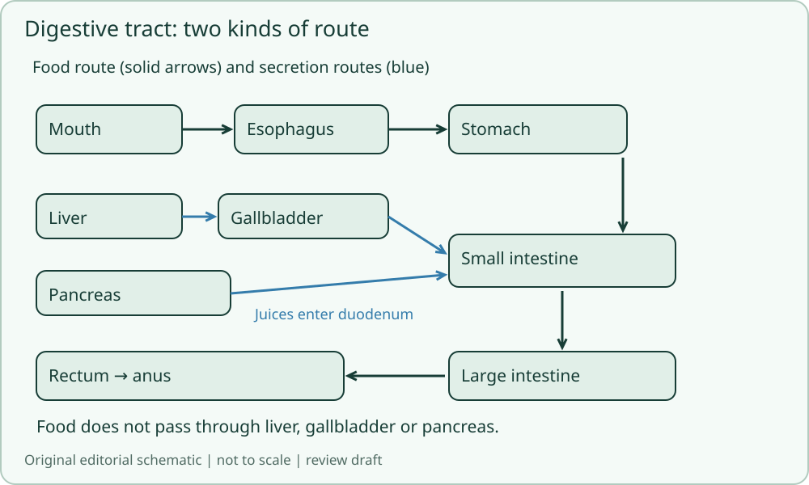
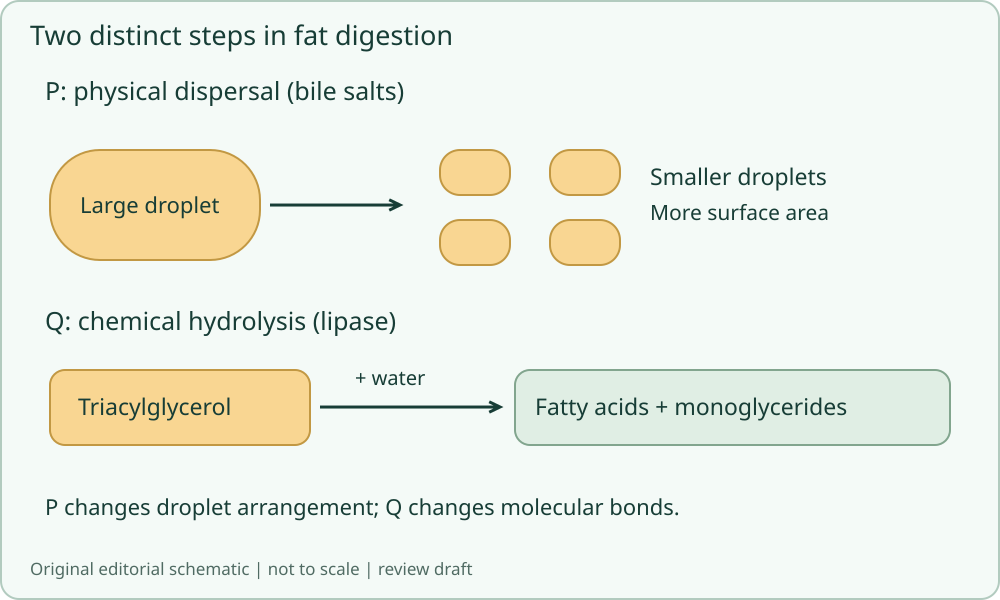
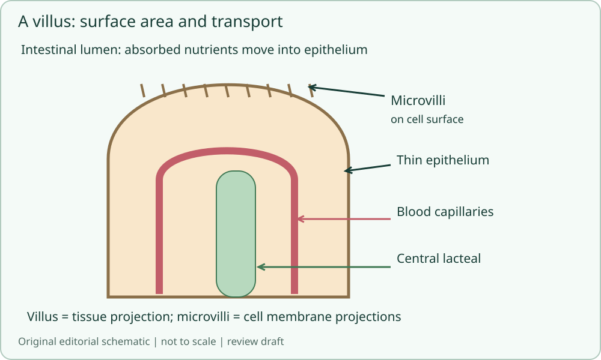

# ৫ম অধ্যায়: খাদ্য, পুষ্টি এবং পরিপাক

> উত্তরসহ পর্যালোচনাধীন খসড়া; নির্ধারিত সংখ্যার উত্তরসহ খসড়া সম্পূর্ণ; বিষয়বস্তু পর্যালোচনা বাকি।
> মূল বই ও বিষয়বিশেষজ্ঞের পূর্ণ যাচাই বাকি। বোর্ড/স্কুল/সাল দাবি নেই।

## rebuild-mcq.json

### MCQ 1

“প্রোটিন ও নিউক্লিক অ্যাসিড গঠনের প্রয়োজনীয় মৌল”—বর্ণনাটি কোন ধারণা বা গঠন নির্দেশ করে?

A. লালার অ্যামাইলেজ
B. শর্করা
C. নাইট্রোজেন
D. লাইপেজ

উত্তর: C — নাইট্রোজেন
নাইট্রোজেন: অ্যামাইনো অ্যাসিড তৈরিতে উপাদান দেয়। সীমা: শুধু পাতা হলুদ দেখে এই মৌলের ঘাটতি নিশ্চিত করা যায় না।

### MCQ 2

“ক্লোরোফিল অণুর কেন্দ্রীয় ধাতব উপাদান”—বর্ণনাটি কোন ধারণা বা গঠন নির্দেশ করে?

A. ম্যাগনেসিয়াম
B. শর্করা
C. পটাশিয়াম
D. ভিলাস

উত্তর: A — ম্যাগনেসিয়াম
ম্যাগনেসিয়াম: আলোকগ্রাহী রঞ্জকের গঠনে অংশ নেয়। সীমা: ক্লোরোফিল সংশ্লেষণে প্রয়োজনীয় লোহা কেন্দ্রীয় ধাতু নয়।

### MCQ 3

“পত্ররন্ধ্রের কাজ ও অসমোটিক নিয়ন্ত্রণে প্রয়োজনীয় খনিজ”—বর্ণনাটি কোন ধারণা বা গঠন নির্দেশ করে?

A. ভিটামিন A
B. মাইক্রোনিউট্রিয়েন্ট
C. পটাশিয়াম
D. ভিলাস

উত্তর: C — পটাশিয়াম
পটাশিয়াম: রক্ষীকোষের আয়ন ভারসাম্য ও এনজাইমের কাজে সহায়তা করে। সীমা: সব পুষ্টিমৌল সরাসরি জৈব অণুর গাঠনিক অংশ নয়।

### MCQ 4

“ATP ও নিউক্লিক অ্যাসিডের ফসফেটের মৌল”—বর্ণনাটি কোন ধারণা বা গঠন নির্দেশ করে?

A. ভিলাস
B. ভিটামিন A
C. খাদ্যআঁশ
D. ফসফরাস

উত্তর: D — ফসফরাস
ফসফরাস: শক্তি স্থানান্তর ও বংশগতীয় অণুর গঠনে অংশ নেয়। সীমা: অতিরিক্ত সার সবসময় বাড়তি ফলন দেয় না।

### MCQ 5

“অল্প পরিমাণে প্রয়োজনীয় অপরিহার্য পুষ্টি উপাদান”—বর্ণনাটি কোন ধারণা বা গঠন নির্দেশ করে?

A. মাইক্রোনিউট্রিয়েন্ট
B. ফসফরাস
C. লৌহ
D. ভিটামিন A

উত্তর: A — মাইক্রোনিউট্রিয়েন্ট
মাইক্রোনিউট্রিয়েন্ট: নির্দিষ্ট বিপাকীয় কাজ সম্পন্ন করতে সহায়তা করে। সীমা: অল্প প্রয়োজন মানে কম গুরুত্বপূর্ণ নয়।

### MCQ 6

“চিনি ও শ্বেতসারসহ প্রধান শক্তিদায়ক খাদ্যগোষ্ঠী”—বর্ণনাটি কোন ধারণা বা গঠন নির্দেশ করে?

A. ট্রিপসিন
B. ম্যাগনেসিয়াম
C. শর্করা
D. পটাশিয়াম

উত্তর: C — শর্করা
শর্করা: শ্বসনের জ্বালানি সরবরাহ করে। সীমা: মানুষ সব ধরনের শর্করা একইভাবে পরিপাক করে না।

### MCQ 7

“অ্যামাইনো অ্যাসিড দিয়ে গঠিত খাদ্য উপাদান”—বর্ণনাটি কোন ধারণা বা গঠন নির্দেশ করে?

A. প্রোটিন
B. ভিটামিন D
C. ভিটামিন A
D. লৌহ

উত্তর: A — প্রোটিন
প্রোটিন: নতুন টিস্যু ও নানা কার্যকর অণু তৈরিতে লাগে। সীমা: প্রয়োজনে শক্তির উৎসও হতে পারে।

### MCQ 8

“তেল ও চর্বিসহ শক্তিঘন খাদ্য উপাদান”—বর্ণনাটি কোন ধারণা বা গঠন নির্দেশ করে?

A. লাইপেজ
B. পটাশিয়াম
C. ভিটামিন D
D. স্নেহপদার্থ

উত্তর: D — স্নেহপদার্থ
স্নেহপদার্থ: শক্তি সঞ্চয় ও কোষঝিল্লি গঠনে ভূমিকা রাখে। সীমা: সব চর্বির স্বাস্থ্যগত প্রভাব এক নয়।

### MCQ 9

“স্বাভাবিক দৃষ্টিতে প্রয়োজনীয় চর্বিদ্রবণীয় ভিটামিন”—বর্ণনাটি কোন ধারণা বা গঠন নির্দেশ করে?

A. ফসফরাস
B. আয়োডিন
C. ভিটামিন A
D. নাইট্রোজেন

উত্তর: C — ভিটামিন A
ভিটামিন A: দৃষ্টি ও আবরণীর স্বাভাবিকতায় সহায়তা করে। সীমা: চোখের সব রোগ এটির অভাবে হয় না।

### MCQ 10

“কোলাজেন তৈরিতে প্রয়োজনীয় পানিদ্রবণীয় ভিটামিন”—বর্ণনাটি কোন ধারণা বা গঠন নির্দেশ করে?

A. ভিটামিন C
B. ফসফরাস
C. ট্রিপসিন
D. পেপসিন

উত্তর: A — ভিটামিন C
ভিটামিন C: যোজক টিস্যুর স্বাভাবিক গঠনে সহায়তা করে। সীমা: মাড়ির সব রক্তক্ষরণের কারণ এক নয়।

### MCQ 11

“ক্যালসিয়ামের স্বাভাবিক বিপাকে প্রয়োজনীয় ভিটামিন”—বর্ণনাটি কোন ধারণা বা গঠন নির্দেশ করে?

A. নাইট্রোজেন
B. ভিটামিন D
C. মাইক্রোনিউট্রিয়েন্ট
D. পিত্ত

উত্তর: B — ভিটামিন D
ভিটামিন D: অন্ত্রে ক্যালসিয়াম শোষণে সহায়তা করে। সীমা: অতিরিক্ত সাপ্লিমেন্ট ক্ষতিকর হতে পারে।

### MCQ 12

“হিমোগ্লোবিন গঠনের প্রয়োজনীয় খনিজ”—বর্ণনাটি কোন ধারণা বা গঠন নির্দেশ করে?

A. লৌহ
B. ম্যাগনেসিয়াম
C. ভিটামিন D
D. শর্করা

উত্তর: A — লৌহ
লৌহ: অক্সিজেনবাহী অণুর গঠনে অংশ নেয়। সীমা: সব রক্তাল্পতা লৌহের অভাবজনিত নয়।

### MCQ 13

“থাইরয়েড হরমোন তৈরির প্রয়োজনীয় মৌল”—বর্ণনাটি কোন ধারণা বা গঠন নির্দেশ করে?

A. ট্রিপসিন
B. আয়োডিন
C. লৌহ
D. পিত্ত

উত্তর: B — আয়োডিন
আয়োডিন: স্বাভাবিক থাইরয়েড কার্যক্রমে সহায়তা করে। সীমা: সব গলগণ্ডের কারণ আয়োডিনের ঘাটতি নয়।

### MCQ 14

“মানুষের নিজস্ব এনজাইমে অপাচ্য খাদ্যাংশ”—বর্ণনাটি কোন ধারণা বা গঠন নির্দেশ করে?

A. লৌহ
B. খাদ্যআঁশ
C. আয়োডিন
D. ম্যাগনেসিয়াম

উত্তর: B — খাদ্যআঁশ
খাদ্যআঁশ: মলের পরিমাণ ও অন্ত্রের স্বাভাবিক কাজে সহায়তা করে। সীমা: আঁশ পরিপাককারী এনজাইম নয়।

### MCQ 15

“মুখে শ্বেতসার ভাঙা শুরু করা এনজাইম”—বর্ণনাটি কোন ধারণা বা গঠন নির্দেশ করে?

A. ম্যাগনেসিয়াম
B. লালার অ্যামাইলেজ
C. নাইট্রোজেন
D. ভিটামিন C

উত্তর: B — লালার অ্যামাইলেজ
লালার অ্যামাইলেজ: শ্বেতসার থেকে ছোট শর্করা তৈরিতে সহায়তা করে। সীমা: শুধু এই এনজাইমে সব খাদ্যের পরিপাক শেষ হয় না।

### MCQ 16

“পাকস্থলীর অম্লীয় পরিবেশে সক্রিয় প্রোটিয়েজ”—বর্ণনাটি কোন ধারণা বা গঠন নির্দেশ করে?

A. লৌহ
B. পটাশিয়াম
C. ভিটামিন D
D. পেপসিন

উত্তর: D — পেপসিন
পেপসিন: প্রোটিনকে ছোট পেপটাইডে ভাঙে। সীমা: সব উৎপাদ সরাসরি মুক্ত অ্যামাইনো অ্যাসিড নয়।

### MCQ 17

“যকৃতে তৈরি চর্বি পরিপাকের সহায়ক রস”—বর্ণনাটি কোন ধারণা বা গঠন নির্দেশ করে?

A. ভিটামিন D
B. লৌহ
C. পিত্ত
D. ম্যাগনেসিয়াম

উত্তর: C — পিত্ত
পিত্ত: চর্বিকে ক্ষুদ্র ফোঁটায় ছড়িয়ে পৃষ্ঠ বাড়ায়। সীমা: এতে পরিপাককারী এনজাইম নেই।

### MCQ 18

“অগ্ন্যাশয় থেকে আসা প্রোটিন পরিপাকের এনজাইম”—বর্ণনাটি কোন ধারণা বা গঠন নির্দেশ করে?

A. ম্যাগনেসিয়াম
B. ট্রিপসিন
C. শর্করা
D. লৌহ

উত্তর: B — ট্রিপসিন
ট্রিপসিন: ক্ষুদ্রান্ত্রে পেপটাইড ভাঙতে সাহায্য করে। সীমা: এটি নিষ্ক্রিয় ট্রিপসিনোজেন হিসেবে নিঃসৃত হয়।

### MCQ 19

“স্নেহপদার্থের রাসায়নিক পরিপাককারী এনজাইম”—বর্ণনাটি কোন ধারণা বা গঠন নির্দেশ করে?

A. ম্যাগনেসিয়াম
B. শর্করা
C. পটাশিয়াম
D. লাইপেজ

উত্তর: D — লাইপেজ
লাইপেজ: চর্বির বন্ধন ভেঙে শোষণযোগ্য উৎপাদ তৈরিতে সাহায্য করে। সীমা: পিত্তের ভৌত ইমালসিফিকেশন একই ঘটনা নয়।

### MCQ 20

“ক্ষুদ্রান্ত্রের আঙুলসদৃশ শোষক প্রবর্ধক”—বর্ণনাটি কোন ধারণা বা গঠন নির্দেশ করে?

A. পিত্ত
B. খাদ্যআঁশ
C. লাইপেজ
D. ভিলাস

উত্তর: D — ভিলাস
ভিলাস: পুষ্টি শোষণের ক্ষেত্রফল বাড়ায়। সীমা: সব শোষিত পুষ্টি একই পথে রক্তে পৌঁছায় না।

### MCQ 21

সার বেশি দিলেই বৃদ্ধি বেশি—দাবির সীমা কোনটি?

A. সব সারই সরাসরি গ্লুকোজ
B. অতিরিক্ত লবণচাপ বা আয়নভারসাম্যহীনতা হতে পারে
C. মাটি কখনও প্রভাব ফেলে না
D. উদ্ভিদে খনিজের কোনো প্রয়োজন নেই

উত্তর: B — অতিরিক্ত লবণচাপ বা আয়নভারসাম্যহীনতা হতে পারে
উপযুক্ত পরিমাণ প্রয়োজন; অতিরিক্ত প্রয়োগও ক্ষতিকর হতে পারে।

### MCQ 22

গৌণ পুষ্টি উপাদানকে কম গুরুত্বপূর্ণ বলা অনুচিত কেন?

A. অল্প পরিমাণেও তার নির্দিষ্ট কাজ অপরিহার্য
B. এটি কোনো উদ্ভিদে লাগে না
C. মুখ্য উপাদান সব কাজ বদলে দেয়
D. সব গৌণ মৌলই বিষ

উত্তর: A — অল্প পরিমাণেও তার নির্দিষ্ট কাজ অপরিহার্য
ম্যাক্রো ও মাইক্রো বিভাজন প্রয়োজনীয় পরিমাণের, গুরুত্বের নয়।

### MCQ 23

খাদ্যে যথেষ্ট ক্যালরি থাকলেও অপুষ্টি হতে পারে কেন?

A. নির্দিষ্ট প্রোটিন, ভিটামিন বা খনিজের ঘাটতি থাকতে পারে
B. ক্যালরি ও ভিটামিন অভিন্ন
C. সব খাবারের উপাদান এক
D. শক্তি পেলে আর কোনো পদার্থ লাগে না

উত্তর: A — নির্দিষ্ট প্রোটিন, ভিটামিন বা খনিজের ঘাটতি থাকতে পারে
শক্তির পর্যাপ্ততা পুষ্টির সব চাহিদা পূরণের প্রমাণ নয়।

### MCQ 24

পানিদ্রবণীয় ভিটামিন বলে যেকোনো মাত্রা নিরাপদ—এ বক্তব্য কেমন?

A. সঠিক; এগুলো শরীরে কোনো কাজ করে না
B. ভুল; অতিরিক্ত গ্রহণেও বিরূপ প্রভাব হতে পারে
C. সঠিক; মাত্রার কোনো সীমা নেই
D. ভুল; সবই কেবল চর্বিতে দ্রবীভূত

উত্তর: B — ভুল; অতিরিক্ত গ্রহণেও বিরূপ প্রভাব হতে পারে
দ্রাব্যতার শ্রেণি নিরাপত্তার সীমাহীন অনুমতি নয়; নিজে অতিরিক্ত সাপ্লিমেন্ট নয়।

### MCQ 25

পিত্তথলি ও যকৃতের কাজ আলাদা করে কোনটি সঠিক?

A. পিত্তথলি সব প্রোটিন বানায়
B. যকৃত দিয়ে সব খাদ্য সরাসরি যায়
C. পিত্ত তৈরি দাঁতে, সঞ্চয় রক্তে
D. পিত্ত তৈরি যকৃতে, সঞ্চয় পিত্তথলিতে

উত্তর: D — পিত্ত তৈরি যকৃতে, সঞ্চয় পিত্তথলিতে
রসের উৎপাদন ও সঞ্চয়ের অঙ্গ আলাদা।

### MCQ 26

পেপসিনের ক্রিয়া সম্পন্ন হলেই সব প্রোটিন মুক্ত অ্যামাইনো অ্যাসিড হয়েছে বলা যায় না কেন?

A. এটি পানি শোষণকারী কোষ
B. এটি মূলত ছোট পেপটাইড তৈরি করে
C. পাকস্থলীতে কখনও প্রোটিন থাকে না
D. এটি শুধু সেলুলোজ তৈরি করে

উত্তর: B — এটি মূলত ছোট পেপটাইড তৈরি করে
অন্ত্রে অন্যান্য প্রোটিয়েজ ও পেপটিডেজ আরও পরিপাক করে।

### MCQ 27

ট্রিপসিনোজেনের মতো নিষ্ক্রিয় পূর্বধাপে নিঃসরণ কী সুবিধা দেয়?

A. এনজাইমকে স্থায়ীভাবে অকেজো করে
B. সব খাদ্য মুখেই শেষ করে
C. উৎপাদক টিস্যুর অনাকাঙ্ক্ষিত প্রোটিনভাঙার ঝুঁকি কমায়
D. রক্তে অক্সিজেন সরাসরি বাড়ায়

উত্তর: C — উৎপাদক টিস্যুর অনাকাঙ্ক্ষিত প্রোটিনভাঙার ঝুঁকি কমায়
স্থান ও সময়মতো সক্রিয়তা এনজাইমের কাজ নিয়ন্ত্রণে সাহায্য করে।

### MCQ 28

ভিলাস ও মাইক্রোভিলাস সম্পর্কে কোনটি সঠিক?

A. দুটি একই অঙ্গের দুই বানান
B. দুটিই লালার গ্রন্থি
C. উভয়েই পৃষ্ঠ বাড়ায়, কিন্তু সংগঠনের স্তর ও আকার ভিন্ন
D. একটি পুরো যকৃত

উত্তর: C — উভয়েই পৃষ্ঠ বাড়ায়, কিন্তু সংগঠনের স্তর ও আকার ভিন্ন
ভিলাস অন্ত্রের আবরণীর প্রবর্ধক, মাইক্রোভিলাস শোষক কোষের ক্ষুদ্র পৃষ্ঠপ্রবর্ধক।

### MCQ 29

অন্ত্র পেরিয়ে অ্যামাইনো অ্যাসিড রক্তে যাওয়া ও কোষে প্রোটিনে যুক্ত হওয়া যথাক্রমে কী?

A. শোষণ ও আত্তীকরণ
B. শ্বাসগ্রহণ ও নিষেক
C. রেচন ও পেরিস্টালসিস
D. আত্তীকরণ ও মলত্যাগ

উত্তর: A — শোষণ ও আত্তীকরণ
অন্ত্রের বাধা পেরোনো ও কোষে নিজের পদার্থে ব্যবহার পৃথক ধাপ।

### MCQ 30

দীর্ঘ-শৃঙ্খল চর্বি ও গ্লুকোজ শোষণের পথ সবসময় এক নয় কেন?

A. সব চর্বি মুখেই রক্তে যায়
B. কোনো পুষ্টি কখনও রক্তে আসে না
C. সব গ্লুকোজ সরাসরি পিত্তথলিতে যায়
D. চর্বির বড় অংশ কাইলোমাইক্রনে প্রথমে লসিকায় যায়

উত্তর: D — চর্বির বড় অংশ কাইলোমাইক্রনে প্রথমে লসিকায় যায়
গ্লুকোজ প্রধানত অন্ত্রের রক্তকৈশিকে যায়, চর্বির পরিবহণে লসিকাপথ গুরুত্বপূর্ণ।

### MCQ 31

খাদ্য মুখে নেওয়া থেকে কোষে ব্যবহারের সঠিক সাধারণ ক্রম কোনটি?

A. গ্রহণ→পরিপাক→শোষণ→আত্তীকরণ
B. শোষণ→গ্রহণ→আত্তীকরণ→পরিপাক
C. পরিপাক→মলত্যাগ→গ্রহণ→শোষণ
D. আত্তীকরণ→শোষণ→গ্রহণ→পরিপাক

উত্তর: A — গ্রহণ→পরিপাক→শোষণ→আত্তীকরণ
খাদ্য গ্রহণ, অণুভাঙন, আবরণী পেরোনো ও কোষে ব্যবহার পৃথক।

### MCQ 32

যান্ত্রিক পরিপাকের উদাহরণ কোনটি?

A. দাঁতে খাদ্য চূর্ণ
B. লাইপেজে চর্বি ভাঙা
C. পেপসিনে প্রোটিনের বন্ধনভাঙা
D. মাল্টেজে মাল্টোজ ভাঙা

উত্তর: A — দাঁতে খাদ্য চূর্ণ
আকার কমানো ও রাসায়নিক বন্ধনভাঙা আলাদা।

### MCQ 33

রাসায়নিক পরিপাকে বড় খাদ্য অণু কী হয়?

A. শোষণযোগ্য ছোট উৎপাদে ভাঙে
B. অক্ষত অবস্থাতেই সব কোষে যায়
C. সবসময় সরাসরি ATP হয়
D. সবটাই O2 হয়

উত্তর: A — শোষণযোগ্য ছোট উৎপাদে ভাঙে
জলবিশ্লেষণসহ এনজাইমীয় ভাঙন গুরুত্বপূর্ণ।

### MCQ 34

চিবিয়ে খাদ্যের পৃষ্ঠ বাড়ানো কেন সহায়ক?

A. এনজাইমের সংস্পর্শের সুযোগ বাড়ে
B. এনজাইমের প্রয়োজন শেষ হয়
C. সব খাদ্য গ্লুকোজ হয়
D. অ্যামাইনো অ্যাসিড সরাসরি তৈরি হয়

উত্তর: A — এনজাইমের সংস্পর্শের সুযোগ বাড়ে
যান্ত্রিক কাজ রাসায়নিক কাজ সহজ করে কিন্তু বিকল্প নয়।

### MCQ 35

মানব দাঁতের কর্তনদাঁতের প্রধান কাজ কী?

A. খাদ্য চিরে ছেঁড়া
B. শুধু খাদ্য ধরে রাখা
C. কাটা
D. খাদ্য পেষণ

উত্তর: C — কাটা
দাঁতের আকৃতিভেদে কাটা, ছেঁড়া ও পেষার কাজ পৃথক।

### MCQ 36

পেষকদাঁতের প্রশস্ত পৃষ্ঠ কোন কাজে উপযোগী?

A. খাদ্য ধরে চেরা
B. খাদ্য পেষা
C. জিহ্বার স্বাদগ্রহণ
D. খাদ্য কাটা

উত্তর: B — খাদ্য পেষা
যান্ত্রিক চূর্ণ খাদ্য ও রসের মিশ্রণ সহজ করে।

### MCQ 37

লালা খাদ্য গিলতে কীভাবে সহায়তা করে?

A. সব প্রোটিন শেষ করে
B. ভিজিয়ে পিচ্ছিল খাদ্যপিণ্ড গড়ে
C. খাদ্যকে রক্তে নেয়
D. সব জীবাণু নিশ্চিত মারে

উত্তর: B — ভিজিয়ে পিচ্ছিল খাদ্যপিণ্ড গড়ে
মিউকাস ও পানিসহ লালা বলাস গঠনে সহায়ক।

### MCQ 38

লালার প্রধান শ্বেতসারভাঙা এনজাইম কোনটি?

A. পেপসিন
B. অ্যামাইলেজ
C. মাল্টেজ
D. লাইপেজ

উত্তর: B — অ্যামাইলেজ
মুখে শ্বেতসার ভাঙা শুরু হয়, সব শর্করার সম্পূর্ণ পরিপাক নয়।

### MCQ 39

চিবানো ভাতে মিষ্টিভাবের সম্ভাব্য কারণ কোনটি?

A. শ্বেতসার থেকে ছোট শর্করা তৈরি
B. প্রোটিন থেকে সরাসরি লবণ
C. লালা নিজেই শ্বেতসার
D. চর্বি থেকে সব গ্লুকোজ

উত্তর: A — শ্বেতসার থেকে ছোট শর্করা তৈরি
অ্যামাইলেজের কাজ মিষ্টিভাব বাড়াতে পারে; শোষণ হয়েছে বলা যায় না।

### MCQ 40

গিলতে খাদ্য শ্বাসপথে না যাওয়ার সুরক্ষায় কোনটি ভূমিকা রাখে?

A. পিত্তথলি
B. অ্যাপেনডিক্স
C. এপিগ্লটিসসহ সমন্বিত গলাধঃকরণ
D. ভিলাস

উত্তর: C — এপিগ্লটিসসহ সমন্বিত গলাধঃকরণ
গলাধঃকরণে শ্বাসপথের প্রবেশ সুরক্ষিত হয়।

### MCQ 41

খাদ্যনালির পেরিস্টালসিস কী?

A. শুধু অভিকর্ষে পতন
B. রক্তকৈশিকের ব্যাপন
C. আয়োডিনের রঞ্জন
D. সমন্বিত তরঙ্গাকার পেশিসংকোচন

উত্তর: D — সমন্বিত তরঙ্গাকার পেশিসংকোচন
পেশির ক্রমবদ্ধ কাজ খাদ্যকে এগিয়ে দেয়।

### MCQ 42

মানুষে খাদ্যের স্বাভাবিক পথের সঠিক অংশক্রম কোনটি?

A. অন্ননালি→যকৃত→পাকস্থলী
B. পাকস্থলী→অগ্ন্যাশয়→বৃহদন্ত্র
C. অন্ননালি→পাকস্থলী→ক্ষুদ্রান্ত্র
D. মুখ→পিত্তথলি→অন্ননালি

উত্তর: C — অন্ননালি→পাকস্থলী→ক্ষুদ্রান্ত্র
সহায়ক গ্রন্থির রস অন্ত্রে যায়, খাদ্য তাদের ভেতর দিয়ে যায় না।

### MCQ 43

পাকস্থলীর মথন কোন ধরনের কাজে সহায়ক?

A. পিত্ত তৈরি
B. খাদ্য ও রস মিশিয়ে অর্ধতরল করা
C. সব পুষ্টি সরাসরি রক্তে নেওয়া
D. শুধু মল সঞ্চয়

উত্তর: B — খাদ্য ও রস মিশিয়ে অর্ধতরল করা
যান্ত্রিক মিশ্রণ ও রাসায়নিক পরিপাক একসঙ্গে ঘটে।

### MCQ 44

পাকস্থলীর HCl-এর একটি কাজ কোনটি?

A. সব চর্বি ইমালসিফাই
B. সব শর্করা শোষণ
C. পেপসিনের অনুকূল অম্লীয় পরিবেশ রাখা
D. পিত্তের এনজাইম তৈরি

উত্তর: C — পেপসিনের অনুকূল অম্লীয় পরিবেশ রাখা
অ্যাসিড নিজে প্রোটিয়েজ নয়; সক্রিয়তা ও প্রোটিন উন্মোচনে সহায়ক।

### MCQ 45

পেপসিন কোন খাদ্যগোষ্ঠীর ওপর কাজ করে?

A. সেলুলোজ
B. শ্বেতসার
C. ল্যাকটোজ
D. প্রোটিন

উত্তর: D — প্রোটিন
এটি প্রোটিনকে পেপটাইডে ভাঙে।

### MCQ 46

পাকস্থলীর মিউকাসের সুরক্ষামূলক ভূমিকা কী?

A. পিত্ত তৈরি
B. সকল খাদ্যকে অ্যামাইনো অ্যাসিড করা
C. ভিলাসে চর্বি নেওয়া
D. আবরণীকে অ্যাসিড-এনজাইমের প্রভাব থেকে রক্ষা

উত্তর: D — আবরণীকে অ্যাসিড-এনজাইমের প্রভাব থেকে রক্ষা
সুরক্ষা একাধিক ব্যবস্থার ফল; শুধু অ্যাসিড থাকলেই আলসার নয়।

### MCQ 47

পাকস্থলী থেকে ক্ষুদ্রান্ত্রের প্রথম অংশ কোনটি?

A. ইলিয়াম
B. জেজুনাম
C. ডুওডেনাম
D. সিকাম

উত্তর: C — ডুওডেনাম
ডুওডেনামে অগ্ন্যাশয়রস ও পিত্ত আসে।

### MCQ 48

অগ্ন্যাশয়রসের বাইকার্বনেটের কাজ কী?

A. অম্লীয় খাদ্যমণ্ড নিরপেক্ষকরণে সাহায্য
B. পিত্ত সঞ্চয়
C. খাদ্যনালির দাঁত তৈরি
D. নিজেই সব প্রোটিন ভাঙা

উত্তর: A — অম্লীয় খাদ্যমণ্ড নিরপেক্ষকরণে সাহায্য
ক্ষুদ্রান্ত্রের এনজাইমের উপযুক্ত pH বজায় রাখতে সহায়ক।

### MCQ 49

অগ্ন্যাশয়ের পরিপাক-সম্পর্কিত নিঃসরণ কোথায় যায়?

A. কেবল মূত্রাশয়ে
B. সরাসরি অন্ননালিতে
C. নালি দিয়ে ক্ষুদ্রান্ত্রে
D. পিত্তথলির কোষে খাদ্য হিসেবে

উত্তর: C — নালি দিয়ে ক্ষুদ্রান্ত্রে
বহিঃক্ষরা পরিপাকরস ও অন্তঃক্ষরা হরমোন আলাদা।

### MCQ 50

ইনসুলিনকে অন্ত্রের পরিপাককারী এনজাইম বলা ভুল কেন?

A. এটি রক্তে কার্যকর হরমোন
B. এটি ভিলাসের রক্তনালি
C. এটি পিত্তলবণ
D. এটি লালার শ্বেতসার

উত্তর: A — এটি রক্তে কার্যকর হরমোন
অগ্ন্যাশয়ের ভিন্ন কোষের ভিন্ন নিঃসরণপথ আছে।

### MCQ 51

অগ্ন্যাশয়জাত অ্যামাইলেজ সাধারণত কোথায় কাজ করে?

A. বৃহদন্ত্রে
B. পাকস্থলীতে
C. ক্ষুদ্রান্ত্রে
D. অন্ননালিতে

উত্তর: C — ক্ষুদ্রান্ত্রে
উৎপত্তির স্থান ও কাজের স্থান ভিন্ন হতে পারে।

### MCQ 52

মাল্টেজের উপাদান ও উৎপাদের সঠিক সম্পর্ক কোনটি?

A. ল্যাকটোজ→ইথানল
B. শ্বেতসার→অ্যামাইনো অ্যাসিড
C. প্রোটিন→ফ্যাটি অ্যাসিড
D. মাল্টোজ→গ্লুকোজ

উত্তর: D — মাল্টোজ→গ্লুকোজ
শর্করার চূড়ান্ত ভাঙনে নির্দিষ্ট এনজাইমের কাজ থাকে।

### MCQ 53

ল্যাকটেজ কোনটি ভাঙে?

A. সুক্রোজ
B. মাল্টোজ
C. শ্বেতসার
D. ল্যাকটোজ

উত্তর: D — ল্যাকটোজ
ল্যাকটোজ থেকে গ্লুকোজ ও গ্যালাকটোজ তৈরি হয়।

### MCQ 54

সুক্রেজের সাধারণ উৎপাদ কোন যুগল?

A. দুটি গ্লুকোজ
B. গ্লুকোজ ও গ্যালাকটোজ
C. গ্লুকোজ ও ফ্রুক্টোজ
D. ফ্রুক্টোজ ও গ্যালাকটোজ

উত্তর: C — গ্লুকোজ ও ফ্রুক্টোজ
সুক্রোজের একক দুটি নির্দিষ্ট মনোস্যাকারাইড।

### MCQ 55

প্রোটিনের পরিপাক ক্ষুদ্রান্ত্রেও চলে কেন?

A. ক্ষুদ্রান্ত্রে সব প্রোটিন নতুন তৈরি
B. পাকস্থলীতে কোনো এনজাইম নেই
C. প্রোটিন সরাসরি সব গ্লুকোজ
D. পেপটাইড আরও ভাঙতে হয়

উত্তর: D — পেপটাইড আরও ভাঙতে হয়
বিভিন্ন প্রোটিয়েজ ও পেপটিডেজ সম্মিলিত কাজ করে।

### MCQ 56

ট্রিপসিনের নিষ্ক্রিয় পূর্বসূরি কোনটি?

A. ট্রিপসিনোজেন
B. মাল্টেজ
C. পেপসিনোজেন
D. কাইমোট্রিপসিন

উত্তর: A — ট্রিপসিনোজেন
নিয়ন্ত্রিত সক্রিয়করণ অঙ্গকে অনাকাঙ্ক্ষিত ভাঙন থেকে সুরক্ষায় সহায়ক।

### MCQ 57

লাইপেজ ও অ্যামাইলেজ আলাদা কেন?

A. দুটিই একই এনজাইম
B. দুটিই কেবল ভৌত পেষণ
C. দুটিই খনিজ আয়ন
D. তাদের প্রধান সাবস্ট্রেট আলাদা

উত্তর: D — তাদের প্রধান সাবস্ট্রেট আলাদা
এনজাইমের কাজ নির্দিষ্ট উপাদান ও বন্ধনের সঙ্গে সম্পর্কিত।

### MCQ 58

পিত্তের উৎপত্তিস্থল কোনটি?

A. অগ্ন্যাশয়
B. পিত্তথলি
C. ক্ষুদ্রান্ত্রের গ্রন্থি
D. যকৃত

উত্তর: D — যকৃত
পিত্তথলিতে সঞ্চয় ও ঘনীভবন হতে পারে, উৎপাদন যকৃতে।

### MCQ 59

পিত্তলবণ চর্বির রাসায়নিক ভাঙন সহজ করে কীভাবে?

A. এনজাইম পুরো বাদ দেয়
B. সব চর্বি প্রোটিন করে
C. নিজেই লাইপেজ হিসেবে বন্ধন কাটে
D. ফোঁটা ছড়িয়ে উন্মুক্ত পৃষ্ঠ বাড়ায়

উত্তর: D — ফোঁটা ছড়িয়ে উন্মুক্ত পৃষ্ঠ বাড়ায়
ইমালসিফিকেশন ভৌত সহায়ক কাজ।

### MCQ 60

একই পরিমাণ চর্বি ছোট ফোঁটায় ভাগ হলে কী বাড়ে?

A. অবশ্যই মোট কার্বনসংখ্যা
B. মোট উন্মুক্ত পৃষ্ঠ
C. অবশ্যই মোট ভর
D. প্রতি অণুর ফ্যাটি অ্যাসিডসংখ্যা

উত্তর: B — মোট উন্মুক্ত পৃষ্ঠ
পৃষ্ঠ বাড়া মানে নতুন চর্বি সৃষ্টি নয়।

### MCQ 61

অগ্ন্যাশয় লাইপেজে ট্রাইগ্লিসারাইডের প্রধান শোষণপূর্ব উৎপাদ কোনটি?

A. ফ্যাটি অ্যাসিড ও মনোগ্লিসারাইড
B. শুধু গ্লুকোজ
C. অক্ষত কাইলোমাইক্রন
D. শুধু অ্যামাইনো অ্যাসিড

উত্তর: A — ফ্যাটি অ্যাসিড ও মনোগ্লিসারাইড
সব চর্বি শুধু মুক্ত গ্লিসারলেই পরিণত হয় বলা অতিসরল।

### MCQ 62

অন্ত্রের লুমেনে মাইসেলের কাজ কী?

A. রক্তে হিমোগ্লোবিন তৈরি
B. দীর্ঘ-শৃঙ্খল চর্বিজাত উৎপাদ শোষক পৃষ্ঠে পৌঁছাতে সহায়তা
C. অক্ষত অবস্থায় লসিকায় যাওয়া
D. সব প্রোটিন ভাঙা

উত্তর: B — দীর্ঘ-শৃঙ্খল চর্বিজাত উৎপাদ শোষক পৃষ্ঠে পৌঁছাতে সহায়তা
উৎপাদ মাইসেল ছেড়ে কোষে ঢোকে; মাইসেলই কাইলোমাইক্রন নয়।

### MCQ 63

কাইলোমাইক্রন কোথায় সংগঠিত হয়?

A. পাকস্থলীর গহ্বরে
B. যকৃতের পিত্তনালিতে
C. অন্ত্রের লুমেনে
D. শোষক অন্ত্রকোষে

উত্তর: D — শোষক অন্ত্রকোষে
পুনর্গঠিত লিপিড প্রোটিনসহ প্যাকেট হয়ে লসিকায় যেতে পারে।

### MCQ 64

অ্যামাইনো অ্যাসিড সাধারণত ভিলাসের কোন পরিবহণপথে যায়?

A. পিত্তনালিতে
B. রক্তকৈশিকে
C. অগ্ন্যাশয়ের নালিতে
D. কেন্দ্রীয় ল্যাকটিয়ালে

উত্তর: B — রক্তকৈশিকে
জলদ্রবণীয় পুষ্টির রক্তপথ গুরুত্বপূর্ণ।

### MCQ 65

ভিলাসের কেন্দ্রীয় ল্যাকটিয়াল কী?

A. রক্তশিরা
B. পিত্তবাহী নালি
C. রক্তধমনি
D. লসিকানালি

উত্তর: D — লসিকানালি
দীর্ঘ-শৃঙ্খল চর্বিজাত প্যাকেটের পরিবহণে গুরুত্বপূর্ণ।

### MCQ 66

ভিলাসের পাতলা আবরণী শোষণে সহায়ক কেন?

A. পার হওয়ার দূরত্ব কম
B. সব কোষ মৃত
C. এনজাইম একেবারে লাগে না
D. প্রতিটি খাদ্য অক্ষত যায়

উত্তর: A — পার হওয়ার দূরত্ব কম
পৃষ্ঠ, দূরত্ব ও পরিবহণব্যবস্থা মিলিয়ে শোষণ সহজ হয়।

### MCQ 67

ক্ষুদ্রান্ত্রের দৈর্ঘ্য, ভাঁজ ও ভিলাসের সম্মিলিত সুবিধা কী?

A. সকল জীবাণু নিশ্চিত মেরে ফেলা
B. খাদ্যকে রক্তে না যেতে দেওয়া
C. শোষক ক্ষেত্রফল বাড়ানো
D. পিত্ত উৎপাদন

উত্তর: C — শোষক ক্ষেত্রফল বাড়ানো
ক্ষুদ্রান্ত্র প্রধান শোষণস্থান, শুধু একটি বৈশিষ্ট্যের জন্য নয়।

### MCQ 68

ভিলাস ক্ষতিগ্রস্ত হলে খাদ্য উপস্থিত থাকলেও কী হতে পারে?

A. কোনো প্রভাব নেই
B. সবসময় বেশি শোষণ
C. শোষণ কমে পুষ্টিঘাটতি
D. সঙ্গে সঙ্গে সব এনজাইম দ্বিগুণ

উত্তর: C — শোষণ কমে পুষ্টিঘাটতি
খাদ্য সরবরাহ, পরিপাক ও শোষণ পৃথক সীমা।

### MCQ 69

খাদ্যকণা কোষে প্রোটিন সংশ্লেষণে ব্যবহৃত হলে সেটি কোন ধাপ?

A. গ্রহণ
B. আত্তীকরণ
C. শুধু পেরিস্টালসিস
D. মলত্যাগ

উত্তর: B — আত্তীকরণ
শোষিত উপাদান দেহের কাজে ব্যবহৃত হচ্ছে।

### MCQ 70

বৃহদন্ত্রের একটি প্রধান কাজ কোনটি?

A. অবশিষ্ট পানি ও লবণ শোষণ
B. পিত্ত উৎপাদন ও সঞ্চয়
C. অগ্ন্যাশয়রস নিঃসরণ
D. বেশিরভাগ অ্যামাইনো অ্যাসিডের পরিপাক

উত্তর: A — অবশিষ্ট পানি ও লবণ শোষণ
ক্ষুদ্রান্ত্রেও বহু পানি শোষিত হয়; বৃহদন্ত্র একমাত্র নয়।

### MCQ 71

মলাশয় ও পায়ুর ভূমিকার সঠিক পার্থক্য কী?

A. সাময়িক সঞ্চয় ও বহির্গমন নিয়ন্ত্রণ
B. গ্লুকোজ ও চর্বি সংশ্লেষণ
C. প্রোটিনভাঙা ও পিত্ত তৈরি
D. ইনসুলিন ও HCl তৈরি

উত্তর: A — সাময়িক সঞ্চয় ও বহির্গমন নিয়ন্ত্রণ
দুটি পথের শেষাংশ হলেও পৃথক কাজ।

### MCQ 72

মলত্যাগ ও রেচন এক নয় কেন?

A. অপাচ্য অবশেষ ত্যাগ ও বিপাকীয় বর্জ্য অপসারণ আলাদা
B. দুটিই শুধু ইউরিয়া
C. দুটিই শুধু খাদ্যগ্রহণ
D. মল সবটাই কোষীয় ATP

উত্তর: A — অপাচ্য অবশেষ ত্যাগ ও বিপাকীয় বর্জ্য অপসারণ আলাদা
পাচনতন্ত্রের অবশেষ ও কোষের বিপাকীয় বর্জ্য পৃথক ধারণা।

### MCQ 73

মানব পরিপাকে এনজাইমের সাধারণ কাজ কী?

A. পরমাণু সৃষ্টি
B. খাদ্যের সব শক্তি নিজে সরবরাহ
C. বিক্রিয়ার সক্রিয়ণশক্তির বাধা কমানো
D. সব বিক্রিয়া তাপহীন করা

উত্তর: C — বিক্রিয়ার সক্রিয়ণশক্তির বাধা কমানো
এনজাইম জৈব অনুঘটক; অনুকূল শর্তে কাজ করে।

### MCQ 74

একই এনজাইম সব খাদ্যে সমান কাজ করে না কেন?

A. এনজাইমে নির্দিষ্টতা নেই
B. সক্রিয় স্থানের সঙ্গে উপাদানের সামঞ্জস্য দরকার
C. সব খাদ্যের সব বন্ধন এক
D. সব এনজাইম একই গঠন

উত্তর: B — সক্রিয় স্থানের সঙ্গে উপাদানের সামঞ্জস্য দরকার
সাবস্ট্রেট-নির্দিষ্টতা পরিপাকের বহু এনজাইম ব্যাখ্যা করে।

### MCQ 75

অত্যধিক তাপে অ্যামাইলেজ নিষ্ক্রিয় হতে পারে কেন?

A. শ্বেতসার গ্লুকোজবিহীন হয়
B. তাপ সবসময় অনন্ত গতি বাড়ায়
C. প্রোটিনের গঠন বদলাতে পারে
D. এনজাইমে কখনও প্রোটিন নেই

উত্তর: C — প্রোটিনের গঠন বদলাতে পারে
বিকৃতি সক্রিয় স্থানের কাজ নষ্ট করতে পারে।

### MCQ 76

ঠান্ডায় এনজাইমের হার কমা সবসময় স্থায়ী বিকৃতি নয় কেন?

A. অনুকূল তাপে কার্যকারিতা ফিরতে পারে
B. সকল এনজাইম ঠান্ডায় মরে
C. তাপের কোনো ভূমিকা নেই
D. ঠান্ডায় সাবস্ট্রেট শূন্য

উত্তর: A — অনুকূল তাপে কার্যকারিতা ফিরতে পারে
ধীর বিক্রিয়া ও স্থায়ী গঠনক্ষতি আলাদা।

### MCQ 77

পেপসিন ও অন্ত্রীয় এনজাইমের pH-চাহিদা এক নয় কেন?

A. তাদের গঠন ও অনুকূল পরিবেশ পৃথক
B. অ্যাসিড সব এনজাইম তৈরি করে
C. অন্ত্রে কোনো দ্রবণ নেই
D. সব এনজাইম নিরপেক্ষ pH-তেই চলে

উত্তর: A — তাদের গঠন ও অনুকূল পরিবেশ পৃথক
pH সক্রিয় স্থানের অবস্থা ও কাজকে প্রভাবিত করে।

### MCQ 78

এনজাইম পরীক্ষায় গরম-করা নিষ্ক্রিয় নমুনার উপযোগিতা কী?

A. শোষণের আবরণী তৈরি
B. সব শর্তে বেশি গ্লুকোজ নিশ্চিত
C. সক্রিয় প্রোটিনের ভূমিকার সঙ্গে তুলনা
D. pH মাপা বাদ দেওয়া

উত্তর: C — সক্রিয় প্রোটিনের ভূমিকার সঙ্গে তুলনা
উপযুক্ত নিয়ন্ত্রণ ছাড়া একক ফলের কারণ নির্ধারণ দুর্বল।

### MCQ 79

স্টার্চ কমলেই সব উৎপাদ গ্লুকোজ হয়েছে বলা যায় না কেন?

A. উৎপাদের স্বতন্ত্র শনাক্তকরণ দরকার
B. স্টার্চে কখনও গ্লুকোজ নেই
C. সব শ্বেতসার পানি
D. অ্যামাইলেজ সব প্রোটিনও ভাঙে

উত্তর: A — উৎপাদের স্বতন্ত্র শনাক্তকরণ দরকার
ঋণাত্মক স্টার্চ পরীক্ষা সম্পূর্ণ উৎপাদ-পরিচয় নয়।

### MCQ 80

পাত্রে খাদ্য ভাঙা থেকে শোষণের প্রমাণ মেলে না কেন?

A. কোষীয় আবরণী পার হওয়ার তথ্য নেই
B. পরিপাকের জন্য কখনও এনজাইম লাগে না
C. সব পাত্রেই ভিলাস আছে
D. সব অণু সরাসরি রক্ত

উত্তর: A — কোষীয় আবরণী পার হওয়ার তথ্য নেই
প্রক্রিয়ার সীমা অনুযায়ী সিদ্ধান্ত করতে হয়।

### MCQ 81

অগ্ন্যাশয়রসের প্রবাহ কমলে একাধিক খাদ্যগোষ্ঠীর পরিপাকে প্রভাব সম্ভব কেন?

A. এটিই সব পিত্ত
B. এটি শুধু ইনসুলিন
C. এতে কেবল পানি
D. এতে একাধিক ধরনের এনজাইম থাকে

উত্তর: D — এতে একাধিক ধরনের এনজাইম থাকে
অ্যামাইলেজ, প্রোটিয়েজ ও লাইপেজসহ বহুমুখী নিঃসরণ।

### MCQ 82

যকৃত খাদ্যনালির সহায়ক অঙ্গ কেন?

A. খাদ্যের সব বলাস এর নালিতে যায়
B. এটি অন্ত্রের শেষাংশ
C. রস ও বিপাকীয় কাজে সাহায্য করে, খাদ্য সরাসরি ভেতর দিয়ে যায় না
D. এটি দাঁতের অংশ

উত্তর: C — রস ও বিপাকীয় কাজে সাহায্য করে, খাদ্য সরাসরি ভেতর দিয়ে যায় না
নালির পথ ও রসের পথ আলাদা।

### MCQ 83

যকৃতে গ্লাইকোজেন সঞ্চয় কোন বিষয়ের সঙ্গে যুক্ত?

A. অপাচ্য আঁশের মল
B. সব চর্বির লসিকা পথ
C. সরাসরি পিত্তের এনজাইম
D. শর্করার বিপাকীয় নিয়ন্ত্রণ

উত্তর: D — শর্করার বিপাকীয় নিয়ন্ত্রণ
শোষিত উপাদান পরবর্তী বিপাকে রূপান্তরিত হতে পারে।

### MCQ 84

যকৃত ক্ষতিকর পদার্থ প্রক্রিয়াকরণ করে বলে কী বলা অনুচিত?

A. যকৃতের ক্ষমতা সীমিত
B. যেকোনো বিষ খাওয়া নিরাপদ
C. অতিরিক্ত ক্ষতিকর পদার্থে ক্ষতি সম্ভব
D. কিছু পদার্থ রূপান্তরিত হয়

উত্তর: B — যেকোনো বিষ খাওয়া নিরাপদ
বিপাকীয় ভূমিকা বিষপ্রতিরোধের অসীম নিশ্চয়তা নয়।

### MCQ 85

পাকস্থলীর অ্যাসিড কিছু জীবাণু কমালেও কী নিশ্চিত নয়?

A. অ্যাসিড প্রতিরক্ষায় ভূমিকা রাখে
B. অম্লীয় পরিবেশ আছে
C. খাদ্যনিরাপত্তা জরুরি
D. সব দূষিত খাবার নিরাপদ হবে

উত্তর: D — সব দূষিত খাবার নিরাপদ হবে
কিছু জীবাণু বা বিষ থেকে ঝুঁকি থাকতে পারে।

### MCQ 86

দীর্ঘ পাতলা পায়খানায় বড় ঝুঁকি কোনটি?

A. পানি ও লবণ হারানো
B. সব এনজাইম বেড়ে যাওয়া
C. কেবল ক্যালরি জমা
D. সবসময় বেশি পুষ্টি শোষণ

উত্তর: A — পানি ও লবণ হারানো
পানিশূন্যতা বিপজ্জনক; উপযুক্ত সেবা দরকার।

### MCQ 87

প্যাকেট ORS তৈরিতে কোন নীতি ঠিক?

A. অতিরিক্ত লবণ যোগ
B. গাঢ় হলেই বেশি ভালো
C. প্যাকেটের নির্দেশমতো নিরাপদ পানির পরিমাণ
D. পানি ইচ্ছামতো কমানো

উত্তর: C — প্যাকেটের নির্দেশমতো নিরাপদ পানির পরিমাণ
ভুল ঘনত্ব ঝুঁকিপূর্ণ; এখানে নিজস্ব মিশ্রণের মাত্রা দেওয়া হচ্ছে না।

### MCQ 88

ডায়রিয়ায় পান করতে না পারা বা অস্বাভাবিক নিস্তেজতা হলে কী জরুরি?

A. শুধু খাদ্যের রং দেখা
B. দ্রুত স্বাস্থ্যসেবা
C. সব তরল বন্ধ
D. নিজে অ্যান্টিবায়োটিক বাছা

উত্তর: B — দ্রুত স্বাস্থ্যসেবা
গুরুতর পানিশূন্যতার লক্ষণে দ্রুত চিকিৎসামূলক মূল্যায়ন দরকার।

### MCQ 89

সব ডায়রিয়ায় নিজে অ্যান্টিবায়োটিক নেওয়া অনুচিত কেন?

A. ওষুধই নিরাপদ পানির বিকল্প
B. কারণ ভিন্ন, ভুল ব্যবহারে ক্ষতি ও প্রতিরোধক্ষম জীবাণু বাড়ে
C. সব ডায়রিয়া একই ব্যাকটেরিয়া
D. উপসর্গেই নিশ্চিত জীবাণু জানা যায়

উত্তর: B — কারণ ভিন্ন, ভুল ব্যবহারে ক্ষতি ও প্রতিরোধক্ষম জীবাণু বাড়ে
চিকিৎসা কারণ ও অবস্থানির্ভর; শিক্ষামূলক তথ্য প্রেসক্রিপশন নয়।

### MCQ 90

কোষ্ঠকাঠিন্যে খাদ্যআঁশের আলোচনার সঙ্গে কোনটি প্রাসঙ্গিক?

A. পর্যাপ্ত পানি ও সামগ্রিক অভ্যাস
B. সবার জন্য একই ওষুধ
C. পানি পুরো বন্ধ
D. সব পেটব্যথাকে আঁশঘাটতি ধরা

উত্তর: A — পর্যাপ্ত পানি ও সামগ্রিক অভ্যাস
দীর্ঘস্থায়ী বা গুরুতর উপসর্গে পেশাগত পরামর্শ দরকার।

### MCQ 91

তীব্র পেটব্যথা শুধু বদহজম বলে উপেক্ষা করা অনুচিত কেন?

A. সব ব্যথা ভিটামিনঘাটতি
B. গুরুতর কারণও থাকতে পারে
C. সব ব্যথা নিজে সারে
D. ব্যথার স্থান কখনও প্রাসঙ্গিক নয়

উত্তর: B — গুরুতর কারণও থাকতে পারে
তীব্র, স্থায়ী বা রক্তপাত-যুক্ত উপসর্গে স্বাস্থ্যসেবা জরুরি।

### MCQ 92

খাদ্যজনিত অসুস্থতায় জীবাণু ছাড়াও কোন ঝুঁকি থাকতে পারে?

A. শুধু ক্যালরি একক
B. রাসায়নিক দূষক ও প্রাকৃতিক বিষ
C. কেবল প্লেটের আকার
D. শুধু খাবারের নাম

উত্তর: B — রাসায়নিক দূষক ও প্রাকৃতিক বিষ
সুরক্ষা জৈব ও রাসায়নিক উভয় ঝুঁকি বিবেচনা করে।

### MCQ 93

নিরাপদ পানি ও হাত পরিষ্কারের উদ্দেশ্য কী?

A. সব অ্যালার্জি সারানো
B. সব ভিটামিন বাড়ানো
C. সব খাবারের kcal শূন্য করা
D. সংক্রমণের সুযোগ কমানো

উত্তর: D — সংক্রমণের সুযোগ কমানো
প্রতিরোধে সহায়ক, শতভাগ ঝুঁকিহীনতার দাবি নয়।

### MCQ 94

কাঁচা মাংসের বোর্ডে প্রস্তুত খাবার কাটলে কী ঝুঁকি?

A. পারস্পরিক দূষণ
B. স্বয়ংক্রিয় পাস্তুরায়ন
C. সব এনজাইম সক্রিয়করণ
D. প্রোটিন সম্পূর্ণ পরিপাক

উত্তর: A — পারস্পরিক দূষণ
কাঁচা ও প্রস্তুত খাদ্য আলাদা রাখা জরুরি।

### MCQ 95

খাদ্য ঢেকে রাখার একটি যুক্তি কী?

A. পোকা ও ধুলার সংস্পর্শ কমানো
B. সব জীবাণু মেরে ফেলা
C. মেয়াদ অনন্ত বাড়ানো
D. তাপমাত্রা নিয়ন্ত্রণ অপ্রয়োজনীয়

উত্তর: A — পোকা ও ধুলার সংস্পর্শ কমানো
এটি পরিচ্ছন্নতার একটি অংশ, অন্য নিয়ন্ত্রণের বিকল্প নয়।

### MCQ 96

নিরাপদ রান্নার মূল্যায়নে শুধু বাইরের রং যথেষ্ট নয় কেন?

A. বাইরে গরম মানেই ভেতরে জীবাণুমুক্ত
B. ভেতরের তাপ ও যথাযথ সময়ও জরুরি
C. সব খাবারের একই সময়
D. সব রং সবসময় তাপ জানায়

উত্তর: B — ভেতরের তাপ ও যথাযথ সময়ও জরুরি
বাহ্যিক চেহারা পূর্ণ তাপপ্রক্রিয়ার নিশ্চয়তা নয়।

### MCQ 97

ঠান্ডায় খাবার রাখলেই সব জীবাণু মরে—দাবি ভুল কেন?

A. অনেকের বৃদ্ধি ধীর হয়, সব ধ্বংস নয়
B. সব জীবাণু বেশি তাপে বাড়ে
C. সব বিষ জমাটে দূর হয়
D. ঠান্ডা খাবারে পানি থাকে না

উত্তর: A — অনেকের বৃদ্ধি ধীর হয়, সব ধ্বংস নয়
শীতল সংরক্ষণে সময়, পরিষ্কার ব্যবস্থা ও খাদ্যের ধরন গুরুত্বপূর্ণ।

### MCQ 98

শুকিয়ে সংরক্ষণে অণুজীবের বৃদ্ধি কমতে পারে কেন?

A. উপলব্ধ পানি কমে
B. সব খনিজ উড়ে যায়
C. সব বিষ ধ্বংস হয়
D. সব প্রোটিন গ্লুকোজ হয়

উত্তর: A — উপলব্ধ পানি কমে
আর্দ্রতা কমানো উপকারী, তবে শুকনো খাবারও দূষিত হতে পারে।

### MCQ 99

লবণ বা চিনিভিত্তিক সংরক্ষণের মূল নীতির একটি কী?

A. সমস্ত পুষ্টির অনুপাত সমান করা
B. এনজাইম দিয়ে সব টক্সিন ভাঙা
C. খাদ্যকে জীবাণুমুক্ত নিশ্চিত করা
D. অণুজীবের জন্য উপলব্ধ পানি কমানো

উত্তর: D — অণুজীবের জন্য উপলব্ধ পানি কমানো
পদ্ধতি, ঘনত্ব ও পরিচ্ছন্নতার ওপর কার্যকারিতা নির্ভর করে।

### MCQ 100

পাস্তুরায়ন ও সম্পূর্ণ জীবাণুমুক্তকরণকে অভিন্ন বলা যাবে না কেন?

A. পাস্তুরায়নে কোনো তাপ নেই
B. দুটিতে সব সময় এক পদ্ধতি
C. পাস্তুরায়নে সব ভিটামিন তৈরি
D. পাস্তুরায়ন নির্দিষ্ট তাপপ্রক্রিয়ায় ঝুঁকি কমায়, সব জীবাণু নিশ্চিহ্ন নয়

উত্তর: D — পাস্তুরায়ন নির্দিষ্ট তাপপ্রক্রিয়ায় ঝুঁকি কমায়, সব জীবাণু নিশ্চিহ্ন নয়
পরবর্তী সংরক্ষণ ও দূষণ ঠেকানোও দরকার।

### MCQ 101

খাবারে অনুমোদিত সংযোজক থাকলেই ক্ষতিকর বলা অনুচিত কেন?

A. সব রাসায়নিক একই বিষ
B. সব সংযোজক অনির্দিষ্ট পরিমাণে চলে
C. প্রাকৃতিক মানেই সব নিরাপদ
D. পদার্থ, মাত্রা ও ব্যবহারের শর্ত গুরুত্বপূর্ণ

উত্তর: D — পদার্থ, মাত্রা ও ব্যবহারের শর্ত গুরুত্বপূর্ণ
অনুমোদিত ব্যবহার ও ভেজাল/অননুমোদিত ব্যবহার আলাদা।

### MCQ 102

শিল্পের রং খাদ্যে ব্যবহার ঝুঁকিপূর্ণ কেন?

A. সব শিল্পরং খাদ্যমানের
B. রং সব বিষকে ঢেকে নষ্ট করে
C. উজ্জ্বল হলেই বেশি ভিটামিন
D. খাদ্যমান ও নিরাপত্তা নিশ্চিত নয়

উত্তর: D — খাদ্যমান ও নিরাপত্তা নিশ্চিত নয়
চেহারা সুন্দর হওয়া খাদ্যনিরাপত্তার প্রমাণ নয়।

### MCQ 103

ফরমালিন মেশানো খাবার ধুয়েই নিশ্চিত নিরাপদ—দাবির সমস্যা কী?

A. সব মিশ্রণ শুধু পৃষ্ঠে থাকে
B. কেবল গন্ধেই পরিমাণ জানা যায়
C. যেকোনো পানি সব রাসায়নিক মুছে দেয়
D. ঘরোয়া ধোয়ায় ঝুঁকি দূর হওয়ার নিশ্চয়তা নেই

উত্তর: D — ঘরোয়া ধোয়ায় ঝুঁকি দূর হওয়ার নিশ্চয়তা নেই
সন্দেহজনক খাদ্য এড়িয়ে উপযুক্ত কর্তৃপক্ষকে জানানো ভালো।

### MCQ 104

পচা খাবারের শুধু দুর্গন্ধযুক্ত অংশ সরালেই নিরাপদ নয় কেন?

A. খাবারের ভেতরে পানি থাকে না
B. রান্নায় সব বিষ সবসময় দূর
C. অদৃশ্য দূষণ বা বিষ ছড়িয়ে থাকতে পারে
D. সব জীবাণু শুধু দৃশ্যমান অংশে

উত্তর: C — অদৃশ্য দূষণ বা বিষ ছড়িয়ে থাকতে পারে
নষ্ট খাবার চেখে পরীক্ষা করা নিরাপদ নয়।

### MCQ 105

ফোলা বা ফুটো কৌটার খাবার সম্পর্কে নিরাপদ আচরণ কী?

A. শুধু নতুন লেবেল লাগানো
B. স্বাদ নিয়ে বিচার
C. না খেয়ে যথাযথভাবে বর্জন
D. ফুটিয়ে সবসময় খাওয়া

উত্তর: C — না খেয়ে যথাযথভাবে বর্জন
পাত্রের ক্ষতি দূষণের সতর্কসংকেত; স্বাদপরীক্ষা নয়।

### MCQ 106

খাবারের গন্ধ স্বাভাবিক হলেই নিরাপদ নিশ্চিত নয় কেন?

A. স্বাভাবিক রং মানেই পরীক্ষা সম্পন্ন
B. গন্ধেই সব মাত্রা মাপে
C. সব ঝুঁকিই গন্ধযুক্ত
D. কিছু রোগজীবাণু বা দূষক গন্ধ বদলায় না

উত্তর: D — কিছু রোগজীবাণু বা দূষক গন্ধ বদলায় না
ইন্দ্রিয়ভিত্তিক পরীক্ষা পূর্ণ নিরাপত্তা যাচাই নয়।

### MCQ 107

মেয়াদ, সংরক্ষণশর্ত ও প্যাকেটের অখণ্ডতা একসঙ্গে দেখা দরকার কেন?

A. মেয়াদ থাকলে তাপ অপ্রাসঙ্গিক
B. প্যাকেট ঠিক থাকলে সব বিষ নেই
C. লেবেল সব ভুল ব্যবহার আটকায়
D. শুধু একটি মানদণ্ড যথেষ্ট নয়

উত্তর: D — শুধু একটি মানদণ্ড যথেষ্ট নয়
নির্দেশ মেনে সংরক্ষণ ও প্রস্তুত করা জরুরি।

### MCQ 108

খাবারে অ্যালার্জির উপাদান-লেবেল পড়া কীতে সাহায্য করে?

A. এনজাইমের সব ঘাটতি দূর
B. সব অপুষ্টি সারাতে
C. পরিচিত ঝুঁকিপূর্ণ উপাদান এড়াতে
D. সব খাবারের kcal কমাতে

উত্তর: C — পরিচিত ঝুঁকিপূর্ণ উপাদান এড়াতে
এটি নিরাপত্তার তথ্য, চিকিৎসার বিকল্প নয়।

### MCQ 109

ল্যাকটোজ অসহিষ্ণুতা ও দুধের অ্যালার্জি এক নয় কেন?

A. দুটিই একই ভিটামিনঘাটতি
B. সবসময় একই চিকিৎসা
C. শর্করা পরিপাকের সীমা ও প্রতিরক্ষাগত প্রতিক্রিয়া ভিন্ন
D. দুটিই শুধু পিত্তের অভাব

উত্তর: C — শর্করা পরিপাকের সীমা ও প্রতিরক্ষাগত প্রতিক্রিয়া ভিন্ন
উপসর্গ মিললেও নিজে এক রোগ ধরে চিকিৎসা নয়।

### MCQ 110

সবার পেটের অস্বস্তিতে একই খাবার স্থায়ী বাদ দেওয়া যুক্তিযুক্ত নয় কেন?

A. সব রোগ খাবার ছাড়লেই সারে
B. সব অস্বস্তিই অ্যালার্জি
C. কারণ ও ব্যক্তিগত প্রয়োজন ভিন্ন
D. দীর্ঘমেয়াদে খাদ্যবৈচিত্র্য জরুরি নয়

উত্তর: C — কারণ ও ব্যক্তিগত প্রয়োজন ভিন্ন
অযথা বর্জনে পুষ্টিঘাটতি হতে পারে; প্রয়োজনমতো মূল্যায়ন দরকার।

### MCQ 111

পুষ্টিশিক্ষার পোস্টারে কোন বার্তা সবচেয়ে দায়িত্বশীল?

A. এক বড়িতেই সব পুষ্টি
B. দেহের আকার দেখে মানুষকে অপমান
C. বৈচিত্র্যময় খাবার, নিরাপদ পানি ও প্রয়োজনমতো স্বাস্থ্যসেবা
D. একটি খাবার সব রোগ সারায়

উত্তর: C — বৈচিত্র্যময় খাবার, নিরাপদ পানি ও প্রয়োজনমতো স্বাস্থ্যসেবা
প্রমাণভিত্তিক, বৈষম্যহীন ও নিরাপদ বার্তা দরকার।

### MCQ 112

অন্ত্রের রক্তকৈশিকে শোষিত অনেক পুষ্টি প্রথমে কোন শিরাপথে যকৃতে যায়?

A. হেপাটিক পোর্টাল শিরা
B. পালমোনারি ধমনি
C. পালমোনারি শিরা
D. হেপাটিক ধমনি

উত্তর: A — হেপাটিক পোর্টাল শিরা
রক্তের পোর্টাল পথ ও চর্বির প্রধান লসিকাপথ পৃথক।

### MCQ 113

গ্লুকোজের কিছু শোষণে Na+-ঢালের ব্যবহার কী বোঝায়?

A. গ্লুকোজ কোষে ঢোকে না
B. ঢাল মানেই এনজাইমের অনুপস্থিতি
C. গ্লুকোজ পিত্তে তৈরি হয়
D. সব শোষণ কেবল সরল ব্যাপন নয়

উত্তর: D — সব শোষণ কেবল সরল ব্যাপন নয়
ঝিল্লির নির্দিষ্ট পরিবাহক ও পরোক্ষ শক্তিনির্ভর ব্যবস্থাও থাকতে পারে।

### MCQ 114

ভিটামিন ও পানি শোষণের আগে সবসময় বড় অণু থেকে ভাঙতে হয় না কেন?

A. সব খাদ্য অক্ষত বড় অণুই যায়
B. পানি লাইপেজের সাবস্ট্রেট
C. এগুলো অনেক ক্ষেত্রে সরাসরি শোষণযোগ্য ছোট উপাদান
D. শোষণ মানেই প্রোটিন পরিপাক

উত্তর: C — এগুলো অনেক ক্ষেত্রে সরাসরি শোষণযোগ্য ছোট উপাদান
সব খাদ্যাংশে একই পরিপাক-ধাপ বাধ্যতামূলক নয়।

### MCQ 115

একই এনজাইমের পরিমাণে সাবস্ট্রেট অনেক বাড়িয়েও হার স্থির হতে পারে কেন?

A. পরিমাণের কোনো প্রভাব নেই
B. সব এনজাইম আলো চায়
C. সক্রিয় স্থানগুলোর সীমিত সক্ষমতা
D. সব উপাদান অবশ্যই বিষ

উত্তর: C — সক্রিয় স্থানগুলোর সীমিত সক্ষমতা
সম্পৃক্ততার পরে অন্য সীমা হারের নিয়ন্ত্রক হতে পারে।

### MCQ 116

দাঁত পরিষ্কার রাখা পরিপাকতন্ত্রের স্বাস্থ্যে কেন প্রাসঙ্গিক?

A. টুথব্রাশ পরিপাককারী এনজাইম
B. দাঁতই সব ভিটামিন বানায়
C. দাঁত ও মাড়ির সুস্থতা চিবানোতে সহায়ক
D. পরিষ্কারে সব অন্ত্ররোগ সারে

উত্তর: C — দাঁত ও মাড়ির সুস্থতা চিবানোতে সহায়ক
মুখের পরিচর্যা খাদ্যভাঙার প্রথম যান্ত্রিক ধাপকে সহায়তা করে।

### MCQ 117

অনেকবার ব্যবহৃত রান্নার তেলকে সবসময় নতুন তেলের সমান বলা যায় না কেন?

A. তেলে কোনো রাসায়নিক বিক্রিয়া হয় না
B. রং স্বাভাবিক হলেই সব নিরাপদ
C. তাপ ও জারণে গঠন বদলাতে পারে
D. বারবার গরমে সব দূষক কমেই যায়

উত্তর: C — তাপ ও জারণে গঠন বদলাতে পারে
প্রস্তুতি ও সংরক্ষণ খাদ্যের গুণমান ও ঝুঁকি প্রভাবিত করে।

### MCQ 118

প্যাকেটের উপাদানতালিকা ও পুষ্টিতালিকা কীভাবে পৃথক?

A. একটি সব রোগের পরীক্ষা
B. দুটিই শুধু বিজ্ঞাপন
C. পুষ্টিতালিকায় ভরের ভিত্তি লাগে না
D. একটি উপকরণ জানায়, অন্যটি নির্দিষ্ট ভিত্তিতে পুষ্টির পরিমাণ

উত্তর: D — একটি উপকরণ জানায়, অন্যটি নির্দিষ্ট ভিত্তিতে পুষ্টির পরিমাণ
খাদ্য বাছাইয়ে উভয় তথ্যের সীমা বুঝে ব্যবহার জরুরি।

### MCQ 119

পাকস্থলী থেকে ডুওডেনামে কাইম নির্গমনের হার নিয়ন্ত্রণে কোনটি গুরুত্বপূর্ণ?

A. পিত্তথলি
B. পাইলোরিক স্ফিংক্টার
C. মলাশয়ের আবরণী
D. এপিগ্লটিস

উত্তর: B — পাইলোরিক স্ফিংক্টার
পেশিবলয়টি অল্প অল্প কাইম ক্ষুদ্রান্ত্রে যেতে সাহায্য করে।

### MCQ 120

স্বাভাবিক পূর্ণবয়স্কের এক পাশের এক চোয়ালে কর্তনদাঁত:শ্বদন্ত:অগ্রপেষক:পেষকের প্রচলিত অনুপাত কত?

A. 1:2:2:3
B. 2:2:1:3
C. 2:1:0:2
D. 2:1:2:3

উত্তর: D — 2:1:2:3
এটি পূর্ণ স্থায়ী দন্তবিন্যাসের সাধারণ সূত্র; আক্কেল দাঁত অনুপস্থিত বা ব্যক্তিগত ভিন্নতা থাকতে পারে।

### MCQ 121

অত্যাবশ্যকীয় পুষ্টিমৌলের একটি নির্ণায়ক বৈশিষ্ট্য কোনটি?

A. যেকোনো পরিমাণে তা বিষমুক্ত
B. তা শুধু শিকড়ে থাকে
C. অন্য সব মৌল তার কাজ করে
D. তা ছাড়া স্বাভাবিক জীবনচক্র সম্পন্ন হয় না

উত্তর: D — তা ছাড়া স্বাভাবিক জীবনচক্র সম্পন্ন হয় না
অপরিহার্যতা নির্দিষ্ট জীবনক্রিয়ায় বিকল্পহীন ভূমিকার সঙ্গে যুক্ত।

### MCQ 122

উদ্ভিদের শুষ্ক জৈব ভরের কার্বন প্রধানত কোন উৎসের?

A. মাটির কার্বনেট লবণ
B. CO2
C. বৃষ্টির পানির শর্করা
D. সারের জৈব প্রোটিন

উত্তর: B — CO2
সালোকসংশ্লেষণে CO2-র কার্বন জৈব যৌগে যুক্ত হয়।

### MCQ 123

মূল সাধারণত মাটি থেকে খনিজ কী রূপে নেয়?

A. অক্ষত খনিজ স্ফটিক
B. দ্রবীভূত আয়ন
C. অদ্রবীভূত মাটিকণা
D. সবসময় জৈব খাদ্যকণা

উত্তর: B — দ্রবীভূত আয়ন
মাটির দ্রবণ থেকে আয়ন গ্রহণ হয়; সব পরিবহণ এক পদ্ধতিতে নয়।

### MCQ 124

মাটির সরাসরি সংস্পর্শ ছাড়াও পূর্ণ পুষ্টিদ্রবণে গাছ বাড়লে কী বোঝায়?

A. সব উদ্ভিদ পরজীবী
B. প্রয়োজনীয় উপাদান উপযুক্ত মাধ্যমে পাওয়া যায়
C. পানি শর্করার বিকল্প
D. খনিজের প্রয়োজন নেই

উত্তর: B — প্রয়োজনীয় উপাদান উপযুক্ত মাধ্যমে পাওয়া যায়
জলচাষ মাটির বদলে উপযুক্ত পুষ্টিমাধ্যমে বৃদ্ধি সম্ভব দেখায়।

### MCQ 125

নাইট্রোজেন কোন জৈব অণুসমষ্টিতে গুরুত্বপূর্ণ?

A. শুধু পানি ও CO2
B. প্রোটিন ও নিউক্লিক অ্যাসিড
C. শুধু সেলুলোজ ও শ্বেতসার
D. শুধু নিরপেক্ষ তেল

উত্তর: B — প্রোটিন ও নিউক্লিক অ্যাসিড
অ্যামাইনো অ্যাসিড ও নিউক্লিওটাইডের নাইট্রোজেনযুক্ত অংশ থাকে।

### MCQ 126

উদ্ভিদে ATP ও ফসফোলিপিড তৈরিতে কোন মৌল সরাসরি গাঠনিক?

A. ফসফরাস
B. পটাশিয়াম
C. নাইট্রোজেন
D. ক্যালসিয়াম

উত্তর: A — ফসফরাস
এগুলোর ফসফেট অংশে ফসফরাস থাকে।

### MCQ 127

পত্ররন্ধ্রের আয়ন ও জলীয় নিয়ন্ত্রণে কোনটি বিশেষ প্রাসঙ্গিক?

A. লোহা
B. পটাশিয়াম
C. সালফার
D. ফসফরাস

উত্তর: B — পটাশিয়াম
K+ রক্ষীকোষের অসমোটিক অবস্থা ও এনজাইমের কাজে গুরুত্বপূর্ণ।

### MCQ 128

ম্যাগনেসিয়ামের ঘাটতি আলো গ্রহণে বাধতে পারে কেন?

A. ক্লোরোফিলের গঠনে Mg লাগে
B. Mg সরাসরি ATP-র ফসফরাস
C. Mg ছাড়া CO2-তে কার্বন থাকে না
D. Mg-ই পাতার সব কার্বন দেয়

উত্তর: A — ক্লোরোফিলের গঠনে Mg লাগে
রঞ্জকের গঠন ক্ষতিগ্রস্ত হলে সালোকসংশ্লেষণ সীমিত হতে পারে।

### MCQ 129

কিছু অ্যামাইনো অ্যাসিডে কোন মৌল থাকে?

A. পটাশিয়ামকে স্থায়ী বন্ধনে
B. সালফার
C. ক্লোরিনকে প্রতিটি অণুতে
D. ম্যাগনেসিয়ামকে প্রতিটি অণুতে

উত্তর: B — সালফার
সিস্টেইন ও মেথিওনিন সালফারযুক্ত অ্যামাইনো অ্যাসিড।

### MCQ 130

ক্যালসিয়াম উদ্ভিদে কোন কাজে গুরুত্বপূর্ণ?

A. গ্লুকোজের কার্বন উৎস
B. সমস্ত DNA-র বেস
C. কোষপ্রাচীরের স্থিতি ও সংকেতপ্রক্রিয়া
D. সব ক্লোরোফিলের কেন্দ্রীয় ধাতু

উত্তর: C — কোষপ্রাচীরের স্থিতি ও সংকেতপ্রক্রিয়া
Ca গঠন ও কোষীয় নিয়ন্ত্রণে ভূমিকা রাখে।

### MCQ 131

আধুনিক সাধারণ শ্রেণিতে Fe কী ধরনের উদ্ভিদপুষ্টি উপাদান?

A. মাইক্রোনিউট্রিয়েন্ট
B. কেবল উপকারী, অপরিহার্য নয়
C. শক্তিদায়ী জৈব যৌগ
D. ম্যাক্রোনিউট্রিয়েন্ট

উত্তর: A — মাইক্রোনিউট্রিয়েন্ট
প্রয়োজনীয় পরিমাণের ভিত্তিতে Fe মাইক্রো; কিছু পুরোনো নোটের শ্রেণি আলাদা।

### MCQ 132

অল্প প্রয়োজনীয় Zn ও বেশি প্রয়োজনীয় N-এর শ্রেণিভাগ কী বোঝায়?

A. জীবের কাছে গুরুত্বের ক্রম
B. প্রয়োজনীয় পরিমাণের পার্থক্য
C. শোষণের সময়ের ক্রম
D. বিষাক্ততার স্থির তালিকা

উত্তর: B — প্রয়োজনীয় পরিমাণের পার্থক্য
মাইক্রো মানে গুরুত্বহীন নয়।

### MCQ 133

ক্লোরোসিস বলতে কী বোঝায়?

A. সবসময় পুরো গাছ মরা
B. মূলের দৈর্ঘ্য বাড়া
C. শুধু কোষপ্রাচীর পুরু হওয়া
D. পাতার সবুজভাব কমে হলুদ হওয়া

উত্তর: D — পাতার সবুজভাব কমে হলুদ হওয়া
রঞ্জকঘাটতিসংশ্লিষ্ট এই লক্ষণের একাধিক কারণ থাকতে পারে।

### MCQ 134

নেক্রোসিস ও ক্লোরোসিসের প্রধান পার্থক্য কী?

A. দুটিই কেবল মূলের শোষণ
B. নেক্রোসিসে টিস্যুর মৃত্যু হয়
C. দুটিই একই অর্থের বানান
D. ক্লোরোসিসেই সবসময় সম্পূর্ণ মৃত্যু

উত্তর: B — নেক্রোসিসে টিস্যুর মৃত্যু হয়
পাতা হলুদ হওয়া ও স্থানীয় মৃত অঞ্চল এক বিষয় নয়।

### MCQ 135

পুরোনো পাতায় N-ঘাটতির লক্ষণ আগে দেখা যেতে পারে কেন?

A. নাইট্রোজেন শুধু বাতাসে থাকে
B. পুরোনো পাতায় কোনো প্রোটিন নেই
C. পুনঃস্থানান্তরযোগ্য N নতুন অংশে যেতে পারে
D. নতুন পাতায় N কখনও লাগে না

উত্তর: C — পুনঃস্থানান্তরযোগ্য N নতুন অংশে যেতে পারে
চলনশীল পুষ্টি সীমায় নতুন বৃদ্ধি পুরোনো অংশের সঞ্চয় পেতে পারে।

### MCQ 136

কচি পাতার আন্তঃশিরা হলুদভাব থেকে Fe ঘাটতি নিশ্চিত করতে কী দরকার?

A. শুধু পাতার রংয়ের ছবি
B. বয়স উপেক্ষা
C. অন্যান্য কারণসহ মাটি ও উদ্ভিদের তথ্য
D. সব সার একসঙ্গে বাড়ানো

উত্তর: C — অন্যান্য কারণসহ মাটি ও উদ্ভিদের তথ্য
লক্ষণ সম্ভাবনা জানায়, একা নির্ভুল নির্ণয় নয়।

### MCQ 137

এক উপাদান বাদ দেওয়া দ্রবণের উপযুক্ত তুলনা কোনটি?

A. একই শর্তে পূর্ণ পুষ্টিদ্রবণ
B. দুই উপাদান বাদ দিয়ে উষ্ণ পাত্র
C. ভিন্ন প্রজাতির শুকনো গাছ
D. আলোহীন ভিন্ন পাত্র

উত্তর: A — একই শর্তে পূর্ণ পুষ্টিদ্রবণ
একক পরিবর্তনের পরীক্ষা কারণ আলাদা করতে সহায়ক।

### MCQ 138

পুষ্টিপরীক্ষায় একই বয়সের চারা কেন সুবিধাজনক?

A. সব জিন অভিন্ন প্রমাণে
B. মাটির পরীক্ষা বাতিল করতে
C. বিকাশগত পার্থক্য কমাতে
D. সব পাতায় সমান CO2 নিশ্চিতে

উত্তর: C — বিকাশগত পার্থক্য কমাতে
বয়স নিয়ন্ত্রণ একটি বিভ্রান্তিকারী কমায়, সব পার্থক্য নয়।

### MCQ 139

অতিরিক্ত সার মূলের পানি গ্রহণ কমাতে পারে কীভাবে?

A. সব পানি গ্লুকোজে বদলে
B. বাইরের দ্রবণের অসমোটিক অবস্থা বদলে
C. সব মাটিকে খাদ্য করে
D. পত্ররন্ধ্রের সংখ্যা তাৎক্ষণিক দ্বিগুণ করে

উত্তর: B — বাইরের দ্রবণের অসমোটিক অবস্থা বদলে
অতিরিক্ত দ্রবীভূত লবণ উদ্ভিদে জলচাপ সৃষ্টি করতে পারে।

### MCQ 140

মাটির pH পুষ্টিতে প্রভাব ফেলে কেন?

A. মৌলকে অন্য মৌলে বদলায়
B. সব লবণ একইভাবে বাড়ায়
C. আয়নের প্রাপ্যতা ও শোষণ বদলাতে পারে
D. সবসময় N তৈরি করে

উত্তর: C — আয়নের প্রাপ্যতা ও শোষণ বদলাতে পারে
মাটিতে উপাদান থাকা ও মূলের জন্য সহজলভ্য হওয়া এক নয়।

### MCQ 141

পূর্ণ দ্রবণেও শিকড়ে O2 কম হলে বৃদ্ধি বাধতে পারে কেন?

A. O2 থেকেই সব নাইট্রেট হয়
B. শ্বসন ও শক্তিনির্ভর গ্রহণে সীমা আসে
C. আয়ন থাকলে আর বিপাক লাগে না
D. খনিজ সরাসরি সূর্যালোক চায়

উত্তর: B — শ্বসন ও শক্তিনির্ভর গ্রহণে সীমা আসে
পুষ্টি গ্রহণে জীবিত মূলের স্বাভাবিক কাজ জরুরি।

### MCQ 142

শুধু Fe বাড়িয়ে N-এর সব কাজ পূরণ করা যাবে না কেন?

A. দুটিই একই মৌলের দুই নাম
B. অত্যাবশ্যকীয় মৌলের নির্দিষ্ট কাজ আলাদা
C. Fe সব প্রোটিনের N হয়
D. N সবসময় অপ্রয়োজনীয়

উত্তর: B — অত্যাবশ্যকীয় মৌলের নির্দিষ্ট কাজ আলাদা
উপাদানের বিকল্পহীন ভূমিকা অপরিহার্যতার ভিত্তি।

### MCQ 143

মাটির খনিজ ও উদ্ভিদের জৈব খাদ্যের সম্পর্ক কী?

A. খনিজ থাকলে আলো লাগে না
B. সব খাদ্য মাটির অক্ষত প্রোটিন
C. খনিজ বিপাকে লাগে, CO2 থেকে জৈব সংশ্লেষণ পৃথক
D. সব খনিজই সরাসরি চিনি

উত্তর: C — খনিজ বিপাকে লাগে, CO2 থেকে জৈব সংশ্লেষণ পৃথক
সহায়ক পুষ্টি ও কার্বনভিত্তিক খাদ্য তৈরিকে গুলিয়ে ফেলা যাবে না।

### MCQ 144

উদ্ভিদের খনিজ ঘাটতির পরীক্ষা পুনরাবৃত্তি কেন করা হয়?

A. অবশ্যই সব রোগ সারাতে
B. একটি পছন্দের ফল রাখতে
C. দৈব পরিবর্তন ও ফলের ধারাবাহিকতা বিচার
D. অমিল তথ্য বাদ দিতে

উত্তর: C — দৈব পরিবর্তন ও ফলের ধারাবাহিকতা বিচার
নমুনাভেদে পার্থক্য বুঝতে পুনরাবৃত্তি দরকার।

### MCQ 145

পাতায় বেগুনি ভাব দেখলেই কী সিদ্ধান্ত অতিরিক্ত?

A. নিশ্চিত শুধু P ঘাটতি
B. অন্য তথ্য দরকার
C. P-ঘাটতি একটি সম্ভাবনা
D. তাপ ও বয়স বিবেচ্য

উত্তর: A — নিশ্চিত শুধু P ঘাটতি
লক্ষণটির একাধিক কারণ থাকতে পারে; সরাসরি সার-নির্দেশ নয়।

### MCQ 146

খাদ্যকে শুধু জ্বালানি বলা অসম্পূর্ণ কেন?

A. সব খাদ্য শুধু ভিটামিন
B. শুধু পানি দেহ গড়ে
C. খাদ্যে কখনও শক্তি নেই
D. গঠন, ক্ষয়পূরণ ও নিয়ন্ত্রণেও উপাদান লাগে

উত্তর: D — গঠন, ক্ষয়পূরণ ও নিয়ন্ত্রণেও উপাদান লাগে
পুষ্টি শক্তি ছাড়াও গাঠনিক ও নিয়ামক চাহিদা পূরণ করে।

### MCQ 147

শ্বেতসার ও গ্লুকোজের গাঠনিক সম্পর্ক কী?

A. গ্লুকোজ ফ্যাটি অ্যাসিডের ভান্ডার
B. শ্বেতসার অ্যামাইনো অ্যাসিডের শৃঙ্খল
C. গ্লুকোজের একক দিয়ে শ্বেতসার গঠিত
D. দুটি একই আকারের অণু

উত্তর: C — গ্লুকোজের একক দিয়ে শ্বেতসার গঠিত
জটিল শর্করা পরিপাকে ছোট এককে ভাঙে।

### MCQ 148

প্রোটিনের মৌলিক গঠন একক কোনটি?

A. ফ্যাটি অ্যাসিড
B. মনোস্যাকারাইড
C. নিউক্লিওটাইড
D. অ্যামাইনো অ্যাসিড

উত্তর: D — অ্যামাইনো অ্যাসিড
অ্যামাইনো অ্যাসিড পেপটাইড বন্ধনে যুক্ত থাকে।

### MCQ 149

অত্যাবশ্যকীয় অ্যামাইনো অ্যাসিড খাদ্যে দরকার কেন?

A. দেহ যথেষ্ট পরিমাণে তৈরি করতে পারে না
B. শুধু পাকস্থলীতে তৈরি হয়
C. সবগুলো শক্তিহীন
D. দেহে কোনো কাজ নেই

উত্তর: A — দেহ যথেষ্ট পরিমাণে তৈরি করতে পারে না
খাদ্যে পর্যাপ্ত সরবরাহ দরকার; অন্য অ্যামাইনো অ্যাসিডের গুরুত্বও আছে।

### MCQ 150

ডাল ও শস্যের বৈচিত্র্যময় সমন্বয় কেন কার্যকর হতে পারে?

A. শস্যে সবসময় সব ভিটামিন আছে
B. প্রতিটি উদ্ভিজ্জ খাদ্যে একদম একই প্রোটিন
C. উদ্ভিজ্জ খাদ্যে কোনো প্রোটিন নেই
D. অ্যামাইনো অ্যাসিডের আপেক্ষিক অনুপাত পরিপূরক হতে পারে

উত্তর: D — অ্যামাইনো অ্যাসিডের আপেক্ষিক অনুপাত পরিপূরক হতে পারে
সব উদ্ভিজ্জ প্রোটিন একই অনুপাতে সব একক দেয় বলা ঠিক নয়।

### MCQ 151

প্রতি গ্রামে সাধারণত কোনটি বেশি খাদ্যশক্তি দেয়?

A. পানি
B. শর্করা
C. আমিষ
D. স্নেহপদার্থ

উত্তর: D — স্নেহপদার্থ
শিক্ষামূলক গড় হিসাবে চর্বি 9, শর্করা ও প্রোটিন 4 kcal/g।

### MCQ 152

খাদ্যের চর্বির একটি প্রয়োজনীয় ভূমিকা কোনটি?

A. পানির প্রয়োজন দূর করা
B. সব খনিজ সরবরাহ নিশ্চিত
C. চর্বিদ্রবণীয় ভিটামিন শোষণে সহায়তা
D. সব এনজাইমের বিকল্প

উত্তর: C — চর্বিদ্রবণীয় ভিটামিন শোষণে সহায়তা
শক্তি ও ঝিল্লির উপাদান ছাড়াও এ ভূমিকা থাকে।

### MCQ 153

তেল ও চর্বিকে সবসময় একই স্বাস্থ্যপ্রভাবের বলা যাবে না কেন?

A. ফ্যাটি অ্যাসিডের ধরন ও পরিমাণ ভিন্ন
B. প্রস্তুতপ্রণালি কখনও প্রভাব ফেলে না
C. সব তেল বিষমুক্ত অসীম নিরাপদ
D. সব চর্বি একই অণু

উত্তর: A — ফ্যাটি অ্যাসিডের ধরন ও পরিমাণ ভিন্ন
উৎস, গঠন, পরিমাণ ও সামগ্রিক খাদ্যধারা বিবেচ্য।

### MCQ 154

ভিটামিনকে প্রধান ক্যালরির উৎস বলা যায় না কেন?

A. সব ভিটামিন অজৈব
B. ভিটামিনের কোনো জৈব কাজ নেই
C. ক্ষুদ্রমাত্রায় নিয়ামক কাজ করে, জ্বালানি হিসেবে গণ্য নয়
D. সব ভিটামিন দেহে অসীম তৈরি হয়

উত্তর: C — ক্ষুদ্রমাত্রায় নিয়ামক কাজ করে, জ্বালানি হিসেবে গণ্য নয়
অল্প প্রয়োজন মানে শক্তিদায়ক খাদ্যের বিকল্প নয়।

### MCQ 155

কোন যুগল পানিদ্রবণীয় ভিটামিনের উদাহরণ?

A. A ও C
B. D ও K
C. B ও E
D. B ও C

উত্তর: D — B ও C
B-গোষ্ঠী ও C পানিদ্রবণীয়; A,D,E,K চর্বিদ্রবণীয়।

### MCQ 156

চর্বিদ্রবণীয় ভিটামিনের সঠিক দল কোনটি?

A. A, D, E, K
B. A, B, C, D
C. B, C, E, K
D. A, C, D, K

উত্তর: A — A, D, E, K
দ্রাব্যতা শোষণ ও সঞ্চয়ে প্রাসঙ্গিক; মাত্রাতিরিক্ত গ্রহণ অনিরাপদ হতে পারে।

### MCQ 157

কম আলোতে স্বাভাবিক দৃষ্টির সঙ্গে কোন ভিটামিন বিশেষ যুক্ত?

A. B1
B. A
C. C
D. K

উত্তর: B — A
A-এর অভাবে রাতকানা হতে পারে, তবে সব দৃষ্টিসমস্যার কারণ এটি নয়।

### MCQ 158

স্কার্ভির সঙ্গে কোন ঘাটতির পরিচিত সম্পর্ক?

A. ভিটামিন D
B. ভিটামিন A
C. ভিটামিন B1
D. ভিটামিন C

উত্তর: D — ভিটামিন C
কোলাজেন তৈরির ব্যাঘাত যোজক টিস্যুতে প্রভাব ফেলে।

### MCQ 159

ক্যালসিয়াম শোষণ ও হাড়ের খনিজায়নে কোন ভিটামিন গুরুত্বপূর্ণ?

A. C
B. K
C. D
D. A

উত্তর: C — D
অভাব রিকেটসের ঝুঁকিতে যুক্ত; সব হাড়সমস্যা একই কারণ নয়।

### MCQ 160

রক্ত জমাট-সম্পর্কিত প্রোটিনের স্বাভাবিক কাজে কোন ভিটামিন যুক্ত?

A. K
B. A
C. B1
D. D

উত্তর: A — K
K-এর গুরুত্বপূর্ণ ভূমিকা আছে, কিন্তু রক্তক্ষরণে নিজে রোগনির্ণয় নয়।

### MCQ 161

বেরিবেরির সঙ্গে কোন ঘাটতি সম্পর্কিত?

A. থায়ামিন বা B1
B. কোবালামিন বা B12
C. নিয়াসিন বা B3
D. রাইবোফ্লাভিন বা B2

উত্তর: A — থায়ামিন বা B1
থায়ামিন শক্তিবিপাকসহ স্বাভাবিক কাজে লাগে।

### MCQ 162

খাদ্যআঁশকে পরিপাককারী এনজাইম বলা ভুল কেন?

A. এটি খাদ্যাংশ, অনুঘটক নয়
B. এটি শুধু পিত্তে তৈরি
C. এটি সব ভিটামিনের বিকল্প
D. এটি সব প্রোটিন সরাসরি ভাঙে

উত্তর: A — এটি খাদ্যাংশ, অনুঘটক নয়
মানুষের নিজস্ব এনজাইমে না-ভাঙা আঁশের অন্ত্রীয় ভূমিকা আছে।

### MCQ 163

আঁশ থেকে মানুষের নিজস্ব এনজাইমে সেলুলোজের গ্লুকোজ সহজে পাওয়া যায় না কেন?

A. মানুষ অ্যামাইলেজ তৈরি করে না
B. সেলুলোজে কার্বন নেই
C. সেলুলোজ প্রোটিন
D. মানুষ সেলুলেজ তৈরি করে না

উত্তর: D — মানুষ সেলুলেজ তৈরি করে না
অন্ত্রের অণুজীব কিছু আঁশ গাঁজন করতে পারে, সব আঁশ শক্তিহীন নয়।

### MCQ 164

পানির পুষ্টিগত গুরুত্বপূর্ণ কাজ কোনটি?

A. অ্যামাইনো অ্যাসিডের বিকল্প
B. সব খনিজের একমাত্র উৎস
C. দ্রাবক, পরিবহণ ও তাপ নিয়ন্ত্রণ
D. 9 kcal/g জ্বালানি

উত্তর: C — দ্রাবক, পরিবহণ ও তাপ নিয়ন্ত্রণ
পানি জরুরি হলেও খাদ্যশক্তি দেয় না।

### MCQ 165

হিমোগ্লোবিন গঠনে কোন খনিজ দরকার?

A. লৌহ
B. আয়োডিন
C. সোডিয়াম
D. ক্যালসিয়াম

উত্তর: A — লৌহ
Fe হিম অংশে থাকে; সব রক্তাল্পতা Fe-ঘাটতি নয়।

### MCQ 166

থাইরয়েড হরমোনের গঠনে কোন মৌল লাগে?

A. ক্যালসিয়াম
B. আয়োডিন
C. লৌহ
D. ম্যাগনেসিয়াম

উত্তর: B — আয়োডিন
আয়োডিন অপরিহার্য, তবে সব থাইরয়েডসমস্যা তার ঘাটতি নয়।

### MCQ 167

ক্যালসিয়ামকে শুধু হাড়ের উপাদান বলা অসম্পূর্ণ কেন?

A. এটি সব ক্যালরি দেয়
B. পেশি ও স্নায়ুর কাজেও ভূমিকা আছে
C. এটি দেহে কোনো দ্রবীভূত অবস্থায় নেই
D. এটিই সব এনজাইমের প্রোটিন

উত্তর: B — পেশি ও স্নায়ুর কাজেও ভূমিকা আছে
খনিজের একাধিক গাঠনিক ও নিয়ামক কাজ থাকতে পারে।

### MCQ 168

সুষম খাদ্যের নীতি কোনটি?

A. একই খাবার অসীম পরিমাণ
B. সব চর্বি ও শর্করা বাদ
C. প্রয়োজনমতো বৈচিত্র্য ও উপযুক্ত পরিমাণ
D. শুধু সর্বোচ্চ ক্যালরি

উত্তর: C — প্রয়োজনমতো বৈচিত্র্য ও উপযুক্ত পরিমাণ
ব্যক্তির প্রয়োজন, প্রাপ্যতা ও পুষ্টির সমন্বয় বিবেচ্য।

### MCQ 169

খাদ্যপিরামিডের চূড়ায় থাকা খাবার সাধারণত কী ইঙ্গিত দেয়?

A. তুলনামূলক সীমিত গ্রহণের নির্দেশনা
B. নিচের খাবার বাদ দিতে হবে
C. এতেই সব পুষ্টি
D. সবচেয়ে বেশি খেতে হবে

উত্তর: A — তুলনামূলক সীমিত গ্রহণের নির্দেশনা
এটি দলভিত্তিক অনুপাতের শিক্ষামূলক সহায়িকা, ব্যক্তিগত প্রেসক্রিপশন নয়।

### MCQ 170

একটি খাদ্যকে শর্করাপ্রধান বললে কী বোঝায় না?

A. উৎসের গঠন বিবেচ্য
B. তাতে অন্য কোনো উপাদান নেই
C. তুলনায় শর্করা বেশি
D. খাদ্যে একাধিক উপাদান থাকতে পারে

উত্তর: B — তাতে অন্য কোনো উপাদান নেই
প্রধান উপাদানের নাম দিয়ে শ্রেণিবিভাগ বিশুদ্ধ যৌগের দাবি নয়।

### MCQ 171

শিশু ও পূর্ণবয়স্কের খাদ্যচাহিদা এক নয় কেন?

A. সব শিশুর একই নির্দিষ্ট ক্যালরি
B. পূর্ণবয়স্কের প্রোটিন লাগে না
C. শিশুর ভিটামিন লাগে না
D. বৃদ্ধি, আকার ও কাজের অবস্থা ভিন্ন

উত্তর: D — বৃদ্ধি, আকার ও কাজের অবস্থা ভিন্ন
বয়স ছাড়াও শারীরবৃত্তীয় অবস্থায় চাহিদা বদলায়।

### MCQ 172

প্রোটিনকে শুধু ক্ষয়পূরণের উপাদান বলা অসম্পূর্ণ কেন?

A. সব হরমোন শুধু প্রোটিন
B. সব প্রোটিনই কেবল হাড়
C. এটি শক্তি দিতে পারে না
D. এনজাইম, পরিবাহক ও প্রয়োজনে শক্তিতেও লাগে

উত্তর: D — এনজাইম, পরিবাহক ও প্রয়োজনে শক্তিতেও লাগে
প্রোটিনের বহুবিধ ভূমিকা আছে; জ্বালানি হওয়া একমাত্র কাজ নয়।

### MCQ 173

অপুষ্টি শুধু কম খাওয়া নয় কেন?

A. সব পুষ্টিসমস্যা একই রোগ
B. পুষ্টি শুধু খাদ্যের ভর
C. বেশি ক্যালরিতে কোনো সমস্যা নেই
D. ঘাটতি, অতিরিক্ততা বা ভারসাম্যহীনতাও অন্তর্ভুক্ত

উত্তর: D — ঘাটতি, অতিরিক্ততা বা ভারসাম্যহীনতাও অন্তর্ভুক্ত
শক্তি ও নির্দিষ্ট উপাদানের যথাযথতা পৃথকভাবে দেখা দরকার।

### MCQ 174

ভাতের সঙ্গে ডাল, সবজি ও মাছ বা বিকল্প যোগে কী উন্নতি হতে পারে?

A. সব ঘাটতি নিশ্চিত সারানো
B. পুষ্টির বৈচিত্র্য
C. রোগনির্ণয়ের প্রয়োজন দূর
D. সবসময় সমান নির্দিষ্ট ক্যালরি

উত্তর: B — পুষ্টির বৈচিত্র্য
সমন্বয় উপকারী হতে পারে, পরিমাণ ও ব্যক্তিগত প্রয়োজনও জরুরি।

### MCQ 175

সব ভিটামিনের বড়ি দিয়ে প্রোটিনের ঘাটতি পূরণ হয় না কেন?

A. সব ভিটামিন প্রোটিন
B. পুষ্টির কাজ ও গঠন এক নয়
C. প্রোটিনের আর প্রয়োজন নেই
D. বড়িই সব অ্যামাইনো অ্যাসিড

উত্তর: B — পুষ্টির কাজ ও গঠন এক নয়
এক খাদ্যগোষ্ঠী অন্য সব অপরিহার্য উপাদানের বিকল্প নয়।

### MCQ 176

খাদ্যতালিকা মূল্যায়নে একদিনের বদলে কয়েক দিনের তথ্যের সুবিধা কী?

A. স্বাভাবিক পরিবর্তনশীলতার ধারণা মেলে
B. প্রতিদিন একই খাওয়া প্রমাণ হয়
C. সব রোগ চিহ্নিত হয়
D. পুষ্টিমান মাপা অপ্রয়োজনীয় হয়

উত্তর: A — স্বাভাবিক পরিবর্তনশীলতার ধারণা মেলে
বহু দিনের রেকর্ড উপকারী, তবু অসম্পূর্ণ পরিমাণে সীমা থাকবে।

### MCQ 177

দুধকে সব বয়সে একমাত্র সম্পূর্ণ খাবার বলা কেন অনুচিত?

A. সব মানুষ একইভাবে সহ্য করে
B. জীবনপর্যায় ও উপাদানচাহিদা বদলায়
C. দুধে কোনো পুষ্টি নেই
D. দুধই খাদ্যআঁশের প্রধান উৎস

উত্তর: B — জীবনপর্যায় ও উপাদানচাহিদা বদলায়
দুধ পুষ্টিকর হলেও সবার সব চাহিদার একমাত্র সমাধান নয়।

### MCQ 178

ফল বা সবজির রং দিয়ে একা কী জানা যায় না?

A. সব পুষ্টি ও নিরাপত্তার পূর্ণ অবস্থা
B. দৃশ্যমান রং
C. কিছু রঞ্জকের সম্ভাবনা
D. বাহ্যিক চেহারা

উত্তর: A — সব পুষ্টি ও নিরাপত্তার পূর্ণ অবস্থা
রং ও চেহারা রাসায়নিক গঠন বা নিরাপত্তার পূর্ণ পরীক্ষা নয়।

### MCQ 179

রাতকানার উল্লেখ থাকা প্রশ্নে কীভাবে সতর্ক উত্তর হবে?

A. সব দৃষ্টিসমস্যায় নিজে A বড়ি
B. সব রাতকানার একমাত্র কারণ খাদ্য
C. A-ঘাটতির পরিচিত সম্পর্ক, সব চোখের রোগ নয়
D. চোখের কোনো পরীক্ষা লাগে না

উত্তর: C — A-ঘাটতির পরিচিত সম্পর্ক, সব চোখের রোগ নয়
পুষ্টিশিক্ষা ব্যক্তিগত নির্ণয় বা মাত্রা নির্ধারণের বিকল্প নয়।

### MCQ 180

খাদ্যের শক্তি ও পুষ্টিমান কি একই ধারণা?

A. হ্যাঁ, শুধু kcal-ই সব বলে
B. না, খাদ্যশক্তি কখনও প্রাসঙ্গিক নয়
C. হ্যাঁ, সব ভিটামিন সমান kcal দেয়
D. না, শক্তি পুষ্টির একটি দিক

উত্তর: D — না, শক্তি পুষ্টির একটি দিক
শক্তি ছাড়াও প্রয়োজনীয় গঠন ও নিয়ামক উপাদান বিবেচ্য।

### MCQ 181

শিক্ষামূলক খাদ্যশক্তির হিসাবে 1 kcal কত kJ ধরা হয়?

A. 0.239
B. 1000
C. 4.184
D. 4184

উত্তর: C — 4.184
1 kcal=4.184 kJ; joule ও kilojoule আলাদা একক।

### MCQ 182

লেবেলের 100 kcal প্রায় কত kJ?

A. 23.9 kJ
B. 4184 kJ
C. 100 kJ
D. 418.4 kJ

উত্তর: D — 418.4 kJ
100×4.184=418.4 kJ।

### MCQ 183

শর্করা ও প্রোটিনে প্রচলিত গড় খাদ্যশক্তি কত?

A. প্রতিটি প্রায় 4 kcal/g
B. প্রতিটি 9 kcal/g
C. প্রতিটি 0 kcal/g
D. প্রতিটি 1 kcal/g

উত্তর: A — প্রতিটি প্রায় 4 kcal/g
এটি শিক্ষামূলক সাধারণ গড়, সব খাদ্যের বাস্তব প্রাপ্যতার অভিন্নতা নয়।

### MCQ 184

10 g চর্বির গড় শক্তি কত, 9 kcal/g ধরে?

A. 19 kcal
B. 9 kcal
C. 40 kcal
D. 90 kcal

উত্তর: D — 90 kcal
10×9=90 kcal; এটি ব্যক্তিগত খাদ্যনির্দেশ নয়।

### MCQ 185

20 g শর্করা ও 5 g প্রোটিনে 4 kcal/g ধরে শক্তি কত?

A. 225 kcal
B. 100 kcal
C. 25 kcal
D. 80 kcal

উত্তর: B — 100 kcal
20×4+5×4=100 kcal; অন্য উপাদান থাকলে আলাদা যোগ করতে হবে।

### MCQ 186

প্রতি 100 g-এর লেবেল ও প্রতি পরিবেশনের লেবেল সরাসরি তুলনা অনুচিত কেন?

A. পরিমাণের ভিত্তি ভিন্ন
B. পরিবেশন কখনও মাপা যায় না
C. সব প্যাকেট সমান ভরের
D. দুই সংখ্যাই শক্তিহীন

উত্তর: A — পরিমাণের ভিত্তি ভিন্ন
একই ভর বা পরিবেশনভিত্তিতে রূপান্তর দরকার।

### MCQ 187

BMI-এর সঠিক সূত্র কোনটি?

A. উচ্চতা(m)/ভর(kg)²
B. ভর(kg)/উচ্চতা(m)²
C. ভর×উচ্চতা²
D. ভর(kg)/উচ্চতা(cm)

উত্তর: B — ভর(kg)/উচ্চতা(m)²
ভর ও উচ্চতার একক সঠিক রাখা জরুরি।

### MCQ 188

50 kg ও 1.60 m-এর উদাহরণে BMI প্রায় কত?

A. 0.20 kg/m²
B. 80 kg/m²
C. 19.5 kg/m²
D. 31.3 kg/m²

উত্তর: C — 19.5 kg/m²
50÷1.60²≈19.53; এটি শুধু হিসাব, বয়সভিত্তিক মূল্যায়ন নয়।

### MCQ 189

কিশোরের BMI ব্যাখ্যায় কোন অতিরিক্ত বিষয় জরুরি?

A. শুধু সহপাঠীর মন্তব্য
B. কেবল প্রাপ্তবয়স্কের স্থির সীমা
C. সবার জন্য একই লক্ষ্যমাত্রার ওজন
D. বয়স ও লিঙ্গভিত্তিক বৃদ্ধি-মানদণ্ড

উত্তর: D — বয়স ও লিঙ্গভিত্তিক বৃদ্ধি-মানদণ্ড
শিশু-কিশোরে উপযুক্ত বয়সভিত্তিক রেফারেন্স প্রয়োজন।

### MCQ 190

BMI সরাসরি কী পরিমাপ করে না?

A. ভর ও উচ্চতার সম্পর্ক
B. দেহের চর্বির সুনির্দিষ্ট শতাংশ
C. উচ্চতার তুলনায় ভরের অনুপাত
D. একটি হিসাবভিত্তিক সূচক

উত্তর: B — দেহের চর্বির সুনির্দিষ্ট শতাংশ
এতে পেশি, চর্বি ও হাড়ের অংশ পৃথক করা যায় না।

### MCQ 191

একই BMI হলেও স্বাস্থ্য অবস্থা পৃথক হতে পারে কেন?

A. দুজনের সব বিপাক সমান
B. দেহগঠন ও অন্যান্য স্বাস্থ্যতথ্য ভিন্ন
C. ভর থাকলেই রক্তচাপ জানা যায়
D. BMI সব রোগের পরীক্ষা

উত্তর: B — দেহগঠন ও অন্যান্য স্বাস্থ্যতথ্য ভিন্ন
BMI একটি screening সূচক, পূর্ণ রোগনির্ণয় নয়।

### MCQ 192

BMR-এর প্রচলিত পূর্ণরূপ কী?

A. Blood Mineral Reserve
B. Basal Metabolic Rate
C. Basic Meal Requirement
D. Body Mass Ratio

উত্তর: B — Basal Metabolic Rate
BMR বিশ্রামকালীন মৌলিক বিপাকহার, BMI নয়।

### MCQ 193

BMR কোন অবস্থার শক্তিব্যয় বোঝায়?

A. শুধু খাদ্যের তাপ
B. দিনের সব কাজসহ মোট ব্যয়
C. শুধু দৌড়ের অতিরিক্ত ব্যয়
D. নির্দিষ্ট বিশ্রাম ও উপবাসোত্তর মৌলিক শর্ত

উত্তর: D — নির্দিষ্ট বিশ্রাম ও উপবাসোত্তর মৌলিক শর্ত
শ্বাস, সঞ্চালন ও কোষীয় রক্ষণাবেক্ষণ বিশ্রামেও চলে।

### MCQ 194

বিশ্রামেও খাদ্যশক্তির প্রয়োজন কেন?

A. বিশ্রামে সব কোষ মৃত
B. ঘুমে সব শ্বসন বন্ধ
C. মৌলিক জীবনক্রিয়া চলতে থাকে
D. এ সময় কোনো ATP লাগে না

উত্তর: C — মৌলিক জীবনক্রিয়া চলতে থাকে
দৈহিক চলন কমলেও বিপাক সম্পূর্ণ বন্ধ হয় না।

### MCQ 195

BMR এবং মোট দৈনিক শক্তিব্যয়ের সম্পর্ক কোনটি?

A. BMR শুধু খাবারের kcal
B. মোট ব্যয় শুধু খেলাধুলা
C. দুটিই সবসময় সমান
D. মোট ব্যয়ে মৌলিক বিপাক ছাড়াও কাজ ও অন্য অংশ থাকে

উত্তর: D — মোট ব্যয়ে মৌলিক বিপাক ছাড়াও কাজ ও অন্য অংশ থাকে
বয়স, দেহগঠন, কাজ ও অন্যান্য অবস্থা মোট ব্যয়ে প্রভাব ফেলে।

### MCQ 196

সবার BMR এক সূত্রে অবিকল জানা যায় না কেন?

A. কেবল উচ্চতা যথেষ্ট
B. সূত্র অনুমান, দেহগঠন ও অবস্থায় ভিন্নতা আছে
C. একই বয়সে সব দেহ অভিন্ন
D. দেহে কোনো বিপাক নেই

উত্তর: B — সূত্র অনুমান, দেহগঠন ও অবস্থায় ভিন্নতা আছে
অনুমানকে ব্যক্তিগত খাদ্য-প্রেসক্রিপশন করা উচিত নয়।

### MCQ 197

শিক্ষামূলক মডেলে মৌলিক ব্যয় 1200 ও অতিরিক্ত কাজ 500 kcal হলে উল্লিখিত দুই অংশের যোগ কত?

A. 600 kcal
B. 2400 kcal
C. 1700 kcal
D. 700 kcal

উত্তর: C — 1700 kcal
1200+500=1700; অন্য ব্যয় না-দিলে এটি পূর্ণ বাস্তব চাহিদার দাবি নয়।

### MCQ 198

স্বাস্থ্যশিক্ষায় খাদ্যের সঙ্গে বিশ্রাম ও শরীরচর্চা কেন আলোচিত?

A. চর্চা করলে পানি লাগে না
B. সুস্থতায় একাধিক আচরণগত উপাদান যুক্ত
C. ঘুম কেবল ক্যালরি
D. ব্যায়াম সব পুষ্টির বিকল্প

উত্তর: B — সুস্থতায় একাধিক আচরণগত উপাদান যুক্ত
একটি অভ্যাস দিয়ে খাদ্য, ঘুম ও স্বাস্থ্যের সব চাহিদা মেটে না।

### MCQ 199

নির্দিষ্ট kcal হিসাব দেখে কিশোরকে খাবার বাদ দিতে বলা অনুচিত কেন?

A. বৃদ্ধি ও ব্যক্তিগত প্রয়োজনের পেশাগত মূল্যায়ন দরকার
B. সব কিশোরের একই ঘাটতি
C. ক্যালরি কখনও প্রাসঙ্গিক নয়
D. এক সূত্র সব নিরাপত্তা নিশ্চিত করে

উত্তর: A — বৃদ্ধি ও ব্যক্তিগত প্রয়োজনের পেশাগত মূল্যায়ন দরকার
হিসাবের অনুশীলন ও ব্যক্তিগত ওজন-পরামর্শ আলাদা।

### MCQ 200

খাদ্যরেকর্ডে ভর না-জানা থাকলে সবচেয়ে সৎ পদক্ষেপ কী?

A. অনুমানকে নিশ্চিত মাপ বলা
B. অনুপস্থিতি নথিভুক্ত করে পরিমাণ জানতে চাওয়া
C. সব খাবার 100 g ধরা
D. অমিল সংখ্যা মুছে ফেলা

উত্তর: B — অনুপস্থিতি নথিভুক্ত করে পরিমাণ জানতে চাওয়া
অজানা তথ্য বানিয়ে পুষ্টির নিখুঁত হিসাব দাবি করা যায় না।

## rebuild-sq.json

### SQ 1

উদ্ভিদে প্রোটিন তৈরি বাধাগ্রস্ত হয়েছে। সংশ্লিষ্ট ধারণা বা গঠনটি শনাক্ত করে তার ভূমিকা এবং একটি গুরুত্বপূর্ণ সীমা লেখো।

নমুনা উত্তর: প্রাসঙ্গিক ধারণা: নাইট্রোজেন। ভূমিকা: অ্যামাইনো অ্যাসিড তৈরিতে উপাদান দেয়। সতর্কতা: শুধু পাতা হলুদ দেখে এই মৌলের ঘাটতি নিশ্চিত করা যায় না।

### SQ 2

ক্লোরোফিলের কেন্দ্রীয় ধাতু শনাক্ত করা হলো। সংশ্লিষ্ট ধারণা বা গঠনটি শনাক্ত করে তার ভূমিকা এবং একটি গুরুত্বপূর্ণ সীমা লেখো।

নমুনা উত্তর: প্রাসঙ্গিক ধারণা: ম্যাগনেসিয়াম। ভূমিকা: আলোকগ্রাহী রঞ্জকের গঠনে অংশ নেয়। সতর্কতা: ক্লোরোফিল সংশ্লেষণে প্রয়োজনীয় লোহা কেন্দ্রীয় ধাতু নয়।

### SQ 3

রক্ষীকোষে আয়ন বিনিময় ও রন্ধ্রের অবস্থা তুলনা হলো। সংশ্লিষ্ট ধারণা বা গঠনটি শনাক্ত করে তার ভূমিকা এবং একটি গুরুত্বপূর্ণ সীমা লেখো।

নমুনা উত্তর: প্রাসঙ্গিক ধারণা: পটাশিয়াম। ভূমিকা: রক্ষীকোষের আয়ন ভারসাম্য ও এনজাইমের কাজে সহায়তা করে। সতর্কতা: সব পুষ্টিমৌল সরাসরি জৈব অণুর গাঠনিক অংশ নয়।

### SQ 4

উদ্ভিদে ফসফেটযুক্ত অণু তৈরির প্রয়োজন হলো। সংশ্লিষ্ট ধারণা বা গঠনটি শনাক্ত করে তার ভূমিকা এবং একটি গুরুত্বপূর্ণ সীমা লেখো।

নমুনা উত্তর: প্রাসঙ্গিক ধারণা: ফসফরাস। ভূমিকা: শক্তি স্থানান্তর ও বংশগতীয় অণুর গঠনে অংশ নেয়। সতর্কতা: অতিরিক্ত সার সবসময় বাড়তি ফলন দেয় না।

### SQ 5

উদ্ভিদের জন্য খুব সামান্য পরিমাণে একটি মৌল প্রয়োজন। সংশ্লিষ্ট ধারণা বা গঠনটি শনাক্ত করে তার ভূমিকা এবং একটি গুরুত্বপূর্ণ সীমা লেখো।

নমুনা উত্তর: প্রাসঙ্গিক ধারণা: মাইক্রোনিউট্রিয়েন্ট। ভূমিকা: নির্দিষ্ট বিপাকীয় কাজ সম্পন্ন করতে সহায়তা করে। সতর্কতা: অল্প প্রয়োজন মানে কম গুরুত্বপূর্ণ নয়।

### SQ 6

খাদ্যের ভাত থেকে শক্তির উপাদান পাওয়া গেল। সংশ্লিষ্ট ধারণা বা গঠনটি শনাক্ত করে তার ভূমিকা এবং একটি গুরুত্বপূর্ণ সীমা লেখো।

নমুনা উত্তর: প্রাসঙ্গিক ধারণা: শর্করা। ভূমিকা: শ্বসনের জ্বালানি সরবরাহ করে। সতর্কতা: মানুষ সব ধরনের শর্করা একইভাবে পরিপাক করে না।

### SQ 7

বর্ধনশীল দেহে নতুন টিস্যু তৈরি হচ্ছে। সংশ্লিষ্ট ধারণা বা গঠনটি শনাক্ত করে তার ভূমিকা এবং একটি গুরুত্বপূর্ণ সীমা লেখো।

নমুনা উত্তর: প্রাসঙ্গিক ধারণা: প্রোটিন। ভূমিকা: নতুন টিস্যু ও নানা কার্যকর অণু তৈরিতে লাগে। সতর্কতা: প্রয়োজনে শক্তির উৎসও হতে পারে।

### SQ 8

দেহে দীর্ঘমেয়াদি শক্তিসঞ্চয়ের উপাদান জমছে। সংশ্লিষ্ট ধারণা বা গঠনটি শনাক্ত করে তার ভূমিকা এবং একটি গুরুত্বপূর্ণ সীমা লেখো।

নমুনা উত্তর: প্রাসঙ্গিক ধারণা: স্নেহপদার্থ। ভূমিকা: শক্তি সঞ্চয় ও কোষঝিল্লি গঠনে ভূমিকা রাখে। সতর্কতা: সব চর্বির স্বাস্থ্যগত প্রভাব এক নয়।

### SQ 9

আলো কমলে দেখার অসুবিধার পুষ্টিগত কারণ আলোচনা হলো। সংশ্লিষ্ট ধারণা বা গঠনটি শনাক্ত করে তার ভূমিকা এবং একটি গুরুত্বপূর্ণ সীমা লেখো।

নমুনা উত্তর: প্রাসঙ্গিক ধারণা: ভিটামিন A। ভূমিকা: দৃষ্টি ও আবরণীর স্বাভাবিকতায় সহায়তা করে। সতর্কতা: চোখের সব রোগ এটির অভাবে হয় না।

### SQ 10

স্কার্ভির সঙ্গে পুষ্টির সম্পর্ক আলোচনা হলো। সংশ্লিষ্ট ধারণা বা গঠনটি শনাক্ত করে তার ভূমিকা এবং একটি গুরুত্বপূর্ণ সীমা লেখো।

নমুনা উত্তর: প্রাসঙ্গিক ধারণা: ভিটামিন C। ভূমিকা: যোজক টিস্যুর স্বাভাবিক গঠনে সহায়তা করে। সতর্কতা: মাড়ির সব রক্তক্ষরণের কারণ এক নয়।

### SQ 11

শিশুর হাড়ে স্বাভাবিক খনিজায়নের কথা আলোচনা হলো। সংশ্লিষ্ট ধারণা বা গঠনটি শনাক্ত করে তার ভূমিকা এবং একটি গুরুত্বপূর্ণ সীমা লেখো।

নমুনা উত্তর: প্রাসঙ্গিক ধারণা: ভিটামিন D। ভূমিকা: অন্ত্রে ক্যালসিয়াম শোষণে সহায়তা করে। সতর্কতা: অতিরিক্ত সাপ্লিমেন্ট ক্ষতিকর হতে পারে।

### SQ 12

খাদ্যে লৌহের ঘাটতি ও রক্তাল্পতার সম্পর্ক দেখা হলো। সংশ্লিষ্ট ধারণা বা গঠনটি শনাক্ত করে তার ভূমিকা এবং একটি গুরুত্বপূর্ণ সীমা লেখো।

নমুনা উত্তর: প্রাসঙ্গিক ধারণা: লৌহ। ভূমিকা: অক্সিজেনবাহী অণুর গঠনে অংশ নেয়। সতর্কতা: সব রক্তাল্পতা লৌহের অভাবজনিত নয়।

### SQ 13

খাদ্যে আয়োডিনের দীর্ঘ ঘাটতি নিয়ে আলোচনা হলো। সংশ্লিষ্ট ধারণা বা গঠনটি শনাক্ত করে তার ভূমিকা এবং একটি গুরুত্বপূর্ণ সীমা লেখো।

নমুনা উত্তর: প্রাসঙ্গিক ধারণা: আয়োডিন। ভূমিকা: স্বাভাবিক থাইরয়েড কার্যক্রমে সহায়তা করে। সতর্কতা: সব গলগণ্ডের কারণ আয়োডিনের ঘাটতি নয়।

### SQ 14

খাবারে সবজি ও পূর্ণশস্য যোগ করা হলো। সংশ্লিষ্ট ধারণা বা গঠনটি শনাক্ত করে তার ভূমিকা এবং একটি গুরুত্বপূর্ণ সীমা লেখো।

নমুনা উত্তর: প্রাসঙ্গিক ধারণা: খাদ্যআঁশ। ভূমিকা: মলের পরিমাণ ও অন্ত্রের স্বাভাবিক কাজে সহায়তা করে। সতর্কতা: আঁশ পরিপাককারী এনজাইম নয়।

### SQ 15

চিবানো ভাত লালার সঙ্গে মিশছে। সংশ্লিষ্ট ধারণা বা গঠনটি শনাক্ত করে তার ভূমিকা এবং একটি গুরুত্বপূর্ণ সীমা লেখো।

নমুনা উত্তর: প্রাসঙ্গিক ধারণা: লালার অ্যামাইলেজ। ভূমিকা: শ্বেতসার থেকে ছোট শর্করা তৈরিতে সহায়তা করে। সতর্কতা: শুধু এই এনজাইমে সব খাদ্যের পরিপাক শেষ হয় না।

### SQ 16

পাকস্থলীতে প্রোটিন পরিপাক হচ্ছে। সংশ্লিষ্ট ধারণা বা গঠনটি শনাক্ত করে তার ভূমিকা এবং একটি গুরুত্বপূর্ণ সীমা লেখো।

নমুনা উত্তর: প্রাসঙ্গিক ধারণা: পেপসিন। ভূমিকা: প্রোটিনকে ছোট পেপটাইডে ভাঙে। সতর্কতা: সব উৎপাদ সরাসরি মুক্ত অ্যামাইনো অ্যাসিড নয়।

### SQ 17

অন্ত্রে চর্বির বড় ফোঁটা ছোট ফোঁটায় বিভক্ত হচ্ছে। সংশ্লিষ্ট ধারণা বা গঠনটি শনাক্ত করে তার ভূমিকা এবং একটি গুরুত্বপূর্ণ সীমা লেখো।

নমুনা উত্তর: প্রাসঙ্গিক ধারণা: পিত্ত। ভূমিকা: চর্বিকে ক্ষুদ্র ফোঁটায় ছড়িয়ে পৃষ্ঠ বাড়ায়। সতর্কতা: এতে পরিপাককারী এনজাইম নেই।

### SQ 18

অগ্ন্যাশয়জাত প্রোটিয়েজ অন্ত্রে কাজ করছে। সংশ্লিষ্ট ধারণা বা গঠনটি শনাক্ত করে তার ভূমিকা এবং একটি গুরুত্বপূর্ণ সীমা লেখো।

নমুনা উত্তর: প্রাসঙ্গিক ধারণা: ট্রিপসিন। ভূমিকা: ক্ষুদ্রান্ত্রে পেপটাইড ভাঙতে সাহায্য করে। সতর্কতা: এটি নিষ্ক্রিয় ট্রিপসিনোজেন হিসেবে নিঃসৃত হয়।

### SQ 19

অন্ত্রে চর্বির রাসায়নিক ভাঙন হচ্ছে। সংশ্লিষ্ট ধারণা বা গঠনটি শনাক্ত করে তার ভূমিকা এবং একটি গুরুত্বপূর্ণ সীমা লেখো।

নমুনা উত্তর: প্রাসঙ্গিক ধারণা: লাইপেজ। ভূমিকা: চর্বির বন্ধন ভেঙে শোষণযোগ্য উৎপাদ তৈরিতে সাহায্য করে। সতর্কতা: পিত্তের ভৌত ইমালসিফিকেশন একই ঘটনা নয়।

### SQ 20

ক্ষুদ্রান্ত্রের ভেতরের শোষক পৃষ্ঠ পরীক্ষা হলো। সংশ্লিষ্ট ধারণা বা গঠনটি শনাক্ত করে তার ভূমিকা এবং একটি গুরুত্বপূর্ণ সীমা লেখো।

নমুনা উত্তর: প্রাসঙ্গিক ধারণা: ভিলাস। ভূমিকা: পুষ্টি শোষণের ক্ষেত্রফল বাড়ায়। সতর্কতা: সব শোষিত পুষ্টি একই পথে রক্তে পৌঁছায় না।

### SQ 21

উদ্ভিদের কার্বনের প্রধান উৎস ও মাটি থেকে পাওয়া পুষ্টির পার্থক্য লেখো।

নমুনা উত্তর: জৈব খাদ্যের কার্বনের প্রধান উৎস বাতাসের CO2। মূল মাটি থেকে পানি ও দ্রবীভূত খনিজ আয়ন পায়। খনিজ অপরিহার্য হলেও মাটি থেকে অক্ষত শর্করা শোষণই সালোকসংশ্লেষী উদ্ভিদের প্রধান পুষ্টিপদ্ধতি নয়।

### SQ 22

উদ্ভিদের কোনো মৌলকে অপরিহার্য বলার ধারণাগত ভিত্তি কী?

নমুনা উত্তর: উপাদানটি ছাড়া স্বাভাবিক জীবনচক্র সম্পূর্ণ হয় না, অন্য মৌল তার নির্দিষ্ট প্রয়োজন সম্পূর্ণ প্রতিস্থাপন করতে পারে না এবং স্বাভাবিক গঠন বা বিপাকে তার প্রয়োজনীয় ভূমিকা থাকে। উপকারী হলেই অপরিহার্য বলা হয় না।

### SQ 23

কোনো মৌল কম পরিমাণে লাগা এবং ঐচ্ছিক হওয়া পৃথক কেন?

নমুনা উত্তর: মাইক্রো পুষ্টি অল্প পরিমাণে লাগলেও নির্দিষ্ট কাজ অপরিহার্য হতে পারে। ঘাটতিতে বৃদ্ধি বাধতে পারে। শ্রেণিটি প্রয়োজনীয় পরিমাণের ভিত্তিতে, গুরুত্ব কম বা না দিলেও চলে—এমন অর্থে নয়।

### SQ 24

ক্লোরোফিলের সঙ্গে Mg ও Fe-এর ভূমিকা আলাদা করে লেখো।

নমুনা উত্তর: Mg ক্লোরোফিল অণুর কেন্দ্রীয় ধাতু। Fe ক্লোরোফিল সংশ্লেষণ-সম্পর্কিত কাজ ও ইলেকট্রন পরিবহণে গুরুত্বপূর্ণ হলেও ক্লোরোফিলের কেন্দ্রীয় ধাতু নয়। গাঠনিক উপস্থিতি ও তৈরিতে সহায়ক ভূমিকা এক নয়।

### SQ 25

খনিজঘাটতির পরীক্ষায় পূর্ণ পুষ্টিদ্রবণ কেন নিয়ন্ত্রণ হিসেবে প্রয়োজন?

নমুনা উত্তর: নির্দিষ্ট একটি আয়ন বাদ দেওয়া দলের সঙ্গে তুলনা করলে ওই আয়নের অনুপস্থিতির সম্ভাব্য প্রভাব আলাদা বোঝা যায়। আলো, বয়স, তাপ ও অন্যান্য শর্ত সমান থাকা এবং একাধিক নমুনা প্রয়োজন।

### SQ 26

মূলের আশপাশে আয়ন থাকা সত্ত্বেও মূলের ক্ষতিতে ঘাটতি হতে পারে কেন?

নমুনা উত্তর: শোষণের জন্য জীবিত মূলকোষ, পরিবাহক ও কিছু ক্ষেত্রে শক্তিনির্ভর ঢাল প্রয়োজন। মূল ক্ষতিগ্রস্ত হলে উপস্থিত আয়নও যথেষ্ট ঢুকতে পারে না। বাইরের মোট সরবরাহ ও ভেতরের প্রাপ্যতা আলাদা।

### SQ 27

গাছের হলুদ পাতা দেখে নির্দিষ্ট সার নির্ধারণের সীমা কী?

নমুনা উত্তর: একাধিক পুষ্টিঘাটতি, বয়স, রোগ বা মূলের পরিবেশে একই ধরনের হলুদভাব হতে পারে। কোন পাতা আগে আক্রান্ত, মাটির অবস্থা ও উপযুক্ত পরীক্ষাসহ অন্যান্য তথ্য প্রয়োজন। একটি লক্ষণ নির্দিষ্ট কারণের নিশ্চয়তা নয়।

### SQ 28

গন্ধক ও নাইট্রোজেনের সঙ্গে প্রোটিনের সম্পর্ক লেখো।

নমুনা উত্তর: অ্যামাইনো অ্যাসিডে নাইট্রোজেন থাকে এবং কিছু অ্যামাইনো অ্যাসিডে গন্ধকও থাকে। উদ্ভিদে এ মৌলের ঘাটতি প্রোটিন-সম্পর্কিত কাজ ব্যাহত করতে পারে। তবে সব অ্যামাইনো অ্যাসিডে গন্ধক আছে বলা যাবে না।

### SQ 29

ফসফরাসকে শুধু শক্তি বলা অসম্পূর্ণ কেন?

নমুনা উত্তর: ফসফরাস ATP-র ফসফেট ছাড়াও নিউক্লিক অ্যাসিড ও ফসফোলিপিডের গঠনে থাকে। মৌলটি নিজে শক্তি নয়; নির্দিষ্ট অণুর গঠন ও শক্তি-সম্পর্কিত বিক্রিয়ায় ভূমিকা রাখে।

### SQ 30

জলচাষে মাটি না থাকলে মূলের সব প্রয়োজন আপনাআপনি মেটে কি?

নমুনা উত্তর: না। উপযুক্ত আয়ন, পানি, O2, pH, তাপ ও প্রয়োজনীয় অবলম্বন নিশ্চিত করতে হয়। মাটি বাদ দেওয়া মানে পরিবেশগত সব প্রয়োজন বাদ দেওয়া নয়। বিশুদ্ধ পানি পূর্ণ পুষ্টিদ্রবণের বিকল্প নয়।

### SQ 31

চলনশীল পুষ্টি পুনর্বণ্টন কীভাবে ঘাটতির অবস্থানকে প্রভাবিত করে?

নমুনা উত্তর: কিছু চলনশীল পুষ্টি পুরোনো পাতা থেকে নতুন বৃদ্ধিতে যেতে পারে। ফলে পুরোনো পাতায় আগে ঘাটতি দৃশ্যমান হতে পারে। এটি একটি প্রবণতা, সব হলুদ পাতার নিশ্চিত রোগনির্ণয় নয়; বিশদটি সম্প্রসারিত পাঠ।

### SQ 32

খাদ্যশক্তি দেয় না বলেই পানি ও খনিজ কম জরুরি—এই দাবি সংশোধন করো।

নমুনা উত্তর: পানি দ্রাবক, পরিবহণ ও তাপ নিয়ন্ত্রণে প্রয়োজন। খনিজ আয়ন গঠন, এনজাইম ও অন্যান্য শারীরবৃত্তীয় কাজে লাগে। সরাসরি kcal না দেওয়া প্রয়োজনহীনতার প্রমাণ নয়।

### SQ 33

শক্তিদায়ী তিন প্রধান খাদ্যাংশের গড় শক্তিমান লেখো।

নমুনা উত্তর: পরিপাচ্য শর্করা ও প্রোটিনের জন্য প্রায় 4 kcal/g এবং চর্বির জন্য প্রায় 9 kcal/g ধরা হয়। এগুলো সাধারণ হিসাবের গড়; আঁশকে সরাসরি সব পরিপাচ্য শর্করার সমান ধরা যাবে না।

### SQ 34

15 g শর্করা ও 4 g চর্বির দেওয়া গড় শক্তি কত?

নমুনা উত্তর: 4 ও 9 kcal/g ধরে শর্করায় 15×4=60 kcal এবং চর্বিতে 4×9=36 kcal। মোট 96 kcal। এটি শুধু উল্লিখিত উপাদানের হিসাব, পুরো খাবারের অজানা উপাদান অন্তর্ভুক্ত নয়।

### SQ 35

100 kcal-কে kJ ও J-তে প্রকাশ করো; 1 kcal=4.184 kJ।

নমুনা উত্তর: 100×4.184=418.4 kJ। 1 kJ=1000 J বলে ফল 418400 J। একক বদলালে একই শক্তির সংখ্যামান বদলায়, প্রকৃত শক্তি নয়।

### SQ 36

প্রতি 100 g-এ 300 kcal থাকলে 40 g-এ কত? লেবেল পড়ার একটি সীমা লেখো।

নমুনা উত্তর: শক্তি 300×40/100=120 kcal। পরিবেশনের ভিত্তি ও প্রকৃত খাওয়া পরিমাণ মিলিয়ে পড়তে হবে। শক্তির সংখ্যা থেকে ভিটামিন, খনিজ বা খাদ্যনিরাপত্তা সম্পূর্ণ জানা যায় না।

### SQ 37

দেহের কাজের জন্য ATP দরকার হলে খাদ্যশক্তিকে কেন সরাসরি ATP-র সংখ্যা বলা যায় না?

নমুনা উত্তর: পরিপাক, শোষণ ও বিপাকে বহু ধাপ থাকে; শক্তির কিছু অংশ তাপে যায়। খাদ্যের kcal একটি সামগ্রিক শক্তির হিসাব, প্রতিটি কোষে একই নির্দিষ্ট ATP উৎপাদের নিশ্চয়তা নয়।

### SQ 38

BMI হিসাবের আগে 160 cm উচ্চতাকে কীভাবে ব্যবহার করবে?

নমুনা উত্তর: 160 cm=1.60 m। সূত্রে উচ্চতার বর্গ 1.60²=2.56 m² নিতে হবে। cm সরাসরি বসালে সূত্রের নির্ধারিত একক বদলে ফল ভুল হবে।

### SQ 39

কল্পিত পূর্ণবয়স্কের ভর 64 kg ও উচ্চতা 1.60 m হলে BMI কত এবং সীমা কী?

নমুনা উত্তর: BMI=64÷2.56=25 kg/m²। এটি screening সূচক; পেশি ও চর্বি পৃথক করে না, রোগনির্ণয়ও নয়। বাস্তব ব্যক্তির স্বাস্থ্য মূল্যায়নে অন্যান্য তথ্য প্রয়োজন।

### SQ 40

স্কুলশিক্ষার্থীর BMI ব্যাখ্যায় বয়স-লিঙ্গ তথ্য দরকার কেন?

নমুনা উত্তর: শিশু-কিশোরের দেহগঠন ও স্বাভাবিক বৃদ্ধি বয়স ও লিঙ্গভেদে বদলায়। উপযুক্ত বয়স-লিঙ্গভিত্তিক বৃদ্ধি-মানদণ্ড প্রয়োজন; প্রাপ্তবয়স্কের সীমা সরাসরি বসানো ঠিক নয়।

### SQ 41

BMR এবং পুরো দিনের শক্তিব্যয়ের পার্থক্য লেখো।

নমুনা উত্তর: BMR নির্দিষ্ট মৌলিক বিশ্রাম ও অন্যান্য মানক শর্তে বিপাকহার। দিনের মোট ব্যয়ে চলাফেরা, খাদ্য প্রক্রিয়াকরণ, বৃদ্ধি বা অন্যান্য প্রয়োজন যুক্ত হতে পারে। তাই BMR একাই সবার পূর্ণ খাদ্যচাহিদা নয়।

### SQ 42

বিশ্রাম ও ঘুমকে পুষ্টি-সম্পর্কিত জীবনযাপনের অংশ বলা যায় কেন?

নমুনা উত্তর: জীবিত দেহ বিশ্রামেও মৌলিক কাজ চালায়; বিশ্রাম ও ঘুম স্বাভাবিক পুনরুদ্ধার ও শারীরিক-মানসিক কাজে সহায়ক। এগুলো সুষম খাদ্যের বিকল্প নয় এবং ঘুমালেই বিপাক সম্পূর্ণ বন্ধ হয় না।

### SQ 43

আয়রন ও আয়োডিনের পুষ্টিগত ভূমিকা তুলনা করো।

নমুনা উত্তর: আয়রন হিমোগ্লোবিনসহ বিভিন্ন অণুতে গুরুত্বপূর্ণ; ঘাটতিতে আয়রন-ঘাটতিজনিত রক্তস্বল্পতা হতে পারে। আয়োডিন থাইরয়েড হরমোন তৈরিতে লাগে; ঘাটতি গলগণ্ডের কারণ হতে পারে। সব রক্তস্বল্পতা বা সব গলগণ্ড একই ঘাটতির জন্য নয়।

### SQ 44

ক্যালসিয়াম ও D ভিটামিনের পারস্পরিক সম্পর্ক কী?

নমুনা উত্তর: ক্যালসিয়াম হাড়-দাঁতের খনিজ অংশসহ নানা কাজে লাগে। D অন্ত্রে ক্যালসিয়াম শোষণ ও স্বাভাবিক খনিজায়নে সহায়তা করে। একটির উপস্থিতি অন্যটির সব ভূমিকার বিকল্প নয়; অতিরিক্ত সম্পূরক নিরাপদ সর্বজনীন নিয়ম নয়।

### SQ 45

চর্বিদ্রবণীয় ও পানিদ্রবণীয় ভিটামিনের উদাহরণ দাও।

নমুনা উত্তর: A, D, E ও K চর্বিদ্রবণীয়; C এবং B-গোষ্ঠী পানিদ্রবণীয়। শ্রেণিটি দ্রাব্যতার; একই দলে থাকলেই সব কাজ বা ঘাটতিলক্ষণ অভিন্ন নয়। পানিদ্রবণীয় মানেও যেকোনো মাত্রায় ক্ষতিহীন নয়।

### SQ 46

ভিটামিন দেহে সরাসরি খাদ্যশক্তি না দিয়েও বিপাককে সাহায্য করে কীভাবে?

নমুনা উত্তর: কিছু ভিটামিন কোএনজাইমের পূর্বসূরি, অন্যগুলোর নিয়ামক, দৃষ্টি বা প্রতিরক্ষামূলক কাজে ভূমিকা আছে। সব ভিটামিনকে একই কোএনজাইম বলা ঠিক নয়। প্রয়োজনীয়তা kcal দেওয়ার মধ্যে সীমাবদ্ধ নয়।

### SQ 47

প্রোটিনকে কেবল পেশির খাদ্য বলা কেন অসম্পূর্ণ?

নমুনা উত্তর: প্রোটিন দেহগঠন ও মেরামত ছাড়াও অনেক এনজাইম, পরিবাহক, রিসেপ্টর ও প্রতিরক্ষামূলক অণুর অংশ। প্রয়োজন হলে বিপাকে শক্তিও দিতে পারে। কাজ শুধু পেশি বড় করায় সীমিত নয়।

### SQ 48

উদ্ভিজ্জ খাদ্যে প্রোটিন আছে, কিন্তু সব উৎস সমমানের নয়—ব্যাখ্যা করো।

নমুনা উত্তর: ডাল-শস্য-বাদামে প্রোটিন থাকে। অত্যাবশ্যকীয় অ্যামাইনো অ্যাসিডের অনুপাত ও প্রাপ্যতা ভিন্ন হওয়ায় বিভিন্ন উৎসের সমন্বয় সহায়ক। সব উদ্ভিজ্জ প্রোটিনকে একসঙ্গে অকার্যকর বা সর্বদা পূর্ণ বলা দুটোই অতিরঞ্জন।

### SQ 49

ভাতের সঙ্গে ডাল ও সবজি যোগে শক্তি ছাড়া কী লাভ হতে পারে?

নমুনা উত্তর: ডালে প্রোটিন ও বিভিন্ন খনিজ, সবজিতে ভিটামিন, খনিজ ও আঁশ পাওয়া যায়। বৈচিত্র্য বাড়ে। তবে পরিমাণ ও অন্যান্য চাহিদা না জেনে এই নামগুলো থেকেই সব পুষ্টির পূর্ণতা নিশ্চিত করা যায় না।

### SQ 50

অণুজীবের গাঁজন থাকলেও মানুষের আঁশ পরিপাককে শ্বেতসারের সমান বলা যায় না কেন?

নমুনা উত্তর: মানুষ নিজে সেলুলেজ তৈরি করে না। অন্ত্রের অণুজীব কিছু আঁশ গাঁজন করতে পারে, কিন্তু সব আঁশ একইভাবে বা সম্পূর্ণ গ্লুকোজে শোষিত হয় না। আঁশের মল ও অন্ত্রীয় পরিবেশে অন্য ভূমিকাও আছে।

### SQ 51

চিবানো ও এনজাইমীয় পরিপাকের ফলের পার্থক্য কী?

নমুনা উত্তর: চিবানো খাদ্য ছোট করে পৃষ্ঠ বাড়ায় ও রসে মেশায়; একই অণুর রাসায়নিক পরিচয় বদলানো জরুরি নয়। এনজাইমীয় জলবিশ্লেষণে বড় অণুর বন্ধন ভেঙে ছোট উৎপাদ হয়। দুটি প্রক্রিয়া সহায়ক কিন্তু অভিন্ন নয়।

### SQ 52

অন্ননালির পেরিস্টালসিস ও শ্বাসপথের সুরক্ষার ভূমিকা পৃথক করো।

নমুনা উত্তর: পেরিস্টালসিস সমন্বিত পেশিসংকোচনে খাদ্যকে পাকস্থলীর দিকে নেয়। গিলনের সময় এপিগ্লটিসসহ সমন্বিত ব্যবস্থা শ্বাসপথে খাদ্য ঢোকার ঝুঁকি কমায়। একই গিলনের সঙ্গে যুক্ত হলেও কাজ ভিন্ন।

### SQ 53

পাকস্থলীর HCl ও মিউকাস বিপরীতধর্মী সহায়ক কাজ করে কীভাবে?

নমুনা উত্তর: HCl অম্লীয় পরিবেশ দিয়ে পেপসিনের সক্রিয়তা ও কিছু জীবাণু প্রতিরোধে সাহায্য করে। মিউকাস-সম্পর্কিত আবরণ দেয়ালকে রসের ক্ষতি থেকে সুরক্ষায় সাহায্য করে। অ্যাসিড থাকা মানেই সব জীবাণু মরে বা দেয়াল অক্ষত থাকার নিশ্চয়তা নয়।

### SQ 54

পেপসিনোজেনের নিষ্ক্রিয় পূর্বসূরি হিসেবে নিঃসরণ কেন উপকারী?

নমুনা উত্তর: সক্রিয় প্রোটিয়েজ হলে উৎপাদক কোষের প্রোটিন ক্ষতির ঝুঁকি থাকত। নিষ্ক্রিয় পূর্বসূরি নির্দিষ্ট স্থানে সক্রিয় হওয়া নিয়ন্ত্রণে সাহায্য করে। পাকস্থলীর সুরক্ষায় মিউকাসসহ অন্য ব্যবস্থাও প্রয়োজন।

### SQ 55

অগ্ন্যাশয়রসের বাইকার্বনেট কীভাবে এনজাইমের কাজকে সাহায্য করে?

নমুনা উত্তর: এটি পাকস্থলী থেকে আসা অম্লীয় কাইমকে নিরপেক্ষীকরণে সাহায্য করে, ফলে ক্ষুদ্রান্ত্রের এনজাইমগুলোর উপযোগী পরিবেশ গড়ে। বাইকার্বনেট নিজে প্রোটিন বা শ্বেতসার কাটার এনজাইম নয়।

### SQ 56

পিত্ত কোথায় তৈরি ও সঞ্চিত হয় এবং কী করে?

নমুনা উত্তর: যকৃতে তৈরি পিত্ত পিত্তথলিতে সঞ্চিত ও ঘনীভূত হয়। অন্ত্রে এসে পিত্তলবণ চর্বির ইমালসিফিকেশনে সাহায্য করে। পিত্ত পরিপাককারী এনজাইম নয় এবং পিত্তথলি উৎপাদক অঙ্গ নয়।

### SQ 57

পিত্তের ইমালসিফিকেশন লাইপেজের কাজ থেকে আলাদা কেন?

নমুনা উত্তর: ইমালসিফিকেশনে বড় ফোঁটা ছোট হয়ে মোট উন্মুক্ত পৃষ্ঠ বাড়ে, মূল ট্রাইগ্লিসারাইডের বন্ধন কাটে না। লাইপেজ রাসায়নিক জলবিশ্লেষণে প্রধানত ফ্যাটি অ্যাসিড ও মনোগ্লিসারাইড তৈরি করে।

### SQ 58

ট্রিপসিন ও পেপটিডেজের মতো একাধিক প্রোটিয়েজে লাভ কী?

নমুনা উত্তর: বিভিন্ন এনজাইম ভিন্ন অবস্থান বা আকারের পেপটাইডবন্ধনে কাজ করতে পারে। ধারাবাহিক ভাঙনে শেষ পর্যন্ত শোষণযোগ্য অ্যামাইনো অ্যাসিডসহ ছোট উৎপাদ পাওয়া যায়। সব প্রোটিয়েজের কাজ বা স্থান অভিন্ন নয়।

### SQ 59

ক্ষুদ্রান্ত্রের তিনটি অংশের নাম ক্রমে লেখো এবং প্রধান ভূমিকার সীমা বলো।

নমুনা উত্তর: ডুওডেনাম, জেজুনাম ও ইলিয়াম। ক্ষুদ্রান্ত্রে অধিকাংশ রাসায়নিক পরিপাক সম্পন্ন ও পুষ্টি শোষিত হয়। কাজের আপেক্ষিক গুরুত্ব অংশভেদে ভিন্ন, কিন্তু প্রতিটি অংশে শুধু একটি কাজই হয়—এমন কঠোর বিভাজন ঠিক নয়।

### SQ 60

ভিলাসের পাতলা আবরণী ও রক্তজাল শোষণে কীভাবে সহায়ক?

নমুনা উত্তর: পাতলা আবরণী পার হওয়ার দূরত্ব কমায়। রক্তকৈশিক শোষিত গ্লুকোজ ও অ্যামাইনো অ্যাসিড সরিয়ে নেয়, যা ধারাবাহিক পরিবহণে সহায়তা করে। সব পুষ্টি সরাসরি একই রক্তপথে যায় না; ল্যাকটিয়ালও আছে।

### SQ 61

মাইক্রোভিলাস কি রক্তনালিভর্তি ক্ষুদ্র ভিলাস?

নমুনা উত্তর: না। মাইক্রোভিলাস হলো পৃথক আবরণীকোষের পৃষ্ঠঝিল্লির অতি ক্ষুদ্র প্রবর্ধক। ভিলাস টিস্যু-স্তরের গঠন যার ভেতরে রক্তকৈশিক ও লসিকানালি থাকে। দুই স্তরই পৃষ্ঠ বাড়ায়, কিন্তু গঠন অভিন্ন নয়।

### SQ 62

দীর্ঘ-শৃঙ্খল চর্বির মাইসেল থেকে লসিকা পর্যন্ত পথের সারাংশ লেখো।

নমুনা উত্তর: মাইসেল চর্বিপরিপাকজাত উপাদান শোষক পৃষ্ঠে পৌঁছায়। উপাদান মাইসেল ছেড়ে কোষে প্রবেশ করে, পুনর্গঠিত হয়ে কাইলোমাইক্রনে প্যাকেট হয় এবং ল্যাকটিয়ালে যায়। মাইসেল অক্ষত লসিকায় ঢোকে বলা ভুল।

### SQ 63

হেপাটিক পোর্টাল পথের সাধারণ গুরুত্ব কী?

নমুনা উত্তর: অন্ত্রের রক্তকৈশিকে শোষিত অনেক উপাদান পোর্টাল শিরায় প্রথমে যকৃতে পৌঁছায়। যকৃত এগুলোর প্রক্রিয়াকরণ, সঞ্চয় ও বণ্টনে অংশ নেয়। প্রধান লসিকাপথে যাওয়া চর্বির সবটিকে একই তাৎক্ষণিক পথ বলা যায় না।

### SQ 64

আত্তীকরণের উদাহরণ হিসেবে গ্লুকোজ ও অ্যামাইনো অ্যাসিডের ব্যবহার লেখো।

নমুনা উত্তর: শোষিত গ্লুকোজ কোষের বিপাকে শক্তি দিতে বা গ্লাইকোজেন হিসেবে সঞ্চিত হতে পারে। অ্যামাইনো অ্যাসিড নিজস্ব প্রোটিন তৈরিতে ব্যবহৃত হতে পারে। শোষণ শুধু ভেতরে প্রবেশ; পরবর্তী ব্যবহার আত্তীকরণের অংশ।

### SQ 65

বৃহদন্ত্রের কাজ লিখে সব পানি শুধু সেখানেই শোষিত হয়—দাবি সংশোধন করো।

নমুনা উত্তর: বৃহদন্ত্র অবশিষ্ট পানি-লবণের অংশ শোষণ ও মল গঠনে সাহায্য করে। ক্ষুদ্রান্ত্রেও অনেক পানি শোষিত হয়। বৃহদন্ত্রের বিশেষ ভূমিকা স্বীকার করতে গিয়ে আগের অঙ্গের অবদান বাদ দেওয়া যাবে না।

### SQ 66

খাদ্যদূষণে গন্ধ স্বাভাবিক থাকার একটি তাৎপর্য কী?

নমুনা উত্তর: রোগজীবাণু বা কিছু রাসায়নিক দূষক দৃশ্যমান পচন বা অস্বাভাবিক গন্ধ ছাড়াও থাকতে পারে। তাই শুধু গন্ধ-রং বা স্বাদ নিরাপত্তার পরীক্ষা নয়; পরিচ্ছন্ন প্রস্তুতি ও সঠিক সংরক্ষণ দরকার। সন্দেহজনক খাবার চেখে দেখা নয়।

### SQ 67

রান্নাঘরে কাঁচা ও প্রস্তুত খাদ্য আলাদা রাখা কেন জরুরি?

নমুনা উত্তর: কাঁচা খাদ্যের জীবাণু ছুরি, বোর্ড, হাত বা ঝরেপড়া তরলে প্রস্তুত খাদ্যে যেতে পারে। আলাদা রাখা ও যথাযথ পরিষ্কারে ক্রস-দূষণের ঝুঁকি কমে। রান্নার পরেও খাদ্য আবার দূষিত হতে পারে।

### SQ 68

পাস্তুরায়ন ও শীতল সংরক্ষণকে এক প্রক্রিয়া বলা যায় না কেন?

নমুনা উত্তর: পাস্তুরায়ন নির্দিষ্ট তাপপ্রক্রিয়ায় অনেক ক্ষতিকর অণুজীব কমায়। শীতল সংরক্ষণ অনেক পরিবর্তন ও অণুজীবের বৃদ্ধি ধীর করে। কোনোটিই সবসময় সব জীবাণু ও সব বিষ শূন্য করার নিশ্চয়তা নয়।

### SQ 69

ডায়রিয়ায় ORS সম্পর্কে দুটি নিরাপদ সীমা লেখো।

নমুনা উত্তর: নিরাপদ পানি ও প্যাকেটের নির্দিষ্ট নির্দেশ মেনে প্রস্তুত করতে হবে, ইচ্ছামতো গাঢ় নয়। ORS পানি-লবণের ক্ষতি পূরণে সাহায্য করে, সব জীবাণু মারে না; পান করতে না পারা, অস্বাভাবিক নিস্তেজতা বা গুরুতর লক্ষণে দ্রুত স্বাস্থ্যসেবা দরকার।

### SQ 70

খাদ্যসংযোজক বা সংরক্ষকের ঝুঁকি যাচাইয়ে কী কী বিবেচ্য?

নমুনা উত্তর: পদার্থের পরিচয়, খাদ্যে অনুমোদন, মাত্রা, ব্যবহারের শর্ত ও দূষণ বিবেচ্য। সব সংযোজক একই বিষ বা যেকোনো মাত্রায় নিরাপদ—দুটিই ভুল। প্রাকৃতিক নাম, সুন্দর রং বা দীর্ঘ সংরক্ষণ একা নিরাপত্তার প্রমাণ নয়।

## rebuild-cq.json

### CQ 1

তিন পাত্রে একই ধরনের চারা রাখা হলো। A-তে পূর্ণ পুষ্টিদ্রবণ, B-তে নাইট্রোজেন ছাড়া এবং C-তে ম্যাগনেসিয়াম ছাড়া দ্রবণ দেওয়া হলো। আলো, পানি ও প্রাথমিক বয়স সমান রাখা হয়।

ক. ম্যাক্রোনিউট্রিয়েন্ট কী? [1]
উদ্ভিদের স্বাভাবিক জীবনের জন্য তুলনামূলক বেশি পরিমাণে প্রয়োজনীয় পুষ্টি উপাদান ম্যাক্রোনিউট্রিয়েন্ট।

খ. একসঙ্গে বহু উপাদান বাদ দিলে সিদ্ধান্ত কঠিন কেন? [2]
বিভিন্ন ঘাটতির প্রভাব মিশে যাবে। এক উপাদান বাদ দিয়ে তুলনা করলে নির্দিষ্ট ভূমিকা বিচার সহজ হয়।

গ. B ও C-তে খাদ্য তৈরির ব্যাঘাতের সম্ভাব্য কারণ লেখো। [3]
নাইট্রোজেন প্রোটিন ও ক্লোরোফিলসহ অণু তৈরিতে প্রয়োজন। ম্যাগনেসিয়াম ক্লোরোফিলের কেন্দ্রীয় মৌল। অভাবে সংশ্লিষ্ট গঠন ও বিক্রিয়া ব্যাহত হয়ে সালোকসংশ্লেষণ কমতে পারে।

ঘ. মাঠে হলুদ পাতা দেখলেই নির্দিষ্ট সার বেশি দেওয়া যুক্তিযুক্ত কি না বিচার করো। [4]
নয়। পানি, রোগ ও বিভিন্ন ঘাটতিতে অনুরূপ লক্ষণ হতে পারে। পরীক্ষা ও মাটি-উদ্ভিদের তথ্য ছাড়া কারণ নিশ্চিত নয়। অতিরিক্ত সার বিষক্রিয়া বা আয়নভারসাম্যের সমস্যা করতে পারে; নিয়ন্ত্রিত পরীক্ষার ফল মাঠে প্রসঙ্গসহ প্রয়োগ করতে হয়।

### CQ 2

এক শিক্ষার্থীর খাবারে যথেষ্ট মিষ্টি ও তেল আছে, কিন্তু ফল, সবজি ও প্রোটিনের উৎস কম। সে বলল, ক্যালরি যথেষ্ট বলে সব পুষ্টিও যথেষ্ট।

ক. সুষম খাদ্য কী? [1]
ব্যক্তির প্রয়োজন অনুযায়ী শক্তি ও প্রয়োজনীয় পুষ্টি উপাদান যথাযথ পরিমাণ ও অনুপাতে সরবরাহকারী খাদ্য সুষম খাদ্য।

খ. শক্তির চাহিদা সবার এক নয় কেন? [2]
বয়স, কাজের মাত্রা, দেহের অবস্থা ও বিশেষ প্রয়োজন চাহিদাকে প্রভাবিত করে। একই পরিমাণ খাদ্য সবার উপযুক্ত নাও হতে পারে।

গ. উদ্দীপকের খাদ্যতালিকার সম্ভাব্য ঘাটতি ব্যাখ্যা করো। [3]
শক্তি পাওয়া গেলেও প্রোটিন, নির্দিষ্ট ভিটামিন, খনিজ ও আঁশ পর্যাপ্ত না-ও হতে পারে। উপাদানের প্রকৃত পরিমাণ না জেনে নির্দিষ্ট রোগ নির্ণয় নয়, তবে বৈচিত্র্যের ঘাটতি স্পষ্ট।

ঘ. শিক্ষার্থীর যুক্তির বদলে মূল্যায়নের নীতি দাও। [4]
মোট শক্তি ছাড়াও উপাদানের বৈচিত্র্য ও প্রয়োজনমতো পরিমাণ দেখতে হবে। খাদ্যদলভিত্তিক সমন্বয় মূল্যায়ন করা যায়, কিন্তু কেবল ক্যালরি দিয়ে পূর্ণ পুষ্টি প্রমাণ হয় না। কোনো ভিটামিনের বেশি সাপ্লিমেন্ট দিয়ে সব ঘাটতি পূরণও নিরাপদ নিয়ম নয়।

### CQ 3

পরিপাকে P রস চর্বির বড় ফোঁটা ছোট করে কিন্তু রাসায়নিক বন্ধন ভাঙে না। Q এনজাইম সেই চর্বির বন্ধন ভাঙে। P যকৃতে তৈরি এবং Q অগ্ন্যাশয় থেকে আসে।

ক. ইমালসিফিকেশন কী? [1]
বড় চর্বিফোঁটাকে ছোট ছোট ফোঁটায় ছড়িয়ে দেওয়ার ভৌত প্রক্রিয়া ইমালসিফিকেশন।

খ. ছোট ফোঁটা এনজাইমের কাজ সহজ করে কেন? [2]
চর্বির মোট উন্মুক্ত পৃষ্ঠ বাড়ে। ফলে পৃষ্ঠে কাজ করা লাইপেজের সঙ্গে সংস্পর্শের সুযোগ বাড়ে।

গ. P ও Q শনাক্ত করে পৃথক ভূমিকা লেখো। [3]
P পিত্ত, যার পিত্তলবণ ইমালসিফিকেশনে সহায়তা করে। Q লাইপেজ, যা চর্বির রাসায়নিক পরিপাকে অংশ নেয়। পিত্ত তৈরি হয় যকৃতে, পিত্তথলিতে সঞ্চয় হতে পারে।

ঘ. P-কে পরিপাককারী এনজাইম বলা যায় কি না বিচার করো। [4]
না। পিত্তে পরিপাককারী এনজাইম নেই এবং শুধু ফোঁটার আকার কমানো রাসায়নিক বন্ধনভাঙা নয়। তবে পৃষ্ঠ বাড়িয়ে লাইপেজকে সহায়তা করায় পরিপাকে গুরুত্বপূর্ণ। প্রত্যক্ষ রাসায়নিক ভাঙন ও সহায়ক কাজ পৃথক।

### CQ 4

এক ধাপে প্রোটিন পেপটাইডে ভাঙে, পরের ধাপে ছোট উৎপাদ তৈরি হয়। ক্ষুদ্রান্ত্রের ভিলাসে শোষক কোষ, রক্তকৈশিক ও লসিকানালি থাকে। একজন সব পরিপাক ও শোষণ পাকস্থলীতেই শেষ বলল।

ক. ভিলাস কী? [1]
ক্ষুদ্রান্ত্রের ভেতরের আঙুলসদৃশ শোষক প্রবর্ধক ভিলাস।

খ. পেপটাইড তৈরি মানেই প্রোটিন সম্পূর্ণ শোষিত নয় কেন? [2]
পেপটাইড আরও ভেঙে শোষণযোগ্য উৎপাদ তৈরির প্রয়োজন হতে পারে। পরিপাকের পরে অন্ত্রের আবরণী পেরোনো আলাদা ধাপ।

গ. প্রোটিন পরিপাকে পাকস্থলী ও ক্ষুদ্রান্ত্রের কাজ ব্যাখ্যা করো। [3]
পাকস্থলীতে পেপসিন প্রোটিনকে ছোট পেপটাইডে ভাঙে। ক্ষুদ্রান্ত্রে অগ্ন্যাশয়জাত প্রোটিয়েজ ও পেপটিডেজ আরও ভাঙে এবং উৎপাদ শোষিত হয়। সব কাজ পাকস্থলীতে শেষ নয়।

ঘ. সব পুষ্টি সরাসরি একই রক্তপথে যায়—দাবি বিচার করো। [4]
গ্লুকোজ ও অ্যামাইনো অ্যাসিড প্রধানত রক্তকৈশিকে যায়। দীর্ঘ-শৃঙ্খল চর্বিজাত পদার্থ শোষক কোষে পুনর্গঠিত ও কাইলোমাইক্রনে প্যাকেট হয়ে প্রথমে লসিকায় যেতে পারে। তাই শোষক পৃষ্ঠের মিল পরিবহণপথের অভিন্নতা নয়।

### CQ 5

তিন পাত্রে সমপরিমাণ শ্বেতসার রাখা হলো। A-তে সক্রিয় অ্যামাইলেজ, B-তে নিষ্ক্রিয় অ্যামাইলেজ এবং C-তে পানি। সব পাত্রের সময় ও তাপমাত্রা সমান। শুধু A-তে শ্বেতসার কমল।

ক. এনজাইম কী? [1]
জীবীয় বিক্রিয়ার হার বাড়ানো জৈব অনুঘটক এনজাইম।

খ. B ও C নিয়ন্ত্রণ হিসেবে কেন উপযোগী? [2]
B-তে সক্রিয়তার এবং C-তে এনজাইম না-থাকার তুলনা পাওয়া যায়। অন্য শর্ত সমান থাকলে সক্রিয় এনজাইমের ভূমিকা আলাদা করা সহজ।

গ. A-এর ফল কীভাবে ব্যাখ্যা করবে? [3]
অ্যামাইলেজ শ্বেতসারকে ছোট শর্করায় ভেঙেছে বলে ফল সমর্থন করে। তবে কোন উৎপাদ কত হলো তা জানতে সংশ্লিষ্ট পরীক্ষাও প্রয়োজন। শুধু শ্বেতসার কমা থেকে সবকিছু গ্লুকোজ হয়েছে বলা যায় না।

ঘ. ফলটি মানবদেহে শোষণ সম্পন্ন হওয়ার প্রমাণ কি না বিচার করো। [4]
না। পরীক্ষায় রাসায়নিক পরিপাকের ফল দেখা হয়েছে। শোষণের জন্য অন্ত্রের কোষীয় বাধা ও পরিবহণের তথ্য দরকার। পাত্রে শ্বেতসার ভাঙা এবং জীবদেহে পুষ্টি আবরণী পেরোনো আলাদা প্রক্রিয়া।

### CQ 6

লিখিত সমতুল্য: পৌষ্টিকতন্ত্রের একটি মানচিত্রে খাদ্যের মূল পথ মুখ→অন্ননালি→পাকস্থলী→ক্ষুদ্রান্ত্র→বৃহদন্ত্র→মলাশয়→পায়ু দেখানো। যকৃত, পিত্তথলি ও অগ্ন্যাশয় থেকে রসের পথ আলাদা তিরে ক্ষুদ্রান্ত্রে যুক্ত। 

ক. পাকস্থলীর পরের প্রথম ক্ষুদ্রান্ত্রীয় অংশ কী? [1]
পাকস্থলীর পরের প্রথম অংশ ডুওডেনাম।

খ. সহায়ক অঙ্গকে মূল খাদ্যপথ বলা যায় না কেন? [2]
খাদ্যপিণ্ড স্বাভাবিকভাবে এসব গ্রন্থির ভেতর দিয়ে যায় না। সেখানকার নিঃসরণ নালি দিয়ে মূল খাদ্যপথে আসে।

গ. মানচিত্র অনুসারে খাদ্য ও রসের দুটি পথ ব্যাখ্যা করো। [3]
খাদ্য অন্ননালি পেরিয়ে পাকস্থলী ও ক্ষুদ্রান্ত্রে যায়। যকৃতের তৈরি পিত্ত পিত্তথলিতে সঞ্চিত হয়ে এবং অগ্ন্যাশয়ের রস পৃথক নালিপথে ডুওডেনামে আসে। রস মিশে রাসায়নিক পরিপাকে সাহায্য করে; খাবার পিত্তথলি বা অগ্ন্যাশয়ের ভেতর ঢোকে না।

ঘ. সমস্ত পরিপাক শুধু পাকস্থলীতেই শেষ—দাবি মূল্যায়ন করো। [4]
মুখে শ্বেতসার ভাঙা শুরু হয়; পাকস্থলীতে মথন ও প্রোটিনের কিছু পরিপাক ঘটে। ক্ষুদ্রান্ত্রে বিভিন্ন রস ও এনজাইমে অধিকাংশ রাসায়নিক পরিপাক সম্পন্ন হয় এবং অধিকাংশ পুষ্টি শোষিত হয়। তাই অঙ্গের নাম আলাদা করার পাশাপাশি পর্যায়গুলোর যৌথ ভূমিকা বোঝা দরকার।

### CQ 7

একটি অন্ননালির মডেলে খাদ্যপিণ্ডের পেছনে পেশি সংকুচিত ও সামনের অংশ শিথিল হচ্ছে। মডেলটি খাদ্য এগোনোকে শুধু নিচে পড়ে যাওয়া হিসেবে দেখায়নি।

ক. এ তরঙ্গাকার চলনের নাম কী? [1]
এ সমন্বিত তরঙ্গাকার চলন পেরিস্টালসিস।

খ. শুধু অভিকর্ষ যথেষ্ট ব্যাখ্যা নয় কেন? [2]
অন্ননালির পেশির ক্রমবদ্ধ সংকোচন সক্রিয়ভাবে খাদ্য ঠেলে দেয়। পথের নিয়ন্ত্রিত পেশিকাজ বাদ দিলে বাস্তব চলন ব্যাখ্যা অসম্পূর্ণ হয়।

গ. মডেলের স্থানিক বিন্যাস ও ফল ব্যাখ্যা করো। [3]
বলাসের পেছনের সংকোচন জায়গা সরু করে চাপ দেয়। সামনে তুলনামূলক শিথিল অংশ খাদ্য গ্রহণের সুযোগ পায়। এই বিন্যাসের অগ্রগতি খাদ্যকে পাকস্থলীর দিকে চালায়; শুধু খাদ্যের ভর বা উচ্চতা দিয়ে ব্যাখ্যা নয়।

ঘ. এই চলন দেখেই রাসায়নিক পরিপাক হয়েছে বলা যায় কি? [4]
না। খাদ্যের অবস্থান ও আকার বদলানো থেকে অণুর বন্ধনভাঙার প্রমাণ পাওয়া যায় না। রাসায়নিক পরিপাক জানতে সাবস্ট্রেট ও উৎপাদের পরীক্ষা দরকার। পেরিস্টালসিস খাবার ও রসের চলাচলে সাহায্য করলেও নিজে এনজাইমের নির্দিষ্ট জলবিশ্লেষণ নয়।

### CQ 8

একই ভাতের একটি অংশ মিহি ও অন্যটি বড় টুকরায় রাখা হলো। উভয়ে সমপরিমাণ শিক্ষক-প্রস্তুত অ্যামাইলেজ, একই pH ও তাপ ছিল। নির্দিষ্ট সময়ে মিহি অংশে শ্বেতসার বেশি কমল।

ক. খাদ্যের যান্ত্রিক ভাঙনের একটি উদাহরণ দাও। [1]
দাঁত দিয়ে খাদ্য চূর্ণ করা যান্ত্রিক ভাঙনের উদাহরণ।

খ. টুকরা করা নিজে গ্লুকোজ উৎপাদনের প্রমাণ নয় কেন? [2]
টুকরায় আকার বদলায়, শ্বেতসারের বন্ধনভাঙা প্রমাণিত হয় না। উৎপাদ শনাক্তের পরীক্ষা ছাড়া গ্লুকোজ বলা যাবে না।

গ. ফলের পৃষ্ঠতলভিত্তিক ব্যাখ্যা দাও। [3]
একই ভরের মিহি খাদ্যে মোট উন্মুক্ত পৃষ্ঠ বেশি হয়। ফলে অ্যামাইলেজের সংস্পর্শের সুযোগ বাড়ে এবং একই সময়ে বেশি শ্বেতসার ভাঙতে পারে। তবে সমান প্রাথমিক ভর, মেশানোর ধরন ও এনজাইমের পরিমাণ রাখতে হবে।

ঘ. এ পরীক্ষা কি দীর্ঘ সময় পরে সবসময় একই ব্যবধান থাকবে প্রমাণ করে? [4]
না। সময় বাড়লে উভয় পাত্রের সাবস্ট্রেট ফুরোতে পারে বা অন্য সীমা কাজ করতে পারে। নির্দিষ্ট সময়ে হারের তুলনা আর চূড়ান্ত উৎপাদের পরিমাণ আলাদা। লালা ব্যক্তিগতভাবে সংগ্রহ বা নমুনা চেখে দেখা নয়; নিরাপদ শিক্ষক-প্রস্তুত উপকরণ ও তথ্য ব্যবহার যথেষ্ট।

### CQ 9

P পাত্রে প্রোটিন, পেপসিন ও অনুকূল অম্লীয় পরিবেশ ছিল। Q-তে একই এনজাইম কিন্তু অনুপযুক্ত pH। P-তে পেপটাইড বেশি পাওয়া গেল; প্রাথমিক প্রোটিন সমান।

ক. পেপসিন কোন অঙ্গের পরিপাকে গুরুত্বপূর্ণ? [1]
পেপসিন পাকস্থলীর প্রোটিন পরিপাকে গুরুত্বপূর্ণ।

খ. pH বদলালে এনজাইমের কাজ বদলায় কেন? [2]
সক্রিয় স্থানের চার্জ ও প্রোটিনের গঠন প্রভাবিত হতে পারে। তাই সব এনজাইম সব pH-তে একই দক্ষ নয়।

গ. P ও Q-এর ফল ব্যাখ্যা করো। [3]
P-তে পেপসিনের উপযোগী পরিবেশ থাকায় নির্দিষ্ট প্রোটিনবন্ধন ভাঙা সহজ হয়েছে। Q-তে পরিবেশ অনুপযুক্ত হওয়ায় কম উৎপাদ পাওয়া যায়। তবে তাপ, সময় ও এনজাইমের পরিমাণও সমান রাখতে হবে। অ্যাসিড নিজেই পেপসিন নয়।

ঘ. P-তে সব উৎপাদ মুক্ত অ্যামাইনো অ্যাসিড ধরে নেওয়া যাবে কি? [4]
না। পেপসিন মূলত পেপটাইড তৈরি করে; পরে অন্ত্রীয় প্রোটিয়েজ ও পেপটিডেজ আরও ভাঙে। পেপটাইডের দৈর্ঘ্যও সবসময় একই স্থির সংখ্যা নয়। উৎপাদ পরীক্ষার সীমা মেনে উত্তর দিতে হবে; পাকস্থলীর সক্রিয়তা শোষণের সমাপ্তি নয়।

### CQ 10

প্রস্তুত তথ্য: একই এনজাইমের পরিমাণে সাবস্ট্রেটের ঘনত্ব 1, 2, 4 ও 8 একক হলে প্রাথমিক হার যথাক্রমে 5, 9, 14 ও 14 একক/মিনিট। pH ও তাপ সমান।

ক. এখানে হার কী প্রকাশ করে? [1]
হার একক সময়ে সাবস্ট্রেটের পরিবর্তন বা উৎপাদের গঠন প্রকাশ করে।

খ. প্রাথমিক হার তুলনা করা সুবিধাজনক কেন? [2]
শুরুতে সাবস্ট্রেট ক্ষয় ও উৎপাদ জমার প্রভাব তুলনামূলক কম। একই সময়ভিত্তিতে শর্তের প্রভাব আলাদা বিচার সহজ হয়।

গ. ঘনত্ব 4 থেকে 8 করেও হার না বাড়ার ব্যাখ্যা দাও। [3]
সক্রিয় স্থান সীমিত হওয়ায় উচ্চ ঘনত্বে এনজাইম সাবস্ট্রেটে প্রায় সম্পৃক্ত হতে পারে। তাই আরও সাবস্ট্রেট সরবরাহ করলেও বর্তমান এনজাইমের সামর্থ্য ছাড়িয়ে হার বাড়ে না। এটি একটি সম্ভাব্য ব্যাখ্যা; অন্য সীমাও পরীক্ষা করা দরকার।

ঘ. ফল থেকে এনজাইম দ্বিগুণ করলে ঠিক দ্বিগুণ হার হবেই বলা যায় কি? [4]
নিশ্চিতভাবে নয়। পর্যাপ্ত সাবস্ট্রেট ও অন্যান্য শর্ত অনুকূল হলে হার বাড়তে পারে, কিন্তু নতুন পরীক্ষার ফল দরকার। বর্তমান পরীক্ষায় এনজাইমের পরিমাণ বদলানো হয়নি। একটি চলকের তথ্য দিয়ে অন্য চলকের নির্ভুল পরিমাণগত ফল দাবি করা যাবে না; সম্পৃক্ততার বিশদটি সম্প্রসারিত পাঠ।

### CQ 11

অগ্ন্যাশয়ের মানচিত্রে একদিকে নালি দিয়ে অন্ত্রে অ্যামাইলেজ-লাইপেজযুক্ত রস এবং অন্যদিকে রক্তে ইনসুলিন যাচ্ছে। শিক্ষার্থী দুটিকেই খাবারভাঙা এনজাইম বলল।

ক. নালি দিয়ে নিঃসরণ কোন ধরনের কাজ? [1]
নালিযুক্ত নিঃসরণ অগ্ন্যাশয়ের বহিঃক্ষরা কাজ।

খ. ইনসুলিনকে পরিপাককারী এনজাইম বলা যায় না কেন? [2]
এটি রক্তে কার্যকর নিয়ামক হরমোন। অন্ত্রের লুমেনে খাদ্যবন্ধন ভাঙা এনজাইমের কাজ থেকে এর ভূমিকা পৃথক।

গ. দুটি পথের স্থান ও ফল তুলনা করো। [3]
পরিপাকরস নালি দিয়ে ডুওডেনামে এসে খাদ্যের রাসায়নিক ভাঙন ও পরিবেশ নিয়ন্ত্রণে সাহায্য করে। ইনসুলিন রক্তের মাধ্যমে লক্ষ্যকোষে গিয়ে গ্লুকোজ ব্যবহারের নিয়ন্ত্রণে ভূমিকা রাখে। একই অঙ্গের ভিন্ন কোষ ও নিঃসরণযন্ত্র ভিন্ন কাজ করে।

ঘ. এক পথের সীমা দেখেই অন্য পথের রোগ নিশ্চিত করবে কি? [4]
না। একই অঙ্গ হলেও দুটি কার্যক্রম সমানভাবে ক্ষতিগ্রস্ত হওয়া বাধ্যতামূলক নয়। উপসর্গ, উপযুক্ত পরীক্ষা ও চিকিৎসামূলক মূল্যায়ন দরকার। এ মানচিত্র কাজের পার্থক্য শেখায়; ইনসুলিন বা পরিপাকরসের ব্যক্তিগত চিকিৎসা নির্ধারণের নির্দেশ নয়।

### CQ 12

লিখিত সমতুল্য: চিত্রে P হলো পিত্তলবণে ফোঁটা ছড়ানো ও Q হলো লাইপেজের বন্ধনভাঙা। কল্পিত পরীক্ষায় লাইপেজের কাজ থামানো হলেও ছোট ফোঁটা পাওয়া গেল; ফ্যাটি অ্যাসিডের বৃদ্ধি প্রায় থেমেছে। প্রাথমিক চর্বি, তাপ ও pH সমান। 

ক. Q-ধাপের বিক্রিয়ার সাধারণ নাম কী? [1]
পানি ব্যবহার করে বন্ধনভাঙার এ বিক্রিয়া জলবিশ্লেষণ।

খ. ছোট ফোঁটা পাওয়া একাই ফ্যাটি অ্যাসিড তৈরির প্রমাণ নয় কেন? [2]
ফোঁটার বিভাজনে অণুর বন্ধন অক্ষত থাকতে পারে। রাসায়নিক উৎপাদ শনাক্ত না করলে শুধু দৃশ্যমান আকার দিয়ে জলবিশ্লেষণ নিশ্চিত নয়।

গ. লাইপেজ বন্ধ করা দলের ফল ব্যাখ্যা করো। [3]
পিত্তলবণের ভৌত কাজ চলায় P-তে ছোট ফোঁটা হয়েছে। কিন্তু Q-র এনজাইমীয় কাজ কমায় ফ্যাটি অ্যাসিড তৈরি থেমেছে। তাই পৃষ্ঠ বাড়ানো ও অণুর বন্ধনভাঙা আলাদা ঘটনা; পূর্ববর্তী ধাপ চললেও পরের ধাপ বাধতে পারে।

ঘ. একটি উপযোগী তুলনাদল ও সিদ্ধান্তের সীমা দাও। [4]
সক্রিয় লাইপেজসহ সমপরিমাণ চর্বি ও পিত্তলবণের দল রাখতে হবে; অন্য শর্ত ও পরীক্ষাকাল সমান রাখতে হবে। বেশি ফ্যাটি অ্যাসিড পাওয়া গেলে লাইপেজের ভূমিকা সমর্থিত হবে। তবু পাত্রের ফল থেকে শোষণ বা লসিকায় পরিবহণের সম্পূর্ণ প্রমাণ মেলে না; উৎপাদ ও কোষীয় প্রবেশ আলাদা ধাপ।

### CQ 13

এক মডেলে শ্বেতসার থেকে ছোট শর্করা ও মাল্টোজ তৈরির পাশে অ্যামাইলেজ লেখা। পরের মাল্টোজ→গ্লুকোজ তীরে আরেকটি এনজাইম আছে। শিক্ষার্থী দুই ধাপকে একই এনজাইমের কাজ ভাবল।

ক. মাল্টোজ ভাঙার এনজাইম কী? [1]
মাল্টোজকে গ্লুকোজে ভাঙার এনজাইম মাল্টেজ।

খ. বিভিন্ন এনজাইমের প্রয়োজন কেন? [2]
ভিন্ন সাবস্ট্রেট ও বন্ধনের জন্য উপযুক্ত সক্রিয় স্থান লাগে। একটি এনজাইম সব ধাপ সমানভাবে চালায় না।

গ. মুখ ও ক্ষুদ্রান্ত্রে শর্করার পথ ব্যাখ্যা করো। [3]
মুখে লালার অ্যামাইলেজ শ্বেতসার ভাঙা শুরু করে। ক্ষুদ্রান্ত্রে অগ্ন্যাশয়জাত অ্যামাইলেজ ও পরের ব্রাশবর্ডার এনজাইমগুলো ছোট শর্করাকে শোষণযোগ্য এককে নিতে সাহায্য করে। মাল্টেজের নির্দিষ্ট সাবস্ট্রেট মাল্টোজ; ল্যাকটেজ বা সুক্রেজের কাজ ভিন্ন।

ঘ. সব শর্করা একইভাবে গ্লুকোজ হয়—দাবির সীমা লেখো। [4]
বিভিন্ন দ্বিশর্করা থেকে গ্লুকোজ ছাড়াও ফ্রুক্টোজ বা গ্যালাকটোজ হতে পারে। মানুষ নিজস্ব সেলুলেজ না থাকায় সেলুলোজকে শ্বেতসারের মতো ভাঙে না। পরিপাকের ফল সাবস্ট্রেট ও এনজাইমের ওপর নির্ভর করে; সব খাদ্যশর্করাকে এক পথ বলা যায় না।

### CQ 14

লিখিত সমতুল্য: এক ভিলাসের চিত্রে পাতলা আবরণী, আবরণীকোষের সূক্ষ্ম মাইক্রোভিলাস, রক্তকৈশিক জাল ও মাঝের ল্যাকটিয়াল দেখানো। দুটি শোষিত পদার্থ গ্লুকোজ এবং দীর্ঘ-শৃঙ্খল চর্বির প্যাকেট। 

ক. ল্যাকটিয়াল কী ধরনের নালি? [1]
ল্যাকটিয়াল ভিলাসের কেন্দ্রীয় লসিকানালি।

খ. ভিলাস ও মাইক্রোভিলাস অভিন্ন নয় কেন? [2]
ভিলাস অন্ত্রের টিস্যু-স্তরের প্রবর্ধক। মাইক্রোভিলাস আলাদা শোষক কোষের ঝিল্লির ক্ষুদ্র পৃষ্ঠপ্রবর্ধক; আকার ও সংগঠনের স্তর আলাদা।

গ. চিত্রের তিনটি বৈশিষ্ট্য শোষণের সঙ্গে যুক্ত করো। [3]
ভিলাস ও মাইক্রোভিলাস বড় ক্ষেত্রফল দেয়। পাতলা আবরণী পার হওয়ার দূরত্ব কমায়। রক্তকৈশিক ও লসিকানালি শোষিত উপাদান সরিয়ে নিয়ে পরিবহণে সাহায্য করে। গঠনগুলো একত্রে কাজ করে; কেবল একটি গুণই যথেষ্ট নয়।

ঘ. সব পুষ্টি একই পথে যাবে—দাবি বিচার করো। [4]
গ্লুকোজ ও অ্যামাইনো অ্যাসিড প্রধানত রক্তকৈশিকে যায়। দীর্ঘ-শৃঙ্খল চর্বিজাত উপাদান শোষক কোষে পুনর্গঠিত হয়ে কাইলোমাইক্রনে প্রথমে লসিকায় যায়। একই পৃষ্ঠে শোষণ হলেও পরিবহণপথ ও প্রক্রিয়াজাতকরণ অভিন্ন নয়; চর্বির সব ধরনেও একই পথ নয়।

### CQ 15

শিক্ষক তিন ঘটনা লিখলেন: খাদ্যপ্রোটিন ছোট এককে ভাঙা; অ্যামাইনো অ্যাসিড অন্ত্রের আবরণী পেরোনো; কোষে তা দিয়ে নিজস্ব প্রোটিন তৈরি।

ক. তৃতীয় ঘটনাটির নাম কী? [1]
শোষিত পদার্থ নিজের কাজে ব্যবহারের ধাপ আত্তীকরণ।

খ. দ্বিতীয়টি প্রথমটির সমার্থক নয় কেন? [2]
অণু ভাঙা এবং কোষীয় বাধা পেরিয়ে ভেতরের পরিবহণে প্রবেশ আলাদা ঘটনা। একটির প্রমাণ অন্যটি সম্পন্ন প্রমাণ করে না।

গ. তিন ধাপের কাজ ধারাবাহিকভাবে ব্যাখ্যা করো। [3]
পরিপাকে বড় প্রোটিন থেকে শোষণযোগ্য উৎপাদ তৈরি হয়। শোষণে উৎপাদ আবরণী পেরিয়ে রক্তে যেতে পারে। আত্তীকরণে কোষ অ্যামাইনো অ্যাসিড দিয়ে নিজস্ব প্রোটিন বা অন্যান্য কাজে ব্যবহার করে। ধাপগুলো সম্পর্কিত, কিন্তু স্থান ও ফল ভিন্ন।

ঘ. খাদ্যে প্রোটিন আছে বলেই দেহে ব্যবহার নিশ্চিত—দাবি বিচার করো। [4]
পরিপাক, শোষক পৃষ্ঠ, পরিবহণ ও কোষীয় ব্যবহার সবকিছু স্বাভাবিক হতে হয়। খাদ্যের পরিমাণ পর্যাপ্ত হলেও কোনো ধাপে সীমা পুষ্টি ব্যবহার কমাতে পারে। তাই সরবরাহ ও বাস্তব ব্যবহার পৃথক; চিকিৎসামূলক সিদ্ধান্তে তথ্য দরকার, শুধু খাবারের নাম যথেষ্ট নয়।

### CQ 16

চর্বি শোষণের মডেলে লুমেনে পিত্তলবণযুক্ত মাইসেল এবং শোষক কোষের ভেতরে লিপিড-প্রোটিনের কাইলোমাইক্রন দেখানো। একটি নোটে মাইসেল অক্ষত লসিকায় ঢোকে লেখা।

ক. কাইলোমাইক্রনের প্রধান বিষয়বস্তু কী? [1]
কাইলোমাইক্রনে লিপিড প্রোটিনসহ পরিবহণযোগ্য প্যাকেটে সংগঠিত থাকে।

খ. মাইসেল ও কাইলোমাইক্রনের স্থানগত পার্থক্য কী? [2]
মাইসেল অন্ত্রের লুমেনে চর্বিজাত উৎপাদ পৃষ্ঠে পৌঁছাতে সাহায্য করে। কাইলোমাইক্রন শোষক কোষে পুনর্গঠিত লিপিড দিয়ে তৈরি হয়।

গ. লুমেন থেকে লসিকা পর্যন্ত পথ সংশোধন করো। [3]
দীর্ঘ-শৃঙ্খল ফ্যাটি অ্যাসিড ও মনোগ্লিসারাইড মাইসেল ছেড়ে কোষে প্রবেশ করে। কোষে আবার ট্রাইগ্লিসারাইডসহ লিপিড সংগঠিত ও প্রোটিনযুক্ত হয়ে কাইলোমাইক্রন গড়ে। তা কোষ ছেড়ে ল্যাকটিয়ালে যায় এবং পরে রক্তে পৌঁছাতে পারে।

ঘ. নোটের ভুলটি শুধু নামের সমস্যা নয় কেন? [4]
দুটি কাঠামোকে এক ধরলে শোষণ, পুনর্গঠন ও প্যাকেটজাতকরণের ধাপ বাদ পড়ে যায়। কোথায় পিত্তলবণ থাকে এবং কী কোষ পেরোয় তাও ভুল বোঝা হয়। তাই অণুর উৎপাদ, স্থান ও পরিবহণ ধারাটি আলাদা রাখা দরকার; চিত্রের ভুল সরলীকরণ অন্ধভাবে নেওয়া যাবে না।

### CQ 17

এক মডেলে ক্ষুদ্রান্ত্রে অধিকাংশ পুষ্টি ও অনেক পানি শোষিত হয়। পরে বৃহদন্ত্রে অবশিষ্ট পানি-লবণ শোষণ ও মল গঠনের কথা লেখা। কেউ বলল, সব পানি শুধু বৃহদন্ত্রেই যায়।

ক. মল সাময়িক কোথায় সঞ্চিত হয়? [1]
মল সাময়িকভাবে মলাশয়ে সঞ্চিত হয়।

খ. বৃহদন্ত্রে পানি শোষণ মানেই একমাত্র সেখানে নয় কেন? [2]
একটি অঙ্গের কাজ থাকা অন্য অঙ্গে একই শ্রেণির কাজ না-থাকার প্রমাণ নয়। ক্ষুদ্রান্ত্রেও উল্লেখযোগ্য পানি শোষণ হয়।

গ. দুটি অন্ত্রাংশের অবদান তুলনা করো। [3]
ক্ষুদ্রান্ত্রে অধিকাংশ খাদ্যপরিপাক সম্পূর্ণ হয় এবং অধিকাংশ পুষ্টি শোষিত হয়; অনেক পানিও শোষিত হয়। বৃহদন্ত্র অবশিষ্ট পানি ও আয়নের অংশ পুনঃশোষণ করে এবং অবশেষকে মলে রূপ দিতে সাহায্য করে। মলাশয় সঞ্চয় ও পায়ু বহির্গমনের নিয়ন্ত্রণে যুক্ত।

ঘ. মলত্যাগকে দেহের সব রেচন বলা কি ঠিক? [4]
না। মল প্রধানত অপাচ্য ও অশোষিত অবশেষসহ অন্ত্রীয় পদার্থ ত্যাগ। রেচনে কোষীয় বিপাকের বর্জ্য যেমন ইউরিয়া বা CO2 অপসারণের ধারণা থাকে। কিছু পদার্থ মলের সঙ্গেও বের হলেও দুটি প্রক্রিয়াকে পুরোপুরি সমার্থক করা যাবে না।

### CQ 18

যকৃতের তথ্যকার্ডে পিত্ত তৈরি, শর্করা সঞ্চয়-নিয়ন্ত্রণ ও কিছু ক্ষতিকর পদার্থের বিপাক লেখা। একজন ধরে নিল, তাই যেকোনো বিষ খেলে যকৃত সব নিষ্ক্রিয় করে দেয়।

ক. যকৃতের তৈরি পরিপাক-সহায়ক রস কী? [1]
যকৃত পিত্ত নামের পরিপাক-সহায়ক রস তৈরি করে।

খ. বিপাক মানেই সব পদার্থ নিরাপদ নয় কেন? [2]
রূপান্তরের ক্ষমতা সীমিত এবং কিছু পদার্থ বা উৎপাদ ক্ষতিকর থাকতে পারে। পদার্থ ও মাত্রাভেদে প্রভাব আলাদা।

গ. যকৃতের তিন কাজ সংক্ষেপে লেখো। [3]
পিত্তের মাধ্যমে চর্বির ইমালসিফিকেশনে সহায়তা করে। শোষিত শর্করার বিপাক ও গ্লাইকোজেন সঞ্চয়-ব্যবহারে ভূমিকা রাখে। কিছু ওষুধ ও অন্যান্য পদার্থের রাসায়নিক প্রক্রিয়াকরণও করে। খাদ্য অবশ্য যকৃতের ভেতর দিয়ে বলাস হিসেবে যায় না।

ঘ. শিক্ষার্থীর নিরাপত্তাসংক্রান্ত সিদ্ধান্ত বিচার করো। [4]
এটি বিপজ্জনক অতিরঞ্জন। কোনো অঙ্গের প্রতিরক্ষামূলক কাজ থাকলে ইচ্ছাকৃত বিষগ্রহণ নিরাপদ হয় না। ঝুঁকি পদার্থ, পরিমাণ ও ব্যক্তির অবস্থায় বদলায়। সন্দেহজনক বিষক্রিয়ায় দ্রুত উপযুক্ত স্বাস্থ্যসেবা দরকার; পুষ্টিশিক্ষার কার্ড ঘরোয়া প্রতিষেধক শেখায় না।

### CQ 19

দেওয়া তথ্য: একই খাবার গ্রহণকারী দুটি মডেলের একটিতে পরিপাকের উৎপাদ স্বাভাবিক, কিন্তু ক্ষুদ্রান্ত্রের শোষক পৃষ্ঠ কম। সেই মডেলে রক্তে পৌঁছানো পুষ্টির পরিমাণ কম।

ক. পরিপাকের পর আবরণী পার হওয়ার ধাপ কী? [1]
পরিপাকজাত উপাদানের আবরণী পার হওয়াকে শোষণ বলে।

খ. উৎপাদ থাকা সত্ত্বেও ভেতরে কম পৌঁছাতে পারে কেন? [2]
শোষক ক্ষেত্রফল ও পরিবাহকের সীমা আলাদা বাধা তৈরি করতে পারে। লুমেনে থাকা আর দেহের ভেতরে পৌঁছানো এক নয়।

গ. ফলের গঠন-কার্য ব্যাখ্যা দাও। [3]
ভিলাস ও কোষের মাইক্রোভিলাস পৃষ্ঠ বাড়ায়। পৃষ্ঠ কমলে একই সময়ে সংস্পর্শ ও পরিবহণের সুযোগ কমতে পারে। ফলে এনজাইমে যথেষ্ট ছোট উৎপাদ থাকলেও শোষিত পরিমাণ কম হয়; পরিবহণ ও রক্তপ্রবাহের অবস্থাও যাচাই দরকার।

ঘ. খাবার দ্বিগুণ করলেই সমস্যা অবশ্যই মিটবে কি? [4]
নিশ্চিত নয়। মূল সীমা শোষক পৃষ্ঠ হলে বেশি লুমেনীয় খাদ্য সমান অনুপাতে শোষিত নাও হতে পারে। কারণ ও প্রয়োজন পেশাগতভাবে মূল্যায়ন করতে হয়। এই মডেল প্রক্রিয়ার পার্থক্য বোঝায়, বাস্তব ব্যক্তির রোগ বা খাদ্যের মাত্রা নির্ধারণ করে না।

### CQ 20

এক পোস্টারে লেখা ‘পাকস্থলীর অ্যাসিড আছে, তাই বাইরে থেকে আসা সব খাবার নিরাপদ’। পাশে হাত পরিষ্কার, নিরাপদ পানি ও মুখের পরিচর্যার ছবি দেওয়া।

ক. পাকস্থলীর প্রধান অ্যাসিড কী? [1]
পাকস্থলীর প্রধান অ্যাসিড হাইড্রোক্লোরিক অ্যাসিড।

খ. অ্যাসিড সুরক্ষা দিলেও সব ঝুঁকি দূর নয় কেন? [2]
কিছু জীবাণু টিকে যেতে পারে এবং কিছু বিষ বা রাসায়নিক দূষকের ঝুঁকি শুধু অম্লতায় দূর হয় না। সুরক্ষা শতভাগ নয়।

গ. পোস্টারের প্রতিরোধমূলক তিন কাজের যুক্তি লেখো। [3]
হাত পরিষ্কারে সংস্পর্শে সংক্রমণ কমতে পারে। নিরাপদ পানি খাদ্য ও পানির মাধ্যমে জীবাণুপ্রবেশ কমায়। দাঁত-মাড়ির পরিচর্যা মুখের স্বাস্থ্য ও স্বাভাবিক চিবানো বজায় রাখতে সাহায্য করে। এগুলো পৃথক প্রতিরোধ, একে অন্যের বিকল্প নয়।

ঘ. মূল স্লোগানটি কীভাবে সংশোধন করবে? [4]
লিখব: দেহের প্রতিরক্ষা থাকলেও নিরাপদ খাবার-পানি ও পরিচ্ছন্নতা জরুরি। সব ঝুঁকি অ্যাসিডে শেষ নয় এবং অসুস্থতার গুরুতর লক্ষণে স্বাস্থ্যসেবা দরকার। নিশ্চিত নিরাপত্তার অতিরঞ্জন না করে ঝুঁকি কমানোর বহুমুখী অভ্যাস শেখাতে হবে।

### CQ 21

রান্না-করা সালাদসামগ্রী একটি বোর্ডে রাখা হলো, যেখানে আগে কাঁচা মাংস কাটা হয়েছিল। বোর্ডটি পরিষ্কার করা হয়নি। খাবার দেখতে স্বাভাবিক।

ক. এ সংক্রমণপথের সাধারণ নাম কী? [1]
এটিকে পারস্পরিক বা ক্রস-দূষণ বলা হয়।

খ. স্বাভাবিক চেহারা নিরাপত্তা নিশ্চিত নয় কেন? [2]
সব রোগজীবাণু খাদ্যের রং বা গন্ধ বদলায় না। দৃশ্যমান পচন না থাকলেও দূষণ থাকতে পারে।

গ. সম্ভাব্য পথ ও প্রতিরোধ লেখো। [3]
কাঁচা মাংসের জীবাণু বোর্ড, ছুরি বা হাতে থেকে প্রস্তুত খাবারে যেতে পারে। কাঁচা ও প্রস্তুত খাদ্য আলাদা রাখা, উপযুক্ত পরিষ্কার ব্যবস্থা এবং নিরাপদ প্রস্তুতি দরকার। শুধু রান্না-করা উপাদান ব্যবহার করলেই পরে দূষণ বন্ধ হয় না।

ঘ. সামান্য স্বাদ নিয়ে পরীক্ষা করা কি উপযুক্ত? [4]
না। অল্প স্বাদেও অনিরাপদ জীবাণু বা বিষের সংস্পর্শ হতে পারে, আর স্বাদ দিয়ে সব দূষক ধরা যায় না। পরীক্ষার বিকল্প হিসেবে নিরাপদ প্রক্রিয়া অনুসরণ জরুরি। সন্দেহজনক নমুনাকে খাবার হিসেবে ব্যবহার না করে উপযুক্তভাবে বর্জন ও নথিভুক্ত করা উচিত।

### CQ 22

ঠান্ডায় সংরক্ষিত খাবারে বৃদ্ধির হার কমলেও সব অণুজীব ধ্বংস হয়নি—এমন প্রস্তুত ফল দেওয়া হলো। অন্য খাবার বেশি সময় বাইরে ছিল। দুটিই একই গন্ধের।

ক. শীতল সংরক্ষণ সাধারণত কী কমায়? [1]
অনেক অণুজীব ও খাদ্যের বিপাকীয় পরিবর্তনের গতি কমায়।

খ. ঠান্ডা মানেই জীবাণুমুক্ত নয় কেন? [2]
কিছু অণুজীব টিকে থাকতে বা ধীরে বাড়তে পারে। তাপমাত্রা ও সময়ের প্রভাব জীব ও খাবারভেদে ভিন্ন।

গ. সংরক্ষণের তথ্য দিয়ে ঝুঁকি বিচার করো। [3]
সময়ের সঙ্গে উপযুক্ত তাপ, প্রস্তুতির পরিচ্ছন্নতা ও পাত্রের অবস্থা দেখতে হবে। ঠান্ডা খাবার পরে দূষিতও হতে পারে; বাইরে থাকা খাবারের একই গন্ধ নিরাপত্তা প্রমাণ নয়। একটি মাত্র ইন্দ্রিয়-সূচক যথেষ্ট নয়।

ঘ. পুনরায় গরম করলেই সব দূষিত খাবার নিরাপদ—দাবি বিচার করো। [4]
ভুল। যথাযথ তাপে অনেক জীবাণুর ঝুঁকি কমলেও সব বিষ বা রাসায়নিক দূষক দূর হবে না। গরম করার সময় ও ভেতরের তাপও গুরুত্বপূর্ণ। তাই নষ্ট বা সন্দেহজনক খাবার উদ্ধার করার নিশ্চিত ঘরোয়া পদ্ধতি হিসেবে গরম করাকে দেখানো যাবে না।

### CQ 23

এক খাবারে অনুমোদিত সংরক্ষক নির্দেশিত শর্তে ব্যবহৃত, অন্যটিতে অজানা শিল্পরং মেশানো। একজন বলল, দুটিই রাসায়নিক তাই সমান বিপজ্জনক, অন্যজন বলল সবই নিরাপদ।

ক. খাদ্যসংযোজক মূল্যায়নের একটি প্রয়োজনীয় তথ্য কী? [1]
পদার্থের পরিচয় ও অনুমোদিত ব্যবহারের শর্ত প্রয়োজনীয় তথ্য।

খ. প্রাকৃতিক বা কৃত্রিম নাম একা ঝুঁকি নির্ধারণ করে না কেন? [2]
রাসায়নিক পরিচয়, মাত্রা, দূষণ ও ব্যবহারের ধরন গুরুত্বপূর্ণ। উৎসের লেবেল একা নিরাপদ বা বিষাক্ত প্রমাণ করে না।

গ. দুটি নমুনার তথ্যের পার্থক্য ব্যাখ্যা করো। [3]
প্রথমটিতে পরিচিত অনুমোদন ও ব্যবহারের শর্ত মূল্যায়নের ভিত্তি দেয়। দ্বিতীয়টির শিল্পরং খাদ্যমানের কি না ও নিরাপত্তা অজানা; অননুমোদিত দূষণের ঝুঁকি আছে। উজ্জ্বলতা বা সংরক্ষণক্ষমতা নিজে খাদ্যমানের প্রমাণ নয়।

ঘ. দুই চরম দাবি সংশোধন করো। [4]
সব সংযোজককে একই বিষ বলা যেমন ভুল, তেমনি যেকোনো পদার্থ যেকোনো মাত্রায় নিরাপদ বলাও ভুল। পরিচয়, অনুমোদন, মাত্রা ও সঠিক ব্যবহার দেখতে হবে। শিক্ষার্থী অজানা রাসায়নিক মিশিয়ে পরীক্ষা করবে না; সন্দেহজনক খাদ্য এড়িয়ে উপযুক্ত কর্তৃপক্ষের তথ্য ব্যবহার করবে।

### CQ 24

ডায়রিয়ায় একজনের বারবার পাতলা পায়খানা হচ্ছে। পরিবারের সদস্য প্যাকেট ORS-এর নির্দেশ পড়ছেন। পরে রোগী পান করতে পারছে না এবং অস্বাভাবিক নিস্তেজ হয়ে পড়ছে।

ক. ডায়রিয়ার বড় তাৎক্ষণিক ঝুঁকি কী? [1]
ডায়রিয়ায় পানি ও লবণ হারিয়ে পানিশূন্যতা হতে পারে।

খ. ORS ইচ্ছামতো গাঢ় করা অনুচিত কেন? [2]
সঠিক ঘনত্বের জন্য নির্দেশিত পানির পরিমাণ দরকার। ভুল ঘনত্বে লবণের ভারসাম্য বিঘ্নিত হয়ে ঝুঁকি বাড়তে পারে।

গ. দেওয়া তথ্যের নিরাপদ প্রতিক্রিয়া লেখো। [3]
সাধারণভাবে নিরাপদ পানি দিয়ে প্যাকেটের নির্দেশ মেনে ORS প্রস্তুত করতে হবে; নিজে অতিরিক্ত লবণ বা চিনি নয়। কিন্তু পান করতে না পারা ও নিস্তেজতা গুরুতর সতর্কসংকেত, তাই দ্রুত স্বাস্থ্যসেবা প্রয়োজন। এ তথ্য শুধু ঘরে ব্যবস্থাপনা চালিয়ে যাওয়ার অনুমতি নয়।

ঘ. একজন বলল, ORS-ই সব জীবাণু মেরে দেবে—মূল্যায়ন করো। [4]
ভুল। ORS-এর প্রধান উদ্দেশ্য পানি ও ইলেকট্রোলাইটের ক্ষতি পূরণে সহায়তা, সব কারণের জীবাণু ধ্বংস নয়। কারণ ও তীব্রতায় চিকিৎসা ভিন্ন হতে পারে। গুরুতর লক্ষণে দ্রুত সেবা এবং সংক্রমণ প্রতিরোধে নিরাপদ খাদ্য-পানির অভ্যাস দরকার।

### CQ 25

একজনের পেটের অস্বস্তি দেখে বন্ধুরা একই অ্যান্টিবায়োটিক ও দুধ বাদ দেওয়ার পরামর্শ দিল। তথ্যপত্রে বলা আছে, সংক্রমণ, অসহিষ্ণুতা ও অন্য কারণেও উপসর্গ হতে পারে।

ক. এনজাইম ও প্রতিরক্ষাগত অ্যালার্জি কি এক ধারণা? [1]
এনজাইমীয় পরিপাকের সীমা ও অ্যালার্জি ভিন্ন ধরনের প্রক্রিয়া।

খ. এক উপসর্গে এক ওষুধ নির্ধারণ অনুচিত কেন? [2]
কারণ ভিন্ন হলে প্রয়োজনীয় ব্যবস্থা ভিন্ন। অপ্রয়োজনীয় অ্যান্টিবায়োটিকে পার্শ্বপ্রতিক্রিয়া ও প্রতিরোধক্ষম জীবাণুর ঝুঁকি থাকে।

গ. ল্যাকটোজ অসহিষ্ণুতা ও দুধের অ্যালার্জির পার্থক্য সংক্ষেপে লেখো। [3]
ল্যাকটোজ অসহিষ্ণুতায় দুধের শর্করা ভাঙায় ল্যাকটেজ-সম্পর্কিত সীমা থাকে। অ্যালার্জিতে প্রতিরক্ষাতন্ত্রের প্রতিক্রিয়া জড়িত, সাধারণত প্রোটিনের বিরুদ্ধে। উপসর্গের কিছু মিল থাকতে পারে, কিন্তু একই রোগ ও একই ব্যবস্থাপনা বলা যায় না।

ঘ. বন্ধুদের পরামর্শের বদলে দায়িত্বশীল নীতি দাও। [4]
কারণ না জেনে ওষুধ বা দীর্ঘমেয়াদি খাদ্যবর্জন নয়। প্রয়োজনমতো স্বাস্থ্যসেবা ও উপযুক্ত মূল্যায়ন দরকার; তীব্র, স্থায়ী বা রক্তপাতযুক্ত উপসর্গ উপেক্ষা করা যাবে না। অযথা খাদ্য বাদ দিলে পুষ্টির বৈচিত্র্য কমে। আধুনিক পার্থক্যটি সম্প্রসারিত শিক্ষা, ব্যক্তিগত রোগনির্ণয় নয়।

### CQ 26

এক সংরক্ষণচার্টে শুকানো, পাস্তুরায়ন ও উপযুক্ত শীতল সংরক্ষণ দেখানো। পাশে ফুটো ও ফুলে ওঠা কৌটার ছবি এবং অজানা ছত্রাকযুক্ত খাবারের উদাহরণ আছে।

ক. শুকিয়ে সংরক্ষণে কোন প্রাপ্যতা কমে? [1]
অণুজীবের জন্য উপলব্ধ পানির প্রাপ্যতা কমে।

খ. পাস্তুরায়নকে সম্পূর্ণ জীবাণুমুক্ত বলা অনুচিত কেন? [2]
এটি নির্দিষ্ট তাপপ্রক্রিয়ায় ঝুঁকি কমায়, সব জীবাণু ও সব বিষ নিশ্চিহ্ন হওয়ার প্রতিশ্রুতি নয়। পরবর্তী সংরক্ষণও জরুরি।

গ. তিন পদ্ধতির সাধারণ সীমা ব্যাখ্যা করো। [3]
শুকানো পানি কমিয়ে বৃদ্ধি সীমিত করে, তাপপ্রক্রিয়া কিছু জীবাণু কমায় এবং ঠান্ডা অনেক পরিবর্তনের গতি ধীর করে। পদ্ধতি সঠিকভাবে প্রয়োগ ও পরে পুনর্দূষণ ঠেকানো দরকার। কোনোটিই অনির্দিষ্ট সময় সব খাবারের সব ঝুঁকি দূর করে না।

ঘ. দেওয়া ক্ষতিগ্রস্ত খাবার চেখে বেছে নেবে কি? [4]
না। ফোলা বা ফুটো কৌটা ও অজানা ছত্রাক দূষণের সতর্কসংকেত। গন্ধ বা স্বাদ স্বাভাবিক হলেও কিছু বিষ বা জীবাণু থাকতে পারে। নিরাপদভাবে বর্জন করতে হবে; সন্দেহজনক নমুনা ছাত্রদের স্বাদপরীক্ষা বা অণুজীবচাষে দেওয়া অনুচিত।

### CQ 27

স্কুলের পুষ্টিপোস্টারের খসড়ায় লেখা ‘এক খাবারেই সব রোগ সারে’ এবং সহপাঠীর দেহের আকার নিয়ে অপমানজনক ছবি আছে। দলটি বৈজ্ঞানিক ও নিরাপদ বার্তা বানাতে চায়।

ক. পুষ্টিসচেতনতার একটি মূল নীতি কী? [1]
প্রয়োজনমতো বৈচিত্র্যময় ও নিরাপদ খাদ্যগ্রহণ একটি মূল নীতি।

খ. এক খাবারে সব রোগ সারার দাবি কেন অপ্রমাণিত? [2]
রোগের কারণ বহু ধরনের এবং পুষ্টির চাহিদাও বহুবিধ। কোনো একটি খাবারের উপকার সব চিকিৎসার বিকল্প প্রমাণ করে না।

গ. খসড়ার বদলে তিনটি দায়িত্বশীল বার্তা দাও। [3]
স্থানীয় প্রাপ্য খাদ্যদল থেকে বৈচিত্র্য ও উপযুক্ত পরিমাণ নাও। নিরাপদ পানি, হাত পরিষ্কার ও কাঁচা-প্রস্তুত খাবার পৃথক রাখো। স্থায়ী বা গুরুতর উপসর্গে স্বাস্থ্যসেবা নাও; নিজে ওষুধ বা সাপ্লিমেন্ট বেছে নিও না।

ঘ. দেহের আকার নিয়ে অপমান বাদ দেওয়ার বৈজ্ঞানিক ও সামাজিক যুক্তি লেখো। [4]
বাহ্যিক আকার দিয়ে সব স্বাস্থ্য বা পুষ্টি নির্ণয় করা যায় না। BMI-ও একা রোগনির্ণয় নয়, কিশোরে বয়সভিত্তিক মানদণ্ড লাগে। অপমান নিরাপদ অভ্যাস শেখায় না এবং সাহায্য চাইতে বাধা দিতে পারে। তাই প্রমাণভিত্তিক, সম্মানজনক ও ব্যবহারযোগ্য বার্তা শিক্ষার জন্য ভালো।

### CQ 28

একদল চারা মাটি ছাড়াই পূর্ণ পুষ্টিদ্রবণে বেড়েছে। শুধু বিশুদ্ধ পানিতে রাখা সমবয়সী চারায় প্রথমে কিছু বৃদ্ধি হলেও পরে বৃদ্ধি বাধল। উভয় দলে আলো ও তাপ সমান ছিল।

ক. জলচাষ কী? [1]
মাটির পরিবর্তে উপযুক্ত পুষ্টিদ্রবণে উদ্ভিদ জন্মানোর পদ্ধতি জলচাষ।

খ. বিশুদ্ধ পানির দল শুরুতে কিছু বাড়তে পারে কেন? [2]
বীজ বা চারায় আগের সঞ্চিত খাদ্য ও খনিজ থাকতে পারে। প্রাথমিক বৃদ্ধি মানেই বিশুদ্ধ পানি সব প্রয়োজন মেটাচ্ছে নয়।

গ. ফল থেকে মাটি ও পুষ্টির সম্পর্ক ব্যাখ্যা করো। [3]
পূর্ণ দ্রবণে খনিজ আয়ন পাওয়া গেলে মাটি ছাড়াও বৃদ্ধি সম্ভব। মাটি সাধারণত পানি, আয়ন, অবলম্বন ও মূলের পরিবেশ দেয়; সেটি অক্ষত খাদ্য হিসেবে গ্রহণ করা হয় না। বিশুদ্ধ পানিতে প্রয়োজনীয় আয়ন না থাকলে সঞ্চয় ফুরিয়ে ঘাটতি দেখা দিতে পারে।

ঘ. এ পরীক্ষা কি গাছের CO2 ও আলো অপ্রয়োজনীয় প্রমাণ করে? [4]
না। উভয় দলেই আলো ছিল এবং বাতাসের CO2 পাওয়ার সুযোগ ছিল। পরীক্ষা শুধু বৃদ্ধিমাধ্যমের পার্থক্য তুলনা করেছে। শক্তি ও জৈব কার্বনের উৎস আলাদা করে বাদ দেওয়া হয়নি। তাই খনিজদ্রবণে বৃদ্ধি থেকে সব খাদ্য সরাসরি দ্রবণ থেকে এসেছে বলা অতিরিক্ত।

### CQ 29

বাগানের কয়েকটি গাছের পাতা হলুদ। একটি গাছের মূল জলাবদ্ধ, অন্যটির মাটিতে খনিজের প্রাপ্যতা কম। মালিক একই সার সব গাছে দ্বিগুণ দিতে চান।

ক. ক্লোরোসিস কী? [1]
পাতার ক্লোরোফিল-সম্পর্কিত সবুজভাব কমে হলুদ হওয়ার লক্ষণ ক্লোরোসিস।

খ. একই দৃশ্যমান লক্ষণের একাধিক কারণ হয় কেন? [2]
বিভিন্ন খনিজঘাটতি, মূলের কাজের বাধা, বয়স বা রোগ রঞ্জক ও কোষীয় কাজে প্রভাব ফেলতে পারে। রং একা নির্দিষ্ট কারণ চেনে না।

গ. দুটি গাছের সম্ভাব্য কার্যকারণ পৃথক করো। [3]
জলাবদ্ধ মাটিতে O2 কমে মূলের শ্বসন ও আয়ন গ্রহণ বাধতে পারে। অন্য গাছে প্রয়োজনীয় আয়ন যথেষ্ট না থাকায় রঞ্জক বা এনজাইম গঠন সীমিত হতে পারে। দুই ক্ষেত্রেই পাতা হলুদ হলেও মূল সীমা এক নয়; মাটি ও উদ্ভিদের তথ্য দরকার।

ঘ. দ্বিগুণ সার দেওয়ার সিদ্ধান্ত বিচার করো। [4]
কারণ যাচাই ছাড়া নয়। অতিরিক্ত লবণ মূলের পানি গ্রহণে বাধা বা আয়নভারসাম্যহীনতা করতে পারে। জলাবদ্ধতার সমস্যাও শুধু সার দিয়ে সমাধান হয় না। লক্ষণ, মাটির অবস্থা ও উপযুক্ত পরীক্ষার ভিত্তিতে ব্যবস্থা দরকার; শিক্ষামূলক সম্ভাবনাকে নির্দিষ্ট কৃষি-প্রেসক্রিপশন করা যাবে না।

### CQ 30

এক পুরোনো তালিকায় Fe-কে ম্যাক্রো উপাদান বলা হয়েছে। আধুনিক সাধারণ তালিকায় Fe মাইক্রো। দুই তালিকাতেই এর প্রয়োজনীয়তা স্বীকার করা আছে।

ক. মাইক্রো উপাদানের মূল ভিত্তি কী? [1]
স্বাভাবিক জীবনে তুলনামূলক অল্প পরিমাণে প্রয়োজনীয়তাই মাইক্রো উপাদানের ভিত্তি।

খ. শ্রেণির নাম গুরুত্বের ক্রম নয় কেন? [2]
ক্ষুদ্রমাত্রায় প্রয়োজনীয় হলেও তার কাজ অপরিহার্য হতে পারে। বেশি লাগে বলেই অন্য মৌল তার নির্দিষ্ট কাজ করে দিতে পারে না।

গ. Fe ও Mg-এর রঞ্জক-সম্পর্কিত ভূমিকা পৃথক করো। [3]
Mg ক্লোরোফিল অণুর কেন্দ্রীয় ধাতু। Fe ক্লোরোফিল সংশ্লেষণ-সম্পর্কিত ও ইলেকট্রন পরিবহণসহ বিভিন্ন কাজে লাগে, কিন্তু ক্লোরোফিলের কেন্দ্রীয় ধাতু নয়। গঠনের অংশ ও তৈরিতে সহায়ক ভূমিকা আলাদা।

ঘ. তালিকার অমিলে কীভাবে বৈজ্ঞানিক সততা রাখবে? [4]
কোন শ্রেণিবিভাগ ও প্রেক্ষাপট ব্যবহার হচ্ছে তা উল্লেখ করব। আধুনিক সাধারণ পরিমাণভিত্তিক শ্রেণিতে Fe মাইক্রো বলে স্পষ্ট করব এবং পুরোনো তালিকার অমিল আড়াল করব না। শুধু নির্দিষ্ট সংখ্যা মুখস্থ করে সর্বকালের সব উদ্ভিদের একমাত্র তালিকা বলাও ঠিক নয়। মূল গুরুত্ব হলো উপাদানের প্রয়োজন ও কাজ বোঝা।

### CQ 31

একটি চারা N-স্বল্প অবস্থায় নতুন পাতা তৈরি করছে; আগে পুরোনো পাতায় হলুদভাব দেখা গেল। শিক্ষক পুষ্টির পুনঃস্থানান্তরের কথা বললেন।

ক. N-যুক্ত একটি জৈব অণুগোষ্ঠী লেখো। [1]
প্রোটিন নাইট্রোজেনযুক্ত একটি গুরুত্বপূর্ণ জৈব অণুগোষ্ঠী।

খ. পুরোনো পাতা আগে প্রভাবিত হতে পারে কেন? [2]
চলনশীল পুষ্টির কিছু অংশ পুরোনো টিস্যু থেকে নতুন বৃদ্ধিতে যেতে পারে। ফলে পুরোনো পাতায় ঘাটতি আগে দৃশ্যমান হতে পারে।

গ. N-স্বল্পতা থেকে খাদ্য তৈরির সীমা ব্যাখ্যা করো। [3]
N প্রোটিন, নিউক্লিক অ্যাসিড ও ক্লোরোফিল-সম্পর্কিত গঠনে প্রয়োজন। ঘাটতিতে রঞ্জক ও এনজাইমের সীমা আসে, ফলে সালোকসংশ্লেষণ ও নতুন টিস্যু তৈরি কমতে পারে। পুনঃস্থানান্তর ঘাটতির প্রভাব বণ্টন বদলায়, নতুন N সৃষ্টি করে না।

ঘ. পুরোনো পাতা হলুদ মানেই N-ঘাটতি নিশ্চিত কি? [4]
না। পুষ্টির গতিশীলতা সম্ভাব্য ব্যাখ্যা দেয়, নির্দিষ্ট রোগনির্ণয় নয়। আলো, স্বাভাবিক বার্ধক্য, মূলের সমস্যা ও অন্য ঘাটতিতেও হলুদভাব হয়। পরীক্ষার তথ্য এবং অন্য শর্ত ছাড়া নিশ্চিত সিদ্ধান্ত নয়। এই চলনশীলতার বিশদ ধারণা সম্প্রসারিত পাঠ।

### CQ 32

দুটি তথ্যকার্ডে P-কে ATP ও নিউক্লিক অ্যাসিডের অংশ এবং K-কে রক্ষীকোষের আয়নীয় নিয়ন্ত্রণে সহায়ক দেখানো হয়েছে। একজন বলল, দুটিই সার বলে একটির অভাব অন্যটি পূরণ করবে।

ক. ATP-র ফসফেটের মৌল কী? [1]
ATP-র ফসফেট অংশে ফসফরাস থাকে।

খ. K-র কাজকে সব জৈব অণুর গাঠনিক অংশ বলা যায় না কেন? [2]
একটি পুষ্টিমৌল আয়নীয় ভারসাম্য বা এনজাইমের কাজে সহায়ক হতে পারে। অপরিহার্য মানেই প্রতিটি জৈব অণুর স্থায়ী গাঠনিক অংশ নয়।

গ. P ও K-এর কাজভিত্তিক পার্থক্য ব্যাখ্যা করো। [3]
P ফসফেটযুক্ত ATP, নিউক্লিক অ্যাসিড ও ফসফোলিপিডের গঠনে লাগে। K+ অসমোটিক অবস্থা, পত্ররন্ধ্রের নিয়ন্ত্রণ ও বিভিন্ন এনজাইমের কাজে ভূমিকা রাখে। উভয়ই গুরুত্বপূর্ণ কিন্তু রাসায়নিক পরিচয় ও নির্দিষ্ট ভূমিকা আলাদা।

ঘ. সার দুটির পারস্পরিক বিকল্পতা বিচার করো। [4]
শুধু সার হিসেবে প্রয়োগযোগ্য হওয়া একই মৌল হওয়ার প্রমাণ নয়। K বাড়িয়ে ATP-র ফসফরাসের জায়গা নেওয়া যায় না এবং P বাড়িয়ে K+-র সব কাজ পূরণ হয় না। সঠিক অনুপাত ও প্রাপ্যতা জরুরি। অতিরিক্ত একটি উপাদান অন্যগুলোর ভারসাম্যও নষ্ট করতে পারে।

### CQ 33

দেওয়া তথ্য: পূর্ণ দ্রবণ, পাঁচগুণ ঘন দ্রবণ এবং পানিস্বল্প দ্রবণে সমরূপ চারা রাখা হয়েছে। সবচেয়ে ঘন দ্রবণের চারাও নেতিয়ে পড়ছে, যদিও সেখানে খনিজ বেশি।

ক. অভিস্রবণে কোন দ্রাবক সাধারণত চলাচল করে? [1]
জীবকোষের অভিস্রবণে সাধারণত পানি চলাচল করে।

খ. বাইরে খনিজ বেশি হলেই পানি গ্রহণ বেশি নয় কেন? [2]
বাইরের দ্রবণ বেশি ঘন হলে পানির প্রবণতা বদলে মূলের পানি গ্রহণ কমতে পারে। পরিমাণ বেশি মানে সহজে পানি পাওয়া নয়।

গ. ঘন দ্রবণের ফলের সম্ভাব্য ব্যাখ্যা দাও। [3]
বেশি লবণে বাইরের জলীয় বিভব কমে উদ্ভিদের জলপ্রাপ্তিতে বাধা আসতে পারে। নির্দিষ্ট আয়নের অতিরিক্ততাও বিষক্রিয়া বা ভারসাম্যহীনতা করতে পারে। তাই খনিজ থাকলেও কোষ স্বাভাবিক কাজ না করে নেতিয়ে পড়তে পারে।

ঘ. বৃদ্ধির জন্য সবসময় সর্বোচ্চ ঘনত্ব বেছে নেবে কি? [4]
না। প্রয়োজনীয় পরিসর, উদ্ভিদ ও মাধ্যমের অবস্থা অনুযায়ী উপযুক্ত ঘনত্ব দরকার। পাঁচগুণ দ্রবণে ক্ষতি হলে ফলই সীমাহীন বৃদ্ধির দাবিকে খণ্ডায়। পুনরাবৃত্তি ও আয়নভেদে তথ্য ছাড়া নির্দিষ্ট নিরাপদ কৃষি-ডোজও বলা যাবে না। পর্যাপ্ততা ও অতিরিক্ততা পৃথক।

### CQ 34

দুটি মাটিতে মোট Fe প্রায় সমান, কিন্তু pH ও শোষণযোগ্য Fe ভিন্ন। চারাগুলোর বৃদ্ধি ও কচি পাতার রংও ভিন্ন হলো।

ক. pH কী সম্পর্কে সূচক দেয়? [1]
pH দ্রবণের অম্লীয় বা ক্ষারীয় অবস্থার সূচক দেয়।

খ. মোট Fe সমান হলেও সমান প্রাপ্যতা নয় কেন? [2]
মাটির রাসায়নিক অবস্থায় দ্রবীভূত ও শোষণযোগ্য রূপের পরিমাণ বদলাতে পারে। মোট উপস্থিতি আর মূলের সহজলভ্যতা এক মাপ নয়।

গ. মূল থেকে পাতার রঞ্জক পর্যন্ত সম্পর্ক দেখাও। [3]
pH-সম্পর্কিত রাসায়নিক অবস্থায় Fe গ্রহণ কমলে সংশ্লেষণ ও ইলেকট্রনবাহী ব্যবস্থার সীমা আসতে পারে। তার সঙ্গে ক্লোরোফিল-সম্পর্কিত কাজ দুর্বল হয়ে হলুদভাব দেখা দেওয়া সামঞ্জস্যপূর্ণ। তবে pH অন্য উপাদান ও মূলের কাজও প্রভাবিত করতে পারে।

ঘ. শুধু বেশি Fe যোগই যথেষ্ট—দাবি বিচার করো। [4]
প্রাপ্যতার মূল কারণ না বদলালে যোগ করা Fe-ও সহজলভ্য নাও হতে পারে। অতিরিক্ত প্রয়োগের ক্ষতিও আছে। মাটি, উদ্ভিদ ও অন্যান্য শর্তের মূল্যায়ন দরকার। এটি প্রাপ্যতার একটি সম্প্রসারিত ব্যাখ্যা, নির্দিষ্ট মাঠের চিকিৎসা নির্দেশ নয়।

### CQ 35

পূর্ণ আয়নদ্রবণে রাখা মূলের একটি দলে বায়ুচলাচল ছিল, অন্য দলে O2 কম। দ্বিতীয় দলে ATP ও কিছু আয়নের সক্রিয় গ্রহণ কম পাওয়া গেল।

ক. সবাত শ্বসনের শেষ ইলেকট্রনগ্রাহক কী? [1]
সবাত শ্বসনে চূড়ান্ত ইলেকট্রনগ্রাহক অক্সিজেন।

খ. পুষ্টি দ্রবণ থাকা সত্ত্বেও ঘাটতি হতে পারে কেন? [2]
শোষণের জন্য মূলের জীবিত বিপাক ও পরিবাহকের কাজ দরকার। বাইরের উপস্থিতি একাই কোষে উপাদান প্রবেশ নিশ্চিত করে না।

গ. ফলটির শক্তি-সম্পর্কিত ব্যাখ্যা দাও। [3]
O2 কমে বায়বীয় ATP আহরণ কমতে পারে। শক্তিনির্ভর পাম্প ও আয়ন ঢাল রক্ষণ দুর্বল হলে নির্দিষ্ট আয়ন গ্রহণ কমে। ফলে পূর্ণ দ্রবণেও ভেতরের সরবরাহ কম হতে পারে। একই সঙ্গে মূলের সামগ্রিক ক্ষতিও যাচাই দরকার।

ঘ. সব খনিজ সরাসরি ATP ভেঙেই ঢোকে—দাবি সঠিক কি? [4]
না। কিছু গ্রহণ চ্যানেল বা প্রবণতা বরাবর, কিছু পরোক্ষভাবে শক্তিনির্ভর ঢাল ব্যবহার করে। ফলটি শক্তিনির্ভর অংশের প্রয়োজন সমর্থন করে, সব আয়নের একই যন্ত্র প্রমাণ করে না। পরিবাহক ও আয়নভেদে আলাদা প্রমাণ প্রয়োজন।

### CQ 36

এক নোটে Ca ও B-কে উদ্ভিদের বর্ধনশীল টিস্যু এবং কোষপ্রাচীরের স্বাভাবিকতায় গুরুত্বপূর্ণ বলা হয়েছে। একটি চারায় অগ্রভাগের ক্ষতি দেখা গেল।

ক. নেক্রোসিস বলতে কী বোঝায়? [1]
নেক্রোসিস হলো স্থানীয় কোষ বা টিস্যুর মৃত্যু।

খ. অগ্রভাগের ক্ষতি বৃদ্ধিতে বেশি প্রভাব ফেলতে পারে কেন? [2]
বর্ধনশীল অঞ্চলে সক্রিয় কোষবিভাজন ও নতুন টিস্যু তৈরি হয়। এই অঞ্চলের কাজ বাধলে পরবর্তী বৃদ্ধি কমে।

গ. পুষ্টির গাঠনিক ও নিয়ামক অবদান ব্যাখ্যা করো। [3]
Ca কোষপ্রাচীরের স্থিতি ও কোষীয় সংকেতে গুরুত্বপূর্ণ। B-ও প্রাচীরের স্বাভাবিক গঠন ও বৃদ্ধির সঙ্গে যুক্ত। নির্দিষ্ট পুষ্টির ঘাটতিতে গঠন ও বিপাক দুই দিকেই সমস্যা হতে পারে; শুধু শক্তির পরিমাণ দিয়ে এই প্রয়োজন পূরণ হয় না।

ঘ. এই অগ্রভাগ দেখেই কোন একটি মৌল নিশ্চিত করা যাবে কি? [4]
না। পুষ্টির একাধিক ঘাটতি, রোগ, যান্ত্রিক ক্ষতি বা পরিবেশগত চাপেও অগ্রভাগ নষ্ট হয়। পর্যবেক্ষণ সম্ভাবনা দেয়, নিশ্চিত পরিচয় নয়। বয়স, অন্যান্য লক্ষণ ও মাটি-উদ্ভিদের তথ্য প্রয়োজন; অযাচাইকৃত বেশি সার যুক্তিযুক্ত নয়।

### CQ 37

এক পরীক্ষায় A-দলে 10টি চারা ও B-দলে 5টি চারা ছিল। মোট শুকনো ভর যথাক্রমে 20 ও 15 g। একজন A-র পুষ্টিদ্রবণকে শ্রেষ্ঠ বলল।

ক. শুকনো ভর ব্যবহারের একটি উদ্দেশ্য কী? [1]
পানির ওঠানামার প্রভাব কমিয়ে ভর তুলনা করা।

খ. মোট ভর সরাসরি তুলনা বিভ্রান্তিকর কেন? [2]
দুই দলে চারার সংখ্যা অসমান। মোট ভর নমুনার পরিমাণের প্রভাব বহন করে, এক চারার গড় বৃদ্ধি নয়।

গ. প্রতি চারার ভর হিসাব করে ব্যাখ্যা করো। [3]
A-তে 20÷10=2 g এবং B-তে 15÷5=3 g প্রতি চারা। তাই মোট ভরে A বেশি হলেও এই ভিত্তিতে B বেশি। প্রাথমিক ভর না জানলে এগুলো শেষ ভর, প্রকৃত বৃদ্ধি কত তা এখনও অজানা।

ঘ. এখনই B-কে শ্রেষ্ঠ পুষ্টিমাধ্যম বলা যাবে কি? [4]
সম্পূর্ণভাবে নয়। প্রাথমিক আকার, বয়স, আলো, প্রতিযোগিতা, দ্রবণের পরিমাণ ও পুনরাবৃত্তি জানা দরকার। গড়ের পার্থক্যও অনিশ্চয়তাসহ যাচাই করতে হবে। একটি সংখ্যার ভিত্তি সংশোধন ভালো, কিন্তু তাতেই সব বিকল্প কারণ দূর হয় না।

### CQ 38

শস্য ও ডালের বিভিন্ন প্রোটিনে অ্যামাইনো অ্যাসিডের আপেক্ষিক অনুপাত পৃথক। এক শিক্ষার্থী বলল, প্রাণিজ খাদ্য না থাকলে কোনো প্রোটিন পাওয়া যায় না।

ক. প্রোটিনের গঠন একক কী? [1]
প্রোটিনের গঠন একক অ্যামাইনো অ্যাসিড।

খ. অত্যাবশ্যকীয় অ্যামাইনো অ্যাসিড খাদ্যে লাগে কেন? [2]
মানবদেহ নিজে প্রয়োজনমতো যথেষ্ট তৈরি করতে পারে না। ফলে খাদ্য থেকে পর্যাপ্ত সরবরাহ প্রয়োজন।

গ. শিক্ষার্থীর বক্তব্য সংশোধন করো। [3]
ডাল, শস্য, বাদাম ও অন্যান্য উদ্ভিজ্জ খাদ্যেও প্রোটিন থাকে। বিভিন্ন উৎসের সমন্বয়ে অ্যামাইনো অ্যাসিডের অনুপাত পরিপূরক হতে পারে। তবে সব উদ্ভিজ্জ খাদ্যে সব একক একই অনুপাতে পর্যাপ্ত—এমন সার্বজনীন দাবিও ঠিক নয়; মোট পরিমাণ ও বৈচিত্র্য জরুরি।

ঘ. শুধু প্রোটিনের গ্রাম লিখে পূর্ণ পুষ্টি বিচার করা যাবে কি? [4]
না। অ্যামাইনো অ্যাসিডের গুণগত অনুপাত ও প্রাপ্যতা ছাড়াও মোট শক্তি, ভিটামিন, খনিজ ও আঁশ দরকার। খাদ্যের ব্যবহারযোগ্যতা, প্রাপ্যতা ও ব্যক্তিগত অবস্থাও বিবেচ্য। একটি পুষ্টির সংখ্যা পুরো খাদ্যধারার পরিপূর্ণতা নয়।

### CQ 39

পরিবারের সাশ্রয়ী তালিকায় ভাত, ডাল, মৌসুমি শাকসবজি, ডিম বা মাছ এবং নিরাপদ পানি আছে। একজন দামি সম্পূরক ছাড়া সুষম খাদ্য অসম্ভব বলল।

ক. সুষম খাদ্য কী? [1]
প্রয়োজনমতো শক্তি ও প্রয়োজনীয় পুষ্টি যথাযথ অনুপাতে দেওয়া খাদ্য সুষম খাদ্য।

খ. দাম দিয়ে পুষ্টিমান নির্ধারণ করা যায় না কেন? [2]
দাম প্রাপ্যতা, পরিবহণ ও বাজারের ওপরও নির্ভর করে। স্থানীয় সাশ্রয়ী খাদ্যও গুরুত্বপূর্ণ পুষ্টি দিতে পারে।

গ. তালিকার বিভিন্ন দলের ভূমিকা লেখো। [3]
ভাত শক্তির শর্করা দেয়; ডাল, ডিম বা মাছ প্রোটিনের উৎস। শাকসবজি ভিটামিন, খনিজ ও আঁশ যোগ করে; নিরাপদ পানি দ্রাবক ও তাপ নিয়ন্ত্রণে দরকার। কোনো একটি খাদ্যকে সব চাহিদার একমাত্র উৎস বলা যায় না।

ঘ. তালিকাটি দেখেই সবার সব পুষ্টি পূর্ণ নিশ্চিত করবে কি? [4]
না। পরিমাণ, ব্যক্তির বয়স, কাজ, স্বাস্থ্যাবস্থা ও খাদ্যের প্রকৃত গঠন জানা দরকার। বৈচিত্র্য একটি ভালো নীতি, কিন্তু শুধু খাদ্যের নাম পূর্ণ মূল্যায়ন নয়। আবার অযাচাইকৃত সাপ্লিমেন্টও সব চাহিদার বিকল্প নয়; প্রয়োজন হলে উপযুক্ত পেশাগত মূল্যায়ন দরকার।

### CQ 40

পুষ্টিশিক্ষার দুটি কার্ডে A-ঘাটতির সঙ্গে কম আলোতে দৃষ্টিসমস্যা এবং C-ঘাটতির সঙ্গে কোলাজেন-সম্পর্কিত সমস্যার যোগ দেখানো আছে। কেউ এসব উপসর্গ দেখেই বড়ি বাছতে চাইছে।

ক. স্কার্ভির সঙ্গে কোন ভিটামিনের ঘাটতি যুক্ত? [1]
স্কার্ভির সঙ্গে ভিটামিন C-এর ঘাটতি যুক্ত।

খ. এক উপসর্গ দিয়ে রোগনির্ণয় অনুচিত কেন? [2]
একাধিক রোগ বা পরিস্থিতিতে একই লক্ষণ দেখা দিতে পারে। খাদ্যঘাটতির পরিচিত সম্পর্ক নিশ্চিত ব্যক্তিগত কারণ প্রমাণ করে না।

গ. দুটি ভিটামিনের কাজ ও সম্ভাব্য ঘাটতিফল তুলনা করো। [3]
A স্বাভাবিক দৃষ্টি ও আবরণীর কাজে লাগে; অভাবে রাতকানা হতে পারে। C কোলাজেন তৈরিতে গুরুত্বপূর্ণ; ঘাটতিতে যোজক টিস্যু ও ক্ষত সারানোয় সমস্যা হতে পারে। কিন্তু সব চোখের সমস্যা বা মাড়ির রক্তপাতকে এই দুই ঘাটতি বলা যায় না।

ঘ. নিজে মাত্রা বেছে সম্পূরক খাওয়ার যুক্তি বিচার করো। [4]
এটি নিরাপদ সাধারণ নিয়ম নয়। প্রয়োজন, কারণ ও মাত্রা ভিন্ন; অতিরিক্ত সম্পূরক ক্ষতি করতে পারে। খাদ্যের বৈচিত্র্য জরুরি, আর স্থায়ী উপসর্গে পেশাগত মূল্যায়ন দরকার। শিক্ষামূলক রোগ-সম্পর্কের তালিকা চিকিৎসার প্রেসক্রিপশন নয়।

### CQ 41

D ও K ভিটামিনের কার্ডে যথাক্রমে ক্যালসিয়াম শোষণ এবং স্বাভাবিক রক্তজমাট-সম্পর্কিত ভূমিকা লেখা। একজন ভাবল, দুটি একই দলে বলে কাজও অভিন্ন।

ক. D ও K দ্রাব্যতার কোন দলে? [1]
D ও K চর্বিদ্রবণীয় ভিটামিনের দলে।

খ. একই দ্রাব্যতা মানেই একই কাজ নয় কেন? [2]
দ্রাব্যতা রাসায়নিক আচরণের একটি বৈশিষ্ট্য। আলাদা অণু আলাদা এনজাইমীয় বা নিয়ামক ভূমিকায় কাজ করে।

গ. D ও K-এর কাজ পৃথক করে লেখো। [3]
D অন্ত্রে ক্যালসিয়াম শোষণ ও হাড়ের স্বাভাবিক খনিজায়নে ভূমিকা রাখে। K রক্তজমাট-সম্পর্কিত কিছু প্রোটিনের স্বাভাবিকতায় প্রয়োজন। একটির সম্পূরক অন্যটির নির্দিষ্ট প্রয়োজন পূরণ করবে এমন নয়।

ঘ. চর্বিদ্রবণীয় বলেই যত বেশি তত ভালো—এই ধারণা বিচার করো। [4]
ভুল। কিছু চর্বিদ্রবণীয় ভিটামিন দেহে সঞ্চিত হতে পারে এবং অতিরিক্ত গ্রহণে ক্ষতি সম্ভব। প্রয়োজনীয়তা ও নিরাপদ সীমাহীনতা এক নয়। খাবার বা চিকিৎসার সিদ্ধান্ত বয়স, স্বাস্থ্য ও পেশাগত পরামর্শের সঙ্গে মিলিয়ে নিতে হবে; এ কার্ড কোনো মাত্রা দেয় না।

### CQ 42

এক খাদ্যতালিকায় আঁশ কম এবং পানি গ্রহণের তথ্য অসম্পূর্ণ। শিক্ষার্থী বলল, সেলুলোজ নিজের এনজাইমে না ভাঙলে আঁশের কোনো ভূমিকা নেই।

ক. সেলুলোজ ভাঙার এনজাইমের নাম কী? [1]
সেলুলোজ ভাঙার এনজাইমকে সেলুলেজ বলে।

খ. মানুষের নিজস্ব সেলুলেজ না থাকলেও আঁশ দরকার কেন? [2]
আঁশ মলের পরিমাণ ও জলীয় অবস্থা এবং অন্ত্রের স্বাভাবিক কাজে সহায়তা করে। কিছু আঁশ অণুজীবে গাঁজনও হয়।

গ. শিক্ষার্থীর খাদ্যমূল্যায়ন সংশোধন করো। [3]
পাচ্য শর্করার মতো গ্লুকোজ না পাওয়া মানেই কার্যহীন নয়। পূর্ণশস্য, শাকসবজি ও ফল আঁশ দিতে পারে; খাদ্যের অন্য উপাদানও আছে। তালিকার পরিমাণ, পানি ও অভ্যাস মিলিয়ে দেখা দরকার; শুধু আঁশের উপস্থিতি সব সমস্যার সমাধান নয়।

ঘ. সব পেটের সমস্যায় একইভাবে অতিরিক্ত আঁশ দেওয়া যুক্তিযুক্ত কি? [4]
না। পেটের সমস্যার কারণ ভিন্ন এবং কখনও চিকিৎসামূলক মূল্যায়ন জরুরি। অযাচাইকৃত মাত্রা বা একক খাদ্য পরিবর্তন নিরাপদ সর্বজনীন নির্দেশ নয়। সাধারণ পুষ্টিশিক্ষা সুষম খাবার ও পর্যাপ্ত পানির কথা বলবে; গুরুতর বা স্থায়ী উপসর্গে সেবা নেওয়ার প্রয়োজনও জানাবে।

### CQ 43

এক শিক্ষামূলক নমুনায় 30 g পরিপাচ্য শর্করা, 10 g প্রোটিন ও 5 g চর্বি আছে। গড় শক্তি যথাক্রমে 4, 4 ও 9 kcal/g ধরা হয়েছে।

ক. সবচেয়ে শক্তিঘন উল্লিখিত উপাদান কোনটি? [1]
উল্লিখিত হিসাবে চর্বি সবচেয়ে শক্তিঘন উপাদান।

খ. g ও kcal এক জিনিস নয় কেন? [2]
g ভরের একক, kcal শক্তির একক। প্রতি গ্রামে শক্তির মান দিয়ে ভরকে গুণ করলে আনুমানিক খাদ্যশক্তি পাওয়া যায়।

গ. মোট শক্তি হিসাব করো। [3]
শর্করায় 30×4=120 kcal, প্রোটিনে 10×4=40 kcal এবং চর্বিতে 5×9=45 kcal। মোট 120+40+45=205 kcal। এটি শুধু দেওয়া তিন উপাদানের শিক্ষামূলক গড় হিসাব।

ঘ. 205 kcal জানলেই নমুনাটি পূর্ণ সুষম কি না বলা যাবে? [4]
না। প্রয়োজনীয় ভিটামিন, খনিজ, আঁশ, পানির পরিমাণ এবং ব্যক্তির প্রয়োজন জানা নেই। শোষণযোগ্যতা ও লেবেলের অনুমানও প্রাসঙ্গিক। শক্তি পুষ্টির একটি দিক; পুরো গুণমান বা নিরাপত্তার পরীক্ষা নয়। এটিকে ব্যক্তিগত ওজন-পরিকল্পনার নির্দেশও করা যাবে না।

### CQ 44

প্যাকেট P-তে প্রতি 100 g-এ 400 kcal এবং Q-তে প্রতি 25 g পরিবেশনে 120 kcal লেখা। একজন সংখ্যায় 120 ছোট বলে Q-কে প্রতি সমভরে কম শক্তির বলল।

ক. এখানে kcal কোন রাশির একক? [1]
kcal খাদ্যের শক্তি পরিমাপের একক।

খ. লেবেলের ভিত্তি এক করা দরকার কেন? [2]
দুটি সংখ্যার ভরভিত্তি আলাদা। একই পরিমাণে রূপান্তর ছাড়া শুধু সংখ্যা তুলনা অর্থপূর্ণ নয়।

গ. সমান 25 g-এ তুলনা করো। [3]
P-তে 400×25/100=100 kcal। Q-তে একই 25 g-এ 120 kcal। তাই প্রদত্ত হিসাবে Q বেশি শক্তি দেয়, শুধু 120 সংখ্যাটি 400-এর চেয়ে ছোট বলে উল্টো সিদ্ধান্ত হবে।

ঘ. কম শক্তি মানেই সব দিক দিয়ে ভালো খাবার কি? [4]
না। প্রোটিন, আঁশ, খনিজ, লবণ, অন্যান্য উপাদান, নিরাপত্তা ও ব্যক্তির প্রয়োজনও বিবেচ্য। লেবেলের শক্তি পূর্ণ পুষ্টিমান নয়। পরিবেশনের আকার ও প্রকৃত খাওয়া পরিমাণও আলাদা হতে পারে; তাই একাধিক তথ্য একত্রে পড়তে হবে।

### CQ 45

খাদ্যের একটি লেবেলে 250 kcal লেখা। অন্য একটি তালিকা kJ ব্যবহার করে। রূপান্তরের জন্য 1 kcal=4.184 kJ দেওয়া আছে।

ক. kJ-এর পূর্ণ নাম কী? [1]
kJ হলো কিলোজুলের প্রতীক।

খ. kcal ও cal গুলিয়ে ফেললে ভুল বড় হয় কেন? [2]
এক কিলোক্যালরি এক হাজার ক্যালরি। kilo উপসর্গ বাদ দিলে শক্তির পরিমাণে হাজার গুণ ভুল হতে পারে।

গ. দেওয়া শক্তিকে kJ-তে প্রকাশ করো। [3]
250×4.184=1046 kJ। যদি joule চাইত তবে আবার 1000 দিয়ে গুণ করতে হতো। এখানে উত্তর kJ-তে, তাই 1046-ই থাকবে; একক স্পষ্ট লিখতে হবে।

ঘ. একক রূপান্তর করে খাদ্যের পুষ্টিমান বদলে যায় কি? [4]
না। একই শক্তি আলাদা এককে প্রকাশ করা হচ্ছে, খাবারের রাসায়নিক গঠন বদলাচ্ছে না। সংখ্যার আকার বড় বা ছোট হওয়া বেশি বা কম বাস্তব শক্তি বোঝায় না। একইভাবে রূপান্তর থেকে ভিটামিন, খনিজ বা খাদ্যনিরাপত্তা সম্পর্কেও নতুন প্রমাণ পাওয়া যায় না।

### CQ 46

এক কল্পিত পূর্ণবয়স্কের ভর 60 kg ও উচ্চতা 1.50 m। পাশের রেকর্ডে 15 বছরের একজনের একই BMI পাওয়া গেছে। শিক্ষক হিসাব ও ব্যাখ্যা আলাদা রাখতে বললেন।

ক. BMI-এর সূত্র লেখো। [1]
BMI=দেহের ভর(kg)/উচ্চতা(m)²।

খ. উচ্চতা cm-এ সরাসরি বসালে ভুল কেন? [2]
সূত্রটি kg ও m ব্যবহার করে। cm আগে m-এ বদলাতে হবে, নইলে বর্গের কারণে ফলের মাত্রা ও সংখ্যা ভুল হয়।

গ. পূর্ণবয়স্ক উদাহরণের BMI হিসাব করো। [3]
উচ্চতার বর্গ 1.50²=2.25 m²। BMI=60÷2.25≈26.7 kg/m²। এটি একটি গণনাভিত্তিক screening মান, সরাসরি চর্বির শতাংশ বা রোগনির্ণয় নয়।

ঘ. দুই ব্যক্তির BMI সমান বলে একই খাদ্য বা স্বাস্থ্যশ্রেণি দেবে কি? [4]
না। শিশু-কিশোরে বয়স ও লিঙ্গভিত্তিক বৃদ্ধি-মানদণ্ড প্রয়োজন; প্রাপ্তবয়স্কের সীমা সরাসরি বসানো ঠিক নয়। পূর্ণবয়স্কেও পেশি, দেহগঠন ও অন্য স্বাস্থ্যতথ্য বিবেচ্য। সমান সংখ্যা মানে সমান পুষ্টিচাহিদা নয়, এবং এ হিসাব নিজে খাবার কমানোর নির্দেশ নয়।

### CQ 47

স্কুলের একটি চার্টে BMR-কে Body Mass Ratio লেখা। শিক্ষক ঘুম বা বিশ্রামেও শ্বাস, সঞ্চালন ও কোষের কাজ চলার উদাহরণ দিলেন।

ক. BMR-এর সঠিক পূর্ণরূপ কী? [1]
BMR-এর প্রচলিত পূর্ণরূপ Basal Metabolic Rate।

খ. বিশ্রামেও শক্তির ব্যয় থাকে কেন? [2]
জীবিত কোষের রক্ষণাবেক্ষণ, রক্তসঞ্চালন ও শ্বাসসহ মৌলিক প্রক্রিয়া চলতে থাকে। বাহ্যিক চলন কমলেও সব বিপাক বন্ধ হয় না।

গ. BMI ও BMR-এর পার্থক্য লেখো। [3]
BMI ভর ও উচ্চতার অনুপাতভিত্তিক একটি হিসাব। BMR নির্দিষ্ট মৌলিক বিশ্রাম, উপবাসোত্তর ও পরিবেশগত শর্তের বিপাকহার। একটি দেহআকারের screening সূচক, অন্যটি একক সময়ে শক্তিব্যয়ের ধারণা; নাম কাছাকাছি হলেও রাশি ও একক পৃথক।

ঘ. চার্টের ভুল নাম রেখে হিসাব করলেই চলবে কি? [4]
না। রাশির পরিচয় ভুল হলে সূত্র, একক ও ব্যাখ্যাও গুলিয়ে যায়। সংশোধিত পূর্ণরূপ, শর্ত ও সীমা স্পষ্ট করা দরকার। আবার অনুমানভিত্তিক BMR-কে কারও পূর্ণ খাদ্যচাহিদা বলা ঠিক নয়; কাজ, বৃদ্ধি ও অন্যান্য ব্যয়ও আছে।

### CQ 48

এক সরল মডেলে মৌলিক ব্যয় 1300 kcal/day এবং তালিকাভুক্ত অতিরিক্ত কাজের ব্যয় 400 kcal/day। মডেলে খাদ্যের তাপীয় প্রভাব ও বৃদ্ধির ব্যয় উল্লেখ করা হয়নি।

ক. day-প্রতি kcal এখানে কী বোঝায়? [1]
এটি এক দিনে শক্তিব্যয়ের হার বা দৈনিক শক্তিপরিমাণের ভিত্তি বোঝায়।

খ. যোগফলকে পূর্ণ ব্যক্তিগত চাহিদা বলা যাবে না কেন? [2]
কিছু ব্যয় মডেলে অনুপস্থিত এবং সংখ্যাগুলো অনুমান। বাস্তব প্রয়োজন ব্যক্তিভেদে ও অবস্থাভেদে বদলায়।

গ. দেওয়া দুই অংশ যোগ করে সীমা লেখো। [3]
1300+400=1700 kcal/day। এটি কেবল তালিকাভুক্ত অংশের যোগ। খাদ্য-প্রক্রিয়াকরণ, বৃদ্ধি বা অন্য প্রয়োজনের তথ্য না থাকায় সম্পূর্ণ বাস্তব প্রয়োজনের নির্ভুল মান দাবি করা যায় না।

ঘ. এই ফল দিয়ে কিশোরকে খাবার বাদ দিতে বলবে কি? [4]
না। কিশোরের বৃদ্ধি ও নিরাপদ পুষ্টির চাহিদা পেশাগতভাবে মূল্যায়ন করতে হয়। একটি সরল অনুমানভিত্তিক যোগফল ব্যক্তিগত খাদ্য-প্রেসক্রিপশন নয়। শিক্ষায় হিসাবের পদ্ধতি শেখাতে হবে, দেহের আকার নিয়ে অপমান বা অযাচাইকৃত খাদ্যসংযম নির্দেশ নয়।

### CQ 49

সাত দিনের খাদ্যরেকর্ডে খাবারের নাম আছে, কিন্তু পরিমাণ ও কয়েক দিনের মাঝের নাশতার তথ্য নেই। শিক্ষার্থী নিখুঁত ভিটামিন ও kcal পূর্ণতার সনদ দিতে চায়।

ক. খাদ্যরেকর্ডের একটি প্রয়োজনীয় পরিমাপ কী? [1]
খাওয়া খাদ্যের পরিমাণ বা ভর একটি প্রয়োজনীয় পরিমাপ।

খ. কয়েক দিনের তথ্য একদিনের চেয়ে সহায়ক কেন? [2]
খাদ্যগ্রহণে দৈনিক ওঠানামা থাকে। একাধিক দিনের রেকর্ড অভ্যাসের বিস্তৃত ছবি দেয়, যদিও তথ্য অসম্পূর্ণ থাকলে সীমা থাকে।

গ. রেকর্ডটি দিয়ে কী করা যায় ও কী যায় না লেখো। [3]
খাদ্যদলের বৈচিত্র্য, কিছু নিয়মিত অনুপস্থিতি ও সাধারণ অভ্যাস আলোচনা করা যায়। কিন্তু পরিমাণ ও সম্পূর্ণ তালিকা ছাড়া নির্ভুল শক্তি বা ভিটামিন গ্রহণ গণনা করা যায় না। পুষ্টির মানতালিকা ও রান্নার তথ্যও প্রয়োজন হতে পারে।

ঘ. অনুপস্থিত ঘর অনুমান করে নিশ্চিত মান লিখবে কি? [4]
না। অনুমান হলে তা স্পষ্টভাবে চিহ্নিত করতে হবে, সম্ভব হলে নির্ভরযোগ্য পরিমাণ সংগ্রহ করতে হবে। অজানা তথ্য বানিয়ে পূর্ণতা দাবি বৈজ্ঞানিকভাবে অসৎ। রেকর্ড পুষ্টিশিক্ষার সহায়ক, রোগনির্ণয় বা সব চাহিদা পূরণের সনদ নয়।

### CQ 50

এক শিক্ষামূলক খাদ্যপিরামিডে নিচে শস্য, মাঝে শাকসবজি-ফল ও প্রোটিনসমৃদ্ধ দল এবং চূড়ায় সীমিত গ্রহণযোগ্য মিষ্টি-চর্বিযুক্ত দল দেখানো। পরিমাণগুলো ব্যক্তিভেদে সমন্বয়ের কথা লেখা আছে।

ক. পিরামিডটি কী ধরনের সহায়িকা? [1]
এটি খাদ্যদল ও আপেক্ষিক গ্রহণ বোঝানোর শিক্ষামূলক সহায়িকা।

খ. চূড়ার দল সর্বাধিক প্রয়োজনীয় বোঝায় না কেন? [2]
চিত্রের অবস্থান এখানে পরিমাণের নির্দেশনার অংশ। উঁচুতে আছে মানেই বেশি খেতে হবে বা সবচেয়ে পুষ্টিকর নয়।

গ. বৈচিত্র্যময় খাদ্য বাছাইয়ে এটি কীভাবে সাহায্য করে? [3]
বিভিন্ন দল থেকে উপাদান নেওয়া এবং সীমিত গ্রহণের দল চিনতে সাহায্য করে। শস্য শক্তি, প্রোটিনসমৃদ্ধ খাদ্য গঠন, ফল-সবজি নানা ভিটামিন-খনিজ-আঁশ দেয়। তবে এক দলেও একাধিক উপাদান থাকতে পারে; গোষ্ঠী বিশুদ্ধ যৌগ নয়।

ঘ. একই পিরামিড সবার নির্দিষ্ট গ্রাম নির্ধারণ করে কি? [4]
না। বয়স, কাজ, স্বাস্থ্যাবস্থা, খাদ্যসংস্কৃতি ও প্রাপ্যতায় প্রয়োজন বদলায়। একটি সাধারণ চিত্র ব্যক্তিগত চিকিৎসা বা নির্ভুল পুষ্টি প্রেসক্রিপশন নয়। নির্দেশনার অনুপাত বুঝে প্রয়োজনমতো নিরাপদ সমন্বয় দরকার, কেবল চিত্র দেখে সব খাদ্যের মূল্যায়ন শেষ নয়।
