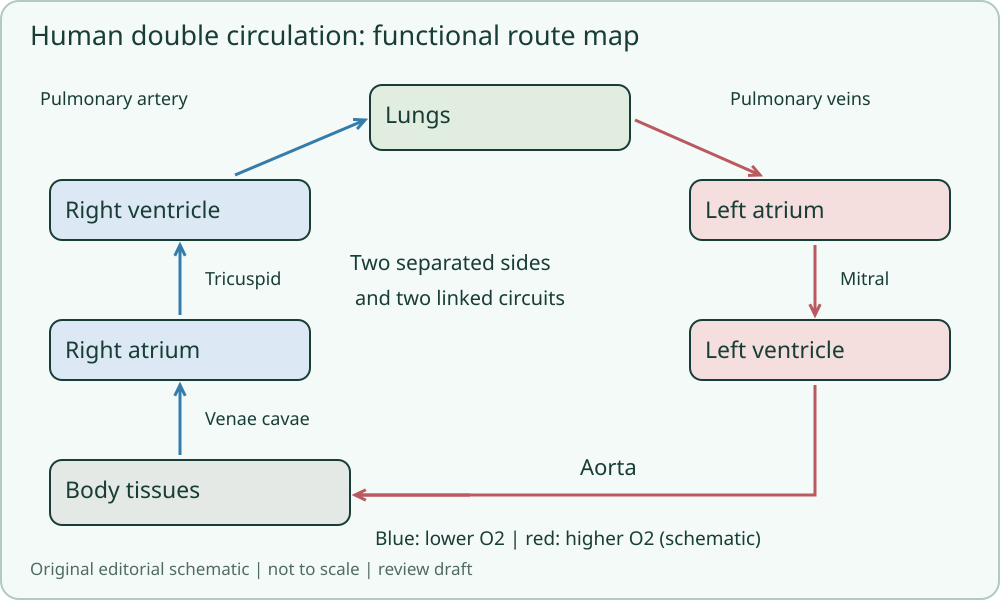
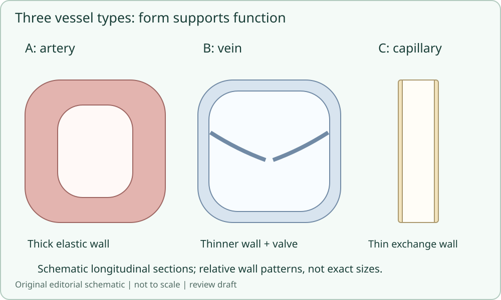
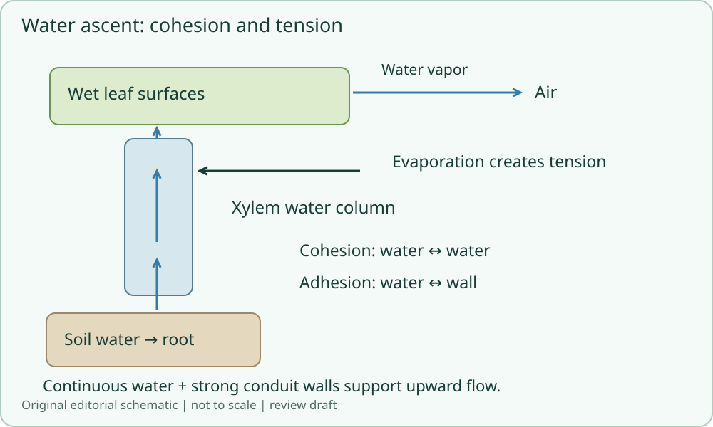

# ৬ষ্ঠ অধ্যায়: জীবে পরিবহণ

> উত্তরসহ পর্যালোচনাধীন খসড়া; নির্ধারিত সংখ্যার উত্তরসহ খসড়া সম্পূর্ণ; বিষয়বস্তু পর্যালোচনা বাকি।
> মূল বই ও বিষয়বিশেষজ্ঞের পূর্ণ যাচাই বাকি। বোর্ড/স্কুল/সাল দাবি নেই।

## rebuild-mcq.json

### MCQ 1

কোন শ্বেতকণিকা ফ্যাগোসাইটোসিসে সুপরিচিত?

A. সিভকোষ
B. নিউট্রোফিল
C. পরিণত RBC
D. অণুচক্রিকা

উত্তর: B — নিউট্রোফিল
নিউট্রোফিল দানাযুক্ত প্রতিরক্ষাকারী কোষ।

### MCQ 2

অ্যান্টিবডি নিঃসরণকারী প্লাজমা কোষ কোন বংশের?

A. B-লিম্ফোসাইট
B. মেগাকারিওসাইট
C. সঙ্গীকোষ
D. লোহিতকণিকা

উত্তর: A — B-লিম্ফোসাইট
সব লিম্ফোসাইট একইভাবে অ্যান্টিবডি বানায় না।

### MCQ 3

মানব অণুচক্রিকা সম্পর্কে সঠিকটি কোনটি?

A. মেগাকারিওসাইটের কোষখণ্ড
B. উদ্ভিদের পরিবহনকোষ
C. প্রধান O2 বাহক
D. সবসময় নিউক্লিয়াসযুক্ত পূর্ণ কোষ

উত্তর: A — মেগাকারিওসাইটের কোষখণ্ড
নিউক্লিয়াসবিহীন হলেও কিছু অঙ্গাণু থাকে।

### MCQ 4

ক্ষতস্থানে অণুচক্রিকার প্রথমদিকের অবদান কী?

A. শুধু অ্যান্টিবডি নিঃসরণ
B. ফুসফুসে O2 তৈরি
C. আঠালো হয়ে প্লাগ গঠনে সহায়তা
D. কেবল লৌহ সঞ্চয়

উত্তর: C — আঠালো হয়ে প্লাগ গঠনে সহায়তা
প্লেটলেট প্লাগ ও তঞ্চন একসঙ্গে রক্তক্ষয় কমায়।

### MCQ 5

থ্রমবিন কোন রূপান্তরে কাজ করে?

A. অ্যালবুমিন→লোহা
B. ফাইব্রিন→গ্লুকোজ
C. হিমোগ্লোবিন→সুক্রোজ
D. ফাইব্রিনোজেন→ফাইব্রিন

উত্তর: D — ফাইব্রিনোজেন→ফাইব্রিন
অদ্রবণীয় ফাইব্রিন জাল clot-কে স্থিতি দেয়।

### MCQ 6

তঞ্চনের সঙ্গে কোন আয়ন গুরুত্বপূর্ণ?

A. শুধু Mg2+
B. শুধু I−
C. Ca2+
D. শুধু Fe3+

উত্তর: C — Ca2+
ক্যালসিয়াম একাধিক তঞ্চনধাপে অংশ নেয়।

### MCQ 7

প্লেটলেট কমলে কোন ঝুঁকি বাড়তে পারে?

A. রক্তক্ষরণ
B. পাতায় জলক্ষয়
C. সরাসরি বেশি O2 বহন
D. সবসময় বেশি অ্যান্টিবডি

উত্তর: A — রক্তক্ষরণ
সংখ্যা ও কাজ উভয় গুরুত্বপূর্ণ; নিজে রোগনির্ণয় নয়।

### MCQ 8

জীবাণুপ্রতিরোধ ও তঞ্চন কি একই কাজ?

A. হ্যাঁ, দুটিই শুধু পানি
B. না, ভিন্ন উপাদানের পৃথক প্রধান কাজ
C. না, রক্তে কোনো প্রতিরক্ষা নেই
D. হ্যাঁ, দুটিই শুধু RBC

উত্তর: B — না, ভিন্ন উপাদানের পৃথক প্রধান কাজ
সহযোগিতা থাকলেও প্রক্রিয়া এক নয়।

### MCQ 9

ABO অ্যান্টিজেন সাধারণত কোথায় চিহ্নিত করা হয়?

A. কেবল প্লাজমার পানিতে
B. RBC-পৃষ্ঠে
C. শুধু প্লেটলেটের নিউক্লিয়াসে
D. শুধু হিমের কেন্দ্রে

উত্তর: B — RBC-পৃষ্ঠে
অ্যান্টিজেন ও প্লাজমার অ্যান্টিবডির অবস্থান পৃথক।

### MCQ 10

A গ্রুপের সাধারণ ABO বিন্যাস কোনটি?

A. কোনো A/B অ্যান্টিজেন ও অ্যান্টিবডি নেই
B. A অ্যান্টিজেন ও anti-B
C. A ও B অ্যান্টিজেন ও দুটো অ্যান্টিবডি
D. B অ্যান্টিজেন ও anti-A

উত্তর: B — A অ্যান্টিজেন ও anti-B
এটি প্রচলিত ABO মডেল; বাস্তবে পরীক্ষাগার যাচাই দরকার।

### MCQ 11

B গ্রুপের রসে সাধারণত কোন ABO অ্যান্টিবডি থাকে?

A. anti-D জন্ম থেকেই সবার
B. anti-A
C. শুধু হিমোগ্লোবিন
D. anti-B

উত্তর: B — anti-A
নিজের B অ্যান্টিজেনের বিরুদ্ধে সাধারণত anti-B থাকে না।

### MCQ 12

AB গ্রুপের RBC-তে কোন ABO অ্যান্টিজেন থাকে?

A. A ও B
B. শুধু A
C. শুধু B
D. কোনোটিই নয়

উত্তর: A — A ও B
A/B উভয় পৃষ্ঠচিহ্ন থাকে।

### MCQ 13

O গ্রুপের রসে সাধারণ ABO অ্যান্টিবডি কী?

A. শুধু anti-B
B. anti-A ও anti-B
C. কোনোটিই নয়
D. শুধু anti-A

উত্তর: B — anti-A ও anti-B
O-তে A/B অ্যান্টিজেন নেই; সব অ্যান্টিজেন নেই নয়।

### MCQ 14

O রক্তে কোনো অ্যান্টিজেনই নেই—দাবি ভুল কেন?

A. O-র সব RBC ঝিল্লিহীন
B. O-তে অবশ্যই B থাকে
C. কথাটি শুধু A/B অনুপস্থিতির ক্ষেত্রে প্রযোজ্য
D. O-তে অবশ্যই A থাকে

উত্তর: C — কথাটি শুধু A/B অনুপস্থিতির ক্ষেত্রে প্রযোজ্য
অন্য রক্তগোষ্ঠীর অ্যান্টিজেন থাকতে পারে।

### MCQ 15

শুধু ABO ধরে A গ্রহীতার packed RBC-এর উপযোগী দল কোনটি?

A. B বা AB
B. সব চারটি
C. A বা O
D. শুধু AB

উত্তর: C — A বা O
এটি তাত্ত্বিক কোষসামঞ্জস্য, transfusion অনুমোদন নয়।

### MCQ 16

শুধু ABO ধরে B গ্রহীতাকে A RBC দিলে মূল সমস্যা কী?

A. গ্রহীতার anti-B নিজের কোষ ভাঙে
B. পানি অভিস্রবণে কেবল বাষ্প হয়
C. গ্রহীতার anti-A দাতার কোষে বিক্রিয়া করতে পারে
D. রক্ত সবসময় বেশি O2 পায়

উত্তর: C — গ্রহীতার anti-A দাতার কোষে বিক্রিয়া করতে পারে
অসামঞ্জস্যে agglutination ও haemolysis হতে পারে।

### MCQ 17

শুধু ABO ধরে O গ্রহীতার RBC গ্রহণের সীমা কী?

A. শুধু AB RBC
B. সব RBC
C. O RBC
D. A ও B RBC

উত্তর: C — O RBC
রসে উভয় ABO অ্যান্টিবডি থাকায় সীমা আসে।

### MCQ 18

শুধু ABO মডেলে AB গ্রহীতার বিস্তৃত RBC গ্রহণক্ষমতার কারণ কী?

A. রসে সাধারণত anti-A ও anti-B নেই
B. সব রক্ত জীবাণুমুক্ত
C. RBC-তে কোনো অ্যান্টিজেন নেই
D. Rh পরীক্ষা অপ্রয়োজনীয়

উত্তর: A — রসে সাধারণত anti-A ও anti-B নেই
গ্রুপের তাত্ত্বিক নিয়ম পূর্ণ নিরাপত্তা নয়।

### MCQ 19

Rh-পজিটিভ বলতে প্রচলিতভাবে কী বোঝায়?

A. D অ্যান্টিজেনের উপস্থিতি
B. বেশি হিমোগ্লোবিন
C. অ্যান্টিবডি A-এর উপস্থিতি
D. উচ্চ রক্তচাপ

উত্তর: A — D অ্যান্টিজেনের উপস্থিতি
D উপস্থিতি ও সুস্থতার মান এক নয়।

### MCQ 20

Rh-নেগেটিভ ব্যক্তির anti-D জন্ম থেকেই থাকবেই—দাবি কেমন?

A. ভুল; সংস্পর্শে sensitization হতে পারে
B. সঠিক; সবার একই
C. ভুল; anti-D কখনও তৈরি হয় না
D. সঠিক; ABO-ই anti-D

উত্তর: A — ভুল; সংস্পর্শে sensitization হতে পারে
Rh অ্যান্টিবডি ও ABO অ্যান্টিবডির সাধারণ ইতিহাস ভিন্ন।

### MCQ 21

সাধারণ জরুরি RBC মডেলে O−-কে বিস্তৃত দাতা বলা হয় কেন?

A. crossmatch লাগে না
B. সব প্লাজমাও সবার উপযোগী
C. সব সংক্রমণ অনুপস্থিত
D. A/B ও D অনুপস্থিতির সুবিধা

উত্তর: D — A/B ও D অনুপস্থিতির সুবিধা
এটি red-cell প্রেক্ষাপট; নিরাপদ সঞ্চালন পেশাদারের কাজ।

### MCQ 22

AB প্লাজমা ও O RBC-এর নিয়ম একই নয় কেন?

A. AB রক্ত সবসময় সম্পূর্ণ নিরাপদ
B. প্লাজমায় কখনও অ্যান্টিবডি নেই
C. O RBC-তে সব অ্যান্টিজেন থাকে
D. অ্যান্টিবডি বনাম কোষের অ্যান্টিজেন বিবেচনা পাল্টায়

উত্তর: D — অ্যান্টিবডি বনাম কোষের অ্যান্টিজেন বিবেচনা পাল্টায়
রক্তের উপাদানভেদে সামঞ্জস্যের নিয়ম আলাদা।

### MCQ 23

দাতা-গ্রহীতার একই ABO/Rh হলেও কী প্রয়োজন?

A. শুধু পালস দেখা
B. শুধু দাতার ছবি
C. শুধু রক্তের রং
D. সামঞ্জস্য পরীক্ষা ও সংক্রমণ screening

উত্তর: D — সামঞ্জস্য পরীক্ষা ও সংক্রমণ screening
অন্য অ্যান্টিজেন ও সংক্রমণের ঝুঁকি থাকে।

### MCQ 24

রক্তদানযোগ্যতা কার সিদ্ধান্তে নির্ধারিত হবে?

A. একই মাত্রা সবার
B. সব স্কুলশিক্ষার্থী বাধ্যতামূলক
C. অনুমোদিত কেন্দ্রের স্বাস্থ্যপরীক্ষা ও স্থানীয় নিয়মে
D. শুধু বন্ধুর কথায়

উত্তর: C — অনুমোদিত কেন্দ্রের স্বাস্থ্যপরীক্ষা ও স্থানীয় নিয়মে
বয়স, ভর, হিমোগ্লোবিন ও স্বাস্থ্যাবস্থা প্রাসঙ্গিক।

### MCQ 25

রক্তদানের সামাজিক দায়িত্বের সঙ্গে কোনটি সঙ্গত?

A. দাতার স্বাস্থ্য গোপন করে যোগ্যতা দেখানো
B. জোর করে দান
C. স্বেচ্ছাসম্মতি ও গোপনীয়তা
D. অপরীক্ষিত ঘরোয়া সঞ্চালন

উত্তর: C — স্বেচ্ছাসম্মতি ও গোপনীয়তা
সহায়তা নিরাপদ ও সম্মানজনক হতে হবে।

### MCQ 26

মানব হৃৎপিণ্ডে প্রকোষ্ঠসংখ্যা কত?

A. 5
B. 2
C. 4
D. 3

উত্তর: C — 4
দুটি অলিন্দ ও দুটি নিলয় থাকে।

### MCQ 27

হৃৎপিণ্ডের অবস্থানের যথার্থ সাধারণ বর্ণনা কোনটি?

A. উদরগহ্বরে পাকস্থলীর ভিতরে
B. পুরোটাই বাম ফুসফুসে
C. বক্ষে দুই ফুসফুসের মাঝে, কিছুটা বামাভিমুখী
D. ডান কাঁধে

উত্তর: C — বক্ষে দুই ফুসফুসের মাঝে, কিছুটা বামাভিমুখী
এটি মধ্যবক্ষের mediastinum অঞ্চলে।

### MCQ 28

হৃৎপিণ্ড ঘিরে থাকা থলির নাম কী?

A. প্লুরার গহ্বর
B. পেরিকার্ডিয়াম
C. পেরিটোনিয়াম
D. এন্ডোথেলিয়াম

উত্তর: B — পেরিকার্ডিয়াম
পেরিকার্ডিয়াম ও হৃদপ্রাচীরের সব স্তর অভিন্ন নয়।

### MCQ 29

সংকোচনক্ষম প্রধান হৃদপ্রাচীরস্তর কোনটি?

A. কিউটিকল
B. মায়োকার্ডিয়াম
C. অন্তঃত্বক
D. এন্ডোকার্ডিয়াম

উত্তর: B — মায়োকার্ডিয়াম
এতে হৃৎপেশি প্রধান।

### MCQ 30

হৃদপ্রকোষ্ঠের ভিতরের আবরণ কোনটি?

A. এপিকার্ডিয়াম
B. বহিঃত্বক
C. পেরিকার্ডিয়াল তরল
D. এন্ডোকার্ডিয়াম

উত্তর: D — এন্ডোকার্ডিয়াম
অন্তরাবরণ মসৃণ রক্তসংস্পর্শী পৃষ্ঠ দেয়।

### MCQ 31

পেরিকার্ডিয়াল তরলের একটি কাজ কী?

A. সুক্রোজ পরিবহণ
B. O2 তৈরির প্রধান উৎস
C. রক্তগোষ্ঠী নির্ধারণ
D. স্পন্দনে ঘর্ষণ কমানো

উত্তর: D — স্পন্দনে ঘর্ষণ কমানো
যান্ত্রিক সুরক্ষায় তরল সহায়ক।

### MCQ 32

অলিন্দের প্রধান ভূমিকা কী?

A. সরাসরি সব রক্তকে মহাধমনিতে পাঠানো
B. ফিরে আসা রক্ত গ্রহণ
C. পিত্তসঞ্চয়
D. মূত্র তৈরি

উত্তর: B — ফিরে আসা রক্ত গ্রহণ
অলিন্দ থেকে রক্ত নিলয়ে যায়।

### MCQ 33

নিলয়ের প্রধান পাম্পিং কাজ কী?

A. হৃদযন্ত্র থেকে রক্ত ধমনিতে পাঠানো
B. RBC পরিপক্ব করা
C. অ্যান্টিবডি তৈরি
D. সব রক্ত শিরা থেকে নেওয়ামাত্র

উত্তর: A — হৃদযন্ত্র থেকে রক্ত ধমনিতে পাঠানো
দুটি নিলয় দুই সার্কিটে রক্ত পাঠায়।

### MCQ 34

বাম নিলয়ের প্রাচীর বেশি পুরু কেন?

A. এতে কোনো কপাটিকা নেই
B. এতে সবসময় বেশি CO2
C. সিস্টেমিক সার্কিটে বেশি চাপ তৈরির প্রয়োজন
D. এটি শুধু রক্ত গ্রহণ করে

উত্তর: C — সিস্টেমিক সার্কিটে বেশি চাপ তৈরির প্রয়োজন
শুধু দূরত্ব নয়, সার্কিটের প্রতিরোধ ও চাপের চাহিদা গুরুত্বপূর্ণ।

### MCQ 35

ডান অলিন্দে প্রধানত কোন নালি রক্ত আনে?

A. পালমোনারি শিরা
B. মহাধমনি
C. পালমোনারি ধমনি
D. মহাশিরাদ্বয়

উত্তর: D — মহাশিরাদ্বয়
উপর ও নিচের দেহাংশের রক্ত vena cava দিয়ে ফেরে।

### MCQ 36

ফুসফুস থেকে রক্ত কোন প্রকোষ্ঠে ফেরে?

A. ডান নিলয়
B. বাম অলিন্দ
C. ডান অলিন্দ
D. বাম নিলয় সরাসরি

উত্তর: B — বাম অলিন্দ
পালমোনারি শিরা বাম অলিন্দে খোলে।

### MCQ 37

ট্রাইকাসপিড ভালভের অবস্থান কোথায়?

A. ডান অলিন্দ-ডান নিলয়ের মাঝে
B. মহাধমনির মুখে
C. পালমোনারি শিরার শেষে
D. বাম অলিন্দ-বাম নিলয়ের মাঝে

উত্তর: A — ডান অলিন্দ-ডান নিলয়ের মাঝে
ডান AV ভালভ রক্তের উল্টো চলন ঠেকায়।

### MCQ 38

মাইট্রাল ভালভের আরেক নাম কী?

A. পালমোনারি ভালভ
B. বাইকাসপিড ভালভ
C. ট্রাইকাসপিড ভালভ
D. অর্টিক ভালভ

উত্তর: B — বাইকাসপিড ভালভ
এটি বাম অলিন্দ ও নিলয়ের মাঝে।

### MCQ 39

অর্ধচন্দ্রাকার ভালভ কোথায় থাকে?

A. দুই অলিন্দের মাঝের পর্দায়
B. শুধু মহাশিরার শেষে
C. মহাধমনি ও পালমোনারি ধমনির গোড়ায়
D. প্রতিটি কৈশিকের মাঝখানে

উত্তর: C — মহাধমনি ও পালমোনারি ধমনির গোড়ায়
নিলয়ে রক্তের প্রত্যাবর্তন ঠেকায়।

### MCQ 40

আন্তঃনিলয় পর্দার গুরুত্বপূর্ণ ফল কী?

A. হিমোগ্লোবিন তৈরি
B. ফুসফুসের গ্যাস তৈরি
C. দুই নিলয়ের রক্ত পৃথক রাখা
D. প্রতিবার সব রক্ত মেশানো

উত্তর: C — দুই নিলয়ের রক্ত পৃথক রাখা
স্বাভাবিক গঠনে দুই সার্কিট আলাদা থাকে।

### MCQ 41

ফুসফুসীয় ধমনি কোথা থেকে বের হয়?

A. ডান অলিন্দ
B. বাম অলিন্দ
C. ডান নিলয়
D. বাম নিলয়

উত্তর: C — ডান নিলয়
এতে তুলনামূলক O2-স্বল্প রক্ত ফুসফুসে যায়।

### MCQ 42

মহাধমনিতে রক্ত সরাসরি কোন প্রকোষ্ঠ থেকে যায়?

A. বাম অলিন্দ
B. ডান নিলয়
C. বাম নিলয়
D. ডান অলিন্দ

উত্তর: C — বাম নিলয়
সিস্টেমিক সার্কিটের প্রধান নির্গমনপথ।

### MCQ 43

ফুসফুসীয় শিরার রক্তের সাধারণ বৈশিষ্ট্য কী?

A. একেবারে O2-শূন্য
B. শুধু লসিকা
C. সর্বদা ইউরিয়ামুক্ত
D. তুলনামূলক অক্সিজেনসমৃদ্ধ

উত্তর: D — তুলনামূলক অক্সিজেনসমৃদ্ধ
শিরা মানেই O2-স্বল্প নয়।

### MCQ 44

হৃৎপিণ্ড→ফুসফুস→হৃৎপিণ্ড কোন সার্কিট?

A. সিস্টেমিক
B. পোর্টালমাত্র
C. পালমোনারি
D. করোনারিমাত্র

উত্তর: C — পালমোনারি
ফুসফুসীয় সার্কিটে গ্যাসবিনিময় হয়।

### MCQ 45

মানুষের দ্বৈত সংবহনের অর্থ কী?

A. পূর্ণ পরিক্রমায় রক্ত দুবার হৃৎপিণ্ডে আসে
B. রক্ত কেবল দুই অঙ্গে যায়
C. দুটি পৃথক হৃৎপিণ্ড
D. একই নালিতে সবসময় দুদিকের সমান প্রবাহ

উত্তর: A — পূর্ণ পরিক্রমায় রক্ত দুবার হৃৎপিণ্ডে আসে
পালমোনারি ও সিস্টেমিক সার্কিট ধারাবাহিক।

### MCQ 46

করোনারি ধমনির প্রধান কাজ কী?

A. ফুসফুসে বায়ু ঢোকানো
B. শুধু অলিন্দের খোলস তৈরি
C. হৃৎপেশিতে রক্ত সরবরাহ
D. শুধু পিত্ত পরিবহণ

উত্তর: C — হৃৎপেশিতে রক্ত সরবরাহ
হৃদযন্ত্রের নিজস্ব পেশিরও O2 ও পুষ্টি প্রয়োজন।

### MCQ 47

হৃৎপিণ্ডে রক্ত আছে বলেই করোনারি পথ অপ্রয়োজনীয় নয় কেন?

A. অলিন্দে রক্ত থাকে না
B. প্রাচীরের গভীর পেশির পৃথক কৈশিক সরবরাহ দরকার
C. মায়োকার্ডিয়াম মৃত
D. রক্ত নিজে O2 বানায়

উত্তর: B — প্রাচীরের গভীর পেশির পৃথক কৈশিক সরবরাহ দরকার
প্রকোষ্ঠের রক্ত সব পেশিকে সরাসরি যথেষ্ট যোগান দেয় না।

### MCQ 48

সিস্টোল শব্দের অর্থ কী?

A. সংকোচন পর্যায়
B. রক্তজমাট
C. শিথিলন পর্যায়মাত্র
D. বাষ্পীভবন

উত্তর: A — সংকোচন পর্যায়
কোন প্রকোষ্ঠের সিস্টোল তা প্রসঙ্গে স্পষ্ট করা দরকার।

### MCQ 49

ডায়াস্টোলের মূল ধারণা কী?

A. শুধু রক্তবর্জন
B. কেবল তঞ্চন
C. শিথিলন ও ভরার পর্যায়
D. সব হৃদক্রিয়া স্থায়ী বন্ধ

উত্তর: C — শিথিলন ও ভরার পর্যায়
চাপ-ভরাটের সঙ্গে সংকোচনের পর্যায়ক্রম আছে।

### MCQ 50

নিলয়ের চাপ অলিন্দের চেয়ে বাড়লে AV ভালভের কী ঘটে?

A. সর্বদা খোলে
B. বন্ধ হয়
C. হিমোগ্লোবিন ছাড়ে
D. ধমনি হয়ে যায়

উত্তর: B — বন্ধ হয়
চাপের পার্থক্য কপাটিকার চলন নিয়ন্ত্রণ করে।

### MCQ 51

নিলয়ের চাপ নির্গামী ধমনির চেয়ে বাড়লে কোনটি খুলতে পারে?

A. অর্ধচন্দ্রাকার ভালভ
B. পেরিকার্ডিয়াম
C. আন্তঃনিলয় পর্দা
D. দুই AV ভালভ একসঙ্গে

উত্তর: A — অর্ধচন্দ্রাকার ভালভ
রক্ত বের হওয়ার জন্য উপযুক্ত চাপপার্থক্য দরকার।

### MCQ 52

স্বাভাবিক প্রথম হৃদশব্দ প্রধানত কোন বন্ধের সঙ্গে যুক্ত?

A. সব কৈশিক
B. শুধু রক্তকোষ
C. পালমোনারি শিরা
D. AV ভালভ

উত্তর: D — AV ভালভ
প্রথম শব্দকে সংক্ষেপে lub বলা হয়।

### MCQ 53

স্বাভাবিক দ্বিতীয় হৃদশব্দের মূল যোগ কী?

A. মহাশিরা সৃষ্টি
B. সিভপাতা বন্ধ
C. সব অলিন্দ ফেটে যাওয়া
D. অর্ধচন্দ্রাকার ভালভ বন্ধ

উত্তর: D — অর্ধচন্দ্রাকার ভালভ বন্ধ
দ্বিতীয় শব্দ dub হিসেবে পরিচিত।

### MCQ 54

স্বাভাবিক হৃদছন্দের প্রাথমিক পেসমেকার কোনটি?

A. SA node
B. সিভনল
C. প্লেটলেট
D. অর্টিক ভালভ

উত্তর: A — SA node
ডান অলিন্দের বিশেষ কোষ বৈদ্যুতিক ছন্দ শুরু করে।

### MCQ 55

ECG মূলত কী রেকর্ড করে?

A. সরাসরি সব নালির ছবি
B. হৃদযন্ত্রের বৈদ্যুতিক কার্যকলাপ
C. কেবল কোলেস্টেরলের ভর
D. রক্তের ABO অ্যান্টিজেন

উত্তর: B — হৃদযন্ত্রের বৈদ্যুতিক কার্যকলাপ
বৈদ্যুতিক সংকেত ও পাম্পের যান্ত্রিক ফল পৃথক।

### MCQ 56

ধমনি চেনার সংজ্ঞাগত ভিত্তি কী?

A. হৃৎপিণ্ড থেকে রক্ত বহন
B. সবসময় কপাটিকাযুক্ত
C. সবসময় O2-সমৃদ্ধ
D. সবসময় ত্বকের নিচে দৃশ্যমান

উত্তর: A — হৃৎপিণ্ড থেকে রক্ত বহন
দিক দিয়ে সংজ্ঞা; অক্সিজেন দিয়ে নয়।

### MCQ 57

শিরা চেনার সংজ্ঞাগত ভিত্তি কী?

A. হৃৎপিণ্ডের দিকে রক্ত আনা
B. সবসময় সবচেয়ে পুরু প্রাচীর
C. সবসময় নীল রক্ত
D. সবসময় O2-শূন্য

উত্তর: A — হৃৎপিণ্ডের দিকে রক্ত আনা
ফুসফুসীয় শিরা সংজ্ঞার ব্যতিক্রম নয়।

### MCQ 58

ধমনিতে পুরু স্থিতিস্থাপক প্রাচীরের সুবিধা কী?

A. সব পুষ্টি সরাসরি ভেতরে তৈরি
B. রক্তের গ্রুপ বদল
C. চাপ সহ্য ও স্থিতিস্থাপক প্রত্যাবর্তন
D. ভিলাস গঠন

উত্তর: C — চাপ সহ্য ও স্থিতিস্থাপক প্রত্যাবর্তন
পাম্পের স্পন্দিত চাপ সামলাতে সহায়ক।

### MCQ 59

অনেক শিরায় কপাটিকা দরকার কেন?

A. সমস্ত শিরা বন্ধ রাখতে
B. RBC বানাতে
C. রক্তের O2 সব ধ্বংস করতে
D. নিম্নচাপে বিপরীত প্রবাহ কমাতে

উত্তর: D — নিম্নচাপে বিপরীত প্রবাহ কমাতে
পেশির চাপের সঙ্গে একমুখী প্রবাহে সহায়তা করে।

### MCQ 60

কৈশিকের পাতলা দেয়াল কী সুবিধা দেয়?

A. স্বল্প দূরত্বে বিনিময়
B. রক্তকোষ উৎপাদন
C. সব অ্যান্টিজেন অপসারণ
D. সর্বোচ্চ পাম্পিং বল

উত্তর: A — স্বল্প দূরত্বে বিনিময়
আবরণীর বৈশিষ্ট্য ও পদার্থভেদে প্রবেশযোগ্যতা ভিন্ন।

### MCQ 61

কৈশিকবিছানায় গড় বেগ কম হওয়ার কারণের একটি কী?

A. হৃৎপিণ্ড সেখানে নেই বলে চাপ শূন্য
B. সম্মিলিত প্রস্থচ্ছেদ বড়
C. প্রতিটি নালি সবচেয়ে মোটা
D. রক্ত একেবারে গতিহীন

উত্তর: B — সম্মিলিত প্রস্থচ্ছেদ বড়
মোট ক্ষেত্র ও একটি নালির ব্যাস এক বিষয় নয়।

### MCQ 62

ধমনিকা সংকুচিত হলে স্থানীয় প্রতিরোধ সাধারণত কী হয়?

A. সবসময় কমে
B. শূন্য হয়
C. কোনো প্রভাব নেই
D. বাড়ে

উত্তর: D — বাড়ে
একই চাপপার্থক্যে প্রবাহ কমতে পারে।

### MCQ 63

লসিকাতন্ত্রের একটি পরিবহন কাজ কী?

A. সরাসরি RBC-র সব O2 তৈরি
B. ধমনিকে জাইলেম করা
C. শুধু পিত্ত জমা
D. টিস্যুর অতিরিক্ত তরল রক্তে ফেরানো

উত্তর: D — টিস্যুর অতিরিক্ত তরল রক্তে ফেরানো
লসিকা তরলভারসাম্য ও প্রতিরক্ষায় যুক্ত।

### MCQ 64

অন্ত্রের ল্যাকটিয়াল কোন পরিবহণে গুরুত্বপূর্ণ?

A. শোষিত দীর্ঘ-শৃঙ্খল চর্বির প্যাকেট
B. কেবল অক্ষত স্টার্চ
C. শুধু O2
D. শুধু ইউরিয়া

উত্তর: A — শোষিত দীর্ঘ-শৃঙ্খল চর্বির প্যাকেট
কাইলোমাইক্রন প্রথমে লসিকায় যেতে পারে।

### MCQ 65

রক্তচাপের প্রচলিত একক কোনটি?

A. mmHg
B. kcal/g
C. g/min
D. beats/L

উত্তর: A — mmHg
এটি চাপের একক, পালসের নয়।

### MCQ 66

120/80 mmHg-এ প্রথম সংখ্যাটি কী?

A. পালস রেট
B. হিমোগ্লোবিনের শতাংশ
C. ডায়াস্টোলিক চাপ
D. সিস্টোলিক চাপ

উত্তর: D — সিস্টোলিক চাপ
দ্বিতীয়টি ডায়াস্টোলিক চাপ।

### MCQ 67

120/80-এর pulse pressure কত?

A. 200 mmHg
B. 80 beats/min
C. 40 mmHg
D. 1.5 mmHg

উত্তর: C — 40 mmHg
সিস্টোলিক থেকে ডায়াস্টোলিক বিয়োগ।

### MCQ 68

পালস গণনায় 30 সেকেন্ডে 36টি নিয়মিত স্পন্দন হলে হার কত?

A. 108/min
B. 72/min
C. 36/min
D. 18/min

উত্তর: B — 72/min
হার=36×60/30=72; অনিয়মে দীর্ঘ পর্যবেক্ষণ দরকার।

### MCQ 69

প্রতি বিটে 70 mL ও মিনিটে 70 বিট হলে cardiac output কত?

A. 49 L/min
B. 4.9 L/min
C. 140 L/min
D. 1 L/min

উত্তর: B — 4.9 L/min
70×70=4900 mL/min।

### MCQ 70

একই হারেও cardiac output ভিন্ন হতে পারে কেন?

A. stroke volume ভিন্ন
B. ABO সবসময় ভিন্ন
C. পালসের রং আলাদা
D. ধমনি সবসময় বন্ধ

উত্তর: A — stroke volume ভিন্ন
হার ও প্রতি বিটের আয়তনের গুণফল বিবেচ্য।

### MCQ 71

ব্যায়ামের পর স্বাভাবিকভাবে পালস বাড়তে পারে কেন?

A. RBC মুহূর্তে দ্বিগুণ হয়
B. রক্তের গ্রুপ বদলায়
C. সবসময় হার্ট অ্যাটাক
D. কাজের টিস্যুর যোগান চাহিদা বাড়ে

উত্তর: D — কাজের টিস্যুর যোগান চাহিদা বাড়ে
শারীরবৃত্তীয় অভিযোজনকে একা রোগ বলা নয়।

### MCQ 72

বিশ্রামের BP মাপার আগে শান্ত বসা কেন জরুরি?

A. সাময়িক উত্তেজনার প্রভাব কমাতে
B. রক্তের রং বাড়াতে
C. সব চাপ শূন্য করতে
D. অ্যান্টিবডি দূর করতে

উত্তর: A — সাময়িক উত্তেজনার প্রভাব কমাতে
মানক শর্তে তুলনা অর্থপূর্ণ।

### MCQ 73

BP মাপে বাহু সমর্থন করে হৃদসমতলে রাখা কেন সহায়ক?

A. মস্তিষ্কে O2 বন্ধ করতে
B. উচ্চতাজনিত চাপের ত্রুটি কমাতে
C. কেবল গ্রুপ শনাক্ত করতে
D. সব রক্ত জমাট করতে

উত্তর: B — উচ্চতাজনিত চাপের ত্রুটি কমাতে
পদ্ধতিগত অবস্থান ফলকে প্রভাবিত করে।

### MCQ 74

অনুপযুক্ত মাপের cuff কী সমস্যা করে?

A. অবশ্যই সঠিক ফল দেয়
B. শুধু O2 মাপে
C. ABO বদলে দেয়
D. পরিমাপে ত্রুটি আনতে পারে

উত্তর: D — পরিমাপে ত্রুটি আনতে পারে
যন্ত্র ও cuff-এর উপযোগিতা যাচাই প্রয়োজন।

### MCQ 75

একবার উচ্চ BP পেলেই স্থায়ী উচ্চরক্তচাপ নিশ্চিত নয় কেন?

A. পুনর্মাপ ও ক্লিনিক্যাল মূল্যায়ন প্রয়োজন
B. ডায়াস্টোলিক সবসময় শূন্য
C. সিস্টোলিক মান অর্থহীন
D. চাপ কখনও মাপা যায় না

উত্তর: A — পুনর্মাপ ও ক্লিনিক্যাল মূল্যায়ন প্রয়োজন
শর্ত, বয়স ও নির্দেশিকা অনুযায়ী মূল্যায়ন হয়।

### MCQ 76

উচ্চরক্তচাপে লক্ষণ নাও থাকতে পারে—তাৎপর্য কী?

A. শুধু মাথাব্যথাই পরীক্ষা
B. লক্ষণ না থাকলে ঝুঁকি নেই
C. পালসই BP-র পূর্ণ বিকল্প
D. উপযুক্ত নিয়মে চাপ মাপা দরকার

উত্তর: D — উপযুক্ত নিয়মে চাপ মাপা দরকার
উপসর্গের অনুপস্থিতি স্বাভাবিক চাপ নিশ্চিত করে না।

### MCQ 77

কিশোরের BP-তে প্রাপ্তবয়স্কের একটিমাত্র সীমা সরাসরি বসানো অনুচিত কেন?

A. সব যন্ত্র নিষিদ্ধ
B. কিশোরের BP শূন্য
C. বয়স ও উপযুক্ত শিশু-কিশোর মানদণ্ড লাগে
D. শিশুর ধমনি নেই

উত্তর: C — বয়স ও উপযুক্ত শিশু-কিশোর মানদণ্ড লাগে
এখানে ব্যক্তিগত রোগনির্ণয় শেখানো নয়।

### MCQ 78

কোলেস্টেরল দেহে কোথায় গুরুত্বপূর্ণ গাঠনিক ভূমিকা রাখে?

A. শুধু পত্ররন্ধ্রে
B. কোষঝিল্লিতে
C. মানুষের সেলুলোজ কোষপ্রাচীরে
D. শুধু ফাইব্রিনজালে

উত্তর: B — কোষঝিল্লিতে
মানবকোষে কোষপ্রাচীর নেই।

### MCQ 79

LDL ও HDL আসলে কী?

A. দুটি ভিন্ন মৌলের নাম
B. লিপোপ্রোটিন পরিবাহককণা
C. দুই রকম হিমোগ্লোবিন
D. দুই প্রকার RBC

উত্তর: B — লিপোপ্রোটিন পরিবাহককণা
কোলেস্টেরল বহনের প্রেক্ষিতে এ নাম ব্যবহৃত হয়।

### MCQ 80

অতিরিক্ত LDL-সম্পর্কিত প্রধান উদ্বেগ কী?

A. সবসময় বেশি O2 সৃষ্টি
B. ধমনিতে plaque-সংক্রান্ত ঝুঁকি
C. সব রক্তজমাট স্বাভাবিক
D. RBC-র সংখ্যা নিশ্চয় দ্বিগুণ

উত্তর: B — ধমনিতে plaque-সংক্রান্ত ঝুঁকি
ঝুঁকি মাত্রা ও সামগ্রিক অবস্থার সঙ্গে বিবেচ্য।

### MCQ 81

HDL-কে ভালো বললেও সীমাহীন বেশি মানেই সুরক্ষা নয় কেন?

A. কোলেস্টেরল দেহে লাগে না
B. একক মান পুরো ঝুঁকি নির্ধারণ করে না
C. HDL খাদ্যের এনজাইম
D. HDL-তে কখনও লিপিড নেই

উত্তর: B — একক মান পুরো ঝুঁকি নির্ধারণ করে না
প্রচলিত লেবেল জটিল বিপাকের সংক্ষিপ্ত রূপ।

### MCQ 82

ট্রাইগ্লিসারাইড ও কোলেস্টেরল সম্পর্কে সঠিকটি কী?

A. ভিন্ন ধরনের লিপিড
B. দুটিই রক্তকোষ
C. দুটিই একই লিপোপ্রোটিন
D. একই অণুর দুই বানান

উত্তর: A — ভিন্ন ধরনের লিপিড
সব রক্তের চর্বিকে কোলেস্টেরল বলা ভুল।

### MCQ 83

করোনারি প্রবাহে বাধা দীর্ঘ হলে কী ক্ষতি হতে পারে?

A. কেবল পাতার নেতানো
B. হৃৎপেশির O2 ঘাটতি ও কোষমৃত্যু
C. সব RBC অ্যান্টিবডি হয়
D. সবসময় বেশি কর্মক্ষমতা

উত্তর: B — হৃৎপেশির O2 ঘাটতি ও কোষমৃত্যু
এটি myocardial infarction-এর মূল কার্যকারণের সঙ্গে যুক্ত।

### MCQ 84

হার্ট অ্যাটাক ও cardiac arrest কি সমার্থক?

A. হ্যাঁ, দুটিই শুধু অ্যানিমিয়া
B. না, কখনও সম্পর্ক নেই
C. না, রক্তযোগানের বাধা ও কার্যকর পাম্পিং বন্ধ ভিন্ন
D. হ্যাঁ, দুটিই শুধু BP

উত্তর: C — না, রক্তযোগানের বাধা ও কার্যকর পাম্পিং বন্ধ ভিন্ন
একটি অন্যটির কারণ হতে পারে, কিন্তু ধারণা পৃথক।

### MCQ 85

স্ট্রোক শুধু মস্তিষ্কে রক্তক্ষরণ নয় কেন?

A. রক্তনালি বন্ধ হয়েও হতে পারে
B. সব স্ট্রোকে ধমনি তৈরি হয়
C. সব স্ট্রোক পিত্তের সমস্যা
D. মস্তিষ্কে রক্ত যায় না

উত্তর: A — রক্তনালি বন্ধ হয়েও হতে পারে
ইস্কেমিক ও রক্তক্ষরণজনিত দুটো প্রধান ধরন আছে।

### MCQ 86

হঠাৎ বুকের চাপ ও শ্বাসকষ্টে দায়িত্বশীল পদক্ষেপ কী?

A. বন্ধুর ওষুধ নেওয়া
B. নিশ্চিত গ্যাস ধরে অপেক্ষা
C. দ্রুত জরুরি স্বাস্থ্যসহায়তা
D. নিজে ব্যায়াম করে দেখা

উত্তর: C — দ্রুত জরুরি স্বাস্থ্যসহায়তা
সম্ভাব্য গুরুতর উপসর্গ অবহেলা নয়।

### MCQ 87

বাতজ্বর ও পরবর্তী ভালভক্ষতির গুরুত্বপূর্ণ যোগ কী?

A. কেবল আয়রন ঘাটতি
B. স্ট্রেপটোকক্কাল সংক্রমণের পর প্রতিরক্ষাগত প্রতিক্রিয়া
C. সব গলাব্যথাই নিশ্চিত বাতজ্বর
D. হৃৎপিণ্ডে সবসময় জীবাণুর সরাসরি বাসামাত্র

উত্তর: B — স্ট্রেপটোকক্কাল সংক্রমণের পর প্রতিরক্ষাগত প্রতিক্রিয়া
সঠিক মূল্যায়ন ও চিকিৎসা প্রয়োজন।

### MCQ 88

লিউকেমিয়ায় WBC বেশি হলেও সংক্রমণঝুঁকি বাড়তে পারে কেন?

A. অস্বাভাবিক কোষ কার্যকর প্রতিরক্ষা নাও দিতে পারে
B. সব RBC জীবাণু
C. অণুচক্রিকা O2 বন্ধ করে
D. সংখ্যা বেশি মানেই সবসময় শ্রেষ্ঠ কাজ

উত্তর: A — অস্বাভাবিক কোষ কার্যকর প্রতিরক্ষা নাও দিতে পারে
সংখ্যা ও কার্যকারিতা অভিন্ন নয়।

### MCQ 89

অস্থিমজ্জার অস্বাভাবিকতা একাধিক রক্তউপাদানে প্রভাব ফেলে কেন?

A. সব কোষ শুধু ফুসফুসে হয়
B. রক্তের কোনো পুনর্নবীকরণ নেই
C. প্লাজমা শুধু অস্থি
D. সেখানে বিভিন্ন কোষবংশ উৎপন্ন হয়

উত্তর: D — সেখানে বিভিন্ন কোষবংশ উৎপন্ন হয়
লোহিতকণিকা, শ্বেতকণিকা ও প্লেটলেট উৎপাদন সম্পর্কিত।

### MCQ 90

তামাক বর্জন ও নিয়মিত উপযোগী চলাফেরার লক্ষ্য কী?

A. হৃদ্‌রোগের পরিবর্তনযোগ্য ঝুঁকি কমানো
B. চিকিৎসার প্রয়োজন চিরতরে দূর
C. সব বংশগত ঝুঁকি মুছে দেওয়া
D. সব রোগ শতভাগ প্রতিরোধ

উত্তর: A — হৃদ্‌রোগের পরিবর্তনযোগ্য ঝুঁকি কমানো
ঝুঁকি কমানো নিশ্চয়তা নয়।

### MCQ 91

ডাক্তারের দেওয়া BP-ওষুধ ভালো বোধ হলেই নিজে বন্ধ করা ঠিক নয় কেন?

A. উপসর্গ ছাড়াও চাপ বেশি থাকতে পারে
B. BP কেবল অনুভূতি
C. ওষুধ থাকলে পরীক্ষা নিষিদ্ধ
D. সব ওষুধ একই

উত্তর: A — উপসর্গ ছাড়াও চাপ বেশি থাকতে পারে
পরিবর্তনের সিদ্ধান্ত চিকিৎসকের সঙ্গে নিতে হয়।

### MCQ 92

রক্তচাপ, পালস ও রক্তগোষ্ঠীকে এক রাশি বলা যায় না কেন?

A. সব শুধু বয়স
B. সব কেবল O2
C. চাপ, স্পন্দনহার ও অ্যান্টিজেনবিন্যাস ভিন্ন
D. সব একই এককে মাপে

উত্তর: C — চাপ, স্পন্দনহার ও অ্যান্টিজেনবিন্যাস ভিন্ন
পরিবহণতন্ত্রের বিভিন্ন পরিমাপ ভিন্ন তথ্য দেয়।

### MCQ 93

পাতার নিচে বেশি রন্ধ্র আছে—এমন প্রজাতিতে নিচে আবরণ দিলে কোন অনুমান যুক্তিযুক্ত?

A. সব বিপাক তাৎক্ষণিক শেষ
B. সব প্রজাতিতে ঠিক একই হ্রাস
C. পানি গ্রহণ নিশ্চিত দ্বিগুণ
D. জলক্ষয় কমতে পারে

উত্তর: D — জলক্ষয় কমতে পারে
রন্ধ্রবণ্টন ও আবরণের অন্য প্রভাব নিয়ন্ত্রণ করতে হবে।

### MCQ 94

একই 10 মিনিটে A-র 0.6 g ও B-র 0.4 g জলক্ষয়; ক্ষেত্র যথাক্রমে 30 ও 10 cm²। প্রতি ক্ষেত্রফলে বেশি কার?

A. B
B. A
C. তথ্য থেকে হার একেবারেই অজানা
D. সমান

উত্তর: A — B
A=0.002 ও B=0.004 g/cm²/min; মোট হার আর মানক হার পৃথক।

### MCQ 95

মূলের অন্তঃত্বকের কাসপারিয়ান ফিতা কী নিয়ন্ত্রণে সহায়ক?

A. প্রাচীরপথের প্রবাহকে নির্বাচক ঝিল্লিপথে আনা
B. সব পানি স্থায়ী বন্ধ
C. পাতার CO2 গ্রহণ
D. সব খনিজ নিজে তৈরি

উত্তর: A — প্রাচীরপথের প্রবাহকে নির্বাচক ঝিল্লিপথে আনা
অ্যাপোপ্লাস্ট বাধা শোষণের নির্বাচনকে সহায়তা করে।

### MCQ 96

একটি পাতা 100 একক জল নেয় এবং 92 একক হারায়। বাকি 8 একক নিয়ে নিশ্চিত কথা কী?

A. সব 8 এককই সালোকসংশ্লেষণে খরচ
B. সব 8 এককই চিনি
C. অন্য সব প্রবাহ শূন্য প্রমাণিত
D. শুধু দেওয়া জল-বাজেটে 8 একক অবশিষ্ট

উত্তর: D — শুধু দেওয়া জল-বাজেটে 8 একক অবশিষ্ট
শুধু বিয়োগে নির্দিষ্ট ব্যবহার জানা যায় না।

### MCQ 97

500 mL নমুনার 55% প্লাজমা ধরে প্লাজমার আয়তন কত?

A. 55 mL
B. 9.1 mL
C. 275 mL
D. 225 mL

উত্তর: C — 275 mL
500×0.55=275; এটি দেওয়া অনুপাতের হিসাব।

### MCQ 98

শরীরের কোষ থেকে তৈরি ইউরিয়া রক্তে কিডনিতে পৌঁছানো কোন ভূমিকা?

A. অক্সিজেন তৈরি
B. রক্তগোষ্ঠী নির্ধারণ
C. সরাসরি খাদ্য পরিপাক
D. বিপাকীয় বর্জ্য পরিবহণ

উত্তর: D — বিপাকীয় বর্জ্য পরিবহণ
রক্ত বর্জ্য বহন করে, সব বর্জ্য নিজে তৈরি করে না।

### MCQ 99

কৈশিকের বাইরে টিস্যুতরল মানেই রক্তক্ষরণ নয় কেন?

A. প্লাজমার কিছু তরল স্বাভাবিকভাবে বিনিময় করে
B. সব RBC সবসময় বের হয়
C. বদ্ধ সংবহনে কোনো বিনিময় নেই
D. সব টিস্যুতরল বিশুদ্ধ পানি

উত্তর: A — প্লাজমার কিছু তরল স্বাভাবিকভাবে বিনিময় করে
বদ্ধ প্রবাহ ও নির্বাচিত তরলবিনিময় সহাবস্থান করে।

### MCQ 100

হৃৎপিণ্ডের সংকোচন না থাকলেও ইলাস্টিক ধমনিতে কিছুক্ষণ প্রবাহ চলতে পারে কেন?

A. ধমনি নতুন রক্ত তৈরি করে
B. স্থিতিস্থাপক প্রত্যাবর্তনে চাপ বজায় থাকে
C. শিরা O2 বানায়
D. রক্তের ভর শূন্য

উত্তর: B — স্থিতিস্থাপক প্রত্যাবর্তনে চাপ বজায় থাকে
ডায়াস্টোলেও ধমনির recoil প্রবাহ মসৃণ করে।

### MCQ 101

উদ্ভিদের দূরবর্তী মূলে পাতার শর্করা পৌঁছানোর প্রধান কলা কোনটি?

A. কর্ক
B. ফ্লোয়েম
C. জাইলেম
D. কিউটিকল

উত্তর: B — ফ্লোয়েম
উৎপাদিত জৈব দ্রব্য ফ্লোয়েমে উৎস থেকে গ্রাহকে যায়।

### MCQ 102

মূল থেকে পাতায় পানি-খনিজের প্রধান দীর্ঘপথ কোনটি?

A. বহিঃত্বক
B. জাইলেম
C. মজ্জা
D. ফ্লোয়েম

উত্তর: B — জাইলেম
জাইলেম জলীয় রসের ঊর্ধ্বপরিবহণে প্রধান।

### MCQ 103

দেহ বড় হলে শুধু ব্যাপন যথেষ্ট দ্রুত নয় কেন?

A. সব পদার্থ গ্যাস হয়ে যায়
B. সব কোষের ঝিল্লি থাকে না
C. পানি তরল থাকে না
D. পরিবহণের দূরত্ব বেড়ে যায়

উত্তর: D — পরিবহণের দূরত্ব বেড়ে যায়
দীর্ঘ দূরত্বে বিশেষ পরিবহনব্যবস্থা কার্যকর।

### MCQ 104

শুষ্ক বীজ পানি নিয়ে স্ফীত হওয়ার প্রাথমিক প্রক্রিয়া কোনটি?

A. তঞ্চন
B. প্রস্বেদন
C. ইমবাইবিশন
D. পরিস্রবণ

উত্তর: C — ইমবাইবিশন
পানিপ্রিয় ম্যাট্রিক্স পানি শোষণ করে ফুলে ওঠে।

### MCQ 105

ইমবাইবিশনের উপযোগী পদার্থ কোনটি?

A. সেলুলোজ
B. মোম
C. তেল
D. রাবারের জলবিমুখ পৃষ্ঠ

উত্তর: A — সেলুলোজ
সেলুলোজ পানিপ্রিয় পদার্থ।

### MCQ 106

ব্যাপনে কোনো পদার্থের নিট চলনের সাধারণ দিক কী?

A. উচ্চ থেকে নিম্ন ঘনত্বে
B. শুধু অভিকর্ষের দিকে
C. সর্বদা নিম্ন থেকে উচ্চ ঘনত্বে
D. শুধু জীবন্ত কোষের দিকে

উত্তর: A — উচ্চ থেকে নিম্ন ঘনত্বে
এটি দৈব গতির সামগ্রিক ঘনত্বনির্ভর ফল।

### MCQ 107

ব্যাপন ও অভিস্রবণে কোন শর্ত শুধু দ্বিতীয়টির সংজ্ঞায় আবশ্যক?

A. নির্বাচনভেদ্য পর্দা
B. জীবন্ত নিউক্লিয়াস
C. সূর্যালোক
D. উচ্চ তাপ

উত্তর: A — নির্বাচনভেদ্য পর্দা
অভিস্রবণ নির্বাচক বাধা পেরিয়ে পানির চলন।

### MCQ 108

সমান চাপে পানিপারগম্য ঝিল্লির দুই পাশে পাতলা ও ঘন সুক্রোজ দ্রবণ। পানি নিট কোথায় যাবে?

A. শুধু নিচের দিকে
B. পাতলা থেকে ঘন দিকে
C. দুই দিকে শূন্য গতি
D. ঘন থেকে পাতলা দিকে

উত্তর: B — পাতলা থেকে ঘন দিকে
অন্য শর্ত সমান হলে ঘন দ্রবণের জলীয় বিভব কম।

### MCQ 109

অভিস্রবণে প্রধানত কোনটি ঝিল্লি পেরোয়?

A. কেবল সুক্রোজ
B. পানি
C. কেবল প্রোটিন
D. কেবল স্টার্চ

উত্তর: B — পানি
পানির চলনকে দ্রবের পরিবহণের সঙ্গে গুলিয়ে ফেলা নয়।

### MCQ 110

অভিস্রবণের সাম্যে কী থামে?

A. ঝিল্লির সব অস্তিত্ব
B. কেবল তাপের গতি
C. সব অণুর গতি
D. পানির নিট চলন

উত্তর: D — পানির নিট চলন
দুই দিকের অণুগতি চললেও নিট পরিবর্তন শূন্য হতে পারে।

### MCQ 111

চাপের পার্থক্য থাকলে শুধু দ্রবের ঘনত্বে পানির দিক বলা অসম্পূর্ণ কেন?

A. সব দ্রবণ সমান
B. মোট জলীয় বিভব বিবেচ্য
C. ঝিল্লি সবসময় বিলীন হয়
D. চাপ পানিকে প্রভাবিত করে না

উত্তর: B — মোট জলীয় বিভব বিবেচ্য
চাপ ও দ্রব উভয়েই পানির প্রবণতা বদলায়।

### MCQ 112

কৃত্রিম নির্বাচক ঝিল্লিতে অভিস্রবণ হলে কী প্রমাণিত হয়?

A. প্রক্রিয়াটি শুধু জীবন্ত কোষে সীমিত নয়
B. খনিজ সবসময় অণু হিসেবে ঢোকে
C. ATP সরাসরি সব পানি ঠেলে দেয়
D. নিউক্লিয়াস অপরিহার্য

উত্তর: A — প্রক্রিয়াটি শুধু জীবন্ত কোষে সীমিত নয়
অভিস্রবণ ভৌত নীতিতে ঘটে।

### MCQ 113

সমান পরিবেশে কাটা আলুর ভর বিশুদ্ধ পানিতে বাড়ার সম্ভাব্য কারণ কী?

A. আলুতে নতুন খনিজ সৃষ্টি
B. সেলুলোজ উবে যাওয়া
C. শুধু শর্করা বাইরে যাওয়া
D. কোষে পানি প্রবেশ

উত্তর: D — কোষে পানি প্রবেশ
জলীয় পার্থক্যে পানি ঢুকলে ভর বাড়তে পারে।

### MCQ 114

আলুর ভরপরীক্ষায় তুলে মুছে মাপার উদ্দেশ্য কী?

A. পৃষ্ঠের লেগে থাকা পানি কমানো
B. শর্করা তৈরি করা
C. কোষের সব পানি সরানো
D. সব ঝিল্লি নষ্ট করা

উত্তর: A — পৃষ্ঠের লেগে থাকা পানি কমানো
পৃষ্ঠজল রাখলে শোষিত পানি বেশি মনে হতে পারে।

### MCQ 115

পূর্ণতুর্জিড কোষে পানি ঢোকা সীমিত হতে পারে কেন?

A. প্রাচীরজনিত চাপ বিপরীত প্রভাব দেয়
B. পানি অণু বিলীন হয়
C. সব দ্রব উড়ে যায়
D. কোষপ্রাচীর সবসময় ভেঙে যায়

উত্তর: A — প্রাচীরজনিত চাপ বিপরীত প্রভাব দেয়
তুর্জর চাপ মোট জলীয় বিভবে অবদান রাখে।

### MCQ 116

ঘন লবণদ্রবণে উদ্ভিদকোষের প্রোটোপ্লাস্ট সরে এলে নাম কী?

A. ফ্যাগোসাইটোসিস
B. সালোকসংশ্লেষণ
C. প্লাজমোলাইসিস
D. ইমালসিফিকেশন

উত্তর: C — প্লাজমোলাইসিস
পানি হারিয়ে প্রোটোপ্লাস্ট প্রাচীর থেকে সরে আসে।

### MCQ 117

মাটিতে পানি থাকলেও অতিরিক্ত লবণে গাছ নেতায় কেন?

A. বাতাসে O2 থাকে না
B. জাইলেম খাদ্য বানায়
C. মূলের পানি গ্রহণ বাধতে পারে
D. লবণ সবসময় বেশি পানি ঢোকায়

উত্তর: C — মূলের পানি গ্রহণ বাধতে পারে
বাইরের জলীয় বিভব কমে যেতে পারে।

### MCQ 118

কোষের তুর্জর চাপ কমলে কচি কাণ্ড নেতিয়ে পড়ে কেন?

A. সব কোষপ্রাচীর গলে যায়
B. জলীয় দৃঢ়তা কমে
C. প্রোটিনই শুধু পানি হয়
D. জাইলেম সঙ্গে সঙ্গে ফ্লোয়েম হয়

উত্তর: B — জলীয় দৃঢ়তা কমে
কোমল অঙ্গে তুর্জর যান্ত্রিক সমর্থন দেয়।

### MCQ 119

মূলরোম শোষণে কার্যকর কেন?

A. এটি মূলের সব পাম্প
B. মাটির সঙ্গে সংস্পর্শের ক্ষেত্রফল বাড়ায়
C. এতে মোটা কিউটিকল থাকে
D. এটি বীজের খোলস

উত্তর: B — মাটির সঙ্গে সংস্পর্শের ক্ষেত্রফল বাড়ায়
গঠনটি জল ও আয়ন গ্রহণের সুযোগ বাড়ায়।

### MCQ 120

মূলরোম মূলের কোন স্তরের কোষের প্রবর্ধক?

A. অন্তঃত্বক
B. পরিচক্র
C. বহিঃত্বক
D. মজ্জা

উত্তর: C — বহিঃত্বক
এটি পৃথক বহুকোষী শাখামূল নয়।

### MCQ 121

মূলরোম থেকে জাইলেমে সাধারণ পথ কোনটি?

A. পিত্তনালি→শিরা
B. কর্টেক্স→অন্তঃত্বক→কেন্দ্রীয় পরিবহন অঞ্চল
C. পাপড়ি→গর্ভাশয়→বীজ
D. কিউটিকল→পত্ররন্ধ্র→ফুল

উত্তর: B — কর্টেক্স→অন্তঃত্বক→কেন্দ্রীয় পরিবহন অঞ্চল
মূলের টিস্যুস্তর পেরিয়ে পানি পরিবহনকলায় পৌঁছায়।

### MCQ 122

খনিজের প্রধান শোষিত রূপ কী?

A. শুধু গ্লুকোজ
B. অক্ষত পাথর
C. শুধু গ্যাসবুদবুদ
D. আয়ন

উত্তর: D — আয়ন
মাটির দ্রবণে দ্রবীভূত আয়ন পরিবাহক দিয়ে ঢুকতে পারে।

### MCQ 123

আয়নের সক্রিয় গ্রহণের বৈশিষ্ট্য কোনটি?

A. কেবল মৃত প্রাচীরে হয়
B. শুধু বাষ্পীভবন
C. বিপাকীয় শক্তির সঙ্গে সম্পর্কিত
D. কোনো কোষীয় ব্যবস্থা নেই

উত্তর: C — বিপাকীয় শক্তির সঙ্গে সম্পর্কিত
প্রবণতার বিপরীতে গ্রহণে সরাসরি বা পরোক্ষ শক্তি লাগে।

### MCQ 124

পানির অভিস্রবণকে আয়নের সক্রিয় গ্রহণের সমান বলা ভুল কেন?

A. দুটিতেই শুধু সুগন্ধি যায়
B. চলমান কণা ও চালিকাশক্তি আলাদা
C. পানি সবসময় ATP ভাঙে
D. আয়ন কখনও ঝিল্লি পেরোয় না

উত্তর: B — চলমান কণা ও চালিকাশক্তি আলাদা
পানির ভৌত চলন ও আয়ন পরিবাহকের ভূমিকা পৃথক।

### MCQ 125

জলাবদ্ধ মাটিতে মূলের শোষণ কমার সম্ভাব্য যোগসূত্র কী?

A. O2-স্বল্পতা→শ্বসনে সীমা
B. বেশি নাইট্রোজেন→পানি গ্যাস
C. আলো→মূলরোম লোহিতকণিকা
D. বেশি O2→সব ATP নষ্ট

উত্তর: A — O2-স্বল্পতা→শ্বসনে সীমা
মূলের স্বাভাবিক বিপাক ও আয়ন গ্রহণ ব্যাহত হতে পারে।

### MCQ 126

মূলের সর্বাংশ একই হারে শোষণ করে না কেন?

A. বয়স ও গঠনের পার্থক্য
B. সব মূলরোম পাতায় থাকে
C. সব অঞ্চলে একই কোষ
D. সব পুরোনো অংশ সবসময় মৃত

উত্তর: A — বয়স ও গঠনের পার্থক্য
মূলরোম অঞ্চল ও পরিণত আবরণের ভিন্নতা আছে।

### MCQ 127

জাইলেম ভেসেল পরিণত অবস্থায় কেমন?

A. সবসময় নিউক্লিয়াসযুক্ত প্রাণীকোষ
B. একটি নিঃসরণগ্রন্থি
C. জলবাহী মৃত কোষের নল
D. একটি রক্তকৈশিক

উত্তর: C — জলবাহী মৃত কোষের নল
ভেসেল উপাদানের ফাঁপা সংযোগ পরিবহণে সহায়ক।

### MCQ 128

লিগনিনযুক্ত জাইলেমপ্রাচীরের সুবিধা কী?

A. শর্করা তৈরির আলো শোষণ
B. সব খনিজকে প্রোটিন করা
C. টানেও নল ধসে পড়া রোধে সহায়তা
D. মূলকে রক্ত দেওয়া

উত্তর: C — টানেও নল ধসে পড়া রোধে সহায়তা
দৃঢ় প্রাচীর পরিবহণ ও সমর্থনে কাজ করে।

### MCQ 129

জাইলেমে পানি-পানির আকর্ষণ কোনটি?

A. গাঁজন
B. কোহেশন
C. অ্যাডহেশন
D. তঞ্চন

উত্তর: B — কোহেশন
কোহেশন জলস্তম্ভের ধারাবাহিকতায় সাহায্য করে।

### MCQ 130

জাইলেমপ্রাচীরের সঙ্গে পানির আকর্ষণকে কী বলে?

A. আত্তীকরণ
B. ডিপোলারাইজেশন
C. কোহেশন
D. অ্যাডহেশন

উত্তর: D — অ্যাডহেশন
ভিন্ন পদার্থের মধ্যকার আকর্ষণ অ্যাডহেশন।

### MCQ 131

উঁচু গাছে পানি ওঠার প্রধান চালিকা কোনটি?

A. শুধু মাধ্যাকর্ষণ
B. প্রস্বেদনজনিত টান
C. শুধু কোষবিভাজন
D. শুধু মূলজ চাপ

উত্তর: B — প্রস্বেদনজনিত টান
বাষ্পীভবনে সৃষ্ট টান জলস্তম্ভে সঞ্চারিত হয়।

### MCQ 132

পাতার কোন ঘটনাটি জাইলেমে টান সৃষ্টির সূচনা করে?

A. শুধু ফুলের রং বদল
B. রক্তজমাট
C. পত্রফলকে ক্যালসিয়াম সৃষ্টি
D. ভেজা মেসোফিলপ্রাচীর থেকে বাষ্পীভবন

উত্তর: D — ভেজা মেসোফিলপ্রাচীর থেকে বাষ্পীভবন
জলীয় ক্ষয় পাতার পানির প্রবণতা বদলায়।

### MCQ 133

মূলজ চাপের প্রকৃতি কী?

A. মাটির অভিকর্ষহীনতা
B. পাতার বাষ্পের সরাসরি ওজন
C. ফ্লোয়েমে সবসময় ঋণাত্মক চাপ
D. মূল থেকে সৃষ্ট ধনাত্মক চাপ

উত্তর: D — মূল থেকে সৃষ্ট ধনাত্মক চাপ
আয়ন সঞ্চয় ও পানি প্রবেশে এই চাপ হতে পারে।

### MCQ 134

মূলজ চাপ সব লম্বা গাছে পানি ওঠার পূর্ণ ব্যাখ্যা নয় কেন?

A. কোনো মূল পানি নেয় না
B. জাইলেম নল নয়
C. পাতায় পানি লাগে না
D. উচ্চতা ও প্রস্বেদনের অবস্থায় এর সামর্থ্য সীমিত

উত্তর: D — উচ্চতা ও প্রস্বেদনের অবস্থায় এর সামর্থ্য সীমিত
সংসক্তি-টান ব্যাখ্যা দীর্ঘ ঊর্ধ্বপ্রবাহে প্রধান।

### MCQ 135

জাইলেমে বায়ুবুদবুদ গড়ে জলস্তম্ভ ভাঙলে কী হতে পারে?

A. সব মূলরোম সৃষ্টি
B. স্থানীয় জলপরিবহণ বাধা
C. পানি সরাসরি শর্করা
D. অবশ্যই বেশি প্রবাহ

উত্তর: B — স্থানীয় জলপরিবহণ বাধা
এম্বোলিজম নলের কার্যক্ষমতা কমাতে পারে।

### MCQ 136

রঞ্জিত পানিতে কাটা ডাঁটার জাইলেম রঙিন হলে কী সমর্থিত?

A. ফ্লোয়েম নেই
B. সব খাদ্য কেবল ওই পথেই যায়
C. জাইলেম পিত্ত বানায়
D. ওই পথে পানি চলেছে

উত্তর: D — ওই পথে পানি চলেছে
রং একটি ট্রেসার; সব পরিবহণের একক প্রমাণ নয়।

### MCQ 137

ডাঁটার রংপরীক্ষায় আড়াআড়ি ছেদ কেন সহায়ক?

A. রঙিন পরিবহনকলার অবস্থান দেখা
B. শুধু তাপ উৎপাদন
C. সরাসরি রক্তচাপ মাপা
D. সমস্ত এনজাইম শনাক্ত

উত্তর: A — রঙিন পরিবহনকলার অবস্থান দেখা
নিরাপদ শিক্ষক-প্রস্তুত ছেদে পথ চেনা যায়।

### MCQ 138

ফ্লোয়েমের সিভনলের চালুনিপাত কী সুবিধা দেয়?

A. গ্যাসের সব বিনিময় বন্ধ
B. পানি সম্পূর্ণ আটকে দেয়
C. লম্বালম্বি রস চলাচলের সংযোগ
D. রক্তকণিকা তৈরি

উত্তর: C — লম্বালম্বি রস চলাচলের সংযোগ
ছিদ্রযুক্ত প্রান্তীয় প্রাচীর প্রবাহ সহজ করে।

### MCQ 139

সঙ্গীকোষের গুরুত্বপূর্ণ ভূমিকা কী?

A. শুধু কিউটিন তৈরি
B. ভেসেলকে রক্তে বদল
C. পাতার সব পানি বাষ্প করা
D. সিভনলের বিপাকীয় সহায়তা

উত্তর: D — সিভনলের বিপাকীয় সহায়তা
জীবিত সিভনল উপাদানের সঙ্গে কার্যগত সম্পর্ক থাকে।

### MCQ 140

ফ্লোয়েমে বহুল পরিবাহিত শর্করা কোনটি?

A. সুক্রোজ
B. সেলুলোজ তন্তু
C. অদ্রবণীয় স্টার্চদানা
D. গ্লাইকোজেনকণা

উত্তর: A — সুক্রোজ
দ্রবণীয় সুক্রোজ স্থানান্তরের উপযোগী।

### MCQ 141

উৎস বা source বলতে কী বোঝায়?

A. নিট শর্করা রপ্তানিকারী অংশ
B. কেবল সব মূল
C. শুধু ফুলের রং
D. কেবল মাটি

উত্তর: A — নিট শর্করা রপ্তানিকারী অংশ
উৎসের পরিচয় বর্তমান সরবরাহভূমিকার ভিত্তিতে।

### MCQ 142

বর্ধনশীল ফল সাধারণত sink কেন?

A. জাইলেম নেই
B. নিজে সবসময় রপ্তানি করে
C. অক্সিজেন নেই
D. শর্করা গ্রহণ ও ব্যবহার বা সঞ্চয় করে

উত্তর: D — শর্করা গ্রহণ ও ব্যবহার বা সঞ্চয় করে
গ্রাহক অঙ্গ বিপাকে বা ভান্ডারে খাদ্য নেয়।

### MCQ 143

অঙ্কুরোদ্গমে সঞ্চয়ী কন্দের ভূমিকা কী হতে পারে?

A. শুধু বাষ্পনির্গমপথ
B. শুধু কপাটিকা
C. শুধু শোষক রক্তনালি
D. উৎস

উত্তর: D — উৎস
সঞ্চিত খাদ্য নতুন অংশে পাঠালে এটি source।

### MCQ 144

ফ্লোয়েমে খাদ্য শুধু নিচে যায়—দাবি ভুল কেন?

A. সিভনল মৃত
B. ফ্লোয়েমে খাদ্য নেই
C. অভিকর্ষ কখনও থাকে না
D. উৎস-গ্রাহকের অবস্থানে দিক নির্ভর করে

উত্তর: D — উৎস-গ্রাহকের অবস্থানে দিক নির্ভর করে
নতুন কুঁড়ি উপরে হলেও খাদ্য পেতে পারে।

### MCQ 145

একই গাছে ফ্লোয়েমপ্রবাহ বিপরীতমুখী হতে পারে কীভাবে?

A. সিভপাতা অদৃশ্য হয়ে
B. সব খাবার গ্যাস হয়ে
C. পৃথক সিভনলপথে ভিন্ন source-sink যোগে
D. একই নলে একই মুহূর্তে নিট দুই বিপরীত প্রবাহ

উত্তর: C — পৃথক সিভনলপথে ভিন্ন source-sink যোগে
গোটা কলার বহুমুখিতা এক নলের নিট দিকের সমার্থক নয়।

### MCQ 146

চাপপ্রবাহ মডেলে উৎসপ্রান্তে চিনি যোগে প্রথমে কী হতে পারে?

A. পানি সম্পূর্ণ বিলীন
B. সব খনিজ বেরিয়ে যায়
C. সব সিভকোষ মরে
D. পানি ঢুকে চাপ বাড়ে

উত্তর: D — পানি ঢুকে চাপ বাড়ে
দ্রবের প্রভাবে অভিস্রবণে পানি আসে।

### MCQ 147

চাপপ্রবাহে সিভনলের সামগ্রিক রস কোন দিকে যায়?

A. শুধু উচ্চ শর্করা থেকে নিম্ন শর্করায় ব্যাপনমাত্র
B. উচ্চ থেকে নিম্ন হাইড্রোস্ট্যাটিক চাপে
C. সবসময় নিচ থেকে উপরে
D. সর্বদা মাটি থেকে বাতাসে

উত্তর: B — উচ্চ থেকে নিম্ন হাইড্রোস্ট্যাটিক চাপে
বাল্ক ফ্লো ও আলাদা অণুর ব্যাপন পৃথক।

### MCQ 148

কাণ্ডের বাকলের বলয় সরিয়ে ফ্লোয়েম কাটলে উপরে চিনি জমতে পারে কেন?

A. পাতার সব শর্করা বাষ্প হয়
B. জাইলেমেই সব খাদ্য নামে
C. নিম্নমুখী খাদ্যপথ ব্যাহত
D. মূলরোমের ক্ষেত্র বাড়ে

উত্তর: C — নিম্নমুখী খাদ্যপথ ব্যাহত
বলয়চ্ছেদন ফ্লোয়েমের ভূমিকা দেখায়; গাছ ক্ষতিগ্রস্ত হয়।

### MCQ 149

বলয়চ্ছেদনের পরও কিছুদিন পানি উঠতে পারে কেন?

A. ফ্লোয়েম দ্রুত রক্ত হয়
B. সব মূল সঙ্গে সঙ্গে মরে
C. ভিতরের জাইলেম অক্ষত থাকতে পারে
D. পানি প্রয়োজন ফুরোয়

উত্তর: C — ভিতরের জাইলেম অক্ষত থাকতে পারে
টিস্যুভেদে পথ আলাদা; পরে মূলের ক্ষতিতে প্রবাহও কমতে পারে।

### MCQ 150

ছায়ায় থাকা কচি পাতাও বাড়তে পারে কীভাবে?

A. কেবল বায়ু থেকে স্টার্চ শুষে
B. পাতার রং জল হয়ে
C. সঙ্গীকোষে রক্ত তৈরি
D. অন্য উৎস থেকে ফ্লোয়েমে খাদ্য পেয়ে

উত্তর: D — অন্য উৎস থেকে ফ্লোয়েমে খাদ্য পেয়ে
সব পাতা একই সময়ে নিট source নয়।

### MCQ 151

প্রস্বেদনে উদ্ভিদ থেকে প্রধানত কী বের হয়?

A. অক্সিহিমোগ্লোবিন
B. তরল ফ্লোয়েমরস
C. জলীয়বাষ্প
D. স্টার্চদানা

উত্তর: C — জলীয়বাষ্প
বাষ্পীয় জলক্ষয় ও তরল নিঃসরণ পৃথক।

### MCQ 152

অধিকাংশ স্থলজ পাতায় প্রস্বেদনের প্রধান পথ কোনটি?

A. পত্ররন্ধ্র
B. জাইলেমের পিটমাত্র
C. সিভপাতা
D. মূলের টুপি

উত্তর: A — পত্ররন্ধ্র
পাতার গ্যাসীয় পথেই অনেক পানি হারায়।

### MCQ 153

পত্ররন্ধ্রের ছিদ্রের আকার নিয়ন্ত্রণ করে কোন কোষ?

A. মৃত কর্ককোষ
B. লোহিতকণিকা
C. রক্ষীকোষ
D. সিভকোষ

উত্তর: C — রক্ষীকোষ
রক্ষীকোষের তুর্জর ও গঠন ছিদ্র বদলায়।

### MCQ 154

কিউটিকুলার প্রস্বেদনের পথ কী?

A. মূলরোম
B. কেবল লেন্টিসেল
C. কিউটিকল
D. শুধু সিভনল

উত্তর: C — কিউটিকল
মোমজাত আবরণ ক্ষয় কমায়, একেবারে শূন্য নয়।

### MCQ 155

কাঠের কাণ্ডের লেন্টিসেল দিয়ে জলক্ষয়ের নাম কী?

A. প্লাজমোলাইসিস
B. পত্ররন্ধ্রীয় প্রস্বেদন
C. লেন্টিকুলার প্রস্বেদন
D. অভিস্রবণ

উত্তর: C — লেন্টিকুলার প্রস্বেদন
পথভেদে প্রস্বেদনের নাম আলাদা।

### MCQ 156

একই তাপে বাতাসের আপেক্ষিক আর্দ্রতা বাড়লে সাধারণত কী হয়?

A. সব পানি ওঠা বাড়েই
B. প্রস্বেদনের চালিকা পার্থক্য কমে
C. জলীয়বাষ্প তরল না হয়েও ঢোকে
D. সব রন্ধ্র বাধ্যতামূলক খোলে

উত্তর: B — প্রস্বেদনের চালিকা পার্থক্য কমে
বাইরের বায়ু সিক্ত হলে বাষ্পের ঘাটতি কমে।

### MCQ 157

মৃদু বাতাসে প্রস্বেদন বাড়ার সম্ভাব্য কারণ কী?

A. পাতা সবসময় ছিঁড়ে যায়
B. পাতার পাশের সিক্ত স্তর সরে যায়
C. কোষরস রক্ত হয়
D. জাইলেমের সব পানি গরম হয়

উত্তর: B — পাতার পাশের সিক্ত স্তর সরে যায়
সীমানাস্তরের প্রতিরোধ কমতে পারে।

### MCQ 158

প্রচণ্ড গরমে সবসময় সরলভাবে প্রস্বেদন বাড়ে না কেন?

A. পানি শুধু রাতে নড়ে
B. বাষ্পীভবন কখনও তাপনির্ভর নয়
C. সব পাতা তাপহীন
D. জলচাপে রন্ধ্র বন্ধ হতে পারে

উত্তর: D — জলচাপে রন্ধ্র বন্ধ হতে পারে
প্রভাবকের পারস্পরিক প্রতিক্রিয়া বিবেচ্য।

### MCQ 159

অন্ধকারে প্রস্বেদন সব গাছে শূন্য নয় কেন?

A. সব গাছ CAM
B. পানির ভর বাড়ে
C. অন্ধকারে সব রন্ধ্র সমান খোলে
D. কিউটিকলসহ অবশিষ্ট পথ ও প্রজাতিভেদ আছে

উত্তর: D — কিউটিকলসহ অবশিষ্ট পথ ও প্রজাতিভেদ আছে
কঠোর day/night সার্বজনীন নিয়ম নয়।

### MCQ 160

রক্ষীকোষে দ্রবের পরিমাণ বাড়লে অনুকূল শর্তে কী হতে পারে?

A. সর্বদা পানি বেরোয়
B. প্রাচীর সবসময় ফেটে যায়
C. পানি ঢুকে তুর্জর বাড়ে
D. কোষ মরে ভেসেল হয়

উত্তর: C — পানি ঢুকে তুর্জর বাড়ে
অভিস্রবণ রন্ধ্রীয় নিয়ন্ত্রণে অংশ নেয়।

### MCQ 161

জলাভাবের সময় রন্ধ্র বন্ধে কোন লাভ-ক্ষতির সমন্বয় হয়?

A. সালোকসংশ্লেষণ সবসময় বাড়ে
B. পানি বাঁচে কিন্তু CO2 প্রবেশ কমে
C. ফ্লোয়েম বিলীন হয়
D. পানি ও CO2 উভয়ই অসীম বাড়ে

উত্তর: B — পানি বাঁচে কিন্তু CO2 প্রবেশ কমে
জলসংরক্ষণ ও কার্বন আহরণের trade-off আছে।

### MCQ 162

মোটা কিউটিকল শুষ্ক পরিবেশে কী সুবিধা দেয়?

A. রক্তচাপ বাড়ায়
B. সব শর্করা মাটিতে দেয়
C. পৃষ্ঠ দিয়ে জলক্ষয় কমায়
D. পানি তৈরি করে

উত্তর: C — পৃষ্ঠ দিয়ে জলক্ষয় কমায়
গাঠনিক অভিযোজন বাষ্পহানি সীমিত করে।

### MCQ 163

বসানো বা নিমজ্জিত পত্ররন্ধ্রের সম্ভাব্য সুবিধা কী?

A. শুধু বেশি পানি হারানো
B. রন্ধ্রের পাশে সিক্ত স্তর ধরে রাখা
C. মূলের অভিকর্ষ বন্ধ
D. ফ্লোয়েম বন্ধ করা

উত্তর: B — রন্ধ্রের পাশে সিক্ত স্তর ধরে রাখা
বাতাসের সরাসরি প্রভাব কমতে পারে।

### MCQ 164

পাতার মোট ক্ষেত্র বেশি হলেই প্রতি ক্ষেত্রফলের প্রস্বেদন বেশি বলা যায় না কেন?

A. বড় পাতায় রন্ধ্র নেই
B. ছোট পাতা জল নেয় না
C. মোট হার ও ক্ষেত্রফলভিত্তিক হার আলাদা
D. ক্ষেত্রফল মাপা যায় না

উত্তর: C — মোট হার ও ক্ষেত্রফলভিত্তিক হার আলাদা
সঠিক ভিত্তিতে হার তুলনা করতে হবে।

### MCQ 165

ব্যাগে ঢেকে রাখা শুকনো পাতাযুক্ত ডালে জলফোঁটা এলে প্রথম নির্গত অবস্থা কী হতে পারে?

A. অবশ্যই সরাসরি তরল ঘাম
B. বাষ্প, পরে ঘনীভবন
C. খনিজের বাষ্পমাত্র
D. কেবল গ্লুকোজ

উত্তর: B — বাষ্প, পরে ঘনীভবন
জমা ফোঁটা দেখে নির্গমনের অবস্থা একা বলা যায় না।

### MCQ 166

প্রস্বেদনের ব্যাগ পরীক্ষায় মাটির উপর আবরণ কেন দরকার?

A. পাতা গরম করতেই
B. মাটির বাষ্পীভবন আলাদা করতে
C. মাটির সব আয়ন শূন্য করতে
D. পানি গ্রহণ বাড়াতেই

উত্তর: B — মাটির বাষ্পীভবন আলাদা করতে
বিকল্প জলউৎস বাদ না দিলে সিদ্ধান্ত দুর্বল।

### MCQ 167

পাতাবিহীন খালি ব্যাগ নিয়ন্ত্রণ কী যাচাইয়ে সহায়ক?

A. ফ্লোয়েমের সব চিনি
B. মূলের বয়সমাত্র
C. প্রাথমিক আর্দ্রতা ও পরিবেশের প্রভাব
D. হিমোগ্লোবিনের পরিমাণ

উত্তর: C — প্রাথমিক আর্দ্রতা ও পরিবেশের প্রভাব
একই শর্তে নিয়ন্ত্রণ কারণ নির্ধারণে সাহায্য করে।

### MCQ 168

পটোমিটার মূলত কী অনুমান করে?

A. হৃদযন্ত্রের চাপ
B. সরাসরি কেবল প্রস্বেদিত প্রতিটি অণু
C. কাটা শাখার পানি গ্রহণের হার
D. পাতার সব খাদ্য

উত্তর: C — কাটা শাখার পানি গ্রহণের হার
গ্রহণের কিছু পানি সঞ্চয় বা বিপাকেও যায়।

### MCQ 169

পটোমিটারের সংযোগে বায়ু ফাঁস থাকলে ফল কেন অনির্ভরযোগ্য?

A. শর্করা সবসময় দ্বিগুণ
B. জাইলেম বেঁচে ওঠে
C. মূলজ চাপ নির্ভুল হয়
D. বুদবুদের সরণ অন্য কারণেও হয়

উত্তর: D — বুদবুদের সরণ অন্য কারণেও হয়
যন্ত্রের নিরোধকতা জরুরি।

### MCQ 170

কৈশিকনলের ক্ষেত্রফল A ও বুদবুদ সরণ x হলে গৃহীত আয়তন কত?

A. Ax
B. A/x
C. x/A
D. A+x

উত্তর: A — Ax
আয়তন=প্রস্থচ্ছেদের ক্ষেত্রফল×দৈর্ঘ্য।

### MCQ 171

0.5 mm² নলে 12 mm সরণ হলে আয়তন কত?

A. 12.5 mm³
B. 24 mm³
C. 6 mm³
D. 0.042 mm³

উত্তর: C — 6 mm³
0.5×12=6; দৈর্ঘ্য ও ক্ষেত্রের একক গুণ হয়।

### MCQ 172

শাখার ভর 20 মিনিটে 0.8 g কমলে গড় ভরহ্রাস কত?

A. 0.4 g/min
B. 16 g/min
C. 25 g/min
D. 0.04 g/min

উত্তর: D — 0.04 g/min
0.8÷20=0.04; মাটির বাষ্পক্ষয় বাদ দিতে হবে।

### MCQ 173

প্রস্বেদন পাতাকে ঠান্ডা করতে পারে কেন?

A. রন্ধ্র চিনি তৈরি করে
B. জলীয়বাষ্প সবসময় তাপ দেয়
C. বাষ্পীভবনে তাপ শোষিত হয়
D. লিগনিন গলে যায়

উত্তর: C — বাষ্পীভবনে তাপ শোষিত হয়
বাষ্পায়নের সুপ্ততাপ জলীয় ক্ষয় ও তাপবিনিময় যুক্ত করে।

### MCQ 174

শোষণের চেয়ে জলক্ষয় বেশি হলে কী ঘটতে পারে?

A. তুর্জর কমে নেতিয়ে পড়া
B. নতুন মূলজচাপ অসীম
C. অবশ্যই বেশি বৃদ্ধি
D. রক্তজমাট

উত্তর: A — তুর্জর কমে নেতিয়ে পড়া
জলের ভারসাম্যহীনতায় কোষের জলঘাটতি হয়।

### MCQ 175

প্রস্বেদনকে প্রয়োজনীয় অমঙ্গল বলার শিক্ষামূলক যুক্তি কী?

A. একাই সব সালোকসংশ্লেষণ
B. সবসময় বিষাক্ত
C. সবসময় সব উদ্ভিদে একই হার
D. পরিবহণ-শীতলীকরণে সহায়ক, অতিরিক্ত ক্ষয়ে ক্ষতি

উত্তর: D — পরিবহণ-শীতলীকরণে সহায়ক, অতিরিক্ত ক্ষয়ে ক্ষতি
এটি লাভ-ক্ষতির সংক্ষিপ্ত বর্ণনা, সর্বজনীন পরম প্রয়োজনের প্রমাণ নয়।

### MCQ 176

পাতার কিনারায় হাইডাথোড দিয়ে তরল নিঃসরণ কী?

A. প্লাজমোলাইসিস
B. ব্যাপনমাত্র
C. গাটেশন
D. প্রস্বেদন

উত্তর: C — গাটেশন
তরল বিন্দু প্রস্বেদনের বাষ্পীয় ক্ষয় নয়।

### MCQ 177

গাটেশনের ফোঁটা ও শিশিরের প্রধান উৎসগত পার্থক্য কী?

A. প্রথমটি উদ্ভিদ থেকে, দ্বিতীয়টি বায়ুর ঘনীভবন
B. উভয়ই ফ্লোয়েমে তৈরি
C. উভয়ই সবসময় মূলরোম
D. শিশির কেবল খনিজ

উত্তর: A — প্রথমটি উদ্ভিদ থেকে, দ্বিতীয়টি বায়ুর ঘনীভবন
একই চেহারার ফোঁটার উৎস এক নয়।

### MCQ 178

দিনে নেতানো গাছ রাতে সতেজ হলে কী সম্ভাবনা?

A. সব মৃত কোষ পুনর্জীবিত
B. সব শর্করা বাষ্প হয়েছে
C. রক্তচাপ স্বাভাবিক
D. জলক্ষয় কমে পুনরায় তুর্জর অর্জন

উত্তর: D — জলক্ষয় কমে পুনরায় তুর্জর অর্জন
সাময়িক জলঅসমতা ও স্থায়ী ক্ষতি এক নয়।

### MCQ 179

পানি মাটিতে খুব শক্তভাবে আবদ্ধ থাকলে কেন সবটুকু গাছ পায় না?

A. মূল সবসময় সম্পূর্ণ শুকনো
B. প্রাপ্য জলীয় বিভবের সীমা থাকে
C. মাটি তরল হয় না
D. খনিজ না থাকলে পানি অণু নেই

উত্তর: B — প্রাপ্য জলীয় বিভবের সীমা থাকে
মোট জল ও শোষণযোগ্য জল এক নয়।

### MCQ 180

দুটি উদ্ভিদে প্রস্বেদন তুলনায় কোনটি নিয়ন্ত্রণযোগ্য রাখা জরুরি?

A. শুধু টবের রং
B. শুধু গাছের নাম
C. শুধু প্রশ্নের ক্রম
D. আলো, তাপ, আর্দ্রতা ও পাতার ক্ষেত্র

উত্তর: D — আলো, তাপ, আর্দ্রতা ও পাতার ক্ষেত্র
ভিন্ন প্রভাবক মিশলে কারণ নির্ধারণ কঠিন।

### MCQ 181

একটি পরীক্ষার ফল পুনরাবৃত্তি করার মূল উদ্দেশ্য কী?

A. একক প্রভাবকের বদলে সব বদলানো
B. ধারাবাহিকতা ও দৈব বৈচিত্র্য যাচাই
C. সব নমুনাকে একই ফল দিতে বাধ্য করা
D. অজানা ফল বাদ দেওয়া

উত্তর: B — ধারাবাহিকতা ও দৈব বৈচিত্র্য যাচাই
বিশ্বাসযোগ্যতায় স্বাধীন পুনরাবৃত্তি সহায়ক।

### MCQ 182

বদ্ধ সংবহনতন্ত্রে রক্ত কোথায় প্রধানত প্রবাহিত হয়?

A. হৃৎপিণ্ড ও রক্তনালির মধ্যে
B. শুধু লসিকাগ্রন্থিতে
C. শুধু ফুসফুসের বায়ুথলিতে
D. সরাসরি সব দেহগহ্বরে

উত্তর: A — হৃৎপিণ্ড ও রক্তনালির মধ্যে
বিনিময় থাকলেও রক্তের মূল প্রবাহ নালিবদ্ধ।

### MCQ 183

রক্ত কোন ধরনের কলা?

A. স্নায়ুকলা
B. আবরণীকলা
C. হৃৎপেশিকলা
D. তরল যোজক কলা

উত্তর: D — তরল যোজক কলা
তরল ম্যাট্রিক্সে গঠিত উপাদান থাকে।

### MCQ 184

রক্তরসের প্রধান দ্রাবক কী?

A. ফাইব্রিন
B. হিমোগ্লোবিন
C. কোলেস্টেরল
D. পানি

উত্তর: D — পানি
পানিতে বহু দ্রবীভূত পদার্থ পরিবাহিত হয়।

### MCQ 185

রক্তরসের সাধারণ রং কেমন?

A. হালকা হলুদ
B. সর্বদা কালো
C. হিমোগ্লোবিনের মতো গাঢ় লাল
D. সবসময় সবুজ

উত্তর: A — হালকা হলুদ
রক্তের লালভাব মূলত RBC-এর জন্য।

### MCQ 186

অ্যালবুমিনের একটি ভূমিকা কী?

A. রক্তরসের কলোয়েড অসমোটিক চাপে অবদান
B. শুধু রন্ধ্র খোলা
C. অ্যান্টিজেন A তৈরি
D. O2-র প্রধান বাহক

উত্তর: A — রক্তরসের কলোয়েড অসমোটিক চাপে অবদান
বড় প্লাজমা প্রোটিন জলবণ্টনে ভূমিকা রাখে।

### MCQ 187

ফাইব্রিনোজেনের প্রধান সম্পর্ক কোন প্রক্রিয়ার সঙ্গে?

A. পিত্তসঞ্চয়
B. হৃদস্পন্দনের বৈদ্যুতিক সূচনা
C. রক্ততঞ্চন
D. অভিস্রবণে শর্করা সৃষ্টি

উত্তর: C — রক্ততঞ্চন
এটি দ্রবণীয় clotting protein।

### MCQ 188

জমাট বাঁধার পরে পাওয়া তরলের সাধারণ নাম কী?

A. সম্পূর্ণ রক্ত
B. জাইলেমরস
C. অক্সিহিমোগ্লোবিন
D. সিরাম

উত্তর: D — সিরাম
সিরামে ফাইব্রিনোজেনসহ ব্যবহৃত তঞ্চন উপাদান কমে।

### MCQ 189

পূর্ণবয়স্কের লোহিতকণিকার প্রধান উৎপত্তিস্থল কী?

A. লাল অস্থিমজ্জা
B. ফুসফুসের বায়ুথলি
C. ক্ষুদ্রান্ত্রের লুমেন
D. পিত্তথলি

উত্তর: A — লাল অস্থিমজ্জা
রক্তকোষ তৈরিতে অস্থিমজ্জা গুরুত্বপূর্ণ।

### MCQ 190

পরিণত স্বাভাবিক মানব RBC-তে কী থাকে না?

A. কোষঝিল্লি
B. নিউক্লিয়াস
C. হিমোগ্লোবিন
D. সাইটোপ্লাজম

উত্তর: B — নিউক্লিয়াস
পরিণতিতে নিউক্লিয়াস হারায়; ঝিল্লি থাকে।

### MCQ 191

মানব RBC-র দ্বি-অবতলতা কী সুবিধা দেয়?

A. বেশি নিউক্লিয়াস
B. বড় আপেক্ষিক পৃষ্ঠ ও ছোট ব্যাপনদূরত্ব
C. শুধু জমাটের জাল
D. নিজেই অ্যান্টিবডি তৈরি

উত্তর: B — বড় আপেক্ষিক পৃষ্ঠ ও ছোট ব্যাপনদূরত্ব
আকৃতি গ্যাসবিনিময় ও নমনীয়তায় সহায়ক।

### MCQ 192

হিমোগ্লোবিনে O2 বাঁধার জন্য গুরুত্বপূর্ণ ধাতু কোনটি?

A. সোডিয়াম
B. আয়োডিন
C. ম্যাগনেসিয়াম
D. লৌহ

উত্তর: D — লৌহ
হিমের লৌহ অক্সিজেন বাঁধায় ভূমিকা রাখে।

### MCQ 193

অক্সিহিমোগ্লোবিন গঠনের প্রকৃতি কী?

A. রক্তের সব CO2 উধাও
B. ফাইব্রিনে রূপান্তর
C. স্থায়ীভাবে হিম ধ্বংস
D. প্রত্যাবর্তনযোগ্য O2-বন্ধন

উত্তর: D — প্রত্যাবর্তনযোগ্য O2-বন্ধন
ফুসফুসে গ্রহণ ও টিস্যুতে মুক্তি এই বৈশিষ্ট্যে সম্ভব।

### MCQ 194

CO2-এর বড় অংশ রক্তে কোন রূপে পরিবাহিত হয়?

A. ফাইব্রিনতন্তু
B. স্টার্চদানা
C. বাইকার্বনেট আয়ন
D. অক্সিহিমোগ্লোবিনমাত্র

উত্তর: C — বাইকার্বনেট আয়ন
সব CO2 অক্সিহিমোগ্লোবিনরূপে যায় বলা ভুল।

### MCQ 195

মানব RBC-র গড় আয়ু প্রায় কত?

A. 120 দিন
B. 120 মিনিট
C. 12 বছর
D. 12 ঘণ্টা

উত্তর: A — 120 দিন
এটি সাধারণ গড়, প্রতিটি কণিকার নির্দিষ্ট মেয়াদ নয়।

### MCQ 196

হিমোগ্লোবিন কমলে অক্সিজেন সরবরাহ কেন বাধতে পারে?

A. পানি সবসময় বাষ্প হয়
B. শ্বেতকণিকা অক্সিজেন বানায়
C. ধমনি সব শিরায় বদলায়
D. বহনক্ষমতা কমে

উত্তর: D — বহনক্ষমতা কমে
রক্তস্বল্পতা নানা কারণে হতে পারে।

### MCQ 197

রক্তস্বল্পতা মানেই শুধু আয়রনের ঘাটতি নয় কেন?

A. সব রক্তস্বল্পতা সংক্রামক
B. RBC-তে সবসময় নিউক্লিয়াস
C. হিমোগ্লোবিনের ভূমিকা নেই
D. কারণ একাধিক

উত্তর: D — কারণ একাধিক
উৎপাদন, ক্ষয় বা রক্তক্ষরণসহ বিভিন্ন কারণ বিবেচ্য।

### MCQ 198

শ্বেতকণিকার সাধারণ বৈশিষ্ট্য কোনটি?

A. নিউক্লিয়াসযুক্ত প্রতিরক্ষাকারী কোষ
B. কেবল কোষখণ্ড
C. হিমোগ্লোবিনসমৃদ্ধ দ্বি-অবতল চাকতি
D. উদ্ভিদের সিভনল

উত্তর: A — নিউক্লিয়াসযুক্ত প্রতিরক্ষাকারী কোষ
রক্তকোষের বিভিন্ন শ্রেণির কাজ আলাদা।

### MCQ 199

ফ্যাগোসাইটোসিসে কী ঘটে?

A. O2 হিমে বাঁধে
B. কণা ঘিরে ভেতরে গ্রহণ ও ভাঙন
C. কেবল পানি বাষ্প হয়
D. ফাইব্রিন সুক্রোজ হয়

উত্তর: B — কণা ঘিরে ভেতরে গ্রহণ ও ভাঙন
কিছু শ্বেতকণিকা এই উপায়ে জীবাণু অপসারণ করে।

### MCQ 200

কোন যুগল দানাবিহীন শ্বেতকণিকার দলে?

A. ইওসিনোফিল ও নিউট্রোফিল
B. লিম্ফোসাইট ও মনোসাইট
C. নিউট্রোফিল ও বেসোফিল
D. প্লেটলেট ও RBC

উত্তর: B — লিম্ফোসাইট ও মনোসাইট
শ্রেণিটি সাধারণ অণুবীক্ষণীয় গঠনভিত্তিক।

## rebuild-cq.json

### CQ 1

একটি প্রস্তুত 200 mL রক্তনমুনার মডেলে 55% প্লাজমা ও 45% গঠিত উপাদান ধরা হয়েছে। আলাদা জমাট-বাঁধা নমুনা থেকে সিরাম পাওয়া গেল।

ক. রক্ত কোন কলা? [1]
রক্ত তরল ম্যাট্রিক্সবিশিষ্ট যোজক কলা।

খ. প্লাজমার হালকা হলুদ রং ও গোটা রক্তের লাল রং আলাদা কেন? [2]
গোটা রক্তের লালভাব মূলত RBC-র হিমোগ্লোবিনের জন্য। জলীয় প্লাজমা নিজে একই গাঢ় লাল রঞ্জকভাগ নয়।

গ. মডেলের দুই অংশের আয়তন বের করো। [3]
প্লাজমা=200×0.55=110 mL। গঠিত উপাদান=90 mL। এটি দেওয়া মডেলের অনুপাত, সব বয়স বা অবস্থার স্থির অনুপাত নয়; গঠিত অংশের বেশিরভাগ আয়তন RBC হতে পারে।

ঘ. সিরামকে একই প্লাজমার সঙ্গে পুরোপুরি অভিন্ন বলবে কি? [4]
না। জমাট বাঁধায় ফাইব্রিনোজেন ও কিছু তঞ্চন উপাদান ব্যবহৃত হয়। সিরামে অনেক দ্রব ও প্রোটিন থাকলেও জমাটের আগের প্লাজমার হুবহু গঠন নয়। প্রস্তুত উপকরণে বোঝা যায়; ছাত্রদের রক্ত সংগ্রহ বা নিজে বিচ্ছেদ করা অনুচিত।

### CQ 2

মানব RBC-র মডেল দ্বি-অবতল, নমনীয় এবং পরিণত অবস্থায় নিউক্লিয়াসবিহীন। একই আয়তনের একটি গোল মডেলের সঙ্গে পৃষ্ঠ ও গ্যাসপারাপারের দূরত্ব তুলনা করা হচ্ছে।

ক. হিমোগ্লোবিন কোথায় বেশি থাকে? [1]
মানুষের রক্তে হিমোগ্লোবিন প্রধানত লোহিতকণিকায় থাকে।

খ. নমনীয়তা উপকারী কেন? [2]
সরু কৈশিক দিয়ে চলতে আকৃতি বদলাতে হয়। নমনীয় ঝিল্লি ও কোষীয় কাঠামো এতে সাহায্য করে।

গ. মডেলের তিন বৈশিষ্ট্য কাজের সঙ্গে মেলাও। [3]
দ্বি-অবতলতায় আপেক্ষিক পৃষ্ঠ বড় ও মাঝের ব্যাপনদূরত্ব ছোট হয়। নিউক্লিয়াস না থাকায় হিমোগ্লোবিনের জায়গা মেলে। নমনীয়তা সূক্ষ্ম নালি পার হওয়ার সহায়ক; গঠনগুলো মিলেই কার্যকর পরিবহণে সাহায্য করে।

ঘ. তাহলে পরিণত RBC নিজে বিভাজিত হয়ে ক্ষয়পূরণ করে কি? [4]
না। নিউক্লিয়াসহীন পরিণত মানব RBC সাধারণ মাইটোসিস করে না। পুরোনো কণিকা অপসারিত হলে অস্থিমজ্জার কোষবংশ থেকে নতুন কণিকা আসে। একটি সুবিধার সঙ্গে সীমাও আছে; সব প্রাণীর RBC-তে একই নিউক্লিয়াসের অবস্থা সাধারণীকরণ নয়।

### CQ 3

দুটি প্রস্তুত রিপোর্টে রক্তের ভৌত আয়তন কাছাকাছি, কিন্তু B-তে হিমোগ্লোবিন কম। B-র অক্সিজেন বহনক্ষমতা কম হতে পারে বলে শিক্ষক মন্তব্য করলেন।

ক. অক্সিহিমোগ্লোবিন কী? [1]
অক্সিজেনের সঙ্গে প্রত্যাবর্তনযোগ্যভাবে যুক্ত হিমোগ্লোবিনকে অক্সিহিমোগ্লোবিন বলে।

খ. প্রত্যাবর্তনযোগ্যতা জরুরি কেন? [2]
ফুসফুসে গ্রহণ এবং টিস্যুতে O2 মুক্তি দুটোই দরকার। স্থায়ী বন্ধন হলে প্রয়োজনে ছাড়ার সুবিধা থাকত না।

গ. একই আয়তনেও ক্ষমতার পার্থক্য ব্যাখ্যা করো। [3]
গ্যাসের বড় অংশ হিমোগ্লোবিনে বহন হয়। প্রতি আয়তনে কার্যকর হিমোগ্লোবিন কম হলে সম্ভাব্য O2 বহন কমে। একই তরল আয়তন তাই একই পুষ্টি বা গ্যাসবহনক্ষমতার নিশ্চয়তা নয়।

ঘ. B-কে দেখেই আয়রনের বড়ি দেওয়া বৈজ্ঞানিক হবে? [4]
না। হিমোগ্লোবিন কমার কারণ খাদ্যঘাটতি, উৎপাদনের বাধা, অতিরিক্ত ক্ষয় বা রক্তক্ষরণসহ নানা হতে পারে। অন্যান্য তথ্য ও চিকিৎসামূলক মূল্যায়ন প্রয়োজন। রিপোর্ট বিশ্লেষণ ধারণা শেখায়, নির্দিষ্ট ব্যক্তির জন্য নিজে চিকিৎসা বা মাত্রা বাছার অনুমোদন নয়।

### CQ 4

P কোষ জীবাণুকণা ঘিরে গ্রহণ করছে। Q কোষবংশ থেকে অ্যান্টিবডি নিঃসরণকারী কোষ হয়েছে। উভয়েই প্রতিরক্ষায় যুক্ত, কিন্তু কাজ আলাদা।

ক. ফ্যাগোসাইটোসিস কী? [1]
বড় কণা ঘিরে কোষের ভেতরে গ্রহণের প্রক্রিয়া ফ্যাগোসাইটোসিস।

খ. সব শ্বেতকণিকাকে একই কাজের বলা যায় না কেন? [2]
এদের ভিন্ন কোষবংশ ও বিশেষায়ন আছে। কণা গ্রহণ, সংকেত ও নির্দিষ্ট প্রতিরক্ষায় অবদান আলাদা।

গ. P ও Q-এর সম্ভাব্য পরিচয় ও ভূমিকা লেখো। [3]
P-র কাজ নিউট্রোফিল বা মনোসাইট-সম্পর্কিত ফ্যাগোসাইটের সঙ্গে মেলে। Q হলো B-লিম্ফোসাইট থেকে তৈরি প্লাজমা কোষের ধারা। প্রথমটি গ্রহণ ও ধ্বংসে, দ্বিতীয়টি অ্যান্টিবডির মাধ্যমে নির্দিষ্ট প্রতিরক্ষায় সহায়ক।

ঘ. রক্তে WBC বেশি মানেই প্রতিরক্ষা সবসময় বেশি কি? [4]
না। সংক্রমণ, প্রদাহ বা কোষউৎপাদনের অস্বাভাবিকতায় সংখ্যা বাড়তে পারে। অস্বাভাবিক কোষ বেশি থাকলেও কার্যকারিতা কম হতে পারে। সংখ্যা, ধরন, কাজ ও ক্লিনিক্যাল তথ্য মেলানো জরুরি; একক গুণফল দিয়ে রোগ বা সক্ষমতার সনদ নয়।

### CQ 5

ক্ষতস্থানে প্রথমে প্লেটলেট জড়ো হয়, পরে তন্তুর জাল স্থিতি দেয়। অন্য রেকর্ডে অক্ষত নালির ভেতর অপ্রয়োজনীয় জমাট প্রবাহ বাধছে।

ক. ফাইব্রিনের পূর্বসূরি কী? [1]
দ্রবণীয় ফাইব্রিনোজেন থেকে ফাইব্রিন তৈরি হয়।

খ. প্লেটলেটকে মানব পূর্ণ নিউক্লিয়াসযুক্ত কোষ বলা ভুল কেন? [2]
এগুলো মেগাকারিওসাইটের কোষখণ্ড। নিউক্লিয়াস নেই, যদিও কার্যকর অঙ্গাণু ও তঞ্চন-সহায়ক ব্যবস্থা থাকে।

গ. ক্ষতের তঞ্চনধারায় উপাদানগুলোর অবদান ব্যাখ্যা করো। [3]
সক্রিয় প্লেটলেট সংযুক্ত হয়ে প্লাগ গঠনে সাহায্য করে। বহু ধাপের তঞ্চনে থ্রমবিন ফাইব্রিনোজেনকে ফাইব্রিনে বদলায়; তন্তুজাল জমাট স্থিতিশীল করে। Ca2+ ও অন্যান্য উপাদানও যুক্ত, তাই শুধু একটি পদার্থের ঘটনা নয়।

ঘ. উভয় জমাটকে সমান উপকারী বলা যাবে? [4]
না। ক্ষতে নিয়ন্ত্রিত জমাট রক্তক্ষয় কমায়। অক্ষত নালির ভেতর অনুপযুক্ত thrombus টিস্যুর রক্তযোগান বন্ধ করে ক্ষতি করতে পারে। প্রক্রিয়ার স্থান ও নিয়ন্ত্রণ গুরুত্বপূর্ণ; ছাত্ররা নিজে রক্ত বা ক্ষত সৃষ্টি করে পরীক্ষা করবে না।

### CQ 6

প্রস্তুত পরীক্ষাতথ্যে এক নমুনার RBC anti-A-তে জমাটবদ্ধ হয়েছে, anti-B-তে হয়নি। অন্য পরীক্ষা ও নিয়ন্ত্রণ সঠিক ছিল বলে দেওয়া আছে। Rh-এর তথ্য নেই।

ক. ABO-তে A অ্যান্টিজেন কোথায় থাকে? [1]
A অ্যান্টিজেন RBC-পৃষ্ঠের গঠনগত চিহ্ন হিসেবে শনাক্ত হয়।

খ. অ্যান্টিজেন ও অ্যান্টিবডি একই বস্তু নয় কেন? [2]
অ্যান্টিজেন শনাক্তযোগ্য লক্ষ্যচিহ্ন; অ্যান্টিবডি সেটির সঙ্গে নির্দিষ্টভাবে যুক্ত হতে পারে এমন প্রতিরক্ষাপ্রোটিন। অবস্থান ও কাজ পৃথক।

গ. তথ্য অনুযায়ী সম্ভাব্য ABO গ্রুপ ও রসের সাধারণ অ্যান্টিবডি লেখো। [3]
anti-A বিক্রিয়া A অ্যান্টিজেনের উপস্থিতি সমর্থন করে, anti-B ঋণাত্মক হওয়া B অনুপস্থিতির সঙ্গে মেলে। সাধারণ ABO মডেলে গ্রুপ A এবং রসে anti-B প্রত্যাশিত। বাস্তবে forward/reverse পরীক্ষা ও নিয়ন্ত্রণ মিলিয়ে নিশ্চিত করা হয়।

ঘ. এ তথ্য দিয়ে A+ নিশ্চিত করে সঞ্চালন করা যাবে? [4]
না। D/Rh তথ্য নেই এবং অন্যান্য অ্যান্টিবডি বা সংক্রমণও পরীক্ষা হয়নি। A শনাক্তের তথ্য থেকে plus/minus বানানো যাবে না। বাস্তব সঞ্চালনের জন্য অনুমোদিত পরীক্ষাগারে উপযুক্ত রক্তব্যাংক প্রোটোকল প্রয়োজন; এটি কেবল প্রস্তুত শিক্ষাতথ্য।

### CQ 7

এক রোগীর ABO গ্রুপ A। সম্ভাব্য packed RBC মজুতে A, B, AB ও O আছে। প্রশ্নে কেবল ABO সামঞ্জস্যের তাত্ত্বিক বিশ্লেষণ চাওয়া হয়েছে।

ক. রক্তসঞ্চালনে packed RBC কী ধরনের উপাদান? [1]
এটি লোহিতকণিকাসমৃদ্ধ রক্তউপাদান, গোটা প্লাজমাসহ রক্তের সমার্থক নয়।

খ. গ্রহীতার রসের দিকে তাকাতে হয় কেন? [2]
রসের অ্যান্টিবডি দাতার RBC-পৃষ্ঠের অ্যান্টিজেনের বিরুদ্ধে বিক্রিয়া করতে পারে। তাই শুধু দাতার সুস্থতা যথেষ্ট নয়।

গ. A গ্রহীতার জন্য ABO অনুযায়ী বিকল্প বিচার করো। [3]
A গ্রহীতার সাধারণ anti-B থাকায় B বা AB কোষে B অ্যান্টিজেন সমস্যা করতে পারে। A ও O RBC তাত্ত্বিকভাবে উপযোগী ABO বিকল্প। এটি একই গ্রুপের পছন্দ ও পেশাগত উপাদান-নির্বাচনের বিকল্প নয়।

ঘ. O মজুত থাকলেই পরীক্ষাহীন দেওয়া নিরাপদ কি? [4]
না। Rh, অন্য অ্যান্টিজেন-অ্যান্টিবডি, crossmatch, সংক্রমণ screening ও রোগীর প্রয়োজন বিবেচ্য। universal শব্দটি সীমিত RBC মডেলের সুবিধা বোঝায়, শূন্য ঝুঁকি নয়। জরুরি সিদ্ধান্তও প্রশিক্ষিত স্বাস্থ্যদলের প্রোটোকলে হবে, ছাত্রের তালিকায় নয়।

### CQ 8

এক কার্ডে O−-কে বিস্তৃত red-cell donor ও AB-কে বিস্তৃত plasma donor বলা হয়েছে। শিক্ষার্থী ভাবল দুটি তালিকা পরস্পরবিরোধী।

ক. প্লাজমার একটি প্রতিরক্ষাপ্রোটিন কী? [1]
অ্যান্টিবডি প্লাজমার গুরুত্বপূর্ণ প্রতিরক্ষাপ্রোটিনের উদাহরণ।

খ. উপাদানের নাম না বলা কেন বিভ্রান্তিকর? [2]
RBC-এর অ্যান্টিজেন এবং প্লাজমার অ্যান্টিবডি ভিন্ন ঝুঁকির দিক। গোটা রক্ত ও উপাদানভিত্তিক নিয়ম এক করে ফেলা হয়।

গ. তালিকাদুটির ভিন্ন ভিত্তি ব্যাখ্যা করো। [3]
O RBC-তে A/B অনুপস্থিত এবং O−-তে D-ও অনুপস্থিত বলে সাধারণ red-cell মডেলে সুবিধা হয়। AB প্লাজমায় সাধারণত anti-A/anti-B নেই বলে plasma মডেলে বিস্তৃত উপযোগিতা। বিবেচিত বস্তু বদলেছে, তাই একই নিয়ম উল্টোভাবে প্রয়োগ নয়।

ঘ. এ কার্ডকে বাস্তব চিকিৎসার পূর্ণ সামঞ্জস্যসনদ বলা যাবে? [4]
না। অন্য অ্যান্টিজেন, অ্যান্টিবডি, রোগীর ইতিহাস ও সংক্রমণঝুঁকি থেকে যায়। প্রশিক্ষিত রক্তব্যাংক পরীক্ষা ও উপাদান-নির্বাচন করবে। কার্ডের নিয়ম শুধু ABO/Rh-ভিত্তিক শিক্ষামূলক সংক্ষিপ্ত ধারণা; clinical clearance নয়।

### CQ 9

এক Rh− ব্যক্তির D অ্যান্টিজেন নেই। আগে D-যুক্ত কোষের সংস্পর্শে আসার পরে anti-D পাওয়া গেল। আরেক Rh− ব্যক্তির anti-D পাওয়া যায়নি।

ক. Rh+ কথায় প্রচলিত প্রধান অ্যান্টিজেন কোনটি? [1]
Rh+ কথায় সাধারণত D অ্যান্টিজেনের উপস্থিতি বোঝানো হয়।

খ. Rh− মানেই জন্মগত anti-D নয় কেন? [2]
অ্যান্টিজেনের অনুপস্থিতি ও অ্যান্টিবডি তৈরি হওয়া আলাদা ঘটনা। উপযুক্ত সংস্পর্শে sensitization হতে পারে।

গ. দুই ব্যক্তির ফলের পার্থক্য ব্যাখ্যা করো। [3]
প্রথম ব্যক্তির পূর্বসংস্পর্শ প্রতিরক্ষাতন্ত্রে anti-D তৈরির কারণ হতে পারে। দ্বিতীয়জনের ওই প্রতিক্রিয়া নেই বা পরীক্ষায় ধরা পড়েনি। একই Rh লেবেল তাই একই অ্যান্টিবডি-ইতিহাস নয়।

ঘ. শুধু minus চিহ্ন দেখে সব সঞ্চালন সিদ্ধান্ত নেওয়া যথেষ্ট কি? [4]
না। ABO, অ্যান্টিবডি screening, পূর্বইতিহাস, crossmatch ও অন্যান্য নিরাপত্তাতথ্য দরকার। ব্যক্তির ক্ষেত্রে সংস্পর্শের প্রকৃতি ও চিকিৎসা বিশেষজ্ঞ মূল্যায়ন করবেন। এ উদ্দীপক ধারণাগত পার্থক্য, কোনো ব্যক্তি বা গর্ভাবস্থার চিকিৎসামাত্রা নির্ধারণ করে না।

### CQ 10

স্কুলের রক্তদানসচেতনতা দলে কেউ সবাইকে বাধ্যতামূলক দানের কথা বলল। অনুমোদিত কেন্দ্র বয়স, ভর, হিমোগ্লোবিন ও স্বাস্থ্যপরীক্ষা ছাড়া গ্রহণ করবে না বলে জানাল।

ক. স্বেচ্ছাসম্মতি বলতে কী বোঝায়? [1]
প্রাসঙ্গিক তথ্য বুঝে চাপ ছাড়া সম্মত হওয়াই স্বেচ্ছাসম্মতি।

খ. সবার জন্য একই দানমাত্রা বা বিরতি কেন বলা অনুচিত? [2]
দানযোগ্যতা ও নিরাপদ নিয়ম ব্যক্তি, উপাদান ও স্থানীয় প্রোটোকলভেদে বদলায়। স্কুলশিক্ষার্থী হলেই যোগ্য নয়।

গ. সচেতনতা দলের নিরাপদ কর্মপরিকল্পনা দাও। [3]
দল অনুমোদিত কেন্দ্রের তথ্য দেবে, ইচ্ছুক যোগ্য ব্যক্তিকে যোগাযোগে সাহায্য করবে এবং গোপনীয়তা রাখবে। স্বাস্থ্যইতিহাস সৎভাবে জানাতে বলবে। কোনো ঘরোয়া সংগ্রহ, বাধ্য করা বা পরীক্ষাহীন সঞ্চালন নয়।

ঘ. রক্তদানের সামাজিক গুরুত্ব ও সীমা একত্রে মূল্যায়ন করো। [4]
নিরাপদ উপাদান বহু রোগীর চিকিৎসায় জীবনরক্ষাকারী হতে পারে। কিন্তু সহায়তার লক্ষ্য দাতা-গ্রহীতা দুজনের সুরক্ষার বিপরীতে নয়। পরীক্ষা, স্বেচ্ছাসম্মতি ও পেশাগত নিয়ন্ত্রণই দায়িত্বের অংশ; শুধু সংখ্যায় দাতা বাড়ানো সাফল্যের পূর্ণ মাপ নয়।

### CQ 11

লিখিত সমতুল্য: দেহ→মহাশিরা→ডান অলিন্দ→ডান নিলয়→পালমোনারি ধমনি→ফুসফুস→পালমোনারি শিরা→বাম অলিন্দ→বাম নিলয়→মহাধমনি→দেহ। দুই পাশের মাঝে পর্দা আছে। 

ক. অলিন্দের মূল ভূমিকা কী? [1]
অলিন্দ ফিরে আসা রক্ত গ্রহণ করে নিলয়ে পাঠায়।

খ. পালমোনারি শিরাকে O2-সমৃদ্ধ বলেও শিরা বলা যায় কেন? [2]
এটি ফুসফুস থেকে হৃৎপিণ্ডের দিকে আসে। নালির নামের ভিত্তি দিক, অক্সিজেনের পরিমাণ নয়।

গ. দ্বৈত সংবহন লিখিত পথ দিয়ে ব্যাখ্যা করো। [3]
ডান নিলয় থেকে ফুসফুস হয়ে বাম পাশে ফেরা পালমোনারি অংশ। বাম নিলয় থেকে দেহ হয়ে ডান পাশে ফেরা সিস্টেমিক অংশ। পূর্ণ পরিক্রমায় রক্ত দুবার হৃদযন্ত্র পেরোয় এবং পৃথক চাপব্যবস্থায় চলতে পারে।

ঘ. পর্দায় অস্বাভাবিক ছিদ্র হলে সবসময় একই ফল নিশ্চিত করা যাবে? [4]
না। ছিদ্রের স্থান, আকার ও দুই পাশের চাপ অনুযায়ী মিশ্রণ ও shunt-এর ফল বদলায়। স্বাভাবিক গঠনের কাজ বোঝা যায়, কিন্তু চিত্র দিয়ে নির্দিষ্ট রোগীর ক্ষতি বা চিকিৎসা বলা যায় না। সঠিক clinical মূল্যায়ন প্রয়োজন।

### CQ 12

সমান সময়ে ডান ও বাম নিলয় দুই সার্কিটে রক্ত পাঠাচ্ছে। বাম নিলয়ের প্রাচীর বেশি পুরু; সিস্টেমিক পথে মোট প্রতিরোধও বেশি ধরা হয়েছে।

ক. মায়োকার্ডিয়াম কী? [1]
হৃদপ্রাচীরের সংকোচনক্ষম পেশিস্তর মায়োকার্ডিয়াম।

খ. অলিন্দের দেয়াল সাধারণত পাতলা কেন? [2]
এগুলো কাছের নিলয়ে রক্ত পাঠায়; প্রধান উচ্চচাপের নির্গমনপাম্প নিলয়। কাজের চাপের চাহিদা ভিন্ন।

গ. দুই নিলয়ের গঠন-কার্য মিলাও। [3]
ফুসফুসীয় সার্কিটে তুলনামূলক কম চাপ উপযোগী। দীর্ঘ সিস্টেমিক নেটওয়ার্কের প্রতিরোধ পেরোতে বাম নিলয়ে বেশি চাপ ও পেশি দরকার। তাই পুরুত্বের পার্থক্য দুই সার্কিটের কাজের সঙ্গে সামঞ্জস্যপূর্ণ।

ঘ. পুরু দেয়াল বলে বাম নিলয় সবসময় দ্বিগুণ রক্ত পাঠায় কি? [4]
না। স্বাভাবিক স্থিতিশীল ধারাবাহিক দুই সার্কিটের দীর্ঘমেয়াদি গড় প্রবাহ কাছাকাছি থাকতে হয়। পুরুত্ব মূলত চাপসামর্থ্যের সঙ্গে সম্পর্কিত, নির্দিষ্ট দ্বিগুণ আয়তন প্রমাণ নয়। পরিমাপ ছাড়া গাঠনিক পার্থক্যকে আয়তনের অনুপাত বানানো ভুল।

### CQ 13

এক মডেলে নিলয়ের চাপ বাড়লে অলিন্দমুখের কপাটিকা বন্ধ ও নির্গামী কপাটিকা খোলে। পরের পর্যায়ে নিলয়ের চাপ কমলে ধমনির দিকের কপাটিকা বন্ধ হয়।

ক. বাম AV ভালভের নাম কী? [1]
বাম AV ভালভ মাইট্রাল বা বাইকাসপিড ভালভ।

খ. কপাটিকা কি নিজে পাম্প? [2]
না। চাপপার্থক্যে খোলা-বন্ধ হয়ে প্রবাহের দিক সীমিত করে। সক্রিয় চাপের মূল উৎস হৃৎপেশি।

গ. দুই পর্যায়ের কপাটিকাচলন ব্যাখ্যা করো। [3]
নিলয়ের চাপ অলিন্দের চেয়ে বেশি হলে AV ভালভ বন্ধ হয়ে ফিরে যাওয়া ঠেকায়। নির্গামী ধমনির চেয়ে বেশি হলে semilunar খোলে। পরে চাপ কমলে ধমনির রক্ত ফিরে আসার প্রবণতা semilunar বন্ধ করে।

ঘ. এক কপাটিকা পুরো বন্ধ না হলে কী ধরনের সীমা আসতে পারে? [4]
রক্তের কিছু অংশ উল্টো গেলে কার্যকর সামনের প্রবাহ কমে ও পাম্পের কাজ বাড়তে পারে। ক্ষতির মাত্রা অবস্থান ও তীব্রতায় বদলায়। এটি সম্ভাব্য যান্ত্রিক ব্যাখ্যা; শুধু শব্দ শুনে নির্দিষ্ট ভালভরোগ বা চিকিৎসা স্থির করা যায় না।

### CQ 14

এক প্রস্তুত সময়রেখায় অলিন্দের সংকোচনের পরে নিলয়ের সংকোচন। প্রথম হৃদশব্দ AV বন্ধের এবং দ্বিতীয় শব্দ নির্গামী semilunar বন্ধের সঙ্গে যুক্ত।

ক. সিস্টোল কী? [1]
নির্দিষ্ট হৃদপ্রকোষ্ঠের সংকোচন পর্যায় সিস্টোল।

খ. ডায়াস্টোল মানেই পাম্পিংব্যবস্থা স্থায়ী বন্ধ নয় কেন? [2]
এটি চক্রের শিথিলন ও ভরার পর্যায়। পরে সংকোচন আবার ঘটে; ধমনির স্থিতিস্থাপক চাপেও প্রবাহ চলতে পারে।

গ. সময়রেখায় ভরাট ও নির্গমন মেলাও। [3]
অলিন্দের সংকোচন নিলয়ের ভরাটে সাহায্য করে। নিলয়ের চাপ বাড়লে AV বন্ধ হয় এবং উপযুক্ত চাপেই semilunar খুলে রক্ত বেরোয়। নিলয় শিথিল হলে নির্গামী কপাটিকা বন্ধ ও পরের ভরাটের সুযোগ তৈরি হয়।

ঘ. দুটি শব্দের মাঝে স্থির সমান সময় সব পরিস্থিতিতে থাকবে কি? [4]
না। হার ও শারীরবৃত্তীয় অবস্থায় চক্রের সময় বদলায়, বিশেষত ভরার সময়ের অনুপাত বদলাতে পারে। এখানে ক্রমের সম্পর্ক শেখানো হয়েছে, প্রতিটি ব্যক্তির নির্দিষ্ট সময় নয়। প্রয়োজন হলে ECG ও অন্যান্য পরীক্ষা পৃথক তথ্য দেয়।

### CQ 15

করোনারি ধমনির এক শাখায় গুরুতর বাধার প্রস্তুত চিত্রে নিচের হৃৎপেশিতে O2 সরবরাহ কম। কিন্তু হৃদপ্রকোষ্ঠে এখনও রক্ত আছে।

ক. করোনারি ধমনি কাকে যোগান দেয়? [1]
করোনারি ধমনি হৃৎপেশি ও সংশ্লিষ্ট টিস্যুতে রক্ত দেয়।

খ. প্রকোষ্ঠের রক্ত সব পেশির বিকল্প নয় কেন? [2]
পুরু প্রাচীরের গভীরে শুধু গহ্বর থেকে ব্যাপন যথেষ্ট নয়। নিজস্ব কৈশিক নেটওয়ার্ক দিয়ে যোগান দরকার।

গ. বাধা থেকে পাম্পের সীমা পর্যন্ত ধারা লেখো। [3]
স্থানীয় প্রবাহ কমলে O2 ও পুষ্টি কমে। শক্তিঘাটতিতে সংকোচন দুর্বল হতে পারে; গুরুতর স্থায়ী অভাবে কোষমৃত্যু ও myocardial infarction হতে পারে। সরবরাহের বাধা তাই পাম্পের নিজের কার্যক্ষমতাই ক্ষতিগ্রস্ত করে।

ঘ. বুকের ব্যথার ক্ষেত্রে শুধু এ ছবির মিল দেখে ওষুধ দেওয়া যাবে? [4]
না। বুকে ব্যথার কারণ বহু এবং জরুরি গুরুতর অবস্থাও থাকতে পারে। নতুন চাপ, ঘাম বা শ্বাসকষ্টে দ্রুত স্বাস্থ্যসহায়তা দরকার। নিজে গ্যাস ধরে অপেক্ষা বা অন্যের ওষুধ নয়; মূল্যায়ন ও চিকিৎসা প্রশিক্ষিত সেবাদলের কাজ।

### CQ 16

লিখিত সমতুল্য: A নালিতে পুরু পেশি-ইলাস্টিক দেয়াল; B-তে পাতলা দেয়াল, বড় লুমেন ও কপাটিকা; C-তে অতি পাতলা একস্তর আবরণী। A হৃদয় থেকে বেরোয়, B ফিরে আসে, C টিস্যুর পাশে। 

ক. C কোন নালির মডেল? [1]
C হলো কৈশিক নালির সরল মডেল।

খ. B-র কপাটিকা কেন উপযোগী? [2]
কম চাপে রক্ত ফিরে যেতে পারে। কপাটিকা বিপরীত প্রবাহ কমিয়ে পেশির চাপসহ প্রত্যাবর্তনে সহায়তা করে।

গ. A ও C-এর গঠন-কার্য ব্যাখ্যা করো। [3]
A-র পুরু স্থিতিস্থাপক দেয়াল ধমনির চাপ সহ্য ও recoil-এ সহায়ক। C-র পাতলা বাধা টিস্যুর সঙ্গে গ্যাস ও দ্রব বিনিময়ের দূরত্ব কমায়। প্রতিটি গঠন ভিন্ন কাজের জন্য উপযোগী, সব নালির একই দেয়াল নয়।

ঘ. শুধু রক্তের O2 দেখেই A বা B শনাক্ত করা যাবে? [4]
নির্ভুলভাবে নয়। ধমনির সংজ্ঞা হৃদযন্ত্র থেকে দূরে, শিরার সংজ্ঞা হৃদযন্ত্রের দিকে প্রবাহ। পালমোনারি নালিতে O2-র প্রচলিত প্রত্যাশা উল্টো। তাই প্রবাহদিক ও গঠন একত্রে ব্যবহার করতে হবে; অক্সিজেনলেবেল একা যথেষ্ট নয়।

### CQ 17

একটি বড় ধমনি থেকে অসংখ্য কৈশিকে ভাগ হলে মোট প্রস্থচ্ছেদ বেড়ে যায়। টিস্যুর পাশে গড় বেগ কম এবং বিনিময় বেশি সময় পায়।

ক. লুমেন কী? [1]
নালির ভেতরের প্রবাহপথ বা গহ্বর লুমেন।

খ. একটি কৈশিক সরু হলেও মোট ক্ষেত্র বড় হতে পারে কেন? [2]
বহু সমান্তরাল নালির ক্ষেত্র যোগ হয়। একটি নালির ব্যাস ও সব নালির সম্মিলিত ক্ষেত্র এক রাশি নয়।

গ. বেগ ও বিনিময়ের সম্পর্ক ব্যাখ্যা করো। [3]
নির্দিষ্ট মোট প্রবাহে সম্মিলিত ক্ষেত্র বেশি হলে গড় বেগ কম হতে পারে। পাতলা দেয়াল ও টিস্যুর কাছে অবস্থানের সঙ্গে বেশি সময় বিনিময়ে সহায়ক। তবে বিনিময় শুধু বেগ নয়, প্রবেশযোগ্যতা ও ঘনত্বেও নির্ভর করে।

ঘ. তাই সব প্লাজমা প্রোটিন ও RBC টিস্যুতে বেরিয়ে যায় কি? [4]
না। আবরণীর নির্বাচন ও গঠন বড় উপাদানের চলন সীমিত করে। টিস্যুভেদে ভিন্নতা আছে এবং স্বাভাবিক তরলবিনিময় রক্তক্ষরণের সমার্থক নয়। মডেলের বেগসম্পর্ককে বাধাহীন সব পদার্থচলনের দাবি করা যাবে না।

### CQ 18

কৈশিকবিনিময়ে তৈরি টিস্যুতরলের কিছু অংশ লসিকানালিতে ঢোকে। একটি প্রস্তুত রোগমডেলে ওই নিষ্কাশন বাধায় স্থানীয় ফুলে ওঠা দেখা যাচ্ছে।

ক. লসিকা কী? [1]
লসিকানালিতে প্রবেশ করা টিস্যু-উৎপন্ন তরল লসিকা।

খ. বদ্ধ সংবহনেও টিস্যুতরল থাকে কেন? [2]
রক্ত নালিবদ্ধ হলেও পানি ও নির্বাচিত দ্রবের বিনিময় ঘটে। গোটা রক্তের অবাধ বেরিয়ে যাওয়া আর নিয়ন্ত্রিত বিনিময় পৃথক।

গ. ফুলে ওঠার সম্ভাব্য কার্যকারণ ব্যাখ্যা করো। [3]
লসিকা অতিরিক্ত টিস্যুতরল ফেরাতে সাহায্য করে। পথ বাধলে তরল অপসারণ কমে স্থানীয় সঞ্চয় হতে পারে। তবে চাপ, প্রোটিন ও অন্যান্য কারণেও ফোলা হয়; এক লক্ষণে কারণ নিশ্চিত নয়।

ঘ. লসিকাকে শুধু বর্জ্যপথ বলা অসম্পূর্ণ কেন? [4]
এতে তরল ও প্রোটিন ফেরানো, প্রতিরক্ষাগত পর্যবেক্ষণ এবং অন্ত্রের ল্যাকটিয়াল দিয়ে কিছু চর্বির পরিবহণ আছে। তাই শুধু ময়লা বেরোনোর নালি বলা কাজের পরিধি ছোট করে। আবার এটি নিজে পৃথক হৃৎপিণ্ডসহ রক্ততন্ত্রের অনুলিপিও নয়।

### CQ 19

এক পূর্ণবয়স্কের প্রস্তুত শিক্ষারেকর্ডে BP 124/78 mmHg। অন্যদিন মানক বিশ্রাম ছাড়া উঁচু মান পাওয়া গেল। কিশোর সহপাঠী একই সীমানায় নিজের ফল বিচার করতে চায়।

ক. সিস্টোলিক চাপ কোন পর্যায়ের মান? [1]
সিস্টোলিক চাপ নিলয়ের সংকোচনের সঙ্গে যুক্ত উচ্চ ধমনিচাপ।

খ. বিশ্রাম ছাড়া মাপ তুলনায় সমস্যা কেন? [2]
সদ্য কাজ, উদ্বেগ, কথাবলা বা অবস্থানের প্রভাব থাকতে পারে। একই পদ্ধতি ছাড়া স্থায়ী পার্থক্য আলাদা করা কঠিন।

গ. দেওয়া রেকর্ডের pulse pressure হিসাব করো। [3]
124−78=46 mmHg। দ্বিতীয় সংখ্যা ডায়াস্টোলিক চাপ, একক mmHg-ই থাকে। এটি নাড়ির হার নয় এবং একটি বিয়োগফল নিজে স্থায়ী রোগনির্ণয় নয়।

ঘ. কিশোরের সিদ্ধান্তের নীতি মূল্যায়ন করো। [4]
শিশু-কিশোরে উপযুক্ত বয়স-নির্ভর নির্দেশিকা ও শরীরের বিকাশ বিবেচ্য; প্রাপ্তবয়স্কের একটি মান সরাসরি বসানো নয়। সঠিক cuff, পুনর্মাপ ও পেশাগত মূল্যায়ন দরকার। একটি শ্রেণিকক্ষের সংখ্যা দিয়ে নিজে ওষুধ বা রোগলেবেল নয়।

### CQ 20

প্রস্তুত পালস রেকর্ডে নিয়মিত 15 সেকেন্ডে 18টি স্পন্দন পাওয়া যায়। আরেক শিক্ষার্থীর তাল অনিয়মিত; সে একই ছোট সময়কে চার গুণ করে নিশ্চিত হার লিখতে চায়।

ক. পালস কী? [1]
হৃদস্পন্দনজনিত ধমনির চাপতরঙ্গ হিসেবে অনুভূত স্পন্দন পালস।

খ. এটি রক্তচাপের সরাসরি সমার্থক নয় কেন? [2]
পালসে সময়প্রতি স্পন্দন গণনা হয়, BP-তে চাপ মাপা হয়। একটির সংখ্যা থেকে অন্যটির নির্ভুল মান পাওয়া যায় না।

গ. নিয়মিত রেকর্ডের মিনিটপ্রতি হার বের করো। [3]
18×60/15=72 স্পন্দন/মিনিট। সময়ের একক রূপান্তর করতে হয়েছে। এই গুণ পদ্ধতি নিয়মিত স্পন্দনের প্রস্তুত উদাহরণের জন্য; সব বাস্তব অবস্থায় সমান নির্ভুল নয়।

ঘ. অনিয়মিত রেকর্ডে কী সতর্কতা প্রয়োজন? [4]
অল্প সময়ের নমুনা পুরো মিনিটের বৈচিত্র্য নাও ধরতে পারে। উপযুক্ত দীর্ঘ পর্যবেক্ষণ ও প্রয়োজনমতো স্বাস্থ্যকর্মীর মূল্যায়ন দরকার। সহপাঠীর ঘাড়ে চাপ দিয়ে বা অস্বস্তিকর পরীক্ষা নয়; একক শ্রেণিকক্ষ ফল দিয়ে হৃদরোগ ঘোষণা অনুচিত।

### CQ 21

মডেল A-তে heart rate 75/min ও stroke volume 64 mL। মডেল B-তে heart rate 80/min ও stroke volume 60 mL। দুটিকে শুধু পালস দিয়ে তুলনা করা হচ্ছে।

ক. cardiac output কী? [1]
এক মিনিটে একটি নিলয় থেকে বেরোনো রক্তের আয়তন cardiac output।

খ. stroke volume আলাদা কেন? [2]
এটি এক সংকোচনে বেরোনো আয়তন। সময়প্রতি বিটসংখ্যার সঙ্গে গুণ করলে মিনিটপ্রতি আয়তন হয়।

গ. দুই মডেলের output হিসাব করো। [3]
A=75×64=4800 mL/min। B=80×60=4800 mL/min। অর্থাৎ উভয়েই 4.8 L/min, যদিও পালস আলাদা। এটি দেওয়া স্থির মডেলের হিসাব।

ঘ. শুধু হার বেশি বলে যোগান বেশি ঘোষণা কি সঠিক? [4]
না। প্রতি বিটের আয়তন ও কার্যকর সামনের প্রবাহ জানতে হবে। ভরাট, কপাটিকা ও অন্যান্য শর্তেও ফল বদলায়। এ গুণফল সম্প্রসারিত শারীরবৃত্তীয় ধারণা; বাস্তব রোগীর output কেবল কবজির পালস দিয়ে নির্ভুল মাপা যায় না।

### CQ 22

স্বেচ্ছায় অংশগ্রহণকারী সুস্থ শিক্ষার্থীদের প্রস্তুত গড় পালস: বিশ্রামে 76/min, হালকা কাজের পরে 104/min, বিশ্রামের পাঁচ মিনিট পরে 82/min। কিছু তথ্য অনুপস্থিত।

ক. এখানে নির্ভরশীল চলক কী? [1]
এখানে মাপা নির্ভরশীল চলক পালস রেট।

খ. পরের বিশ্রামে হার কমা সামঞ্জস্যপূর্ণ কেন? [2]
কাজের চাহিদা কমলে সঞ্চালনের বাড়তি প্রয়োজনও কমতে পারে। তবে ব্যক্তি ও সময়ভেদে পুনরুদ্ধার আলাদা।

গ. তিন মানের পরিবর্তন ব্যাখ্যা করো। [3]
কাজের পরে বৃদ্ধি 104−76=28/min। পরে হার কমে 82 হলেও শুরু থেকে 6 বেশি। টিস্যুর চাহিদা ও পুনরুদ্ধারের সঙ্গে সামঞ্জস্যপূর্ণ, কিন্তু শুধু গড় দিয়ে সবার একই প্রতিক্রিয়া বলা নয়।

ঘ. অনুপস্থিত তথ্য পূরণ ও পরীক্ষার নিরাপত্তায় নীতি কী? [4]
অজানা ঘর বানিয়ে পূরণ নয়; বাদ পড়ার কারণ ও নমুনাসংখ্যা লিখতে হবে। অসুস্থতা, মাথাঘোরা বা বুকব্যথায় কাজ থামিয়ে সেবা নিতে হয়; কারও ওপর পরিশ্রম চাপানো নয়। প্রস্তুত তথ্য দিয়েও বিশ্লেষণ সম্ভব; ব্যায়াম-পরীক্ষা চিকিৎসাসনদ নয়।

### CQ 23

দুটি lipid-report কার্ডে LDL, HDL ও triglyceride আলাদা সারিতে লেখা। একজন সবকিছুকে একই ক্ষতিকর কোলেস্টেরল বলে খাদ্য থেকে সব চর্বি বাদ দিতে চায়।

ক. কোলেস্টেরলের একটি প্রয়োজনীয় কাজ লেখো। [1]
কোষঝিল্লির গঠন ও কিছু স্টেরয়েড-পূর্বসূরিতে কোলেস্টেরল প্রয়োজন।

খ. LDL ও triglyceride একই শ্রেণি নয় কেন? [2]
LDL লিপোপ্রোটিন পরিবাহককণা; triglyceride একটি লিপিডের ধরন। পরিবাহক ও বহনকৃত পদার্থ এক নয়।

গ. উপকারী ভূমিকা ও ঝুঁকি একসঙ্গে ব্যাখ্যা করো। [3]
কোলেস্টেরল স্বাভাবিক গঠন ও বিপাকে দরকার। কিন্তু LDL-সম্পর্কিত অতিরিক্ততা ধমনিতে plaque-ঝুঁকির সঙ্গে যুক্ত। HDL-র প্রচলিত ভালো লেবেলও পুরো ঝুঁকির পূর্ণ মূল্যায়ন নয়; অন্যান্য স্বাস্থ্যতথ্য প্রাসঙ্গিক।

ঘ. সব চর্বি বাদ দেওয়ার সিদ্ধান্ত বিচার করো। [4]
সুষম খাদ্যে প্রয়োজনীয় চর্বির ভূমিকা আছে; ধরন, পরিমাণ ও পুরো খাদ্যধারা দেখতে হয়। একটি রিপোর্ট থেকে ছাত্রের ব্যক্তিগত কঠোর খাদ্যবর্জন বা ওষুধ নয়। বয়স, স্বাস্থ্য ও চিকিৎসকের পরামর্শমতো মূল্যায়ন দরকার; কোষঝিল্লিকে কোষপ্রাচীর বলাও ভুল।

### CQ 24

পুষ্টিক্লাব হৃদ্‌স্বাস্থ্য পোস্টারে ‘আমাদের নিয়ম মানলেই কারও হৃদ্‌রোগ হবে না’ লিখেছে। নিয়মে তামাক বর্জন, উপযোগী চলাফেরা ও অতিরিক্ত লবণ কমানোর কথা আছে।

ক. পরিবর্তনযোগ্য ঝুঁকির একটি উদাহরণ দাও। [1]
তামাক ব্যবহার হৃদ্‌রোগের একটি পরিবর্তনযোগ্য ঝুঁকির উদাহরণ।

খ. ভালো অভ্যাস থাকলেও শূন্য ঝুঁকি বলা যায় না কেন? [2]
বয়স, বংশগতি, অন্যান্য রোগ ও বহু কারণ ফলকে প্রভাবিত করে। ঝুঁকি হ্রাস ও নিশ্চিত প্রতিরোধ এক নয়।

গ. পোস্টারের উপযোগী বার্তা তিনটি দাও। [3]
তামাক বর্জন ও পরোক্ষ ধোঁয়া এড়াও। বয়স ও সক্ষমতামতো নিয়মিত চলাফেরা করো। সুষম খাদ্য, অতিরিক্ত লবণ নিয়ন্ত্রণ ও প্রয়োজনমতো স্বাস্থ্যপরীক্ষা করো। এগুলো উপকারী নীতি, ব্যক্তিগত চিকিৎসার বিকল্প নয়।

ঘ. ওষুধ খাওয়া ব্যক্তিকে শুধু অভ্যাস বদলে ওষুধ বন্ধ করতে বলবে কি? [4]
না। অনেকের ভালো অভ্যাসের সঙ্গে চিকিৎসাও প্রয়োজন। উপসর্গ না থাকলেও BP বেশি থাকতে পারে। ওষুধ পরিবর্তন বা বন্ধের সিদ্ধান্ত চিকিৎসকের সঙ্গে নিতে হয়; স্বাস্থ্যশিক্ষা অনুসরণকে চিকিৎসা পরিত্যাগের নির্দেশ বানানো অনিরাপদ।

### CQ 25

তিন প্রস্তুত রেকর্ড: P-তে করোনারি বাধার পর হৃৎপেশির ক্ষতি; Q-তে আগের স্ট্রেপটোকক্কাল সংক্রমণের পর ভালভক্ষতি; R-তে অস্থিমজ্জার অস্বাভাবিক কোষবৃদ্ধির সঙ্গে RBC ও প্লেটলেট উৎপাদন কম।

ক. P-তে ক্ষতিগ্রস্ত পেশিস্তরের নাম কী? [1]
হৃৎপেশির প্রধান স্তর মায়োকার্ডিয়াম।

খ. Q-কে সব গলাব্যথার ফল বলা ভুল কেন? [2]
নির্দিষ্ট সংক্রমণ-পরবর্তী প্রতিরক্ষাগত জটিলতা সবার হয় না। গলাব্যথার কারণ ও পরিণতি বহু ধরনের।

গ. তিন রেকর্ডের কাজগত ক্ষতি পৃথক করো। [3]
P-তে যোগান কমে পাম্পের কোষ ক্ষতি, Q-তে ভালভের দক্ষতা কমে প্রবাহে সীমা। R-তে রক্তউৎপাদনের গোলযোগে O2 বহন ও রক্তক্ষয়রোধ বাধতে পারে। একই পরিবহনব্যবস্থার ভিন্ন স্তরের সমস্যা।

ঘ. একই দুর্বলতার লক্ষণে একই চিকিৎসা দেওয়া যুক্তিযুক্ত কি? [4]
না। অঙ্গ, কারণ ও তীব্রতা ভিন্ন; উপযুক্ত ইতিহাস ও পরীক্ষা দরকার। বুকের নতুন চাপ বা তীব্র শ্বাসকষ্টে জরুরি সেবা এবং অস্বাভাবিক রক্তক্ষরণে দ্রুত মূল্যায়ন প্রয়োজন। এ রেকর্ড সম্ভাব্য কার্যকারণ শেখায়, রোগীর জন্য নিজে ওষুধ বা নিশ্চয় নিরাময়ের ঘোষণা নয়।

### CQ 26

দুটি সমতাপ কক্ষে একই গ্যাসের ঘনত্ব 8 ও 2 একক। মাঝের বাধা সরানোর পর নিট স্থানান্তর বেশি ঘন দিক থেকে কম ঘন দিকে হলো। পরে দুই দিকে সমান গড় ঘনত্ব পাওয়া গেল।

ক. ব্যাপন কী? [1]
ঘনত্বপার্থক্যে কণার উচ্চ থেকে নিম্ন ঘনত্বে নিট ছড়িয়ে পড়া ব্যাপন।

খ. শেষে অণু কি স্থির হয়? [2]
না, দৈব গতি চলতে থাকে। দুইমুখী প্রবাহের সাম্যে নিট স্থানান্তর শূন্য হতে পারে।

গ. ঘটনাটির শুরু ও শেষের ফল ব্যাখ্যা করো। [3]
শুরুতে বেশি ঘন দিকে বেশি কণা থাকায় সামগ্রিকভাবে সেদিক থেকে বেশি কণা অন্য পাশে যায়। মিশ্রণে পার্থক্য কমে; সাম্যে আর একদিকে নিট সঞ্চয় হয় না। একই তাপ ও চাপ রাখা তুলনাটি অর্থপূর্ণ করে।

ঘ. বৃহৎ গাছে শুধু এ প্রক্রিয়াই দূরপরিবহণের জন্য যথেষ্ট কি? [4]
না। দীর্ঘ দূরত্বে ব্যাপন ধীর এবং অঙ্গগুলোর চাহিদা বেশি। জাইলেমে পানি ও ফ্লোয়েমে খাদ্যের বাল্ক প্রবাহ দ্রুত সরবরাহ দেয়। স্থানীয় কোষীয় বিনিময়ে ব্যাপন গুরুত্বপূর্ণ থাকলেও সেটি গোটা পরিবহনব্যবস্থার বিকল্প নয়।

### CQ 27

শুকনো কাঠের টুকরা ও জলবিমুখ মোমের টুকরা পানিতে দেওয়া হলো। কাঠ পানি নিয়ে ফুলল; মোম একইভাবে স্ফীত হলো না। কোনো জীবন্ত ঝিল্লি ব্যবহার করা হয়নি।

ক. ইমবাইবিশন কী? [1]
পানিপ্রিয় ম্যাট্রিক্সের পানি নিয়ে স্ফীত হওয়া ইমবাইবিশন।

খ. ঝিল্লি না থাকলেও কাঠ ফুলল কেন? [2]
কাঠের সেলুলোজসহ পানিপ্রিয় উপাদান পানি বাঁধতে পারে। এই প্রক্রিয়ার সংজ্ঞায় জীবন্ত নির্বাচক ঝিল্লি বাধ্যতামূলক নয়।

গ. দুই টুকরার ফল গঠনের সঙ্গে মেলাও। [3]
কাঠে পানি-আকর্ষী প্রাচীরীয় পদার্থ রয়েছে; পানি ঢুকে স্ফীতি হয়। মোম তুলনামূলক জলবিমুখ বলে একইভাবে পানি ধরে না। তাপ, সময় ও আকার সমান না রাখলে তুলনায় অন্য প্রভাবও আসবে।

ঘ. এই ফলকে অভিস্রবণের সম্পূর্ণ প্রমাণ বলা যাবে? [4]
না। অভিস্রবণে নির্বাচক বাধা পেরিয়ে পানির চলন দেখাতে হয়। এখানে ম্যাট্রিক্সে পানি গ্রহণ দেখা গেছে। একই উদ্ভিদে উভয় প্রক্রিয়া থাকতে পারে, কিন্তু একটি ঘটনার প্রমাণ দিয়ে অন্যটির প্রয়োজনীয় শর্ত মুছে দেওয়া যাবে না।

### CQ 28

পানিপারগম্য কিন্তু সুক্রোজ-অপারগম্য ঝিল্লির একদিকে বিশুদ্ধ পানি ও অন্যদিকে সুক্রোজ দ্রবণ। ঘন পাশের নলের স্তর উঠেছে; শেষে চাপপার্থক্য তৈরি হয়ে নিট ওঠা থেমেছে।

ক. নির্বাচনভেদ্য পর্দা কী? [1]
যে বাধা সব পদার্থকে সমানভাবে পেরোতে দেয় না তা নির্বাচনভেদ্য পর্দা।

খ. স্তর ওঠার সঙ্গে চাপ বাড়ে কেন? [2]
তরলস্তম্ভের উচ্চতা বাড়লে তার হাইড্রোস্ট্যাটিক চাপও বাড়ে। এই চাপ পরবর্তী পানি প্রবেশের বিপরীত প্রভাব দিতে পারে।

গ. প্রথম দিকে ওঠার কারণ ব্যাখ্যা করো। [3]
সমান প্রাথমিক চাপে সুক্রোজ দ্রবণে পানির জলীয় বিভব কম। ঝিল্লি দিয়ে পানি ওই দিকে নিট যায়, সুক্রোজ সমানভাবে ফিরতে পারে না। ফলে ঘন পাশের আয়তন ও স্তরের উচ্চতা বাড়ে।

ঘ. শেষে দুই পাশের সুক্রোজ ঘনত্ব সমান হয়েছে বলা যাবে? [4]
অবশ্যই নয়। বাড়তি চাপ দ্রবজনিত প্রবণতাকে সাম্য দিতে পারে, যদিও ঘনত্ব ভিন্ন থাকে। সাম্যে মোট জলীয় বিভব বিবেচ্য; শুধু ঘনত্বের সমতা বাধ্যতামূলক নয়। তাই সাম্য মানেই সব দ্রব সমান হয়ে গেছে—এটি ভুল সরলীকরণ।

### CQ 29

সমান আকারের আলুখণ্ডের প্রাথমিক ভর 5.0 g। একই সময়ে A-তে 5.5 g এবং B-তে 4.5 g হলো। ভর নেওয়ার আগে পৃষ্ঠজল একইভাবে মোছা হয়েছে।

ক. অভিস্রবণে চলমান প্রধান দ্রাবক কী? [1]
এ উদাহরণে চলমান প্রধান দ্রাবক পানি।

খ. পৃষ্ঠজল মোছা জরুরি কেন? [2]
বাইরে লেগে থাকা জলকে কোষে শোষিত জল বলে ভুল হতে পারে। একই পদ্ধতি পরিমাপের পক্ষপাত কমায়।

গ. দুই খণ্ডের শতকরা ভরপরিবর্তন হিসাব করো। [3]
A-তে (5.5−5.0)/5.0×100=+10%। B-তে (4.5−5.0)/5.0×100=−10%। বিপরীত নিট জলচলন এ ফলের সঙ্গে সামঞ্জস্যপূর্ণ, তবে দ্রব বেরোনো বা টিস্যুক্ষতিও বিবেচ্য।

ঘ. এ দুটি ফল দিয়ে আলুর কোষরসের নির্ভুল ঘনত্ব জানা যাবে? [4]
না। আরও একাধিক বাইরের ঘনত্বে শূন্য ভরপরিবর্তনের বিন্দু অনুমান করতে হবে। সময়, তাপ, আকার ও জৈব বৈচিত্র্য নিয়ন্ত্রণ দরকার। শূন্য পরিবর্তন পেলেও চাপ ও কোষের অবস্থা সম্পর্কিত অনুমান স্পষ্ট না করলে নির্ভুল কোষরসঘনত্ব দাবি অতিরিক্ত।

### CQ 30

প্রস্তুত অণুচিত্রে একই উদ্ভিদকোষ A-তে প্রাচীরের সঙ্গে চাপা প্রোটোপ্লাস্ট এবং B-তে প্রাচীর থেকে সরে যাওয়া প্রোটোপ্লাস্ট দেখায়। B ঘন লবণদ্রবণে রাখা হয়েছিল।

ক. B অবস্থার নাম কী? [1]
প্রোটোপ্লাস্ট সরে যাওয়ার অবস্থাটি প্লাজমোলাইসিস।

খ. প্রাচীরের আকৃতি কিছুটা বজায় থাকতে পারে কেন? [2]
দৃঢ় কোষপ্রাচীর ও জীবন্ত প্রোটোপ্লাস্ট আলাদা কাঠামো। ভেতরের পানি কমলেও প্রাচীর সঙ্গে সঙ্গে একইভাবে সংকুচিত হয় না।

গ. B-র পানি চলনের ব্যাখ্যা দাও। [3]
বাইরের ঘন দ্রবণের জলীয় বিভব উপযুক্ত শর্তে কম থাকলে পানি কোষ থেকে বেরোয়। প্রোটোপ্লাস্টের আয়তন ও তুর্জর কমে; ঝিল্লি-ঘেরা অংশ প্রাচীর থেকে সরে আসে। এটি শুধু প্রাচীর গলে যাওয়ার ঘটনা নয়।

ঘ. পাতার নেতানোকে সবসময় স্থায়ী কোষমৃত্যু বলা কি ঠিক? [4]
না। সাময়িক তুর্জরহানিতে জল ফের পেলে সতেজতা আসতে পারে। দীর্ঘ বা তীব্র ক্ষতিতে ঝিল্লি ও টিস্যুর স্থায়ী ক্ষতিও হয়। লক্ষণের সঙ্গে সময়, মূলের অবস্থা ও পুনরুদ্ধার মিলিয়ে বিচার করতে হবে; এক দৃশ্যমান অবস্থা দিয়ে মৃত্যু নিশ্চিত নয়।

### CQ 31

দুটি টবে পানি সমান। একটিতে ভুল করে অতিরিক্ত লবণ দেওয়া হয়েছে। সেখানকার চারা নেতালেও মাটি ভেজা ছিল। মালিক আরও একই লবণ দিতে চান।

ক. তুর্জর কী? [1]
কোষের ভেতরের জলীয় চাপের প্রাচীরের ওপর প্রভাব তুর্জর নামে আলোচিত।

খ. ভেজা মাটি মানেই সমান প্রাপ্য পানি নয় কেন? [2]
মাটির দ্রব ও আবদ্ধতার কারণে মোট পানি এবং মূলের গ্রহণযোগ্য পানি পৃথক হয়। বাইরের জলীয় বিভব কমতে পারে।

গ. লবণদেওয়া টবের ফল ব্যাখ্যা করো। [3]
অতিরিক্ত দ্রব মাটির জলীয় বিভব কমিয়ে মূলের পানি প্রবেশ বাধাতে পারে। নির্দিষ্ট আয়নের অতিরিক্ততাও কোষে ক্ষতিকর। ফলে জল থাকা সত্ত্বেও তুর্জর ধরে রাখা কঠিন হয়।

ঘ. মালিকের সিদ্ধান্ত মূল্যায়ন করো। [4]
একই লবণ আরও দিলে সমস্যার কারণ বাড়তে পারে। ভেজা দেখেই ঘাটতির ধরন অনুমান নয়; লবণমাত্রা, নিষ্কাশন ও মূলের অবস্থা দেখতে হবে। শিক্ষামূলক ফলকে সব ফসলের নির্দিষ্ট চিকিৎসা-ডোজ না বানিয়ে উপযুক্ত কৃষি পরামর্শের ভিত্তিতে ব্যবস্থা দরকার।

### CQ 32

সমবয়সী দুটি চারার একটির মূলরোম অক্ষত এবং অন্যটির অনেকটা ক্ষতিগ্রস্ত। একই পুষ্টিদ্রবণে দ্বিতীয়টি প্রথম দিকে কম পানি ও আয়ন গ্রহণ করছে।

ক. মূলরোম কোন কোষের প্রবর্ধক? [1]
মূলরোম মূলের বহিঃত্বকীয় কোষের প্রবর্ধক।

খ. এটি শাখামূল নয় কেন? [2]
এটি একটি কোষের পৃষ্ঠপ্রবর্ধক। শাখামূল অনেক টিস্যুযুক্ত বহুকোষী অঙ্গ, উৎপত্তি ও গঠনও পৃথক।

গ. ক্ষেত্রফল ও শোষণের সম্পর্ক ব্যাখ্যা করো। [3]
অসংখ্য মূলরোম মাটির জলীয় অংশের সঙ্গে ঘনিষ্ঠ সংস্পর্শ ও বড় পৃষ্ঠ দেয়। ক্ষতিতে সেই সংস্পর্শ কমে শোষণের সুযোগ কমতে পারে। তবে একই পরীক্ষায় আঘাতের বিপাকীয় প্রভাবও আছে; শুধু ক্ষেত্রফলই একমাত্র কারণ নিশ্চিত নয়।

ঘ. দীর্ঘ সময় পরেও ফল একই থাকবে ধরে নেওয়া যাবে? [4]
না। নতুন মূলরোম বা শাখামূল গড়ে আংশিক পুনরুদ্ধার হতে পারে; ক্ষতির তীব্রতায় চারাও মারা যেতে পারে। সময় ধরে মাপ, প্রাথমিক আকারের মিল ও পুনরাবৃত্তি প্রয়োজন। একটি প্রাথমিক পার্থক্যকে স্থায়ী অপরিবর্তনীয় নিয়ম করা অনুচিত।

### CQ 33

মূলকোষে একটি আয়নের ঘনত্ব বাইরে থেকে বেশি। তবু গ্রহণ চলছে। বিপাকীয় শক্তি কমানোর শর্তে গ্রহণ কমল, কিন্তু কিছু পানি চলা অব্যাহত থাকল।

ক. সক্রিয় পরিবহণ কী? [1]
শক্তির সহায়তায় প্রতিকূল প্রবণতার বিপরীতে পদার্থ পরিবহণ সক্রিয় পরিবহণ।

খ. পানির চলা মানেই আয়নের একই প্রক্রিয়া নয় কেন? [2]
পানি মোট জলীয় বিভবের অধীনে চলে। আয়নের পরিবাহক ও শক্তিসংযোগ ভিন্ন হওয়ায় দুটি প্রবাহ একভাবে বদলানো বাধ্যতামূলক নয়।

গ. ফলটি আয়নগ্রহণ সম্পর্কে কী সমর্থন করে? [3]
শক্তি কমালে গ্রহণ কমা সক্রিয় উপাদানের ভূমিকার পক্ষে যায়। তবে আয়নের ক্ষেত্রে বৈদ্যুতিক-রাসায়নিক প্রবণতা দেখতে হবে, ঘনত্ব একা যথেষ্ট নয়। ঝিল্লিক্ষতি বা কোষমৃত্যু বাদ দেওয়ার নিয়ন্ত্রণও দরকার।

ঘ. সব আয়নই সরাসরি ATP ভেঙে মূলের ভেতর যায়—দাবি বিচার করো। [4]
ফলটি সব আয়নের একই যন্ত্র প্রমাণ করে না। কিছু চ্যানেলে অনুকূল ঢালে যায়, কিছু পরিবাহক অন্য আয়নের শক্তিঢাল ব্যবহার করে। শক্তিনির্ভর অংশ থাকা এবং প্রতিটি প্রবেশে সরাসরি ATP ভাঙা পৃথক দাবি; আয়নভেদে পরীক্ষা দরকার।

### CQ 34

দুটি চিহ্নিত দ্রব্য মূলের প্রাচীরপথে এগোয়। অন্তঃত্বকে একটি আটকে যায়; অন্যটি নির্বাচক ঝিল্লি পেরিয়ে কেন্দ্রীয় অঞ্চলে পৌঁছে। শিক্ষক কাসপারিয়ান ফিতার কথা বললেন।

ক. অন্তঃত্বক কোথায় থাকে? [1]
মূলের কর্টেক্সের ভিতরের সীমান্তস্তর অন্তঃত্বক।

খ. প্রাচীরপথকে অ্যাপোপ্লাস্টিক বলা হয় কেন? [2]
কোষপ্রাচীর ও আন্তঃকোষীয় অঞ্চল দিয়ে চলনকে এই নামে বর্ণনা করা হয়। এটি কোষঝিল্লি-ঘেরা সাইটোপ্লাজমিক পথের সমার্থক নয়।

গ. চিহ্নিত দ্রব্যের ফল ব্যাখ্যা করো। [3]
কাসপারিয়ান ফিতা প্রাচীরপথের অবাধ চলন বাধে। কেন্দ্রীয় অঞ্চলে যেতে অনেক পদার্থকে জীবন্ত নির্বাচক ঝিল্লি পেরোতে হয়। ঝিল্লি না-পারার কারণে এক ট্রেসার আটকালেও অন্যটি ঢুকতে পারে।

ঘ. এ স্তর সব অপ্রয়োজনীয় পদার্থ সম্পূর্ণ রোধ করে কি? [4]
এমন শতভাগ দাবি নয়। পরিবাহকের পরিচয়, মূলের বয়স, ক্ষতি ও পদার্থভেদে প্রবেশের সুযোগ আলাদা। পরীক্ষার ট্রেসার শুধু নির্দিষ্ট শর্তে নির্দিষ্ট পথ নির্দেশ করে। ধারণাটি সম্প্রসারিত গাঠনিক ব্যাখ্যা, মূলকে নিখুঁত ছাঁকনি বলা নয়।

### CQ 35

দুটি নলমডেলের একটিতে দৃঢ় পুরু প্রাচীর, অন্যটিতে নরম প্রাচীর। টান প্রয়োগে নরমটি ধসে পড়ল। শিক্ষক জাইলেম ভেসেলের গঠনের সঙ্গে তুলনা করলেন।

ক. পরিণত ভেসেল উপাদান জীবিত না মৃত? [1]
পরিণত জলবাহী ভেসেল উপাদান সাধারণত মৃত।

খ. মৃত হওয়া মানেই পরিবহণে অকার্যকর নয় কেন? [2]
ফাঁপা সংযুক্ত গঠন পদার্থ চলার পথ দেয়। কাঠামোগত কাজের জন্য প্রতিটি নলকোষের জীবন্ত বিপাক বাধ্যতামূলক নয়।

গ. নলমডেলের সঙ্গে জাইলেমের সম্পর্ক লেখো। [3]
লিগনিনযুক্ত প্রাচীর টানের মধ্যে নলকে দৃঢ় রাখতে সাহায্য করে। প্রান্তীয় সংযোগ ও পিট জলপ্রবাহের পথ দেয়। মডেলটি ধসে পড়া প্রতিরোধ বোঝায়, জীবন্ত গাছের সব শাখাপথ ও নিয়ন্ত্রণ দেখায় না।

ঘ. জাইলেম শুধু মৃত ভেসেল দিয়েই গঠিত—দাবি বিচার করো। [4]
ভুল। জাইলেমে ট্রাকিড, ভেসেল, তন্তু ও প্যারেনকাইমা থাকতে পারে; কিছু প্যারেনকাইমা জীবিত। একটি উপাদানের পরিণত অবস্থা দিয়ে গোটা কলার সব কোষ চিহ্নিত করা যায় না। গঠন-কার্য মিলাতে উপাদান ও কলার স্তর পৃথক রাখতে হবে।

### CQ 36

লিখিত সমতুল্য: মাটির পানি→মূল→কাণ্ডের জাইলেম→ভেজা পাতার পৃষ্ঠ→বায়ু। পাতার বাষ্পীভবনে সৃষ্ট টান সংযুক্ত জলস্তম্ভে নিচে সঞ্চারিত; পানি-পানির আকর্ষণ ও দৃঢ় নল সহায়ক। 

ক. কোহেশন কী? [1]
একই ধরনের অণুর পারস্পরিক আকর্ষণ কোহেশন।

খ. প্রাচীরের সঙ্গে আকর্ষণ আলাদা নামে কেন? [2]
পানি ও প্রাচীর ভিন্ন পদার্থ। এ আকর্ষণ অ্যাডহেশন, পানি-পানির কোহেশন নয়।

গ. লিখিত ধারায় রসের আরোহণ ব্যাখ্যা করো। [3]
পাতার জলীয় ক্ষয়ে টান তৈরি হয়। কোহেশনে সংযুক্ত জলস্তম্ভে তা সঞ্চারিত হয় এবং মূল থেকে পানি ওঠে। লিগনিনযুক্ত প্রাচীর নলকে টানের মধ্যে খোলা রাখতে সাহায্য করে; উৎসে মাটি থেকে পানি সরবরাহও প্রয়োজন।

ঘ. জলস্তম্ভে গ্যাসবুদবুদ হলে এবং মূলজ চাপ কম থাকলে কী সীমা আসবে? [4]
বুদবুদে নির্দিষ্ট নলের ধারাবাহিক জলপথ ভেঙে প্রবাহ বাধতে পারে। অন্য পথ দিয়ে কিছু পরিবহণ চলতে পারে, তাই এক নলে বাধা মানেই তাৎক্ষণিক পুরো গাছমৃত্যু নয়। আবার মূলজ চাপকে সর্বোচ্চ গাছের সব অবস্থার সমাধান বলা যায় না; প্রস্বেদন-টানই প্রধান ব্যাখ্যা।

### CQ 37

রাতে আর্দ্র পরিবেশে একটি চারার কাটা গোড়ায় রস বেরোল। দিনে পাতাযুক্ত অবস্থায় দ্রুত জলপ্রবাহ ছিল, যদিও ধনাত্মক মূলজ চাপ খুব কম মাপা হয়েছে।

ক. মূলজ চাপ কী? [1]
মূলের ভেতর থেকে সৃষ্ট ধনাত্মক হাইড্রোস্ট্যাটিক চাপ মূলজ চাপ।

খ. আর্দ্র রাতে প্রস্বেদন কম হতে পারে কেন? [2]
বাইরের জলীয়বাষ্পের ঘাটতি কমে এবং অনেক গাছে রন্ধ্রের খোলা কমে। তবে সব গাছে শূন্য হবে এমন নয়।

গ. রাতের রসনিঃসরণ কীভাবে হতে পারে? [3]
মূলের আয়ন সঞ্চয় জলীয় বিভব কমিয়ে পানি প্রবেশে সহায়তা করতে পারে। তাতে ধনাত্মক চাপ তৈরি হয়ে কাটা অংশে রস ঠেলে বেরোয়। রস বেরোনো মূলজ চাপের পক্ষে যায়, পুরো দিনের একমাত্র চালিকা প্রমাণ নয়।

ঘ. দিনের দ্রুত প্রবাহকে কীভাবে মূল্যায়ন করবে? [4]
ধনাত্মক চাপ অল্প হলেও পাতার বাষ্পীভবনের টান প্রবাহ ঘটাতে পারে। তাই রাতের পর্যবেক্ষণ ও দিনের পরিবহণকে একই শক্তির একমাত্র ফল ধরা যাবে না। শর্তভেদে আপেক্ষিক অবদান আলাদা; উচ্চ বৃক্ষের জন্য শুধু মূলজ চাপ যথেষ্ট ব্যাখ্যা নয়।

### CQ 38

কাটা ডাঁটা রঞ্জিত পানিতে রেখে শিক্ষক আড়াআড়ি ছেদ প্রস্তুত করেছেন। কিছু নির্দিষ্ট পরিবহন অংশ রঙিন, বাকলের সব অংশ নয়। তুলনাডাঁটা সাধারণ পানিতে ছিল।

ক. জাইলেমের প্রধান পরিবাহিত পদার্থ কী? [1]
জাইলেম প্রধানত পানি ও খনিজ আয়ন পরিবহণ করে।

খ. সাধারণ পানির নিয়ন্ত্রণ কেন উপযোগী? [2]
টিস্যুর স্বাভাবিক রং এবং ব্যবহৃত রঞ্জকের রং আলাদা করা যায়। একই আলো ও সময়ও রাখা দরকার।

গ. রঙিন অংশ দেখে কী সিদ্ধান্ত হবে? [3]
রঞ্জকসহ জল ওই অংশে পৌঁছেছে বলে সমর্থন পাওয়া যায়। অবস্থান জাইলেমের সঙ্গে মিললে দীর্ঘ জলপথের প্রমাণ শক্ত হয়। রঞ্জকের বৈশিষ্ট্য ও ছেদের গঠন যাচাই ছাড়া সব রঙিন অংশ একই কোষ বলা নয়।

ঘ. শিক্ষার্থী কি জীবন্ত গাছ কাটতে বা রস চেখে দেখতে পারবে? [4]
না। নিরাপদ প্রস্তুত নমুনা বা চিত্র যথেষ্ট; ব্লেড ও রঞ্জক শিক্ষক নিয়ন্ত্রণে থাকবে। এ পরীক্ষা রসের পথ দেখায়, পানযোগ্যতা নয়। একই ট্রেসারের ফল দিয়ে ফ্লোয়েমে খাদ্য চলা অস্বীকারও করা যাবে না।

### CQ 39

কাণ্ডের বাইরের বলয় অপসারণের প্রস্তুত রেকর্ডে কাটা বলয়ের উপরে শর্করা জমেছে। প্রথম দিকে পাতা সতেজ, পরে মূল দুর্বল হয়েছে। ভিতরের কাঠের নল তখনও অক্ষত ছিল।

ক. বাকলের খাদ্যবাহী কলা কী? [1]
বাকলের খাদ্য পরিবহণকারী প্রধান কলা ফ্লোয়েম।

খ. শুরুতে পাতা সতেজ কেন থাকতে পারে? [2]
জাইলেম অক্ষত থাকলে প্রথমে পানি আসতে পারে। খাদ্যের নিম্নমুখী পথ কাটা মানেই জলপথ তাৎক্ষণিক সম্পূর্ণ বন্ধ নয়।

গ. শর্করা জমা ও মূল দুর্বল হওয়া ব্যাখ্যা করো। [3]
পাতার উৎস থেকে মূলের দিকে শর্করা নামা বাধলে কাটা অংশের উপরে জমতে পারে। মূল পর্যাপ্ত জৈব সরবরাহ না পেয়ে শ্বসন ও বৃদ্ধিতে সীমায় পড়ে। পরে জলগ্রহণেও প্রভাব পড়তে পারে।

ঘ. সব উদ্ভিদে একই সময়ে একই ফল হবেই কি? [4]
না। সঞ্চিত খাদ্য, বলয়ের গভীরতা, বিকল্প পথ ও নিরাময়ভেদে সময় বদলায়। একটি প্রস্তুত রেকর্ড ফ্লোয়েমের ভূমিকা সমর্থন করে, নির্দিষ্ট মৃত্যুকাল নয়। জীবন্ত গাছ নষ্ট না করে রেকর্ড বিশ্লেষণই দায়িত্বশীল শিক্ষা।

### CQ 40

বসন্তে একটি সঞ্চয়ী কন্দ থেকে কুঁড়িতে খাদ্য যাচ্ছে। পরে পূর্ণবয়স্ক পাতা তৈরি হলে সেই পাতা থেকে নতুন কন্দে খাদ্য জমছে। দুবারই একই উদ্ভিদ।

ক. sink কী? [1]
যে অংশ নিট খাদ্য গ্রহণ করে ব্যবহার বা সঞ্চয় করে তা sink।

খ. কচি পাতা সবসময় source নয় কেন? [2]
নিজের তৈরি খাদ্যের চেয়ে বৃদ্ধির চাহিদা বেশি হলে বাইরে থেকে খাদ্য নিতে পারে। শুধু সবুজ রং source হওয়ার প্রমাণ নয়।

গ. দুই সময়ে source-sink শনাক্ত করো। [3]
প্রথমে সঞ্চয়ী কন্দ source এবং কুঁড়ি sink। পরে পূর্ণবয়স্ক রপ্তানিকারী পাতা source ও খাদ্যজমাকারী নতুন কন্দ sink। ভূমিকা বিকাশের সঙ্গে বদলেছে, অঙ্গের নামের সঙ্গে স্থায়ী নয়।

ঘ. এ তথ্য কি ফ্লোয়েমে খাদ্য শুধু নিচে যায় সমর্থন করে? [4]
না। প্রথমে নিচের কন্দ থেকে উপরের কুঁড়িতে যেতে পারে; পরে নিচের কন্দে আসতে পারে। পৃথক source-sink পথ দিক নির্ধারণ করে। গোটা কলায় বিপরীত প্রবাহ মানে একটি সিভনলের একই স্থানে একই মুহূর্তে বিপরীত নিট bulk flow নয়।

### CQ 41

এক চাপপ্রবাহ মডেলে উৎসপ্রান্তে চিনি লোড হওয়ার পর পানি ঢোকে ও চাপ বাড়ে। গ্রাহকপ্রান্তে চিনি সরানো হচ্ছে; সেখানে চাপ তুলনামূলক কম।

ক. বাল্ক প্রবাহ কী? [1]
চাপপার্থক্যে তরলের সামগ্রিক চলন বাল্ক প্রবাহ।

খ. পানি উৎসপ্রান্তে আসে কেন? [2]
চিনি বাড়লে জলীয় বিভব কমতে পারে। সংলগ্ন জাইলেম থেকে অভিস্রবণে পানি ঢুকে চাপ বাড়ায়।

গ. উৎস থেকে গ্রাহকে রসের চলন ব্যাখ্যা করো। [3]
লোডিং-সম্পর্কিত পানি প্রবেশে উৎসে বেশি চাপ হয়। গ্রাহকে আনলোডিং ও ব্যবহার চাপপার্থক্য বজায় রাখতে সাহায্য করে। উচ্চ থেকে নিম্ন হাইড্রোস্ট্যাটিক চাপে দ্রবণ সামগ্রিকভাবে যায়; শুধু চিনির পৃথক ব্যাপন নয়।

ঘ. এ মডেলে শক্তির প্রয়োজন নেই—দাবি বিচার করো। [4]
বাল্ক প্রবাহের প্রতিটি ধাপে পাম্প না থাকলেও লোডিং, আনলোডিং ও কোষীয় রক্ষণে শক্তি লাগতে পারে। সব প্রজাতির পথও অভিন্ন নয়। মডেল পরিবহণের সামগ্রিক ব্যাখ্যা, প্রত্যেক উদ্ভিদের সব আণবিক যন্ত্রের অভিন্নতার দাবি নয়।

### CQ 42

এক পাতায় রক্ষীকোষে দ্রবের পরিমাণ বাড়লে পানি ঢুকে ছিদ্র প্রশস্ত হলো। খরায় ছিদ্র সংকুচিত হওয়ায় জলক্ষয় কমেছে কিন্তু CO2 গ্রহণও কমেছে।

ক. পত্ররন্ধ্র কী? [1]
রক্ষীকোষবেষ্টিত নিয়ন্ত্রণযোগ্য গ্যাসীয় ছিদ্র পত্ররন্ধ্র।

খ. পানি ঢুকলে রক্ষীকোষের তুর্জর বাড়ে কেন? [2]
কোষের জলীয় আয়তন ও প্রাচীরের ওপর চাপ বাড়ে। বিশেষ প্রাচীরবিন্যাসের জন্য আকৃতিও বদলায়।

গ. খরার প্রতিক্রিয়ার লাভ ও মূল্য ব্যাখ্যা করো। [3]
ছিদ্র কম খোলা থাকলে জলীয়বাষ্প বেরোনোর পথ সীমিত হয়। একই সঙ্গে CO2 প্রবেশ কমে সালোকসংশ্লেষণে সীমা আসতে পারে। তাই জলসংরক্ষণ ও খাদ্য তৈরির মধ্যে ভারসাম্য দরকার।

ঘ. ছিদ্র স্থায়ী বন্ধ করলেই গাছের সর্বোত্তম বৃদ্ধি হবে কি? [4]
না। পানি রক্ষার লাভ থাকলেও গ্যাসবিনিময় ও কার্বন আহরণ কমে। পরিবেশ, জলসরবরাহ ও প্রজাতি অনুযায়ী উপযুক্ত খোলার মাত্রা বদলায়। একটি মাত্র প্রক্রিয়া কমানোকে সব কাজের সর্বোচ্চ দক্ষতা বলা যায় না।

### CQ 43

একই তাপ, আলো ও পাতার ক্ষেত্রফলে শুকনো ও সিক্ত বাতাসে দুটি শাখার জলক্ষয় মাপা হলো। শুকনো বাতাসে ক্ষয় বেশি।

ক. আপেক্ষিক আর্দ্রতা কী বোঝায়? [1]
নির্দিষ্ট তাপে বায়ুর সম্পৃক্ততার তুলনায় জলীয়বাষ্পের আপেক্ষিক পরিমাণ বোঝায়।

খ. একই তাপ রাখা জরুরি কেন? [2]
তাপ বদলালে বাষ্পের অবস্থা, বাষ্পায়ন ও পাতার প্রতিক্রিয়া বদলায়। শুধু আর্দ্রতার প্রভাব আলাদা করা কঠিন হয়।

গ. ফলটির চালিকাপার্থক্য ব্যাখ্যা করো। [3]
পাতার ভেতরের সিক্ত বায়ু ও শুষ্ক বাইরের বায়ুর মধ্যে বাষ্পের ঘাটতি বেশি। তাতে অন্য শর্ত সমান হলে বেশি নিট ক্ষয় হতে পারে। সিক্ত বায়ুতে এই পার্থক্য কমে।

ঘ. শুকনো বায়ুতে সবসময় একই অনুপাতে বেশি ক্ষয় হবে? [4]
না। অতিরিক্ত জলচাপে রন্ধ্র বন্ধ হতে পারে এবং প্রজাতির অভিযোজন আলাদা। আর্দ্রতা বদলালে জলাবস্থাও সময়ের সঙ্গে বদলায়। তাই নির্দিষ্ট পরীক্ষার সম্পর্ককে অসীম সরল অনুপাত হিসেবে সব পরিবেশে প্রয়োগ নয়।

### CQ 44

এক শাখায় মৃদু বাতাস দিলে জলগ্রহণ বেড়েছে। অত্যন্ত জোর বাতাসে পরে রন্ধ্র সংকোচন ও ক্ষয়হ্রাস দেখা গেল। তাপ ও আলো অপরিবর্তিত ছিল।

ক. সীমানাস্তর বলতে কী বোঝায়? [1]
পাতার গা ঘেঁষা তুলনামূলক স্থির বায়ুস্তর সীমানাস্তর।

খ. এ স্তর সিক্ত হলে জলক্ষয় ধীর হতে পারে কেন? [2]
বাইরের বাষ্পঘাটতি পাতার পৃষ্ঠে কমে এবং বিসরণের বাধা বাড়ে। বায়ু সরে গেলে ওই স্থানীয় বাধা বদলায়।

গ. মৃদু বাতাসের ফল ব্যাখ্যা করো। [3]
সিক্ত স্তর সরে অপেক্ষাকৃত শুকনো বায়ু এলে বাষ্প বেরোনোর চালিকা বাড়ে। জলক্ষয়ের সঙ্গে পানি গ্রহণও বাড়তে পারে। তবে গ্রহণ সরাসরি প্রতিটি হারানো অণুর মাপ নয়।

ঘ. দুটি পর্যায়ের ফল কি পরস্পরবিরোধী? [4]
না। প্রথমে ভৌত সীমানাস্তরের প্রভাব, পরে জলাবস্থা ও রন্ধ্রের জীবীয় প্রতিক্রিয়া গুরুত্বপূর্ণ হতে পারে। সময় ও বাতাসের মাত্রা বদলেছে। এক প্রভাবকও ভিন্ন পরিসরে ভিন্ন নিট ফল দিতে পারে; সব হার একরৈখিক নয়।

### CQ 45

ল্যাম্প কাছে আনলে একটি পাতার প্রস্বেদন বেড়েছে। কিন্তু একই সঙ্গে তাপ 25 থেকে 32°C হয়েছে। শিক্ষার্থী এটিকে শুধু আলোর সরাসরি প্রভাব বলল।

ক. স্বাধীন চলক কাকে বলে? [1]
পরীক্ষায় যার প্রভাব যাচাই করতে পরিকল্পিতভাবে বদলানো হয় তা স্বাধীন চলক।

খ. এখানে বিভ্রান্তিকারী চলক কোনটি? [2]
তাপমাত্রাও বদলেছে। তাই আলো ও তাপের প্রভাব একসঙ্গে ফলকে প্রভাবিত করতে পারে।

গ. উন্নত পরীক্ষার পরিকল্পনা দাও। [3]
তাপ নিয়ন্ত্রণ করে আলোর তীব্রতা বদলাতে হবে, অথবা আলো ও তাপের পৃথক সমন্বয়ে তুলনাদল রাখতে হবে। পাতার ক্ষেত্র, আর্দ্রতা ও বাতাস এক রাখতে হবে। একাধিক নমুনায় সময়ভিত্তিক মাপ নেওয়া প্রয়োজন।

ঘ. মূল পরীক্ষার সিদ্ধান্ত কতটুকু বৈধ? [4]
ল্যাম্প কাছে আনার সম্মিলিত শর্তে ক্ষয় বেড়েছে বলা যায়। কিন্তু শুধু আলোই পুরো পার্থক্য ঘটিয়েছে নিশ্চিত নয়। রন্ধ্র খোলা ও তাপজনিত বাষ্পায়ন আলাদা যাচাই দরকার; সহপরিবর্তন আর একক কারণের প্রমাণ পৃথক।

### CQ 46

শুকনো পাতাযুক্ত ডাল পরিষ্কার ব্যাগে ঢাকা। মাটির পৃষ্ঠ আবৃত। একই পরিবেশে পাতাবিহীন খালি ব্যাগও আছে। প্রথম ব্যাগে বেশি ফোঁটা জমল।

ক. প্রস্বেদন কী? [1]
উদ্ভিদের বায়বীয় অংশ দিয়ে বাষ্পাকারে পানি হারানো প্রস্বেদন।

খ. পাতা ও ব্যাগ শুকনো রাখা কেন দরকার? [2]
আগে লেগে থাকা পানি ফলের বিকল্প উৎস হতে পারে। শুকনো উপকরণ সেই ত্রুটি কমায়।

গ. তুলনাদলসহ ফল ব্যাখ্যা করো। [3]
খালি ব্যাগের তুলনায় বেশি জল জমা পাতাযুক্ত অংশের অবদান সমর্থন করে। মাটি ঢাকায় মাটির বাষ্পীভবনের প্রভাব কমে। নির্গত বাষ্প ব্যাগে ঠান্ডা পৃষ্ঠে ঘনীভূত হয়ে ফোঁটা হতে পারে।

ঘ. শুধু ফোঁটা দেখে গাটেশন বা প্রস্বেদনের নির্ভুল হার বলা যাবে? [4]
না। ফোঁটার উৎস ও সময়, পুনর্বাষ্পায়ন এবং পাতার গাটেশন আলাদা করা দরকার। বন্ধ ব্যাগের আর্দ্রতা নিজেই প্রস্বেদন বদলায়। উপস্থিতির প্রদর্শন ও উন্মুক্ত পরিবেশের পরিমাণগত হার একই পরীক্ষা নয়।

### CQ 47

এক বায়ুরোধী পটোমিটারে নলের ক্ষেত্র 0.4 mm²। বুদবুদ 5 মিনিটে 20 mm এগিয়েছে। শাখা সতেজ ছিল, কিন্তু কোষের কিছু জলসঞ্চয়ও বেড়েছে।

ক. পটোমিটার মূলত কী অনুমান করে? [1]
পটোমিটার কাটা শাখার পানি গ্রহণের হার অনুমান করে।

খ. ফাঁস থাকলে বুদবুদের চলন বিভ্রান্তিকর কেন? [2]
বায়ু ঢোকা বা পানি বেরোনোও সরণ ঘটাতে পারে। সরণ তখন শুধু শাখার গ্রহণ বোঝাবে না।

গ. আয়তন ও গ্রহণহার হিসাব করো। [3]
আয়তন=0.4×20=8 mm³। হার=8÷5=1.6 mm³/min। দৈর্ঘ্যকে সরাসরি আয়তন বলা যাবে না; প্রস্থচ্ছেদের ক্ষেত্রফল গুণ করতে হয়।

ঘ. এই হারকেই নির্ভুল প্রস্বেদনহার লেখা যাবে কি? [4]
না। পানি কোষে জমা, বিপাক বা অন্য পথে ব্যবহৃতও হতে পারে। উদ্দীপকেই সঞ্চয়বৃদ্ধি আছে। স্থির জলাবস্থায় গ্রহণ কাছাকাছি সূচক হতে পারে, কিন্তু সীমা না জানিয়ে সমার্থক দাবি অসৎ; পুনরাবৃত্তি ও যন্ত্রনিয়ন্ত্রণ প্রয়োজন।

### CQ 48

A শাখার পাতার ক্ষেত্র 20 cm² ও 10 মিনিটে ক্ষয় 0.4 g। B-র ক্ষেত্র 10 cm² ও একই সময়ে ক্ষয় 0.3 g। মাটির বাষ্পীভবন বাদ দেওয়া হয়েছে।

ক. হার নির্ণয়ে কোন দুটি ভিত্তি এখানে প্রাসঙ্গিক? [1]
এখানে সময় ও পাতার ক্ষেত্রফল প্রাসঙ্গিক ভিত্তি।

খ. শুধু মোট ক্ষয় তুলনা অসম্পূর্ণ কেন? [2]
A-তে পাতা বেশি। বড় পৃষ্ঠ থেকে বেশি মোট ক্ষয় মানেই প্রতি ক্ষেত্রফলে বেশি হার নয়।

গ. প্রতি ক্ষেত্রফল-সময়ে হার বের করো। [3]
A=0.4/(20×10)=0.002 g/cm²/min। B=0.3/(10×10)=0.003 g/cm²/min। ফলে মোট ক্ষয়ে A এগিয়ে হলেও মানক হারে B বেশি।

ঘ. B-কে সব পরিবেশে কম জলদক্ষ বলা যাবে? [4]
না। কার্বন আহরণ, মূলের যোগান, তাপ, রন্ধ্রবণ্টন ও সময়ের অন্য তথ্য নেই। জলক্ষয়ের একটি হারই মোট বৃদ্ধিদক্ষতা নয়। একই ভিত্তি করা প্রথম প্রয়োজন, কিন্তু তাতেই সব গাঠনিক বা পরিবেশগত কারণ আলাদা হয় না।

### CQ 49

ভোরে পাতার কিনারায় ফোঁটা দেখা গেল। একটি রেকর্ডে তা হাইডাথোড থেকে বেরিয়েছে; অন্য শীতল পাতায় বায়ুর জল ঘনীভূত হয়েছে।

ক. হাইডাথোডের তরল নিঃসরণের নাম কী? [1]
হাইডাথোডের তরল নিঃসরণকে গাটেশন বলে।

খ. দুটি ফোঁটার চেহারা এক হলেও উৎস ভিন্ন কেন? [2]
প্রথমটি উদ্ভিদের ভিতরের জলীয় পথ থেকে, দ্বিতীয়টি বাইরের বায়ু থেকে। দৃশ্যমান তরলত্ব একা উৎপত্তি নির্ধারণ করে না।

গ. প্রস্বেদনের সঙ্গে দুই ঘটনাকে তুলনা করো। [3]
প্রস্বেদনে মূল নির্গমন বাষ্পীয়। গাটেশনে সরাসরি তরল বেরোয়; শিশিরে বায়ুর বাষ্প ঘনীভূত হয়। প্রস্বেদিত বাষ্প পরে ঘনীভূত হলেও শুরুতে নিঃসরণের অবস্থা আলাদা থাকে।

ঘ. শুধু ভোরের ছবি দিয়ে মূলজ চাপ নির্ভুল মাপা যাবে? [4]
না। উৎস শনাক্ত ও চাপমাপ প্রয়োজন; শিশিরও হতে পারে। গাটেশন নিশ্চিত হলেও চাপের নির্ভুল মান ছবিতে নেই। পর্যবেক্ষণের ধরন অনুসারে দাবি সীমিত করতে হবে; সম্প্রসারিত পার্থক্যটি নির্ভুলতার জন্য, নতুন অমাপা সংখ্যা নয়।

### CQ 50

এক গাছে বাষ্পায়নে পাতা ঠান্ডা ও জাইলেমপ্রবাহ সচল থাকে। খরায় একই গাছ শোষণের চেয়ে বেশি পানি হারিয়ে নেতিয়ে পড়ছে।

ক. বাষ্পায়ন কীভাবে শীতল করতে পারে? [1]
তরল থেকে বাষ্প হতে তাপ শোষিত হওয়ায় পৃষ্ঠ ঠান্ডা হতে পারে।

খ. নেতানোয় তুর্জরের যোগ কী? [2]
কোষে জলঘাটতিতে ভেতরের চাপ কমে। বিশেষত কচি অঙ্গে যান্ত্রিক দৃঢ়তা কমে নেতায়।

গ. উপকারী ও ক্ষতিকর দিক দুটি বিশ্লেষণ করো। [3]
পাতার জলক্ষয় টান সৃষ্টি করে ঊর্ধ্বপ্রবাহে সহায়তা এবং তাপ অপসারণ করে। কিন্তু সরবরাহের চেয়ে ক্ষয় বেশি হলে জলভারসাম্য নষ্ট হয়। একই প্রক্রিয়ার ফল পরিবেশ ও হারভেদে বদলায়।

ঘ. প্রয়োজনীয় অমঙ্গল বাক্যটির সীমা বিচার করো। [4]
বাক্যটি লাভ-ক্ষতি মনে রাখার উপমা। এটি সব উদ্ভিদের জন্য একই হার বা সবসময় সর্বাধিক প্রস্বেদন দরকার প্রমাণ করে না। রন্ধ্রীয় নিয়ন্ত্রণ ও অভিযোজন দেখায় যে জলক্ষয় সীমিত করেও কার্যকর বৃদ্ধি দরকার। তাই অতিরিক্ত প্রস্বেদনকে লক্ষ্য বানানো ভুল।

## rebuild-sq.json

### SQ 1

পরিবহণ উদ্ভিদে কেন প্রয়োজন?

নমুনা উত্তর: মূল পানি-খনিজ নেয়, সবুজ অংশ জৈব খাদ্য তৈরি করে। এসব পদার্থের ব্যবহার ও সঞ্চয় ভিন্ন স্থানে হয়। পরিবহণ দূরবর্তী অঙ্গগুলোর চাহিদা যোগ করে।

### SQ 2

পানির দ্রাবক ভূমিকা পরিবহণে কী সাহায্য করে?

নমুনা উত্তর: অনেক খনিজ আয়ন ও দ্রবণীয় জৈব পদার্থ পানিতে থেকে চলতে পারে। তবে সব পদার্থ সমান দ্রবণীয় নয় এবং ঝিল্লি পেরোনোও নির্বাচিত।

### SQ 3

ইমবাইবিশন ও অভিস্রবণের মূল পার্থক্য লেখো।

নমুনা উত্তর: ইমবাইবিশনে পানিপ্রিয় ম্যাট্রিক্স পানি নিয়ে স্ফীত হয়। অভিস্রবণ নির্বাচনভেদ্য পর্দা পেরিয়ে পানির নিট চলন; ইমবাইবিশনের সংজ্ঞায় ওই পর্দা বাধ্যতামূলক নয়।

### SQ 4

ব্যাপনের সাম্যে অণু কি স্থির হয়?

নমুনা উত্তর: না। অণুর দৈব গতি চলতে থাকে, কিন্তু বিপরীত দিকের প্রবাহ সামগ্রিকভাবে সাম্য পেলে নিট পরিবর্তন থাকে না। স্থিতিশীল ঘনত্ব মানে অণুগতি বন্ধ নয়।

### SQ 5

অভিস্রবণের দিক বলার সময় চাপের কথা উল্লেখ করা দরকার কেন?

নমুনা উত্তর: দ্রবের পাশাপাশি চাপও জলীয় বিভবে প্রভাব ফেলে। সমান চাপের সরল উদাহরণে পাতলা থেকে ঘন দ্রবণে পানি যায়; অসম চাপে শুধু ঘনত্ব যথেষ্ট নয়।

### SQ 6

জীবন্ত কোষ ছাড়াও অভিস্রবণ ঘটতে পারে কীভাবে?

নমুনা উত্তর: কৃত্রিমভাবে পানিপারগম্য নির্বাচক ঝিল্লি দিয়ে ভিন্ন জলীয় প্রবণতার দ্রবণ আলাদা করলে নিট জলচলন হতে পারে। এটি ভৌত প্রক্রিয়া, নিউক্লিয়াস অপরিহার্য নয়।

### SQ 7

মূলরোমকে শাখামূল বলা ভুল কেন?

নমুনা উত্তর: মূলরোম একটি বহিঃত্বকীয় কোষের প্রবর্ধক; শাখামূল বহুকোষী অঙ্গ। মূলরোম ক্ষেত্রফল ও মাটির সংস্পর্শ বাড়িয়ে শোষণে সাহায্য করে।

### SQ 8

মূলরোমে সব খনিজ পানি সঙ্গে একই নিয়মে ঢোকে না কেন?

নমুনা উত্তর: পানি জলীয় বিভব অনুযায়ী চলে। আয়নের চলনে বৈদ্যুতিক-রাসায়নিক প্রবণতা, চ্যানেল ও পরিবাহক কাজ করে; কিছু গ্রহণ সরাসরি বা পরোক্ষ শক্তিনির্ভর।

### SQ 9

সক্রিয় ও নিষ্ক্রিয় আয়ন গ্রহণের পার্থক্য লেখো।

নমুনা উত্তর: নিষ্ক্রিয় চলন অনুকূল বৈদ্যুতিক-রাসায়নিক প্রবণতা বরাবর হতে পারে। সক্রিয় গ্রহণে বিপাকীয় শক্তি বা তার সৃষ্ট ঢাল ব্যবহার করে প্রতিকূল প্রবণতাও অতিক্রম করা যায়।

### SQ 10

জলাবদ্ধতায় পানি থাকলেও চারা নেতাতে পারে কেন?

নমুনা উত্তর: O2 কমে মূলের শ্বসন ও স্বাভাবিক কাজ ব্যাহত হয়। আয়ন গ্রহণ ও জলপরিবহণও বাধতে পারে। মোট পানি থাকা শোষণের সব শর্ত পূর্ণ করে না।

### SQ 11

পরিবহনকলায় পৌঁছানো পর্যন্ত মূলের সাধারণ স্তরক্রম লেখো।

নমুনা উত্তর: বহিঃত্বকের মূলরোম থেকে কর্টেক্স, অন্তঃত্বক ও কেন্দ্রীয় পরিবহন অঞ্চলে পৌঁছায়। প্রকৃত চলনে প্রাচীর ও কোষীয় উভয় পথ আছে; সবটুকুই কোষ থেকে কোষে অভিস্রবণমাত্র নয়।

### SQ 12

অন্তঃত্বকের কাসপারিয়ান ফিতার গুরুত্ব কী?

নমুনা উত্তর: এটি প্রাচীরপথে অবাধ চলন বাধিয়ে অনেক পদার্থকে নির্বাচক ঝিল্লি পেরোতে বাধ্য করে। ফলে কেন্দ্রীয় পরিবহন অঞ্চলে প্রবেশে নিয়ন্ত্রণ আসে; এটি সম্প্রসারিত ব্যাখ্যা।

### SQ 13

জাইলেম ভেসেলের ফাঁপা গঠন ও দৃঢ় প্রাচীর কেন উপযোগী?

নমুনা উত্তর: ফাঁপা সংযুক্ত নল জলপ্রবাহের বাধা কমায়। লিগনিনযুক্ত দৃঢ় প্রাচীর টানের মধ্যে ধসে পড়া রোধ ও সমর্থনে সহায়তা করে। সব জাইলেম উপাদান অবশ্য মৃত নয়।

### SQ 14

কোহেশন ও অ্যাডহেশন আলাদা করে লেখো।

নমুনা উত্তর: পানি অণুগুলোর পারস্পরিক আকর্ষণ কোহেশন। পানি ও নলপ্রাচীরের মতো ভিন্ন পদার্থের আকর্ষণ অ্যাডহেশন। দুটোই জলস্তম্ভের আচরণে ভূমিকা রাখে।

### SQ 15

সংসক্তি-টান ব্যাখ্যার সংক্ষিপ্ত ধারাটি লেখো।

নমুনা উত্তর: পাতার ভেজা পৃষ্ঠ থেকে বাষ্পীভবন জলীয় টান সৃষ্টি করে। সংযুক্ত জাইলেমজলস্তম্ভে টান সঞ্চারিত হয়; কোহেশন ও প্রাচীরের সমর্থনে মূল থেকে পানি ওঠে।

### SQ 16

মূলজ চাপকে একমাত্র ঊর্ধ্বপরিবহনশক্তি বলা যায় না কেন?

নমুনা উত্তর: মূলজ চাপ ধনাত্মক চাপ দিতে পারে, কিন্তু সব পরিস্থিতিতে বা দীর্ঘ গাছের পুরো উচ্চতায় যথেষ্ট নয়। দিনের সক্রিয় প্রস্বেদনে পাতার টান প্রধান ভূমিকা রাখে।

### SQ 17

রঞ্জিত পানির ডাঁটা-পরীক্ষায় কী প্রমাণ হয়, কী হয় না?

নমুনা উত্তর: রঙিন জাইলেম অংশে জলীয় ট্রেসার চলার সমর্থন মেলে। সব জৈব খাদ্য একই পথে চলে বা নির্দিষ্ট চালিকাশক্তিই একমাত্র কারণ—এগুলো প্রমাণ হয় না। শিক্ষক-প্রস্তুত নিরাপদ ছেদ ব্যবহার করা যায়।

### SQ 18

সিভনল জীবিত হলেও সঙ্গীকোষের সহায়তা দরকার কেন?

নমুনা উত্তর: পরিণত সিভনল উপাদানের কোষীয় সরঞ্জাম কম এবং নিউক্লিয়াস অনুপস্থিত। সংলগ্ন সঙ্গীকোষ বিপাক ও লোডিং-সম্পর্কিত কাজে সহায়তা করে। এটি মৃত ভেসেলের সমান নয়।

### SQ 19

ফ্লোয়েমে শর্করা সুক্রোজরূপে চলা সুবিধাজনক কেন?

নমুনা উত্তর: সুক্রোজ দ্রবণীয় হওয়ায় জলীয় রসে পরিবাহিত হতে পারে। অদ্রবণীয় স্টার্চ ভান্ডার হিসেবে উপযোগী হলেও অক্ষত বড় দানায় একইভাবে চলার নয়।

### SQ 20

source ও sink স্থায়ী অঙ্গের নাম নয় কেন?

নমুনা উত্তর: এগুলো নিট সরবরাহ ও গ্রহণভিত্তিক ভূমিকা। সঞ্চয়ী অঙ্গ খাদ্য জমালে sink, অঙ্কুরে খাদ্য ছাড়লে source হতে পারে। বিকাশ ও ঋতুতে ভূমিকা বদলায়।

### SQ 21

একই গাছে খাদ্য উপরে ও নিচে চললেও একই সিভনলে নিট প্রবাহ নিয়ে সতর্কতা কী?

নমুনা উত্তর: পৃথক source-sink সংযোগে আলাদা সিভনলপথে বিপরীত প্রবাহ হতে পারে। একই মুহূর্তে একটি ধারাবাহিক নলের একই স্থানে দুটি বিপরীত নিট bulk flow বলা ঠিক নয়।

### SQ 22

চাপপ্রবাহে উৎসপ্রান্তের চিনি কীভাবে সহায়তা করে?

নমুনা উত্তর: লোডিংয়ে দ্রবের প্রভাব বাড়লে পানি অভিস্রবণে আসে ও চাপ বাড়ে। গ্রাহকপ্রান্তে আনলোডিং-সম্পর্কিত কম চাপের দিকে রসের সামগ্রিক প্রবাহ হয়। সব প্রজাতির লোডিং একই নয়।

### SQ 23

বলয়চ্ছেদনে প্রথমে খাদ্যপথ ও পরে জলপথে প্রভাব কেন পড়তে পারে?

নমুনা উত্তর: বাকলের ফ্লোয়েম কাটা গেলে মূলের খাদ্যসরবরাহ কমে। ভিতরের জাইলেম প্রথমে অক্ষত থাকতে পারে; পরে মূল দুর্বল হলে জলশোষণও কমে। জীবিত গাছে অযথা পরীক্ষাটি করা উচিত নয়।

### SQ 24

প্রস্বেদন ও গাটেশনের পার্থক্য লেখো।

নমুনা উত্তর: প্রস্বেদনে বায়বীয় অংশ দিয়ে পানি বাষ্পাকারে হারায়। গাটেশনে হাইডাথোড দিয়ে তরল জল নিঃসৃত হয়। পরে বাষ্প ঘনীভূত হয়ে ফোঁটা হলে সেটিকে মূল নির্গমনের অবস্থা ভাবা যাবে না।

### SQ 25

প্রস্বেদনের তিনটি পথ কী?

নমুনা উত্তর: পত্ররন্ধ্র, কিউটিকল ও লেন্টিসেল। গুরুত্ব প্রজাতি ও অঙ্গভেদে ভিন্ন; সব উদ্ভিদের জন্য একই শতাংশ স্থির বলা যায় না।

### SQ 26

রক্ষীকোষের তুর্জর রন্ধ্রের আকারে কীভাবে প্রভাব ফেলে?

নমুনা উত্তর: দ্রব ও পানি চলনে তুর্জর বদলায়। কোষপ্রাচীরের অসম গঠনসহ এর ফলে রক্ষীকোষের আকৃতি ও ছিদ্রের প্রস্থ বদলায়। শুধু দুটি কোষ ফুললেই সব গঠনে একই ফল নয়।

### SQ 27

আর্দ্র বাতাসে সাধারণত প্রস্বেদন কমার ব্যাখ্যা দাও।

নমুনা উত্তর: পাতার ভেতর ও বাইরের জলীয়বাষ্পের চালিকা পার্থক্য কমে। অন্য শর্ত সমান হলে বাষ্প বের হওয়ার প্রবণতা কম হয়। তাপমাত্রাও বিবেচ্য।

### SQ 28

বাতাসের গতি ও প্রস্বেদনে সবসময় সরল অনুপাত নেই কেন?

নমুনা উত্তর: মৃদু বাতাস পাতার সিক্ত সীমানাস্তর সরায়। অত্যধিক বাতাস বা জলচাপে রন্ধ্র বন্ধ ও অন্য প্রতিক্রিয়া হতে পারে। তাই অন্য শর্ত না জেনে অসীম বৃদ্ধির দাবি নয়।

### SQ 29

আলো-প্রস্বেদন পরীক্ষায় তাপ নিয়ন্ত্রণ করা প্রয়োজন কেন?

নমুনা উত্তর: আলো রন্ধ্রে প্রভাব ফেলার পাশাপাশি পাতা গরমও করতে পারে। তাপ আলাদা না রাখলে কোন প্রভাব কত কাজ করেছে বলা কঠিন।

### SQ 30

কম রন্ধ্র বা ছোট পাতাকে সর্বদা বেশি কার্যকর বলা অনুচিত কেন?

নমুনা উত্তর: জলক্ষয় কমলেও CO2 আহরণ ও আলো গ্রহণের সুযোগ সীমিত হতে পারে। পরিবেশভেদে লাভ-ক্ষতির সমন্বয় বদলায়; এক গঠন সব পরিবেশে শ্রেষ্ঠ নয়।

### SQ 31

ব্যাগ পরীক্ষায় পাতার প্রাথমিক পৃষ্ঠ শুকনো রাখা কেন দরকার?

নমুনা উত্তর: লেগে থাকা পানি বাষ্প হয়ে পরে ফোঁটা তৈরি করলে তা উদ্ভিদ থেকে নতুন নির্গমন বলে ভুল হতে পারে। শুকনো পৃষ্ঠ ও তুলনাদল বিকল্প কারণ কমায়।

### SQ 32

পটোমিটার কেন সরাসরি প্রস্বেদনমাপক নয়?

নমুনা উত্তর: এটি কাটা শাখার পানি গ্রহণ অনুমান করে। কিছু পানি কোষের সঞ্চয় বা বিপাকে থাকতে পারে; ফাঁস ও পরিবেশের প্রভাবও থাকে। গ্রহণ ও ক্ষয় কাছাকাছি হলেও ধারণাগতভাবে আলাদা।

### SQ 33

পটোমিটারে A=0.2 mm², সরণ 15 mm, সময় 5 min হলে আয়তনিক হার কত?

নমুনা উত্তর: আয়তন=0.2×15=3 mm³। হার=3÷5=0.6 mm³/min। বুদবুদের দৈর্ঘ্য সরাসরি আয়তন নয়; নলের ক্ষেত্রফল লাগে।

### SQ 34

মোট জলক্ষয়কে পাতার ক্ষেত্র ও সময় দিয়ে ভাগ করার উদ্দেশ্য কী?

নমুনা উত্তর: ভিন্ন আকার ও পর্যবেক্ষণসময়কে একই ভিত্তিতে আনা। একক যেমন g/cm²/min হতে পারে। মোট ক্ষয় বেশি হলেও প্রতি ক্ষেত্রফলে হার কম হতে পারে।

### SQ 35

নেতানো গাছে পানি দিলেই সবসময় আগের অবস্থা ফিরে না-আসার কারণ কী?

নমুনা উত্তর: তীব্র বা দীর্ঘ জলঘাটতিতে টিস্যুর স্থায়ী ক্ষতি হতে পারে। মূলরোগ, লবণ বা পরিবহনবাধাও কারণ হতে পারে। নেতানো মানেই শুধু সাময়িক তুর্জরহানি নয়।

### SQ 36

রক্তরস ও গঠিত উপাদানের পার্থক্য লেখো।

নমুনা উত্তর: রক্তরস জলীয় ম্যাট্রিক্স, যাতে প্রোটিন ও বিভিন্ন দ্রব থাকে। গঠিত উপাদান হলো RBC, WBC ও প্লেটলেট; মানব প্লেটলেট পূর্ণ নিউক্লিয়াসযুক্ত কোষ নয়, কোষখণ্ড।

### SQ 37

প্লাজমা ও সিরামের পার্থক্য কী?

নমুনা উত্তর: প্লাজমা জমাট বাঁধার আগের তরল অংশ, ফাইব্রিনোজেনসহ উপাদান থাকে। সিরাম জমাটের পরের তরল; ব্যবহৃত তঞ্চন উপাদান কম থাকে। সিরামকে প্রোটিনহীন পানি বলা ভুল।

### SQ 38

RBC-র নিউক্লিয়াসহীনতা ও নমনীয়তা কী সুবিধা দেয়?

নমুনা উত্তর: হিমোগ্লোবিনের জায়গা বাড়ে এবং সরু কৈশিক পার হওয়ায় সহায়তা মেলে। কিন্তু পরিণত মানব RBC সাধারণ কোষের মতো মাইটোসিস করে না; পুনর্নবীকরণ অস্থিমজ্জা থেকে হয়।

### SQ 39

অক্সিজেন পরিবহণে হিমোগ্লোবিনের প্রত্যাবর্তনযোগ্য বন্ধন দরকার কেন?

নমুনা উত্তর: ফুসফুসে O2 বাঁধতে এবং টিস্যুতে ছাড়তে হয়। স্থায়ী বন্ধন হলে গ্রহণের পর প্রয়োজনীয় স্থানে মুক্তি হতো না। oxyhaemoglobin ও সব CO2 পরিবহণ এক নয়।

### SQ 40

CO2 পরিবহণে বাইকার্বনেটের ভূমিকা লেখো।

নমুনা উত্তর: টিস্যুর CO2-এর বড় অংশ রূপান্তরিত হয়ে বাইকার্বনেটরূপে রক্তে চলে। অন্য অংশ দ্রবীভূত বা প্রোটিনের সঙ্গে যুক্ত থাকে। সব CO2-কে অক্সিহিমোগ্লোবিন বলা যায় না।

### SQ 41

রক্তকোষের সংখ্যা ও কাজের মান এক নয়—উদাহরণ দাও।

নমুনা উত্তর: লিউকেমিয়ায় অস্বাভাবিক WBC বেশি হলেও কার্যকর প্রতিরক্ষা কমতে পারে। প্লেটলেট বা RBC-র ক্ষেত্রেও শুধু সংখ্যা নয়, কার্যকারিতা ও প্রাসঙ্গিক মান দেখতে হয়; এক ফল রোগনির্ণয় নয়।

### SQ 42

মনোসাইট ও নিউট্রোফিলের একটি মিল ও একটি শ্রেণিগত পার্থক্য লেখো।

নমুনা উত্তর: দুটিই ফ্যাগোসাইটোসিসে অংশ নিতে পারে। সাধারণ শ্রেণিতে নিউট্রোফিল গ্রানুলোসাইট, মনোসাইট অ্যাগ্রানুলোসাইট। সব শ্বেতকণিকার কাজ অভিন্ন নয়।

### SQ 43

অ্যান্টিবডি গঠনে লিম্ফোসাইট নিয়ে সঠিক সীমা কী?

নমুনা উত্তর: B-লিম্ফোসাইট থেকে গঠিত প্লাজমা কোষ অ্যান্টিবডি নিঃসরণ করে। সব লিম্ফোসাইট একই কাজ করে না; T কোষসহ অন্য শাখায় ভিন্ন প্রতিরক্ষা রয়েছে।

### SQ 44

প্লেটলেট প্লাগ ও ফাইব্রিনজালের পারস্পরিক কাজ লেখো।

নমুনা উত্তর: সক্রিয় প্লেটলেট ক্ষতস্থানে জমে প্রাথমিক প্লাগে সাহায্য করে। তঞ্চনপ্রক্রিয়ায় ফাইব্রিনোজেন থেকে ফাইব্রিন তৈরি হয়ে জাল দিয়ে সেটিকে স্থিতি দেয়। প্রক্রিয়াটি বহু ধাপের।

### SQ 45

স্বাভাবিক ক্ষতস্থানের clot ও নালির ক্ষতিকর thrombus আলাদা কেন?

নমুনা উত্তর: ক্ষতে সীমিত তঞ্চন রক্তক্ষয় রোধে সহায়ক। অনুপযুক্ত স্থানে জমাট নালি বন্ধ করে টিস্যুর যোগান বাধতে পারে। একই সক্ষমতার নিয়ন্ত্রণ ও স্থান ফল বদলায়।

### SQ 46

ABO রক্তগোষ্ঠীর অ্যান্টিজেন ও অ্যান্টিবডির অবস্থান লেখো।

নমুনা উত্তর: সাধারণ মডেলে A/B অ্যান্টিজেন RBC-পৃষ্ঠে শনাক্ত হয়। সংশ্লিষ্ট anti-A বা anti-B প্লাজমায় থাকতে পারে। দাতার কোষ ও গ্রহীতার অ্যান্টিবডির মিথস্ক্রিয়া সামঞ্জস্যে গুরুত্বপূর্ণ।

### SQ 47

O গ্রুপকে অ্যান্টিজেনশূন্য বলার বদলে কী বলা উচিত?

নমুনা উত্তর: O RBC-তে A ও B অ্যান্টিজেন নেই বলা উচিত। অন্য রক্তগোষ্ঠীর অ্যান্টিজেন থাকতে পারে; O বা O− বলেই সব সংক্রমণ বা সঞ্চালনঝুঁকি শূন্য নয়।

### SQ 48

শুধু ABO ধরে B ব্যক্তির RBC A ব্যক্তিকে দিতে সমস্যা কেন?

নমুনা উত্তর: A ব্যক্তির প্লাজমায় সাধারণত anti-B থাকে। তা দাতার B অ্যান্টিজেনযুক্ত কোষে বিক্রিয়া করতে পারে। এই তাত্ত্বিক ব্যাখ্যা বাস্তব transfusion পরিকল্পনার বিকল্প নয়।

### SQ 49

Rh− মানেই anti-D উপস্থিত নয় কেন?

নমুনা উত্তর: D অ্যান্টিজেন না থাকা এবং তার বিরুদ্ধে অ্যান্টিবডি থাকা পৃথক ঘটনা। D-র সংস্পর্শে sensitization হতে পারে। তাই পরীক্ষায় অ্যান্টিবডির ইতিহাসও গুরুত্বপূর্ণ।

### SQ 50

একই ABO/Rh হলেও crossmatch ও screening দরকার কেন?

নমুনা উত্তর: অন্য অ্যান্টিজেন-অ্যান্টিবডির অসামঞ্জস্য এবং সংক্রমণের ঝুঁকি থাকতে পারে। প্রশিক্ষিত রক্তব্যাংক রোগী, উপাদান ও পরীক্ষার ফল মিলিয়ে সিদ্ধান্ত নেয়। ঘরোয়া সঞ্চালন নয়।

### SQ 51

রক্তদানে ছাত্রদের সামাজিক সাহায্য কীভাবে নিরাপদ রাখা যায়?

নমুনা উত্তর: সচেতনতা, অনুমোদিত কেন্দ্রে যোগাযোগ, স্বেচ্ছাসম্মতি ও গোপনীয়তা রক্ষা করা যায়। দানের যোগ্যতা বয়স-ভর-স্বাস্থ্যসহ স্থানীয় নিয়মে কেন্দ্র নির্ধারণ করে; সবাইকে দানে চাপ দেওয়া নয়।

### SQ 52

হৃৎপিণ্ডের চার প্রকোষ্ঠের কার্যগত ক্রম লেখো।

নমুনা উত্তর: দেহ থেকে ডান অলিন্দ→ডান নিলয়→ফুসফুস; ফুসফুস থেকে বাম অলিন্দ→বাম নিলয়→দেহ। দুটি সার্কিটে কপাটিকা একমুখী চলনে সাহায্য করে।

### SQ 53

বাম নিলয়ের পুরু প্রাচীর ও ডান নিলয়ের তুলনামূলক পাতলা প্রাচীর কেন যুক্তিযুক্ত?

নমুনা উত্তর: সিস্টেমিক সার্কিটে উচ্চতর চাপ ও প্রতিরোধ সামলাতে বাম নিলয়ের বেশি পেশি লাগে। নিকট ফুসফুসীয় সার্কিটে কম চাপ উপযোগী; দুটো একই পরিমাণগত কাজের অনুলিপি নয়।

### SQ 54

কপাটিকা কি নিজেরা রক্ত পাম্প করে?

নমুনা উত্তর: না। চাপের পার্থক্যে খোলা-বন্ধ হয়ে উল্টো প্রবাহ কমায়। পাম্পিং চাপ হৃৎপেশির কাজে তৈরি হয়; কপাটিকার কাঠামোগত সুরক্ষাও জরুরি।

### SQ 55

ডান ও বাম AV ভালভের নাম-অবস্থান লেখো।

নমুনা উত্তর: ডান অলিন্দ-নিলয়ের মাঝে ট্রাইকাসপিড। বাম অলিন্দ-নিলয়ের মাঝে মাইট্রাল বা বাইকাসপিড। অর্ধচন্দ্রাকার ভালভ দুটি নির্গামী ধমনির গোড়ায়, AV স্থানে নয়।

### SQ 56

একটি পূর্ণ দ্বৈত সংবহনে হৃৎপিণ্ড দুবার পেরোনোর সুবিধা কী?

নমুনা উত্তর: ফুসফুসে গ্যাসবিনিময় ও দেহে সরবরাহ পৃথক চাপব্যবস্থায় হয়। স্বাভাবিক সম্পূর্ণ পর্দায় O2-সমৃদ্ধ ও তুলনামূলক O2-স্বল্প রক্তের মিশ্রণ কম থাকে।

### SQ 57

করোনারি ধমনি বন্ধ হলে কেবল প্রকোষ্ঠের রক্ত কেন যথেষ্ট নয়?

নমুনা উত্তর: হৃৎপেশির গভীরে আলাদা কৈশিক সরবরাহ লাগে। প্রকোষ্ঠে রক্ত থাকলেও সেই টিস্যুর O2 ও পুষ্টি স্বাভাবিকভাবে পৌঁছানো বন্ধ হতে পারে, ফলে পাম্পই ক্ষতিগ্রস্ত হয়।

### SQ 58

ধমনি-শিরার সংজ্ঞায় ফুসফুসীয় নালিদুটি কেন ব্যতিক্রম নয়?

নমুনা উত্তর: ধমনি হৃৎপিণ্ড থেকে দূরে ও শিরা হৃদযন্ত্রের দিকে রক্ত নেয়। O2-পরিমাণ সংজ্ঞার ভিত্তি নয়। ফুসফুসীয় ধমনি O2-স্বল্প এবং শিরা O2-সমৃদ্ধ হলেও দিকের নিয়ম মানে।

### SQ 59

কৈশিক নালিকে বিনিময়ের উপযোগী করে কোন বৈশিষ্ট্য?

নমুনা উত্তর: পাতলা আবরণী, বিপুল সম্মিলিত ক্ষেত্র ও টিস্যুর নিকট অবস্থান বিনিময় সহজ করে। পদার্থ ও টিস্যুভেদে প্রবেশযোগ্যতা ভিন্ন; সব প্লাজমা প্রোটিন অবাধে যায় না।

### SQ 60

শিরার কপাটিকা ও পেশির সংকোচন কীভাবে সহযোগী?

নমুনা উত্তর: পেশির চাপ শিরার রক্ত এগোয়। কপাটিকা বিপরীত প্রবাহ কমায়, বিশেষত অভিকর্ষের বিপরীতে প্রত্যাবর্তনে সহায়ক। সব শিরায় একই ধরনের কপাটিকা থাকে না।

### SQ 61

লসিকা ও টিস্যুতরলের সম্পর্ক কী?

নমুনা উত্তর: কৈশিকবিনিময়ের পর টিস্যুর কিছু তরল লসিকানালিতে ঢুকে লসিকা হয়। তা শেষ পর্যন্ত শিরীয় রক্তে ফেরে। পথে প্রতিরক্ষা ও অন্ত্রের চর্বিবহনের ভূমিকা আছে।

### SQ 62

পালসের হার ও রক্তচাপ একই এককে মাপা যায় না কেন?

নমুনা উত্তর: পালস একক সময়ে স্পন্দনসংখ্যা, যেমন প্রতি মিনিটে। BP নালির দেয়ালে চাপ, যেমন mmHg। একটির পরিবর্তন থেকে অন্যটির নির্ভুল মান বলা যায় না।

### SQ 63

126/82 mmHg-এ pulse pressure কত? কী জানা যায় না?

নমুনা উত্তর: 126−82=44 mmHg। এটি দুই চাপের পার্থক্য। একটি মাপ থেকে স্থায়ী উচ্চরক্তচাপ বা কারও ওষুধের প্রয়োজন নিশ্চিত করা যায় না; বয়স ও পদ্ধতি প্রাসঙ্গিক।

### SQ 64

পালস 80/min ও stroke volume 60 mL হলে cardiac output কত?

নমুনা উত্তর: 80×60=4800 mL/min=4.8 L/min। এটি দেওয়া মডেলের গুণফল। বাস্তবে হার ও stroke volume দুটোই অবস্থাভেদে বদলাতে পারে।

### SQ 65

বিশ্রামের BP তুলনায় পরিমাপের তিনটি শর্ত লেখো।

নমুনা উত্তর: কয়েক মিনিট শান্ত বিশ্রাম, উপযুক্ত cuff-সহ নির্ভরযোগ্য যন্ত্র এবং বাহু সমর্থন করে হৃদসমতলে রাখা জরুরি। কথা বা সদ্য ব্যায়ামের প্রভাব এড়াতে মানক প্রোটোকল দরকার।

### SQ 66

কোলেস্টেরল প্রয়োজনীয় হয়েও ঝুঁকি তৈরি করতে পারে কীভাবে?

নমুনা উত্তর: কোষঝিল্লি ও কিছু হরমোন-পূর্বসূরিতে প্রয়োজন। কিন্তু রক্তে LDL-সম্পর্কিত অতিরিক্ততা ধমনির plaque-ঝুঁকিতে যুক্ত। প্রয়োজনীয়তা মানে সব মাত্রায় নিরাপত্তা নয়।

### SQ 67

ট্রাইগ্লিসারাইড, LDL ও HDL এক শ্রেণির নাম নয় কেন?

নমুনা উত্তর: ট্রাইগ্লিসারাইড একটি লিপিডের ধরন। LDL ও HDL লিপিড পরিবাহক লিপোপ্রোটিনকণা। সবকিছুকে একই কোলেস্টেরল অণু বলা শ্রেণিগত ভুল।

### SQ 68

বাতজ্বরকে সব গলাব্যথার সমার্থক বলা অনুচিত কেন?

নমুনা উত্তর: কিছু স্ট্রেপটোকক্কাল সংক্রমণের পর প্রতিরক্ষাগত জটিলতায় বাতজ্বর ও ভালভক্ষতি হতে পারে। সব গলাব্যথার কারণ বা ফল এক নয়; পরীক্ষা ও চিকিৎসক মূল্যায়ন দরকার।

### SQ 69

বুকের নতুন চাপ, ঘাম ও শ্বাসকষ্টে নিরাপদ স্বাস্থ্যবার্তা কী?

নমুনা উত্তর: দ্রুত জরুরি স্বাস্থ্যসহায়তা নিতে হবে; নিশ্চিত গ্যাস ধরে অপেক্ষা বা বন্ধুদের ওষুধ নয়। উপসর্গে সন্দেহ তৈরি হয়, নিশ্চিত রোগনির্ণয়ের জন্য মূল্যায়ন লাগে।

### SQ 70

জাইলেমের টান ও মানুষের হৃদপাম্পের চাপের তুলনায় একটি মিল ও পার্থক্য লেখো।

নমুনা উত্তর: উভয় ব্যবস্থায় চাপপার্থক্য ও ধারাবাহিক প্রবাহপথ গুরুত্বপূর্ণ। জাইলেমে প্রধানত পাতার বাষ্পায়নজনিত টান, মানুষের রক্তে হৃৎপেশির ধনাত্মক পাম্পচাপ প্রধান। উদ্ভিদে হৃৎপিণ্ড বা রক্ত আছে বলা যায় না।
