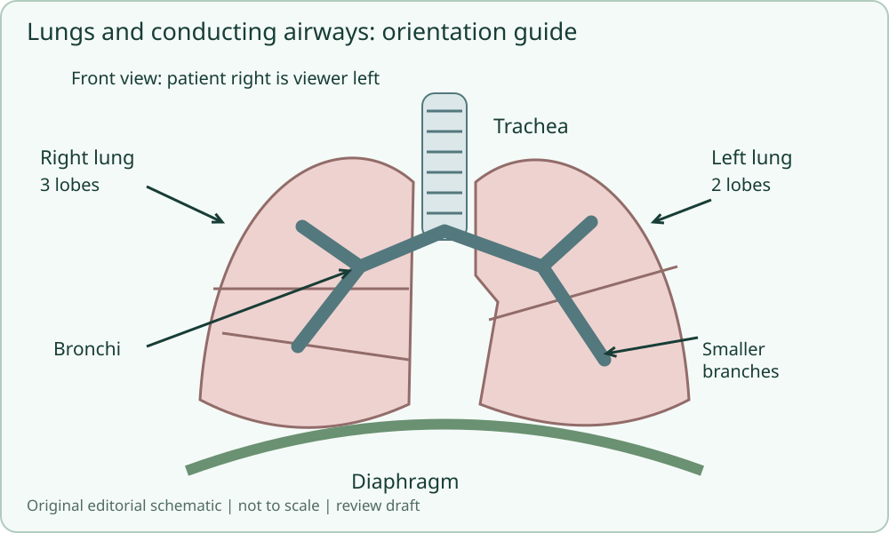
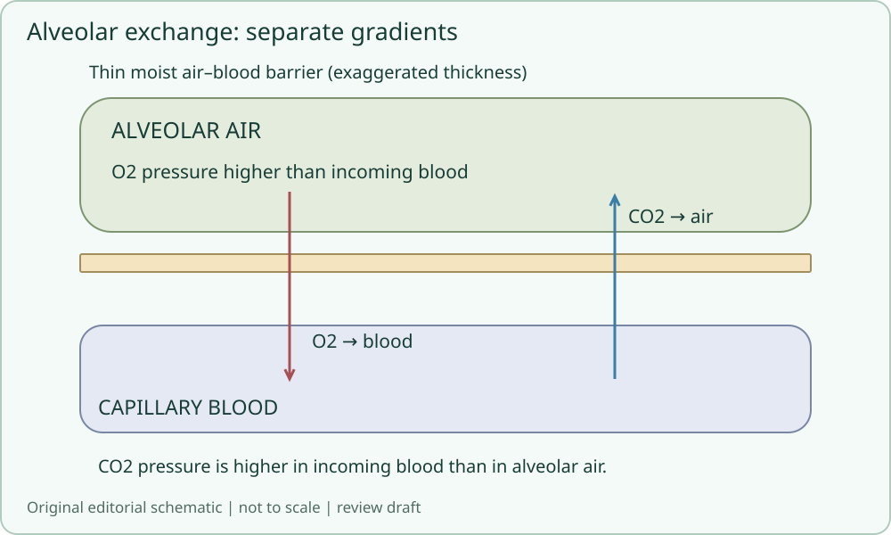
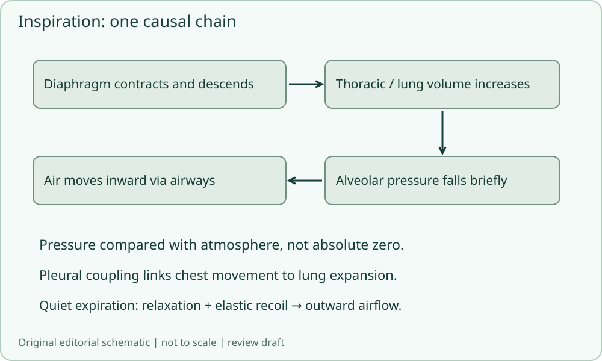

# ৭ম অধ্যায়: গ্যাসীয় বিনিময়

> উত্তরসহ পর্যালোচনাধীন খসড়া; নির্ধারিত সংখ্যার উত্তরসহ খসড়া সম্পূর্ণ; বিষয়বস্তু পর্যালোচনা বাকি।
> মূল বই ও বিষয়বিশেষজ্ঞের পূর্ণ যাচাই বাকি। বোর্ড/স্কুল/সাল দাবি নেই।

## rebuild-mcq.json

### MCQ 1

ফুসফুসে O2-এর নিট ব্যাপন সাধারণত কোন দিকে?

A. শুধু নাকে ফিরে
B. রক্ত থেকে অ্যালভিওলাসে
C. শুধু প্লুরারসে
D. অ্যালভিওলাস থেকে রক্তে

উত্তর: D — অ্যালভিওলাস থেকে রক্তে
অ্যালভিওলার O2 আংশিকচাপ প্রবেশকারী রক্তের তুলনায় বেশি।

### MCQ 2

টিস্যুতে CO2-এর নিট চলনের সাধারণ দিক কী?

A. কোষ থেকে রক্তে
B. শুধু বাইরের বাতাসে সরাসরি
C. কোনো দিকেই নয়
D. রক্ত থেকে কোষে

উত্তর: A — কোষ থেকে রক্তে
বিপাকে সৃষ্ট CO2 টিস্যু থেকে কৈশিকে যায়।

### MCQ 3

ফুসফুসে CO2 রক্ত থেকে বায়ুথলিতে যায় কেন?

A. অ্যালভিওলাসে কোনো গ্যাস নেই
B. শুধু O2-এর ভর বেশি
C. শ্বাসপেশি CO2 পাম্প করে
D. CO2-এর নিজস্ব আংশিকচাপের পার্থক্য

উত্তর: D — CO2-এর নিজস্ব আংশিকচাপের পার্থক্য
দুটি গ্যাসের আলাদা ঢাল আছে।

### MCQ 4

বায়ুর মোট চাপ ও O2 আংশিকচাপ একই নয় কেন?

A. মোট চাপ শুধু CO2
B. সব গ্যাসের ঘনত্ব সমান
C. মোট চাপে অন্যান্য গ্যাসও অবদান রাখে
D. O2 কোনো চাপ দেয় না

উত্তর: C — মোট চাপে অন্যান্য গ্যাসও অবদান রাখে
মিশ্র গ্যাসে একটি উপাদানের অংশচাপ আলাদা।

### MCQ 5

শুকনো বায়ুতে O2 প্রায় কত ভাগ?

A. 100%
B. 21%
C. 78%
D. 4%

উত্তর: B — 21%
সাধারণ বায়ুর আনুমানিক গঠন; উচ্চতায় শতাংশ প্রায় একই থাকে।

### MCQ 6

সাধারণ শ্বাসত্যাগের মিশ্র বায়ুতে O2 থাকায় কী বোঝায়?

A. শ্বাসত্যাগে শুধু বিশুদ্ধ O2
B. ফুসফুস O2 বানায়
C. কোষে O2 লাগে না
D. সব O2 একবারে ব্যবহৃত হয় না

উত্তর: D — সব O2 একবারে ব্যবহৃত হয় না
মিশ্র expired air-এ উল্লেখযোগ্য O2 অবশিষ্ট থাকে।

### MCQ 7

নিঃশ্বাসে CO2 প্রায় 4% ধরা হলে তা কেমন সংখ্যা?

A. সব ব্যক্তির সর্বক্ষণ ধ্রুব
B. শিক্ষামূলক আনুমানিক গড়
C. বিশুদ্ধ CO2
D. নির্ভুল রোগনির্ণয় সীমা

উত্তর: B — শিক্ষামূলক আনুমানিক গড়
শ্বাসের ধরন ও নমুনাভেদে গঠন বদলায়।

### MCQ 8

গ্রহণকৃত ও ত্যাগকৃত বায়ুতে নাইট্রোজেনের ভাগ তুলনামূলক কাছাকাছি কেন?

A. N2 সব O2 হয়ে যায়
B. মানুষ সরাসরি বড় পরিমাণে N2 ব্যবহার করে না
C. N2 শুধু খাবারে
D. N2 ফুসফুসে তৈরি

উত্তর: B — মানুষ সরাসরি বড় পরিমাণে N2 ব্যবহার করে না
এটি প্রধানত নিষ্ক্রিয় সহগ্যাস; শতাংশ একেবারে অভিন্ন বলা নয়।

### MCQ 9

শ্বাসত্যাগের বায়ু সাধারণত বেশি আর্দ্র কেন?

A. O2 পানিতে পরিণত হয় নাকেই
B. শুধু রক্তের সব পানি উড়ে
C. ভেজা শ্বাসপথ থেকে জলীয়বাষ্প মেশে
D. বায়ুর ভর নেই

উত্তর: C — ভেজা শ্বাসপথ থেকে জলীয়বাষ্প মেশে
দ্রবীভূত পৃষ্ঠ ও উষ্ণতা বাষ্প বাড়াতে সহায়তা করে।

### MCQ 10

আয়নায় শ্বাস ফেললে ফোঁটা জমা কী নির্দেশ করে?

A. O2-এর তঞ্চন
B. নাইট্রোজেনের দহন
C. CO2-এর তরল হওয়া নিশ্চিত
D. জলীয়বাষ্পের ঘনীভবন

উত্তর: D — জলীয়বাষ্পের ঘনীভবন
ঠান্ডা পৃষ্ঠে পানি জমে; একে CO2 শনাক্তকরণ বলা যায় না।

### MCQ 11

রক্তে O2-এর অধিকাংশ কোন বাহকে থাকে?

A. পিত্তলবণ
B. ইউরিয়া
C. ফাইব্রিন
D. হিমোগ্লোবিন

উত্তর: D — হিমোগ্লোবিন
অল্প O2 প্লাজমায় দ্রবীভূত; অধিকাংশ Hb-তে প্রত্যাবর্তনযোগ্যভাবে বাঁধে।

### MCQ 12

অক্সিহিমোগ্লোবিনের প্রত্যাবর্তনযোগ্যতা কেন প্রয়োজন?

A. টিস্যুতে O2 ছাড়ার জন্য
B. RBC-কে অস্থি করতে
C. স্থায়ী জমাটের জন্য
D. CO2-কে সম্পূর্ণ সরাতে

উত্তর: A — টিস্যুতে O2 ছাড়ার জন্য
গ্রহণ ও মুক্তি উভয়ই প্রয়োজন।

### MCQ 13

CO2 রক্তে প্রধানত কোন রূপে চলে?

A. বিশুদ্ধ বুদবুদমাত্র
B. ক্যালসিয়াম কার্বনেট কঠিন
C. বাইকার্বনেট
D. অক্সিহিমোগ্লোবিনমাত্র

উত্তর: C — বাইকার্বনেট
অন্য অংশ দ্রবীভূত বা প্রোটিনের সঙ্গে যুক্ত থাকে।

### MCQ 14

ফুসফুসে ফেরার সময় বাইকার্বনেট থেকে CO2 পুনর্গঠন কী কাজে লাগে?

A. খাদ্যে O2 স্থিরীকরণে
B. রক্তকোষ দ্বিগুণে
C. বায়ুতে CO2 ত্যাগে
D. প্লুরা মোটা করতে

উত্তর: C — বায়ুতে CO2 ত্যাগে
পরিবহণরূপ থেকে নির্গমনযোগ্য গ্যাসে ফিরে আসে।

### MCQ 15

অ্যানিমিয়ায় ফুসফুস ভালো হলেও O2 বহনক্ষমতা কমতে পারে কেন?

A. হিমোগ্লোবিন কম থাকতে পারে
B. সব অ্যালভিওলাস ভেঙে যায়
C. বায়ুতে O2 স্থায়ী শূন্য
D. নাইট্রোজেন বংশগতভাবে হারায়

উত্তর: A — হিমোগ্লোবিন কম থাকতে পারে
বিনিময়পৃষ্ঠের বাইরেও বাহকের সীমা থাকে।

### MCQ 16

কার্বন মনোক্সাইড বিষক্রিয়ায় প্রধান সমস্যা কী?

A. Hb-ভিত্তিক O2 বহন ও মুক্তি ব্যাহত
B. সব RBC বেড়ে যাওয়া
C. বায়ুতে O2 বাড়া
D. CO2 চুনে পরিণত

উত্তর: A — Hb-ভিত্তিক O2 বহন ও মুক্তি ব্যাহত
CO শক্তভাবে Hb-তে বাঁধে; সম্ভাব্য সংস্পর্শে জরুরি সহায়তা দরকার।

### MCQ 17

বদ্ধ ঘরে জ্বলন্ত কয়লার অদৃশ্য বিপদ কী?

A. কার্বন মনোক্সাইড জমা
B. O2-এর নিরাপদ বৃদ্ধি
C. ফুসফুসে নাইট্রোজেন তৈরির উপকার
D. সব জীবাণু নির্মূল

উত্তর: A — কার্বন মনোক্সাইড জমা
অসম্পূর্ণ দহনে CO হতে পারে; পরীক্ষার জন্য এমন সংস্পর্শ নয়।

### MCQ 18

উচ্চতায় O2-এর ভাগ প্রায় একই থেকেও ঘাটতি হয় কেন?

A. মোট চাপ কমে O2 আংশিকচাপ কমে
B. O2 সব নাইট্রোজেন হয়
C. মানুষের Hb থাকে না
D. উচ্চতায় সব CO2 জমাট

উত্তর: A — মোট চাপ কমে O2 আংশিকচাপ কমে
বায়ুর শতাংশ আর চালিকা চাপ এক নয়।

### MCQ 19

আংশিকচাপের ঢাল শূন্য হলে গ্যাস অণুর কী হয়?

A. শুধু বড় অণু চলে
B. সব অণু হারায়
C. সব অণু স্থির
D. দৈব গতি থাকে, নিট ব্যাপন শূন্য

উত্তর: D — দৈব গতি থাকে, নিট ব্যাপন শূন্য
গতিশীল সাম্য আর স্থিরতা আলাদা।

### MCQ 20

একই ঢালে বিনিময়বাধা পুরু হলে গ্যাস চলনের সম্ভাব্য ফল কী?

A. কোনো প্রভাব সম্ভব নয়
B. সব গ্যাসের দিক উল্টায়
C. হার কমে
D. অবশ্যই বাড়ে

উত্তর: C — হার কমে
বেশি ব্যাপনদূরত্ব বিনিময়ে বাধা দেয়।

### MCQ 21

একই একক ক্ষেত্রে কার্যকর অ্যালভিওলার ক্ষেত্র কমলে কী ঘটে?

A. O2 উৎপাদন বাড়ে
B. Hb নিজে ফুসফুস হয়
C. সকল চাপ সমান হয়
D. মোট বিনিময়ক্ষমতা কমতে পারে

উত্তর: D — মোট বিনিময়ক্ষমতা কমতে পারে
কার্যকর ক্ষেত্র গ্যাস স্থানান্তরের গুরুত্বপূর্ণ নির্ধারক।

### MCQ 22

নিউমোনিয়ায় বায়ুথলিতে তরল জমলে কীভাবে O2 গ্রহণ বাধে?

A. O2-কে স্থায়ী শর্করা করে
B. বায়ুর জায়গা ও ব্যাপনপথ ক্ষতিগ্রস্ত
C. ফুসফুসের সংখ্যা বাড়ায়
D. RBC-তে নিউক্লিয়াস দেয়

উত্তর: B — বায়ুর জায়গা ও ব্যাপনপথ ক্ষতিগ্রস্ত
বিনিময়পৃষ্ঠের অবস্থা কার্যকর গ্যাস চলনে প্রভাব ফেলে।

### MCQ 23

বায়ু পৌঁছায় কিন্তু রক্তপ্রবাহ নেই এমন অংশে সমস্যা কী?

A. সেখানে সরাসরি খাদ্য তৈরি
B. রক্ত ছাড়াই টিস্যুতে সব O2
C. সব বিনিময় সর্বোচ্চ
D. বায়ু ও রক্ত সরবরাহের অমিল

উত্তর: D — বায়ু ও রক্ত সরবরাহের অমিল
ventilation ও perfusion দুটোর মিল দরকার।

### MCQ 24

রক্ত পৌঁছায় কিন্তু বায়ু কম এমন অ্যালভিওলাসে কী সীমা?

A. CO2 তৈরি বন্ধ
B. সবসময় O2 বেশি হয়
C. Hb-এর প্রয়োজন নেই
D. রক্ত যথেষ্ট O2 নিতে নাও পারে

উত্তর: D — রক্ত যথেষ্ট O2 নিতে নাও পারে
বায়ু ও রক্তের একটির ঘাটতি অপরটিকে সীমিত করে।

### MCQ 25

শ্বাসের হার দেখে একা টিস্যুর O2-সরবরাহ নিশ্চিত বলা যায় না কেন?

A. প্রতিটি শ্বাসে সমান রক্ত যায়
B. শ্বাসহার কখনো বদলায় না
C. বিনিময়, Hb ও রক্তপ্রবাহও প্রাসঙ্গিক
D. O2 শুধু নাকে থাকে

উত্তর: C — বিনিময়, Hb ও রক্তপ্রবাহও প্রাসঙ্গিক
একটি মাপ পুরো কার্যক্রমের বিকল্প নয়।

### MCQ 26

কোষীয় বায়বীয় শ্বসনের সামগ্রিক ফলে কোনটি উৎপন্ন হয়?

A. শুধু O2
B. CO2, পানি ও ব্যবহারযোগ্য শক্তি
C. শুধু হিমোগ্লোবিন
D. শুধু N2

উত্তর: B — CO2, পানি ও ব্যবহারযোগ্য শক্তি
গ্লুকোজ জারণের সরল সমীকরণ সামগ্রিক ফল বোঝায়।

### MCQ 27

অ্যালভিওলার O2 চাপ 100 ও আগত রক্তে 40 mmHg হলে প্রাথমিক ঢাল কত?

A. 140 mmHg
B. 2.5 mmHg
C. 40 mmHg
D. 60 mmHg

উত্তর: D — 60 mmHg
100−40=60; এগুলো প্রস্তুত মডেলের মান।

### MCQ 28

রক্তের CO2 চাপ 46 ও অ্যালভিওলাসে 40 mmHg হলে দিক কোনটি?

A. বায়ুথলি থেকে রক্তে
B. কোনো দৈব গতি নেই
C. দুই দিকের নিট একই বেশি
D. রক্ত থেকে বায়ুথলিতে

উত্তর: D — রক্ত থেকে বায়ুথলিতে
উচ্চ 46 থেকে নিম্ন 40-এর দিকে নিট চলন।

### MCQ 29

শুকনো গ্যাসে মোট চাপ 700 mmHg ও O2 ভাগ 0.21 হলে তার অংশচাপ কত?

A. 721 mmHg
B. 147 mmHg
C. 210 mmHg
D. 33.3 mmHg

উত্তর: B — 147 mmHg
700×0.21=147; humidification এখানে ধরা হয়নি।

### MCQ 30

প্রতি শ্বাসে 0.5 L ও হার 12/min হলে minute ventilation কত?

A. 12.5 L/min
B. 0.042 L/min
C. 6 L/min
D. 24 L/min

উত্তর: C — 6 L/min
0.5×12=6; এটি মোট বায়ুচলন।

### MCQ 31

tidal 500 mL, মৃতস্থান 150 mL, হার 12/min হলে কার্যকর অ্যালভিওলার ventilation কত?

A. 1.8 L/min
B. 7.8 L/min
C. 4.2 L/min
D. 6 L/min

উত্তর: C — 4.2 L/min
(500−150)×12=4200 mL/min।

### MCQ 32

400 mL করে 15/min শ্বাসে মোট 6 L/min হলেও মৃতস্থান 150 mL হলে অ্যালভিওলার হার কত?

A. 6 L/min
B. 8.25 L/min
C. 2.25 L/min
D. 3.75 L/min

উত্তর: D — 3.75 L/min
(400−150)×15=3750 mL/min।

### MCQ 33

IRV 2500, tidal 500, ERV 1000 mL হলে vital capacity কত?

A. 1500 mL
B. 4000 mL
C. 5000 mL
D. 3000 mL

উত্তর: B — 4000 mL
চলনযোগ্য তিন আয়তনের যোগফল=4000।

### MCQ 34

vital capacity 4 L ও residual volume 1.2 L হলে total lung capacity কত?

A. 4 L
B. 5.2 L
C. 2.8 L
D. 0.3 L

উত্তর: B — 5.2 L
মোট ধারণক্ষমতায় অবশিষ্ট বায়ুও যুক্ত হয়।

### MCQ 35

এক মিনিটে 18 চক্র ও প্রতি চক্রে 400 mL বায়ু চললে মোট কত?

A. 4.5 L/min
B. 0.72 L/min
C. 7.2 L/min
D. 720 L/min

উত্তর: C — 7.2 L/min
18×400=7200 mL/min=7.2 L/min।

### MCQ 36

একই শর্তে 2 L নমুনায় CO2 4% হলে তার আয়তন কত?

A. 8 mL
B. 800 mL
C. 50 mL
D. 80 mL

উত্তর: D — 80 mL
2000×0.04=80; মানটি শিক্ষামূলক নমুনার জন্য।

### MCQ 37

শ্বাসহার 14 থেকে 21/min হলে শতকরা বৃদ্ধি কত?

A. 50%
B. 33.3%
C. 7%
D. 150%

উত্তর: A — 50%
বৃদ্ধি 7; প্রাথমিক 14-এর তুলনায় 7/14×100=50।

### MCQ 38

বিশ্রাম 16, কাজের পর 28, পরে 18/min হলে পুনরুদ্ধার সম্পর্কে কী বলা যায়?

A. রোগ নিশ্চিত
B. হার কমেছে, পুরো baseline নয়
C. পুরোপুরি 16 হয়েছে
D. কাজে কোনো প্রভাব নেই

উত্তর: B — হার কমেছে, পুরো baseline নয়
18 এখনও 16 থেকে বেশি; এক তথ্য রোগনির্ণয় নয়।

### MCQ 39

চুনের পানিতে CO2 দিলে প্রথমে সাদা ঘোলাটে হওয়ার কারণ কী?

A. সোডিয়াম ধাতু
B. CaCO3 অধঃক্ষেপ
C. বিশুদ্ধ O2 উৎপাদন
D. শর্করা দহন

উত্তর: B — CaCO3 অধঃক্ষেপ
Ca(OH)2+CO2→CaCO3+H2O।

### MCQ 40

চুনের পানি পরীক্ষায় সমান বায়ু আয়তন নেওয়া জরুরি কেন?

A. তুলনায় গ্যাসের পরিমাণ নিয়ন্ত্রণে
B. প্রতিটি রোগ শনাক্ত করতে
C. বায়ুর ভর মুছতে
D. চুনকে O2 করতে

উত্তর: A — তুলনায় গ্যাসের পরিমাণ নিয়ন্ত্রণে
অসমান নমুনায় সময় বা ঘোলাটে হওয়া বিভ্রান্ত করতে পারে।

### MCQ 41

সাধারণ বায়ুতেও CO2 থাকলে দীর্ঘ প্রবাহে কী হতে পারে?

A. অবশ্যই জীবাণু তৈরি
B. শুধু নীল হয়
C. চুনের পানি ঘোলা হতে পারে
D. কখনোই কোনো পরিবর্তন নয়

উত্তর: C — চুনের পানি ঘোলা হতে পারে
স্বল্প সময়ে কম পরিবর্তন মানে CO2 অনুপস্থিত নয়।

### MCQ 42

অতিরিক্ত CO2 দিলে CaCO3-এর ঘোলাটে ভাব কমতে পারে কেন?

A. দ্রবণীয় বাইকার্বনেট গঠিত হতে পারে
B. O2 কঠিন হয়
C. CaCO3 শর্করা হয়
D. সব পানি উধাও

উত্তর: A — দ্রবণীয় বাইকার্বনেট গঠিত হতে পারে
শেষের স্বচ্ছতাকে CO2 ছিল না বলা ভুল।

### MCQ 43

চুনের পানির নল মুখে নিয়ে শ্বাস টানার বদলে নিরাপদ নীতি কী?

A. চোখে ফোঁটা দেওয়া
B. এক নল সবাই ভাগ করা
C. তরল মুখে টানা
D. শিক্ষক-প্রস্তুত নমুনা ও অনুমোদিত যন্ত্র

উত্তর: D — শিক্ষক-প্রস্তুত নমুনা ও অনুমোদিত যন্ত্র
ক্ষারীয় তরল ও শ্বাসজনিত সংক্রমণের ঝুঁকি এড়াতে হবে।

### MCQ 44

CO2-এর indicator রং একা কোষীয় শ্বসনের হার দেয় না কেন?

A. CO2 কখনো দ্রবীভূত নয়
B. রং মানেই ATP সংখ্যা
C. অম্লতা, নমুনা ও অন্য চলকের প্রভাব থাকে
D. indicator সব গ্যাসের ভর মাপে

উত্তর: C — অম্লতা, নমুনা ও অন্য চলকের প্রভাব থাকে
ক্যালিব্রেশন ও নিয়ন্ত্রণ ছাড়া পরিমাণগত দাবি দুর্বল।

### MCQ 45

বেলজার মডেলে নিচের রবারপাত কী বোঝায়?

A. অ্যালভিওলার কৈশিক
B. রক্তরস
C. স্বরতন্ত্রী
D. মধ্যচ্ছদার যান্ত্রিক ভূমিকা

উত্তর: D — মধ্যচ্ছদার যান্ত্রিক ভূমিকা
রবার টানায় ভেতরের আয়তন বদলায়; বাস্তব পেশির অনুলিপি নয়।

### MCQ 46

হাঁপানিতে প্রধানত কোন পরিবর্তন শ্বাসে বাধা দেয়?

A. প্লুরা O2 উৎপন্ন
B. ছোট বায়ুপথে প্রদাহ ও সংকোচন
C. সব RBC একযোগে হাড় হওয়া
D. কেবল নাকের লোম লম্বা

উত্তর: B — ছোট বায়ুপথে প্রদাহ ও সংকোচন
শ্বাসপথের সংকীর্ণতা ও প্রদাহ উপসর্গ ঘটায়।

### MCQ 47

হাঁপানি সম্পর্কে সঠিক সামাজিক বার্তা কী?

A. কাশি থাকলেই নিশ্চিত হাঁপানি
B. ছোঁয়াচে নয়
C. শুধু ব্যাকটেরিয়ায় হয়
D. ছোঁয়া লাগলেই সবার হয়

উত্তর: B — ছোঁয়াচে নয়
এটি অসংক্রামক দীর্ঘমেয়াদি রোগ; কাশি অন্য রোগেও হয়।

### MCQ 48

হাঁপানির trigger বলতে কী বোঝায়?

A. নিরাময়ের নিশ্চয়তা
B. ফুসফুসের নতুন অঙ্গ
C. সকলের একমাত্র জীবাণু
D. উপসর্গ বাড়াতে পারে এমন উদ্দীপক

উত্তর: D — উপসর্গ বাড়াতে পারে এমন উদ্দীপক
ধুলো, ধোঁয়া, রেণু ইত্যাদির প্রভাব ব্যক্তিভেদে আলাদা।

### MCQ 49

সব হাঁপানি রোগীকে একই মাছ-মাংস বন্ধ করতে বলা অনুচিত কেন?

A. খাদ্যে কখনো অ্যালার্জি হয় না
B. হাঁপানিতে খাদ্য লাগে না
C. সব প্রোটিনই বিষ
D. ব্যক্তির trigger ও পুষ্টিচাহিদা ভিন্ন

উত্তর: D — ব্যক্তির trigger ও পুষ্টিচাহিদা ভিন্ন
অকারণ খাদ্যবর্জন নয়, নির্দিষ্ট মূল্যায়ন দরকার।

### MCQ 50

চিকিৎসকের দেওয়া inhaled steroid-এর প্রধান লক্ষ্য কী?

A. কেবল কফ রং করা
B. RBC-তে নিউক্লিয়াস তৈরি
C. বায়ুপথের প্রদাহ কমানো
D. সকল জীবাণু মারা

উত্তর: C — বায়ুপথের প্রদাহ কমানো
নিয়ন্ত্রিত inhaled চিকিৎসাকে অনিয়ন্ত্রিত উচ্চমাত্রার systemic steroid-এর সঙ্গে এক করা যাবে না।

### MCQ 51

bronchodilator-এর সাধারণ কাজ কী?

A. ক্যান্সার নিশ্চিত সারানো
B. বায়ুপথ প্রসারিত করতে সহায়তা
C. প্লুরা ছিদ্র করা
D. TB জীবাণু নিশ্চিত ধ্বংস

উত্তর: B — বায়ুপথ প্রসারিত করতে সহায়তা
ওষুধের ধরন ও ব্যবহার চিকিৎসা-পরিকল্পনার বিষয়।

### MCQ 52

হাঁপানির লিখিত action plan কেন সহায়ক?

A. উপসর্গ বাড়লে নির্ধারিত করণীয় জানা
B. সবার ডোজ এক করা
C. সব ওষুধ নিজে বন্ধ করা
D. চিকিৎসার প্রয়োজন অস্বীকার

উত্তর: A — উপসর্গ বাড়লে নির্ধারিত করণীয় জানা
পরিকল্পনা স্বাস্থ্যপেশাজীবীর সঙ্গে নির্ধারিত হয়।

### MCQ 53

তীব্র শ্বাসকষ্টে কথা বলতে না-পারা বা ঠোঁট নীল হলে কী করা উচিত?

A. পরীক্ষা শেষ হওয়া পর্যন্ত অপেক্ষা
B. জরুরি স্বাস্থ্যসহায়তা নেওয়া
C. ধোঁয়া শোঁকানো
D. জোর করে পানি খাওয়ানো

উত্তর: B — জরুরি স্বাস্থ্যসহায়তা নেওয়া
গুরুতর লক্ষণকে শ্রেণিকক্ষের সাধারণ কাশি ধরে রাখা নিরাপদ নয়।

### MCQ 54

অ্যাজমা নিয়ন্ত্রিত থাকলে শিক্ষার্থীর চলাফেরা সম্পর্কে যুক্তিযুক্ত নীতি কী?

A. ওষুধের সব দরকার শেষ
B. উপযুক্ত পরিকল্পনায় সক্রিয় জীবন সম্ভব
C. শুধু শয্যায় থাকা
D. আজীবন সব খেলাধুলা নিষিদ্ধ

উত্তর: B — উপযুক্ত পরিকল্পনায় সক্রিয় জীবন সম্ভব
সক্ষমতা ও চিকিৎসা-পরামর্শমতো অংশগ্রহণ সম্ভব।

### MCQ 55

ব্রংকাইটিস শব্দটি কোন প্রদাহ বোঝায়?

A. শুধু বৃক্কের
B. শুধু অস্থিমজ্জার
C. শুধু স্বরতন্ত্রীর
D. ব্রংকাসের আবরণের

উত্তর: D — ব্রংকাসের আবরণের
রোগের নাম আক্রান্ত অংশের সঙ্গে যুক্ত।

### MCQ 56

সাধারণ acute bronchitis-এ অ্যান্টিবায়োটিক সবসময় প্রয়োজন নয় কেন?

A. অনেক ক্ষেত্রেই ভাইরাস দায়ী
B. ওষুধ কখনো কাজ করে না
C. সব কাশি অ্যালার্জি
D. ব্যাকটেরিয়া বলে কিছু নেই

উত্তর: A — অনেক ক্ষেত্রেই ভাইরাস দায়ী
কারণ ও তীব্রতা চিকিৎসক বিচার করেন।

### MCQ 57

দীর্ঘদিন তামাকধোঁয়ায় সিলিয়ার ক্ষতি কীভাবে সমস্যা করে?

A. কৈশিকের সব বাধা সারে
B. বায়ু জীবাণুমুক্ত হয়
C. শ্লেষ্মা-কণা পরিষ্কার কমে
D. সব কাশি বন্ধ

উত্তর: C — শ্লেষ্মা-কণা পরিষ্কার কমে
প্রতিরক্ষার mucociliary clearance দুর্বল হয়।

### MCQ 58

দীর্ঘস্থায়ী কফ-কাশি নিয়ে নিজে রোগলেবেল না-দেওয়ার কারণ কী?

A. একাধিক রোগে মিল থাকতে পারে
B. একটি ছবি সব পরীক্ষা
C. শুধু বয়সই রোগ
D. কাশির কোনো কারণ হয় না

উত্তর: A — একাধিক রোগে মিল থাকতে পারে
পেশাগত ইতিহাস ও পরীক্ষা দরকার।

### MCQ 59

দূষিত কর্মপরিবেশে শুধু মাস্ক দিলেই সব দায় শেষ নয় কেন?

A. ধুলো কেবল খাবারে
B. মাস্ক সব গ্যাস আটকায়
C. শ্রমিকের স্বাস্থ্য অপ্রাসঙ্গিক
D. উৎসনিয়ন্ত্রণ ও বায়ুচলাচলও দরকার

উত্তর: D — উৎসনিয়ন্ত্রণ ও বায়ুচলাচলও দরকার
বহুস্তর নিয়ন্ত্রণ ব্যক্তিগত সুরক্ষার আগে/সঙ্গে প্রয়োজন।

### MCQ 60

নিউমোনিয়ার কারণ সম্পর্কে সঠিকটি কী?

A. বিভিন্ন জীবাণু দায়ী হতে পারে
B. সবসময় একই ব্যাকটেরিয়া
C. শুধু ঠান্ডা বাতাসই জীবাণু
D. শুধু ধুলোর রং

উত্তর: A — বিভিন্ন জীবাণু দায়ী হতে পারে
ব্যাকটেরিয়া, ভাইরাস বা ছত্রাকসহ কারণ ভিন্ন হয়।

### MCQ 61

Pneumococcus বলতে কোন জীবাণুর পরিচিত নাম বোঝায়?

A. Saccharomyces
B. Streptococcus pneumoniae
C. Mycobacterium tuberculosis
D. Plasmodium vivax

উত্তর: B — Streptococcus pneumoniae
এটি নিউমোনিয়ার একটি সম্ভাব্য ব্যাকটেরিয়াজনিত কারণ।

### MCQ 62

শিশুর দ্রুত/কষ্টকর শ্বাস ও জ্বরে মূল দায়িত্ব কী?

A. নিজে বহু অ্যান্টিবায়োটিক মেশানো
B. দ্রুত স্বাস্থ্য মূল্যায়ন
C. অবশ্যই কেবল ঠান্ডা ধরে রাখা
D. উপসর্গ লুকানো

উত্তর: B — দ্রুত স্বাস্থ্য মূল্যায়ন
গুরুতর সংক্রমণের সম্ভাবনায় সময়মতো সেবা জরুরি।

### MCQ 63

নিউমোনিয়া প্রতিরোধে প্রস্তাবিত টিকার তাৎপর্য কী?

A. চিকিৎসা অপ্রয়োজনীয়
B. সব কাশি চিরতরে বন্ধ
C. কিছু গুরুত্বপূর্ণ কারণের ঝুঁকি কমানো
D. সব রোগের শতভাগ সুরক্ষা

উত্তর: C — কিছু গুরুত্বপূর্ণ কারণের ঝুঁকি কমানো
টিকা স্থানীয় কর্মসূচি ও স্বাস্থ্যপরামর্শ অনুযায়ী নিতে হয়।

### MCQ 64

গিলতে সমস্যা থাকা ব্যক্তিকে জোর করে তরল দিলে শ্বাসতন্ত্রে কী ঝুঁকি?

A. aspiration
B. অভিস্রবণ বন্ধ
C. সালোকসংশ্লেষণ
D. ভাইটাল ক্যাপাসিটি নিশ্চয় দ্বিগুণ

উত্তর: A — aspiration
খাদ্য/তরল ভুল পথে যেতে পারে; তীব্র কষ্টে জোরে খাওয়ানো নয়।

### MCQ 65

মানব যক্ষ্মার প্রধান পরিচিত জীবাণু কোনটি?

A. অ্যামিবা
B. ইনফ্লুয়েঞ্জা ভাইরাস
C. Mycobacterium tuberculosis
D. ইস্ট

উত্তর: C — Mycobacterium tuberculosis
TB সাধারণত ব্যাকটেরিয়াজনিত।

### MCQ 66

সংক্রামক ফুসফুসীয় TB ছড়ানোর প্রধান পথ কী?

A. শুধু করমর্দন
B. বংশগতভাবে নিশ্চিত
C. শুধু চামচ দেখা
D. বায়ুবাহিত সংক্রামক কণা

উত্তর: D — বায়ুবাহিত সংক্রামক কণা
একই ঘরের বায়ুতে সংস্পর্শ গুরুত্বপূর্ণ।

### MCQ 67

TB সংক্রমণ আর সক্রিয় রোগ একই নয় কেন?

A. TB-তে জীবাণু থাকে না
B. সব সংক্রমণ ক্যান্সার
C. সংক্রমিত সবাই সঙ্গে সঙ্গে অসুস্থ/সংক্রামক নয়
D. অসুস্থতা সবসময় শূন্য

উত্তর: C — সংক্রমিত সবাই সঙ্গে সঙ্গে অসুস্থ/সংক্রামক নয়
সুপ্ত সংক্রমণ ও রোগের অবস্থা পৃথক।

### MCQ 68

যক্ষ্মা শুধু ফুসফুসেই সীমিত—দাবি ভুল কেন?

A. TB শুধু রক্তগোষ্ঠী
B. অন্য অঙ্গও আক্রান্ত হতে পারে
C. ব্যাকটেরিয়া কখনো অঙ্গে যায় না
D. ফুসফুসে TB হয় না

উত্তর: B — অন্য অঙ্গও আক্রান্ত হতে পারে
হাড়, বৃক্ক, মস্তিষ্কসহ অন্য স্থানে রোগ হতে পারে।

### MCQ 69

দীর্ঘ কাশি, জ্বর ও ওজন কমলে যুক্তিযুক্ত পদক্ষেপ কী?

A. উপযুক্ত পরীক্ষা ও স্বাস্থ্যপরামর্শ
B. সবসময় ক্যান্সার ঘোষণা
C. শুধু গরম পানি যথেষ্ট
D. নিজে TB নিশ্চিত ঘোষণা

উত্তর: A — উপযুক্ত পরীক্ষা ও স্বাস্থ্যপরামর্শ
লক্ষণ সন্দেহ জাগায়, নিশ্চিত কারণ পরীক্ষায় নির্ধারিত হয়।

### MCQ 70

TB-র ওষুধ ভালো বোধ হলেই নিজে বন্ধ করলে ঝুঁকি কী?

A. সব প্রতিরোধ চিরতরে দূর
B. চিকিৎসা ব্যর্থতা ও প্রতিরোধী জীবাণুর ঝুঁকি
C. BCG সঙ্গে সঙ্গে কাজ হারায়
D. অবশ্যই স্থায়ী নিরাময়

উত্তর: B — চিকিৎসা ব্যর্থতা ও প্রতিরোধী জীবাণুর ঝুঁকি
নির্ধারিত কোর্স চিকিৎসকের নির্দেশে সম্পন্ন করতে হয়।

### MCQ 71

BCG টিকার বিশেষ পরিচিত উপকার কী?

A. শিশুর গুরুতর TB থেকে সুরক্ষা
B. সব ব্যাকটেরিয়া ধ্বংস
C. সব বয়সে সব TB শতভাগ রোধ
D. ফুসফুস ক্যান্সার নিরাময়

উত্তর: A — শিশুর গুরুতর TB থেকে সুরক্ষা
সুরক্ষা সীমিত/ভিন্ন; আজীবন পূর্ণ নিশ্চয়তা নয়।

### MCQ 72

একটি পজিটিভ TB infection test একাই কী নিশ্চিত করে না?

A. জীবাণুর সঙ্গে কোনো সম্পর্ক
B. সক্রিয় ফুসফুসীয় রোগ ও সংক্রামকতা
C. কখনো পরীক্ষা লাগে না
D. সব চিকিৎসা নিষিদ্ধ

উত্তর: B — সক্রিয় ফুসফুসীয় রোগ ও সংক্রামকতা
রোগনির্ণয়ে ক্লিনিক্যাল তথ্য ও উপযুক্ত অতিরিক্ত পরীক্ষা দরকার।

### MCQ 73

দ্রুত molecular TB পরীক্ষার একটি সুবিধা কী?

A. জীবাণু ও কিছু ওষুধপ্রতিরোধ দ্রুত শনাক্তে সাহায্য
B. অঙ্গের সব ছবি
C. সব রোগের কারণ একবারে
D. চিকিৎসক ছাড়াই ডোজ নির্ধারণ

উত্তর: A — জীবাণু ও কিছু ওষুধপ্রতিরোধ দ্রুত শনাক্তে সাহায্য
নমুনা ও পরীক্ষার ধরন অনুযায়ী ফলের সীমা থাকে।

### MCQ 74

বায়ুচলাচল TB প্রতিরোধে কীভাবে সহায়ক?

A. দূষিত বায়ুকণার ঘনত্ব কমাতে
B. টিকার বিকল্পে সব ঝুঁকি মুছতে
C. মাস্ককে অপ্রয়োজনীয় করতে
D. ব্যাকটেরিয়াকে শর্করা করতে

উত্তর: A — দূষিত বায়ুকণার ঘনত্ব কমাতে
বহুস্তর প্রতিরোধে ventilation গুরুত্বপূর্ণ।

### MCQ 75

TB রোগীর প্রতি স্বাস্থ্যসম্মত আচরণ কোনটি?

A. কলঙ্ক দিয়ে চিকিৎসা থেকে দূরে রাখা
B. শিক্ষা স্থায়ী নিষিদ্ধ
C. রোগ ছোঁয়া মানেই অপরাধ বলা
D. সেবা, গোপনীয়তা ও সংক্রমণ নিয়ন্ত্রণ

উত্তর: D — সেবা, গোপনীয়তা ও সংক্রমণ নিয়ন্ত্রণ
সহায়তা ও যুক্তিযুক্ত সতর্কতা একসঙ্গে প্রয়োজন।

### MCQ 76

ফুসফুসের ক্যান্সারের মৌলিক বৈশিষ্ট্য কী?

A. শুধু শ্লেষ্মার সাময়িক জমা
B. শুধু ব্যাকটেরিয়া সংখ্যা
C. সব অ্যালভিওলাসে স্বাভাবিক মাইটোসিস
D. অস্বাভাবিক অনিয়ন্ত্রিত কোষবৃদ্ধি

উত্তর: D — অস্বাভাবিক অনিয়ন্ত্রিত কোষবৃদ্ধি
স্বাভাবিক নিয়ন্ত্রণ ভাঙা ও টিস্যু আক্রমণ রোগের অংশ।

### MCQ 77

ধূমপান ও ফুসফুস ক্যান্সারের সম্পর্ক কী?

A. একটি প্রধান পরিবর্তনযোগ্য ঝুঁকি
B. ধূমপানেই কেবল সব ঘটনা
C. ধূমপান সম্পূর্ণ নিরপেক্ষ
D. প্রতিটি ধূমপায়ী নিশ্চিত আক্রান্ত

উত্তর: A — একটি প্রধান পরিবর্তনযোগ্য ঝুঁকি
ঝুঁকি বাড়া আর প্রতিটি ব্যক্তির নিশ্চিত ফল এক নয়।

### MCQ 78

অধূমপায়ীর ফুসফুস ক্যান্সার হতে পারে কেন?

A. অন্যান্য ঝুঁকি ও কারণও আছে
B. তামাক কখনো ঝুঁকি নয়
C. ক্যান্সার শুধু সংক্রমণ
D. অধূমপায়ীর ফুসফুস নেই

উত্তর: A — অন্যান্য ঝুঁকি ও কারণও আছে
পরোক্ষ ধোঁয়া, কর্মক্ষেত্র ও অন্যান্য কারণ প্রাসঙ্গিক।

### MCQ 79

এ্যাসবেস্টসের ধুলো নিয়ন্ত্রণ কেন জরুরি?

A. সিলিয়া শক্ত করে
B. এটি নিরাপদ খাদ্য
C. ফুসফুসের গুরুতর রোগ/ক্যান্সারের ঝুঁকি
D. এটি O2 সরবরাহ করে

উত্তর: C — ফুসফুসের গুরুতর রোগ/ক্যান্সারের ঝুঁকি
বিপজ্জনক পেশাগত সংস্পর্শে নিয়ন্ত্রিত অপসারণ ও সুরক্ষা দরকার।

### MCQ 80

ক্যান্সারের metastasis কী বোঝায়?

A. ধুলো নাকে আটকানো
B. একই ব্যক্তির স্বাভাবিক শ্বাস
C. মূল স্থান থেকে অন্য স্থানে ছড়ানো
D. সব কোষের বিশ্রাম

উত্তর: C — মূল স্থান থেকে অন্য স্থানে ছড়ানো
দূরবর্তী টিস্যুতে ক্যান্সার ছড়ানো রোগের বিস্তার।

### MCQ 81

CT-তে অস্বাভাবিক ছায়া দেখা একাই সবসময় নিশ্চিত ক্যান্সার নয় কেন?

A. ছায়া মানেই TB
B. অন্য কারণও ছায়া দিতে পারে
C. CT শুধু শ্বাসহার মাপে
D. টিস্যু মূল্যায়নের প্রয়োজন হয় না

উত্তর: B — অন্য কারণও ছায়া দিতে পারে
উপযুক্ত চিকিৎসক পরীক্ষা ও প্রয়োজনে টিস্যু মূল্যায়ন করেন।

### MCQ 82

সব ফুসফুস ক্যান্সারের একই চিকিৎসা নয় কেন?

A. ধরন, পর্যায় ও রোগীর অবস্থা ভিন্ন
B. সব ক্যান্সার এক কোষ
C. রেডিয়েশন সবক্ষেত্রে একমাত্র
D. কোনো পরীক্ষা লাগে না

উত্তর: A — ধরন, পর্যায় ও রোগীর অবস্থা ভিন্ন
চিকিৎসা বিশেষজ্ঞ দল নির্ধারণ করে।

### MCQ 83

পরোক্ষ তামাকধোঁয়া এড়ানো কাদের জন্য গুরুত্বপূর্ণ?

A. শুধু বিক্রেতাদের
B. শুধু প্রাপ্তবয়স্ক পুরুষের
C. কোনো শিশুর নয়
D. ধূমপায়ী ও অধূমপায়ী উভয়ের পরিবেশে

উত্তর: D — ধূমপায়ী ও অধূমপায়ী উভয়ের পরিবেশে
শিশুসহ অন্যরা ক্ষতিকর ধোঁয়ার সংস্পর্শে আসতে পারে।

### MCQ 84

রান্নাঘরের ধোঁয়া কমাতে কোন ব্যবস্থা উৎসভিত্তিক?

A. কেবল সুগন্ধি ছড়ানো
B. শিশুকে ধোঁয়ার কাছে রাখা
C. পরিচ্ছন্ন জ্বালানি ও কার্যকর নিষ্কাশন
D. জানালা স্থায়ী বন্ধ

উত্তর: C — পরিচ্ছন্ন জ্বালানি ও কার্যকর নিষ্কাশন
উৎস কমানো ও ventilation দুটো কার্যকর নীতি।

### MCQ 85

দূষণের গন্ধ না-পেলেও নিরাপত্তা নিশ্চিত নয় কেন?

A. সব ক্ষতিকর গ্যাস নীল
B. ফুসফুস গন্ধই শোষণ করে
C. কিছু ক্ষতিকর গ্যাস/কণা গন্ধহীন
D. গন্ধই ঘনত্বমাপক

উত্তর: C — কিছু ক্ষতিকর গ্যাস/কণা গন্ধহীন
বিশেষত CO-এর গন্ধের ওপর সতর্কতা নির্ভর করা যায় না।

### MCQ 86

শ্বাসতন্ত্র সুস্থ রাখতে কেবল ব্যক্তির অভ্যাস যথেষ্ট নয় কেন?

A. সামাজিক ব্যবস্থা অপ্রাসঙ্গিক
B. দূষণ ব্যক্তিকে ছোঁয় না
C. বাসস্থান ও কর্মস্থলের পরিবেশও গুরুত্বপূর্ণ
D. জীবাণু কেবল খাদ্যে

উত্তর: C — বাসস্থান ও কর্মস্থলের পরিবেশও গুরুত্বপূর্ণ
স্বাস্থ্যরক্ষায় ব্যক্তি ও প্রতিষ্ঠান উভয়ের দায়িত্ব আছে।

### MCQ 87

কাশির কণাকে কম ছড়ানোর ভালো অভ্যাস কোনটি?

A. খোলা মুখে সবার দিকে কাশি
B. একই ব্যবহৃত টিস্যু ভাগ
C. টিস্যু/কনুই দিয়ে ঢেকে হাত পরিষ্কার
D. থুতু ছড়িয়ে দেওয়া

উত্তর: C — টিস্যু/কনুই দিয়ে ঢেকে হাত পরিষ্কার
শ্বাসশিষ্টাচার বহুস্তর প্রতিরোধের অংশ।

### MCQ 88

সাধারণ কাপড়ের মুখাবরণ সব বিষাক্ত গ্যাস আটকায় না কেন?

A. সব মুখাবরণ অক্সিজেন বানায়
B. সব গ্যাস বড় ধুলো
C. কাপড়ের কোনো ছিদ্র নেই
D. গ্যাসের জন্য উপযুক্ত আলাদা ফিল্টার/নিয়ন্ত্রণ লাগে

উত্তর: D — গ্যাসের জন্য উপযুক্ত আলাদা ফিল্টার/নিয়ন্ত্রণ লাগে
কণা-নিয়ন্ত্রণকে বিষাক্ত গ্যাসে নিরাপদ প্রবেশের অনুমতি ধরা যাবে না।

### MCQ 89

শ্বাসকষ্টে steam বা ধোঁয়া শোঁকানোকে নিশ্চিত চিকিৎসা বলা অনিরাপদ কেন?

A. শ্বাসকষ্ট কখনো গুরুতর নয়
B. সব রোগে একই উপকার
C. সব বাষ্প জীবাণুমুক্ত রক্ত
D. পোড়া/উত্তেজনার ঝুঁকি ও চিকিৎসা বিলম্ব

উত্তর: D — পোড়া/উত্তেজনার ঝুঁকি ও চিকিৎসা বিলম্ব
তীব্র লক্ষণে পেশাগত সেবা নিতে হবে।

### MCQ 90

দুই দলের দূষণ-সংস্পর্শ ও কাশির সম্পর্ক পাওয়া মানেই একমাত্র কারণ প্রমাণ নয় কেন?

A. সব তথ্য সমান নির্ভুল
B. সম্পর্ক কখনো তথ্য নয়
C. কাশি কেবল বংশগত
D. বয়স, ধূমপানসহ বিভ্রান্তিকারী চলক থাকতে পারে

উত্তর: D — বয়স, ধূমপানসহ বিভ্রান্তিকারী চলক থাকতে পারে
পর্যবেক্ষণগত সম্পর্ক থেকে সীমিত সিদ্ধান্ত নিতে হয়।

### MCQ 91

শ্বাসরোগের জরিপে পরিচয় গোপন রাখা কেন গুরুত্বপূর্ণ?

A. সম্মতি এড়াতে
B. সংখ্যা বানানো সহজ করতে
C. ব্যক্তিগত স্বাস্থ্যতথ্যের সুরক্ষা
D. রোগ ছড়াতে

উত্তর: C — ব্যক্তিগত স্বাস্থ্যতথ্যের সুরক্ষা
সম্মতি, গোপনীয়তা ও কলঙ্কহীন ব্যবহার প্রয়োজন।

### MCQ 92

ধূমপান পরীক্ষায় সহপাঠীকে ধোঁয়া টানাতে বলা উচিত নয় কেন?

A. ক্ষতিকর সংস্পর্শ ইচ্ছাকৃত সৃষ্টি হয়
B. তাতে কোনো তথ্য সম্ভব নয়
C. শ্বাসপেশি নেই
D. তামাক কেবল চিনি

উত্তর: A — ক্ষতিকর সংস্পর্শ ইচ্ছাকৃত সৃষ্টি হয়
শিক্ষায় প্রস্তুত তথ্য ও নিরাপদ মডেল ব্যবহার করতে হবে।

### MCQ 93

একই ব্যক্তির শ্বাসহার বারবার গণনায় সংখ্যার সামান্য পার্থক্য হলে কী করা ভালো?

A. একটি পছন্দের মান বানানো
B. পদ্ধতি মানক রেখে পুনরাবৃত্তি ও পরিসর লেখা
C. সব ভিন্ন মান মুছা
D. সঙ্গে সঙ্গে রোগ ঘোষণা

উত্তর: B — পদ্ধতি মানক রেখে পুনরাবৃত্তি ও পরিসর লেখা
জৈব বৈচিত্র্য ও গণনার ত্রুটি বিবেচ্য।

### MCQ 94

চুনের পানির পুরোনো বোতল আগে থেকেই ঘোলা হলে কী সমস্যা?

A. O2 শনাক্ত সহজ হয়
B. CO2 মাপ নিখুঁত হয়
C. প্রমাণ ছাড়াই ফল নিশ্চিত
D. প্রাথমিক অবস্থা বদলে তুলনা দুর্বল

উত্তর: D — প্রাথমিক অবস্থা বদলে তুলনা দুর্বল
তাজা উপযুক্ত reagent ও নিয়ন্ত্রণ দরকার।

### MCQ 95

পাতার গ্যাসপরীক্ষায় সময় না-লিখলে কী নির্ণয় করা কঠিন?

A. উদ্ভিদের নামমাত্র
B. indicator-এর রংমাত্র
C. পাত্রের মোট সংখ্যা
D. পরিবর্তনের হার

উত্তর: D — পরিবর্তনের হার
হার=পরিবর্তন/সময়; শুধু পরিবর্তন পরিমাণ।

### MCQ 96

অ্যালভিওলাসে O2 ঢাল থাকলেও বাধা ক্ষতিগ্রস্ত হলে ফল কী হতে পারে?

A. ফুসফুসের আকার অপরিবর্তনীয়
B. Hb সর্বদা দ্বিগুণ
C. কার্যকর বিনিময় কমে
D. সকল গ্যাসচলন নিশ্চিত বাড়ে

উত্তর: C — কার্যকর বিনিময় কমে
ঢাল, ক্ষেত্র ও বাধা মিলেই বিনিময় নির্ধারণ করে।

### MCQ 97

ফুসফুসে ঢোকা বায়ু ও রক্তকে আলাদা রাখার তাৎপর্য কী?

A. RBC বায়ুপথে অবাধে চলে
B. পাতলা বাধায় গ্যাস চললেও দুই তরল/বায়ু মেশে না
C. বায়ুথলি সরাসরি রক্তের থলি
D. ব্যাপন অসম্ভব

উত্তর: B — পাতলা বাধায় গ্যাস চললেও দুই তরল/বায়ু মেশে না
স্বাভাবিক শ্বাসবাধা দিয়ে গ্যাস পার হয়, গোটা রক্ত নয়।

### MCQ 98

টাইপ-I অ্যালভিওলার কোষের পাতলা গঠন কী কাজে উপযোগী?

A. পিত্ত নিঃসরণ
B. বড় কণা আটকে রাখার লোম
C. গ্যাস ব্যাপনের পৃষ্ঠ
D. হাড়ের বৃদ্ধি

উত্তর: C — গ্যাস ব্যাপনের পৃষ্ঠ
টাইপ-II কোষের সারফ্যাকট্যান্ট ভূমিকা থেকে এটি পৃথক।

### MCQ 99

ফুসফুসীয় বিনিময় ও টিস্যুগত বিনিময়ের মূল পার্থক্য কী?

A. একটিতে শুধু N2 লাগে
B. বিনিময়স্থল ও গ্যাসের নিট দিক
C. একটিতে কোনো ব্যাপন নেই
D. দুটিই নাকে ঘটে

উত্তর: B — বিনিময়স্থল ও গ্যাসের নিট দিক
ফুসফুসে রক্ত O2 নেয়, টিস্যুতে প্রয়োজনমতো O2 ছাড়ে।

### MCQ 100

বেলজার মডেলের কঠিন জার বাস্তব বক্ষের কোন বৈশিষ্ট্য দেখায় না?

A. চাপের পরিবর্তনের ধারণা
B. ভেতরের বায়ু থাকা
C. বেলুনের বায়ুপথ
D. পাঁজরের সক্রিয় চলন

উত্তর: D — পাঁজরের সক্রিয় চলন
মডেল নির্বাচিত যান্ত্রিক সম্পর্ক দেখায়, পুরো শ্বাসতন্ত্র নয়।

### MCQ 101

উদ্ভিদের পাতায় CO2 প্রবেশের প্রধান ছিদ্র কোনটি?

A. চালুনিপাত
B. পত্ররন্ধ্র
C. জাইলেম ভেসেল
D. হাইডাথোড

উত্তর: B — পত্ররন্ধ্র
বেশির ভাগ স্থলজ পাতায় পত্ররন্ধ্র গ্যাস চলার প্রধান পথ।

### MCQ 102

কাষ্ঠল কাণ্ডে গ্যাস চলাচলের উপযোগী গঠন কী?

A. মূলটুপি
B. পত্রবৃন্ত
C. লেন্টিসেল
D. সিভনল

উত্তর: C — লেন্টিসেল
বাকলের লেন্টিসেলের ফাঁক গ্যাসের পথ দেয়।

### MCQ 103

সবুজ পাতায় দিনের আলোতে কোষীয় শ্বসন সম্পর্কে সঠিকটি কী?

A. চলতে থাকে
B. সম্পূর্ণ বন্ধ থাকে
C. শুধু CO2 গ্রহণ করে
D. শুধু রন্ধ্রে ঘটে

উত্তর: A — চলতে থাকে
সালোকসংশ্লেষণ চললেও জীবন্ত কোষের শ্বসন থামে না।

### MCQ 104

পর্যাপ্ত আলোতে সালোকসংশ্লেষণ শ্বসনের চেয়ে বেশি হলে পাতার নিট CO2 চলন কী?

A. ভেতর থেকে বাইরে
B. শুধু রক্তে
C. বাইরে থেকে ভেতরে
D. দুই দিকেই স্থির শূন্য

উত্তর: C — বাইরে থেকে ভেতরে
নিট চলন দুটি বিপরীত প্রক্রিয়ার পার্থক্য।

### MCQ 105

অন্ধকারে সাধারণ সবুজ পাতার নিট O2 চলন কোন দিকে হতে পারে?

A. সর্বদা শূন্য
B. শুধু জাইলেম থেকে মাটিতে
C. পাতা থেকে বাইরে
D. পাতার দিকে

উত্তর: D — পাতার দিকে
আলোকনির্ভর O2 উৎপাদন বন্ধ, বায়বীয় শ্বসনে O2 লাগে।

### MCQ 106

পাতার আন্তঃকোষীয় বায়ুফাঁক কী সুবিধা দেয়?

A. অভ্যন্তরে গ্যাস ছড়ানোর পথ
B. সরাসরি শর্করা পাম্প
C. কোষপ্রাচীর বিলুপ্তি
D. রক্তের চাপ বাড়ানো

উত্তর: A — অভ্যন্তরে গ্যাস ছড়ানোর পথ
মেসোফিলের পৃষ্ঠে গ্যাস পৌঁছাতে ফাঁক সাহায্য করে।

### MCQ 107

পাতার ভেজা কোষপ্রাচীর গ্যাস বিনিময়ে সহায়ক কেন?

A. আলোর প্রয়োজন মুছে যায়
B. গ্যাস দ্রবীভূত হয়ে ঝিল্লি পার হতে পারে
C. সব গ্যাস তরল জলে রূপ নেয়
D. শুধু নাইট্রোজেন আটকে থাকে

উত্তর: B — গ্যাস দ্রবীভূত হয়ে ঝিল্লি পার হতে পারে
আর্দ্র পৃষ্ঠে দ্রবীভবন ব্যাপনপথের অংশ।

### MCQ 108

পত্ররন্ধ্রের খোলা-বন্ধে কোন কোষ মুখ্য?

A. রক্ষীকোষ
B. লোহিতকণিকা
C. পরিণত ভেসেল
D. সঙ্গীকোষ

উত্তর: A — রক্ষীকোষ
রক্ষীকোষের গঠন ও তুর্জর রন্ধ্রের প্রস্থে প্রভাব ফেলে।

### MCQ 109

রন্ধ্র বন্ধে জল বাঁচলেও কোন সীমা আসে?

A. কোষীয় শ্বসন সব বন্ধ হয়
B. CO2 প্রবেশ কমতে পারে
C. শিকড় রক্ত তৈরি করে
D. ক্লোরোফিল সঙ্গে সঙ্গে বাড়ে

উত্তর: B — CO2 প্রবেশ কমতে পারে
জলরক্ষা ও কার্বন আহরণের মধ্যে সমন্বয় আছে।

### MCQ 110

উদ্ভিদের মূল বায়বীয় শ্বসনের O2 সাধারণত কোথা থেকে পায়?

A. মাটির বায়ুফাঁক ও দ্রবীভূত O2
B. সবসময় নিজস্ব সালোকসংশ্লেষণে
C. শুধু পাতার রক্ত থেকে
D. খনিজ ভেঙে

উত্তর: A — মাটির বায়ুফাঁক ও দ্রবীভূত O2
মূলের চারপাশে অক্সিজেনের প্রাপ্যতা গুরুত্বপূর্ণ।

### MCQ 111

জলাবদ্ধ মাটিতে মূলের সমস্যা হওয়ার একটি কারণ কী?

A. গ্যাসের সরবরাহ ধীর হয়ে O2 ঘাটতি
B. মাটিতে আর কোনো অণু থাকে না
C. পানি O2-তে পুরো বদলে যায়
D. সব খনিজ গ্যাস হয়

উত্তর: A — গ্যাসের সরবরাহ ধীর হয়ে O2 ঘাটতি
পানিভরা ফাঁকে বায়ুচলাচল কমে এবং জলে ব্যাপন ধীর।

### MCQ 112

শ্বাসমূলের বায়ুরন্ধ্রের উপযোগিতা কী?

A. শুধু ফুলের রং নিয়ন্ত্রণ
B. পাতার শিরা মুছে ফেলা
C. জলাবদ্ধ পরিবেশে গ্যাসের পথ
D. হৃদপাম্প তৈরি

উত্তর: C — জলাবদ্ধ পরিবেশে গ্যাসের পথ
কিছু উদ্ভিদে বায়বীয় অংশ মূলের গ্যাস সরবরাহে সাহায্য করে।

### MCQ 113

জলজ উদ্ভিদে বায়ুকলা থাকলে কী সুবিধা হতে পারে?

A. বীজের নিউক্লিয়াসহীনতা
B. অভ্যন্তরীণ গ্যাস চলাচল ও ভাসমানতা
C. সবসময় বেশি লবণ শোষণ
D. রক্তজমাট

উত্তর: B — অভ্যন্তরীণ গ্যাস চলাচল ও ভাসমানতা
বড় বায়ুফাঁক দুই কাজে সহায়ক হতে পারে; সব প্রজাতি অভিন্ন নয়।

### MCQ 114

সালোকসংশ্লেষণে নির্গত O2-এর পরমাণুর প্রধান উৎস কী?

A. সুক্রোজের নাইট্রোজেন
B. CO2-এর কার্বন
C. পানি
D. মাটির লোহা

উত্তর: C — পানি
আলোক বিক্রিয়ায় পানির জারণে O2 তৈরি হয়।

### MCQ 115

পাতায় শ্বসনজাত CO2-এর কিছু অংশ আবার কোথায় ব্যবহৃত হতে পারে?

A. সালোকসংশ্লেষণে
B. কঙ্কাল তৈরিতে
C. রক্ততঞ্চনে
D. পিত্ত তৈরিতে

উত্তর: A — সালোকসংশ্লেষণে
একই পাতায় উৎপাদন ও ব্যবহার পাশাপাশি হয়।

### MCQ 116

আলোক-ক্ষতিপূরণ বিন্দুতে নিট CO2 বিনিময় শূন্য হলেও কী চলে?

A. কোনো বিপাকই নয়
B. শুধু কোষমৃত্যু
C. সালোকসংশ্লেষণ ও শ্বসন
D. শুধু রক্তপ্রবাহ

উত্তর: C — সালোকসংশ্লেষণ ও শ্বসন
সমান বিপরীত হার থাকলে নিট ফল শূন্য হয়।

### MCQ 117

পাতা থেকে O2 বেরোলেই শ্বসন বন্ধ প্রমাণ হয় না কেন?

A. সব O2 খনিজ থেকে আসে
B. উৎপাদন ব্যবহারের চেয়ে বেশি হতে পারে
C. শ্বসন কেবল প্রাণীতে
D. O2 শ্বসনে লাগে না

উত্তর: B — উৎপাদন ব্যবহারের চেয়ে বেশি হতে পারে
নিট পরিমাপ মোট বিপরীত প্রবাহ আলাদা করে না।

### MCQ 118

কাটা পাতার সব রন্ধ্র উভয় পৃষ্ঠে সমান—এ দাবি কেমন?

A. কেবল মূলের জন্য সত্য
B. প্রজাতিভেদে ভুল হতে পারে
C. সব উদ্ভিদে সত্য
D. শুধু রাতে সত্য

উত্তর: B — প্রজাতিভেদে ভুল হতে পারে
রন্ধ্রের বণ্টন বাসস্থান ও প্রজাতিভেদে বদলায়।

### MCQ 119

ভাসমান পাতার উন্মুক্ত উপরিপৃষ্ঠে রন্ধ্র বেশি হলে কী যুক্তি মেলে?

A. নিচের জলে O2 নেই কখনো
B. বায়ুর সঙ্গে যোগাযোগ থাকে
C. সব প্রস্বেদন বন্ধ
D. মূল আর শ্বসন করে না

উত্তর: B — বায়ুর সঙ্গে যোগাযোগ থাকে
জলের নিচের পৃষ্ঠের তুলনায় বায়ুসংযোগ সুবিধাজনক।

### MCQ 120

স্থলজ পাতার মোটা কিউটিকলকে প্রধান গ্যাসছিদ্র বলা ভুল কেন?

A. এটি শুধু O2 উৎপন্ন করে
B. এটি সাধারণত চলনে বাধা দেয়
C. এটি সবসময় খোলা নল
D. এতে রক্ত চলে

উত্তর: B — এটি সাধারণত চলনে বাধা দেয়
কিউটিকল জলরক্ষাকারী বাধা; বিনিময়ে পত্ররন্ধ্র মুখ্য।

### MCQ 121

একই পাতার CO2 গ্রহণ দুই তাপমাত্রায় তুলনায় আলো সমান রাখা কেন?

A. অন্য চলকের প্রভাব কমাতে
B. পরীক্ষা পুনরাবৃত্তি এড়াতে
C. রন্ধ্র স্থায়ী বন্ধ করতে
D. O2-কে শর্করা করতে

উত্তর: A — অন্য চলকের প্রভাব কমাতে
একটি চলকের প্রভাব বুঝতে অন্য প্রাসঙ্গিক শর্ত নিয়ন্ত্রণ দরকার।

### MCQ 122

পাতা-সহ বদ্ধ পাত্রে CO2 কমা দেখলে প্রয়োজনীয় তথ্য কোনটি?

A. শিক্ষার্থীর রক্তগোষ্ঠী
B. শুধু পাত্রের নাম
C. মাটির রং মাত্র
D. আলো, সময় ও পাতার অবস্থা

উত্তর: D — আলো, সময় ও পাতার অবস্থা
নিট পরিবর্তন পরিবেশ ও জীবন্ত কার্যকলাপের ওপর নির্ভর করে।

### MCQ 123

গাছবিহীন নিয়ন্ত্রণপাত্র কেন দরকার?

A. অজৈব বা যন্ত্রগত পরিবর্তন চেনা
B. ফল আগেই ঠিক করা
C. গাছের শ্বসন বাড়ানো
D. সালোকসংশ্লেষণ মুছে ফেলা

উত্তর: A — অজৈব বা যন্ত্রগত পরিবর্তন চেনা
পাতা ছাড়া পরিবর্তন থাকলে বিকল্প কারণ বিবেচনা করা যায়।

### MCQ 124

সব গাছে পত্ররন্ধ্র শুধু দিনেই খোলে—এ বক্তব্যের সীমা কী?

A. সব গাছের রন্ধ্র নেই
B. রাতে ব্যাপন অসম্ভব
C. রন্ধ্র শুধু শিরায়
D. বিশেষ অভিযোজিত উদ্ভিদে ব্যতিক্রম আছে

উত্তর: D — বিশেষ অভিযোজিত উদ্ভিদে ব্যতিক্রম আছে
CAM উদ্ভিদের মতো ব্যতিক্রম আছে; সর্বজনীন দিন-রাত নিয়ম নয়।

### MCQ 125

মানুষের মতো ফুসফুস ছাড়াই গাছে গ্যাস বিনিময় সম্ভব কেন?

A. সব কোষ বায়ুশূন্য
B. গাছের সব অংশ মৃত
C. গাছে কোনো শক্তি লাগে না
D. বিস্তৃত পৃষ্ঠ ও অভ্যন্তরীণ ফাঁক আছে

উত্তর: D — বিস্তৃত পৃষ্ঠ ও অভ্যন্তরীণ ফাঁক আছে
অনেক কোষ পরিবেশ বা অভ্যন্তরীণ বায়ুপথের কাছে থাকে।

### MCQ 126

পাতার দিকে CO2-এর নিট ব্যাপন প্রধানত কোনটির অধীন?

A. O2-এর বিপরীত নাম
B. শুধু অভিকর্ষ
C. মাটির মোট রং
D. CO2-এর নিজস্ব চালিকা পার্থক্য

উত্তর: D — CO2-এর নিজস্ব চালিকা পার্থক্য
প্রতিটি গ্যাস নিজস্ব ঘনত্ব/আংশিকচাপের প্রবণতায় চলে।

### MCQ 127

লেন্টিসেলকে রক্ষীকোষচালিত পত্ররন্ধ্রের অনুলিপি বলা ভুল কেন?

A. লেন্টিসেল রক্তনালি
B. গঠন ও নিয়ন্ত্রণ এক নয়
C. রন্ধ্র শুধু তরল ছাড়ে
D. কোনোটিতে গ্যাস চলে না

উত্তর: B — গঠন ও নিয়ন্ত্রণ এক নয়
লেন্টিসেলের আলগা কলা রক্ষীকোষের জোড়ার মতো নয়।

### MCQ 128

মূলরোমের পৃষ্ঠ দিয়ে O2 প্রবেশকে কী বলা যুক্তিযুক্ত?

A. ব্যাপনভিত্তিক গ্যাস চলন
B. অভিস্রবণে O2 পাম্প
C. ফাইব্রিন গঠন
D. সরাসরি সালোকসংশ্লেষণ

উত্তর: A — ব্যাপনভিত্তিক গ্যাস চলন
অভিস্রবণ পানির চলন, O2-এর নয়।

### MCQ 129

শুধু একটি গাছ রাতে CO2 ছাড়ে বলে খোলা জায়গায় তার নিচে O2 মারাত্মক কমবেই—এ সিদ্ধান্ত কেন দুর্বল?

A. বায়ুতে শুধু O2 আছে
B. বায়ু মিশ্রণ ও পরিমাণ বিবেচিত হয়নি
C. গাছ রাতে কখনো CO2 ছাড়ে না
D. সব গাছ বিষাক্ত গ্যাস ছাড়ে

উত্তর: B — বায়ু মিশ্রণ ও পরিমাণ বিবেচিত হয়নি
স্বাভাবিক উন্মুক্ত পরিবেশকে বদ্ধ পাত্রের সঙ্গে এক করা যায় না।

### MCQ 130

বীজ অঙ্কুরিত হওয়ার সময় অন্ধকারেও CO2 বাড়ার সম্ভাব্য কারণ কী?

A. আলোর ফোটোলাইসিস
B. নিউক্লিয়াসের ব্যাপন
C. প্লেটলেটের কাজ
D. সঞ্চিত খাদ্যের কোষীয় শ্বসন

উত্তর: D — সঞ্চিত খাদ্যের কোষীয় শ্বসন
জীবন্ত অঙ্কুরের শক্তিচাহিদায় শ্বসন চলে।

### MCQ 131

পাতার উপর ধুলোর ঘন আস্তরণ গ্যাস বিনিময়ে বাধতে পারে কীভাবে?

A. রক্তঘনত্ব বাড়ায়
B. অবশ্যই সব রন্ধ্র সৃষ্টি করে
C. O2 স্থায়ীভাবে কঠিন করে
D. ছিদ্র ও আলোর প্রাপ্যতা প্রভাবিত করে

উত্তর: D — ছিদ্র ও আলোর প্রাপ্যতা প্রভাবিত করে
আলো ও পৃষ্ঠের বাধা একাধিক প্রভাব ফেলতে পারে।

### MCQ 132

উদ্ভিদে নিট O2 ত্যাগ 6 একক ও ব্যবহার 4 একক হলে মোট O2 উৎপাদন কত ধরে নেওয়া যায়?

A. 6 একক
B. 24 একক
C. 10 একক
D. 2 একক

উত্তর: C — 10 একক
অন্য উৎস-ক্ষয় নেই ধরে মোট উৎপাদন=নিট ত্যাগ+ব্যবহার।

### MCQ 133

একই সময়ে CO2 স্থিরীকরণ 9 ও শ্বসনজাত মুক্তি 3 একক হলে নিট গ্রহণ কত?

A. 6 একক
B. 3 একক
C. 27 একক
D. 12 একক

উত্তর: A — 6 একক
নিট গ্রহণ=9−3; দুই হার একই এককে হতে হবে।

### MCQ 134

জীবন্ত অপ্রকাশসংশ্লেষী মূলের O2 ব্যবহারকে পাতার সালোকসংশ্লেষণ বলা যায় না কেন?

A. সব মূল সবুজ
B. স্থান ও রাসায়নিক কাজ পৃথক
C. মূলের কোনো কোষ নেই
D. O2 শুধু পাতায় থাকে

উত্তর: B — স্থান ও রাসায়নিক কাজ পৃথক
শ্বসন ও সালোকসংশ্লেষণের গ্যাসগত ভূমিকা আলাদা।

### MCQ 135

শুধু পাতার ক্ষেত্র ভিন্ন রেখে দুই গাছের মোট গ্যাস বিনিময় তুলনার সীমা কী?

A. প্রতি ক্ষেত্রফলের হার আলাদা হতে পারে
B. তুলনায় সময় লাগে না
C. মোট হারই কোষসংখ্যা
D. সব পাতা সমান

উত্তর: A — প্রতি ক্ষেত্রফলের হার আলাদা হতে পারে
আকার ও সময় দিয়ে স্বাভাবিকীকরণ তুলনা উন্নত করে।

### MCQ 136

বায়ু প্রবেশের সাধারণ মানব পথ কোনটি?

A. নাক→হৃদপ্রকোষ্ঠ→ট্রাকিয়া
B. নাক→খাদ্যনালি→পাকস্থলী
C. নাক→মূত্রনালি→ফুসফুস
D. নাক→গলবিল→স্বরযন্ত্র→ট্রাকিয়া

উত্তর: D — নাক→গলবিল→স্বরযন্ত্র→ট্রাকিয়া
বায়ুপথ ও খাদ্যপথের শেষ গন্তব্য আলাদা।

### MCQ 137

নাসাপথে লোম ও শ্লেষ্মার প্রধান সহায়তা কী?

A. কিছু কণা আটকে রাখা
B. হিমোগ্লোবিন তৈরি
C. O2 তৈরি করা
D. সব জীবাণু নিঃশেষ করা

উত্তর: A — কিছু কণা আটকে রাখা
এটি আংশিক পরিশোধন, সম্পূর্ণ জীবাণুমুক্তকরণ নয়।

### MCQ 138

নাসাপথে বায়ু উষ্ণ হওয়ার সহায়ক কী?

A. কঠিন দাঁত
B. অস্থিমজ্জা
C. পিত্তরস
D. রক্তসমৃদ্ধ আবরণ

উত্তর: D — রক্তসমৃদ্ধ আবরণ
স্থানীয় রক্তপ্রবাহ তাপের আদান-প্রদান ঘটায়।

### MCQ 139

বায়ুকে আর্দ্র করার তাৎপর্য কী?

A. বায়ুতে নাইট্রোজেন মুছা
B. সব গ্যাসের ভর শূন্য করা
C. শ্বাসপৃষ্ঠের শুষ্কতা কমাতে সহায়তা
D. শ্বসন বন্ধ করা

উত্তর: C — শ্বাসপৃষ্ঠের শুষ্কতা কমাতে সহায়তা
নাসাপথ বায়ুকে গ্রহণযোগ্য করে, নিজে গ্যাসবিনিময়ের প্রধান পৃষ্ঠ নয়।

### MCQ 140

খাদ্য ও বায়ু উভয়ের সাধারণ চলার অংশ কোনটি?

A. ব্রংকিওল
B. অ্যালভিওলাস
C. গলবিল
D. ইউরেটার

উত্তর: C — গলবিল
গলবিলের পরে খাদ্য ও বায়ুর পথ পৃথক হয়।

### MCQ 141

স্বরযন্ত্রের ইংরেজি নাম কী?

A. Ureter
B. Alveolus
C. Larynx
D. Pharynx

উত্তর: C — Larynx
লারিংক্স ট্রাকিয়ার উপরে অবস্থিত।

### MCQ 142

কণ্ঠস্বর তৈরিতে কোন গঠন কম্পিত হয়?

A. প্লুরারস
B. স্বরতন্ত্রী
C. পাঁজরের অস্থিমজ্জা
D. অ্যালভিওলার কৈশিক

উত্তর: B — স্বরতন্ত্রী
স্বরযন্ত্রের স্বরতন্ত্রী দিয়ে বায়ু চলায় শব্দ উৎপন্ন হয়।

### MCQ 143

গিলবার সময় শ্বাসপথ রক্ষায় সহায়ক ঢাকনা কোনটি?

A. আলাজিহ্বা মাত্র
B. কাসপারিয়ান ফিতা
C. এপিগ্লটিস
D. পাইলোরাস

উত্তর: C — এপিগ্লটিস
এপিগ্লটিস লারিংক্সের প্রবেশপথ ঢাকতে সহায়তা করে।

### MCQ 144

আলাজিহ্বা-সহ নরম তালুর উত্থান কোন পথ রক্ষায় সাহায্য করে?

A. নাসাপথে খাদ্য যাওয়া ঠেকাতে
B. ব্রংকাসে RBC পাঠাতে
C. হৃৎপিণ্ডের কপাটিকা বন্ধে
D. পাকস্থলীতে O2 তৈরিতে

উত্তর: A — নাসাপথে খাদ্য যাওয়া ঠেকাতে
নরম তালু ও এপিগ্লটিস পৃথক গঠন।

### MCQ 145

ট্রাকিয়ার তুলনায় খাদ্যনালির সাধারণ অবস্থান কী?

A. পেছনে
B. নাসাগহ্বরের সামনে
C. সবসময় ভেতরে
D. দুই ফুসফুসের বাইরে মাত্র

উত্তর: A — পেছনে
শ্বাসনালি সাধারণত খাদ্যনালির সামনে থাকে।

### MCQ 146

ট্রাকিয়ার C-আকৃতির তরুণাস্থির সুবিধা কী?

A. নালি খোলা রাখতে সহায়তা
B. খাদ্য হজম
C. সব ব্যাপন বন্ধ
D. রক্তে O2 বাঁধা

উত্তর: A — নালি খোলা রাখতে সহায়তা
সমর্থন নালিকে সহজে চুপসে যাওয়া থেকে রক্ষা করে।

### MCQ 147

ট্রাকিয়ার অসম্পূর্ণ বলয়ের পেছনের খোলা দিক কেন উপযোগী?

A. সব পেশি বিলুপ্তি
B. সরাসরি পিত্ত প্রবেশ
C. বায়ু মাটিতে ফেলা
D. খাদ্যনালির প্রসারণে অবকাশ

উত্তর: D — খাদ্যনালির প্রসারণে অবকাশ
পেছনের নমনীয় অংশ পাশের খাদ্যপথকে জায়গা দেয়।

### MCQ 148

শ্বাসপথের সিলিয়ার সাধারণ চালনার দিক কী?

A. গলবিলের দিকে
B. উদরগহ্বরে
C. শুধু রক্তের দিকে
D. সর্বদা অ্যালভিওলাসে

উত্তর: A — গলবিলের দিকে
আটকানো কণাসহ শ্লেষ্মা উপরে সরানো হয়।

### MCQ 149

গবলেট কোষের নিঃসরণ কী?

A. পিত্ত
B. শ্লেষ্মা
C. ইনসুলিন
D. ফাইব্রিন

উত্তর: B — শ্লেষ্মা
শ্লেষ্মা কণা ধরে; সিলিয়া তা সরায়।

### MCQ 150

ট্রাকিয়া নিচে প্রধানত কয়টি মূল ব্রংকাসে ভাগ হয়?

A. একটি
B. চারটি
C. তিনটি
D. দুটি

উত্তর: D — দুটি
প্রতিটি ফুসফুসের জন্য একটি প্রধান ব্রংকাস।

### MCQ 151

ব্রংকাসের ক্ষুদ্রতর শাখাগুলোকে কী বলে?

A. কোরোনারি শিরা
B. ইউরেথ্রা
C. ল্যাকটিয়াল
D. ব্রংকিওল

উত্তর: D — ব্রংকিওল
শাখাবিন্যাসে বায়ু গভীর অঞ্চলে বিতরণ হয়।

### MCQ 152

সাধারণ ব্রংকিওলে ব্রংকাসের মতো তরুণাস্থি না থাকা কোন পার্থক্য দেখায়?

A. সব শাখার প্রাচীর অভিন্ন নয়
B. কোনোটিতে বায়ু চলে না
C. ব্রংকিওল অস্থি
D. সব শাখা রক্তনালি

উত্তর: A — সব শাখার প্রাচীর অভিন্ন নয়
ব্রংকিওলে মসৃণ পেশির গুরুত্ব থাকে।

### MCQ 153

ব্রংকিওলের মসৃণ পেশি সংকুচিত হলে কী হতে পারে?

A. বায়ুপথের ব্যাস কমে
B. সব কৈশিক উধাও
C. O2 অণু বাড়ে
D. ব্রংকাস খাদ্যনালি হয়

উত্তর: A — বায়ুপথের ব্যাস কমে
সংকোচনে প্রবাহের প্রতিরোধ বাড়তে পারে।

### MCQ 154

অ্যালভিওলাসের প্রধান ভূমিকা কী?

A. রক্তকোষ উৎপাদন
B. বড় ধুলো ছাঁকা
C. বায়ু-রক্ত গ্যাস বিনিময়
D. কণ্ঠস্বরের কম্পন

উত্তর: C — বায়ু-রক্ত গ্যাস বিনিময়
পাতলা বায়ুথলি ও কৈশিকের ঘনিষ্ঠতা বিনিময় সহজ করে।

### MCQ 155

দুটি ফুসফুস কোথায় থাকে?

A. উদরগহ্বরে
B. বক্ষগহ্বরে
C. করোটির ভেতরে
D. শ্রোণিগহ্বরে

উত্তর: B — বক্ষগহ্বরে
মধ্যচ্ছদা বক্ষ ও উদরকে আলাদা করে।

### MCQ 156

মানব ডান ও বাম ফুসফুসের লোবসংখ্যা যথাক্রমে কত?

A. 4 ও 4
B. 1 ও 2
C. 2 ও 3
D. 3 ও 2

উত্তর: D — 3 ও 2
দুই ফুসফুসের আকার ও লোবের সংখ্যা এক নয়।

### MCQ 157

বাম ফুসফুস তুলনামূলক ছোট হওয়ার গাঠনিক সম্পর্ক কী?

A. বাম নাক বন্ধ থাকা
B. শুধু CO2 রাখা
C. যকৃতের ভেতরে অবস্থান
D. হৃদযন্ত্রের জায়গা

উত্তর: D — হৃদযন্ত্রের জায়গা
হৃদযন্ত্র বামদিকে কিছু জায়গা নেয়।

### MCQ 158

ফুসফুস ও বক্ষপ্রাচীরের সঙ্গে যুক্ত দ্বিস্তর পর্দার নাম কী?

A. প্লুরা
B. পেরিটোনিয়াম
C. মেনিনজেস
D. পেরিকার্ডিয়াম

উত্তর: A — প্লুরা
ভিসেরাল ও প্যারাইটাল প্লুরা দুটি স্তর।

### MCQ 159

প্লুরার অল্প তরলের একটি কাজ কী?

A. খাদ্য হজম
B. মূত্র তৈরি
C. স্তরগুলোর ঘর্ষণ কমানো
D. O2-কে CO2 করা

উত্তর: C — স্তরগুলোর ঘর্ষণ কমানো
তরল স্তর চলনকে মসৃণ করে ও যান্ত্রিক সংযোগে সহায়তা দেয়।

### MCQ 160

ফুসফুসের গায়ে লেগে থাকা প্লুরাস্তর কোনটি?

A. প্যারাইটাল
B. পেরিকার্ডিয়াল
C. এপিডার্মাল
D. ভিসেরাল

উত্তর: D — ভিসেরাল
প্যারাইটাল স্তর বক্ষপ্রাচীরের ভেতর দিক আবৃত করে।

### MCQ 161

অসংখ্য অ্যালভিওলাসের ফলে প্রধান সুবিধা কী?

A. মোট বিনিময়ক্ষেত্র বড়
B. সব তরুণাস্থি শক্ত হয়
C. ব্যাপন দূরত্ব বাড়ে
D. বায়ু সরাসরি RBC হয়

উত্তর: A — মোট বিনিময়ক্ষেত্র বড়
বহু ছোট থলিতে বৃহৎ সম্মিলিত ক্ষেত্র পাওয়া যায়।

### MCQ 162

অ্যালভিওলার ও কৈশিক প্রাচীর পাতলা হওয়ার গুরুত্ব কী?

A. রক্তের সব কোষ বেরোয়
B. শুধু আলো ঢোকে
C. ব্যাপনের দূরত্ব কম
D. কোনো বাধাই থাকে না

উত্তর: C — ব্যাপনের দূরত্ব কম
পাতলা বিনিময়বাধা দ্রুত গ্যাস চলনে সহায়ক।

### MCQ 163

অ্যালভিওলাসে কৈশিকজাল কেন জরুরি?

A. বায়ুপথ বন্ধ
B. ফুসফুসে কণ্ঠস্বর তৈরি
C. বায়ুতে খাবার ছড়ানো
D. নতুন রক্ত এনে গ্যাসের ঢাল বজায় রাখা

উত্তর: D — নতুন রক্ত এনে গ্যাসের ঢাল বজায় রাখা
রক্তপ্রবাহ গ্যাস সরিয়ে/এনে বিনিময় চালু রাখে।

### MCQ 164

অ্যালভিওলার পৃষ্ঠের সারফ্যাকট্যান্ট কী করে?

A. CO2 অদৃশ্য করে
B. হিমোগ্লোবিন ভাঙে
C. পৃষ্ঠটান কমায়
D. ট্রাকিয়া শক্ত অস্থি করে

উত্তর: C — পৃষ্ঠটান কমায়
এতে বায়ুথলি চুপসে পড়ার প্রবণতা কমে।

### MCQ 165

সারফ্যাকট্যান্টকে শ্লেষ্মার সঙ্গে এক করা ভুল কেন?

A. দুটিই RBC
B. উপাদান ও প্রধান কাজ আলাদা
C. শ্লেষ্মা গ্যাস
D. সারফ্যাকট্যান্ট কেবল নাকে

উত্তর: B — উপাদান ও প্রধান কাজ আলাদা
কণা ধরা ও অ্যালভিওলার পৃষ্ঠটান কমানো পৃথক ভূমিকা।

### MCQ 166

মধ্যচ্ছদা কোন ধরনের গঠন?

A. তরুণাস্থির থলি
B. পেশিবহুল পর্দা
C. অস্থির বলয়
D. একমাত্র রক্তনালি

উত্তর: B — পেশিবহুল পর্দা
এটি বক্ষ ও উদর পৃথক করে এবং শ্বাসচলনে অংশ নেয়।

### MCQ 167

ফুসফুসের অ্যালভিওলাস নিজেই সক্রিয় পেশিপাম্প নয় কেন?

A. প্রসারণ প্রধানত বাইরের যান্ত্রিক পরিবর্তনে
B. বায়ুথলিতে শূন্যস্থান নেই
C. সেখানে O2 চলে না
D. বায়ুথলি মৃত অস্থি

উত্তর: A — প্রসারণ প্রধানত বাইরের যান্ত্রিক পরিবর্তনে
শ্বাসপেশি ও প্লুরার সংযোগ ফুসফুসের আয়তন বদলায়।

### MCQ 168

প্রশ্বাস এখানে কোন কাজ বোঝায়?

A. বায়ু বাইরে ছাড়া
B. রক্তজমাট
C. বায়ু ভেতরে নেওয়া
D. কোষে গ্লুকোজ ভাঙা মাত্র

উত্তর: C — বায়ু ভেতরে নেওয়া
শব্দের বিভ্রান্তি এড়াতে বায়ু গ্রহণ ও ত্যাগ স্পষ্ট করে লেখা হয়।

### MCQ 169

স্বাভাবিক বায়ু গ্রহণে মধ্যচ্ছদা কীভাবে বদলায়?

A. সবসময় স্থির থাকে
B. সংকুচিত হয়ে নিচে নামে
C. অস্থিতে পরিণত হয়
D. শিথিল হয়ে ওপরে ওঠে

উত্তর: B — সংকুচিত হয়ে নিচে নামে
নিচে নামায় বক্ষগহ্বরের আয়তন বাড়ে।

### MCQ 170

স্বাভাবিক বায়ু গ্রহণে বাহ্যিক আন্তঃপাঁজর পেশির ভূমিকা কী?

A. পাঁজর ভেতরে চূর্ণ করা
B. পাঁজর ওপরে-বাইরে তুলতে সহায়তা
C. কণ্ঠনালি বন্ধ রাখা
D. অ্যালভিওলাসে Hb তৈরি

উত্তর: B — পাঁজর ওপরে-বাইরে তুলতে সহায়তা
বক্ষের প্রসারণ ফুসফুসের আয়তন বৃদ্ধিতে সহায়তা করে।

### MCQ 171

বায়ু ঢোকার সময় অ্যালভিওলার চাপ বায়ুমণ্ডলের তুলনায় কেমন?

A. অসীম বেশি
B. সবসময় একেবারে শূন্য
C. সামান্য কম
D. সামান্য বেশি

উত্তর: C — সামান্য কম
চাপপার্থক্যে বায়ু বাইরে থেকে ভেতরে চলে।

### MCQ 172

শান্ত বিশ্রামে বায়ু ছাড়ার প্রধান চালিকা কী?

A. নাকের সক্রিয় শোষণ
B. সর্বদা পেটের সর্বোচ্চ সংকোচন
C. অ্যালভিওলাসে রক্ত তৈরি
D. পেশির শিথিলন ও স্থিতিস্থাপক প্রত্যাবর্তন

উত্তর: D — পেশির শিথিলন ও স্থিতিস্থাপক প্রত্যাবর্তন
স্বাভাবিক নীরব expiration প্রধানত নিষ্ক্রিয়।

### MCQ 173

জোরে বায়ু ছাড়ার সঙ্গে শান্ত বায়ু ছাড়ার পার্থক্য কী?

A. সব পেশি সবসময় নিষ্ক্রিয়
B. অতিরিক্ত পেশি কাজ করতে পারে
C. বায়ু খাদ্যনালিতে যায়
D. কোনো চাপ বদলায় না

উত্তর: B — অতিরিক্ত পেশি কাজ করতে পারে
জোরালো expiration-এ উদরসহ পেশি যোগ হয়।

### MCQ 174

বায়ু বাইরে চলার মুহূর্তে অ্যালভিওলার চাপের সম্পর্ক কী?

A. সবসময় কম
B. সবসময় সমান
C. বাইরের চাপ শূন্য
D. বাইরের চেয়ে সামান্য বেশি

উত্তর: D — বাইরের চেয়ে সামান্য বেশি
উচ্চ থেকে নিম্ন মোট চাপে bulk airflow ঘটে।

### MCQ 175

শ্বাসের দুই পর্যায়ের মধ্যবর্তী প্রবাহহীন মুহূর্তে কী হতে পারে?

A. অ্যালভিওলার ও বাইরের চাপ সমান
B. O2 ব্যাপন বন্ধ
C. ফুসফুস পুরো খালি
D. রক্ত চলা বন্ধ

উত্তর: A — অ্যালভিওলার ও বাইরের চাপ সমান
বায়ুর bulk flow শূন্য হলেও গ্যাস বিনিময় চলতে পারে।

### MCQ 176

বয়েলের সূত্রে তাপমাত্রা ও গ্যাসের পরিমাণ স্থির রাখলে P ও V-এর সম্পর্ক কী?

A. সম্পূর্ণ সম্পর্কহীন
B. সর্বদা সমানুপাতিক
C. ব্যস্তানুপাতিক
D. শুধু ভরের সমান

উত্তর: C — ব্যস্তানুপাতিক
PV ধ্রুব; বাস্তব শ্বাসে বায়ু চলায় খোলা ব্যবস্থার সীমা মনে রাখতে হয়।

### MCQ 177

ফুসফুসের আয়তন বাড়া ও বায়ু ঢোকার কার্যক্রমের যথার্থ ধারা কী?

A. CO2 জমা→আয়তন শূন্য
B. প্রসারণ→চাপ কমা→বায়ু প্রবেশ
C. প্রাচীর শক্ত→সব চাপ সমান
D. বায়ু সৃষ্টি→অস্থি গলা

উত্তর: B — প্রসারণ→চাপ কমা→বায়ু প্রবেশ
নেগেটিভ-প্রেশার শ্বাসে পেশির কাজ আগে যান্ত্রিক ঢাল তৈরি করে।

### MCQ 178

প্লুরাগহ্বরে অস্বাভাবিক বায়ু ঢুকলে ফুসফুস চুপসে যেতে পারে কেন?

A. সব অ্যালভিওলাস রক্তে ভরে
B. ডায়াফ্রাম হাড় হয়
C. O2 সঙ্গে সঙ্গে লোহা হয়
D. বক্ষপ্রাচীরের সঙ্গে যান্ত্রিক সংযোগ বিঘ্নিত

উত্তর: D — বক্ষপ্রাচীরের সঙ্গে যান্ত্রিক সংযোগ বিঘ্নিত
স্বাভাবিক চাপসম্পর্ক নষ্ট হতে পারে; এটি চিকিৎসার বিষয়।

### MCQ 179

শ্বাসপেশি শক্তি ব্যবহার করলেও গ্যাসের ঝিল্লি-পারাপার প্রধানত কী?

A. অভিস্রবণ
B. প্রতিটি O2-তে ATP পাম্প
C. নিষ্ক্রিয় ব্যাপন
D. ফ্যাগোসাইটোসিস

উত্তর: C — নিষ্ক্রিয় ব্যাপন
বায়ুচলন ও আণবিক গ্যাসবিনিময় আলাদা স্তরের কাজ।

### MCQ 180

বায়ুপথ সরু হলে একই প্রবাহ রাখতে সাধারণত কী বাড়তে পারে?

A. প্লুরার ছিদ্র
B. প্রয়োজনীয় চাপপার্থক্য/কাজ
C. Hb-এর পরমাণু
D. সবসময় অ্যালভিওলার সংখ্যা

উত্তর: B — প্রয়োজনীয় চাপপার্থক্য/কাজ
নালির প্রতিরোধ বাড়লে শ্বাসের কাজ বাড়ে।

### MCQ 181

ফুসফুস শক্ত হয়ে প্রসারণযোগ্যতা কমলে কী সমস্যা হয়?

A. সব বায়ু O2 হয়
B. চাপ ছাড়াই বেশি বায়ু ঢোকে
C. একই প্রসারণে বেশি কাজ লাগে
D. শ্বাসপেশি অপ্রয়োজনীয়

উত্তর: C — একই প্রসারণে বেশি কাজ লাগে
compliance কমা যান্ত্রিক শ্বাসকষ্টের কারণ হতে পারে।

### MCQ 182

বুকে পাঁজরের খাঁচা শ্বাসের বাইরে আর কী সহায়তা দেয়?

A. পাকস্থলীতে পিত্ত ঢালা
B. বক্ষের অঙ্গকে সুরক্ষা
C. রক্তে ইউরিয়া ভাঙা
D. মূত্র ছাঁকা

উত্তর: B — বক্ষের অঙ্গকে সুরক্ষা
অঙ্গরক্ষা ও চলমান সমর্থন একত্রে থাকে।

### MCQ 183

ফুসফুসীয় ventilation বলতে কী বোঝায়?

A. পাতায় শর্করা চলন
B. রক্তে ইউরিয়া সৃষ্টি
C. ফুসফুসে বায়ুর আসা-যাওয়া
D. কোষে ATP উৎপাদনমাত্র

উত্তর: C — ফুসফুসে বায়ুর আসা-যাওয়া
শব্দটি বায়ুচলন বোঝায়; গ্যাসবিনিময়ের সমার্থক নয়।

### MCQ 184

কোষীয় শ্বসন ও শ্বাসচলনের সম্পর্ক কোনটি?

A. একটি বিপাক, অন্যটি বায়ু সরবরাহের প্রক্রিয়া
B. একটিতে কোনো গ্যাস লাগে না কখনো
C. দুটিই শুধু ট্রাকিয়ায়
D. দুটিই কোনো শক্তি বদলায় না

উত্তর: A — একটি বিপাক, অন্যটি বায়ু সরবরাহের প্রক্রিয়া
পরিবহণ-শ্বাসব্যবস্থা কোষের বিপাককে সমর্থন করে।

### MCQ 185

মস্তিষ্কের কোন অংশ শ্বাসছন্দ নিয়ন্ত্রণে গুরুত্বপূর্ণ?

A. সেরিব্রামের শুধু ঘ্রাণকেন্দ্র
B. ককলিয়া
C. রেটিনা
D. মেডুলা

উত্তর: D — মেডুলা
ব্রেনস্টেমের কেন্দ্র স্বয়ংক্রিয় নিয়ন্ত্রণে গুরুত্বপূর্ণ।

### MCQ 186

রক্তে CO2/H+ বৃদ্ধির প্রতিক্রিয়ায় শ্বাসচালনা সাধারণত কীভাবে বদলাতে পারে?

A. বাড়ে
B. রক্তগোষ্ঠী বদলায়
C. কোনো স্নায়ু লাগে না
D. অবশ্যই শূন্য হয়

উত্তর: A — বাড়ে
রাসায়নিক নিয়ন্ত্রণ বিপাকের সঙ্গে ventilation মেলায়।

### MCQ 187

কিছুক্ষণ ইচ্ছায় শ্বাসের ছন্দ বদলাতে পারা কী দেখায়?

A. শ্বাস সম্পূর্ণ ইচ্ছাধীন
B. মেডুলা অকার্যকর
C. স্বয়ংক্রিয় নিয়ন্ত্রণের ওপর সীমিত ইচ্ছাধীন প্রভাব
D. সব গ্যাস থেমে যায়

উত্তর: C — স্বয়ংক্রিয় নিয়ন্ত্রণের ওপর সীমিত ইচ্ছাধীন প্রভাব
সীমিত নিয়ন্ত্রণ থাকলেও নিরাপদ শ্বাসধারণ প্রতিযোগিতা নয়।

### MCQ 188

একটি পূর্ণ শ্বাসচক্র গণনায় কী ধরা হয়?

A. চোখের পলক
B. একবার গ্রহণ ও ত্যাগ
C. শুধু হৃদস্পন্দন
D. প্রতিটি ধাপ আলাদা দুটি চক্র

উত্তর: B — একবার গ্রহণ ও ত্যাগ
একই সংজ্ঞা ছাড়া হার তুলনা ভুল হয়।

### MCQ 189

30 সেকেন্ডে 8টি পূর্ণ নিয়মিত শ্বাসচক্র হলে হার কত?

A. 8/min
B. 32/min
C. 16/min
D. 4/min

উত্তর: C — 16/min
8×60/30=16 চক্র/মিনিট।

### MCQ 190

শুধু দ্রুত শ্বাস মানেই বেশি কার্যকর অ্যালভিওলার ventilation নয় কেন?

A. প্রতি শ্বাসের গভীরতা ও মৃতস্থানও গুরুত্বপূর্ণ
B. প্রতি শ্বাসে একই O2 সবসময়
C. দ্রুত শ্বাসে বায়ু থাকে না
D. সব অ্যালভিওলাস বন্ধ

উত্তর: A — প্রতি শ্বাসের গভীরতা ও মৃতস্থানও গুরুত্বপূর্ণ
অতি অগভীর শ্বাসে কার্যকর অংশ কম হতে পারে।

### MCQ 191

স্বাভাবিক শ্বাসে প্রতি চক্রে চলাচল করা বায়ুর নাম কী?

A. টাইডাল আয়তন
B. ভাইটাল ক্যাপাসিটি
C. অবশিষ্ট আয়তন
D. মোট রক্ত আয়তন

উত্তর: A — টাইডাল আয়তন
tidal volume সাধারণ গ্রহণ-ত্যাগের চলমান আয়তন।

### MCQ 192

সর্বাধিক বায়ু ছাড়ার পরেও থাকা বায়ু কোনটি?

A. অবশিষ্ট আয়তন
B. শ্বাসহার
C. টাইডাল আয়তন
D. শূন্য আয়তন

উত্তর: A — অবশিষ্ট আয়তন
ফুসফুস সম্পূর্ণ খালি হয় না।

### MCQ 193

সর্বাধিক গ্রহণের পর সর্বাধিক ত্যাগযোগ্য বায়ু কী?

A. ভাইটাল ক্যাপাসিটি
B. শুধু অবশিষ্ট আয়তন
C. মিনিটপ্রতি শ্বাসসংখ্যা
D. শুধু ট্রাকিয়ার বায়ু

উত্তর: A — ভাইটাল ক্যাপাসিটি
এটি বিভিন্ন চলনযোগ্য lung volume-এর যোগফল।

### MCQ 194

সাধারণ spirometry দিয়ে অবশিষ্ট আয়তন সরাসরি মাপা যায় না কেন?

A. যন্ত্র শুধু রক্ত মাপে
B. অবশিষ্ট বায়ু গ্যাস নয়
C. ওই বায়ু মুখ দিয়ে বেরোয় না
D. সব বায়ু কঠিন

উত্তর: C — ওই বায়ু মুখ দিয়ে বেরোয় না
অতিরিক্ত পদ্ধতি দরকার; ছাত্রের স্বপরীক্ষার নির্দেশ নয়।

### MCQ 195

স্বাভাবিক নাসিকাশ্বাসে পরিবাহী অংশের কিছু বায়ু বিনিময়ে না-পৌঁছানোর নাম কী?

A. ভাইটাল ক্যাপাসিটি
B. শারীরস্থানিক মৃতস্থান
C. প্লুরারস
D. অক্সিহিমোগ্লোবিন

উত্তর: B — শারীরস্থানিক মৃতস্থান
পরিবাহী নালির বায়ু সরাসরি অ্যালভিওলার বিনিময় করে না।

### MCQ 196

এক মিনিটে চলা মোট বায়ু পেতে tidal volume-কে কী দিয়ে গুণ করতে হয়?

A. রক্তের গ্রুপ
B. দেহের তাপের বর্গ
C. মিনিটপ্রতি শ্বাসহার
D. প্রতি mmHg চাপ

উত্তর: C — মিনিটপ্রতি শ্বাসহার
minute ventilation-এর আয়তন/সময় একক পাওয়া যায়।

### MCQ 197

শ্বাসহারে ব্যায়ামের প্রভাব তুলতে আগে বিশ্রাম দরকার কেন?

A. সব CO2 মুছতে
B. তুলনাযোগ্য প্রাথমিক অবস্থা পেতে
C. ফুসফুস খালি করতে
D. সকলের হার সমান করতে

উত্তর: B — তুলনাযোগ্য প্রাথমিক অবস্থা পেতে
মানক baseline প্রভাব আলাদা করতে সহায়ক।

### MCQ 198

কাশির প্রতিরক্ষামূলক ভূমিকা কী?

A. হৃদয়ের সব কপাটিকা খোলা
B. CO2-কে O2 করা
C. বায়ুপথের উত্তেজক/শ্লেষ্মা বের করতে সহায়তা
D. সব রোগ নিশ্চিত সারানো

উত্তর: C — বায়ুপথের উত্তেজক/শ্লেষ্মা বের করতে সহায়তা
কাশি উপসর্গও হতে পারে; কারণ মূল্যায়ন দরকার।

### MCQ 199

সব জীবেরই অক্সিজেননির্ভর শ্বসন বাধ্যতামূলক—এ দাবি ভুল কেন?

A. সব উদ্ভিদে শ্বসন নেই
B. শ্বাসপথই খাদ্য উৎপাদন করে
C. মানুষের O2 লাগে না
D. অবাতজীবও রয়েছে

উত্তর: D — অবাতজীবও রয়েছে
বায়বীয় জীবের প্রয়োজনকে সব জীবের নিয়ম করা যায় না।

### MCQ 200

ভেন্টিলেশন চললেও রক্তপ্রবাহ বন্ধ হলে O2 সরবরাহ ব্যাহত হয় কেন?

A. রক্তে গ্যাস চলে না
B. বায়ু আনা ও রক্তে বহন দুটোই প্রয়োজন
C. শ্বাসে সব কোষ সরাসরি বায়ু পায়
D. O2 শুধু নাকে ব্যবহৃত

উত্তর: B — বায়ু আনা ও রক্তে বহন দুটোই প্রয়োজন
শ্বাসতন্ত্র ও সংবহন একত্রে কাজ করে।

## rebuild-cq.json

### CQ 1

মডেল A: tidal 500 mL, হার 12/min। B: tidal 300 mL, হার 20/min। উভয়ের মৃতস্থান 150 mL ধরা হয়েছে।

ক. টাইডাল আয়তন কী? [1]
স্বাভাবিক প্রতি শ্বাসে চলা বায়ুর আয়তন টাইডাল আয়তন।

খ. মৃতস্থানের বায়ু বাদ দেওয়া হয় কেন? [2]
পরিবাহী নালির ওই বায়ু সরাসরি অ্যালভিওলার বিনিময়ে পৌঁছায় না।

গ. দুই ধরনের ventilation তুলনা করো। [3]
মোটে A=500×12 ও B=300×20, উভয়ে 6 L/min। অ্যালভিওলার A=(500−150)×12=4.2, B=(300−150)×20=3 L/min।

ঘ. শুধু শ্বাসহার দিয়ে বেশি কার্যকর শ্বাস বলা যাবে? [4]
না। B দ্রুত হলেও গভীরতা কম এবং মৃতস্থানের অংশ বড়। মোট বায়ুচলন সমান হলেও কার্যকর ventilation আলাদা; বাস্তব রোগীতে অন্য তথ্যও লাগে।

### CQ 2

এক প্রস্তুত মাপে IRV=2400, tidal=500, ERV=1100 ও residual=1200 mL।

ক. অবশিষ্ট আয়তন কী? [1]
সর্বাধিক ত্যাগের পরেও ফুসফুসে থাকা বায়ু অবশিষ্ট আয়তন।

খ. vital capacity-তে residual থাকে না কেন? [2]
vital capacity সর্বাধিক চলনযোগ্য বায়ু; residual মুখ দিয়ে স্বেচ্ছায় বেরোয় না।

গ. vital ও total capacity হিসাব করো। [3]
Vital=2400+500+1100=4000 mL=4 L। Total=4000+1200=5200 mL=5.2 L। সব যোগ একই আয়তন এককে।

ঘ. এই মানকে সব বয়সের স্বাভাবিক সীমানা বলবে? [4]
না। বয়স, উচ্চতা, শরীরের গঠন ও পদ্ধতিভেদে মান বদলায়। শিক্ষামূলক সংখ্যা রোগনির্ণয় বা সক্ষমতার স্থির মানদণ্ড নয়।

### CQ 3

ফুসফুসে অ্যালভিওলার O2 চাপ 100, আগত রক্তে 40 mmHg; CO2 যথাক্রমে 40 ও 46 mmHg।

ক. এখানে চালিকা রাশি কী? [1]
প্রতিটি গ্যাসের নিজস্ব আংশিকচাপের পার্থক্য চালিকা।

খ. মোট চাপ দিয়ে দুই গ্যাসের দিক জানা যায় না কেন? [2]
মোট চাপের ভেতর বিভিন্ন গ্যাসের অংশ আলাদা; প্রতিটির ঢাল ভিন্ন হতে পারে।

গ. দুটি গ্যাসের ঢাল ও দিক লেখো। [3]
O2-এর ঢাল 100−40=60 mmHg, বায়ু থেকে রক্তে। CO2-এর ঢাল 46−40=6 mmHg, রক্ত থেকে বায়ুতে। মানগুলো মডেল-উদাহরণ।

ঘ. দুটি ঢাল থেকে গতির অনুপাত ঠিক 10:1 বলা যায়? [4]
না। দ্রাব্যতা, বাধা ও গ্যাসের বৈশিষ্ট্যও হারে প্রভাব ফেলে। শুধু চাপপার্থক্যের অনুপাতকে মোট স্থানান্তরের অনুপাত করা অসম্পূর্ণ।

### CQ 4

উঁচু স্থানে শুকনো বায়ুর মোট চাপ 600 mmHg, O2 ভাগ 0.21। সমুদ্রপৃষ্ঠের তুলনামূলক মডেলে মোট চাপ 760 mmHg।

ক. আংশিকচাপ কী? [1]
গ্যাসমিশ্রণে একটি গ্যাসের অবদানকৃত চাপ আংশিকচাপ।

খ. উচ্চতায় O2 শতাংশ একই থেকেও অসুবিধা কেন? [2]
মোট চাপ কমলে O2 অংশচাপও কমে; ফুসফুসে গ্রহণের চালিকা কমতে পারে।

গ. দুটি শুকনো অংশচাপ বের করো। [3]
উঁচু স্থানে 600×0.21=126 mmHg। নিচে 760×0.21=159.6 mmHg। এগুলো শুকনো বাইরের বায়ুর মান, অ্যালভিওলার নয়।

ঘ. অ্যালভিওলার O2-কে সরাসরি 126 বলা যাবে? [4]
না। আর্দ্রতা, আগের বায়ুর সঙ্গে মেশা ও গ্যাসবিনিময়ে অ্যালভিওলার গঠন বদলায়। বাইরের শুকনো বায়ুর হিসাবকে সরাসরি ভেতরের মান ধরা যাবে না।

### CQ 5

এক ব্যক্তির ফুসফুসের গঠন ভালো, কিন্তু Hb কম। অন্য ব্যক্তির Hb স্বাভাবিক হলেও কিছু অংশে রক্তপ্রবাহ কম।

ক. O2-এর প্রধান রক্তবাহক কী? [1]
হিমোগ্লোবিন রক্তে O2-এর প্রধান বাহক।

খ. রক্তরসে সামান্য O2 থাকাই যথেষ্ট নয় কেন? [2]
বেশির ভাগ পরিবহণ Hb-নির্ভর; শুধু দ্রবীভূত অংশ স্বাভাবিক চাহিদা মেটায় না।

গ. দুটি সমস্যার স্থান আলাদা করো। [3]
প্রথমটিতে বহনক্ষমতা কমতে পারে। দ্বিতীয়টিতে বায়ুথলির পাশে কার্যকর রক্ত সরবরাহ কম। দুই ক্ষেত্রেই খোলা বায়ুপথ থাকা টিস্যুর যথেষ্ট যোগান নিশ্চিত করে না।

ঘ. শুধু শ্বাসসংখ্যা গুনে দুটো শনাক্ত করা যায়? [4]
না। একই শ্বাসহারে ভিন্ন সীমা থাকতে পারে। রক্ত, সংবহন ও বিনিময় সম্পর্কে উপযুক্ত ক্লিনিক্যাল তথ্য ছাড়া নিশ্চিত রোগলেবেল দেওয়া যাবে না।

### CQ 6

টিস্যুতে CO2 তৈরি হয়ে রক্তে যায়; বড় অংশ বাইকার্বনেটরূপে পরিবাহিত। ফুসফুসে পুনরায় CO2 হয়ে বের হয়।

ক. CO2-এর প্রধান পরিবহণরূপ কী? [1]
CO2-এর প্রধান পরিবহণরূপ বাইকার্বনেট আয়ন।

খ. সব CO2-কে অক্সিহিমোগ্লোবিন বলা ভুল কেন? [2]
অক্সিহিমোগ্লোবিন O2-যুক্ত Hb; CO2-এর দ্রবীভূত, প্রোটিনযুক্ত ও বাইকার্বনেট পথ আছে।

গ. টিস্যু থেকে বাইরের পথ লেখো। [3]
কোষ→টিস্যুতরল→কৈশিক রক্ত→ফুসফুসীয় কৈশিক→অ্যালভিওলার বায়ু→শ্বাসপথ→বাইরে। পরিবহণরূপ বদলালেও উৎস কোষের বিপাক।

ঘ. সব ধাপকে শুধু নাকের শ্বাসচলন বলবে? [4]
না। স্থানীয় ব্যাপন, রক্তে রূপান্তর/পরিবহণ ও বায়ুর bulk flow পৃথক কাজ। একটিকে দিয়ে গোটা প্রক্রিয়া বোঝালে গুরুত্বপূর্ণ ধাপ বাদ পড়ে।

### CQ 7

শিক্ষক সমান আয়তনের সাধারণ বায়ু ও সংগৃহীত ত্যাগকৃত বায়ু পৃথক তাজা চুনের পানিতে নিরাপদ যন্ত্রে চালানোর প্রস্তুত ফল দেখালেন। দ্বিতীয়টি আগে ঘোলা।

ক. ঘোলাটে অধঃক্ষেপের নাম কী? [1]
অধঃক্ষেপের নাম ক্যালসিয়াম কার্বনেট।

খ. সমান গ্যাস আয়তন দরকার কেন? [2]
বেশি নমুনায় বেশি CO2 ঢুকতে পারে; তুলনা করতে আয়তনের প্রভাব নিয়ন্ত্রণ দরকার।

গ. প্রতিক্রিয়া ও ফল ব্যাখ্যা করো। [3]
Ca(OH)2+CO2→CaCO3+H2O। সমশর্তে দ্বিতীয় নমুনায় বেশি CO2 থাকায় আগে দৃশ্যমান ঘোলাটে হতে পারে; এটি আনুমানিক তুলনা।

ঘ. সাধারণ বায়ুতে কখনোই পরিবর্তন হবে না—বিচার করো। [4]
ভুল। সাধারণ বায়ুতেও CO2 আছে, যথেষ্ট চালালে ঘোলা হতে পারে। স্বল্প সময়ে অদৃশ্য পরিবর্তন মানে গ্যাস অনুপস্থিত নয়।

### CQ 8

এক পরীক্ষায় CO2 দিতে দিতে চুনের পানি প্রথমে ঘোলা, পরে অপেক্ষাকৃত স্বচ্ছ। শিক্ষার্থী শেষের ফল দেখে CO2 ছিল না বলল।

ক. প্রথম সাদা পদার্থ কী? [1]
প্রথম সাদা পদার্থ ক্যালসিয়াম কার্বনেট।

খ. অতিরিক্ত CO2-তে স্বচ্ছ হতে পারে কেন? [2]
অধঃক্ষেপ দ্রবণীয় বাইকার্বনেটে রূপ নিতে পারে; তাই শেষ অবস্থা আলাদা।

গ. সময়ক্রমের ফল বিশ্লেষণ করো। [3]
প্রথমে CaCO3 তৈরি হয়ে ঘোলা। পরে অতিরিক্ত CO2 ও পানির উপস্থিতিতে দ্রবণীয় Ca(HCO3)2 হতে পারে। মাঝের পর্যবেক্ষণ হারালে ব্যাখ্যা ভুল হবে।

ঘ. পরীক্ষার নিরাপত্তা ও নথিতে কী দরকার? [4]
প্রস্তুত নমুনা/শিক্ষকনিয়ন্ত্রিত ব্যবস্থা, চোখ-ত্বকের সুরক্ষা ও সময়ক্রম লেখা দরকার। মুখে রাসায়নিক টানা বা নল ভাগাভাগি নয়; শেষ ছবি একাই প্রমাণ নয়।

### CQ 9

ঠান্ডা আয়নায় শ্বাস ফেলায় ফোঁটা জমল; আরেকটি প্রস্তুত নমুনা চুনের পানি ঘোলা করল।

ক. আয়নায় জমা তরল কী? [1]
আয়নায় প্রধানত ঘনীভূত পানি জমে।

খ. দুটি ফল একই গ্যাস পরীক্ষা নয় কেন? [2]
ঘনীভবন জলীয়বাষ্পের, চুনের প্রতিক্রিয়া CO2-এর উপস্থিতির সহায়ক প্রমাণ।

গ. দুটি পর্যবেক্ষণের সিদ্ধান্ত আলাদা করো। [3]
প্রথমটি ত্যাগকৃত বায়ুর আর্দ্রতার সঙ্গে সামঞ্জস্যপূর্ণ। দ্বিতীয়টি CO2-এর সঙ্গে সামঞ্জস্যপূর্ণ। কোনোটি একাই ত্যাগকৃত বায়ু বিশুদ্ধ এক গ্যাস প্রমাণ করে না।

ঘ. এ দিয়ে নির্ভুল গ্যাসশতাংশ জানা যায় কি? [4]
না। নমুনা সংগ্রহ, ক্যালিব্রেশন ও পরিমাণগত মাপ প্রয়োজন। উপস্থিতি/আনুমানিক তুলনাকে নির্ভুল শতাংশ বা রোগনির্ণয় বলা অতিরিক্ত।

### CQ 10

ধুলোর পরে রিনার কাশি ও সাঁইসাঁই শব্দ বাড়ে। স্বাস্থ্যকর্মী হাঁপানির জন্য নির্দিষ্ট পরিকল্পনা দিয়েছেন। বন্ধু এটিকে ছোঁয়াচে বলে আলাদা বসাতে চায়।

ক. হাঁপানিতে কোন পথ সরু হয়? [1]
হাঁপানিতে বিশেষত ছোট বায়ুপথ সরু হতে পারে।

খ. ধুলো trigger হলেও একমাত্র কারণ নয় কেন? [2]
বংশগত প্রবণতা, প্রদাহ ও ভিন্ন উদ্দীপকের ভূমিকা আছে; সব রোগীর একই ইতিহাস নয়।

গ. সরু পথ থেকে উপসর্গের ধারা লেখো। [3]
প্রদাহ, পেশির সংকোচন ও শ্লেষ্মায় প্রবাহবাধা বাড়ে। বায়ু চলতে বেশি কাজ লাগে, কাশি/হুইজ/কষ্ট হতে পারে; লক্ষণ মূল্যায়ন প্রয়োজন।

ঘ. বন্ধুর সিদ্ধান্ত বিচার করো। [4]
হাঁপানি অসংক্রামক, তাই ছোঁয়ার ভয়ভিত্তিক বর্জন অযৌক্তিক। ব্যক্তির trigger কমানো, পরিকল্পনা মানা ও প্রয়োজনীয় সহায়তা দেওয়া উচিত।

### CQ 11

এক হাঁপানি রোগীকে prescribed inhaled anti-inflammatory দেওয়া হয়েছে। পরিচিত একজন সব steroid ক্ষতিকর বলে এটি বন্ধ করে অজানা বড়ি খেতে বলেছে।

ক. bronchodilator-এর লক্ষ্য কী? [1]
bronchodilator বায়ুপথ প্রসারিত করতে সহায়তা করে।

খ. anti-inflammatory-এর কাজ আলাদা কেন? [2]
এটি প্রদাহ কমিয়ে নিয়ন্ত্রণে সাহায্য করে; সব ওষুধ শুধু তাৎক্ষণিক পথ খোলে না।

গ. দুই ধরনের কাজ তুলনা করো। [3]
বায়ুপথ শিথিল/প্রসারিত করা ও দীর্ঘমেয়াদি প্রদাহ নিয়ন্ত্রণ পরিপূরক হতে পারে। নির্দিষ্ট inhaler-এ এক বা একাধিক উপাদান থাকতে পারে, ব্যবহার পরিকল্পনানির্ভর।

ঘ. সব steroid বন্ধ করার পরামর্শ মূল্যায়ন করো। [4]
চিকিৎসকনির্ধারিত inhaled চিকিৎসা ও অজানা উচ্চমাত্রার systemic ব্যবহারের ঝুঁকি এক নয়। নিজে বন্ধ/বদল নয়; সংশয় হলে স্বাস্থ্যপেশাজীবীর সঙ্গে আলোচনা দরকার।

### CQ 12

এক শিক্ষার্থীর ধোঁয়ায় কষ্ট বাড়ে, অন্যটির রেণুতে। পোস্টারে সবার মাছ-মাংস বন্ধ ও সব খেলাধুলা নিষিদ্ধ লেখা হয়েছে।

ক. trigger-এর অর্থ কী? [1]
উপসর্গ বাড়াতে পারে এমন উদ্দীপক trigger।

খ. একই খাদ্যবর্জন সবার জন্য কেন নয়? [2]
নির্দিষ্ট সংবেদনশীলতা ও পুষ্টির প্রয়োজন ব্যক্তিভেদে ভিন্ন।

গ. পোস্টারের পরিবর্তে উপযোগী তিন নীতি দাও। [3]
নিজের পরিচিত trigger এড়ানো, prescribed পরিকল্পনা মেনে চলা এবং সক্ষমতা/পরামর্শমতো সক্রিয় থাকা। ধোঁয়ামুক্ত পরিবেশও সবার জন্য সহায়ক।

ঘ. সম্পূর্ণ বিশ্রামই আজীবনের একমাত্র পথ—বিচার করো। [4]
সঠিক নিয়ন্ত্রণে স্বাভাবিক সক্রিয় জীবন সম্ভব। অকারণ বর্জন ও নিষেধের বদলে চিকিৎসা-পরিকল্পনা ও জরুরি লক্ষণ জানা দরকার; ব্যক্তিগত সীমা সম্মান করতে হবে।

### CQ 13

এক বন্ধুর হঠাৎ তীব্র শ্বাসকষ্ট, পুরো বাক্য বলতে পারছে না, ঠোঁট নীলাভ। অন্যরা তাকে গরম তরল জোর করে খাওয়াতে চায়।

ক. এগুলো কেমন সতর্কসংকেত? [1]
এগুলো সম্ভাব্য গুরুতর শ্বাসসমস্যার সতর্কসংকেত।

খ. নীলাভতা কেন উদ্বেগের? [2]
পর্যাপ্ত অক্সিজেন না-পাওয়ার সঙ্গে যুক্ত হতে পারে, তবে কারণ মূল্যায়ন প্রয়োজন।

গ. তাৎক্ষণিক দায়িত্বশীল নীতি লেখো। [3]
দ্রুত স্থানীয় জরুরি স্বাস্থ্যসহায়তা নিতে হবে; পাশে থেকে সাহায্য ডাকতে হবে। পরিচিত prescribed জরুরি পরিকল্পনা থাকলে তার নির্দেশ/দায়িত্বশীল সহায়তা অনুসরণযোগ্য।

ঘ. জোর করে পানীয় দেওয়া বা শ্রেণিকক্ষের রোগলেবেল বিচার করো। [4]
তরল ভুল পথে যেতে পারে এবং সেবা বিলম্ব হতে পারে। লক্ষণ থেকে নিশ্চিত কারণ/নতুন ওষুধ ঠিক করা নয়; গুরুতর কষ্টকে সাধারণ কাশি ধরে অপেক্ষা অনিরাপদ।

### CQ 14

রাহাতের স্বল্পদিনের কাশি নিয়ে চিকিৎসক acute bronchitis বলেছেন। সে বন্ধুর আগের অ্যান্টিবায়োটিক খেতে চায়।

ক. ব্রংকাইটিসে কোন অংশে প্রদাহ? [1]
ব্রংকাসের আবরণে প্রদাহ ব্রংকাইটিস।

খ. acute ক্ষেত্রে অ্যান্টিবায়োটিক সবসময় নয় কেন? [2]
অনেক সাধারণ acute bronchitis ভাইরাসজনিত; অ্যান্টিবায়োটিক ভাইরাস সারায় না।

গ. শ্বাসপথের পরিবর্তন ব্যাখ্যা করো। [3]
আবরণ ফুলে শ্লেষ্মা বাড়তে পারে, ফলে কাশি হয়। এটি অ্যালভিওলার তরল-ভরা নিউমোনিয়ার একই সংজ্ঞা নয়, যদিও উপসর্গে মিল থাকতে পারে।

ঘ. বন্ধুর ওষুধ নেওয়ার সিদ্ধান্ত বিচার করো। [4]
রোগ, ওষুধ, মাত্রা ও ব্যক্তির ঝুঁকি আলাদা। নিজে পুরোনো অ্যান্টিবায়োটিক নয়; শ্বাসকষ্ট, রক্তসহ কাশি বা উদ্বেগজনক অবস্থায় পুনর্মূল্যায়ন দরকার।

### CQ 15

দীর্ঘদিন ধোঁয়ায় কাজ করা ব্যক্তির কফ-কাশি আছে। অন্য ব্যক্তির কয়েক দিনের কাশি। দুজনের জন্য একই স্থায়ী রোগলেবেল লেখা হয়েছে।

ক. শ্বাসপথের শ্লেষ্মার সহায়ক কাজ কী? [1]
শ্লেষ্মা কিছু কণা আটকে রাখতে সাহায্য করে।

খ. দীর্ঘ ধোঁয়া-সংস্পর্শ কেন ক্ষতিকর? [2]
এটি আবরণে উত্তেজনা ও পরিষ্কার ব্যবস্থার ক্ষতি করতে পারে; দীর্ঘমেয়াদি সমস্যা বাড়ে।

গ. দুটি ইতিহাসের পার্থক্য বিশ্লেষণ করো। [3]
উপসর্গের স্থায়িত্ব, সংস্পর্শ ও অন্যান্য চিহ্ন ভিন্ন। দীর্ঘস্থায়ী ও স্বল্পস্থায়ী সমস্যা একইভাবে নিশ্চিত করা যায় না; পেশাগত ও ক্লিনিক্যাল মূল্যায়ন প্রয়োজন।

ঘ. শুধু কাশি দেখেই কারণ নির্ধারণ কি যথেষ্ট? [4]
না। TB, সংক্রমণ, হাঁপানি ও অন্য কারণেও কাশি হয়। একটি সাধারণ লক্ষণকে এক রোগের নিশ্চিত সনদ না করে উপযুক্ত পরীক্ষা ও ইতিহাস নিতে হবে।

### CQ 16

এক শিশুর জ্বর, কাশি ও কষ্টকর দ্রুত শ্বাস। প্রস্তুত মডেলে বায়ুথলি আংশিক তরলে ভরা। পরিবার শুধু ঠান্ডা লাগা বলে অপেক্ষা করছে।

ক. নিউমোনিয়া কোন অঙ্গের রোগ? [1]
নিউমোনিয়া ফুসফুসের একটি রোগ।

খ. শুধু ঠান্ডা বাতাসকে জীবাণু বলা ভুল কেন? [2]
তাপের অবস্থা ও সংক্রমণকারী ব্যাকটেরিয়া/ভাইরাস/ছত্রাক আলাদা বিষয়।

গ. কেন O2 গ্রহণ কমতে পারে ব্যাখ্যা করো। [3]
তরল ও প্রদাহে কার্যকর বায়ুভরা ক্ষেত্র কমে এবং ব্যাপন বাধে। শিশুর শ্বাসের কাজ বাড়তে পারে; মডেল কারণ শেখায়, নির্দিষ্ট জীবাণু নয়।

ঘ. পরিবারের সিদ্ধান্ত মূল্যায়ন করো। [4]
দ্রুত স্বাস্থ্য মূল্যায়ন প্রয়োজন। গুরুতর লক্ষণে শুধু গরম রাখা বা নিজে ওষুধ যথেষ্ট নয়; কারণ, তীব্রতা ও প্রয়োজনীয় চিকিৎসা প্রশিক্ষিত দল নির্ধারণ করবে।

### CQ 17

স্বাস্থ্যক্লাব নিউমোনিয়া প্রতিরোধে প্রস্তাবিত টিকা, পুষ্টি ও ধোঁয়া কমানোর প্রচার করে। কেউ বলল টিকা নিলেই সব নিউমোনিয়া অসম্ভব।

ক. নিউমোকক্কাসের বৈজ্ঞানিক নাম কী? [1]
নিউমোকক্কাস হলো Streptococcus pneumoniae।

খ. একাধিক প্রতিরোধ দরকার কেন? [2]
বিভিন্ন কারণ ও ঝুঁকি আছে; এক ব্যবস্থা সব পথ বন্ধ করে না।

গ. তিন ব্যবস্থার কার্যগত যুক্তি লেখো। [3]
নির্দিষ্ট টিকা কিছু জীবাণুর রোগঝুঁকি কমায়। পুষ্টি প্রতিরক্ষায় সহায়ক। ধোঁয়া কমালে শ্বাসপৃষ্ঠের ক্ষতি ও ঝুঁকি কমতে পারে; কর্মসূচি স্বাস্থ্যপরামর্শনির্ভর।

ঘ. শতভাগ সুরক্ষার দাবি বিচার করো। [4]
টিকার লক্ষ্য ও কার্যকারিতা সীমিত/ভিন্ন। উপসর্গ হলেও যথাসময়ে মূল্যায়ন দরকার; টিকা নেওয়া চিকিৎসা অপ্রয়োজনীয় হওয়ার প্রমাণ নয়।

### CQ 18

এক ব্যক্তির দীর্ঘ কাশি, ওজন কমা ও রাতের ঘাম। পরীক্ষায় TB রোগ নির্ণীত হয়েছে। প্রতিবেশী দাবি করল রোগ শুধু ঠান্ডায় এবং শুধু ফুসফুসে হয়।

ক. TB-র প্রধান জীবাণু কী? [1]
Mycobacterium tuberculosis প্রধান পরিচিত জীবাণু।

খ. লক্ষণ একাই নিশ্চিত রোগ নয় কেন? [2]
অন্য রোগেও মিল থাকতে পারে; উপযুক্ত নমুনা ও পরীক্ষা দরকার।

গ. প্রতিবেশীর দুটি ভুল সংশোধন করো। [3]
TB ব্যাকটেরিয়াজনিত, ঠান্ডা নিজে সেই জীবাণু নয়। ফুসফুস ছাড়াও হাড়, বৃক্ক বা অন্য অঙ্গ আক্রান্ত হতে পারে; অঙ্গভেদে পরীক্ষা বদলায়।

ঘ. রোগীর সামাজিক সহায়তায় কী নীতি প্রয়োজন? [4]
সেবা ও গোপনীয়তা বজায় রেখে বায়ুবাহিত সংক্রমণ নিয়ন্ত্রণ দরকার। কলঙ্ক দিয়ে রোগীকে চিকিৎসা থেকে সরানো নয়; স্বাস্থ্যদলের পরামর্শে যোগাযোগ-পরীক্ষা ও সহায়তা করা উচিত।

### CQ 19

এক ঘনবসতিপূর্ণ ঘরে সংক্রামক ফুসফুসীয় TB রোগীর সঙ্গে দীর্ঘ বায়ুসংস্পর্শ হয়েছে। পরিবার শুধু বাসন আলাদা করে জানালা বন্ধ রেখেছে।

ক. এই TB-র প্রধান ছড়ানোর পথ কী? [1]
প্রধান ছড়ানোর পথ বায়ুবাহিত সংক্রামক কণা।

খ. শুধু বাসন আলাদা যথেষ্ট নয় কেন? [2]
একই ঘরের বায়ুতে সংস্পর্শের প্রধান পথ তাতে দূর হয় না।

গ. যৌক্তিক প্রতিরোধের উপাদান লেখো। [3]
যথাসময়ে কার্যকর চিকিৎসা, ভালো ventilation এবং স্বাস্থ্যদলের নির্দেশমতো শ্বাসশিষ্টাচার/উপযুক্ত মুখাবরণ সহায়ক। ঘনিষ্ঠ সংস্পর্শকারীর মূল্যায়নও লাগতে পারে।

ঘ. জানালা বন্ধ রাখার সিদ্ধান্ত বিশ্লেষণ করো। [4]
অনুপযুক্ত বদ্ধ পরিবেশে কণার ঘনত্ব বাড়তে পারে। ব্যক্তিগত সুরক্ষা, উৎস নিয়ন্ত্রণ ও বায়ুচলাচলের সমন্বয় দরকার; ব্যবস্থা কলঙ্ক নয়, ঝুঁকিভিত্তিক হওয়া উচিত।

### CQ 20

একজনের TB infection test পজিটিভ, উপসর্গ নেই। অন্যজনের সক্রিয় ফুসফুসীয় রোগ নিশ্চিত। দুইজনকে একইভাবে সংক্রামক বলা হচ্ছে।

ক. সুপ্ত সংক্রমণ ও রোগ কি অভিন্ন? [1]
সুপ্ত সংক্রমণ ও সক্রিয় রোগ অভিন্ন অবস্থা নয়।

খ. infection test একা কেন যথেষ্ট নয়? [2]
এটি সংক্রমণের প্রমাণ দিতে পারে, কিন্তু সক্রিয় রোগ/সংক্রামকতা নির্ধারণে অন্য মূল্যায়ন লাগে।

গ. দুটি অবস্থার সাধারণ পার্থক্য লেখো। [3]
অনেক সংক্রমিত ব্যক্তি অসুস্থ বোধ করেন না ও সংক্রামক নন। সক্রিয় ফুসফুসীয় রোগে সংক্রমণ ছড়ানোর সম্ভাবনা থাকতে পারে; প্রকৃত ঝুঁকি স্বাস্থ্যদল বিচার করে।

ঘ. একই লেবেল ও বর্জন মূল্যায়ন করো। [4]
অযাচাইকৃত লেবেল ক্ষতিকর এবং প্রয়োজনীয় যত্নে বাধা দেয়। পেশাগত পরীক্ষা, নির্দেশিত প্রতিরোধ/চিকিৎসা ও গোপনীয়তার ভিত্তিতে পৃথক ব্যবস্থা দরকার।

### CQ 21

TB-র ওষুধে কাশি কমায় রোগী কোর্স বন্ধ করতে চান। অন্যজন বলে BCG নেওয়া থাকলে পরীক্ষার দরকার নেই।

ক. BCG-র একটি গুরুত্বপূর্ণ উপকার কী? [1]
শিশুর গুরুতর TB থেকে সুরক্ষায় BCG গুরুত্বপূর্ণ।

খ. উপসর্গ কমা মানেই জীবাণুমুক্তি নয় কেন? [2]
বাকি জীবাণু ও রোগের কার্যকলাপ পুরো শেষ হওয়ার আগে ভালো লাগতে পারে।

গ. কোর্স সম্পন্ন করার যুক্তি দাও। [3]
নির্ধারিত চিকিৎসা অসম্পূর্ণ হলে রোগ থেকে যাওয়া/ফিরে আসা ও ওষুধপ্রতিরোধের ঝুঁকি বাড়ে। সমস্যা বা পার্শ্বপ্রতিক্রিয়ায় নিজে বন্ধ না করে স্বাস্থ্যদলের সাহায্য নিতে হয়।

ঘ. BCG-ভিত্তিক নিশ্চয়তার দাবি বিচার করো। [4]
এটি সব বয়সের সব TB শতভাগ আটকায় না। টিকাপ্রাপ্ত ব্যক্তিরও উপসর্গ/সংস্পর্শে মূল্যায়ন লাগতে পারে; প্রতিরোধের সুবিধাকে সম্পূর্ণ রোগ-অসম্ভবতা বলা ভুল।

### CQ 22

কারখানায় ধুলো ও এ্যাসবেস্টস-সংস্পর্শের ঝুঁকি আছে। কর্তৃপক্ষ শুধু সাধারণ কাপড়ের মুখাবরণ দিয়ে বাকিটা কর্মীর দায়িত্ব বলল।

ক. ক্যান্সারের মৌলিক কোষীয় বৈশিষ্ট্য কী? [1]
ক্যান্সারে অস্বাভাবিক নিয়ন্ত্রণহীন কোষবৃদ্ধি ঘটে।

খ. এ্যাসবেস্টস নিয়ে সতর্কতা কেন? [2]
সংস্পর্শ ফুসফুসের গুরুতর রোগ/ক্যান্সারের ঝুঁকির সঙ্গে যুক্ত।

গ. কর্মস্থলের উপযোগী নিয়ন্ত্রণস্তর লেখো। [3]
উৎস নির্মূল/নিরাপদ বিকল্প, নিয়ন্ত্রিত ধুলো অপসারণ ও ventilation, প্রশিক্ষণ এবং ঝুঁকিসঙ্গত অনুমোদিত ব্যক্তিগত সুরক্ষা দরকার। বিপজ্জনক পদার্থ ছাত্রদের দিয়ে নাড়াচাড়া নয়।

ঘ. সব দায় কর্মীর—এই নীতি বিচার করো। [4]
উৎস ও পরিবেশের নিয়ন্ত্রণ প্রতিষ্ঠানেরও দায়িত্ব। অনুপযুক্ত মুখাবরণ দিয়ে সব কণা/গ্যাসের নিরাপত্তা নিশ্চিত করা যায় না; বহুপদক্ষেপ ও পর্যবেক্ষণ দরকার।

### CQ 23

এক অধূমপায়ীর দীর্ঘ কাশিতে পরীক্ষা চলছে। অন্য ধূমপায়ীর CT-তে ছায়া আছে। সহপাঠী দ্বিতীয়জনের ক্যান্সার নিশ্চিত ও প্রথমজনের অসম্ভব বলল।

ক. metastasis কী? [1]
মূল স্থান থেকে অন্য স্থানে ক্যান্সারের বিস্তার metastasis।

খ. অধূমপায়ীও আক্রান্ত হতে পারেন কেন? [2]
পরোক্ষ ধোঁয়া, পরিবেশ/পেশাগত ঝুঁকি ও অন্যান্য কারণও আছে।

গ. দুটি সিদ্ধান্তের ত্রুটি বিশ্লেষণ করো। [3]
ধূমপান বড় ঝুঁকি, নিশ্চিত ব্যক্তিগত ফল নয়। CT-ছায়ারও একাধিক কারণ থাকতে পারে; প্রয়োজনীয় চিকিৎসক মূল্যায়ন ও প্রয়োজনে টিস্যু পরীক্ষা লাগে।

ঘ. সবার একই চিকিৎসা দেওয়ার প্রস্তাব বিচার করো। [4]
ধরন, পর্যায়, molecular বৈশিষ্ট্য ও ব্যক্তির অবস্থা অনুযায়ী চিকিৎসা ভিন্ন। রোগনির্ণয়হীন সার্বজনীন ওষুধ/বিকিরণ নির্দেশ অনিরাপদ; বিশেষজ্ঞ দল সিদ্ধান্ত নেবে।

### CQ 24

এক রান্নাঘরে ধোঁয়া আটকে থাকে; অন্য ঘরে কয়লা জ্বালিয়ে দরজা বন্ধ। কয়েকজনের মাথা ঘোরা ও দুর্বলতা হচ্ছে, গন্ধ নেই।

ক. গন্ধহীন বিষাক্ত দহনগ্যাসের নাম কী? [1]
কার্বন মনোক্সাইড বা CO এমন বিষাক্ত গ্যাস।

খ. গন্ধ না-থাকা নিরাপত্তার প্রমাণ নয় কেন? [2]
CO বর্ণহীন ও গন্ধহীন; গন্ধ দিয়ে বিপজ্জনক ঘনত্ব শনাক্ত হয় না।

গ. দুটি পরিবেশের ঝুঁকি ব্যাখ্যা করো। [3]
ধোঁয়ার কণা শ্বাসপথ ক্ষতিগ্রস্ত করতে পারে। অপর্যাপ্ত দহনে CO জমে Hb-নির্ভর O2 সরবরাহ ব্যাহত করতে পারে; বদ্ধ স্থানে ঝুঁকি গুরুতর।

ঘ. শিক্ষার্থীর দায়িত্বশীল প্রতিক্রিয়া কী? [4]
নিজে ঝুঁকিপূর্ণ ঘরে ঢুকে উদ্ধার পরীক্ষা নয়; নিরাপদ দূরত্ব থেকে জরুরি সহায়তা ডাকতে হবে। ভেতরে কয়লা/জেনারেটর না-চালানো এবং উৎস/নিষ্কাশন নিয়ন্ত্রণই প্রতিরোধ।

### CQ 25

শ্বাসস্বাস্থ্য জরিপে দূষিত এলাকার কাশি বেশি। নমুনার বয়স, ধূমপান ও পেশার তথ্য অসম্পূর্ণ। একটি দল নামসহ রিপোর্ট প্রকাশ করতে চায়।

ক. এখানে পর্যবেক্ষিত সম্পর্ক কী? [1]
দূষণ-সংস্পর্শ ও কাশির মধ্যে একটি সম্পর্ক।

খ. সম্পর্ক মানেই একমাত্র কারণ নয় কেন? [2]
অন্য বিভ্রান্তিকারী চলক ও নমুনা-পক্ষপাত থাকতে পারে।

গ. ভালো জরিপের তিন উন্নতি লেখো। [3]
সম্মতিতে প্রাসঙ্গিক বয়স/সংস্পর্শের তথ্য নেওয়া, একই প্রশ্ন-পদ্ধতি রাখা ও অনুপস্থিত তথ্য স্বচ্ছভাবে লেখা। ব্যক্তিগত পরিচয় বাদ দিয়ে সামষ্টিক ফল দেখানো উচিত।

ঘ. নাম প্রকাশ ও নিশ্চিত কারণের দাবি মূল্যায়ন করো। [4]
স্বাস্থ্যতথ্য প্রকাশ গোপনীয়তা/কলঙ্কের ক্ষতি করতে পারে। অসম্পূর্ণ পর্যবেক্ষণ থেকে নিশ্চিত কারণ নয়; সীমা উল্লেখ ও নৈতিক সুরক্ষা বজায় রেখে রিপোর্ট দরকার।

### CQ 26

এক সবুজ পাতায় আলোতে CO2 স্থিরীকরণ 12 ও শ্বসনজাত মুক্তি 4 একক/ঘণ্টা। অন্ধকারে স্থিরীকরণ শূন্য হলেও মুক্তি 4 রইল।

ক. পাতার প্রধান গ্যাসছিদ্র কী? [1]
পাতার প্রধান গ্যাসছিদ্র পত্ররন্ধ্র।

খ. আলোতেও শ্বসন চলে কেন? [2]
জীবন্ত কোষের শক্তিচাহিদা থাকে; সালোকসংশ্লেষণ চলা শ্বসন বন্ধ করে না।

গ. আলো ও অন্ধকারে নিট CO2 চলন হিসাব করো। [3]
আলোতে 12−4=8 একক/ঘণ্টা গ্রহণ। অন্ধকারে 4 একক/ঘণ্টা ত্যাগ। এখানে স্থিরীকরণ ও মুক্তির পার্থক্য মাপা হচ্ছে।

ঘ. নিট ফল দিয়ে মোট দুটি হার আলাদা জানা যায় কি? [4]
না। একই নিট ফল ভিন্ন উৎপাদন-ব্যবহারের জোড়া থেকে আসতে পারে। আলাদা মাপ বা সমর্থিত অনুমান ছাড়া মোট হার নির্ণয় অনির্ভরযোগ্য।

### CQ 27

আলোর তীব্রতা বাড়ালে একটি পাতায় নিট CO2 ত্যাগ প্রথমে কমল, পরে শূন্য এবং শেষে গ্রহণ হলো। তাপ স্থির রাখা হয়েছে।

ক. গ্যাস ছড়ানোর প্রধান প্রক্রিয়া কী? [1]
গ্যাস ছড়ানোর প্রধান প্রক্রিয়া ব্যাপন।

খ. শূন্য নিট মানে অণু স্থির নয় কেন? [2]
দুই বিপরীত প্রক্রিয়া ও অণুর চলন চলেও সামগ্রিক পরিবর্তন শূন্য হতে পারে।

গ. মধ্যবর্তী শূন্য বিন্দু ব্যাখ্যা করো। [3]
ওই শর্তে সালোকসংশ্লেষণের CO2 ব্যবহার শ্বসনজাত মুক্তির সমান হতে পারে। এটিই আলোক-ক্ষতিপূরণের ধারণা; বিপাক বন্ধের বিন্দু নয়।

ঘ. সব প্রজাতিতে একই আলোর মান দাবি মূল্যায়ন করো। [4]
দাবি অতিরিক্ত। প্রজাতি, পাতার বয়স, তাপ ও অন্যান্য শর্তে হার বদলায়। নির্দিষ্ট পরীক্ষার বিন্দুকে সব গাছের ধ্রুবক করা যায় না।

### CQ 28

দুটি সমবয়সী চারার একটির মাটিতে বায়ুফাঁক আছে, অন্যটি দীর্ঘদিন জলাবদ্ধ। দ্বিতীয়টির মূলের বৃদ্ধি ও আয়নগ্রহণ কমেছে।

ক. মূলের O2-এর সাধারণ উৎস কী? [1]
মাটির বায়ুফাঁক ও দ্রবীভূত O2 মূলের উৎস।

খ. জলে ভর্তি ফাঁক কেন সমস্যা করে? [2]
বায়ু সরবরাহ কমে এবং পানির মধ্যে গ্যাসের ব্যাপন ধীর; মূলের O2-প্রাপ্যতা কমতে পারে।

গ. মূলের কাজ কমার যোগসূত্র লেখো। [3]
O2 ঘাটতিতে বায়বীয় শ্বসন ও শক্তি সরবরাহ সীমিত হতে পারে। সক্রিয় আয়নগ্রহণ ও বৃদ্ধি ক্ষতিগ্রস্ত হয়; অন্য জলাবদ্ধতাজনিত প্রভাবও থাকতে পারে।

ঘ. বেশি পানি মানেই সবসময় বেশি বৃদ্ধি—বিচার করো। [4]
সঠিক নয়। প্রয়োজনীয় জল ও প্রয়োজনীয় বায়ু দুটোই দরকার। মাটির নিষ্কাশন, প্রজাতি ও মূলের অভিযোজন না দেখে অতিরিক্ত পানি উপকারী বলা যায় না।

### CQ 29

একটি উপকূলীয় উদ্ভিদের কিছু মূল মাটির ওপরে ওঠে; অন্য জলজ উদ্ভিদে বড় অভ্যন্তরীণ বায়ুফাঁক দেখা যায়।

ক. লেন্টিসেলের একটি কাজ কী? [1]
লেন্টিসেল গ্যাস চলাচলের পথ দিতে সাহায্য করে।

খ. ওপরে ওঠা শ্বাসমূল কেন উপযোগী? [2]
জলাবদ্ধ মাটির বাইরে বায়ুর সঙ্গে সংযোগ বাড়ায়; ভেতরের অংশে গ্যাস পৌঁছাতে পারে।

গ. দুটি গঠনের অভিযোজন তুলনা করো। [3]
শ্বাসমূল বাইরের বায়ুর সঙ্গে যোগাযোগ বাড়ায়। বায়ুকলা অভ্যন্তরে গ্যাস চলন ও কখনো ভাসমানতায় সহায়ক। দুটোই পরিবেশের সীমা মোকাবিলা করে, গঠন এক নয়।

ঘ. সব জলজ উদ্ভিদে একই গঠন থাকবে কি? [4]
না। অভিযোজন প্রজাতি ও বাসস্থানভেদে ভিন্ন। দুটি উদাহরণ দিয়ে সব মূল বা সব জলজ উদ্ভিদের সার্বজনীন কাঠামো ঘোষণা করা যাবে না।

### CQ 30

একই পাতার উপর ও নিচের পৃষ্ঠে রন্ধ্রসংখ্যা অসম। নিচে বেশি রন্ধ্র পাওয়া গেছে; একটি ভাসমান প্রজাতির পাতায় উল্টো বণ্টন দেখা গেল।

ক. রন্ধ্রের প্রস্থ নিয়ন্ত্রণকারী কোষ কী? [1]
রন্ধ্রের প্রস্থে রক্ষীকোষ গুরুত্বপূর্ণ।

খ. রন্ধ্র একইসঙ্গে লাভ ও ক্ষতির পথ কেন? [2]
CO2 চলাচল সহজ হলেও জলীয়বাষ্প বেরোয়; বিনিময় ও জলরক্ষার সমন্বয় লাগে।

গ. ভাসমান পাতার বণ্টনের উপযোগিতা লেখো। [3]
বায়ুর সংস্পর্শে থাকা উপরিপৃষ্ঠ দিয়ে গ্যাসের যোগাযোগ সহজ। নিচের জলমগ্ন পৃষ্ঠের সীমা এভাবে আংশিক কাটে; প্রজাতির বাস্তব গঠনও দেখতে হবে।

ঘ. সব পাতার নিচেই বেশি রন্ধ্র—দাবি বিচার করো। [4]
প্রথম প্রজাতিতে সত্য হলেও দ্বিতীয়টি ব্যতিক্রম। বাসস্থান ও বিবর্তিত গঠন না দেখে একটি সাধারণ প্রবণতাকে সর্বজনীন নিয়ম বানানো অনুচিত।

### CQ 31

গরমে একটি পাতার রন্ধ্র বন্ধ হয়। জলক্ষয় কমলেও CO2 গ্রহণ ও শর্করা উৎপাদন কমতে দেখা যায়।

ক. প্রস্বেদনে প্রধানত কী বেরোয়? [1]
উদ্ভিদ থেকে জলীয়বাষ্প বেরোয়।

খ. CO2 চলন কমতে পারে কেন? [2]
রন্ধ্র সংকুচিত হলে পরিবেশ ও মেসোফিলের বায়ুপথে বাধা বাড়ে।

গ. জলরক্ষা ও খাদ্যগঠনের সমন্বয় ব্যাখ্যা করো। [3]
রন্ধ্র বন্ধে পানি বাঁচে, কিন্তু CO2 সরবরাহে সীমা আসে। ফলত আলোকপ্রাপ্যতা যথেষ্ট হলেও কার্বন স্থিরীকরণ কমতে পারে; জলরক্ষা বিনামূল্যের লাভ নয়।

ঘ. তাই সবসময় রন্ধ্র খোলা রাখা শ্রেষ্ঠ কি? [4]
না। গুরুতর জলক্ষয় কোষের কাজ নষ্ট করতে পারে। পরিবেশ ও পানির প্রাপ্যতা অনুযায়ী আপস দরকার; একটি হার সর্বাধিক করাই পুরো উদ্ভিদের সেরা অবস্থা নয়।

### CQ 32

পাতাযুক্ত A ও পাতাবিহীন B পাত্রে একই indicator রাখা। আলোতে A-র CO2-সম্পর্কিত রং বদলেছে, B-তে প্রায় বদলায়নি। পাত্রে ফাঁস নেই।

ক. এখানে B-এর ভূমিকা কী? [1]
B হলো পাতাবিহীন তুলনাদল বা নিয়ন্ত্রণ।

খ. তাপ ও সময় সমান কেন? [2]
এগুলো গ্যাসের দ্রবীভবন ও বিপাকের ফল বদলাতে পারে; ভিন্ন হলে পাতার প্রভাব আলাদা করা কঠিন।

গ. A-এর পরিবর্তনের গ্রহণযোগ্য ব্যাখ্যা দাও। [3]
আলোতে পাতার নিট CO2 ব্যবহার দ্রবণের অম্লতা/indicator-এ প্রভাব ফেলতে পারে। তবে ব্যবহৃত indicator-এর রং-নিয়ম ও প্রাথমিক অবস্থা জানা জরুরি।

ঘ. রং দিয়েই নির্ভুল ATP উৎপাদন বলা যাবে? [4]
না। এটি পরোক্ষ গ্যাস/অম্লতা-সংকেত। ক্যালিব্রেশন, পরিমাণগত গ্যাসমাপ ও বিপাকীয় অনুমান ছাড়া ATP সংখ্যা বের করা ভিত্তিহীন।

### CQ 33

একই সময় A পাতার ক্ষেত্র 20 cm²-এ CO2 গ্রহণ 40 একক এবং B-র 10 cm²-এ 30 একক।

ক. হার তুলনায় ক্ষেত্রফল কেন লাগে? [1]
ভিন্ন আকারকে সমান ভিত্তিতে আনতে ক্ষেত্রফল লাগে।

খ. মোট গ্রহণ ও কার্যকারিতা এক নয় কেন? [2]
বড় পাতায় মোট গ্রহণ বেশি হলেও প্রতি ক্ষেত্রফলে কম হতে পারে।

গ. প্রতি cm² গ্রহণ তুলনা করো। [3]
A=40/20=2, B=30/10=3 একক/cm² একই সময়ে। তাই B-র ক্ষেত্রভিত্তিক গ্রহণ বেশি, যদিও A-র মোট গ্রহণ বেশি।

ঘ. B প্রজাতি সব পরিবেশে শ্রেষ্ঠ—বলবে কি? [4]
না। একটি সময়ের একটি শর্তে এক সূচকের তুলনা হয়েছে। পানি ব্যবহার, স্থায়িত্ব, বৃদ্ধি ও পরিবেশের তথ্য ছাড়া সামগ্রিক শ্রেষ্ঠত্ব বলা যায় না।

### CQ 34

একই কাষ্ঠল গাছের সবুজ পাতায় রক্ষীকোষঘেরা ছিদ্র এবং কাণ্ডের বাকলে আলগা কলার ছোট অঞ্চল পাওয়া যায়।

ক. বাকলের গ্যাসপথের নাম কী? [1]
বাকলের গ্যাসপথের নাম লেন্টিসেল।

খ. কাণ্ডের জীবন্ত কোষেও গ্যাস লাগে কেন? [2]
সেগুলোর বিপাকীয় শ্বসন চলে; শুধু পাতাই জীবন্ত নয়।

গ. দুটি গ্যাসপথের গঠন তুলনা করো। [3]
পাতার পত্ররন্ধ্র রক্ষীকোষের জোড়ায় নিয়ন্ত্রিত। লেন্টিসেলের আলগা কলা গ্যাসের পথ দেয়, কিন্তু একই রক্ষীকোষীয় যন্ত্র নয়।

ঘ. দুটিকে একইভাবে দিন-রাত খোলা-বন্ধ ধরার সীমা কী? [4]
গঠন ও নিয়ন্ত্রণ আলাদা এবং প্রজাতিভেদও আছে। একটির পর্যবেক্ষণ থেকে অন্যটির নির্দিষ্ট ছন্দ অনুমান না করে পৃথক তথ্য নিতে হবে।

### CQ 35

বদ্ধ কক্ষে গাছ রেখে কেউ রাতের জন্য সব জানালা বন্ধ রাখতে বলল। সে দাবি করল, গাছ সবসময় O2 দেবে।

ক. অন্ধকারে সাধারণ পাতায় কোন O2-উৎপাদন থামে? [1]
আলোকনির্ভর সালোকসংশ্লেষণজাত O2 উৎপাদন থামে।

খ. গাছ রাতে CO2 ছাড়তে পারে কেন? [2]
জীবন্ত কোষের শ্বসন চলতে থাকে, অথচ আলো ছাড়া সেই CO2 ব্যবহারের হার কমে।

গ. ঘরের দাবিটির ত্রুটি ব্যাখ্যা করো। [3]
গাছ দিনরাত একই নিট গ্যাস ছাড়ে না। ঘরের মানুষের শ্বাস, দহন ও বায়ুচলাচলও প্রাসঙ্গিক; গাছকে ventilation-এর বিকল্প করা যায় না।

ঘ. খোলা মাঠের গাছের নিচেও একই ভয় প্রযোজ্য কি? [4]
স্বয়ংক্রিয়ভাবে নয়। খোলা জায়গায় বায়ুমিশ্রণ ও গ্যাসের পরিমাণ ভিন্ন। বদ্ধ ঘরের ভারসাম্য থেকে উন্মুক্ত গাছের নিচে অনিবার্য শ্বাসরোধ দাবি অতিরঞ্জন।

### CQ 36

লিখিত সমতুল্য: নাসাপথ→গলবিল→স্বরযন্ত্র→ট্রাকিয়া→ডান/বাম ব্রংকাস→ব্রংকিওল→অ্যালভিওলি। ফুসফুসের নিচে মধ্যচ্ছদা, চারপাশে প্লুরা। 

ক. স্বরযন্ত্রের ইংরেজি নাম কী? [1]
স্বরযন্ত্রের ইংরেজি নাম Larynx।

খ. নাসাপথকে বায়ুপ্রস্তুতকারী বলা যায় কেন? [2]
কিছু কণা আটকানো এবং বায়ু উষ্ণ-আর্দ্র করার কাজ সেখানে হয়।

গ. লিখিত পথে পরিবহন ও বিনিময় অঞ্চল আলাদা করো। [3]
নাক থেকে পরিবাহী নালি বায়ু পৌঁছে দেয়। অ্যালভিওলার অঞ্চলের পাতলা বায়ু-রক্ত বাধায় প্রধান গ্যাসবিনিময় হয়; ট্রাকিয়ার বলয় নিজে প্রধান বিনিময়পৃষ্ঠ নয়।

ঘ. শুধু বায়ুপথ অক্ষত থাকলেই টিস্যু O2 পাবে কি? [4]
যথেষ্ট নয়। ventilation, অ্যালভিওলার বাধা, রক্তপ্রবাহ ও Hb-ও প্রয়োজন। যেকোনো স্তরে সীমা থাকলে টিস্যুর যোগান কমতে পারে।

### CQ 37

এক শিক্ষার্থী বলল নাক সব রোগজীবাণু মেরে ফেলে, তাই ধুলোভরা বাতাসে সুরক্ষা লাগে না।

ক. নাসাল শ্লেষ্মার একটি কাজ কী? [1]
নাসাল শ্লেষ্মা কিছু কণা আটকে রাখে।

খ. ছাঁকন মানেই sterilization নয় কেন? [2]
সব কণা/জীবাণু পুরো আটকায় না; কিছু শ্বাসপথে ঢুকতে পারে।

গ. নাসাপথের তিন ভূমিকা ব্যাখ্যা করো। [3]
লোম-শ্লেষ্মায় আংশিক ছাঁকন, রক্তসমৃদ্ধ আবরণে উষ্ণকরণ এবং ভেজা পৃষ্ঠে আর্দ্রকরণ হয়। এগুলো গ্রহণের উপযোগিতা বাড়ায়, সম্পূর্ণ নিরাপত্তা নয়।

ঘ. শিক্ষার্থীর সিদ্ধান্ত মূল্যায়ন করো। [4]
প্রাকৃতিক প্রতিরক্ষা সীমিত। উৎসে ধুলো কমানো, উপযুক্ত বায়ুচলাচল ও প্রয়োজনীয় সুরক্ষা বাদ দেওয়া যায় না; নাককে সব দূষকের নিখুঁত ফিল্টার ধরা ভুল।

### CQ 38

খাদ্য গিলবার সময় নরম তালু ওঠে এবং লারিংক্সের মুখ রক্ষায় এপিগ্লটিসসহ গঠন কাজ করে। কথা বলতে গিয়ে একবার বিষম লাগে।

ক. বায়ু ও খাদ্যের সাধারণ অংশ কী? [1]
গলবিল বায়ু ও খাদ্যের সাধারণ অংশ।

খ. নরম তালু ও এপিগ্লটিস আলাদা কেন? [2]
একটি নাসাপথে খাদ্য যাওয়া ঠেকাতে, অন্যটি লারিংক্সের মুখ রক্ষায় সাহায্য করে।

গ. নিরাপদ গিলনের পথ ব্যাখ্যা করো। [3]
সমন্বিত চলনে খাদ্য খাদ্যনালিতে যায় এবং শ্বাসপথের প্রবেশ রক্ষিত হয়। সময়মিল নষ্ট হলে খাদ্য/তরল ভুল পথে গিয়ে কাশি বা aspiration হতে পারে।

ঘ. তীব্র শ্বাসকষ্টে জোর করে তরল খাওয়ানো বিচার করো। [4]
এতে ভুল পথে যাওয়ার ঝুঁকি বাড়তে পারে। গুরুতর কষ্টে দ্রুত স্বাস্থ্যসহায়তা দরকার; শ্রেণিকক্ষের তথ্য দিয়ে জোরে খাওয়ানো বা অন্ধ চিকিৎসা নিরাপদ নয়।

### CQ 39

প্রস্তুত মডেলে ট্রাকিয়া C-আকৃতির সমর্থনে খোলা থাকে, তার পেছনে নরম খাদ্যনালি। ভিতরের সিলিয়া শ্লেষ্মা উপরে সরায়।

ক. C-আকৃতির সমর্থন কী দিয়ে গঠিত? [1]
সমর্থন প্রধানত তরুণাস্থি দিয়ে গঠিত।

খ. নালিটি সহজে চুপসে না-পড়া জরুরি কেন? [2]
বায়ু চলাচলের খোলা পথ বজায় রাখতে হয়; বাধলে ventilation কমতে পারে।

গ. সমর্থন ও পরিষ্কার ব্যবস্থার কাজ মেলাও। [3]
তরুণাস্থি পথ খোলা রাখতে সাহায্য করে। শ্লেষ্মা কণা ধরে ও সিলিয়া গলবিলের দিকে সরায়। গঠনগত সমর্থন ও পৃষ্ঠ পরিষ্কার পৃথক পরিপূরক কাজ।

ঘ. ট্রাকিয়া ও ব্রংকিওলের সব প্রাচীর অভিন্ন বলবে? [4]
না। ছোট ব্রংকিওলে একই তরুণাস্থির বলয় নেই; মসৃণ পেশির ভূমিকা ভিন্ন। একটি নালির মডেল দিয়ে শাখাতন্ত্রের সব স্তর একই বলা ভুল।

### CQ 40

এক প্রস্তুত অণুচিত্রে সিলিয়া কম কার্যকর এবং শ্লেষ্মা-কণা দীর্ঘসময় রয়ে যাচ্ছে। অন্যদিকে সুস্থ নমুনায় এগুলো গলবিলের দিকে সরে।

ক. শ্লেষ্মা নিঃসরণকারী একটি কোষের নাম কী? [1]
শ্বাসপথের গবলেট কোষ শ্লেষ্মা নিঃসরণ করে।

খ. সিলিয়া ও নাসার লোম এক নয় কেন? [2]
সিলিয়া কোষপৃষ্ঠের সূক্ষ্ম চলনশীল গঠন; দৃশ্যমান নাসার লোম অন্য ধরনের গঠন।

গ. প্রতিরক্ষা দুর্বল হওয়ার ধারা লেখো। [3]
শ্লেষ্মায় আটকানো কণা ঠিকমতো সরে না গেলে জমে উত্তেজনা ও সংক্রমণঝুঁকি বাড়তে পারে। কাশি আংশিক পরিষ্কারে সাহায্য করে, কারণ দূর করে না সবসময়।

ঘ. ফল দেখে একাই ধূমপানকে নিশ্চিত একমাত্র কারণ বলবে? [4]
না। ধোঁয়া একটি পরিচিত ক্ষতিকর প্রভাব হলেও অন্য রোগ/কারণও থাকতে পারে। সংস্পর্শের ইতিহাস, নিয়ন্ত্রণ ও ক্লিনিক্যাল তথ্য ছাড়া একক কারণ নিশ্চিত নয়।

### CQ 41

একই মোট বায়ুআয়তনের দুটি মডেলের একটিতে একটি বড় থলি, অন্যটিতে বহু ছোট থলি। ছোট থলিগুলোর মোট পৃষ্ঠ বেশি।

ক. ফুসফুসের ক্ষুদ্র বায়ুথলি কী? [1]
ক্ষুদ্র বায়ুথলি হলো অ্যালভিওলাস।

খ. ক্ষেত্রফল বড় কেন সহায়ক? [2]
একই ঢাল ও বাধার শর্তে অধিক বিনিময়পৃষ্ঠ দিয়ে বেশি গ্যাস স্থানান্তরের সুযোগ থাকে।

গ. মডেলটি মানবফুসফুসের সঙ্গে মেলাও। [3]
অসংখ্য অ্যালভিওলি স্পঞ্জসদৃশ ফুসফুসে বড় সম্মিলিত ক্ষেত্র দেয়। কৈশিকের ঘনিষ্ঠতা ও পাতলা বাধা এর সঙ্গে যোগ হয়ে বিনিময় কার্যকর করে।

ঘ. পৃষ্ঠ বড় হলেই সব পরিস্থিতিতে যথেষ্ট কি? [4]
না। বায়ু, রক্ত, চালিকা ঢাল ও বাধার অবস্থাও লাগে। ক্ষেত্র বড় কিন্তু রক্তপ্রবাহ বন্ধ থাকলে টিস্যুর যোগান নিশ্চিত নয়।

### CQ 42

লিখিত সমতুল্য: অ্যালভিওলার বায়ু—পাতলা ভেজা বায়ু-রক্ত বাধা—কৈশিক। O2 বায়ু থেকে রক্তে, CO2 রক্ত থেকে বায়ুতে যায়; দুই গ্যাসের নিজস্ব ঢাল আছে। 

ক. প্রধান আণবিক প্রক্রিয়া কী? [1]
আণবিক গ্যাসবিনিময়ের প্রধান প্রক্রিয়া ব্যাপন।

খ. পাতলা বাধার উপযোগিতা কী? [2]
ব্যাপনদূরত্ব কম থাকে; একই ঢালে গ্যাস তুলনামূলক দ্রুত চলতে পারে।

গ. বিপরীতমুখী দুটি গ্যাসের চলন ব্যাখ্যা করো। [3]
আগত রক্তের তুলনায় বায়ুথলিতে O2 আংশিকচাপ বেশি, তাই O2 রক্তে যায়। রক্তে CO2 আংশিকচাপ বেশি হলে CO2 বায়ুথলিতে যায়।

ঘ. এক গ্যাসের দিক থেকে অন্যটির দিক সবসময় বলা যায়? [4]
না। প্রতিটি নিজস্ব আংশিকচাপের ঢাল অনুসরণ করে। একটির ঘাটতি অন্যটির স্বয়ংক্রিয় উল্টো চলনের নিয়ম নয়; উভয় মান জানা দরকার।

### CQ 43

নিউমোনিয়ার প্রস্তুত মডেলে কিছু বায়ুথলিতে তরল আছে এবং বিনিময়বাধা পুরু। বাইরে থেকে শ্বাস চলা দেখা যাচ্ছে।

ক. বায়ুথলির পাশের রক্তনালি কী? [1]
বায়ুথলির পাশে কৈশিক নালির জাল থাকে।

খ. শ্বাস চলা দেখাই পর্যাপ্ত O2-এর প্রমাণ নয় কেন? [2]
বায়ু আনা ছাড়াও কার্যকর বিনিময় ও রক্তে বহন দরকার।

গ. তরল ও পুরু বাধার প্রভাব লেখো। [3]
তরলে কার্যকর বায়ুভরা ক্ষেত্র কমে এবং ব্যাপনপথ বাড়তে পারে। ফলে চলমান শ্বাসের মধ্যেও রক্তে O2 যোগ সীমিত হতে পারে।

ঘ. এ তথ্য দিয়ে রোগীর চিকিৎসা ঠিক করা যাবে? [4]
না। এটি কার্যকারণ বোঝানোর মডেল। প্রকৃত তীব্রতা, কারণ ও রোগীর অবস্থা স্বাস্থ্যপেশাজীবী মূল্যায়ন করবেন; গুরুতর কষ্টে দ্রুত সেবা দরকার।

### CQ 44

এক অপরিণত শিশুর প্রস্তুত প্রতিবেদনে surfactant কম। অ্যালভিওলি খোলা রাখতে বেশি কাজ লাগছে।

ক. সারফ্যাকট্যান্টের প্রধান কাজ কী? [1]
সারফ্যাকট্যান্ট অ্যালভিওলার পৃষ্ঠটান কমায়।

খ. পৃষ্ঠটান কমা কেন সহায়ক? [2]
বায়ুথলি চুপসে পড়ার প্রবণতা কমে এবং পুনঃপ্রসারণ তুলনামূলক সহজ হয়।

গ. গঠন থেকে কাজের সীমা ব্যাখ্যা করো। [3]
আর্দ্র পৃষ্ঠের টান থলি সংকুচিত করতে চায়। পর্যাপ্ত surfactant না থাকলে থলি খোলা রাখা কঠিন হতে পারে, ফলে ventilation-এর কাজ বাড়ে।

ঘ. একে ঘরোয়া সাবান প্রয়োগের যুক্তি বলা যাবে? [4]
কখনো নয়। তুলনা শুধু পৃষ্ঠটানের ধারণা বোঝায়। শিশুর শ্বাসসমস্যা বিশেষজ্ঞ চিকিৎসার বিষয়; বাইরের সাবান বা রাসায়নিক শ্বাসপথে দেওয়া ক্ষতিকর।

### CQ 45

প্লুরার দুই স্তরের মাঝখানে স্বাভাবিক অল্প তরল। এক দুর্ঘটনার মডেলে এই স্থানে বায়ু ঢুকে ফুসফুস আংশিক চুপসে যায়।

ক. ফুসফুসের গায়ের প্লুরা কোনটি? [1]
ফুসফুসের গায়ে ভিসেরাল প্লুরা থাকে।

খ. স্বাভাবিক তরলের কাজ কী? [2]
ঘর্ষণ কমায় ও যান্ত্রিক সংযোগ বজায় রাখতে সহায়তা করে।

গ. বায়ু ঢোকার ফল ব্যাখ্যা করো। [3]
স্বাভাবিক চাপসম্পর্ক ও বক্ষপ্রাচীরের সঙ্গে ফুসফুসের coupling বিঘ্নিত হতে পারে। স্থিতিস্থাপক ফুসফুস ভেতরের দিকে সরে আংশিক চুপসে যেতে পারে।

ঘ. সহপাঠীকে দিয়ে চাপ মেপে পরীক্ষাটি করা কি গ্রহণযোগ্য? [4]
না। এটি বিপজ্জনক চিকিৎসাবিষয়ক অবস্থা, ছাত্রের পরীক্ষা নয়। প্রস্তুত তথ্যেই বিশ্লেষণ করতে হবে; আঘাত-পরবর্তী তীব্র কষ্টে জরুরি সেবা দরকার।

### CQ 46

লিখিত সমতুল্য: মধ্যচ্ছদা সংকোচন→নিচে নামা→বক্ষ/ফুসফুসের আয়তন বৃদ্ধি→অ্যালভিওলার চাপ সাময়িক কমা→বায়ু প্রবেশ। 

ক. মধ্যচ্ছদা কী ধরনের পর্দা? [1]
মধ্যচ্ছদা একটি পেশিবহুল পর্দা।

খ. বায়ু ঢোকার সময় চাপ কম বলতে কী বোঝায়? [2]
অ্যালভিওলার চাপ বায়ুমণ্ডলের তুলনায় সামান্য কম; একেবারে শূন্য চাপ নয়।

গ. ধারাটির কার্যকারণ ব্যাখ্যা করো। [3]
পেশির কাজ আয়তন বাড়ায়; প্লুরার সংযোগে ফুসফুস প্রসারিত হয়। সৃষ্ট চাপপার্থক্যে বাইরের বায়ু ঢোকে, তাই বায়ু নিজে আগে থেকে সৃষ্টি হয় না।

ঘ. বায়ু চলন শেষ হলেও গ্যাসবিনিময় থামবেই কি? [4]
না। সাময়িক সমান মোটচাপে bulk airflow থামতে পারে। কিন্তু O2/CO2-এর নিজস্ব ঢাল থাকলে বায়ু-রক্ত ব্যাপন চলতে পারে।

### CQ 47

শান্ত বায়ু ত্যাগে শ্বাসপেশি শিথিল হয়। দৌড়ের পর জোরে ত্যাগে অতিরিক্ত পেশিও কাজ করে।

ক. স্থিতিস্থাপক প্রত্যাবর্তন কী? [1]
প্রসারিত গঠনের আগের অবস্থায় ফেরার প্রবণতা স্থিতিস্থাপক প্রত্যাবর্তন।

খ. শান্ত expiration-কে নিষ্ক্রিয় বলা হয় কেন? [2]
সাধারণত পেশির সক্রিয় চাপ নয়, শিথিলন ও elastic recoil বায়ু বের করে।

গ. দুই অবস্থার যান্ত্রিক তুলনা করো। [3]
শান্ত ত্যাগে আয়তন কমে চাপ বাড়ে এবং বায়ু বেরোয়। জোরালো ত্যাগে উদরসহ পেশির কাজ অতিরিক্ত চাপ দিতে পারে; দুই ক্ষেত্রের সক্রিয়তার মাত্রা ভিন্ন।

ঘ. তাই সব expiration-এ কোনো পেশি কাজ করে না—বিচার করো। [4]
সর্বজনীন দাবি ভুল। শান্ত অবস্থার সরলীকরণকে জোরালো শ্বাসে বসানো যায় না। অবস্থাভেদে পেশি ও শ্বাসের কাজ আলাদা করে বলতে হবে।

### CQ 48

বেলজারের ভেতরে বেলুন ও বায়ুনল, নিচে নমনীয় রবারপাত। রবার নিচে টানলে বেলুন ফুলে, ছেড়ে দিলে কমে।

ক. রবারপাত কোন গঠনের মডেল? [1]
রবারপাত মধ্যচ্ছদার যান্ত্রিক মডেল।

খ. বায়ুরোধী সংযোগ কেন জরুরি? [2]
ফাঁস থাকলে চাপপার্থক্য প্রত্যাশিতভাবে তৈরি নাও হতে পারে।

গ. বেলুন ফোলার ধারা ব্যাখ্যা করো। [3]
নিচে টানায় জারের কার্যকর আয়তন বাড়ে ও চাপ কমে। নল দিয়ে বায়ু বেলুনে ঢোকে; বাহ্যিক আয়তন পরিবর্তন ভেতরের বায়ুপ্রবাহ ঘটায়।

ঘ. বাস্তব বক্ষের দুটি সীমা চিহ্নিত করো। [4]
জারের শক্ত দেয়াল পাঁজরের সক্রিয় চলন দেখায় না। রবার সমতল টান আর গম্বুজাকার পেশির সংকোচন এক নয়; প্লুরা ও গ্যাসবিনিময়ও মডেলে অনুপস্থিত।

### CQ 49

প্রস্তুত বন্ধ গ্যাসমডেলে তাপ ও গ্যাসপরিমাণ স্থির। P1=100 একক, V1=6 একক; পরে V2=5 একক।

ক. প্রযোজ্য সূত্র কোনটি? [1]
স্থির তাপ ও গ্যাসপরিমাণে বয়েলের সূত্র প্রযোজ্য।

খ. মানব ফুসফুস নিখুঁত বন্ধ গ্যাসপাত্র নয় কেন? [2]
শ্বাসের সময় বায়ু ঢোকে/বেরোয়; গ্যাসের পরিমাণ ও অন্য শর্ত বদলায়।

গ. শেষ চাপ হিসাব করো। [3]
P1V1=P2V2 থেকে P2=100×6/5=120 একক। আয়তন কমায় চাপ বাড়ে; এটি প্রদত্ত বন্ধ মডেলের ফল।

ঘ. এই 120-কে সরাসরি রোগীর চাপ বলবে? [4]
না। মডেলের শর্ত, একক ও বাস্তব শ্বাসের খোলা ব্যবস্থা আলাদা। সূত্রের দিকগত ধারণা ব্যবহার করা যায়, রোগীর নির্দিষ্ট চাপ হিসেবে কপি নয়।

### CQ 50

একইভাবে বসে থাকা সুস্থ স্বেচ্ছাসেবীর প্রস্তুত গণনায় 30 সেকেন্ডে 7 পূর্ণ শ্বাসচক্র; কাজের পরে 30 সেকেন্ডে 11।

ক. এক পূর্ণ শ্বাসচক্র কী? [1]
একবার বায়ু গ্রহণ ও একবার ত্যাগ মিলে এক চক্র।

খ. মানক বিশ্রাম দরকার কেন? [2]
সদ্য কাজ বা উদ্বেগের প্রভাব কমিয়ে তুলনাযোগ্য baseline পাওয়া যায়।

গ. দুটি হার ও পার্থক্য বের করো। [3]
বিশ্রামে 7×2=14/min, পরে 11×2=22/min। বৃদ্ধি 8 চক্র/মিনিট; অর্ধমিনিটের নিয়মিত নমুনার অনুমান ব্যবহৃত।

ঘ. সবার জন্য এই ফল বাধ্যতামূলক কি? [4]
না। বয়স, সক্ষমতা, গভীরতা ও পুনরুদ্ধারসময় ভিন্ন। ছাত্রদের কষ্টকর ব্যায়াম বা শ্বাসধারণে বাধ্য না করে প্রস্তুত তথ্যেই শেখা যায়।

## rebuild-sq.json

### SQ 1

গ্যাসীয় বিনিময় ও কোষীয় শ্বসনের পার্থক্য লেখো।

নমুনা উত্তর: গ্যাসীয় বিনিময় হলো পরিবেশ/দেহের দুই অঞ্চলের মধ্যে গ্যাস চলাচল। কোষীয় শ্বসন খাদ্যের শক্তি ব্যবহারযোগ্য রূপে আনার বিপাকীয় প্রক্রিয়া; বায়বীয় ক্ষেত্রে O2 ব্যবহৃত ও CO2 তৈরি হয়।

### SQ 2

উদ্ভিদের দিন-রাতের নিট CO2 বিনিময় কেন বদলায়?

নমুনা উত্তর: আলোতে সালোকসংশ্লেষণ শ্বসনের চেয়ে বেশি হলে নিট CO2 গ্রহণ হয়। অন্ধকারে আলোকনির্ভর কাজ থামলেও শ্বসন চলে, তাই সাধারণ পাতায় নিট CO2 ত্যাগ হতে পারে।

### SQ 3

পাতা O2 ছাড়ছে দেখেই শ্বসন বন্ধ বলা যায় না কেন?

নমুনা উত্তর: উৎপাদন ও ব্যবহার একসঙ্গে ঘটতে পারে। উৎপাদন বেশি হলে ব্যবহারের পর অবশিষ্ট O2 বাইরে যায়; নিট ফল দিয়ে শ্বসন শূন্য প্রমাণ হয় না।

### SQ 4

পাতার বায়ুফাঁক কীভাবে মেসোফিলকে সাহায্য করে?

নমুনা উত্তর: আন্তঃকোষীয় ফাঁক পত্ররন্ধ্র থেকে গ্যাস ভেতরে ছড়ায়। ভেজা কোষপ্রাচীরে দ্রবীভূত গ্যাস কোষের সঙ্গে আদান-প্রদান করে; এটি রক্তনালি নয়।

### SQ 5

পত্ররন্ধ্রের নিয়ন্ত্রণে লাভ-ক্ষতির সমন্বয় লেখো।

নমুনা উত্তর: খুললে CO2 গ্রহণ সহজ হলেও জলক্ষয় বাড়ে। বন্ধে পানি বাঁচে কিন্তু কার্বন গ্রহণ সীমিত হতে পারে; পরিবেশভেদে সমন্বয় বদলায়।

### SQ 6

লেন্টিসেল ও পত্ররন্ধ্রের একটি মিল ও পার্থক্য দাও।

নমুনা উত্তর: দুটিই গ্যাস চলার পথ দেয়। পত্ররন্ধ্রে রক্ষীকোষের জোড়া থাকে; লেন্টিসেলের আলগা কলা একই খোলা-বন্ধের যন্ত্র নয়।

### SQ 7

মূলের গ্যাস বিনিময়কে অভিস্রবণ বলা ভুল কেন?

নমুনা উত্তর: O2/CO2-এর চলন মূলত ব্যাপনভিত্তিক। অভিস্রবণ নির্বাচক পর্দা দিয়ে পানির চলন; গ্যাসের প্রবেশ ও পানি শোষণ এক সংজ্ঞা নয়।

### SQ 8

জলাবদ্ধ মাটিতে আয়নগ্রহণ কমার সঙ্গে O2-এর সম্পর্ক কী?

নমুনা উত্তর: বায়ুফাঁক পানিতে ভরলে অক্সিজেন সরবরাহ কমে। মূলের বায়বীয় শ্বসন ও শক্তিনির্ভর গ্রহণ সীমিত হতে পারে; জলাবদ্ধতার অন্য প্রভাবও আছে।

### SQ 9

শ্বাসমূল ও বায়ুকলার উপযোগিতা তুলনা করো।

নমুনা উত্তর: শ্বাসমূল জলাবদ্ধ পৃষ্ঠের ওপরে বায়ুসংযোগ বাড়ায়। বায়ুকলা অভ্যন্তরীণ গ্যাস চলাচলে সহায়ক বড় ফাঁক দেয়; সব প্রজাতিতে একই অভিযোজন নয়।

### SQ 10

ভাসমান পাতায় উপরিপৃষ্ঠের রন্ধ্র কেন উপযোগী?

নমুনা উত্তর: উপরিপৃষ্ঠ বায়ুর সঙ্গে সরাসরি যুক্ত থাকে, নিচেরটি জলমগ্ন। তাই ওই পথে পরিবেশের গ্যাসের সঙ্গে যোগাযোগ সহজ হতে পারে।

### SQ 11

ক্ষতিপূরণ বিন্দুতে নিট CO2 শূন্য মানে কী?

নমুনা উত্তর: নির্দিষ্ট শর্তে CO2 ব্যবহার ও শ্বসনজাত মুক্তি সমান। দুটি প্রক্রিয়া চললেও সামগ্রিক গ্রহণ/ত্যাগ শূন্য; কোষের সব বিপাক বন্ধ নয়।

### SQ 12

সালোকসংশ্লেষণে নির্গত O2-এর উৎস পানি কেন বলা হয়?

নমুনা উত্তর: আলোক বিক্রিয়ায় পানির জারণে O2 নির্গত হয়। CO2 কার্বন স্থিরীকরণে ব্যবহৃত হলেও তার কার্বনকে O2-এর উৎস বলা যায় না।

### SQ 13

গাছ রাতেও ঘরে বিশুদ্ধ O2 যোগ করবে—এ দাবির সীমা কী?

নমুনা উত্তর: সাধারণ অন্ধকারে গাছের শ্বসন O2 নেয় ও CO2 ছাড়ে। ঘরের বায়ুচলাচল গাছ দিয়ে প্রতিস্থাপন নয়; খোলা জায়গার গাছের নিচে অনিবার্য শ্বাসরোধও এ থেকে প্রমাণিত নয়।

### SQ 14

পাতার gas-rate পরীক্ষায় ক্ষেত্র ও সময় লেখার প্রয়োজন কী?

নমুনা উত্তর: পরিমাণকে ক্ষেত্র ও সময় দিয়ে ভাগ করলে তুলনাযোগ্য হার পাওয়া যায়। বড় পাতা বা বেশি সময়ের মোট ফলকে একা বেশি কার্যকারিতা বলা যায় না।

### SQ 15

পাতাযুক্ত পরীক্ষায় খালি পাত্রের নিয়ন্ত্রণ কেন দরকার?

নমুনা উত্তর: যন্ত্র, বায়ু, reagent বা অজৈব পরিবর্তন শনাক্তে সাহায্য করে। নিয়ন্ত্রণ ছাড়া সব রং/গ্যাস পরিবর্তন জীবন্ত পাতার কাজ বলে ধরা দুর্বল।

### SQ 16

নাক বায়ুকে উপযোগী করে কোন তিন উপায়ে?

নমুনা উত্তর: লোম-শ্লেষ্মা কিছু কণা ধরে, রক্তসমৃদ্ধ আবরণ বায়ু উষ্ণ করে এবং ভেজা পৃষ্ঠ আর্দ্র করে। এটি সম্পূর্ণ জীবাণুমুক্তকরণ নয়।

### SQ 17

গলবিলকে কেন বায়ু-খাদ্যের সাধারণ অংশ বলা হয়?

নমুনা উত্তর: নাসা/মুখ থেকে আসা বায়ু ও মুখের খাদ্য গলবিলের অঞ্চলে চলতে পারে। পরে বায়ু লারিংক্স-ট্রাকিয়া ও খাদ্য খাদ্যনালির দিকে যায়।

### SQ 18

এপিগ্লটিস ও নরম তালুর কাজ পৃথক করো।

নমুনা উত্তর: এপিগ্লটিস গিলনের সময় লারিংক্সের মুখ রক্ষায় সাহায্য করে। নরম তালুর উত্থান খাদ্য নাসাপথে যাওয়া কমায়; দুটি একই ঢাকনা নয়।

### SQ 19

ট্রাকিয়ার C-আকৃতির তরুণাস্থির দুটি সুবিধা লেখো।

নমুনা উত্তর: পথ খোলা রাখতে দৃঢ় সমর্থন দেয়। পেছনের নমনীয় অংশ খাদ্যনালির প্রসারণে অবকাশ দেয়; ট্রাকিয়া খাদ্যবাহী নালি নয়।

### SQ 20

মিউকোসিলিয়ার পরিষ্কার প্রক্রিয়া কী?

নমুনা উত্তর: শ্লেষ্মা কিছু কণা আটকে রাখে এবং সিলিয়া তা গলবিলের দিকে সরায়। ধোঁয়া বা অন্য ক্ষতিতে এই প্রতিরক্ষা দুর্বল হতে পারে।

### SQ 21

ব্রংকাস ও ব্রংকিওলের প্রাচীর পুরো একই নয় কেন?

নমুনা উত্তর: বড় ব্রংকাসে তরুণাস্থির সমর্থন থাকে; ছোট ব্রংকিওলে একই বলয় থাকে না। মসৃণ পেশি ও ব্যাসের পরিবর্তন ছোট পথের প্রতিরোধে গুরুত্বপূর্ণ।

### SQ 22

স্বরতন্ত্রী ও অ্যালভিওলাসের কাজের পার্থক্য কী?

নমুনা উত্তর: লারিংক্সের স্বরতন্ত্রী বায়ুপ্রবাহে কম্পিত হয়ে শব্দে সহায়তা করে। অ্যালভিওলাস পাতলা বায়ু-রক্ত বিনিময়পৃষ্ঠ; কণ্ঠস্বরের প্রধান উৎস নয়।

### SQ 23

মানব দুই ফুসফুসের লোবসংখ্যা ও অবস্থান লেখো।

নমুনা উত্তর: বক্ষগহ্বরে হৃদযন্ত্রের দুই পাশে ফুসফুসদুটি। ডানটিতে তিন ও বামটিতে দুই লোব; বামে হৃদযন্ত্রের জন্য জায়গা থাকে।

### SQ 24

প্লুরার দুই স্তর ও তরলের ভূমিকা লেখো।

নমুনা উত্তর: ভিসেরাল স্তর ফুসফুসের গায়ে, প্যারাইটাল স্তর বক্ষের ভিতরের প্রাচীরে। মাঝের অল্প তরল ঘর্ষণ কমায় ও যান্ত্রিক সংযোগে সহায়তা করে।

### SQ 25

অ্যালভিওলার বিনিময়ে তিনটি গাঠনিক সুবিধা কী?

নমুনা উত্তর: বিপুল মোট ক্ষেত্র, পাতলা আর্দ্র বাধা এবং ঘন কৈশিকসংযোগ। এগুলো ব্যাপনকে সাহায্য করে; কার্যকর বায়ু ও রক্ত সরবরাহও দরকার।

### SQ 26

সারফ্যাকট্যান্ট কমলে শ্বাসের কাজ বাড়তে পারে কেন?

নমুনা উত্তর: পৃষ্ঠটান যথেষ্ট কমে না, ফলে বায়ুথলি চুপসে যাওয়ার প্রবণতা বাড়ে। খোলা/প্রসারিত রাখতে বেশি কাজ লাগে; ঘরোয়া রাসায়নিক প্রয়োগের বিষয় নয়।

### SQ 27

টাইপ-I ও টাইপ-II অ্যালভিওলার কোষের প্রধান ভূমিকা আলাদা করো।

নমুনা উত্তর: পাতলা টাইপ-I কোষ বিনিময়পৃষ্ঠের বড় অংশ দেয়। টাইপ-II কোষ সারফ্যাকট্যান্ট নিঃসরণে গুরুত্বপূর্ণ; এ বিশদটি সম্প্রসারিত ধারণা।

### SQ 28

মধ্যচ্ছদার সংকোচনে বায়ু কীভাবে ঢোকে?

নমুনা উত্তর: মধ্যচ্ছদা নিচে নেমে বক্ষের আয়তন বাড়ায়; সংযোগে ফুসফুস প্রসারিত হয়। অ্যালভিওলার চাপ সাময়িক বাইরের চেয়ে কমলে বায়ু ঢোকে।

### SQ 29

শান্ত expiration ও জোরালো expiration আলাদা করো।

নমুনা উত্তর: শান্ত অবস্থায় পেশির শিথিলন ও elastic recoil প্রধান। জোরালো ত্যাগে উদরসহ অতিরিক্ত পেশি কাজ করতে পারে; সব expiration নিষ্ক্রিয় নয়।

### SQ 30

মোটচাপ ও আংশিকচাপের পার্থক্য গ্যাস বিনিময়ে কেন গুরুত্বপূর্ণ?

নমুনা উত্তর: bulk airflow-তে মোট চাপপার্থক্য গুরুত্বপূর্ণ। বাধা পেরোনো O2/CO2-এর নিট ব্যাপন প্রতিটির নিজস্ব অংশচাপের ঢালে হয়; দুটি প্রক্রিয়া আলাদা।

### SQ 31

বায়ু চলা থামলেও অ্যালভিওলার ব্যাপন চলতে পারে কীভাবে?

নমুনা উত্তর: গ্রহণ-ত্যাগের মধ্যবর্তী মুহূর্তে মোটচাপ সমান হয়ে bulk flow থামতে পারে। কিন্তু রক্ত ও বায়ুতে গ্যাসের পৃথক ঢাল থাকলে বিনিময় চলে।

### SQ 32

বেলজার মডেলের দুটি সীমা লেখো।

নমুনা উত্তর: শক্ত জার পাঁজরের চলন দেখায় না এবং টানা রবার বাস্তব গম্বুজাকার পেশির সংকোচন নয়। কৈশিক, প্লুরা ও গ্যাসবিনিময়ও পুরো দেখায় না।

### SQ 33

প্লুরাস্থানে বায়ু ঢোকা কেন গুরুতর হতে পারে?

নমুনা উত্তর: স্বাভাবিক চাপসম্পর্ক ও বক্ষপ্রাচীর-ফুসফুসের যান্ত্রিক সংযোগ নষ্ট হতে পারে। ফুসফুস আংশিক চুপসে ventilation কমতে পারে; জরুরি চিকিৎসা প্রয়োজন হতে পারে।

### SQ 34

বায়ু গ্রহণ ও শ্বাসত্যাগে অ্যালভিওলার চাপের দিক লেখো।

নমুনা উত্তর: বায়ু ঢোকার সময় অ্যালভিওলার চাপ বাইরের চেয়ে সামান্য কম, বেরোনোর সময় বেশি। চলনহীন বিরতিতে সমান হতে পারে; একেবারে শূন্য চাপ নয়।

### SQ 35

ফুসফুসে বায়ু পৌঁছানো ও O2 টিস্যুতে পৌঁছানো এক নয় কেন?

নমুনা উত্তর: বিনিময়বাধা, কার্যকর রক্তপ্রবাহ ও Hb-তে বহন প্রয়োজন। কোনো এক স্তর ব্যর্থ হলে দৃশ্যমান শ্বাস চললেও পর্যাপ্ত যোগান নিশ্চিত হয় না।

### SQ 36

ফুসফুস ও টিস্যুতে O2/CO2-এর নিট দিক লেখো।

নমুনা উত্তর: ফুসফুসে সাধারণত O2 বায়ু থেকে রক্তে ও CO2 রক্ত থেকে বায়ুতে যায়। টিস্যুতে O2 রক্ত থেকে কোষে এবং CO2 কোষ থেকে রক্তে যায়।

### SQ 37

O2 ও CO2 বিপরীত দিকে চলাকে একই পাম্পের কাজ বলা যায় না কেন?

নমুনা উত্তর: প্রতিটি গ্যাস নিজস্ব আংশিকচাপের ঢালে নিষ্ক্রিয়ভাবে ছড়ায়। শ্বাসপেশি ventilation ঘটালেও প্রতিটি গ্যাস অণুকে ATP-পাম্পে ঠেলে দেয় না।

### SQ 38

হিমোগ্লোবিনের O2 বাঁধা প্রত্যাবর্তনযোগ্য হওয়া দরকার কেন?

নমুনা উত্তর: ফুসফুসে গ্রহণ ও টিস্যুতে মুক্তি দুটোই করতে হয়। স্থায়ী বন্ধন হলে বহন করেও প্রয়োজনীয় কোষে O2 দেওয়া সম্ভব হতো না।

### SQ 39

CO2 পরিবহণের তিনটি প্রধান রূপ লেখো।

নমুনা উত্তর: প্লাজমায় দ্রবীভূত, প্রোটিন/Hb-যুক্ত এবং প্রধানত বাইকার্বনেট রূপ। ফুসফুসে রূপান্তর উল্টে CO2 বেরোয়; সবটিকে অক্সিহিমোগ্লোবিন বলা ভুল।

### SQ 40

স্বাভাবিক ফুসফুস থাকলেও অ্যানিমিয়ায় O2 বহনে সীমা কেন?

নমুনা উত্তর: Hb কম থাকলে রক্তের প্রধান O2-বহনক্ষমতা কমতে পারে। শ্বাসপথ খোলা থাকাই যথেষ্ট নয়; বাহক ও সঞ্চালনও প্রাসঙ্গিক।

### SQ 41

CO ও CO2-কে এক করা বিপজ্জনক কেন?

নমুনা উত্তর: CO গন্ধহীন বিষাক্ত গ্যাস, Hb-ভিত্তিক O2 যোগান গুরুতরভাবে ব্যাহত করতে পারে। CO2 স্বাভাবিক বিপাকজাত গ্যাস হলেও বেশি ঘনত্বও ঝুঁকিপূর্ণ; দুটি আলাদা পদার্থ।

### SQ 42

উচ্চতায় O2 শতাংশ প্রায় একই থেকেও সমস্যা কেন?

নমুনা উত্তর: মোট বায়ুচাপ কমায় O2 আংশিকচাপ কমে। ফলে ফুসফুসে O2 গ্রহণের চালিকা কমতে পারে; শুধু শতাংশ দিয়ে উপলব্ধতা বিচার অসম্পূর্ণ।

### SQ 43

শুকনো বায়ুর চাপ 650 mmHg ও O2 ভাগ 0.21 হলে অংশচাপ কত?

নমুনা উত্তর: 650×0.21=136.5 mmHg। এটি শুকনো বাইরের গ্যাসমডেলের মান; আর্দ্র অ্যালভিওলার মান সরাসরি নয়।

### SQ 44

tidal 450 mL ও হার 16/min হলে মোট minute ventilation কত?

নমুনা উত্তর: 450×16=7200 mL/min=7.2 L/min। মৃতস্থান বাদ না-দেওয়ায় এটি মোট ventilation, কার্যকর অ্যালভিওলার নয়।

### SQ 45

tidal 450, মৃতস্থান 150 mL ও হার 16/min হলে অ্যালভিওলার ventilation কত?

নমুনা উত্তর: (450−150)×16=4800 mL/min=4.8 L/min। নির্দিষ্ট মডেলের কার্যকর অংশের আয়তন/সময় পাওয়া গেল।

### SQ 46

VC=3.8 L ও residual=1.1 L হলে TLC কত?

নমুনা উত্তর: TLC=VC+residual=3.8+1.1=4.9 L। সব আয়তন একই এককে যোগ করতে হয়; মানটি ব্যক্তিগত স্বাভাবিক সীমা নয়।

### SQ 47

প্রস্তুত রেকর্ডে 20 সেকেন্ডে 6 নিয়মিত পূর্ণ শ্বাস হলে হার কত?

নমুনা উত্তর: 6×60/20=18 চক্র/মিনিট। স্বল্প সময়ের নিয়মিত নমুনা ধরে হিসাব; অনিয়মিত শ্বাসে বেশি পর্যবেক্ষণ প্রয়োজন হতে পারে।

### SQ 48

শ্বাসহার দ্বিগুণ হলেই কার্যকর ventilation দ্বিগুণ নয় কেন?

নমুনা উত্তর: tidal volume ও মৃতস্থান ভিন্ন হতে পারে। অগভীর দ্রুত শ্বাসে বড় অংশ পরিবাহী নালিতেই থাকে; শুধু হার পুরো যোগান বোঝায় না।

### SQ 49

শ্বাসছন্দে মেডুলা ও রাসায়নিক সংকেতের ভূমিকা কী?

নমুনা উত্তর: ব্রেনস্টেমের কেন্দ্র স্বয়ংক্রিয় ছন্দে গুরুত্বপূর্ণ। CO2/H+-সম্পর্কিত সংকেত শ্বাসচালনা বদলাতে পারে; ইচ্ছাধীন প্রভাব থাকলেও নিরাপদ শ্বাসধারণ প্রতিযোগিতা নয়।

### SQ 50

ত্যাগকৃত বায়ুকে বিশুদ্ধ CO2 বলা ভুল কেন?

নমুনা উত্তর: এতে নাইট্রোজেন, অবশিষ্ট O2, জলীয়বাষ্প ও অন্যান্য গ্যাসও আছে। আনুমানিক 4% CO2 মিশ্র বায়ুর শিক্ষামূলক মান, সর্বক্ষণ ধ্রুব নয়।

### SQ 51

চুনের পানি ঘোলা হওয়ার সমীকরণ লেখো।

নমুনা উত্তর: Ca(OH)2+CO2→CaCO3↓+H2O। সাদা CaCO3 ঘোলাটে করে; অতিরিক্ত CO2-তে দ্রবণীয় বাইকার্বনেট হয়ে তা কমতেও পারে।

### SQ 52

চুনের পানির সাধারণ ও ত্যাগকৃত বায়ু তুলনায় তিন নিয়ন্ত্রণ কী?

নমুনা উত্তর: সমান বায়ুআয়তন/প্রবাহ, সমান ঘনত্ব-আয়তনের তাজা চুনের পানি ও সমান পর্যবেক্ষণপদ্ধতি দরকার। মুখে নল টানা/ভাগাভাগির বদলে নিরাপদ শিক্ষক-প্রস্তুত নমুনা ব্যবহারযোগ্য।

### SQ 53

আয়নার ফোঁটা ও চুনের পানির ঘোলাটে হওয়ার সিদ্ধান্ত আলাদা করো।

নমুনা উত্তর: ফোঁটা জলীয়বাষ্পের ঘনীভবনের সঙ্গে সামঞ্জস্যপূর্ণ। চুনের প্রতিক্রিয়া CO2-এর সহায়ক প্রমাণ; কোনোটি একাই নির্ভুল শতাংশ বা শ্বাসরোগ নির্ণয় নয়।

### SQ 54

হাঁপানি ও TB-র সংক্রামকতার পার্থক্য কী?

নমুনা উত্তর: হাঁপানি অসংক্রামক বায়ুপথের রোগ। সংক্রামক ফুসফুসীয় TB বায়ুবাহিতভাবে ছড়াতে পারে; সব TB সংক্রমিত ব্যক্তি একইভাবে সংক্রামক নন।

### SQ 55

হাঁপানিতে প্রদাহ ও পেশির সংকোচন কীভাবে কষ্ট বাড়ায়?

নমুনা উত্তর: পথ সরু হয়ে প্রবাহবাধা বাড়ে, শ্লেষ্মাও যোগ হতে পারে। কাশি, হুইজ ও শ্বাসকষ্ট হতে পারে; লক্ষণ অন্য কারণেও হয়।

### SQ 56

সব হাঁপানি রোগীর একই খাদ্য বন্ধ করা উচিত নয় কেন?

নমুনা উত্তর: ব্যক্তিভেদে trigger ও পুষ্টিচাহিদা আলাদা। নির্দিষ্ট মূল্যায়ন ছাড়া ব্যাপক খাদ্যবর্জন ক্ষতিকর হতে পারে; স্বাস্থ্যদলের পরামর্শ প্রয়োজন।

### SQ 57

inhaled anti-inflammatory ও bronchodilator-এর কাজ আলাদা করো।

নমুনা উত্তর: প্রথমটি প্রদাহ নিয়ন্ত্রণে, দ্বিতীয়টি পথ প্রসারিত করতে সাহায্য করে। এক বা সমন্বিত ওষুধের ব্যবহার চিকিৎসকের পরিকল্পনামতো; নিজে মাত্রা/ওষুধ বদল নয়।

### SQ 58

গুরুতর শ্বাসকষ্টে কোন স্বাস্থ্যবার্তা নিরাপদ?

নমুনা উত্তর: কথা বলতে না-পারা, নীলাভতা বা তীব্র কষ্টে দ্রুত জরুরি স্বাস্থ্যসহায়তা নিতে হবে। জোর করে খাবার/তরল বা ধোঁয়া দেওয়া এবং চিকিৎসা বিলম্ব অনিরাপদ।

### SQ 59

acute bronchitis-এ নিজে অ্যান্টিবায়োটিক নেওয়া কেন অনুচিত?

নমুনা উত্তর: অনেক সাধারণ ঘটনা ভাইরাসজনিত এবং অ্যান্টিবায়োটিকে উপকার হয় না। অন্য রোগের মিলও থাকতে পারে; কারণ ও তীব্রতা অনুযায়ী স্বাস্থ্যপেশাজীবী সিদ্ধান্ত নেন।

### SQ 60

দীর্ঘ ধোঁয়া-সংস্পর্শে শ্লেষ্মা জমার একটি ব্যাখ্যা দাও।

নমুনা উত্তর: ধোঁয়া সিলিয়ার কাজ ও আবরণ ক্ষতিগ্রস্ত করতে পারে। আটকানো কণা-শ্লেষ্মা পরিষ্কার কমে উত্তেজনা ও কাশি বাড়তে পারে; এক লক্ষণে একমাত্র কারণ নিশ্চিত নয়।

### SQ 61

নিউমোনিয়ায় তরল-ভরা বায়ুথলি গ্যাসবিনিময় কমায় কেন?

নমুনা উত্তর: কার্যকর বায়ুক্ষেত্র কমে এবং গ্যাসের পথ বাধাগ্রস্ত হয়। শিশুর কষ্টকর দ্রুত শ্বাস/জ্বরে সময়মতো স্বাস্থ্য মূল্যায়ন দরকার; শুধু ঠান্ডা মনে করে অপেক্ষা নয়।

### SQ 62

নিউমোনিয়া প্রতিরোধে তিনটি সাধারণ ব্যবস্থা লেখো।

নমুনা উত্তর: প্রস্তাবিত টিকাদান, যথাযথ পুষ্টি এবং ধোঁয়া/দূষণ কমানো সহায়ক। কোনো একটি ব্যবস্থা সব কারণ শতভাগ রোধ করে না; স্থানীয় স্বাস্থ্যনির্দেশ মানতে হয়।

### SQ 63

TB-তে দীর্ঘ কাশির সঙ্গে কোন লক্ষণগুলো সন্দেহ বাড়াতে পারে?

নমুনা উত্তর: জ্বর, রাতের ঘাম, অকারণ ওজন কমা ও কখনো রক্তসহ কাশি সন্দেহ বাড়ায়। উপসর্গ একাই নিশ্চিত নয়; উপযুক্ত পরীক্ষা ও স্বাস্থ্যপরামর্শ প্রয়োজন।

### SQ 64

TB infection test পজিটিভ মানেই সক্রিয় রোগ নয় কেন?

নমুনা উত্তর: সুপ্ত সংক্রমণে অসুস্থতা ও সংক্রামকতা নাও থাকে। সক্রিয় রোগ নির্ণয়ে ইতিহাস, পরীক্ষা ও উপযুক্ত নমুনা লাগে; এক ফল দিয়ে কলঙ্ক দেওয়া নয়।

### SQ 65

TB-র কোর্স সম্পন্ন ও BCG-র সীমা লেখো।

নমুনা উত্তর: চিকিৎসকনির্দেশিত কোর্স অসম্পূর্ণ রাখা ব্যর্থতা/প্রতিরোধের ঝুঁকি বাড়ায়। BCG শিশুর গুরুতর TB-তে সুরক্ষায় গুরুত্বপূর্ণ, সব বয়সে সব রোগের পূর্ণ নিশ্চয়তা নয়।

### SQ 66

TB প্রতিরোধে ventilation ও সামাজিক সহায়তা কেন একসঙ্গে প্রয়োজন?

নমুনা উত্তর: বায়ুচলাচল সংক্রামক কণার ঘনত্ব কমাতে সাহায্য করে। কলঙ্কহীন সহায়তা পরীক্ষা ও নিয়মিত চিকিৎসায় উৎসাহ দেয়; গোপনীয়তা ও স্বাস্থ্যদলের নির্দেশ মানতে হয়।

### SQ 67

ধূমপান ক্যান্সারের ঝুঁকি হলেও নিশ্চিত ব্যক্তিগত ভবিষ্যৎ নয় কেন?

নমুনা উত্তর: ঝুঁকি ঘটনা ঘটার সম্ভাবনা বাড়ায়, প্রত্যেক ব্যক্তির ফল নির্ধারণ করে না। অধূমপায়ীরও অন্য কারণে রোগ হতে পারে; সন্দেহে উপযুক্ত পরীক্ষা দরকার।

### SQ 68

ক্যান্সারের চিকিৎসা শুধু একটি নাম শুনে নির্ধারণ করা যায় না কেন?

নমুনা উত্তর: কোষের ধরন, পর্যায়, molecular বৈশিষ্ট্য ও ব্যক্তির অবস্থা ভিন্ন। বিশেষজ্ঞ দল উপযুক্ত পরীক্ষা করে সিদ্ধান্ত নেন; সব ছায়া নিশ্চিত ক্যান্সারও নয়।

### SQ 69

কর্মস্থলের শ্বাসঝুঁকি কমাতে ব্যক্তি ও প্রতিষ্ঠানের ভূমিকা লেখো।

নমুনা উত্তর: প্রতিষ্ঠানের উৎসনিয়ন্ত্রণ, নিরাপদ বিকল্প ও ventilation দরকার। কর্মীর প্রশিক্ষণ ও ঝুঁকিসঙ্গত সুরক্ষা প্রয়োজন; সাধারণ কাপড় সব গ্যাস আটকায় না।

### SQ 70

শ্বাসস্বাস্থ্য পরীক্ষার দুটি নৈতিক সীমা কী?

নমুনা উত্তর: স্বেচ্ছাসম্মতি ও গোপনীয়তা রক্ষা করতে হবে। সহপাঠীকে ধোঁয়া, রাসায়নিক বা কষ্টকর শ্বাসধারণে না-ফেলে প্রস্তুত তথ্য ব্যবহার করা যায়; অজানা ফল বানানো নয়।
