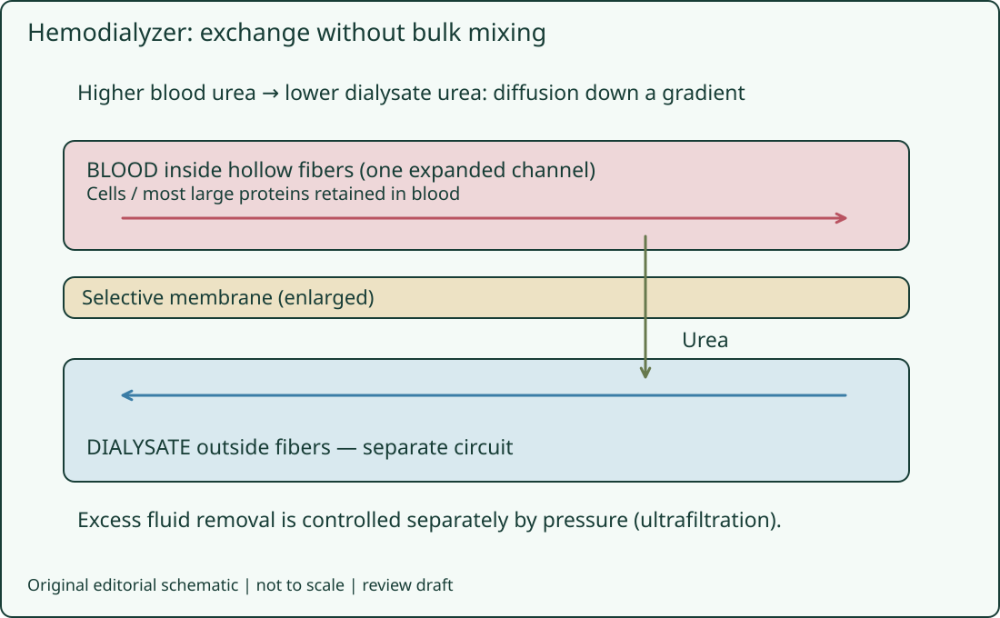
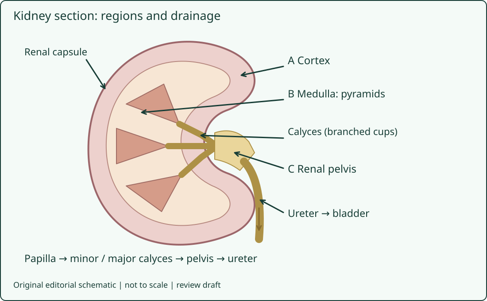
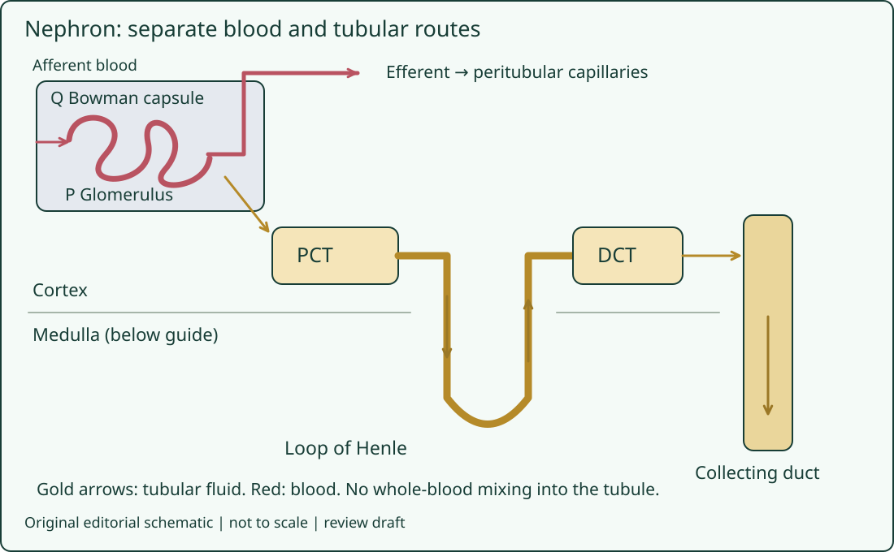

# ৮ম অধ্যায়: রেচন প্রক্রিয়া

> উত্তরসহ পর্যালোচনাধীন খসড়া; নির্ধারিত সংখ্যার উত্তরসহ খসড়া সম্পূর্ণ; বিষয়বস্তু পর্যালোচনা বাকি।
> মূল বই ও বিষয়বিশেষজ্ঞের পূর্ণ যাচাই বাকি। বোর্ড/স্কুল/সাল দাবি নেই।

## rebuild-mcq.json

### MCQ 1

অভিস্রবণ নিয়ন্ত্রণের বিষয় কোনটি?

A. শুধু খাদ্য কাটা
B. দেহতরলের পানি-দ্রবের সাম্য
C. শুধু হাড়ের দৈর্ঘ্য
D. শুধু আলো গ্রহণ

উত্তর: B — দেহতরলের পানি-দ্রবের সাম্য
osmoregulation অভ্যন্তরীণ তরলের ঘনত্ব নিয়ন্ত্রণে যুক্ত।

### MCQ 2

গরমে বেশি ঘামলে সুস্থ দেহ সাধারণত কীভাবে পানি ধরে?

A. সব ইউরিয়া গ্লুকোজ করে
B. সব নেফ্রন বিলুপ্ত করে
C. সব পানি মূত্রে ফেলে
D. পুনঃশোষণ বাড়িয়ে কম মূত্র করতে পারে

উত্তর: D — পুনঃশোষণ বাড়িয়ে কম মূত্র করতে পারে
শর্তসাপেক্ষ নিয়ন্ত্রণ; গুরুতর কম মূত্রকে উপেক্ষা নয়।

### MCQ 3

পানিশূন্যতায় রক্তরসের অসমোলালিটি বাড়লে কোন প্রতিক্রিয়া সহায়ক?

A. পানি পুনঃশোষণ কমা
B. তৃষ্ণা সম্পূর্ণ বন্ধ
C. সব লবণ তৈরি বন্ধ
D. তৃষ্ণা ও ADH বৃদ্ধি

উত্তর: D — তৃষ্ণা ও ADH বৃদ্ধি
পানি গ্রহণ ও সংরক্ষণে যৌথ প্রতিক্রিয়া হয়।

### MCQ 4

ADH-এর অন্য নাম কোনটি?

A. থাইরক্সিন
B. পেপসিন
C. ইনসুলিন
D. ভ্যাসোপ্রেসিন

উত্তর: D — ভ্যাসোপ্রেসিন
এটি পানি সংরক্ষণের হরমোনীয় নিয়ন্ত্রণে যুক্ত।

### MCQ 5

ADH প্রধানত কোথায় তৈরি হয়?

A. গ্লোমেরুলাসে
B. ইউরেটারে
C. হাইপোথ্যালামাসে
D. মূত্রাশয়ে

উত্তর: C — হাইপোথ্যালামাসে
পশ্চাৎ পিটুইটারি থেকে মুক্ত হয়; উৎপাদন ও মুক্তির স্থান পৃথক।

### MCQ 6

ADH কোন স্থান থেকে রক্তে মুক্ত হয়?

A. রেনাল পেলভিস
B. ক্ষুদ্রান্ত্রের ভিলাস
C. পশ্চাৎ পিটুইটারি
D. লালাগ্রন্থি

উত্তর: C — পশ্চাৎ পিটুইটারি
হাইপোথ্যালামাসে তৈরি হরমোন সেখানে সঞ্চিত/মুক্ত হয়।

### MCQ 7

ADH সংগ্রাহী নালিতে কী প্রভাব ফেলে?

A. জলপারগম্যতা বাড়ায়
B. সব রক্তকোষ বের করে
C. ইউরিয়া তৈরি বন্ধ করে
D. খাদ্য এনজাইম দেয়

উত্তর: A — জলপারগম্যতা বাড়ায়
aquaporin-সম্পর্কিত পরিবর্তনে পানি ফেরত যেতে পারে।

### MCQ 8

যথাযথ অবস্থায় ADH বেড়ে গেলে মূত্র কেমন হয়?

A. সম্পূর্ণ রক্ত
B. কম আয়তনের ও ঘন
C. সবসময় বেশি ও পাতলা
D. সবসময় গ্লুকোজপূর্ণ

উত্তর: B — কম আয়তনের ও ঘন
কার্যকর নালিকা ও ঘনত্বঢাল থাকার শর্ত প্রযোজ্য।

### MCQ 9

অনেক পানি গ্রহণের পর ADH কমলে কী প্রবণতা হয়?

A. সব পানি জমে যায়
B. কখনো মূত্র হয় না
C. তুলনামূলক পাতলা বেশি মূত্র
D. মূত্র সঙ্গে সঙ্গে কঠিন

উত্তর: C — তুলনামূলক পাতলা বেশি মূত্র
পানির ভারসাম্যে স্বাস্থ্যবান বৃক্কের স্বাভাবিক অভিযোজন।

### MCQ 10

ঋণাত্মক প্রতিপুষ্টির উদাহরণ কোনটি?

A. ঘাটতি কমলেও ADH অসীম বাড়া
B. সব আয়ন একই দিকে জমা
C. পানির ঘাটতি পূরণে ADH-উদ্দীপনা কমা
D. মূত্র গঠন চিরবন্ধ

উত্তর: C — পানির ঘাটতি পূরণে ADH-উদ্দীপনা কমা
প্রাথমিক বিচ্যুতি কমলে সংশোধনী সংকেতও কমে।

### MCQ 11

অ্যালডোস্টেরনের সঙ্গে প্রধানত কোন নিয়ন্ত্রণ যুক্ত?

A. অক্সিজেন তৈরি
B. স্টার্চ চর্বণ
C. সোডিয়াম ধরে রাখা ও পটাশিয়াম ক্ষরণ
D. সব প্রোটিন ছাঁকা

উত্তর: C — সোডিয়াম ধরে রাখা ও পটাশিয়াম ক্ষরণ
পানি সোডিয়ামের সঙ্গে সম্পর্কিতভাবে অনুসরণ করতে পারে।

### MCQ 12

বেশি লবণ খাওয়ার পর তৃষ্ণার সম্ভাব্য ব্যাখ্যা কী?

A. ইউরিয়া শূন্য হয়
B. সব কোষ তাৎক্ষণিক বাড়ে
C. লবণ রক্ত থেকে হারায়
D. দ্রবঘনত্বের পরিবর্তনে পানি চাহিদা

উত্তর: D — দ্রবঘনত্বের পরিবর্তনে পানি চাহিদা
নিয়ন্ত্রণে স্নায়বিক-হরমোনীয় সংকেত কাজ করে।

### MCQ 13

পানির প্রয়োজন সবার জন্য একই আট গ্লাস নয় কেন?

A. রোগে পানি সবসময় বাড়াতে হয়
B. পানি কারও লাগে না
C. সব গ্লাস একই মাপ
D. আবহাওয়া, কাজ ও স্বাস্থ্যভেদে চাহিদা বদলায়

উত্তর: D — আবহাওয়া, কাজ ও স্বাস্থ্যভেদে চাহিদা বদলায়
দেহাবস্থা ও চিকিৎসাগত তরলসীমা বিবেচ্য।

### MCQ 14

বৃক্ক বিকলতায় ইচ্ছামতো অনেক পানি খাওয়া ঝুঁকিপূর্ণ কেন?

A. নেফ্রন দ্বিগুণ হয়
B. অতিরিক্ত তরল জমতে পারে
C. ইউরিয়া তৎক্ষণাৎ শূন্য হয়
D. পানি সবসময় বিষ

উত্তর: B — অতিরিক্ত তরল জমতে পারে
দলীয় চিকিৎসা-পরামর্শে তরল সীমা নির্ধারণ দরকার।

### MCQ 15

কম সময়ে অতিরিক্ত পানি পানও ক্ষতিকর হতে পারে কেন?

A. সব পানি অক্সিজেন হয়
B. রক্তের সোডিয়াম অতিরিক্ত পাতলা হতে পারে
C. মূত্র সবসময় লাল
D. সব পাথর গলে

উত্তর: B — রক্তের সোডিয়াম অতিরিক্ত পাতলা হতে পারে
পানির সাম্য মানে শুধু যত বেশি তত ভালো নয়।

### MCQ 16

ইলেকট্রোলাইট সাম্যের উদাহরণ কোনটি?

A. শুধু পাতা ঝরা
B. শুধু চুলের রং
C. Na+ ও K+-এর মাত্রা নিয়ন্ত্রণ
D. শুধু ফুসফুসের আয়তন

উত্তর: C — Na+ ও K+-এর মাত্রা নিয়ন্ত্রণ
স্নায়ু-পেশিসহ বহু কাজ আয়নের নিয়ন্ত্রিত মাত্রার ওপর নির্ভর করে।

### MCQ 17

বৃক্কের রেনিন-সম্পর্কিত কাজ কোন ব্যবস্থায় যুক্ত?

A. শব্দ গ্রহণ
B. শ্বেতসার চর্বণ
C. রক্তচাপ নিয়ন্ত্রণ
D. আলো শোষণ

উত্তর: C — রক্তচাপ নিয়ন্ত্রণ
এটি বৃক্কের অতিরিক্ত শারীরবৃত্তীয় ভূমিকা।

### MCQ 18

বৃক্কের এরিথ্রোপয়েটিন কীতে সহায়তা করে?

A. অস্থিমজ্জায় লোহিতকণিকা উৎপাদনের সংকেতে
B. মূত্রাশয়ে RBC জমায়
C. সব ইউরিয়া ভাঙায়
D. অক্সিজেন গ্যাস বানায়

উত্তর: A — অস্থিমজ্জায় লোহিতকণিকা উৎপাদনের সংকেতে
বৃক্ক সরাসরি সব RBC তৈরি করে না।

### MCQ 19

দীর্ঘস্থায়ী বৃক্করোগে রক্তাল্পতার একটি সম্ভাব্য কারণ কী?

A. এরিথ্রোপয়েটিন কমে যাওয়া
B. সবসময় খাদ্যে লোহা শূন্য
C. ইউরেটারেই RBC তৈরি
D. সব রোগীর একই কারণ

উত্তর: A — এরিথ্রোপয়েটিন কমে যাওয়া
একাধিক কারণ থাকতে পারে; এটি একটি প্রক্রিয়া।

### MCQ 20

ভিটামিন D সক্রিয়করণে বৃক্কের ভূমিকা কিসে সহায়ক?

A. নাকে বায়ু
B. ক্যালসিয়াম ও অস্থিস্বাস্থ্য
C. শুধু মুখের লালা
D. ত্বকের সব রঞ্জক

উত্তর: B — ক্যালসিয়াম ও অস্থিস্বাস্থ্য
হরমোনীয় কাজেরও সীমা হতে পারে বৃক্করোগে।

### MCQ 21

কিডনি পাথর মূলত কী?

A. সবসময় জীবন্ত কৃমি
B. অক্ষত খাদ্যশস্য
C. মূত্রের কিছু পদার্থের স্ফটিক থেকে কঠিন জমা
D. জমাট অক্সিজেন

উত্তর: C — মূত্রের কিছু পদার্থের স্ফটিক থেকে কঠিন জমা
বিভিন্ন রাসায়নিক গঠনের পাথর হয়।

### MCQ 22

মূত্র কম ঘন না হয়ে বেশি ঘন থাকলে পাথরের ঝুঁকি কীভাবে বাড়তে পারে?

A. কিছু দ্রবের স্ফটিকায়ন সহজ হতে পারে
B. সব দ্রব নিশ্চয়ই গ্যাস হয়
C. সব লবণ অদৃশ্য
D. পাথর কেবল হাড়ে

উত্তর: A — কিছু দ্রবের স্ফটিকায়ন সহজ হতে পারে
ঝুঁকি বহু কারণনির্ভর; এটি এক সম্ভাব্য যোগ।

### MCQ 23

কিডনি পাথরের সম্ভাব্য উপসর্গ কোনটি?

A. কোমর-পার্শ্বে তীব্র ব্যথা ও রক্তমূত্র
B. অবশ্যই নীল ত্বক
C. সবসময় কোনো ব্যথা নেই
D. শুধু চুল লম্বা হওয়া

উত্তর: A — কোমর-পার্শ্বে তীব্র ব্যথা ও রক্তমূত্র
উপসর্গের অন্য কারণও থাকতে পারে; পরীক্ষা দরকার।

### MCQ 24

পাথর থাকলেও লক্ষণ নাও থাকতে পারে কেন?

A. ব্যথাই একমাত্র পরীক্ষা
B. সব পাথর কল্পনা
C. ছোট পাথর কখনো নড়ে না
D. আকার ও অবস্থানভেদে প্রভাব ভিন্ন

উত্তর: D — আকার ও অবস্থানভেদে প্রভাব ভিন্ন
উপসর্গহীনতা সবসময় রোগহীনতা প্রমাণ নয়।

### MCQ 25

ইউরেটারে পাথর আটকে গেলে প্রধান যান্ত্রিক সমস্যা কী?

A. মূত্রাশয়ে O2 তৈরি
B. সব নেফ্রন বেশি জন্মায়
C. রক্ত সরাসরি পাকস্থলীতে
D. মূত্রপ্রবাহে বাধা

উত্তর: D — মূত্রপ্রবাহে বাধা
বাধার চাপ বৃক্কের ক্ষতি করতে পারে।

### MCQ 26

পাথরসহ জ্বর-কাঁপুনি ও কম মূত্র হলে কী করা উচিত?

A. দ্রুত চিকিৎসা মূল্যায়ন
B. নিজে নালি ঢোকানো
C. পানি বন্ধ রেখে দিন কাটানো
D. বাড়িতে অজানা ওষুধে অপেক্ষা

উত্তর: A — দ্রুত চিকিৎসা মূল্যায়ন
সংক্রমণ/বাধা জরুরি সমস্যা হতে পারে।

### MCQ 27

পাথরের সব রোগীর একই চিকিৎসা নয় কেন?

A. আকার, অবস্থান, বাধা ও সংক্রমণ ভিন্ন
B. সবার বয়স অভিন্ন
C. সব পাথর একই ওষুধে গলে
D. সব পাথরের রংই একমাত্র বিষয়

উত্তর: A — আকার, অবস্থান, বাধা ও সংক্রমণ ভিন্ন
কখনো পর্যবেক্ষণ, কখনো পদ্ধতিগত চিকিৎসা লাগে।

### MCQ 28

আল্ট্রাসনোগ্রাম চিকিৎসক কেন চাইতে পারেন?

A. ইউরিয়ার স্বাদ নিতে
B. সব হরমোন মাপতে
C. মূত্রপথের গঠন/বাধা মূল্যায়নে
D. সব রোগ এক ছবিতে নিশ্চিত করতে

উত্তর: C — মূত্রপথের গঠন/বাধা মূল্যায়নে
পরীক্ষার ক্ষমতা ও সীমা আছে; নির্বাচন প্রসঙ্গনির্ভর।

### MCQ 29

পাথর ঠেকাতে সব ক্যালসিয়াম খাবার বন্ধ করা ভুল কেন?

A. সব পাথর চিনি
B. ধরন ও পুষ্টিচাহিদাভিত্তিক পরামর্শ দরকার
C. ক্যালসিয়াম কখনো দরকার নেই
D. খাদ্য কখনো ভূমিকা রাখে না

উত্তর: B — ধরন ও পুষ্টিচাহিদাভিত্তিক পরামর্শ দরকার
অপ্রয়োজনীয় নিষেধ পুষ্টিক্ষতি করতে পারে।

### MCQ 30

লেবুর পানি সব পাথর গলাবে—দাবি সম্পর্কে সঠিকটি কী?

A. সংক্রমণের নিশ্চিত ওষুধ
B. এটি নিশ্চয়তামূলক ভুল দাবি
C. প্রমাণ ছাড়াই সর্বজনীন সত্য
D. অস্ত্রোপচারের একমাত্র বিকল্প

উত্তর: B — এটি নিশ্চয়তামূলক ভুল দাবি
কিছু খাদ্যপরামর্শ থাকতে পারে, চিকিৎসার বিকল্প সার্বিক প্রতিশ্রুতি নয়।

### MCQ 31

UTI-এর পূর্ণ ধারণা কী?

A. মূত্রপথের সংক্রমণ
B. সবসময় পাথর
C. শুধু রক্তচাপ
D. সবসময় বৃক্ক বিকলতা

উত্তর: A — মূত্রপথের সংক্রমণ
মূত্রপথের ভিন্ন অংশ আক্রান্ত হতে পারে।

### MCQ 32

প্রস্রাবে জ্বালা ও বারবার তাগিদ হলে সঠিক পদক্ষেপ কী?

A. নিজে অন্যের অ্যান্টিবায়োটিক
B. সবসময় কেবল কম পানি ধরা
C. উপযুক্ত চিকিৎসা ও প্রয়োজনমতো পরীক্ষা
D. সব লক্ষণ লুকানো

উত্তর: C — উপযুক্ত চিকিৎসা ও প্রয়োজনমতো পরীক্ষা
লক্ষণ সংক্রমণসহ ভিন্ন কারণে হয়; নিজে রোগ নির্ধারণ নয়।

### MCQ 33

সংক্রমণের ওষুধ চিকিৎসকের নির্দেশে নেওয়া কেন জরুরি?

A. সব জীবাণু একই ওষুধে মরে
B. কারণ, উপযুক্ত ওষুধ ও নিরাপত্তা বিবেচনায়
C. বয়স কখনো গুরুত্বপূর্ণ নয়
D. বৃক্ক সব ওষুধ সমান ছাড়ে

উত্তর: B — কারণ, উপযুক্ত ওষুধ ও নিরাপত্তা বিবেচনায়
অনুপযুক্ত অ্যান্টিবায়োটিক প্রতিরোধ ও ক্ষতি বাড়াতে পারে।

### MCQ 34

রক্তমূত্র দেখলেই শুধু পাথর নির্ণয় করা ভুল কেন?

A. রক্তমূত্র সর্বদা স্বাভাবিক
B. বিভিন্ন রোগে এমন হতে পারে
C. এটি শুধু খাদ্যের মাপ
D. কোনো পরীক্ষা নেই

উত্তর: B — বিভিন্ন রোগে এমন হতে পারে
প্রকৃত রক্ত ও অন্য রঞ্জকও আলাদা করতে হতে পারে।

### MCQ 35

প্রচুর ফেনাযুক্ত মূত্র একাই কী প্রমাণ করে?

A. সব নেফ্রন স্বাভাবিক
B. অবশ্যই চূড়ান্ত বৃক্ক বিকলতা
C. নির্দিষ্ট রোগ নিশ্চিত করে না
D. কেবল পাথর

উত্তর: C — নির্দিষ্ট রোগ নিশ্চিত করে না
স্থায়ী হলে প্রোটিনসহ কারণ মূল্যায়ন উপযোগী।

### MCQ 36

ডায়াবেটিস দীর্ঘদিন অনিয়ন্ত্রিত থাকলে বৃক্কে কী ঝুঁকি?

A. বৃক্ক সম্পূর্ণ অপ্রয়োজনীয়
B. সবার সঙ্গে সঙ্গে পাথর
C. সূক্ষ্ম রক্তনালি ও ছাঁকনব্যবস্থার ক্ষতি
D. সবসময় বাড়তি নেফ্রন

উত্তর: C — সূক্ষ্ম রক্তনালি ও ছাঁকনব্যবস্থার ক্ষতি
ঝুঁকি বৃদ্ধি নিশ্চিত পরিণতি নয়; নিয়ন্ত্রণ ও নজরদারি জরুরি।

### MCQ 37

উচ্চ রক্তচাপ ও বৃক্করোগের সম্পর্ক কী?

A. একে অন্যকে বাড়াতে পারে
B. শুধু এক মিনিট স্থায়ী
C. সবসময় একই রোগ
D. কোনো সম্পর্ক নেই

উত্তর: A — একে অন্যকে বাড়াতে পারে
ক্ষতি ও তরল-চাপ নিয়ন্ত্রণে পারস্পরিক প্রভাব থাকতে পারে।

### MCQ 38

বৃক্করোগে লক্ষণ শুরুর আগেও পরীক্ষা লাগতে পারে কেন?

A. প্রাথমিক পর্যায় নীরব হতে পারে
B. সব রোগ একইদিন প্রকাশ
C. লক্ষণই একমাত্র মাপ
D. রক্তপরীক্ষা কখনো কাজ করে না

উত্তর: A — প্রাথমিক পর্যায় নীরব হতে পারে
ঝুঁকিপূর্ণ ব্যক্তির নজরদারি চিকিৎসক নির্ধারণ করেন।

### MCQ 39

AKI ও CKD-এর প্রধান সময়গত পার্থক্য কী?

A. দ্রুত ক্ষতি বনাম দীর্ঘস্থায়ী অস্বাভাবিকতা
B. CKD শুধু পাথরের নাম
C. AKI শুধু জন্মগত
D. দুটিই সবসময় কয়েক সেকেন্ড

উত্তর: A — দ্রুত ক্ষতি বনাম দীর্ঘস্থায়ী অস্বাভাবিকতা
সময়, পূর্বতথ্য ও পরীক্ষা দিয়ে পৃথক করা হয়।

### MCQ 40

তীব্র পানিশূন্যতায় বৃক্কের ক্ষতি কীভাবে হতে পারে?

A. ইউরেটার পুষ্টি শোষে
B. রক্তসরবরাহ কমে
C. সব পানি হাড়ে বদলায়
D. বৃক্কে O2 প্রয়োজন নেই

উত্তর: B — রক্তসরবরাহ কমে
গুরুতর অবস্থায় দ্রুত চিকিৎসা প্রয়োজন।

### MCQ 41

কিছু ব্যথার ওষুধের অনিয়ন্ত্রিত ব্যবহার কেন ঝুঁকি?

A. বৃক্কের রক্তপ্রবাহ/কাজ ক্ষতিগ্রস্ত হতে পারে
B. সব ওষুধ একরকম বিষ
C. সব ব্যথার ওষুধ নিষিদ্ধ
D. নাম বদলালেই ঝুঁকি নেই

উত্তর: A — বৃক্কের রক্তপ্রবাহ/কাজ ক্ষতিগ্রস্ত হতে পারে
বয়স, রোগ, মাত্রা ও সময়ভেদে ঝুঁকি বদলায়।

### MCQ 42

অজানা ‘কিডনি পরিষ্কার’ ভেষজ ব্যবহারে উদ্বেগ কী?

A. সব বৃক্ক নতুন হয়
B. উপাদান ও বিষক্রিয়ার অনিশ্চয়তা
C. প্রাকৃতিক মানেই পরীক্ষিত নিরাপদ
D. সব ডায়ালাইসিস বন্ধ

উত্তর: B — উপাদান ও বিষক্রিয়ার অনিশ্চয়তা
অজানা মিশ্রণ চিকিৎসার বিকল্প নয়।

### MCQ 43

বৃক্ক বিকলতায় ফোলা কেন হতে পারে?

A. মূত্র সব ত্বকে যায়
B. অস্থি হঠাৎ বড় হয়
C. সোডিয়াম-পানি জমাসহ কারণে
D. সব পেশি চর্বি হয়

উত্তর: C — সোডিয়াম-পানি জমাসহ কারণে
ফোলার অন্য কারণও আছে; রোগনির্ণয় নয়।

### MCQ 44

রক্তে পটাশিয়াম অতিরিক্ত বাড়লে কোন ঝুঁকি গুরুত্বপূর্ণ?

A. শুধু চুল সাদা
B. নিশ্চিত সুস্থতা
C. সবসময় বেশি ক্ষুধা
D. হৃদস্পন্দনের বিপজ্জনক পরিবর্তন

উত্তর: D — হৃদস্পন্দনের বিপজ্জনক পরিবর্তন
ইলেকট্রোলাইট সাম্য জীবনরক্ষাকারী।

### MCQ 45

বৃক্ক বিকলতায় শ্বাসকষ্ট জরুরি কেন?

A. এতে চিকিৎসা লাগে না
B. এটি সবসময় ব্যায়ামের ফল
C. শুধু মূত্রের রং বদলায়
D. তরল জমাসহ গুরুতর কারণ থাকতে পারে

উত্তর: D — তরল জমাসহ গুরুতর কারণ থাকতে পারে
নতুন/তীব্র শ্বাসকষ্টে দ্রুত সহায়তা প্রয়োজন।

### MCQ 46

রক্তের ক্রিয়েটিনিন রিপোর্ট একা চূড়ান্ত নয় কেন?

A. শুধু নখে তৈরি
B. এটি বৃক্কের সঙ্গে কখনো যুক্ত নয়
C. পেশিভর ও অন্যান্য বিষয় ফল প্রভাবিত করে
D. সব মানুষের একই মান

উত্তর: C — পেশিভর ও অন্যান্য বিষয় ফল প্রভাবিত করে
বয়স, পূর্বমান ও eGFR/অন্যান্য তথ্যসহ ব্যাখ্যা হয়।

### MCQ 47

eGFR মূলত কী নির্দেশের অনুমান?

A. মূত্রাশয়ের সর্বোচ্চ আয়তন
B. গ্লোমেরুলার পরিস্রাবণ হার
C. সব নেফ্রনের সরাসরি গণনা
D. পাথরের রাসায়নিক নাম

উত্তর: B — গ্লোমেরুলার পরিস্রাবণ হার
এটি estimate; পরোক্ষ সমীকরণভিত্তিক মাপ।

### MCQ 48

মূত্রে অ্যালবুমিন ও eGFR একসঙ্গে দেখা কেন?

A. একটি মাপ সব বলে
B. অ্যালবুমিন শুধু খাদ্যে
C. দুটিই শুধু পাথরের রং
D. ক্ষতি ও filtration-এর ভিন্ন তথ্য দেয়

উত্তর: D — ক্ষতি ও filtration-এর ভিন্ন তথ্য দেয়
পরিপূরক তথ্য রোগ মূল্যায়নে সহায়ক।

### MCQ 49

একবার বেশি ক্রিয়েটিনিন মানেই বহু বছরের CKD নয় কেন?

A. রক্তে ক্রিয়েটিনিন থাকে না
B. শুধু দাঁতের পরীক্ষা যথেষ্ট
C. বেশি মান সবসময় ভুল
D. স্থিতিকাল ও পরিবর্তনের ইতিহাস দরকার

উত্তর: D — স্থিতিকাল ও পরিবর্তনের ইতিহাস দরকার
তীব্র পরিবর্তন ও দীর্ঘস্থায়ী রোগ আলাদা করা জরুরি।

### MCQ 50

একটি সুস্থ বৃক্ক নিয়েও অনেকে থাকতে পারেন কেন?

A. অবশিষ্ট কার্যক্ষমতা প্রয়োজন মেটাতে পারে
B. দুটি বৃক্কই অকার্যকর
C. একটি বৃক্কে কখনো ঝুঁকি নেই
D. সব রোগে একই ফল

উত্তর: A — অবশিষ্ট কার্যক্ষমতা প্রয়োজন মেটাতে পারে
ব্যক্তিভেদে মূল্যায়ন ও নজরদারি প্রয়োজন; দানের নিশ্চয়তা নয়।

### MCQ 51

ডায়ালাইসিসের মূল ধারণা কী?

A. কিছু বর্জ্য ও অতিরিক্ত তরল অপসারণে সহায়তা
B. সকল হরমোন পূরণ
C. রক্তকে পানিতে বদলানো
D. সমস্ত নেফ্রন পুনর্জন্ম

উত্তর: A — কিছু বর্জ্য ও অতিরিক্ত তরল অপসারণে সহায়তা
এটি বৃক্কের সব কাজ সম্পূর্ণ প্রতিস্থাপন নয়।

### MCQ 52

হেমোডায়ালাইসিসে রক্ত কোথায় যায়?

A. দেহের বাইরের ডায়ালাইজারে
B. পানীয় জলের ট্যাংকে
C. পাকস্থলীতে
D. বাতাসে খোলা পাত্রে

উত্তর: A — দেহের বাইরের ডায়ালাইজারে
নিয়ন্ত্রিত বদ্ধ সার্কিটে চিকিৎসাদল চালায়।

### MCQ 53

ডায়ালাইজারের ঝিল্লির প্রধান কাজ কী?

A. সব রক্তকোষ বাইরে দেওয়া
B. যকৃত তৈরি
C. রক্ত ও ডায়ালাইসেট পৃথক রেখে নির্বাচিত বিনিময়
D. দুই তরল সরাসরি মেশানো

উত্তর: C — রক্ত ও ডায়ালাইসেট পৃথক রেখে নির্বাচিত বিনিময়
আংশিক ভেদ্য বাধা ছোট দ্রব চলতে দেয়।

### MCQ 54

ডায়ালাইসেটে ইউরিয়া কম রাখার যুক্তি কী?

A. রক্তে ইউরিয়া বাড়ানো
B. সব গ্লুকোজ সরানো
C. রক্ত জমাট করানো
D. রক্ত থেকে ইউরিয়ার ব্যাপনঢাল রাখা

উত্তর: D — রক্ত থেকে ইউরিয়ার ব্যাপনঢাল রাখা
ঘনত্বপার্থক্যে ছোট বর্জ্য ঝিল্লি পেরোয়।

### MCQ 55

ডায়ালাইসেটে প্রয়োজনীয় আয়ন নির্ধারণ করা হয় কেন?

A. শুধু রং মেলাতে
B. সব আয়ন অবশ্যই শূন্য করতে
C. রক্তের সঙ্গে মেশাতে
D. অতিরিক্ত ক্ষয় বা ভুল বিনিময় এড়াতে

উত্তর: D — অতিরিক্ত ক্ষয় বা ভুল বিনিময় এড়াতে
দ্রবের ঘনত্ব রোগীর প্রয়োজনমতো তৈরি হয়।

### MCQ 56

ডায়ালাইজারে RBC সাধারণত রক্তপথেই থাকে কেন?

A. ঝিল্লি অক্ষত অবস্থায় কোষ আটকায়
B. RBC ব্যাপন করে বায়ু হয়
C. রক্তে কোনো কোষ নেই
D. সব RBC ডায়ালাইসেটে দরকার

উত্তর: A — ঝিল্লি অক্ষত অবস্থায় কোষ আটকায়
বড় গঠন ও অধিকাংশ বড় প্রোটিন ধরে রাখা হয়।

### MCQ 57

ডায়ালাইসেটে সরাসরি পূর্ণ রক্ত ব্যবহার করা হয় না কেন?

A. এটি শুধু বিশুদ্ধ তেল
B. এটি নির্দিষ্ট দ্রবণ, রক্তের মিশ্রণ নয়
C. সবসময় নোনতা পানি যথেষ্ট
D. শুধু রক্তই দ্রবণ

উত্তর: B — এটি নির্দিষ্ট দ্রবণ, রক্তের মিশ্রণ নয়
নিরাপদ চিকিৎসাগত composition দরকার।

### MCQ 58

হেমোডায়ালাইসিসে অতিরিক্ত পানি সরানোর নিয়ন্ত্রিত পদ্ধতি কী?

A. ইউরেটারে ফুঁ দেওয়া
B. সব রক্ত শুকানো
C. চাপভিত্তিক ultrafiltration
D. শুধু পানি ফুটানো

উত্তর: C — চাপভিত্তিক ultrafiltration
তরল অপসারণ ও দ্রব ব্যাপন আলাদা নীতির সঙ্গে যুক্ত।

### MCQ 59

রক্ত ও ডায়ালাইসেট বিপরীতমুখে প্রবাহের সুবিধা কী?

A. সব কোষ একসঙ্গে মেশানো
B. দৈর্ঘ্যজুড়ে কার্যকর ঘনত্বঢাল ধরে রাখা
C. রক্তচাপ সর্বদা শূন্য
D. ঝিল্লি বিলুপ্ত করা

উত্তর: B — দৈর্ঘ্যজুড়ে কার্যকর ঘনত্বঢাল ধরে রাখা
countercurrent বিন্যাস বিনিময় দক্ষতা বাড়াতে সহায়ক।

### MCQ 60

ডায়ালাইসিসের পরও ওষুধ/খাদ্যনিয়ন্ত্রণ লাগতে পারে কেন?

A. ডায়ালাইসিস কোনো কাজই করে না
B. সব রোগ সারে
C. সব রেনাল কাজ পুনরুদ্ধার হয় না
D. কেবল রক্তের রং বদলায়

উত্তর: C — সব রেনাল কাজ পুনরুদ্ধার হয় না
ব্যক্তিভিত্তিক সমন্বিত যত্ন দরকার।

### MCQ 61

সবার সপ্তাহে একই সেশনসূচি নির্ধারণ অনুচিত কেন?

A. মেশিন শুধু একবার চলে
B. সব রোগীর ভর সমান
C. অবশিষ্ট কাজ ও চিকিৎসাগত প্রয়োজন ভিন্ন
D. কোনো সেশন লাগে না

উত্তর: C — অবশিষ্ট কাজ ও চিকিৎসাগত প্রয়োজন ভিন্ন
প্রচলিত সূচি ব্যক্তিগত prescription নয়।

### MCQ 62

ডায়ালাইসিস রক্তপ্রবেশপথ কার তত্ত্বাবধানে থাকে?

A. নিজে ঘরে বানানো নল
B. অনিরীক্ষিত দোকানের
C. যেকোনো সহপাঠীর
D. প্রশিক্ষিত চিকিৎসাদলের

উত্তর: D — প্রশিক্ষিত চিকিৎসাদলের
access তৈরি ও রক্ষণ চিকিৎসাগত কাজ, শ্রেণিকক্ষ পরীক্ষা নয়।

### MCQ 63

ডায়ালাইসিস চলাকালে দুর্বলতা/চাপ কমলে কী দরকার?

A. সেশন বাড়ানো নিজে
B. সবসময় চুপ থাকা
C. দলকে দ্রুত জানিয়ে মূল্যায়ন
D. নিজে রক্তনালি খুলে দেওয়া

উত্তর: C — দলকে দ্রুত জানিয়ে মূল্যায়ন
পর্যবেক্ষণ চিকিৎসার নিরাপত্তার অংশ।

### MCQ 64

পেরিটোনিয়াল ডায়ালাইসিসে কোন ঝিল্লি কাজে লাগে?

A. রেটিনা
B. কানের পর্দা
C. উদরের পেরিটোনিয়াম
D. ফুসফুসের অ্যালভিওলাস

উত্তর: C — উদরের পেরিটোনিয়াম
চিকিৎসাগতভাবে তরল দেওয়া-নেওয়ায় বিনিময় হয়।

### MCQ 65

হেমোডায়ালাইসিস ও পেরিটোনিয়াল পদ্ধতির একটি মিল কী?

A. কোনোটিতে সংক্রমণঝুঁকি নেই
B. দুটিই একই বাহ্যিক dialyzer
C. দুটিই সব হরমোন তৈরি
D. দ্রব বিনিময়ে ঝিল্লির ভূমিকা

উত্তর: D — দ্রব বিনিময়ে ঝিল্লির ভূমিকা
ঝিল্লির অবস্থান ও ব্যবস্থা আলাদা হলেও বর্জ্য বিনিময় সাধারণ নীতি।

### MCQ 66

ডায়ালাইসিসকে বৃক্ক প্রতিস্থাপন বলা ভুল কেন?

A. ডায়ালাইসিসে নতুন অঙ্গ বসে
B. দুটিই শুধু পানি পান
C. প্রতিস্থাপনে কখনো সার্জারি নেই
D. কার্যসহায়তা ও অঙ্গস্থাপন পৃথক

উত্তর: D — কার্যসহায়তা ও অঙ্গস্থাপন পৃথক
একটি পদ্ধতিগত বিকল্প, অন্যটি অস্ত্রোপচারভিত্তিক অঙ্গ প্রতিস্থাপন।

### MCQ 67

তীব্র ক্ষতিতে সাময়িক ডায়ালাইসিস লাগলে কী বোঝায়?

A. কিছু ক্ষেত্রে কাজ ফিরে আসতে পারে
B. সবসময় আজীবন লাগবেই
C. সব ক্ষেত্রে পরদিন বন্ধ
D. কোনো পর্যবেক্ষণ লাগে না

উত্তর: A — কিছু ক্ষেত্রে কাজ ফিরে আসতে পারে
কারণ ও পুনরুদ্ধারভেদে ফল ভিন্ন।

### MCQ 68

ডায়ালাইসেটকে বিশুদ্ধ পানি বলা বিপজ্জনক কেন?

A. ভুল দ্রবঘনত্বে অনাকাঙ্ক্ষিত স্থানান্তর হতে পারে
B. পানির কোনো প্রভাব নেই
C. রক্ত ও পানি সমান
D. সব আয়ন একই

উত্তর: A — ভুল দ্রবঘনত্বে অনাকাঙ্ক্ষিত স্থানান্তর হতে পারে
দ্রবণ নিরাপদভাবে প্রস্তুত/মাননিয়ন্ত্রিত হতে হয়।

### MCQ 69

ডায়ালাইসিসে গ্লুকোজ বজায় রাখার যুক্তি কী হতে পারে?

A. RBC-কে স্টার্চ করা
B. অপ্রয়োজনীয় গ্লুকোজক্ষয় সীমিত করা
C. ইউরেটার গলানো
D. সকল গ্লুকোজ বের করা

উত্তর: B — অপ্রয়োজনীয় গ্লুকোজক্ষয় সীমিত করা
উপযুক্ত দ্রবঘনত্ব নির্ধারণ চিকিৎসাগত সিদ্ধান্ত।

### MCQ 70

বর্জ্য কমলেও ডায়ালাইসিসকে ‘স্থায়ী নিরাময়’ বলা যায় না কেন?

A. কোনো উপকার নেই
B. অন্তর্নিহিত ক্ষতি থেকে যেতে পারে
C. সব কিডনি নতুন হয়
D. দাতা অপ্রয়োজনীয় হয় সবসময়

উত্তর: B — অন্তর্নিহিত ক্ষতি থেকে যেতে পারে
উপসর্গ নিয়ন্ত্রণ ও রোগ নিরাময় আলাদা।

### MCQ 71

বৃক্ক প্রতিস্থাপনে মূলত কী করা হয়?

A. উপযুক্ত দাতার বৃক্ক গ্রহীতায় স্থাপন
B. মূত্রাশয়ে পানি ভরা
C. শুধু ধমনি মাপা
D. কৃত্রিম ফুসফুস বসানো

উত্তর: A — উপযুক্ত দাতার বৃক্ক গ্রহীতায় স্থাপন
শল্যচিকিৎসা ও পরবর্তী দীর্ঘমেয়াদি যত্ন প্রয়োজন।

### MCQ 72

জীবিত দাতার নিরাপত্তায় কী অপরিহার্য?

A. শুধু অর্থপ্রদান
B. যেকোনো ব্যক্তিকে চাপ
C. শুধু আত্মীয় পরিচয়
D. স্বতন্ত্র স্বাস্থ্যপরীক্ষা ও স্বেচ্ছাসম্মতি

উত্তর: D — স্বতন্ত্র স্বাস্থ্যপরীক্ষা ও স্বেচ্ছাসম্মতি
দাতার মঙ্গলও চিকিৎসার নিজস্ব লক্ষ্য।

### MCQ 73

আত্মীয় হলেই বৃক্ক অবশ্যই মিলে যাবে কি?

A. হ্যাঁ সব আত্মীয় মেলে
B. না, সামঞ্জস্য পরীক্ষা দরকার
C. পরীক্ষা নিষিদ্ধ
D. শুধু নাম মিললেই হয়

উত্তর: B — না, সামঞ্জস্য পরীক্ষা দরকার
রক্তের গ্রুপ, টিস্যু/অ্যান্টিবডি ও অন্যান্য পরীক্ষা প্রাসঙ্গিক।

### MCQ 74

প্রতিস্থাপনে crossmatch কী বিষয়ে সহায়ক?

A. দাতা-গ্রহীতার প্রতিরক্ষাগত অসামঞ্জস্য মূল্যায়ন
B. শুধু খাদ্যের ক্যালরি
C. দুইজনের উচ্চতা সমান করা
D. ইউরেটারের দৈর্ঘ্যমাত্র

উত্তর: A — দাতা-গ্রহীতার প্রতিরক্ষাগত অসামঞ্জস্য মূল্যায়ন
গ্রহীতার অ্যান্টিবডি-সম্পর্কিত ঝুঁকি দেখা হয়।

### MCQ 75

প্রত্যাখ্যান বা rejection-এর মূল ধারণা কী?

A. গ্রহীতার প্রতিরক্ষা ব্যবস্থার অঙ্গের বিরুদ্ধে প্রতিক্রিয়া
B. মূত্রাশয়ের ক্ষুধা
C. সবসময় জীবাণুর একমাত্র কাজ
D. দাতা অঙ্গের ইচ্ছাকৃত সিদ্ধান্ত

উত্তর: A — গ্রহীতার প্রতিরক্ষা ব্যবস্থার অঙ্গের বিরুদ্ধে প্রতিক্রিয়া
প্রতিরোধে চিকিৎসা ও পর্যবেক্ষণ লাগে।

### MCQ 76

প্রতিস্থাপনের পর immunosuppressant কেন লাগে?

A. দেহে নতুন DNA বন্ধ করতে
B. প্রত্যাখ্যানের ঝুঁকি কমাতে
C. সব জীবাণু মারতে
D. সব পাথর নিশ্চিত গলাতে

উত্তর: B — প্রত্যাখ্যানের ঝুঁকি কমাতে
নিজে ওষুধ বন্ধ করলে graft ঝুঁকিতে পড়তে পারে।

### MCQ 77

প্রতিরক্ষাদমন ওষুধে সংক্রমণ নজরদারি কেন গুরুত্বপূর্ণ?

A. সংক্রমণের ঝুঁকি বাড়তে পারে
B. প্রতিরক্ষা অসীম হয়
C. ওষুধ সবসময় অ্যান্টিবায়োটিক
D. সব জীবাণু নিষ্ক্রিয় হয়

উত্তর: A — সংক্রমণের ঝুঁকি বাড়তে পারে
লাভ-ঝুঁকি সামলে চিকিৎসক মাত্রা ঠিক করেন।

### MCQ 78

প্রতিস্থাপনের পর নিয়মিত follow-up-এর লক্ষ্য কী?

A. শুধু সেলাইয়ের রং
B. অঙ্গের কাজ, ওষুধ ও জটিলতা দেখা
C. সব পরীক্ষা আজীবন বন্ধ
D. কেবল দাতার নাম

উত্তর: B — অঙ্গের কাজ, ওষুধ ও জটিলতা দেখা
কাজ ভালো হলেও দীর্ঘমেয়াদি তত্ত্বাবধান থাকে।

### MCQ 79

ব্রেন ডেথ ও কোমা এক নয় কেন?

A. সব অচেতনই মৃত
B. নির্ধারিত পরীক্ষা-মানদণ্ডে মৃত্যু নিরূপণ আলাদা
C. যেকেউ দেখে ঘোষণা দেয়
D. ঘুম মানেই ব্রেন ডেথ

উত্তর: B — নির্ধারিত পরীক্ষা-মানদণ্ডে মৃত্যু নিরূপণ আলাদা
বিশেষজ্ঞ ও প্রযোজ্য বিধি ছাড়া মৃত্যুনির্ধারণ নয়।

### MCQ 80

মৃতদেহ থেকে অঙ্গদানের আলোচনায় কোনটি জরুরি?

A. পরিবারকে গোপন রাখা সর্বদা
B. শুধু দ্রুত অঙ্গ নেওয়া
C. মৃত্যুনির্ধারণ, বৈধ সম্মতি ও নৈতিক সুরক্ষা
D. অচেতন মানেই অনুমতি

উত্তর: C — মৃত্যুনির্ধারণ, বৈধ সম্মতি ও নৈতিক সুরক্ষা
দেশভেদে বিধি ভিন্ন; যাচাইহীন আইন দাবি নয়।

### MCQ 81

অঙ্গ কেনাবেচার প্রলোভনযুক্ত প্রচার কেন অনৈতিক?

A. সব অপেক্ষা দূর করে
B. শোষণ ও জবরদস্তির ঝুঁকি
C. দাতার নিরাপত্তা বাড়ায় নিশ্চিত
D. পরীক্ষা অপ্রয়োজনীয় করে

উত্তর: B — শোষণ ও জবরদস্তির ঝুঁকি
স্বেচ্ছা, ন্যায় ও বৈধ চিকিৎসাব্যবস্থা কেন্দ্রীয়।

### MCQ 82

প্রতিস্থাপন সবার জন্য একমাত্র সেরা বিকল্প নয় কেন?

A. স্বাস্থ্য, সামঞ্জস্য ও যোগ্যতা পৃথক
B. অঙ্গ কখনো কাজ করে না
C. সব রোগী অভিন্ন
D. ডায়ালাইসিস নিষিদ্ধ

উত্তর: A — স্বাস্থ্য, সামঞ্জস্য ও যোগ্যতা পৃথক
বিকল্প নিয়ে চিকিৎসাদল ও রোগীর যৌথ সিদ্ধান্ত জরুরি।

### MCQ 83

সফল graft থাকলেও ‘আর কোনো যত্ন নয়’ দাবি ভুল কেন?

A. ওষুধ ও নজরদারি চলতে হয়
B. প্রতিরক্ষা আর নেই
C. রক্তচাপ আর হয় না
D. বৃক্ক সবসময় অমর

উত্তর: A — ওষুধ ও নজরদারি চলতে হয়
সফলতা দায়মুক্তি নয়, দীর্ঘমেয়াদি ব্যবস্থাপনা।

### MCQ 84

দান-সচেতনতায় নিরাপদ ভাষা কোনটি?

A. প্রতিটি সুস্থ ব্যক্তিকে বাধ্য করা
B. স্বেচ্ছায় তথ্য জেনে অনুমোদিত কেন্দ্রে পরামর্শ
C. পরীক্ষা ছাড়াই নিশ্চয়তা
D. অজানা দালালের যোগাযোগ

উত্তর: B — স্বেচ্ছায় তথ্য জেনে অনুমোদিত কেন্দ্রে পরামর্শ
সচেতনতা মানে চাপ বা লেনদেনের প্রচার নয়।

### MCQ 85

ডায়ালাইসিসে কোন স্বাভাবিক কাজ সরাসরি সম্পূর্ণ ফেরে না?

A. কিছু অতিরিক্ত পানি সরানো
B. কিছু আয়ন বিনিময়
C. এরিথ্রোপয়েটিনসহ হরমোনীয় কাজ
D. কিছু ইউরিয়া সরানো

উত্তর: C — এরিথ্রোপয়েটিনসহ হরমোনীয় কাজ
অবশিষ্ট কাজের জন্য অতিরিক্ত চিকিৎসা লাগতে পারে।

### MCQ 86

স্কুলের dialysis মডেলে কী ব্যবহার নিরাপদ?

A. কৃত্রিম দ্রব ও প্রস্তুত membrane model
B. নিজের রক্ত
C. শরীরে নল
D. রোগীর ব্যবহৃত ফিল্টার

উত্তর: A — কৃত্রিম দ্রব ও প্রস্তুত membrane model
জীবন্ত দেহে প্রবেশ নয়; মডেলের সীমা স্বীকার করতে হবে।

### MCQ 87

মডেলে রং পার হলেই বাস্তবে সব বিষ সরে—কেন নয়?

A. কোষও রঙের সমান
B. অণুর আকার-বাঁধন ও বাস্তব প্রবাহ ভিন্ন
C. সব ঝিল্লি অভিন্ন
D. রং মানেই সব বিষ

উত্তর: B — অণুর আকার-বাঁধন ও বাস্তব প্রবাহ ভিন্ন
এক পদার্থের ফল থেকে সর্বজনীন দাবি করা যায় না।

### MCQ 88

গবেষণায় পানি গ্রহণ ও মূত্রের ডেটা তুলনায় আর কী লিখবে?

A. শুধু নাম
B. শুধু হাতের রং
C. সময়, কাজ ও ঘামের প্রসঙ্গ
D. কেবল জুতার মাপ

উত্তর: C — সময়, কাজ ও ঘামের প্রসঙ্গ
ভিন্ন প্রভাবকারী নিয়ন্ত্রণ/নথিভুক্ত না করলে সিদ্ধান্ত দুর্বল।

### MCQ 89

বিনা সম্মতিতে সহপাঠীর স্বাস্থ্যরিপোর্ট প্রকাশ কেন অনুচিত?

A. নাম মুছলেও সবসময় অভিন্ন ঝুঁকি
B. পড়াশোনায় গোপনীয়তা নেই
C. স্বাস্থ্যতথ্যের গোপনীয়তা ভাঙে
D. সব রিপোর্ট সবার সম্পত্তি

উত্তর: C — স্বাস্থ্যতথ্যের গোপনীয়তা ভাঙে
শিক্ষায় কৃত্রিম/অনামিক তথ্য ও সম্মতি উপযোগী।

### MCQ 90

কয়েকজনের গাঢ় মূত্র দেখে স্কুলে বৃক্করোগের হার বলা ভুল কেন?

A. রং সব রোগ নিশ্চিত করে
B. সব শিক্ষার্থীর একই দেহ
C. নমুনা ও রোগনির্ণয় অপর্যাপ্ত
D. নমুনা লাগে না

উত্তর: C — নমুনা ও রোগনির্ণয় অপর্যাপ্ত
পরীক্ষা, সংজ্ঞা ও প্রতিনিধিত্ব দরকার।

### MCQ 91

0.8 L থেকে 1.2 L মূত্র হলে শতকরা বৃদ্ধি কত?

A. 150%
B. 33.3%
C. 0.4%
D. 50%

উত্তর: D — 50%
(1.2−0.8)/0.8×100=50%; বৃদ্ধি ও চূড়ান্ত শতকরা আলাদা।

### MCQ 92

মূত্রের দৈনিক আয়তন তুলনায় 6 ঘণ্টার নমুনা সরাসরি 24 ঘণ্টার সঙ্গে মেলানো ভুল কেন?

A. সময়ভিত্তি আলাদা
B. দিনে বৃক্ক বন্ধ
C. সব নমুনা সমান
D. আয়তনের একক নেই

উত্তর: A — সময়ভিত্তি আলাদা
সময় সমান করা বা হার তুলনা দরকার, দৈনিক পরিবর্তনও থাকে।

### MCQ 93

ইউরিয়ায় N আছে বলে প্রতিটি N-যুক্ত অণুই বর্জ্য নয় কেন?

A. অ্যামিনো অ্যাসিডও প্রয়োজনীয়
B. প্রোটিন কেবল মূত্রে
C. সব N-যুক্ত পদার্থ বিষ
D. DNA কখনো N বহন করে না

উত্তর: A — অ্যামিনো অ্যাসিডও প্রয়োজনীয়
রাসায়নিক উপাদান নয়, বিপাকীয় ভূমিকা বিবেচ্য।

### MCQ 94

রেচনপথে ফুসফুস যুক্ত হলেও সেটি ইউরিয়া প্রধানত সরায় না কেন?

A. ফুসফুসে রক্ত নেই
B. সব ইউরিয়া গ্যাস
C. ইউরিয়া শুধু বায়ুতে
D. CO2 প্রধান গ্যাসীয় বর্জ্য

উত্তর: D — CO2 প্রধান গ্যাসীয় বর্জ্য
বর্জ্যের প্রকৃতি ও অঙ্গের বিশেষায়ন পৃথক।

### MCQ 95

সুস্থ মূত্রে বড় প্রোটিন অল্প অথচ ইউরিয়া থাকে—কী বোঝায়?

A. আকারভিত্তিক বাধা ও নালিকাগত প্রক্রিয়ার সম্মিলিত ফল
B. সব প্রোটিন ইউরিয়া
C. মূত্রাশয় প্রোটিন গিলে
D. দুটির অণু সমান

উত্তর: A — আকারভিত্তিক বাধা ও নালিকাগত প্রক্রিয়ার সম্মিলিত ফল
ছাঁকন ও পরবর্তী প্রক্রিয়া ভিন্ন পদার্থে ভিন্ন ফল দেয়।

### MCQ 96

মূত্রপথ বন্ধ কিন্তু নেফ্রন কিছুক্ষণ কাজ করছে—কোন সিদ্ধান্ত ঠিক?

A. বাধা মানে কোনো ক্ষতির ঝুঁকি নেই
B. প্রবাহবাধা ও উৎপাদন এক বিষয় নয়
C. ইউরেটারই পরিস্রাবক
D. সব মূত্র বাইরে যেতেই হবে

উত্তর: B — প্রবাহবাধা ও উৎপাদন এক বিষয় নয়
পেছনে চাপ বাড়তে পারে; দ্রুত মূল্যায়ন প্রয়োজন।

### MCQ 97

‘বৃক্কে ব্যথা নেই তাই বৃক্ক সুস্থ’—ত্রুটি কী?

A. কিছু ক্ষতি ব্যথাহীন থাকে
B. শুধু ব্যথা দিয়ে GFR মাপা যায়
C. সব ক্ষতি সর্বদা ব্যথাযুক্ত
D. পরীক্ষা নিষ্প্রয়োজন

উত্তর: A — কিছু ক্ষতি ব্যথাহীন থাকে
উপসর্গ, ঝুঁকি ও পরীক্ষা মিলিয়ে বিবেচনা জরুরি।

### MCQ 98

পানি নিয়ন্ত্রণে বৃক্ক ও তৃষ্ণার যৌথ কাজ কী বোঝায়?

A. অঙ্গগুলোর সমন্বিত হোমিওস্ট্যাসিস
B. স্নায়ুতন্ত্র অপ্রাসঙ্গিক
C. একই অঙ্গ সব কাজ
D. মূত্র সবসময় নির্দিষ্ট

উত্তর: A — অঙ্গগুলোর সমন্বিত হোমিওস্ট্যাসিস
আচরণগত গ্রহণ ও রেনাল সংরক্ষণ একসঙ্গে সাম্য আনে।

### MCQ 99

একই ইউরিয়া ঘনত্বের রক্ত ও ডায়ালাইসেটে নিট ব্যাপন কী প্রবণতা হবে?

A. ঝিল্লি অদৃশ্য হবে
B. অবশ্যই সর্বাধিক বাড়বে
C. সব RBC বেরোবে
D. ঘনত্বচালিত নিট চলন কমবে

উত্তর: D — ঘনত্বচালিত নিট চলন কমবে
সাম্য হলে দ্বিমুখী অণুচলন থাকলেও নিট flux শূন্য হতে পারে।

### MCQ 100

কেন রোগীর নির্দেশিত ওষুধের মাত্রায় বৃক্কের কাজ বিবেচ্য?

A. কিছু ওষুধ/বিপাকজাত পদার্থের অপসারণ বদলায়
B. প্রতিবার দ্বিগুণ মাত্রা দরকার
C. সব ওষুধ একমাত্র ফুসফুস ছাড়ে
D. মূত্রের সঙ্গে ওষুধের সম্পর্ক নেই

উত্তর: A — কিছু ওষুধ/বিপাকজাত পদার্থের অপসারণ বদলায়
মাত্রা বদল চিকিৎসকের সিদ্ধান্ত, নিজে নয়।

### MCQ 101

বিপাকজাত বর্জ্য দেহ থেকে সরানোর প্রক্রিয়া কোনটি?

A. পরাগায়ন
B. রক্ততঞ্চন
C. পরিপাক
D. রেচন

উত্তর: D — রেচন
রেচন অভ্যন্তরীণ রাসায়নিক কাজের বর্জ্য অপসারণ করে।

### MCQ 102

রেচন ও অপাচ্য খাদ্যত্যাগের মূল পার্থক্য কী?

A. দুটির উৎসই কেবল অস্থি
B. রেচনে কখনো পানি থাকে না
C. খাদ্যত্যাগ শুধু ফুসফুসে
D. বর্জ্যের উৎস আলাদা

উত্তর: D — বর্জ্যের উৎস আলাদা
অপাচ্য খাদ্য অন্ত্রের অবশিষ্ট; বিপাকজাত বর্জ্য ভিন্ন উৎসের।

### MCQ 103

মানুষের প্রধান নাইট্রোজেনঘটিত রেচন পদার্থ কোনটি?

A. ইউরিয়া
B. গ্লুকোজ
C. স্টার্চ
D. অক্সিজেন

উত্তর: A — ইউরিয়া
মানুষে নাইট্রোজেন বর্জ্যের বড় অংশ ইউরিয়া রূপে বেরোয়।

### MCQ 104

ইউরিয়া প্রধানত কোথায় তৈরি হয়?

A. যকৃতে
B. ইউরেটারে
C. প্লীহায়
D. মূত্রাশয়ে

উত্তর: A — যকৃতে
যকৃতে বিষাক্ত অ্যামোনিয়ার নাইট্রোজেন তুলনামূলক কম বিষাক্ত ইউরিয়ায় রূপ নেয়।

### MCQ 105

অ্যামিনো অ্যাসিডের অ্যামিনো অংশ অপসারণের নাম কী?

A. ডিঅ্যামিনেশন
B. অক্সিজেনেশন
C. গ্লাইকোলাইসিসমাত্র
D. অনুবাদ

উত্তর: A — ডিঅ্যামিনেশন
এতে নাইট্রোজেন বর্জ্য তৈরির উপাদান আসে।

### MCQ 106

অ্যামোনিয়াকে ইউরিয়ায় বদলানো কেন উপকারী?

A. সব নাইট্রোজেন শক্তি হয়
B. পানি অপ্রয়োজনীয় হয়
C. বিষাক্ততা কমিয়ে পরিবহণ সহজ করে
D. বৃক্কের সব কাজ বন্ধ হয়

উত্তর: C — বিষাক্ততা কমিয়ে পরিবহণ সহজ করে
ইউরিয়াও জমে গেলে ক্ষতিকর; সম্পূর্ণ নিরীহ নয়।

### MCQ 107

ইউরিয়া তৈরি ও নিষ্কাশন এক অঙ্গের একই কাজ নয় কেন?

A. শুধু ত্বকেই উভয়
B. ইউরেটারে গঠন, নাকে ত্যাগ
C. যকৃতে গঠন, বৃক্কে প্রধান অপসারণ
D. মূত্রাশয়েই উভয়

উত্তর: C — যকৃতে গঠন, বৃক্কে প্রধান অপসারণ
রক্ত দুই অঙ্গের মধ্যে বর্জ্য পরিবহণ করে।

### MCQ 108

কার্বন ডাই-অক্সাইডের প্রধান রেচনপথ কী?

A. প্লীহা
B. লালাগ্রন্থি
C. মূত্রাশয়
D. ফুসফুস

উত্তর: D — ফুসফুস
রক্তে আসা CO2 অ্যালভিওলাস হয়ে শ্বাসত্যাগে বেরোয়।

### MCQ 109

ঘামে প্রধানত কোন দুটি পদার্থ বেরোয়?

A. হিমোগ্লোবিন ও DNA
B. পানি ও লবণ
C. স্টার্চ ও পিত্ত
D. অস্থি ও তরুণাস্থি

উত্তর: B — পানি ও লবণ
ঘামে অল্প ইউরিয়াও থাকতে পারে; এটি প্রধান নাইট্রোজেন রেচনপথ নয়।

### MCQ 110

ঘর্মগ্রন্থির প্রধান কার্যগত গুরুত্ব কোনটি?

A. খাদ্য শোষণ
B. অক্সিজেন তৈরি
C. সব রেনাল কাজের বিকল্প
D. তাপ নিয়ন্ত্রণে সহায়তা

উত্তর: D — তাপ নিয়ন্ত্রণে সহায়তা
বাষ্পীভবনে তাপ হারায়; ঘামকে সর্ববর্জ্য detox বলা ঠিক নয়।

### MCQ 111

ইউরিক অ্যাসিড কোন ধরনের বিপাকের সঙ্গে সম্পর্কিত?

A. শুধু অক্সিজেন গঠন
B. তরুণাস্থির দহন
C. পিউরিন ভাঙন
D. শুধু স্টার্চ সঞ্চয়

উত্তর: C — পিউরিন ভাঙন
এটি নাইট্রোজেনঘটিত একটি রেচন পদার্থ।

### MCQ 112

ক্রিয়েটিনিনের একটি সাধারণ উৎস কী?

A. শুধু লালার পানি
B. পেশির ক্রিয়েটিন-সম্পর্কিত বিপাক
C. শুধু হিমোগ্লোবিনে O2 বাঁধা
D. ফুসফুসে N2 উৎপাদন

উত্তর: B — পেশির ক্রিয়েটিন-সম্পর্কিত বিপাক
রক্তের ক্রিয়েটিনিন বৃক্ক মূল্যায়নে ব্যবহৃত হয়, একা নিখুঁত পরীক্ষা নয়।

### MCQ 113

মূত্রের বৃহত্তম উপাদান কী?

A. গ্লুকোজ
B. ইউরিয়া
C. অ্যালবুমিন
D. পানি

উত্তর: D — পানি
সাধারণত প্রায় 95% পানি বলা হয়, ঘনত্ব অবস্থাভেদে বদলায়।

### MCQ 114

স্বাভাবিক মূত্রের হালকা হলুদ রঙের সঙ্গে কোন রঞ্জক যুক্ত?

A. ক্লোরোফিল
B. মেলানিনমাত্র
C. হিমোসায়ানিন
D. ইউরোক্রোম

উত্তর: D — ইউরোক্রোম
রঞ্জক, ঘনত্ব ও খাদ্য/ওষুধে রং বদলাতে পারে।

### MCQ 115

মূত্রে দ্রবীভূত পদার্থের ঘনত্ব বদলালে রং কী হতে পারে?

A. অবশ্যই নীল
B. কেবল সবুজ
C. গাঢ় বা হালকা হতে পারে
D. সর্বদা অভিন্ন

উত্তর: C — গাঢ় বা হালকা হতে পারে
রং একাই রোগ বা পানির ঘাটতির নিশ্চিত পরীক্ষা নয়।

### MCQ 116

মূত্রে পানি ছাড়াও স্বাভাবিক কোন উপাদান থাকতে পারে?

A. বড় সংখ্যায় RBC
B. অবিকৃত স্টার্চদানা
C. ইউরিয়া ও খনিজ আয়ন
D. বেশি অ্যালবুমিন

উত্তর: C — ইউরিয়া ও খনিজ আয়ন
বর্জ্য ও নিয়ন্ত্রিত লবণ বেরোয়; উল্লেখযোগ্য কোষ/প্রোটিন মূল্যায়নযোগ্য।

### MCQ 117

বর্জ্য না-সরালে অভ্যন্তরীণ পরিবেশে কী সমস্যা হতে পারে?

A. সমস্ত চাপ শূন্য
B. বিষাক্ত জমা ও সাম্যহানি
C. সর্বদা বেশি সুস্থতা
D. সব খাদ্য স্বয়ংক্রিয় শোষণ

উত্তর: B — বিষাক্ত জমা ও সাম্যহানি
রেচন হোমিওস্ট্যাসিসের অংশ।

### MCQ 118

হোমিওস্ট্যাসিসের যথার্থ ধারণা কোনটি?

A. নিয়ন্ত্রিত সীমার মধ্যে অভ্যন্তরীণ সাম্য
B. সব মান স্থায়ী শূন্য
C. সবসময় একই মূত্র আয়তন
D. শুধু দেহের আকৃতি

উত্তর: A — নিয়ন্ত্রিত সীমার মধ্যে অভ্যন্তরীণ সাম্য
নিয়ন্ত্রণ গতিশীল, প্রতিটি মান অপরিবর্তনীয় নয়।

### MCQ 119

বৃক্ক শুধু বর্জ্য ফেলার যন্ত্র নয় কেন?

A. এটি মূলত শর্করা হজম করে
B. এটি সব O2 বানায়
C. এটি শুধু খাদ্য জমায়
D. পানি, আয়ন ও অম্ল-ক্ষার সাম্যও রাখে

উত্তর: D — পানি, আয়ন ও অম্ল-ক্ষার সাম্যও রাখে
নিয়ন্ত্রণ ও অপসারণ পরস্পর সম্পর্কিত।

### MCQ 120

মূত্র উৎপাদন ও মূত্রত্যাগের পার্থক্য কী?

A. উভয় শুধু নাকে
B. গঠন বৃক্কে, বাইরে ছাড়ার কাজ পৃথক
C. গঠন শুধু মূত্রাশয়ে
D. ত্যাগ শুধু গ্লোমেরুলাসে

উত্তর: B — গঠন বৃক্কে, বাইরে ছাড়ার কাজ পৃথক
মূত্রথলি সঞ্চয় করে; নেফ্রন গঠনে মুখ্য।

### MCQ 121

মানুষের সাধারণত কয়টি বৃক্ক থাকে?

A. একটি
B. চারটি
C. ছয়টি
D. দুটি

উত্তর: D — দুটি
স্বাভাবিক যুগ্ম অবস্থান; জন্মগত/চিকিৎসাগত ব্যতিক্রম আছে।

### MCQ 122

বৃক্কের সাধারণ অবস্থান কোথায়?

A. মূত্রাশয়ের ভেতর
B. বক্ষের ফুসফুসের ভেতর
C. মেরুদণ্ডের দুপাশে পেটের পশ্চাৎভাগে
D. মাথার খুলিতে

উত্তর: C — মেরুদণ্ডের দুপাশে পেটের পশ্চাৎভাগে
বৃক্ক পশ্চাৎ উদরপ্রাচীরের কাছে retroperitoneal অঙ্গ।

### MCQ 123

বৃক্কের সাধারণ আকৃতি কিসের মতো?

A. দাঁতের মুকুট
B. শিমবীজ
C. সোজা নল
D. পাতলা চাকতি

উত্তর: B — শিমবীজ
অবতল দিকের হাইলামে নালি-রক্তনালির সংযোগ থাকে।

### MCQ 124

বৃক্কের অবতল সংযোগাঞ্চলের নাম কী?

A. অ্যালভিওলাস
B. হাইলাম
C. স্টোমাটা
D. পাইলোরাস

উত্তর: B — হাইলাম
এই অঞ্চল দিয়ে রক্তনালি, স্নায়ু ও মূত্রনালির সংযোগ ঘটে।

### MCQ 125

বৃক্কে রক্ত আনে কোন নালি?

A. পিত্তনালি
B. ইউরেটার
C. রেনাল ধমনি
D. ইউরেথ্রা

উত্তর: C — রেনাল ধমনি
রেনাল ধমনি রক্তবাহী, মূত্রবাহী নয়।

### MCQ 126

বৃক্ক থেকে রক্ত ফিরে যায় কোন পথে?

A. বোওম্যানের স্থান
B. রেনাল শিরা
C. ইউরেটার
D. সংগ্রাহী নালি

উত্তর: B — রেনাল শিরা
রক্ত ও মূত্রের প্রধান পথ পৃথক।

### MCQ 127

বৃক্ক থেকে মূত্রাশয়ে মূত্র বহনকারী নালি কোনটি?

A. রেনাল ধমনি
B. ইউরেটার
C. ইউরেথ্রা
D. পিত্তনালি

উত্তর: B — ইউরেটার
প্রতিটি বৃক্ক থেকে সাধারণত একটি ইউরেটার আসে।

### MCQ 128

মূত্রাশয় থেকে বাইরের মূত্রপথ কোনটি?

A. ইউরেটার
B. ইউরেথ্রা
C. হেনলির লুপ
D. রেনাল শিরা

উত্তর: B — ইউরেথ্রা
ইউরেটার ও ইউরেথ্রার শুরু-শেষ আলাদা।

### MCQ 129

বৃক্কের সরাসরি তন্তুময় আবরণের নাম কী?

A. প্লুরা
B. রেনাল ক্যাপসুল
C. বোওম্যানের ক্যাপসুল
D. পেরিকার্ডিয়াম

উত্তর: B — রেনাল ক্যাপসুল
পুরো বৃক্কের আবরণ ও নেফ্রনের ক্যাপসুল পৃথক গঠন।

### MCQ 130

রেনাল ক্যাপসুলের নিচের বাইরের কলাঞ্চল কোনটি?

A. মূত্রাশয়
B. কর্টেক্স
C. ইউরেটার
D. পেলভিস

উত্তর: B — কর্টেক্স
কর্টেক্সের ভেতরে মেডুলা থাকে।

### MCQ 131

বৃক্কের পিরামিডগুলো কোন অঞ্চলে থাকে?

A. শুধু ক্যাপসুলে
B. মূত্রাশয়ে
C. মেডুলা
D. ইউরেথ্রায়

উত্তর: C — মেডুলা
রেনাল মেডুলায় পিরামিডাকার কলা দেখা যায়।

### MCQ 132

রেনাল প্যাপিলা কী নির্দেশ করে?

A. রেনাল ধমনির মুখ
B. মূত্রাশয়ের গম্বুজ
C. পিরামিডের অগ্রভাগ
D. গ্লোমেরুলাসের সব কোষ

উত্তর: C — পিরামিডের অগ্রভাগ
প্যাপিলা থেকে মূত্র ক্ষুদ্র ক্যালিক্সের দিকে যায়।

### MCQ 133

মূত্রের সঠিক নিষ্কাশনধারা কোনটি?

A. ইউরেথ্রা→পেলভিস→নেফ্রন
B. প্যাপিলা→রেনাল ধমনি→পেলভিস
C. পেলভিস→গ্লোমেরুলাস→যকৃত
D. প্যাপিলা→ক্যালিক্স→পেলভিস→ইউরেটার

উত্তর: D — প্যাপিলা→ক্যালিক্স→পেলভিস→ইউরেটার
প্যাপিলা সরাসরি সব ক্ষেত্রে পেলভিসে খোলে বলা অসম্পূর্ণ।

### MCQ 134

পেলভিসের প্রধান ভূমিকা কী?

A. গ্লুকোজ হজম
B. খাদ্য সঞ্চয়
C. রক্তকোষ তৈরি
D. মূত্র সংগ্রহ করে ইউরেটারে পাঠানো

উত্তর: D — মূত্র সংগ্রহ করে ইউরেটারে পাঠানো
এটি বৃক্কের মূত্র-সংগ্রহ অঞ্চলের অংশ।

### MCQ 135

বৃক্কের কার্যগত একক কোনটি?

A. নেফ্রন
B. নিউরন
C. অ্যালভিওলাস
D. অস্টিয়ন

উত্তর: A — নেফ্রন
নেফ্রনে পরিস্রাবণ ও নালিকাগত প্রক্রিয়া হয়।

### MCQ 136

প্রতি বৃক্কে নেফ্রনের সংখ্যা কীভাবে বলা যথাযথ?

A. প্রতি মুহূর্তে সমান দ্বিগুণ
B. প্রায় দশ লক্ষ, ব্যক্তিভেদে ভিন্ন
C. শুধু একটি
D. সবার ঠিক দশটি

উত্তর: B — প্রায় দশ লক্ষ, ব্যক্তিভেদে ভিন্ন
সংখ্যাটি আনুমানিক; ব্যক্তিগত নির্ভুল গণনা নয়।

### MCQ 137

রেনাল করপাসল কোন দুটি অংশে গঠিত?

A. পেলভিস ও ইউরেটার
B. গ্লোমেরুলাস ও বোওম্যানের ক্যাপসুল
C. মূত্রাশয় ও ইউরেথ্রা
D. হেনলির লুপ ও প্লুরা

উত্তর: B — গ্লোমেরুলাস ও বোওম্যানের ক্যাপসুল
করপাসল পরিস্রাবণের প্রাথমিক গঠন।

### MCQ 138

গ্লোমেরুলাস আসলে কী?

A. মূত্রভরা পেশিথলি
B. একটি স্নায়ুকোষ
C. কৈশিকনালির গুচ্ছ
D. দৃঢ় অস্থি

উত্তর: C — কৈশিকনালির গুচ্ছ
রক্ত এখানে পরিস্রাবণবাধার সংস্পর্শে আসে।

### MCQ 139

গ্লোমেরুলাসকে ঘিরে পেয়ালাসদৃশ অংশ কী?

A. সঙ্গীকোষ
B. মূত্রাশয়
C. রেনাল ক্যাপসুল
D. বোওম্যানের ক্যাপসুল

উত্তর: D — বোওম্যানের ক্যাপসুল
ক্যাপসুলের স্থানে প্রাথমিক পরিস্রুত জমে।

### MCQ 140

রেনাল করপাসল প্রধানত কোথায় থাকে?

A. মূত্রাশয়ে
B. কর্টেক্সে
C. ইউরেথ্রায়
D. শুধু গভীর পেলভিসে

উত্তর: B — কর্টেক্সে
করপাসল ও প্যাঁচানো নালিকা কর্টেক্সের সঙ্গে যুক্ত।

### MCQ 141

গ্লোমেরুলাসে ঢোকে কোন ক্ষুদ্র ধমনি?

A. রেনাল শিরা সরাসরি
B. ইউরেটার
C. অ্যাফারেন্ট আর্টারিওল
D. ইফারেন্ট আর্টারিওল

উত্তর: C — অ্যাফারেন্ট আর্টারিওল
afferent এখানে আগমনকারী নালি।

### MCQ 142

গ্লোমেরুলাস থেকে বেরোনো রক্তনালি কোনটি?

A. ইউরেথ্রা
B. সংগ্রাহী নালি
C. ইফারেন্ট আর্টারিওল
D. অ্যাফারেন্ট আর্টারিওল

উত্তর: C — ইফারেন্ট আর্টারিওল
বেরিয়েও এটি ধমনিকা; সঙ্গে সঙ্গে মূত্রনালি নয়।

### MCQ 143

ইফারেন্ট ধমনিকার পর নালিকার চারপাশে কী তৈরি হয়?

A. খাদ্যনালি
B. পেরিটিউবুলার কৈশিকজাল
C. পত্ররন্ধ্র
D. মূত্রাশয়

উত্তর: B — পেরিটিউবুলার কৈশিকজাল
পুনঃশোষণ ও ক্ষরণে রক্তের সঙ্গে বিনিময় হয়।

### MCQ 144

রেনাল নালিকার সঠিক ক্রম কোনটি?

A. DCT→PCT→ক্যাপসুল
B. পেলভিস→PCT→যকৃত
C. PCT→হেনলির লুপ→DCT
D. ইউরেথ্রা→লুপ→PCT

উত্তর: C — PCT→হেনলির লুপ→DCT
নিকটবর্তী ও দূরবর্তী নাম করপাসল থেকে পথগত অবস্থান বোঝায়।

### MCQ 145

PCT-এর পূর্ণরূপ কী?

A. Posterior collecting trachea
B. Plasma clotting tube
C. Proximal convoluted tubule
D. Primary cardiac tissue

উত্তর: C — Proximal convoluted tubule
এটি নিকটবর্তী প্যাঁচানো নালিকা।

### MCQ 146

হেনলির লুপের আকৃতি কোনটির অনুরূপ?

A. পাতার ছিদ্র
B. সোজা অস্থি
C. বন্ধ কঠিন গোলক
D. U-আকৃতির বাঁক

উত্তর: D — U-আকৃতির বাঁক
নেমে ও উঠে আসা বাহু ভিন্ন কাজ করে।

### MCQ 147

DCT সাধারণত কোথায় মূত্রপূর্ব তরল দেয়?

A. মূত্রাশয়ে সরাসরি
B. সংগ্রাহী নালিতে
C. যকৃতের শিরায়
D. রেনাল ধমনিতে

উত্তর: B — সংগ্রাহী নালিতে
সংগ্রাহী পথ একাধিক নেফ্রনের তরল নিতে পারে।

### MCQ 148

সংগ্রাহী নালি শুধু নিষ্ক্রিয় পাইপ নয় কেন?

A. এটি ইউরিয়া প্রথম তৈরি করে
B. এখানে খাদ্য চিবানো হয়
C. এটি RBC তৈরি করে
D. পানি-দ্রবের নিয়ন্ত্রিত বিনিময় হয়

উত্তর: D — পানি-দ্রবের নিয়ন্ত্রিত বিনিময় হয়
মূত্রের চূড়ান্ত ঘনত্বে এর ভূমিকা আছে।

### MCQ 149

নেফ্রনের সব অংশ শুধু কর্টেক্সে থাকে—এ দাবি ভুল কেন?

A. লুপ মেডুলায় নামতে পারে
B. নেফ্রন কোনো নালি নয়
C. PCT মূত্রাশয়ে থাকে
D. করপাসল নাকে থাকে

উত্তর: A — লুপ মেডুলায় নামতে পারে
নেফ্রনের অঞ্চলগত বিস্তার ভিন্ন।

### MCQ 150

দীর্ঘ লুপযুক্ত juxtamedullary নেফ্রন বিশেষভাবে কীতে সহায়ক?

A. ঘন মূত্র তৈরির পরিবেশে
B. পিত্তরস জমায়
C. ফুসফুসে O2 উৎপাদনে
D. কণ্ঠস্বর তৈরিতে

উত্তর: A — ঘন মূত্র তৈরির পরিবেশে
মেডুলার ঘনত্বঢাল বজায় রাখায় ভূমিকা আছে।

### MCQ 151

মূত্রগঠনের তিন প্রধান প্রক্রিয়া কোনগুলো?

A. পরিপাক, পরাগায়ন ও তঞ্চন
B. পরিস্রাবণ, পুনঃশোষণ ও নালিকাক্ষরণ
C. গ্রহণ, চর্বণ ও গিলন
D. শুধু ব্যাপন ও সালোকসংশ্লেষণ

উত্তর: B — পরিস্রাবণ, পুনঃশোষণ ও নালিকাক্ষরণ
চূড়ান্ত অপসারণে তিনটির সম্মিলিত ফল থাকে।

### MCQ 152

গ্লোমেরুলার পরিস্রাবণের প্রধান চালিকা কী?

A. কেবল অভিকর্ষ
B. ইউরেটারের বাতাস
C. কার্যকর চাপপার্থক্য
D. প্রতিটি ইউরিয়াকে ATP-পাম্প

উত্তর: C — কার্যকর চাপপার্থক্য
এটি চাপচালিত filtration, নিছক ঘনত্বের ব্যাপন নয়।

### MCQ 153

স্বাভাবিক প্রাথমিক পরিস্রুতে কোনটি সহজে থাকতে পারে?

A. অনেক RBC
B. বেশি বড় প্লাজমা প্রোটিন
C. পানি ও গ্লুকোজ
D. অক্ষত প্লেটলেটের স্তূপ

উত্তর: C — পানি ও গ্লুকোজ
ছোট দ্রব ছাঁকা পড়লেও কোষ ও বড় প্রোটিন মূলত রক্তে থাকে।

### MCQ 154

রক্তকোষ স্বাভাবিকভাবে পরিস্রুতে বিপুল যায় না কেন?

A. পরিস্রাবণবাধা আকারসহ বৈশিষ্ট্যভিত্তিক
B. গ্লোমেরুলাসে রক্ত নেই
C. কোষ বায়ুতে ভাসে
D. কোষ শুধু মূত্রাশয়ে থাকে

উত্তর: A — পরিস্রাবণবাধা আকারসহ বৈশিষ্ট্যভিত্তিক
বাধার ক্ষতিতে অস্বাভাবিক পদার্থ পাওয়া যেতে পারে।

### MCQ 155

প্রাথমিক পরিস্রুতকে চূড়ান্ত মূত্র বলা ভুল কেন?

A. পরিস্রুতে কোনো পানি নেই
B. মূত্র সবসময় রক্ত
C. পরিস্রুত শুধু অস্থি
D. পরে উপাদান ও আয়তন বদলায়

উত্তর: D — পরে উপাদান ও আয়তন বদলায়
নালিকায় পুনঃশোষণ ও ক্ষরণ বাকি থাকে।

### MCQ 156

পুনঃশোষণের নিট দিক কোনটি?

A. শুধু মূত্রাশয় থেকে বাইরে
B. রেনাল শিরা থেকে যকৃতে
C. নালিকার তরল থেকে রক্তের দিকে
D. রক্ত থেকে নালিকার তরলে

উত্তর: C — নালিকার তরল থেকে রক্তের দিকে
মধ্যবর্তী টিস্যুতরল হয়ে উপযোগী পদার্থ ফিরে আসে।

### MCQ 157

নালিকাক্ষরণের সাধারণ দিক কোনটি?

A. যকৃত থেকে পাকস্থলীতে
B. রক্ত/টিস্যুতরল থেকে নালিকার ভেতরে
C. মূত্রাশয় থেকে রেনাল ধমনিতে
D. নালিকা থেকে রক্তে

উত্তর: B — রক্ত/টিস্যুতরল থেকে নালিকার ভেতরে
এটি secretion; পুনঃশোষণের বিপরীত দিকের স্থানান্তর।

### MCQ 158

স্বাভাবিক অবস্থায় ছাঁকা গ্লুকোজের কী হয়?

A. প্রায় সব পুনঃশোষিত হয়
B. সব ইউরিয়ায় বদলায়
C. RBC-তে জমাট বাঁধে
D. সব মূত্রে যেতেই হবে

উত্তর: A — প্রায় সব পুনঃশোষিত হয়
সাধারণত পরিবাহকের সামর্থ্যের মধ্যে গ্লুকোজ ফিরে আসে।

### MCQ 159

PCT-এর মাইক্রোভিলাই কী সুবিধা দেয়?

A. রক্তকোষ ভেঙে ফেলে
B. নালিকা অস্থি করে
C. পুনঃশোষণের পৃষ্ঠ বাড়ায়
D. শুধু গ্যাস ঢোকায়

উত্তর: C — পুনঃশোষণের পৃষ্ঠ বাড়ায়
বড় পৃষ্ঠ দ্রব পরিবহণে সহায়ক।

### MCQ 160

PCT কোষে বেশি মাইটোকন্ড্রিয়ার যুক্তি কী?

A. শক্তিনির্ভর পরিবহণে ATP দরকার
B. শুধু DNA সঞ্চয়
C. প্রতিটি ইউরিয়া উৎপাদন
D. সব পানি সরাসরি ATP-পাম্পে

উত্তর: A — শক্তিনির্ভর পরিবহণে ATP দরকার
বহু আয়ন/পুষ্টি পরিবহণ শক্তির সঙ্গে যুক্ত।

### MCQ 161

পুনঃশোষিত পানি প্রধানত কোন প্রক্রিয়ায় চলে?

A. ফ্যাগোসাইটোসিস
B. কোষবিভাজন
C. সরাসরি ATP-পাম্পে পানি ঠেলা
D. অভিস্রবণ

উত্তর: D — অভিস্রবণ
দ্রব ও জলীয় বিভবের সম্পর্ক পানির চলনকে সহায়তা করে।

### MCQ 162

সব পুনঃশোষণ সক্রিয় পরিবহণ—দাবি ভুল কেন?

A. নিষ্ক্রিয় চলনও থাকে
B. সব ATP কেবল নাকে
C. পানি আয়ন নয় তাই চলে না
D. রক্তে কিছুই ফেরে না

উত্তর: A — নিষ্ক্রিয় চলনও থাকে
বিভিন্ন পদার্থ বিভিন্ন চালিকায় চলে।

### MCQ 163

ফিল্টারে গ্লুকোজ আছে মানেই অপ্রয়োজনীয়—এ ধারণার ত্রুটি কী?

A. পরিস্রুতে কেবল ইউরিয়া
B. ছাঁকা পড়া ও বর্জ্য হওয়া এক নয়
C. গ্লুকোজ রক্তে থাকে না
D. সব গ্লুকোজ বিষ

উত্তর: B — ছাঁকা পড়া ও বর্জ্য হওয়া এক নয়
বাছাই পরবর্তী নালিকাগত প্রক্রিয়াতেও হয়।

### MCQ 164

হেনলির অবরোহী বাহুর জলপারগম্যতার ফল কী?

A. সব লবণ সঙ্গে সঙ্গে ঢোকে
B. পানি বেরিয়ে তরল ঘন হতে পারে
C. সব কোষ বেরিয়ে আসে
D. পানি সোজা ATP হয়

উত্তর: B — পানি বেরিয়ে তরল ঘন হতে পারে
মেডুলার পরিবেশের ঢালে পানি সরে।

### MCQ 165

ঊর্ধ্বারোহী বাহুতে লবণ বেরোয় কিন্তু পানি কম চলে—ফল কী?

A. অবশ্যই বেশি ঘন
B. রক্তপ্রবাহ বন্ধ
C. সব পানি ইউরিয়া হয়
D. নালিকার তরল পাতলা হতে পারে

উত্তর: D — নালিকার তরল পাতলা হতে পারে
ভিন্ন পারগম্যতা ঘনত্বঢাল গঠনে গুরুত্বপূর্ণ।

### MCQ 166

মেডুলার অসমোটিক ঢালের ভূমিকা কী?

A. হিমোগ্লোবিন তৈরি
B. পানি পুনঃশোষণের চালিকা দিতে সহায়তা
C. শুধু খাদ্য ছাঁকা
D. সব প্রোটিন ভাঙা

উত্তর: B — পানি পুনঃশোষণের চালিকা দিতে সহায়তা
হরমোন ও নালিকার পারগম্যতার সঙ্গে মিলে কাজ করে।

### MCQ 167

ভাসা রেক্টার একটি কাজ কী?

A. ইউরেটারে বায়ু দেওয়া
B. হৃদকপাটিকা বন্ধ
C. মেডুলার বিনিময় ও ঢাল রক্ষায় সহায়তা
D. পিত্ত সঞ্চয়

উত্তর: C — মেডুলার বিনিময় ও ঢাল রক্ষায় সহায়তা
এটি দীর্ঘ লুপের সঙ্গে সম্পর্কিত কৈশিকব্যবস্থা।

### MCQ 168

DCT ও সংগ্রাহী পথে নিয়ন্ত্রিত আয়ন চলনের গুরুত্ব কী?

A. খাদ্য গিলন
B. সব কোষকে হাড় করা
C. লবণ ও অম্ল-ক্ষার সাম্য ঠিক করা
D. ইউরিয়া শুধু তৈরি

উত্তর: C — লবণ ও অম্ল-ক্ষার সাম্য ঠিক করা
দেহের প্রয়োজন অনুযায়ী নিট অপসারণ বদলাতে পারে।

### MCQ 169

H+ ক্ষরণ ও বাইকার্বনেট রক্ষার সম্মিলিত কাজ কী?

A. মূত্রকে রক্তে বদলানো
B. গ্যাসীয় N2 বানানো
C. অম্ল-ক্ষার ভারসাম্যে সহায়তা
D. সবসময় রক্তকে সর্বাধিক ক্ষারীয় করা

উত্তর: C — অম্ল-ক্ষার ভারসাম্যে সহায়তা
নিয়ন্ত্রিত সীমা রক্ষা লক্ষ্য; একদিকে অসীম পরিবর্তন নয়।

### MCQ 170

একটি পদার্থের নিঃসৃত পরিমাণের সাধারণ হিসাব কী?

A. শুধু পুনঃশোষিত
B. ছাঁকা−পুনঃশোষিত+ক্ষরিত
C. ক্ষরিত−ছাঁকা
D. ছাঁকা+পুনঃশোষিত−ক্ষরিত

উত্তর: B — ছাঁকা−পুনঃশোষিত+ক্ষরিত
একই সময় ও এককে mass balance প্রয়োগ করা হয়।

### MCQ 171

100 একক ছাঁকা, 70 ফিরে ও 5 যোগ হলে মূত্রে কত?

A. 25 একক
B. 65 একক
C. 175 একক
D. 35 একক

উত্তর: D — 35 একক
100−70+5=35; নালিকায় যোগকে secretion ধরা হয়েছে।

### MCQ 172

দৈনিক 180 L পরিস্রুত থেকে 1.8 L মূত্র হলে প্রায় কত শতাংশ পানি ফিরে?

A. 1%
B. 10%
C. 90%
D. 99%

উত্তর: D — 99%
(180−1.8)/180×100=99%; উদাহরণগত মান।

### MCQ 173

একজনের 24 ঘণ্টায় 1440 mL মূত্র হলে গড় হার কত?

A. 24 mL/min
B. 1 mL/min
C. 1440 mL/min
D. 60 mL/min

উত্তর: B — 1 mL/min
24×60=1440 মিনিট; আয়তনকে সময় দিয়ে ভাগ করতে হয়।

### MCQ 174

সব পরিস্রুত যদি মূত্র হয়ে বেরোত তবে প্রধান সমস্যা কী?

A. রক্তঘনত্ব স্থায়ী এক
B. সবসময় নিখুঁত সাম্য
C. আর পানি লাগত না
D. পানি ও দরকারি দ্রবের বিপুল ক্ষয়

উত্তর: D — পানি ও দরকারি দ্রবের বিপুল ক্ষয়
পুনঃশোষণ প্রয়োজনীয় পদার্থ ধরে রাখে।

### MCQ 175

একই দিনে মূত্র কম হলেও রোগ নিশ্চিত নয় কেন?

A. বৃক্ক কেবল রাতে কাজ করে
B. কম মূত্র সবসময় নিরাপদ
C. ঘাম ও পানি গ্রহণে পরিবর্তন হতে পারে
D. মূত্র শুধু খাবারের রং

উত্তর: C — ঘাম ও পানি গ্রহণে পরিবর্তন হতে পারে
প্রসঙ্গ ও বিপদলক্ষণসহ মূল্যায়ন দরকার।

### MCQ 176

বৃক্কের রক্তপ্রবাহ খুব কমলে পরিস্রাবণ কী হতে পারে?

A. অবশ্যই দ্বিগুণ
B. সম্পূর্ণ পিত্তে বদলে যায়
C. সবসময় অপরিবর্তনীয়
D. কমতে পারে

উত্তর: D — কমতে পারে
স্বনিয়ন্ত্রণের সীমা আছে; গুরুতর রক্তক্ষয় ঝুঁকিপূর্ণ।

### MCQ 177

গ্লোমেরুলাসে স্বনিয়ন্ত্রণ মানে কী নয়?

A. বৃক্কের নিয়ন্ত্রণের অংশ
B. স্থানীয় প্রতিক্রিয়া
C. কিছু সীমায় স্থিতি সহায়তা
D. যেকোনো চাপে GFR একেবারে অপরিবর্তিত

উত্তর: D — যেকোনো চাপে GFR একেবারে অপরিবর্তিত
গুরুতর চাপহ্রাসে filtration কমতে পারে।

### MCQ 178

বাধা পেরিয়ে প্রোটিন বেশি গেলে কোন পরীক্ষা উপযোগী হতে পারে?

A. শুধু চোখের রং
B. শুধু চুলের দৈর্ঘ্য
C. কানের শ্রবণমাত্র
D. মূত্রে অ্যালবুমিন মূল্যায়ন

উত্তর: D — মূত্রে অ্যালবুমিন মূল্যায়ন
অ্যালবুমিন ক্ষতি একটি সূচক, একাই কারণ নির্ণয় নয়।

### MCQ 179

নালিকায় গ্লুকোজের পরিবহণসীমা অতিক্রম করলে কী হতে পারে?

A. সব গ্লুকোজ তেল হয়
B. মূত্রে গ্লুকোজ যেতে পারে
C. ইউরেটার বন্ধ হবেই
D. সব RBC বাড়ে

উত্তর: B — মূত্রে গ্লুকোজ যেতে পারে
glycosuria-র একাধিক কারণ আছে; রিপোর্ট চিকিৎসক দেখবেন।

### MCQ 180

মূত্রে গ্লুকোজ পেলেই কেবল বৃক্ক ছিদ্র হয়েছে বলা ভুল কেন?

A. গ্লুকোজ কোনো দ্রব নয়
B. এটি সবসময় স্বাভাবিক বিপুল
C. পরিস্রাবণ বলে কিছু নেই
D. রক্তের মাত্রা বা নালিকার কাজও প্রাসঙ্গিক

উত্তর: D — রক্তের মাত্রা বা নালিকার কাজও প্রাসঙ্গিক
ছাঁকা পড়া ও পুনঃশোষণের ভারসাম্য বিবেচ্য।

### MCQ 181

বৃক্কের কোষেরও O2 লাগে কেন?

A. নিজস্ব বিপাক ও পরিবহণের শক্তির জন্য
B. ইউরিয়া দাহ্য বলে
C. মূত্র হলুদ করতে
D. রক্তের সব O2 নষ্ট করতে

উত্তর: A — নিজস্ব বিপাক ও পরিবহণের শক্তির জন্য
বৃক্ক জীবন্ত কাজের অঙ্গ, নিষ্ক্রিয় জাল নয়।

### MCQ 182

রেনাল শিরার রক্তকে সম্পূর্ণ বর্জ্যমুক্ত বলা যায় না কেন?

A. এতে কোনো কোষ নেই
B. এটি O2 ছাড়া বিশুদ্ধ পানি
C. এতে শুধু মূত্র
D. একবারে সব বর্জ্য পুরো সরে না

উত্তর: D — একবারে সব বর্জ্য পুরো সরে না
রক্ত বারবার সঞ্চালিত হয়; পরিশোধন আপেক্ষিক।

### MCQ 183

রেনাল শিরা ও ইউরেটারের উপাদানের প্রধান পার্থক্য কী?

A. একটিতে রক্ত, অন্যটিতে মূত্র
B. দুটিই পিত্তবাহী
C. দুটিতে শুধু বায়ু
D. একটিতে শুধু গ্লুকোজ

উত্তর: A — একটিতে রক্ত, অন্যটিতে মূত্র
একই হাইলামাঞ্চল মানে এক তরলের পথ নয়।

### MCQ 184

ইউরেটারে মূত্র এগোনোর সহায়ক কী?

A. স্বরতন্ত্রীর কম্পন
B. শুধু অভিকর্ষ সর্বদা
C. পেশির পেরিস্টালসিস
D. কাশির সিলিয়া

উত্তর: C — পেশির পেরিস্টালসিস
তাই কেবল নিচে ঝরা পানির পাইপ হিসেবে দেখা অসম্পূর্ণ।

### MCQ 185

মূত্রাশয়ের প্রাচীরের পেশির সুবিধা কী?

A. ভরাট ও ত্যাগে সহায়তা
B. ইউরিয়া উৎপাদন
C. O2-কে CO2 করা
D. প্রাথমিক রক্তছাঁকন

উত্তর: A — ভরাট ও ত্যাগে সহায়তা
মূত্র গঠন ছাড়াই সঞ্চয়-ত্যাগে বিশেষ কাজ আছে।

### MCQ 186

মূত্রত্যাগে sphincter-এর ভূমিকা কী?

A. বাইরে যাওয়ার পথের নিয়ন্ত্রণ
B. সব রক্ত ফিল্টার
C. পানি তৈরি
D. প্রোটিন হজম

উত্তর: A — বাইরে যাওয়ার পথের নিয়ন্ত্রণ
স্নায়বিক নিয়ন্ত্রণের সঙ্গে কাজ করে।

### MCQ 187

দীর্ঘসময় ইচ্ছাকৃত প্রস্রাব চেপে রাখা নিয়মিত অভ্যাস না-করার যুক্তি কী?

A. বৃক্ক তখনই নতুন হয়
B. সব UTI একমাত্র এতে
C. মূত্র রক্তে সরাসরি ঢোকে
D. স্বাভাবিক ত্যাগের সুযোগ রাখা

উত্তর: D — স্বাভাবিক ত্যাগের সুযোগ রাখা
সুস্থ অভ্যাস জরুরি, কিন্তু সব রোগের একমাত্র কারণ দাবি নয়।

### MCQ 188

সংগ্রাহী নালি থেকে বেরোনো মূত্র সাধারণত প্রথমে কোন পথে যায়?

A. রেনাল শিরায়
B. মস্তিষ্কে
C. যকৃতে
D. প্যাপিলা ও ক্যালিক্সের দিকে

উত্তর: D — প্যাপিলা ও ক্যালিক্সের দিকে
সংগ্রাহক থেকে পেলভিস-ইউরেটার হয়ে মূত্রাশয়ে আসে।

### MCQ 189

একই মূত্রে ইউরিয়া ঘনত্ব বেশি মানেই মোট অপসারণ বেশি নয় কেন?

A. সময় কখনো লাগে না
B. ঘনত্বই সবসময় ভর
C. মূত্রের আয়তনও জানতে হয়
D. ইউরিয়া গ্যাস

উত্তর: C — মূত্রের আয়তনও জানতে হয়
ভর=ঘনত্ব×আয়তন; হারের জন্য সময়ও দরকার।

### MCQ 190

20 g/L ইউরিয়াযুক্ত 1.5 L মূত্রে ইউরিয়া কত?

A. 13.3 g
B. 21.5 g
C. 30 g
D. 0.075 g

উত্তর: C — 30 g
20×1.5=30 g; একই নমুনার হিসাব।

### MCQ 191

একই দিনে A-র 10 g/L×2 L ও B-র 20 g/L×1 L ইউরিয়া অপসারণ তুলনা কী?

A. দুজনের 20 g
B. A দ্বিগুণ
C. B দ্বিগুণ
D. কারও ইউরিয়া নেই

উত্তর: A — দুজনের 20 g
ঘনত্ব ভিন্ন হলেও মোট ভর সমান হতে পারে।

### MCQ 192

মূত্রের pH একবার মেপেই নির্দিষ্ট রোগ বলা যায় না কেন?

A. খাদ্য, সময় ও অন্যান্য কারণ প্রভাব ফেলে
B. খাদ্যের কোনো ভূমিকা নেই
C. সব মূত্র ঠিক নিরপেক্ষ
D. pH কোনো রাসায়নিক রাশি নয়

উত্তর: A — খাদ্য, সময় ও অন্যান্য কারণ প্রভাব ফেলে
একটি সূচক প্রাসঙ্গিক তথ্য ছাড়া রোগনির্ণয় নয়।

### MCQ 193

মূত্র স্বাভাবিকভাবে সবসময় জীবাণুমুক্ত—এ ধারণা ব্যবহার করে খোলা নমুনা স্পর্শ করা কেন অনুচিত?

A. সব নমুনা শুধু পানি
B. নমুনা পানযোগ্য
C. সুরক্ষা ফল নষ্ট করে
D. জৈব নমুনায় নিরাপত্তা ও দূষণঝুঁকি আছে

উত্তর: D — জৈব নমুনায় নিরাপত্তা ও দূষণঝুঁকি আছে
শ্রেণিকক্ষে প্রস্তুত তথ্য/কৃত্রিম মডেল ব্যবহারযোগ্য।

### MCQ 194

প্রাথমিক পরিস্রুত ও প্লাজমার মধ্যে প্রধান সীমা কোনটি?

A. বড় প্রোটিন মূলত প্লাজমায় থাকে
B. পরিস্রুতে শুধু RBC
C. প্লাজমায় পানি নেই
D. পরিস্রুত কঠিন

উত্তর: A — বড় প্রোটিন মূলত প্লাজমায় থাকে
ফিল্টারবাধার নির্বাচক গুণ composition বদলায়।

### MCQ 195

নেফ্রন ক্ষতিগ্রস্ত হলে শুধু অপসারণ নয় আর কী বাধতে পারে?

A. শুধু দাঁতের বৃদ্ধি
B. কণ্ঠস্বর সবসময় বন্ধ
C. সব পরাগ গঠন
D. পুনঃশোষণ ও সাম্য নিয়ন্ত্রণ

উত্তর: D — পুনঃশোষণ ও সাম্য নিয়ন্ত্রণ
বিভিন্ন অংশের ক্ষতিতে ভিন্ন কাজের সীমা হয়।

### MCQ 196

একটি nephron-এর ছবিকে প্রকৃত আকারের প্রতিরূপ ধরা ভুল কেন?

A. নেফ্রন আসলে নেই
B. সব অংশ একই আয়তন
C. নেফ্রন দৃশ্যমান অস্থি
D. শিক্ষামূলক চিত্রে অনুপাত সরলীকৃত

উত্তর: D — শিক্ষামূলক চিত্রে অনুপাত সরলীকৃত
পথ ও সম্পর্ক শেখাতে রেখাচিত্র ব্যবহার হয়, নির্ভুল মাপ নয়।

### MCQ 197

এক নেফ্রনের রক্ত ও পরিস্রুতের রেখা আলাদা দেখানোর কারণ কী?

A. নালি ও তরলপ্রবাহ ভিন্ন
B. ছাঁকন মানেই গোটা রক্ত সরানো
C. দুটিই একই খোলা নল
D. রক্ত সবসময় মূত্র হয়

উত্তর: A — নালি ও তরলপ্রবাহ ভিন্ন
পরিস্রাবণবাধা পেরিয়ে নির্বাচিত অংশ যায়, পুরো রক্ত নয়।

### MCQ 198

গ্লোমেরুলাসের পর দুটি রক্তকৈশিক স্তরের উপযোগিতা কী?

A. শুধু খাদ্য জমা
B. মূত্রাশয় তৈরি
C. বায়ু পাম্প
D. ছাঁকন ও পরবর্তী বিনিময়ের সুযোগ

উত্তর: D — ছাঁকন ও পরবর্তী বিনিময়ের সুযোগ
গ্লোমেরুলার ও পেরিটিউবুলার নেটওয়ার্ক ভিন্ন প্রধান ভূমিকা রাখে।

### MCQ 199

অ্যাফারেন্ট ও ইফারেন্ট শব্দ মনে রাখার উপযুক্ত সম্পর্ক কী?

A. দুটিই পিত্তের পথ
B. গ্লোমেরুলাসের দিকে আগমন ও সেখান থেকে নির্গমন
C. দুটিই মূত্রাশয়ের মুখ
D. শুধু বাইরের মূত্রপথ

উত্তর: B — গ্লোমেরুলাসের দিকে আগমন ও সেখান থেকে নির্গমন
দিকটি নির্দিষ্ট গঠনের সাপেক্ষে বলা হয়।

### MCQ 200

একটি সংগ্রাহী নালি একাধিক নেফ্রনের তরল নেয়—কোন ধারণা সংশোধন করে?

A. সংগ্রাহী নালি শুধু রক্ত নেয়
B. প্রতিটি নেফ্রনের জন্য সম্পূর্ণ পৃথক ইউরেটার নয়
C. মানুষে একটাই নেফ্রন
D. সব নেফ্রন পেলভিসে ভাসে

উত্তর: B — প্রতিটি নেফ্রনের জন্য সম্পূর্ণ পৃথক ইউরেটার নয়
অণুবীক্ষণিক এককগুলো বড় নিষ্কাশনপথে একত্র হয়।

## rebuild-cq.json

### CQ 1

দুটি কৃত্রিম রিপোর্টে A-র ক্রিয়েটিনিন হঠাৎ বেড়েছে; B-র অস্বাভাবিক বৃক্ককাজ বহু মাসের নথিতে আছে। শিক্ষক সময়ের ধারা দেখতে বললেন।

ক. AKI কী বোঝায়? [1]
AKI দ্রুত সংঘটিত তীব্র বৃক্ককার্যহানি বোঝায়।

খ. একটি রিপোর্টে স্থিতিকাল জানা যায় না কেন? [2]
এক মুহূর্তের মান অতীত সময়ের পরিবর্তন দেখায় না; পূর্বতথ্য বা পুনর্মূল্যায়ন দরকার।

গ. A ও B-র সময়গত পার্থক্য ব্যাখ্যা করো। [3]
A-তে দ্রুত পরিবর্তন তীব্র সমস্যার উদ্বেগ দেয়; কারণ ও পুনরুদ্ধার মূল্যায়ন জরুরি। B-তে দীর্ঘ সময়ের প্রমাণ দীর্ঘস্থায়ী অস্বাভাবিকতার ধারণায় সহায়ক। শুধু সংখ্যা নয়, সময়ের নথি মুখ্য।

ঘ. A-র আজীবন ডায়ালাইসিস নিশ্চিত বলা যায় কি? [4]
না। কিছু তীব্র সমস্যায় কারণের চিকিৎসায় কাজ ফেরে, আবার কিছুতে স্থায়ী ক্ষতি হয়। উদাহরণ থেকে নিশ্চয়তা দেওয়া যায় না। পরীক্ষা, কারণ ও সময়ের ধারা দেখে চিকিৎসাদল সিদ্ধান্ত নেবে।

### CQ 2

এক কৃত্রিম রোগীর ফোলা, প্রস্রাব কম ও নতুন শ্বাসকষ্ট। পরিবারের ধারণা, ফোলা মানেই বেশি পানি খেয়ে সব বের করে দিতে হবে।

ক. বৃক্কের একটি অপসারণযোগ্য বর্জ্য লেখো। [1]
বৃক্ক মূত্রের মাধ্যমে ইউরিয়া অপসারণে প্রধান ভূমিকা রাখে।

খ. তরল জমলে ফোলা হতে পারে কেন? [2]
সোডিয়াম-পানি অপসারণ কমে টিস্যুতে অতিরিক্ত তরল জমতে পারে।

গ. শ্বাসকষ্ট ও ফোলার সম্ভাব্য যোগ ব্যাখ্যা করো। [3]
তরল জমার একটি প্রভাব ফুসফুসে তরলবৃদ্ধি ও শ্বাসকষ্ট হতে পারে। অন্য কারণও থাকতে পারে; নতুন শ্বাসকষ্টসহ এমন অবস্থায় দ্রুত চিকিৎসা দরকার। এটি শুধু রঙের পরিবর্তন নয়।

ঘ. পরিবারের পানি-পরিকল্পনা মূল্যায়ন করো। [4]
অপসারণ কম থাকলে বাড়তি পানি আরও জমতে পারে। তাই বিপুল পানি জোর করে দেওয়া নয়; জরুরি মূল্যায়ন ও নির্দিষ্ট তরলপরিকল্পনা দরকার। সাধারণ পানি-সচেতনতাকে বিশেষ রোগীর নির্দেশের বিকল্প করা যাবে না।

### CQ 3

শিক্ষামূলক নোটে মূত্রে অ্যালবুমিন পাওয়া ও eGFR কমা আলাদাভাবে দেখানো হয়েছে। শিক্ষার্থী বলল, একটি পরীক্ষা করলেই বৃক্কের সব কাজ জানা যায়।

ক. eGFR কীসের অনুমান? [1]
eGFR গ্লোমেরুলার পরিস্রাবণ হারের অনুমান।

খ. বেশি অ্যালবুমিন হারানো কেন মূল্যায়নযোগ্য? [2]
বড় প্রোটিন সাধারণত মূলত রক্তে থাকে; বাড়তি হারানো ছাঁকনবাধার ক্ষতির ইঙ্গিত হতে পারে।

গ. দুই সূচক পরিপূরক কীভাবে? [3]
অ্যালবুমিন হারানো ক্ষতির একটি দিক দেখায়; eGFR filtration সামর্থ্যের ধারণা দেয়। একটির পরিবর্তন অন্যটিকে সবসময় অভিন্নভাবে অনুসরণ করে না, তাই প্রসঙ্গসহ উভয় তথ্য কাজে লাগে।

ঘ. সব কাজ এক পরীক্ষায় জানার দাবি কেন অতিরিক্ত? [4]
বৃক্কের দ্রব, পানি, অম্ল-ক্ষার ও হরমোনীয় কাজ বহুমাত্রিক। ক্রিয়েটিনিনভিত্তিক অনুমানেও পেশিভরসহ সীমা আছে। রোগনির্ণয়ে ইতিহাস, পুনর্মাপ ও নির্বাচিত একাধিক তথ্য প্রয়োজন।

### CQ 4

এক দোকানে অজানা ভেষজ ‘কিডনি ধোয়া’ মিশ্রণ বিক্রি হয়। একই ব্যক্তি দীর্ঘদিন নিজে ব্যথার ওষুধও খান। চিকিৎসক তার সব উপাদানের তালিকা চাইলেন।

ক. নালিকাক্ষরণ কী? [1]
রক্ত/টিস্যুতরল থেকে কিছু পদার্থ নালিকার তরলে যোগ হওয়া নালিকাক্ষরণ।

খ. ওষুধের তালিকা কেন প্রাসঙ্গিক? [2]
কিছু ওষুধ বৃক্কে প্রভাব ফেলে বা বৃক্ক দিয়ে বেরোয়; মিলিত ব্যবহারেও ঝুঁকি বদলায়।

গ. দুটি ব্যবহারের সম্ভাব্য ঝুঁকি আলোচনা করো। [3]
কিছু ব্যথার ওষুধ বিশেষ পরিস্থিতিতে রক্তপ্রবাহ বা কাজ ক্ষতিগ্রস্ত করতে পারে। অজানা ভেষজে উপাদান, দূষণ ও মাত্রা অনিশ্চিত; ‘প্রাকৃতিক’ নাম নিরাপত্তার প্রমাণ নয়।

ঘ. সব নির্ধারিত ওষুধ নিজে বন্ধ করাই কি সমাধান? [4]
না। নির্বিচারে বন্ধে মূল রোগের ক্ষতি হতে পারে। ব্যবহৃত সব উপাদান চিকিৎসককে জানিয়ে প্রয়োজন, মাত্রা ও বিকল্প মূল্যায়ন দরকার। সতর্কতা মানে সব ওষুধকে অভিন্ন বিষ বলা নয়।

### CQ 5

 লিখিত সমতুল্য: বাহ্যিক যন্ত্রে রক্ত এক পাশে, কম ইউরিয়াযুক্ত নির্দিষ্ট দ্রব অন্য পাশে বইছে। মাঝের ঝিল্লি বড় কোষ আটকে ছোট দ্রব যেতে দেয়।

ক. যন্ত্রটির নাম কী? [1]
হেমোডায়ালাইসিসের এই বিনিময়যন্ত্র ডায়ালাইজার।

খ. দুই তরল সরাসরি না-মেশানো জরুরি কেন? [2]
নিরাপদ পৃথক রক্তপথ বজায় রেখে নির্বাচিত বিনিময় করা হয়; মিশ্রণ চিকিৎসার নীতি নয়।

গ. ইউরিয়া সরার কার্যধারা ব্যাখ্যা করো। [3]
রক্তে তুলনামূলক বেশি ও ডায়ালাইসেটে কম ইউরিয়া থাকলে ছোট অণু ঝিল্লি পেরিয়ে ঘনত্বঢালে সরে। অক্ষত বাধা RBC-র মতো বড় কোষ মূলত রক্তেই রাখে।

ঘ. ডায়ালাইসেট কেবল বিশুদ্ধ পানি হলেই ভালো—দাবি মূল্যায়ন করো। [4]
ভুল। প্রয়োজনীয় আয়ন ও অন্যান্য দ্রবের নির্দিষ্ট ঘনত্ব দরকার, যাতে অনাকাঙ্ক্ষিত ক্ষয় বা বিনিময় না হয়। বিশুদ্ধতা ও composition দুটিই মাননিয়ন্ত্রিত; বাড়ির পানি বা পুরো রক্ত এর বিকল্প নয়।

### CQ 6

এক dialysis মডেলে রক্ত ও ডায়ালাইসেটের তির বিপরীত দিকে। ছবির নোটে ইউরিয়া ছড়ানো এবং চাপ নিয়ন্ত্রণে অতিরিক্ত পানি সরানোর কথা আলাদা আছে।

ক. আংশিক ভেদ্য ঝিল্লি কী? [1]
যে বাধা কিছু উপাদান চলতে দেয় কিন্তু অন্যগুলোর চলন সীমিত করে সেটি আংশিক ভেদ্য ঝিল্লি।

খ. ইউরিয়া চলনে ঘনত্বঢাল দরকার কেন? [2]
দুই পাশের রাসায়নিক ঘনত্বপার্থক্য নিট ব্যাপন চালায়; সাম্যে নিট চলন কমে।

গ. বিপরীতমুখী প্রবাহের সুবিধা ব্যাখ্যা করো। [3]
দৈর্ঘ্যজুড়ে রক্ত তুলনামূলক কম বর্জ্যঘনত্বের দ্রবণের সংস্পর্শে থাকতে পারে। এতে কার্যকর ঘনত্বঢাল ধরে রেখে বর্জ্য বিনিময়ের দক্ষতা বাড়ানো সম্ভব হয়।

ঘ. সব তরল অপসারণকে শুধু একই ব্যাপন বলা ঠিক কি? [4]
না। ছোট দ্রবের বিনিময়ে ব্যাপন মুখ্য, অতিরিক্ত পানির নির্ধারিত অপসারণে চাপপার্থক্য-নিয়ন্ত্রিত ultrafiltration ব্যবহৃত হয়। প্রবাহ, চাপ ও রোগীর অবস্থা চিকিৎসাদল নিয়ন্ত্রণ করে।

### CQ 7

ডায়ালাইসিসের পর একজনের ইউরিয়া কমেছে। তিনি মনে করলেন, এখন সব রেনাল হরমোনীয় কাজও সম্পূর্ণ ফিরে এসেছে এবং সব ওষুধ বাদ দেওয়া যাবে।

ক. ডায়ালাইসিসের একটি লক্ষ্য কী? [1]
কিছু বিপাকবর্জ্য ও অতিরিক্ত তরল অপসারণে সহায়তা করা এর লক্ষ্য।

খ. বর্জ্য কমা মানেই অঙ্গ নতুন নয় কেন? [2]
যন্ত্র কিছু কাজের সহায়তা করে; অন্তর্নিহিত নেফ্রনক্ষতি থেকে যেতে পারে।

গ. স্বাভাবিক বৃক্কের তুলনায় সীমা দেখাও। [3]
স্বাভাবিক বৃক্ক অবিরত সূক্ষ্ম পানি-আয়ন ও অম্ল-ক্ষার নিয়ন্ত্রণ করে এবং হরমোনীয় ভূমিকা রাখে। dialysis নির্দিষ্ট ব্যবস্থায় আংশিক বিকল্প; এরিথ্রোপয়েটিনসহ সব কাজ সম্পূর্ণ দেয় না।

ঘ. ওষুধ বাদ দেওয়ার সিদ্ধান্ত মূল্যায়ন করো। [4]
নিজে বন্ধ করা অনুচিত। রক্তাল্পতা, চাপ, আয়ন বা মূল রোগের চিকিৎসা চলতে পারে। চিকিৎসাদল পরীক্ষার ধারায় পরিকল্পনা বদলায়; একবার বর্জ্য কমার ফলকে স্থায়ী নিরাময় বলা যাবে না।

### CQ 8

দুই রোগীর অবশিষ্ট বৃক্ককাজ ও তরল জমা ভিন্ন। একজন অন্যজনের সেশনসূচি দেখে নিজের সেশন কমাতে চাইলেন।

ক. হেমোডায়ালাইসিস কোথায় রক্ত পরিশোধনে সাহায্য করে? [1]
দেহের বাইরে ডায়ালাইজারে এটি রক্তের কিছু বর্জ্য সরায়।

খ. অবশিষ্ট কাজ গুরুত্বপূর্ণ কেন? [2]
নিজস্ব বৃক্ক কতটা দ্রব ও পানি সরাচ্ছে তা মোট চিকিৎসার প্রয়োজনকে প্রভাবিত করে।

গ. ব্যক্তিভিত্তিক সূচির যুক্তি দাও। [3]
ওজন, তরল, আয়ন, অবশিষ্ট কাজ ও সামগ্রিক স্বাস্থ্য দেখে চিকিৎসার সময় ও ঘনত্ব ঠিক হয়। প্রচলিত একটি সূচি সব রোগীর ব্যক্তিগত prescription নয়।

ঘ. নিজে সেশন কমানো কেন অনিরাপদ? [4]
বর্জ্য, পটাশিয়াম ও তরল জমে গুরুতর সমস্যা হতে পারে। অতিরিক্ত দ্রুত তরল সরানোতেও ঝুঁকি থাকে। তাই পরিবর্তন কেবল চিকিৎসাদলের মূল্যায়নে, অন্যের অভিজ্ঞতা অনুলিপিতে নয়।

### CQ 9

স্কুলে ঝিল্লিযুক্ত ব্যাগে রঙিন কৃত্রিম দ্রব রেখে বাইরের দ্রবে রং ছড়ানো দেখানো হলো। কোনো রক্ত বা শরীরে নল ব্যবহার করা হয়নি।

ক. মডেলে প্রধান পরিবহণ প্রক্রিয়া কী? [1]
উপযুক্ত ঘনত্বপার্থক্যে রঙের চলন ব্যাপনকে মডেল করতে পারে।

খ. কৃত্রিম দ্রব ব্যবহার নিরাপদ কেন? [2]
বাস্তব রক্তের জীবাণু, সংস্পর্শ ও শরীরভেদী পদ্ধতির ঝুঁকি এড়ানো যায়।

গ. ডায়ালাইসিসের সঙ্গে মডেলের সাদৃশ্য দেখাও। [3]
ঝিল্লির দুপাশে দ্রব রাখা ও কিছু ছোট উপাদান সরা নির্বাচিত বিনিময়ের ধারণা দেয়। বাস্তবে রক্ত ও নির্দিষ্ট ডায়ালাইসেট পৃথক থাকে, বর্জ্য ঘনত্বঢালে যেতে পারে।

ঘ. রং সরেছে মানেই সব বিষ সমান সরে—এই সাধারণীকরণ খণ্ডন করো। [4]
অণুর আকার, প্রোটিনে বাঁধা, ঝিল্লির বৈশিষ্ট্য ও প্রবাহ ভিন্ন। মডেল চাপ, জীবন্ত প্রতিক্রিয়া ও হরমোন পূরণ দেখায় না। একটি রঙের ফলকে সব বিষ/রোগের নিরাময়ের প্রমাণ বলা অনুচিত।

### CQ 10

দুটি চিকিৎসা পোস্টারে একটিতে বাইরের dialyzer, অন্যটিতে পেরিটোনিয়াল গহ্বরের বিনিময় দেখানো আছে। শিক্ষার্থী বলল, উভয়েই নতুন বৃক্ক বসায়।

ক. পেরিটোনিয়াম কোথায় থাকে? [1]
পেরিটোনিয়াম উদরাঞ্চলের আবরণী ঝিল্লি।

খ. ডায়ালাইসিস অঙ্গস্থাপন নয় কেন? [2]
এতে বিনিময়ের মাধ্যমে কিছু কাজের সহায়তা হয়, দাতার অঙ্গ বসানো হয় না।

গ. দুই পদ্ধতির ঝিল্লির অবস্থান তুলনা করো। [3]
হেমোডায়ালাইসিসে বাহ্যিক যন্ত্রের ঝিল্লি; পেরিটোনিয়াল পদ্ধতিতে দেহের পেরিটোনিয়াম ব্যবহৃত হয়। চিকিৎসাগতভাবে নির্দিষ্ট তরল ও ব্যবস্থা পরিচালিত হয়।

ঘ. একই নীতি থাকলেই ঝুঁকি ও পরিচালনা এক কি? [4]
না। প্রবেশপথ, সংক্রমণঝুঁকি, প্রশিক্ষণ ও দৈনন্দিন ব্যবস্থাপনা ভিন্ন হতে পারে। কোন পদ্ধতি উপযোগী তা ব্যক্তিগত মূল্যায়নে হয়; শিক্ষামূলক ছবি থেকে নিজে পদ্ধতি বাছা বা করা নয়।

### CQ 11

এক জীবিত আত্মীয় বৃক্ক দান করতে চাইলেন। পরিবার বলল, রক্তসম্পর্ক থাকলেই পরীক্ষা ও আলাদা সম্মতির প্রয়োজন নেই।

ক. বৃক্ক প্রতিস্থাপন কী? [1]
উপযুক্ত দাতার বৃক্ক গ্রহীতার দেহে শল্যচিকিৎসায় স্থাপন করা বৃক্ক প্রতিস্থাপন।

খ. আত্মীয়তা নিশ্চয়তা নয় কেন? [2]
স্বাস্থ্য ও প্রতিরক্ষাগত সামঞ্জস্য রক্তসম্পর্ক থাকলেও ভিন্ন হতে পারে; পরীক্ষা প্রয়োজন।

গ. দাতা ও গ্রহীতার মূল্যায়নের লক্ষ্য পৃথক করো। [3]
দাতার নিজস্ব স্বাস্থ্য, অবশিষ্ট কাজ ও দানের নিরাপত্তা দেখতে হয়। গ্রহীতার উপযোগিতা, সংক্রমণঝুঁকি ও সামঞ্জস্য দেখতে হয়; সম্মতি ও বোঝাপড়াও আলাদা নিশ্চিত করতে হয়।

ঘ. পরিবারের সিদ্ধান্তে স্বতন্ত্র সম্মতি বাদ দেওয়া নৈতিক কি? [4]
না। চাপমুক্ত তথ্যভিত্তিক সম্মতি দাতার অধিকার; আত্মীয়তা জবরদস্তির অনুমতি নয়। বৈধ অনুমোদিত ব্যবস্থায় উভয়ের মঙ্গল ও স্বাধীন সুরক্ষা বজায় রাখা জরুরি।

### CQ 12

প্রতিস্থাপন মূল্যায়নে রক্তের গ্রুপ, টিস্যু-সম্পর্কিত তথ্য ও crossmatch দেখা হলো। কেউ বলল, শুধু উচ্চতা ও নাম মিললেই যথেষ্ট।

ক. rejection কী? [1]
গ্রহীতার প্রতিরক্ষা ব্যবস্থার প্রতিস্থাপিত অঙ্গের বিরুদ্ধে প্রতিক্রিয়া rejection।

খ. crossmatch কেন প্রাসঙ্গিক? [2]
গ্রহীতার অ্যান্টিবডি ও দাতার উপাদানের অসামঞ্জস্য-ঝুঁকি মূল্যায়নে সহায়তা করে।

গ. নাম-উচ্চতা নয়, জৈব সামঞ্জস্যের গুরুত্ব বোঝাও। [3]
গ্রহীতার প্রতিরক্ষা ব্যবস্থা দাতার টিস্যুকে অপর হিসেবে শনাক্ত করতে পারে। সংশ্লিষ্ট পরীক্ষা ও চিকিৎসাগত মূল্যায়ন ঝুঁকি কমাতে সাহায্য করে; বাইরের পরিচয়ের মিল তা জানায় না।

ঘ. পরীক্ষায় সামঞ্জস্য থাকলেই ঝুঁকি শূন্য কি? [4]
না। যথাযথ নির্বাচন ঝুঁকি কমালেও rejection ও অন্য জটিলতা হতে পারে। পরবর্তী ওষুধ ও পর্যবেক্ষণ প্রয়োজন; পরীক্ষাকে নিশ্চয়তামূলক প্রতিশ্রুতি হিসেবে উপস্থাপন করা উচিত নয়।

### CQ 13

প্রতিস্থাপনের পর অঙ্গ ভালো কাজ করছে। গ্রহীতা anti-rejection ওষুধ বন্ধ করতে চাইলে দল সংক্রমণসচেতনতা ও নিয়মিত follow-up বোঝাল।

ক. anti-rejection ওষুধের প্রধান লক্ষ্য কী? [1]
প্রতিরক্ষাগত প্রত্যাখ্যানের ঝুঁকি কমানো এর প্রধান লক্ষ্য।

খ. সংক্রমণ নজরদারি কেন দরকার? [2]
প্রতিরক্ষাদমন ওষুধে জীবাণুর বিরুদ্ধে প্রতিরোধ কিছুটা কমে সংক্রমণঝুঁকি বাড়তে পারে।

গ. ভালো কাজের পরও নজরদারির যুক্তি দাও। [3]
অঙ্গের কাজ, ওষুধের মাত্রা, পার্শ্বপ্রতিক্রিয়া ও rejection/সংক্রমণের লক্ষণ দেখতে হয়। ভালো এক রিপোর্ট দীর্ঘমেয়াদি ঝুঁকি সম্পূর্ণ সরায় না।

ঘ. নিজে বন্ধ বনাম তত্ত্বাবধানে সমন্বয় তুলনা করো। [4]
নিজে বন্ধে প্রত্যাখ্যানের ঝুঁকি বাড়তে পারে। সমস্যা হলে দলকে জানিয়ে পরীক্ষা ও মাত্রাসমন্বয় নিরাপদ পদ্ধতি। উপকার ও ঝুঁকির ভারসাম্য চিকিৎসাগত সিদ্ধান্ত, লক্ষণ না-থাকার অনুমান নয়।

### CQ 14

অঙ্গদান আলোচনায় এক বক্তা ঘুম, কোমা ও ব্রেন ডেথকে একই বললেন। অন্যজন বিশেষজ্ঞ পরীক্ষার মানদণ্ড এবং বৈধ সম্মতির কথা তুললেন।

ক. কোমার সাধারণ বৈশিষ্ট্য কী? [1]
কোমা গভীর অচেতন অবস্থা; একে নিজে থেকেই মৃত্যু বলা যায় না।

খ. ঘুমকে মৃত্যুর সমার্থক বলা ভুল কেন? [2]
ঘুম স্বাভাবিক পরিবর্তনশীল শারীরবৃত্তীয় অবস্থা; মৃত্যুনির্ধারণের মানদণ্ড নয়।

গ. ব্রেন ডেথ বিষয়ে শিক্ষামূলক সতর্কতা লেখো। [3]
এটি নির্দিষ্ট বিশেষজ্ঞ পরীক্ষা ও প্রযোজ্য নিয়মে নির্ধারিত মৃত্যুর ধারণা। বাহ্যিক অচেতনতা দেখে যে কেউ ঘোষণা দিতে পারেন না; কোমা থেকে আলাদা রাখতে হবে।

ঘ. অঙ্গ সংগ্রহের নৈতিক সুরক্ষা বিশ্লেষণ করো। [4]
যথাযথ মৃত্যুনির্ধারণ, বৈধ সম্মতি, স্বার্থসংঘাত থেকে সুরক্ষা এবং অনুমোদিত চিকিৎসাপ্রক্রিয়া দরকার। দেশভেদে বিধি ভিন্ন; যাচাইহীন নির্দিষ্ট আইনি দাবি বা অচেতন ব্যক্তিকে দাতা ঘোষণা অনুচিত।

### CQ 15

শিক্ষার্থীরা ‘অঙ্গদান: জীবন বাঁচানোর সম্ভাবনা’ পোস্টার করছে। খসড়ায় দালালের নম্বর, অর্থের প্রলোভন ও পরীক্ষা ছাড়াই দান করার নিশ্চয়তা আছে।

ক. জীবিত দাতার একটি অপরিহার্য শর্ত লেখো। [1]
তথ্য জেনে চাপমুক্ত স্বেচ্ছাসম্মতি অপরিহার্য।

খ. অর্থের প্রলোভন কেন উদ্বেগজনক? [2]
এতে দুর্বল মানুষের শোষণ ও জবরদস্তির ঝুঁকি বাড়ে, স্বাধীন সিদ্ধান্ত ক্ষুণ্ণ হতে পারে।

গ. পোস্টারের তিনটি নিরাপদ সংশোধন করো। [3]
দালালের বদলে বৈধ অনুমোদিত কেন্দ্রের পরামর্শের কথা রাখবে; স্বাস্থ্য-সামঞ্জস্য পরীক্ষা ও দাতা নিরাপত্তা বলবে; স্বেচ্ছা, সম্মতি ও প্রযোজ্য নিয়ম মেনে চলা উল্লেখ করবে।

ঘ. সচেতনতা ও চাপ সৃষ্টির সীমারেখা কী? [4]
সচেতনতা নির্ভুল তথ্য দিয়ে ব্যক্তি সিদ্ধান্তে সহায়তা করে। দান না-করলে দোষ দেওয়া, নিশ্চয়তা বা অর্থ দিয়ে চাপ দেওয়া অনৈতিক। সম্ভাব্য উপকারের পাশাপাশি ঝুঁকি ও বিকল্প জানানো দরকার।

### CQ 16

এক পরিবার প্রতিস্থাপনকে সবার জন্য নিশ্চিত স্থায়ী নিরাময় ভাবছে। চিকিৎসাদল রোগীর স্বাস্থ্য, সম্ভাব্য দাতা ও দীর্ঘমেয়াদি যত্ন নিয়ে আলোচনা করছে।

ক. প্রতিস্থাপনে কোন অঙ্গ স্থাপন হয়? [1]
দাতার উপযুক্ত বৃক্ক গ্রহীতার দেহে স্থাপন করা হয়।

খ. সব রোগীর যোগ্যতা অভিন্ন নয় কেন? [2]
অন্যান্য রোগ, অপারেশনের ঝুঁকি ও সামঞ্জস্যসহ বহু বিষয় ভিন্ন থাকে।

গ. ডায়ালাইসিস ও প্রতিস্থাপনের মৌলিক পার্থক্য লেখো। [3]
ডায়ালাইসিস বিনিময়ের মাধ্যমে কিছু দ্রব/তরল সরায়; প্রতিস্থাপন কার্যকর দাতৃঅঙ্গ বসায়। উভয়েই মূল্যায়ন ও চলমান যত্ন দরকার, কিন্তু পদ্ধতি ও ঝুঁকি পৃথক।

ঘ. ‘প্রতিস্থাপনের পর আর কোনো চিকিৎসা নয়’ দাবি মূল্যায়ন করো। [4]
ভুল। anti-rejection ওষুধ, পরীক্ষা ও নজরদারি লাগে; অঙ্গের দীর্ঘমেয়াদি কাজ নিশ্চয়তাপ্রাপ্ত নয়। ব্যক্তির জন্য উপযুক্ত বিকল্প নিয়ে দল ও রোগীর তথ্যভিত্তিক যৌথ সিদ্ধান্ত জরুরি।

### CQ 17

একটি দৈনিক সংগ্রহে ইউরিয়া 15 g/L এবং মূত্র 2 L। আরেক পূর্ণ দিনে 25 g/L এবং 1.2 L। শিক্ষার্থী দ্বিতীয় দিনে বেশি ইউরিয়া অপসারণ বলল।

ক. ঘনত্ব কী? [1]
প্রতি নির্দিষ্ট আয়তনে দ্রবের পরিমাণ ঘনত্ব।

খ. শুধু g/L তুলনা যথেষ্ট নয় কেন? [2]
মোট ভর জানতে সেই ঘনত্বের তরলের মোট আয়তনও দরকার।

গ. দুই দিনের ইউরিয়া অপসারণ হিসাব করো। [3]
প্রথম দিন 15×2=30 g/দিন। দ্বিতীয় দিন 25×1.2=30 g/দিন। সুতরাং উদ্দীপকের মানে মোট অপসারণ সমান, ঘনত্ব ভিন্ন।

ঘ. আয়তন বাদ দিয়ে করা সিদ্ধান্তের ত্রুটি ও একটি শর্ত লেখো। [4]
বেশি ঘনত্বকে সরাসরি বেশি মোট ভর ধরা হয়েছে। তুলনায় সম্পূর্ণ একই সময়ভিত্তিক সংগ্রহ ও সঠিক একক দরকার; অসম্পূর্ণ সংগ্রহ হলে এই দৈনিক হিসাবও ভুল হবে।

### CQ 18

এক চার্টে 4 ঘণ্টায় মূত্র 240 mL, অন্য চার্টে 10 ঘণ্টায় 500 mL। দ্বিতীয় আয়তন বড় বলে বৃক্কের সামগ্রিক কাজ দ্বিগুণ দাবি করা হলো।

ক. মূত্র কোথায় গঠিত হয়? [1]
বৃক্কের নেফ্রন ও সংশ্লিষ্ট সংগ্রাহী পথে মূত্র গঠিত/পরিবর্তিত হয়।

খ. সময়ের ভিত্তি এক করা দরকার কেন? [2]
অসমান সময়ের মোট আয়তন সরাসরি উৎপাদনহার জানায় না।

গ. গড় হার দুটি নির্ণয় করো। [3]
প্রথম 240/4=60 mL/h; দ্বিতীয় 500/10=50 mL/h। দ্বিতীয় মোট আয়তন বেশি হলেও গড় হার কম; দৈনিক ছন্দসহ অন্যান্য প্রভাব থাকতে পারে।

ঘ. মূত্র আয়তন দিয়ে সব রেনাল কাজ মাপা যায় কি? [4]
না। দ্রবের অপসারণ, filtration, ঘনত্ব নিয়ন্ত্রণ ও হরমোনীয় কাজ ভিন্ন মাত্রা। বেশি আয়তন মানেই সব কাজ ভালো নয়। ইতিহাস ও উপযুক্ত পরীক্ষাসহ ব্যাখ্যা প্রয়োজন।

### CQ 19

প্রস্তুত কৃত্রিম ডেটায় তিন নমুনার রং হালকা, গাঢ় ও লালচে। শিক্ষার্থী এগুলো দেখে যথাক্রমে সম্পূর্ণ সুস্থ, বৃক্ক বিকল ও নিশ্চিত পাথর লিখল।

ক. মূত্রের সাধারণ হলুদ রঞ্জক কী? [1]
সাধারণ হলুদ রঙের সঙ্গে ইউরোক্রোম যুক্ত।

খ. এক রং থেকে এক রোগ নিশ্চিত নয় কেন? [2]
ঘনত্ব, খাদ্য, ওষুধ ও রক্তসহ বহু কারণ রং বদলাতে পারে।

গ. তিনটি সিদ্ধান্ত সংশোধন করো। [3]
হালকা রং রোগহীনতার সব প্রমাণ নয়। গাঢ়ে ঘনত্ববৃদ্ধিসহ বিভিন্ন কারণ থাকে। লালচে হলে রক্ত বা অন্য রঞ্জক যাচাই দরকার; কোনো রঙেই একা নির্দিষ্ট রোগ নিশ্চিত নয়।

ঘ. শ্রেণিকক্ষে কোন তথ্যপদ্ধতি নিরাপদ ও বৈজ্ঞানিক? [4]
কৃত্রিম/অনামিক ডেটা ব্যবহার করে সম্ভাবনা ও সীমা আলোচনা করা ভালো। কারও বাস্তব রিপোর্ট বিনা সম্মতিতে প্রকাশ নয়; শরীরভেদী পরীক্ষা বা নমুনা পান/স্পর্শ নয়। রোগনির্ণয় যোগ্য চিকিৎসার কাজ।

### CQ 20

মূত্রে গ্লুকোজ পাওয়া একটি রিপোর্টে কেউ লিখল, ‘গ্লুকোজ অণু বড় বলে বাধা ফেটে বেরিয়েছে।’ শিক্ষক রক্তের মাত্রা ও নালিকার পরিবহণসীমা ভাবতে বললেন।

ক. গ্লুকোজ কি প্রাথমিক পরিস্রুতে যেতে পারে? [1]
হ্যাঁ, ছোট দ্রব হিসেবে গ্লুকোজ স্বাভাবিকভাবে ছাঁকা পড়তে পারে।

খ. সাধারণ মূত্রে উল্লেখযোগ্য গ্লুকোজ থাকে না কেন? [2]
স্বাভাবিক শর্তে নালিকা প্রায় সব ছাঁকা গ্লুকোজ রক্তে পুনঃশোষণ করে।

গ. পরিবহণসীমা অতিক্রম করলে সম্ভাব্য ফল ব্যাখ্যা করো। [3]
রক্তে বেশি গ্লুকোজে ছাঁকা পরিমাণ নালিকার সামর্থ্য ছাড়ালে অবশিষ্ট গ্লুকোজ মূত্রে যেতে পারে। নালিকার সমস্যা বা অন্য প্রভাবও বিবেচ্য; রিপোর্টের একটিমাত্র ব্যাখ্যা নয়।

ঘ. বাধা ফাটার নিশ্চিত প্রমাণ বলা যায় কি? [4]
না। গ্লুকোজ আগে থেকেই ছাঁকা পড়তে পারে; পরে ফেরার ভারসাম্য গুরুত্বপূর্ণ। প্রোটিন/কোষের বাধার সঙ্গে গ্লুকোজ পরিবহণকে গুলিয়ে ফেলা হয়েছে। রক্তপরীক্ষা ও প্রাসঙ্গিক মূল্যায়নে কারণ দেখতে হবে।

### CQ 21

রেনাল ধমনি ও শিরার রক্ত তুলনায় শিরায় কিছু ইউরিয়া পাওয়া গেল। পাশে ছবিতে শিরা দিয়ে রক্ত ফিরছে, ইউরেটার দিয়ে মূত্র যাচ্ছে।

ক. বৃক্কে রক্ত আনে কোন নালি? [1]
রেনাল ধমনি বৃক্কে রক্ত আনে।

খ. শিরার রক্তকে মূত্র বলা ভুল কেন? [2]
এটি রক্তকোষ-প্লাজমাসহ সঞ্চালনের রক্ত, ইউরেটারের মূত্র থেকে পৃথক।

গ. শিরায় ইউরিয়া থেকে যাওয়ার স্বাভাবিক যুক্তি দাও। [3]
একবার চলনে সব ইউরিয়া সম্পূর্ণ বের হয় না। দেহে উৎপাদনও চলতে থাকে; রক্ত বারবার বৃক্ক দিয়ে যায়। তাই কিছু ইউরিয়া থাকা একাই অকার্যকারিতার প্রমাণ নয়।

ঘ. পরিশোধিত মানে সম্পূর্ণ বর্জ্যশূন্য—কথাটির সীমা কী? [4]
শিক্ষামূলক কথাটি আপেক্ষিক অপসারণ বোঝাতে পারে, শূন্য সব বর্জ্য নয়। বৃক্কের নিজস্ব O2 ব্যবহারও আছে। প্রকৃত কাজ নির্ধারণে নির্ভরযোগ্য পরিমাণগত পরীক্ষা দরকার।

### CQ 22

এক ব্যক্তি দীর্ঘসময় মূত্র চেপে রাখেন। শিক্ষার্থী বলল, মূত্রাশয়েই রক্ত ছাঁকা হয় বলে চাপ দিলে ছাঁকন বন্ধ হয়।

ক. মূত্রাশয় কোন ধরনের কাজ করে? [1]
মূত্রাশয় মূত্রের সাময়িক সঞ্চয় ও ত্যাগে সহায়তা করে।

খ. মূত্র তৈরি ও ত্যাগ আলাদা কেন? [2]
প্রথমটি বৃক্কের ছাঁকন-নালিকাগত কাজ; দ্বিতীয়টি সঞ্চিত মূত্র বাইরে ছাড়ার পেশি-স্নায়বিক নিয়ন্ত্রণ।

গ. শিক্ষার্থীর অঙ্গ-কার্য মানচিত্র সংশোধন করো। [3]
গ্লোমেরুলাসে ছাঁকন, নালিকায় পুনঃশোষণ/ক্ষরণ হয়। ইউরেটার মূত্রাশয়ে আনে; মূত্রাশয়ের পেশি ও sphincter-সম্পর্কিত নিয়ন্ত্রণে ইউরেথ্রা দিয়ে ত্যাগ হয়।

ঘ. স্বাস্থ্যবার্তায় অতিরঞ্জন ছাড়া কী বলবে? [4]
স্বাভাবিক তাগিদে মূত্রত্যাগের সুযোগ রাখা ও পরিচ্ছন্ন সুবিধা জরুরি। সব বৃক্করোগ বা UTI-র একমাত্র কারণ চেপে রাখা—এ দাবি নয়। ব্যথা, জ্বর বা ত্যাগে সমস্যায় মূল্যায়ন প্রয়োজন।

### CQ 23

দুর্ঘটনায় রক্তক্ষয়ের পর এক ব্যক্তির রক্তচাপ খুব কম ও মূত্র কমে গেছে। শিক্ষার্থী মনে করে বৃক্কের স্বনিয়ন্ত্রণে যে কোনো চাপেও ছাঁকন একই থাকে।

ক. GFR কীসের হার? [1]
GFR গ্লোমেরুলার পরিস্রাবণের হার।

খ. বৃক্কের রক্তসরবরাহ দরকার কেন? [2]
পরিস্রাবণের তরল ও চাপ এবং কলার নিজস্ব অক্সিজেন-শক্তির প্রয়োজন রক্তসরবরাহে পূরণ হয়।

গ. রক্তক্ষয়ের প্রভাব ব্যাখ্যা করো। [3]
রক্তের আয়তন ও চাপ কমে বৃক্কে সরবরাহ কমতে পারে। কার্যকর ছাঁকনচাপ ও GFR কমে মূত্র কমতে পারে; গুরুতর অক্সিজেন ঘাটতিতে তীব্র ক্ষতির ঝুঁকি থাকে।

ঘ. স্বনিয়ন্ত্রণ নিয়ে বক্তব্য মূল্যায়ন করো। [4]
স্বনিয়ন্ত্রণ কিছু সীমার ভেতরে কাজ স্থিতিশীল রাখতে সাহায্য করে, সীমাহীন নয়। বড় রক্তক্ষয় জরুরি চিকিৎসার বিষয়; নিয়ন্ত্রণের ধারণা ব্যবহার করে চিকিৎসা বিলম্ব করা অনিরাপদ।

### CQ 24

স্কুলের স্বাস্থ্যদল গাঢ় মূত্রের 8টি স্বেচ্ছায় দেওয়া নোট পেয়ে এলাকার সব শিশুর বৃক্করোগের হার ঘোষণা করতে চায়। কারও রোগনির্ণয় বা প্রতিনিধিত্বশীল নমুনা নেই।

ক. জরিপে নমুনা কী? [1]
বৃহত্তর দলের যে নির্বাচিত অংশের তথ্য নেওয়া হয় সেটি নমুনা।

খ. স্বেচ্ছা নোটে পক্ষপাত হতে পারে কেন? [2]
যাদের সমস্যা বা আগ্রহ বেশি তারা বেশি জানাতে পারে, ফলে পুরো দলের প্রতিনিধিত্ব নাও হয়।

গ. রোগের হার ঘোষণায় দুটি মূল ঘাটতি দেখাও। [3]
রং নির্দিষ্ট বৃক্করোগের মানসম্মত রোগনির্ণয় নয়। আটটি স্বেচ্ছা নোট এলাকার সব শিশুর প্রতিনিধিত্ব করে না; উপযুক্ত সংজ্ঞা, নির্বাচন ও পর্যাপ্ত যাচাই দরকার।

ঘ. গোপনীয়তা রেখে প্রকল্পটি কীভাবে বদলাবে? [4]
কৃত্রিম/সম্মতিসম্পন্ন অনামিক তথ্য দিয়ে রঙের সীমা ও স্বাস্থ্যসচেতনতা শেখানো যায়। রোগের হার বা ব্যক্তিগত রোগ ঘোষণা নয়; ঝুঁকিলক্ষণে উপযুক্ত সেবার কথা বলা এবং পরিচয় প্রকাশ এড়ানো দরকার।

### CQ 25

একটি সমন্বিত চার্টে খাদ্য থেকে অ্যামিনো অ্যাসিড, যকৃতে ইউরিয়া, রক্তে পরিবহণ, বৃক্কে অপসারণ ও মূত্রাশয়ে সঞ্চয় দেখানো হয়েছে। শিক্ষক বললেন, নিয়ন্ত্রণও এতে যুক্ত করো।

ক. রক্তের পরিবহণে ইউরিয়া কোথায় প্রধানত আসে? [1]
যকৃতে তৈরি ইউরিয়া রক্তে এসে বৃক্কে পরিবাহিত হয়।

খ. সঞ্চয় অঙ্গকে প্রধান উৎপাদক বলা ভুল কেন? [2]
মূত্রাশয় তৈরি মূত্র ধরে রাখে; রক্ত থেকে প্রাথমিক পরিস্রুত তৈরি করে না।

গ. চার্টে পানি নিয়ন্ত্রণের শাখা যোগ করো। [3]
বৃক্কে ছাঁকনের পর নালিকা-সংগ্রাহী পথে পানি পুনঃশোষণ নিয়ন্ত্রিত হয়। ঘাটতির সংকেত, ADH ও তৃষ্ণা মিলে গ্রহণ ও সংরক্ষণে প্রভাব ফেলে; প্রয়োজনমতো মূত্রের আয়তন-ঘনত্ব বদলায়।

ঘ. অঙ্গগুলো আলাদা তালিকায় মুখস্থ করার চেয়ে এ চার্টের লাভ কী? [4]
উৎপাদন, পরিবহণ, নির্বাচন, নিয়ন্ত্রণ ও ত্যাগের কার্যকারণ সম্পর্ক দেখা যায়। তবু চার্ট সরলীকরণ; অম্ল-ক্ষার, অন্য দ্রব ও হরমোনীয় ভূমিকা পুরো দেখায় না। সংযোগ শেখায়, সম্পূর্ণ চিকিৎসামডেল নয়।

### CQ 26

শিক্ষার্থী তিনটি কার্ডে লিখল: কোষে উৎপন্ন CO2, প্রোটিন বিপাকের ইউরিয়া এবং অন্ত্রের অপাচ্য আঁশ। সে তিনটিকেই একই উৎসের বর্জ্য বলল।

ক. রেচন কী? [1]
বিপাকজাত বর্জ্য দেহ থেকে অপসারণ রেচন।

খ. অপাচ্য আঁশ আলাদা কেন? [2]
এটি খাদ্যের অশোষিত অবশিষ্ট; কোষের বিপাকজাত বর্জ্যের সমার্থক নয়।

গ. তিন কার্ডকে উৎস ও পথে সাজাও। [3]
CO2 কোষীয় বিপাক থেকে রক্ত হয়ে ফুসফুসে যায়; ইউরিয়া নাইট্রোজেন বিপাকের ফলে যকৃতে তৈরি, প্রধানত বৃক্কে সরানো হয়। অপাচ্য আঁশ অন্ত্র দিয়ে মলের অংশ হিসেবে বেরোয়।

ঘ. রেচনের সংজ্ঞায় শুধু নাইট্রোজেন রাখলে কী বাদ পড়ে? [4]
CO2-র মতো নাইট্রোজেনবিহীন বিপাকবর্জ্য বাদ পড়ে। উপাদান নয়, বিপাকীয় উৎস ও অপসারণ বিবেচ্য। আবার N-যুক্ত সব অণুও বর্জ্য নয়—দরকারি অ্যামিনো অ্যাসিড আছে। তাই সংজ্ঞাটি বিস্তৃত হতে হবে।

### CQ 27

এক শিক্ষার্থী বলল, ‘রক্তে ইউরিয়া থাকলে সেটি বৃক্কেই তৈরি হয়েছে।’ শিক্ষক তাকে যকৃৎ ও রক্তের ভূমিকা ভাবতে বললেন।

ক. মানুষের প্রধান নাইট্রোজেন বর্জ্য কী? [1]
মানুষের প্রধান নাইট্রোজেনঘটিত বর্জ্য ইউরিয়া।

খ. অ্যামোনিয়াকে ইউরিয়ায় বদলানো উপকারী কেন? [2]
ইউরিয়া তুলনামূলক কম বিষাক্ত, তাই রক্তে পরিবহণ করে অপসারণ করা সুবিধাজনক।

গ. যকৃৎ থেকে মূত্র পর্যন্ত কার্যধারা ব্যাখ্যা করো। [3]
অ্যামিনো অ্যাসিডের নাইট্রোজেন থেকে যকৃতে ইউরিয়া গঠিত হয়। রক্ত বৃক্কে আনে; গ্লোমেরুলার ছাঁকন ও নালিকাগত বিনিময়ের নিট ফলে একটি অংশ চূড়ান্ত মূত্রে অপসারিত হয়।

ঘ. উৎপাদনস্থল ও অপসারণস্থল এক ধরে নেওয়ার ভুল বিশ্লেষণ করো। [4]
রক্তে কোনো পদার্থ পাওয়া তার উৎপত্তিস্থল জানায় না; রক্ত পরিবহণও করে। বৃক্ক প্রধান অপসারক হলেও যকৃৎ ইউরিয়া তৈরিতে মুখ্য। দুটি অঙ্গের কাজ গুলিয়ে ফেললে রোগ ও বিপাকের ব্যাখ্যা ভুল হবে।

### CQ 28

রৌদ্রে খেলায় ঘেমে এক ছাত্র মনে করল, আজ আর বৃক্ক দিয়ে বর্জ্য সরানোর দরকার নেই। বিশ্রামের দিনে তার ঘাম কম হয়।

ক. ঘর্মগ্রন্থি কোথায় থাকে? [1]
ঘর্মগ্রন্থি ত্বকে অবস্থিত থাকে।

খ. ঘাম ঠান্ডা হতে সাহায্য করে কীভাবে? [2]
ঘামের পানি বাষ্পীভূত হলে দেহ থেকে তাপ নেয়, ফলে তাপহানি ঘটে।

গ. ঘাম ও মূত্রের ভূমিকা তুলনা করো। [3]
ঘামে প্রধানত পানি-লবণ এবং অল্প ইউরিয়া যায়; তাপনিয়ন্ত্রণ মুখ্য। বৃক্ক নিয়ন্ত্রিতভাবে বহু বর্জ্য, পানি ও আয়ন সরায় এবং সাম্য রাখে; উভয়ে কিছু পদার্থ বেরোলেও কাজের পরিসর ভিন্ন।

ঘ. ছাত্রের সিদ্ধান্ত কি গ্রহণযোগ্য? [4]
না। ঘাম বৃক্কের নিয়ন্ত্রিত রেচন, অম্ল-ক্ষার ও হরমোনীয় কাজের বিকল্প নয়। বেশি ঘামলে পানি সংরক্ষণে মূত্র কমতে পারে, বৃক্কের প্রয়োজন শেষ হয় না। অসুস্থতার লক্ষণ হলে মূল্যায়ন দরকার।

### CQ 29

 লিখিত সমতুল্য: বৃক্কের ছেদচিত্রে বাইরের অঞ্চল A, ভেতরের পিরামিডযুক্ত অঞ্চল B এবং মূত্র-সংগ্রহের ফানেল C দেখা গেল। পিরামিডের অগ্রভাগ ও C-এর মধ্যে ক্যালিক্স আছে।

ক. বৃক্কের কার্যগত একক কী? [1]
বৃক্কের কার্যগত একক নেফ্রন।

খ. ক্যাপসুল ও A একই নয় কেন? [2]
ক্যাপসুল আবরণ; A বা কর্টেক্স হলো আবরণের ভেতরের জীবন্ত কলাঞ্চল।

গ. A, B ও C শনাক্ত করে মূত্রের গতি লেখো। [3]
A কর্টেক্স, B মেডুলা, C পেলভিস। সংগ্রাহী পথ থেকে প্যাপিলা হয়ে ক্ষুদ্র ও বৃহৎ ক্যালিক্স, তারপর পেলভিস ও ইউরেটারের দিকে মূত্র যায়।

ঘ. পিরামিড থেকে সরাসরি C-তে সবসময় খোলে—বর্ণনা মূল্যায়ন করো। [4]
এতে মধ্যবর্তী ক্যালিক্সের সংগ্রহপথ বাদ পড়ে। সংক্ষিপ্ত ছবিতে অংশ না-আঁকলেও বাস্তব অঙ্গের ধারায় প্যাপিলা-ক্যালিক্স-পেলভিস সম্পর্ক রাখা উচিত। অনুপাত নয়, সংযোগের শুদ্ধতা এখানে জরুরি।

### CQ 30

এক মডেলে X নালি বৃক্ক থেকে মূত্রাশয়ে গেছে; Y মূত্রাশয় থেকে বাইরে গেছে। পাশের রেনাল শিরাকেও মডেলকার মূত্রবাহী বলল।

ক. মূত্রাশয়ের প্রধান কাজ কী? [1]
মূত্রাশয় সাময়িকভাবে মূত্র সঞ্চয় করে।

খ. X-এ পেরিস্টালসিসের সুবিধা কী? [2]
পেশির তরঙ্গায়িত সংকোচন মূত্রকে মূত্রাশয়ের দিকে এগোতে সহায়তা করে।

গ. X, Y ও রেনাল শিরার উপাদান-পথ আলাদা করো। [3]
X ইউরেটার, মূত্র আনে বৃক্ক থেকে। Y ইউরেথ্রা, মূত্র বাইরে নেয়। রেনাল শিরা রক্ত বহন করে বৃক্ক থেকে রক্তসঞ্চালনে ফেরায়; এটি মূত্রনালি নয়।

ঘ. মূত্র তৈরি ও মূত্রত্যাগ এক প্রক্রিয়া বলার সীমা কী? [4]
নেফ্রনে ছাঁকন ও নালিকাগত পরিবর্তনে মূত্র তৈরি হয়। পরে পরিবহণ, সঞ্চয় এবং পেশি-sphincter-স্নায়ু নিয়ন্ত্রণে ত্যাগ হয়। কোনো এক ধাপে সমস্যা অন্য ধাপের সঙ্গে সম্পর্কিত হলেও তারা অভিন্ন নয়।

### CQ 31

 লিখিত সমতুল্য: মাইক্রোচিত্রে কৈশিকগুচ্ছ P একটি পেয়ালাসদৃশ Q দ্বারা ঘেরা। Q থেকে প্যাঁচানো নালি, U-বাঁক ও আরেক প্যাঁচানো নালি দেখা গেল।

ক. P-এর নাম কী? [1]
P হলো গ্লোমেরুলাস বা কৈশিকগুচ্ছ।

খ. P ও Q মিলে কী গঠন করে? [2]
গ্লোমেরুলাস ও বোওম্যানের ক্যাপসুল মিলে রেনাল করপাসল গঠন করে।

গ. Q-এর পরের নালিকার ধারাবাহিকতা ব্যাখ্যা করো। [3]
বোওম্যানের স্থান থেকে PCT, হেনলির অবরোহী-ঊর্ধ্বারোহী লুপ, DCT ও সংগ্রাহী পথে তরল এগোয়। এই পথে পুনঃশোষণ ও ক্ষরণে প্রাথমিক তরল বদলায়।

ঘ. ছবির পুরো গঠন কর্টেক্সে বলে দিলে কী ত্রুটি হবে? [4]
রেনাল করপাসল ও প্যাঁচানো নালিকা কর্টেক্সের সঙ্গে যুক্ত, কিন্তু লুপ মেডুলায় নামে এবং সংগ্রাহী পথও ভেতরে যায়। বিভিন্ন নেফ্রনে লুপের দৈর্ঘ্য ভিন্ন; সব অংশ এক অঞ্চলে সীমাবদ্ধ নয়।

### CQ 32

এক রেখাচিত্রে গ্লোমেরুলাসে ঢোকা ধমনিকা A এবং বেরোনো ধমনিকা B। B আবার নালিকার চারপাশে জাল তৈরি করেছে।

ক. A-এর নাম কী? [1]
A আগমনকারী অ্যাফারেন্ট ধমনিকা।

খ. B-কে ইউরেটার বলা যায় না কেন? [2]
B-তে রক্ত থাকে ও এটি ইফারেন্ট ধমনিকা; ইউরেটারে চূড়ান্ত মূত্র বহন হয়।

গ. দুই কৈশিকব্যবস্থার কাজে পার্থক্য করো। [3]
গ্লোমেরুলার জালে চাপচালিত ছাঁকন মুখ্য। B-পরবর্তী পেরিটিউবুলার/সম্পর্কিত কৈশিকব্যবস্থা নালিকার সঙ্গে বিনিময়ে পুনঃশোষিত দ্রব গ্রহণ ও ক্ষরণে সহায়তা করে।

ঘ. ছাঁকন মানে গোটা রক্ত Q-তে ঢুকে যাওয়া—দাবি মূল্যায়ন করো। [4]
না। বাধা পেরিয়ে মূলত পানি ও ছোট দ্রব যায়; কোষ ও বড় প্রোটিন মূলত রক্তেই থাকে। রক্তনালি ও নালিকার পথ আলাদা। বাধার ক্ষতি হলে অস্বাভাবিক উপাদান যেতে পারে, যা স্বাভাবিক মডেল নয়।

### CQ 33

তিন নমুনার শিক্ষামূলক তালিকা: রক্তরসে পানি, গ্লুকোজ, ইউরিয়া ও বড় প্রোটিন; প্রাথমিক পরিস্রুতে প্রথম তিনটি; স্বাভাবিক চূড়ান্ত মূত্রে উল্লেখযোগ্য গ্লুকোজ নেই।

ক. পরিস্রাবণ কোথায় শুরু হয়? [1]
গ্লোমেরুলার বাধা পেরিয়ে বোওম্যানের স্থানে প্রাথমিক পরিস্রুত আসে।

খ. বড় প্রোটিন মূলত রক্তে থাকে কেন? [2]
পরিস্রাবণবাধা আকারসহ গঠনগত বৈশিষ্ট্যে বড় প্রোটিনের চলন সীমিত করে।

গ. পরিস্রুতে থাকা গ্লুকোজের পরিণতি ব্যাখ্যা করো। [3]
ছাঁকনের পর নালিকায় বিশেষ পরিবাহকের সাহায্যে গ্লুকোজ পুনঃশোষিত হয়ে রক্তে ফেরে। স্বাভাবিক সীমায় প্রায় সব ফিরে যাওয়ায় চূড়ান্ত মূত্রে উল্লেখযোগ্য পরিমাণ থাকে না।

ঘ. শুধু দরকারি নয় এমন পদার্থই ছাঁকা পড়ে—দাবি খণ্ডন করো। [4]
তালিকার গ্লুকোজ দরকারি হলেও প্রাথমিক তরলে আছে। ছাঁকন নিখুঁত প্রয়োজনভিত্তিক বাছাই নয়; বাধার বৈশিষ্ট্য ও পরে নির্বাচিত পুনঃশোষণ মিলে ফল দেয়। ছাঁকন ও চূড়ান্ত নিঃসরণ পৃথক রাখতে হবে।

### CQ 34

পদার্থ Z-এর ছাঁকা হার 80 mg/min, পুনঃশোষিত 50 mg/min, ক্ষরিত 12 mg/min। এগুলো একই সময়ের নির্ভরযোগ্য শিক্ষামূলক মান।

ক. পুনঃশোষণ কী? [1]
নালিকার তরল থেকে পদার্থ রক্তের দিকে ফেরার প্রক্রিয়া পুনঃশোষণ।

খ. ক্ষরণ হিসাবের যোগ হয় কেন? [2]
ক্ষরণে রক্ত/টিস্যুতরল থেকে নতুন পদার্থ নালিকার তরলে যোগ হয়, তাই মূত্রের মোট বাড়ায়।

গ. Z-এর নিঃসরণ হার নির্ণয় করো। [3]
নিঃসরণ=ছাঁকা−পুনঃশোষিত+ক্ষরিত=80−50+12=42 mg/min। সব মানের পদার্থ, সময় ও একক একই হওয়া জরুরি।

ঘ. শুধু ছাঁকা হার বাড়লেই নিঃসরণ সমান হারে বাড়বে কি? [4]
অবশ্যই নয়। পুনঃশোষণ বা ক্ষরণও বদলাতে পারে। অন্য দুই মান অপরিবর্তিত থাকলে তবেই বাড়তি ছাঁকন সরাসরি যোগ হয়। ভিন্ন সময়ের তথ্য মেলালে mass balance-ও অনির্ভরযোগ্য হবে।

### CQ 35

উদাহরণে এক দিনে প্রাথমিক পরিস্রুত 150 L ও মূত্র 1.5 L। অন্য সব জটিলতা বাদ দিয়ে পানির নিট ফেরত হিসাব করা হবে।

ক. চূড়ান্ত মূত্র কোথায় সঞ্চিত হয়? [1]
চূড়ান্ত মূত্র সাময়িকভাবে মূত্রাশয়ে সঞ্চিত হয়।

খ. পরিস্রুত মূত্রের চেয়ে এত বেশি কেন? [2]
নালিকায় বিপুল পানি ও দরকারি দ্রব পুনঃশোষিত হয়, সব পরিস্রুত বেরোয় না।

গ. ফেরত আয়তন ও শতাংশ বের করো। [3]
ফেরত 150−1.5=148.5 L/দিন। সরল হিসাবে ফেরত শতাংশ=148.5/150×100=99%। এটি নির্দিষ্ট উদাহরণ, সবার দৈনিক মান নয়।

ঘ. পুনঃশোষণ বন্ধ হলেও দেহে প্রভাব নেই—মূল্যায়ন করো। [4]
ভুল। বিপুল পানি ও দরকারি দ্রব হারানোর ঝুঁকি হবে; রক্তের আয়তন, আয়ন ও পুষ্টি সাম্য ভেঙে যাবে। স্বাভাবিক মূত্রের ছোট আয়তন দেখেই পরিস্রাবণের কাজ ছোট মনে করাও ভুল।

### CQ 36

নালিকা কোষের ছবিতে অনেক ক্ষুদ্র ভাঁজ ও মাইটোকন্ড্রিয়া দেখা যায়। পরীক্ষার নোটে পানি ও সোডিয়ামের চলন একই সরাসরি ATP-পাম্পে হয় লেখা ছিল।

ক. PCT-এর বাংলা নাম কী? [1]
PCT নিকটবর্তী প্যাঁচানো নালিকা।

খ. মাইক্রোভিলাই কী সুবিধা দেয়? [2]
ক্ষুদ্র ভাঁজগুলো বিনিময়ের পৃষ্ঠতল বাড়িয়ে পুনঃশোষণে সহায়তা করে।

গ. মাইটোকন্ড্রিয়ার উপস্থিতিকে পরিবহণের সঙ্গে যুক্ত করো। [3]
বহু আয়ন ও পুষ্টির পরিবহণ শক্তিনির্ভর বা শক্তিনির্ভর ঢালের সঙ্গে যুক্ত। মাইটোকন্ড্রিয়া ATP সরবরাহে সহায়ক; বড় পৃষ্ঠের সঙ্গে এই শক্তিসামর্থ্য কাজের উপযোগী।

ঘ. নোটের পানি-সোডিয়াম বক্তব্য সংশোধন করো। [4]
সব চলন সরাসরি ATP-পাম্প নয়। সোডিয়াম পরিবহণে পাম্প ও সংযুক্ত পরিবহণ থাকে; পানি প্রধানত অভিস্রবণে দ্রবঢাল অনুসরণ করে। শক্তি পরোক্ষভাবে পরিবেশ তৈরি করলেও পানিকে সরাসরি একই পাম্পে ঠেলা বলা ভুল।

### CQ 37

এক U-নালিকার অবরোহী পাশে পানি সহজে সরে, ঊর্ধ্বারোহীতে পানি কম সরে কিন্তু লবণ বেরোয়। চারপাশের মেডুলা গভীরে বেশি ঘন।

ক. U-আকৃতির অংশের নাম কী? [1]
U-আকৃতির এই নালিকার অংশ হলো হেনলির লুপ।

খ. অবরোহী তরল ঘন হতে পারে কেন? [2]
ঘন পারিপার্শ্বে পানি বেরিয়ে গেলে অবশিষ্ট দ্রবের তুলনামূলক ঘনত্ব বাড়তে পারে।

গ. ঊর্ধ্বারোহী অংশ তরল পাতলা করতে পারে কীভাবে? [3]
লবণ বেরোয় অথচ পানি সমপরিমাণে অনুসরণ করতে পারে না। ফলে নালিকার তরলের দ্রবঘনত্ব কমতে পারে, আর বাইরের মেডুলার ঢাল গঠনে সহায়তা হয়।

ঘ. শুধু লুপ থাকলেই সবসময় একই ঘন মূত্র হবে কি? [4]
না। সংগ্রাহী নালিকার জলপারগম্যতা, ADH, ঘনত্বঢাল ও সামগ্রিক কাজ দরকার। লুপ উপযুক্ত পরিবেশ তৈরি করে, কিন্তু চূড়ান্ত মূত্র গ্রহণ-অপসারণের প্রয়োজন অনুযায়ী বদলায়।

### CQ 38

কঠোর ব্যায়ামে পানি কম পাওয়ায় এক সুস্থ ব্যক্তির দেহতরলের অসমোলালিটি বাড়ল। কিছুক্ষণ পর তৃষ্ণা এবং মূত্রে পানি সংরক্ষণের প্রতিক্রিয়া বাড়ল।

ক. অভিস্রবণ নিয়ন্ত্রণ কী? [1]
দেহতরলের পানি-দ্রবের সাম্য নিয়ন্ত্রণই অভিস্রবণ নিয়ন্ত্রণ।

খ. তৃষ্ণা প্রতিক্রিয়া সহায়ক কেন? [2]
এটি পানি গ্রহণের আচরণ বাড়িয়ে ঘাটতি পূরণে সহায়তা করে।

গ. ADH-এর মাধ্যমে রেনাল প্রতিক্রিয়া ব্যাখ্যা করো। [3]
বাড়তি অসমোলালিটির সংকেতে ADH মুক্তি বাড়তে পারে। কার্যকর সংগ্রাহী নালিকার জলপারগম্যতা বাড়ায়; মেডুলার ঢালে বেশি পানি রক্তে ফেরে, কম ও ঘন মূত্র হয়।

ঘ. শুধু মূত্র কমা দেখে সর্বদা স্বাভাবিক বলা যায় কি? [4]
না। প্রসঙ্গ ছাড়াও তীব্র পানিশূন্যতা, বাধা বা কার্যহানি থাকতে পারে। অস্বাভাবিক স্থায়ী কম মূত্র ও অসুস্থতায় দ্রুত মূল্যায়ন দরকার। স্বাভাবিক অভিযোজন দিয়ে সব বিপদ আড়াল করা উচিত নয়।

### CQ 39

এক নিয়ন্ত্রিত কৃত্রিম ডেটায় পানি গ্রহণের পরে অসমোলালিটি আগের সীমায় ফিরল এবং ADH সংকেত কমল। শিক্ষার্থী এটিকে ইতিবাচক প্রতিপুষ্টি বলল।

ক. ADH-এর অন্য নাম কী? [1]
ADH-এর অন্য নাম ভ্যাসোপ্রেসিন।

খ. উৎপাদন ও মুক্তির স্থান আলাদা করো। [2]
হাইপোথ্যালামাসে তৈরি ADH পশ্চাৎ পিটুইটারি থেকে রক্তে মুক্ত হয়।

গ. উদ্দীপনা কমার ধারাটি ব্যাখ্যা করো। [3]
ঘাটতিতে সংকেত বাড়ে ও পানি সংরক্ষিত হয়। ঘাটতি কমে অসমোলালিটি নিয়ন্ত্রিত সীমায় এলে অতিরিক্ত সংরক্ষণের প্রয়োজন কমে, ADH-উদ্দীপনাও কমে।

ঘ. প্রতিপুষ্টির নাম নির্ধারণে কোন যুক্তি প্রযোজ্য? [4]
এটি ঋণাত্মক প্রতিপুষ্টি, কারণ প্রতিক্রিয়া মূল বিচ্যুতি কমায় এবং বিচ্যুতি সরে গেলে নিজেই হ্রাস পায়। ‘হরমোন বেড়েছে’ বলেই ইতিবাচক নয়; মূল পরিবর্তনের ওপর প্রতিক্রিয়ার প্রভাব দেখতে হয়।

### CQ 40

বিভিন্ন দিনে একই ব্যক্তির নথি: A-দিন গরমে বেশি ঘাম, B-দিন ঠান্ডায় কম কাজ। দুই দিনই সে সমান পানি পান করেছে। A-তে মূত্র কম।

ক. মূত্রের প্রধান উপাদান কী? [1]
মূত্রের বৃহত্তম উপাদান পানি।

খ. পানি গ্রহণ সমান হলেও ফল ভিন্ন কেন? [2]
ঘামসহ অন্যান্য পথে ক্ষয় সমান নয়; দেহের নিট পানিসাম্য ভিন্ন হতে পারে।

গ. A-দিনের সম্ভাব্য নিয়ন্ত্রণ ব্যাখ্যা করো। [3]
বেশি ঘামে পানি হারালে তৃষ্ণা ও রেনাল পানি সংরক্ষণ বাড়তে পারে। পুনঃশোষণ বাড়ায় মূত্র কম/ঘন হয়; এটি উপযুক্ত শর্তে সাম্য রক্ষার প্রতিক্রিয়া।

ঘ. দুটি দিন দিয়ে তাপই একমাত্র কারণ প্রমাণিত কি? [4]
না। খাবার, কাজ, হরমোন, স্বাস্থ্য ও অসম্পূর্ণ সংগ্রহও প্রভাব ফেলতে পারে। পুনরাবৃত্ত পর্যবেক্ষণ ও প্রাসঙ্গিক নথি দরকার। মানুষকে ইচ্ছাকৃত পানিশূন্য করে স্কুলে পরীক্ষা করা অনুচিত।

### CQ 41

প্রচারপত্রে লেখা, ‘সবার প্রতিদিন ঠিক আট গ্লাস; বৃক্ক বিকল হলেও যত বেশি পানি তত ভালো।’ একজনের চিকিৎসক তরলসীমা দিয়েছেন।

ক. হোমিওস্ট্যাসিস কী? [1]
অভ্যন্তরীণ পরিবেশকে নিয়ন্ত্রিত সীমায় রাখা হোমিওস্ট্যাসিস।

খ. গ্লাসকে অভিন্ন পরিমাপ ধরা দুর্বল কেন? [2]
গ্লাসের আয়তন ভিন্ন হতে পারে; পাশাপাশি মানুষের প্রয়োজনও একই নয়।

গ. প্রচারপত্রের জন্য নিরাপদ পানি-বার্তা লেখো। [3]
পর্যাপ্ত নিরাপদ পানি প্রয়োজন, তবে বয়স, কাজ, আবহাওয়া ও স্বাস্থ্যভেদে চাহিদা বদলায়। যাদের তরলসীমা আছে তারা চিকিৎসকের নির্দিষ্ট পরিকল্পনা অনুসরণ করবেন; সব রোগে বেশি পানি নয়।

ঘ. নির্দিষ্ট রোগীর নির্দেশ সাধারণ প্রচারে বাতিল করা উচিত কি? [4]
না। বৃক্কের অপসারণক্ষমতা কমলে অতিরিক্ত তরল জমে ক্ষতি করতে পারে। রোগীর পরীক্ষা ও সামগ্রিক অবস্থার ভিত্তিতে সীমা হয়। শিক্ষা ব্যক্তিগত চিকিৎসার বিকল্প নয়।

### CQ 42

দূরবর্তী নালিকায় এক হরমোন সোডিয়াম ধরে রাখতে ও পটাশিয়াম ক্ষরণে সাহায্য করে। অন্যটি সংগ্রাহী নালিকার জলপারগম্যতা বাড়ায়।

ক. প্রথম হরমোনের নাম কী? [1]
প্রথমটি অ্যালডোস্টেরন।

খ. দ্বিতীয়টির সরাসরি লক্ষ্য কী? [2]
ADH জলপারগম্যতা বাড়িয়ে উপযুক্ত ঢালে পানি পুনঃশোষণে সহায়তা করে।

গ. দুটি নিয়ন্ত্রণের পার্থক্য দেখাও। [3]
অ্যালডোস্টেরন আয়ন পরিবহণে, বিশেষত সোডিয়াম পুনঃশোষণ ও পটাশিয়াম ক্ষরণে প্রভাব ফেলে। ADH মূলত জলপারগম্যতার নিয়ন্ত্রণে যুক্ত; দুটির ফলে পানিসাম্যে প্রভাব থাকলেও লক্ষ্য এক নয়।

ঘ. সব লবণ পুরো সরিয়ে ফেলাই কি সুস্থতা? [4]
না। স্নায়ু, পেশি ও তরলসাম্যে নিয়ন্ত্রিত মাত্রার আয়ন দরকার। অতিরিক্ত জমা এবং অতিরিক্ত ক্ষয় উভয়েই ক্ষতিকর। বৃক্কের লক্ষ্য ‘সব সরানো’ নয়, প্রয়োজনমতো ধরে রাখা ও বের করা।

### CQ 43

বৃক্কের কাজ নিয়ে একটি তালিকায় শুধু ‘ইউরিয়া ফেলা’ আছে। চিকিৎসাবিষয়ক নোটে H+ ক্ষরণ, বাইকার্বনেট সংরক্ষণ এবং রেনিনের কথাও দেখা গেল।

ক. বাইকার্বনেটের সংকেত কী? [1]
বাইকার্বনেট আয়নের সংকেত HCO3−।

খ. H+ ক্ষরণ গুরুত্বপূর্ণ কেন? [2]
অম্লের ভারসাম্যে সহায়তা করে রক্তের নিয়ন্ত্রিত pH বজায় রাখতে ভূমিকা রাখে।

গ. তালিকায় বাদ পড়া কাজগুলো ব্যাখ্যা করো। [3]
পানি-আয়ন ও অম্ল-ক্ষার সাম্য রক্ষায় বৃক্ক নিয়ন্ত্রিত বিনিময় করে। রেনিন-সম্পর্কিত ব্যবস্থা ও পানি-সোডিয়াম নিয়ন্ত্রণে রক্তচাপেও অংশ নেয়; কেবল বর্জ্য অপসারণ নয়।

ঘ. সবসময় বেশি ক্ষারীয় রক্ত তৈরি করাই লক্ষ্য কি? [4]
না। স্বাভাবিক সীমা থেকে উভয় দিকের বিচ্যুতি ক্ষতিকর হতে পারে। ক্ষরণ ও পুনঃশোষণ প্রয়োজন অনুযায়ী সমন্বিত হয়। একমুখী অসীম পরিবর্তনকে হোমিওস্ট্যাসিস বলা যায় না।

### CQ 44

দীর্ঘস্থায়ী বৃক্করোগীর রক্তাল্পতা দেখা গেছে। শিক্ষার্থী বলল, বৃক্কেই লোহিতকণিকা তৈরি বন্ধ হয়েছে। নোটে এরিথ্রোপয়েটিন কমার কথা আছে।

ক. লোহিতকণিকা প্রধানত কোথায় তৈরি হয়? [1]
প্রাপ্তবয়স্কে অস্থিমজ্জায় লোহিতকণিকা তৈরি হয়।

খ. এরিথ্রোপয়েটিনের কাজ কী? [2]
এটি অস্থিমজ্জায় লোহিতকণিকা উৎপাদনের সংকেতে সহায়তা করে।

গ. বৃক্ক থেকে রক্তাল্পতার একটি কার্যযোগ দেখাও। [3]
বৃক্কে এই হরমোনীয় সংকেত কম তৈরি হলে অস্থিমজ্জার উৎপাদন উদ্দীপনা কমতে পারে। ফলে রক্তাল্পতায় অবদান থাকে; বৃক্ক নিজেই সব RBC কারখানা নয়।

ঘ. রক্তাল্পতা মানেই শুধু এই কারণ ধরে চিকিৎসা কেন নয়? [4]
লোহা ঘাটতি, রক্তক্ষয় ও অন্য কারণও থাকতে পারে। পরীক্ষা ও চিকিৎসাগত মূল্যায়নে কারণ নির্ণয় জরুরি। একই লক্ষণের একাধিক ব্যাখ্যা থাকে; নিজে হরমোন/ওষুধ নেওয়া অনুচিত।

### CQ 45

একজনের মূত্রে কিছু লবণের ঘনত্ব বেড়েছে। পরে পরীক্ষায় বৃক্কে কঠিন স্ফটিকজাত জমা পাওয়া গেল। তার বন্ধু বলল, এটি অপরিপাক খাদ্য জমা।

ক. কিডনি পাথর কী? [1]
মূত্রের কিছু পদার্থের স্ফটিক থেকে তৈরি কঠিন জমা কিডনি পাথর।

খ. খাদ্যের টুকরা জমা বলা ভুল কেন? [2]
পাথর মূত্রের রাসায়নিক দ্রব থেকে গঠিত হয়, অক্ষত অপাচ্য খাদ্য সরাসরি বৃক্কে আসে না।

গ. ঘন মূত্র থেকে ঝুঁকির কার্যধারা ব্যাখ্যা করো। [3]
একই দ্রব কম পানিতে বেশি ঘন হতে পারে। কিছু পদার্থ অতিসম্পৃক্ত হয়ে স্ফটিক গঠন ও বাড়তে পারে; তবে পদার্থের ধরন, অন্যান্য ঝুঁকি ও দেহাবস্থা প্রাসঙ্গিক।

ঘ. পানি বাড়ালেই সব পাথর সারবে—এ সিদ্ধান্তের সীমা কী? [4]
প্রতিরোধে পর্যাপ্ত তরল অনেকের জন্য সহায়ক হলেও তৈরি পাথরের চিকিৎসা আকার, অবস্থান, বাধা ও সংক্রমণনির্ভর। কিছু রোগীর তরলসীমাও থাকে। সর্বজনীন নিরাময়ের দাবি করা যাবে না।

### CQ 46

এক পাথর ইউরেটারে আটকে মূত্রের গতি বাধাগ্রস্ত করেছে। ব্যক্তি জ্বর, কাঁপুনি ও কোমরব্যথায় অসুস্থ। পরিবার বাড়ির মিশ্রণ দিয়ে অপেক্ষা করতে চায়।

ক. ইউরেটার কী বহন করে? [1]
ইউরেটার বৃক্ক থেকে মূত্রাশয়ে মূত্র বহন করে।

খ. বাধায় পেছনে চাপ বাড়তে পারে কেন? [2]
উৎপন্ন মূত্রের নিষ্কাশন বাধা পেলে আগের অংশে তরল জমে চাপ বাড়তে পারে।

গ. উদ্দীপকের ঝুঁকিগুলো একত্রে বিশ্লেষণ করো। [3]
প্রবাহবাধা বৃক্কের কাজ ক্ষতিগ্রস্ত করতে পারে; সঙ্গে জ্বর-কাঁপুনি সংক্রমণের উদ্বেগ বাড়ায়। তাই এটি শুধু সাধারণ ব্যথা ধরে অপেক্ষার বিষয় নয়; দ্রুত চিকিৎসা মূল্যায়ন প্রয়োজন।

ঘ. কী ধরনের পরামর্শ নিরাপদ ও কী বলা উচিত নয়? [4]
অনুমোদিত চিকিৎসাকেন্দ্রে দ্রুত সহায়তা নিতে হবে। নিজে নালি ঢোকানো, অজানা মিশ্রণ বা জোর করে বিপুল পানি নয়। কারণ ও চিকিৎসা পরীক্ষা-নির্ভর; প্রশ্নের তথ্য দিয়ে নিশ্চিত রোগ/ওষুধ নির্ধারণ নয়।

### CQ 47

দুই ব্যক্তির পাথরের আকার ও অবস্থান ভিন্ন। একজনের বাধা নেই, অন্যজনের সংক্রমণও আছে। একটি বিজ্ঞাপন একই ‘সব পাথর গলানো’ পানীয় বিক্রি করছে।

ক. পাথর গঠনের মৌলিক প্রক্রিয়া কী? [1]
দ্রবের স্ফটিকায়ন ও জমাট বৃদ্ধিতে পাথর গঠিত হতে পারে।

খ. একই উপসর্গে ভিন্ন চিকিৎসা কেন? [2]
আকার, অবস্থান, বাধা, সংক্রমণ ও রোগীর সামগ্রিক অবস্থায় চিকিৎসার প্রয়োজন ভিন্ন হয়।

গ. দুই ব্যক্তির ব্যবস্থাপনা নির্বাচনে কোন তথ্য লাগবে? [3]
ইতিহাস, পরীক্ষা, মূত্র/রক্তের প্রয়োজনীয় মূল্যায়ন ও নির্বাচিত imaging-এ গঠন এবং বাধা দেখা যায়। চিকিৎসক এসব মিলিয়ে পর্যবেক্ষণ বা অন্য ব্যবস্থা ঠিক করবেন।

ঘ. বিজ্ঞাপনের নিশ্চয়তা মূল্যায়ন করো। [4]
সব রাসায়নিক ধরনের পাথর একই পানীয়তে গলে—এ প্রমাণহীন সার্বিক দাবি। এতে জরুরি চিকিৎসা বিলম্ব ও অজানা উপাদানের ক্ষতি হতে পারে। খাদ্যপরামর্শ থাকলেও চিকিৎসার সর্বজনীন বিকল্প নয়।

### CQ 48

এক শিক্ষার্থীর পরিচিত ব্যক্তির প্রস্রাবে জ্বালা ও বারবার তাগিদ। বন্ধু পাথর ভেবে অন্যের বাকি অ্যান্টিবায়োটিক দিল। কোনো পরীক্ষা হয়নি।

ক. UTI কী? [1]
UTI হলো মূত্রপথের সংক্রমণ।

খ. UTI ও পাথর অভিন্ন নয় কেন? [2]
একটি সংক্রমণ, অন্যটি স্ফটিকজাত কঠিন জমা; একসঙ্গে থাকতে পারলেও উৎস ও চিকিৎসা পৃথক।

গ. উপসর্গ থেকে নিরাপদ পরবর্তী পদক্ষেপ ব্যাখ্যা করো। [3]
ইতিহাসসহ যোগ্য চিকিৎসা মূল্যায়ন ও প্রয়োজনমতো মূত্র পরীক্ষা দরকার। শুধু উপসর্গে নির্দিষ্ট কারণ নিশ্চিত নয়; জ্বর, পার্শ্বব্যথা বা গুরুতর অসুস্থতায় দ্রুত সহায়তা প্রয়োজন।

ঘ. অন্যের বাকি ওষুধ ব্যবহারের সমস্যা বিশ্লেষণ করো। [4]
উপযুক্ত ওষুধ, মাত্রা ও সময় ভিন্ন হতে পারে; ভুল ব্যবহারে পার্শ্বপ্রতিক্রিয়া ও প্রতিরোধ বাড়ে। বৃক্কের কাজও কিছু ওষুধে প্রাসঙ্গিক। তাই চিকিৎসকের নির্দেশ ছাড়া এমন ব্যবহার অনুচিত।

### CQ 49

এক সচেতনতামূলক সভায় বলা হলো, ‘বৃক্করোগ শুধু অসচেতন মানুষের হয়; ব্যথা না-থাকলে পরীক্ষা লাগে না।’ শ্রোতাদের মধ্যে ডায়াবেটিস ও উচ্চচাপের রোগীও আছেন।

ক. বৃক্কের একটি সাম্যরক্ষার কাজ লেখো। [1]
বৃক্ক পানি ও আয়নের নিয়ন্ত্রিত মাত্রা বজায় রাখতে সহায়তা করে।

খ. ব্যথাহীনতা নিরাপত্তার নিশ্চয়তা নয় কেন? [2]
প্রাথমিক বৃক্কক্ষতি নীরব থাকতে পারে; ব্যথা একমাত্র কাজের সূচক নয়।

গ. ঝুঁকিপূর্ণ ব্যক্তিদের জন্য উপযুক্ত বার্তা লেখো। [3]
শর্করা ও রক্তচাপ নিয়ন্ত্রণ, চিকিৎসকনির্ধারিত পরীক্ষা এবং নির্ধারিত চিকিৎসা গুরুত্বপূর্ণ। ঝুঁকি থাকলে লক্ষণ না-থাকলেও প্রয়োজনমতো রক্ত-মূত্রে নজরদারি করা যায়।

ঘ. সভায় দোষারোপের বক্তব্য সংশোধন করো। [4]
বংশগত, জন্মগত, সংক্রমণজনিত ও অন্যান্য কারণও আছে। অভ্যাস ঝুঁকিতে প্রভাব ফেললেও সব রোগের দায় ব্যক্তির নয়। সহায়তামূলক সচেতনতা ও সেবায় প্রবেশাধিকার দরকার, কলঙ্ক নয়।

### CQ 50

বৃক্কের একটি বাড়তি কাজের নোটে ভিটামিন D সক্রিয়করণ ও ক্যালসিয়াম সাম্যের যোগ আছে। শিক্ষার্থী ভাবল, ক্যালসিয়ামের সব কাজ কেবল মূত্রে বেরিয়ে যাওয়া।

ক. ক্যালসিয়ামের একটি গঠনগত ভূমিকা কী? [1]
ক্যালসিয়াম অস্থির খনিজ গঠনে গুরুত্বপূর্ণ উপাদান।

খ. ভিটামিন D সক্রিয়করণকে বাড়তি রেনাল ভূমিকা বলা হয় কেন? [2]
এটি শুধু বর্জ্য ছাঁকার কাজ নয়; ক্যালসিয়াম ও অস্থিস্বাস্থ্যের হরমোনীয় নিয়ন্ত্রণের সঙ্গে যুক্ত।

গ. বৃক্ক থেকে অস্থিসাম্যের একটি কার্যযোগ ব্যাখ্যা করো। [3]
বৃক্ক ভিটামিন D-এর সক্রিয় রূপ তৈরির ধাপে অংশ নেয়। সক্রিয় ভিটামিন D ক্যালসিয়াম ব্যবস্থাপনায় সহায়ক; তাই দীর্ঘস্থায়ী বৃক্করোগে অস্থি-খনিজ সাম্যও প্রভাবিত হতে পারে।

ঘ. ক্যালসিয়াম সব সরিয়ে দেওয়া বা নিজে সাপ্লিমেন্ট বাড়ানো ঠিক কি? [4]
কোনোটিই সাধারণ সমাধান নয়। প্রয়োজনীয় আয়ন ধরে রাখাও জরুরি, আবার অতিরিক্তের ঝুঁকি আছে। পরীক্ষা ও চিকিৎসাগত পরিকল্পনায় খাদ্য/ওষুধ নির্ধারণ হয়; এক সম্পর্ক থেকে নিজে মাত্রা ঠিক নয়।

## rebuild-sq.json

### SQ 1

রেচনের সংজ্ঞায় ‘বিপাকজাত’ শব্দটি কেন প্রয়োজন?

নমুনা উত্তর: এটি বর্জ্যের উৎস নির্দিষ্ট করে। অন্ত্রে অপাচ্য খাদ্য ত্যাগ ও কোষের বিপাকজাত বর্জ্য সরানো একই উৎসের প্রক্রিয়া নয়; CO2 ও ইউরিয়া রেচনের উদাহরণ।

### SQ 2

সব রেচন পদার্থ নাইট্রোজেনঘটিত নয়—দুটি উদাহরণসহ বোঝাও।

নমুনা উত্তর: ইউরিয়া নাইট্রোজেন বহন করে, কিন্তু শ্বসনজাত CO2-তে নাইট্রোজেন নেই। তাই শুধু নাইট্রোজেন বর্জ্য সরানো দিয়ে রেচনের সম্পূর্ণ সংজ্ঞা হয় না।

### SQ 3

প্রোটিন বিপাক থেকে ইউরিয়া অপসারণে যকৃৎ, রক্ত ও বৃক্কের ধারাবাহিক ভূমিকা লেখো।

নমুনা উত্তর: অ্যামিনো অ্যাসিডের নাইট্রোজেন থেকে যকৃতে ইউরিয়া গঠিত হয়। রক্ত এটি বৃক্কে আনে; ছাঁকন ও নালিকাগত প্রক্রিয়ার নিট ফলে ইউরিয়া মূত্রে বেরোয়।

### SQ 4

ইউরিয়া অ্যামোনিয়ার তুলনায় কম বিষাক্ত হলেও জমতে দেওয়া যায় না কেন?

নমুনা উত্তর: কম বিষাক্ত মানে সম্পূর্ণ ক্ষতিহীন নয়। ইউরিয়াসহ নানা বিপাকবর্জ্য জমা ও পানি-আয়নের সাম্যহানি বৃক্কের কাজ কমার গুরুতর ফল হতে পারে।

### SQ 5

ঘামকে ‘বৃক্কের সম্পূর্ণ বিকল্প’ বলা ভুল কেন?

নমুনা উত্তর: ঘামে পানি, লবণ ও অল্প ইউরিয়া যায়, প্রধানত তাপনিয়ন্ত্রণে সহায়তা করে। বৃক্কের নিয়ন্ত্রিত বর্জ্য অপসারণ, অম্ল-ক্ষার ও হরমোনীয় কাজ ঘাম পূরণ করে না।

### SQ 6

মূত্রের আনুমানিক 95% পানি কথাটির সীমা কী?

নমুনা উত্তর: এটি সাধারণ বর্ণনা, প্রতিটি নমুনার অপরিবর্তনীয় গঠন নয়। পানি গ্রহণ, ঘাম, দ্রব অপসারণ ও হরমোনীয় নিয়ন্ত্রণে মূত্রের ঘনত্ব বদলায়।

### SQ 7

বৃক্ককে retroperitoneal অঙ্গ বলার সহজ অর্থ কী?

নমুনা উত্তর: বৃক্ক পেটের পশ্চাৎদিকে পেরিটোনিয়ামের পেছনে থাকে। এটি মুক্তভাবে পেরিটোনিয়াল গহ্বরে ঝুলন্ত অঙ্গ নয়; মেরুদণ্ডের দুই পাশে এর অবস্থান।

### SQ 8

রেনাল ক্যাপসুল ও বোওম্যানের ক্যাপসুল আলাদা করো।

নমুনা উত্তর: রেনাল ক্যাপসুল পুরো বৃক্কের সরাসরি আবরণ। বোওম্যানের ক্যাপসুল নেফ্রনে গ্লোমেরুলাস ঘিরে থাকে এবং এর স্থানে প্রাথমিক পরিস্রুত আসে।

### SQ 9

কর্টেক্স ও মেডুলার একটি করে গঠনগত পরিচয় দাও।

নমুনা উত্তর: কর্টেক্স বাইরের কলাঞ্চল, রেনাল করপাসলগুলো সেখানে থাকে। মেডুলা ভেতরের অঞ্চল; পিরামিড এবং লুপ-সংগ্রাহী পথের অংশ সেখানে বিস্তৃত থাকে।

### SQ 10

হাইলাম ও পেলভিস একই গঠন নয় কেন?

নমুনা উত্তর: হাইলাম বৃক্কের অবতল দিকের প্রবেশ-নির্গমনাঞ্চল। পেলভিস অভ্যন্তরীণ মূত্র-সংগ্রহের ফানেলসদৃশ অংশ, যা ইউরেটারের সঙ্গে যুক্ত।

### SQ 11

রেনাল প্যাপিলা থেকে মূত্রাশয় পর্যন্ত পথ লেখো।

নমুনা উত্তর: প্যাপিলা থেকে ক্ষুদ্র ক্যালিক্স, বৃহৎ ক্যালিক্স, রেনাল পেলভিস ও ইউরেটার হয়ে মূত্রাশয়ে আসে। মূত্রাশয় থেকে ইউরেথ্রা দিয়ে বাইরে যায়।

### SQ 12

ইউরেটার ও ইউরেথ্রার বিভ্রান্তি দূর করার উপায় লেখো।

নমুনা উত্তর: প্রান্ত ধরে মনে রাখতে হবে: ইউরেটার বৃক্কের পেলভিস থেকে মূত্রাশয়; ইউরেথ্রা মূত্রাশয় থেকে বাইরে। প্রথমটি মূত্র আনে, দ্বিতীয়টি বাইরে যাওয়ার পথ।

### SQ 13

ইউরেটারের পেশি থাকায় কী সুবিধা হয়?

নমুনা উত্তর: পেশির তরঙ্গায়িত সংকোচন বা পেরিস্টালসিস মূত্র এগোতে সাহায্য করে। ফলে একে কেবল অভিকর্ষে তরল নামার নিষ্ক্রিয় পাইপ বলা অসম্পূর্ণ।

### SQ 14

নেফ্রনের রেনাল করপাসল ও রেনাল নালিকার পার্থক্য কী?

নমুনা উত্তর: করপাসল গ্লোমেরুলাস ও বোওম্যানের ক্যাপসুলের সমন্বয়, পরিস্রাবণে মুখ্য। নালিকায় PCT, লুপ ও DCT থাকে; পুনঃশোষণ ও ক্ষরণে পরিস্রুত বদলায়।

### SQ 15

গ্লোমেরুলাসে রক্তের সঠিক আগমন-নির্গমনপথ লেখো।

নমুনা উত্তর: অ্যাফারেন্ট ধমনিকা রক্ত আনে; গ্লোমেরুলার কৈশিকগুচ্ছ থেকে ইফারেন্ট ধমনিকা রক্ত নেয়। পরে পেরিটিউবুলার কৈশিকজাল/সম্পর্কিত ভাসা রেক্টায় বিনিময় হয়।

### SQ 16

বোওম্যানের স্থানকে রক্তনালি বলা ভুল কেন?

নমুনা উত্তর: এটি পরিস্রাবণবাধার বাইরের সংগ্রহস্থান। রক্ত গ্লোমেরুলার কৈশিকে থাকে; মূলত পানি ও ছোট দ্রব বাধা পেরিয়ে ক্যাপসুলের স্থানে আসে।

### SQ 17

PCT-তে পৃষ্ঠবৃদ্ধি ও শক্তি সরবরাহ কীভাবে কাজের সঙ্গে মানানসই?

নমুনা উত্তর: মাইক্রোভিলাই বিনিময়পৃষ্ঠ বাড়ায়। মাইটোকন্ড্রিয়ার ATP বহু শক্তিনির্ভর পরিবহণে সহায়তা করে; তবে পানি চলনসহ সব প্রক্রিয়া সরাসরি ATP-পাম্প নয়।

### SQ 18

হেনলির লুপের দুই বাহুর পারগম্যতা ভিন্ন হওয়া কেন গুরুত্বপূর্ণ?

নমুনা উত্তর: অবরোহী অংশে পানি সরা ও ঊর্ধ্বারোহী অংশে তুলনামূলক পানি ছাড়া লবণ সরা মেডুলার ঘনত্বঢালে সহায়ক। এই পরিবেশ পরে পানি পুনঃশোষণে কাজে লাগে।

### SQ 19

সংগ্রাহী নালিতে একাধিক নেফ্রন যুক্ত হলেও প্রতিটি নেফ্রনের ভূমিকা থাকে কীভাবে?

নমুনা উত্তর: প্রতিটি করপাসলে ছাঁকন ও সংশ্লিষ্ট নালিকায় পরিবর্তন হয়। পরে তরল সম্মিলিত সংগ্রাহী পথে যায়, যেখানে আরও নিয়ন্ত্রিত বিনিময় হয়ে চূড়ান্ত মূত্র নির্ধারিত হয়।

### SQ 20

পরিস্রাবণকে কেবল ‘ইউরিয়ার ব্যাপন’ বলা ভুল কেন?

নমুনা উত্তর: এটি কার্যকর চাপপার্থক্যে পানি ও ছাঁকনযোগ্য ছোট দ্রবের চলন। গ্লুকোজসহ প্রয়োজনীয় দ্রবও যায়; পরে পুনঃশোষণের মাধ্যমে ফেরানো হয়।

### SQ 21

প্রাথমিক পরিস্রুতে গ্লুকোজ থাকা ও মূত্রে না-থাকার সামঞ্জস্য ব্যাখ্যা করো।

নমুনা উত্তর: ছোট গ্লুকোজ অণু ছাঁকা পড়তে পারে। স্বাভাবিক মাত্রা ও কার্যকর পরিবহণে নালিকা প্রায় সব গ্লুকোজ রক্তে ফেরায়, ফলে চূড়ান্ত মূত্রে উল্লেখযোগ্য পরিমাণ থাকে না।

### SQ 22

মূত্রে বড় প্রোটিন পাওয়া ছাঁকনবাধা মূল্যায়নের কারণ কেন?

নমুনা উত্তর: বড় প্রোটিন স্বাভাবিকভাবে মূলত রক্তে থাকে। অতিরিক্ত অ্যালবুমিন হারানো বাধার ক্ষতির ইঙ্গিত দিতে পারে, তবে রিপোর্ট, স্থায়িত্ব ও অন্যান্য কারণ চিকিৎসক মিলিয়ে দেখবেন।

### SQ 23

পুনঃশোষণ ও নালিকাক্ষরণকে তিরচিহ্নে আলাদা করো।

নমুনা উত্তর: পুনঃশোষণ: নালিকার তরল→টিস্যুতরল→রক্ত। ক্ষরণ: রক্ত/টিস্যুতরল→নালিকার তরল। দুটির নিট ফলে দরকারি দ্রব ধরে রাখা ও কিছু পদার্থ বের করা যায়।

### SQ 24

ছাঁকা 120 mg/min, ফিরে 90 ও ক্ষরিত 8 হলে নিঃসরণ হার কত?

নমুনা উত্তর: একই পদার্থ ও সময়ের হিসাবে নিঃসরণ=120−90+8=38 mg/min। পুনঃশোষণ মূত্র থেকে কমায়, ক্ষরণ যোগ করে; একক মিলিয়ে হিসাব করতে হবে।

### SQ 25

180 L পরিস্রুত ও 1.5 L মূত্রের উদাহরণে ফিরে যাওয়া তরলের আয়তন কত?

নমুনা উত্তর: সরল আয়তন হিসাবে 180−1.5=178.5 L/দিন। এটি উদাহরণ, সবার নির্দিষ্ট হার নয়; নিট পানিফেরতের বিশাল গুরুত্ব দেখায়।

### SQ 26

রক্তনালির চাপ খুব কমলে বৃক্কের স্বনিয়ন্ত্রণ সীমাবদ্ধ হয় কেন?

নমুনা উত্তর: কিছু সীমায় স্থানীয় প্রতিক্রিয়া পরিস্রাবণ ধরে রাখতে পারে। কিন্তু গুরুতর রক্তক্ষয় বা পানিশূন্যতায় সরবরাহ এত কমে যায় যে GFR ও কলার অক্সিজেন কমতে পারে।

### SQ 27

রেনাল শিরায় ইউরিয়া থাকা কি বৃক্ক অকার্যকর হওয়ার প্রমাণ?

নমুনা উত্তর: না। প্রতিবার রক্তপ্রবাহে সব ইউরিয়া সম্পূর্ণ সরানো হয় না এবং দেহে উৎপাদন চলতে থাকে। সামগ্রিক কাজ নির্ধারণে উপযুক্ত পরীক্ষা ও ধারাবাহিক তথ্য প্রয়োজন।

### SQ 28

মূত্রের ঘনত্ব বনাম মোট দ্রব অপসারণে পার্থক্য বোঝাও।

নমুনা উত্তর: ঘনত্ব হলো প্রতি আয়তনে দ্রবের ভর; মোট ভর পেতে ঘনত্বকে আয়তন দিয়ে গুণ করতে হয়। খুব ঘন কিন্তু অল্প মূত্রে মোট অপসারণ কমও হতে পারে।

### SQ 29

12 g/L দ্রবের 2.5 L মূত্রে দৈনিক অপসারণ কত?

নমুনা উত্তর: 12×2.5=30 g/দিন, যদি এটি পূর্ণ এক দিনের সংগ্রহ হয়। অসম্পূর্ণ নমুনার ভরকে দৈনিক মোট বলা যাবে না।

### SQ 30

6 ঘণ্টায় 360 mL ও 12 ঘণ্টায় 600 mL-কে হারে তুলনা করো।

নমুনা উত্তর: প্রথম হার 360/6=60 mL/h; দ্বিতীয় 600/12=50 mL/h। প্রথম আয়তন কম হলেও গড় হার বেশি; সরাসরি মোট আয়তন তুলনা বিভ্রান্তিকর।

### SQ 31

অভিস্রবণ নিয়ন্ত্রণ ও রেচনের সম্পর্ক কী?

নমুনা উত্তর: বর্জ্য সরানোর সঙ্গে পানি ও আয়নও বেরোয়। বৃক্ক পুনঃশোষণ ও ক্ষরণ বদলে দেহতরলের সাম্য রক্ষা করে; তাই বর্জ্য অপসারণ ও osmoregulation ঘনিষ্ঠভাবে যুক্ত।

### SQ 32

পানির ঘাটতিতে তৃষ্ণা ও বৃক্কের প্রতিক্রিয়া কীভাবে পরিপূরক?

নমুনা উত্তর: তৃষ্ণা আচরণগতভাবে পানি গ্রহণ বাড়াতে সহায়তা করে। ADH-সম্পর্কিত রেনাল প্রতিক্রিয়া পানি পুনঃশোষণ বাড়ায়; একদিকে প্রবেশ বাড়ে, অন্যদিকে অপচয় কমে।

### SQ 33

ADH তৈরি ও রক্তে মুক্তির স্থান উল্লেখ করো।

নমুনা উত্তর: ADH হাইপোথ্যালামাসের স্নায়ুকোষে তৈরি হয়। পশ্চাৎ পিটুইটারি থেকে রক্তে মুক্ত হয়; এই দুটি স্থানকে এক কাজের সমার্থক বলা ঠিক নয়।

### SQ 34

ADH বাড়লেই প্রত্যেক রোগীর মূত্র নিশ্চিত ঘন হবে না কেন?

নমুনা উত্তর: উপযুক্ত সংগ্রাহী নালিকার প্রতিক্রিয়া ও মেডুলার ঘনত্বঢাল দরকার। অঙ্গের ক্ষতি বা হরমোনে সাড়া না-দিলে প্রত্যাশিত পানি সংরক্ষণ বাধাগ্রস্ত হতে পারে।

### SQ 35

ঋণাত্মক প্রতিপুষ্টিতে পানির ঘাটতি পূরণের পর কী ঘটে?

নমুনা উত্তর: দেহতরলের বিচ্যুতি কমে গেলে ADH মুক্তির উদ্দীপনাও কমে। এভাবে সংশোধনী প্রতিক্রিয়া প্রয়োজনের বাইরে অনবরত পানি ধরে রাখার প্রবণতা সীমিত করে।

### SQ 36

অ্যালডোস্টেরনকে ADH-এর অভিন্ন কাজ বলা ভুল কেন?

নমুনা উত্তর: ADH প্রধানত জলপারগম্যতার নিয়ন্ত্রণে যুক্ত। অ্যালডোস্টেরন দূরবর্তী নালিকাগত সোডিয়াম পুনঃশোষণ ও পটাশিয়াম ক্ষরণে প্রভাব ফেলে; ফল সম্পর্কিত হলেও সরাসরি লক্ষ্য পৃথক।

### SQ 37

সব মানুষের পানি পানের এক অভিন্ন তালিকা অনিরাপদ কেন?

নমুনা উত্তর: ঘাম, আবহাওয়া, বয়স, কাজ, খাদ্য ও রোগভেদে চাহিদা ভিন্ন। বিশেষ করে বৃক্ক/হৃদ্‌রোগে তরলসীমা থাকতে পারে; নির্দিষ্ট চিকিৎসা-পরামর্শকে সাধারণ নিয়ম দিয়ে বাতিল নয়।

### SQ 38

বৃক্কের অম্ল-ক্ষার সাম্য রক্ষার দুটি দিক লেখো।

নমুনা উত্তর: বৃক্ক নালিকায় H+ নিঃসরণ এবং বাইকার্বনেট পুনঃশোষণ/পুনঃসংস্থানে সহায়তা করে। লক্ষ্য রক্তকে অনিয়ন্ত্রিত ক্ষারীয় করা নয়, স্বাভাবিক সীমা রক্ষা।

### SQ 39

বৃক্কের সঙ্গে রক্তচাপের দ্বিমুখী সম্পর্ক কী?

নমুনা উত্তর: রক্তচাপ বৃক্কের রক্তসরবরাহ ও সূক্ষ্ম নালিতে প্রভাব ফেলে। বৃক্ক পানি-সোডিয়াম এবং রেনিন-সম্পর্কিত সংকেতে চাপ নিয়ন্ত্রণে অংশ নেয়; ক্ষতি ও উচ্চচাপ একে অন্যকে বাড়াতে পারে।

### SQ 40

বৃক্কের হরমোনীয় কাজ কমলে রক্তাল্পতা হতে পারে কীভাবে?

নমুনা উত্তর: এরিথ্রোপয়েটিন অস্থিমজ্জায় RBC উৎপাদনের সংকেত দেয়। বৃক্করোগে তা কমলে রক্তাল্পতায় অবদান রাখতে পারে, যদিও অন্য কারণও খুঁজতে হয়।

### SQ 41

কিডনি পাথর গঠনে কম তরল মূত্র কেন সহায়ক ঝুঁকি হতে পারে?

নমুনা উত্তর: একই দ্রব কম পানিতে বেশি ঘন হয়। কিছু লবণ অতিসম্পৃক্ত হয়ে স্ফটিকায়িত হতে পারে; তবে সব পাথরের কারণ বা প্রতিরোধ একই নয়।

### SQ 42

পাথরের চিকিৎসা নির্বাচন শুধু ব্যথার তীব্রতায় হয় না কেন?

নমুনা উত্তর: আকার, অবস্থান, প্রবাহবাধা, সংক্রমণ ও বৃক্কের কাজ বিবেচ্য। ছোট উপসর্গ বা ব্যথাহীন অবস্থাতেও মূল্যায়ন দরকার হতে পারে; একই চিকিৎসা সবার নয়।

### SQ 43

জ্বরসহ কোমরব্যথা ও প্রস্রাব কমা অবহেলা করা উচিত নয় কেন?

নমুনা উত্তর: সংক্রমণ ও বাধাসহ গুরুতর সমস্যা থাকতে পারে। ঘরোয়া ‘পাথর গলানো’ মিশ্রণে সময় না দিয়ে দ্রুত যোগ্য চিকিৎসা নিতে হবে; নিজে রোগ নিশ্চিত নয়।

### SQ 44

সব পাথরের রোগীকে সব ক্যালসিয়াম খাবার বাদ দিতে বলা ভুল কেন?

নমুনা উত্তর: পাথরের ধরন ও ব্যক্তিগত খাদ্যাবস্থা অনুযায়ী পরিকল্পনা হয়। অযথা ক্যালসিয়াম বাদ দিলে পুষ্টি ও অস্থিস্বাস্থ্যের ক্ষতি হতে পারে; উপযুক্ত বিশেষজ্ঞ-পরামর্শ দরকার।

### SQ 45

UTI ও কিডনি পাথর একই বিষয় নয়—বোঝাও।

নমুনা উত্তর: UTI মূত্রপথে সংক্রমণ; পাথর দ্রবের স্ফটিক থেকে কঠিন জমা। উপসর্গে মিল বা সহাবস্থান থাকতে পারে, কিন্তু কারণ, পরীক্ষা ও চিকিৎসা এক নয়।

### SQ 46

রক্তমূত্রের ক্ষেত্রে স্বনির্ণয়ের বদলে মূল্যায়ন কেন দরকার?

নমুনা উত্তর: পাথর, সংক্রমণ ও অন্যান্য সমস্যায় রক্ত আসতে পারে; কখনো খাদ্য/ওষুধে রংও বদলায়। মূত্র পরীক্ষা ও প্রয়োজনীয় মূল্যায়নে কারণ পৃথক করতে হয়।

### SQ 47

ডায়াবেটিসে উপসর্গ না-থাকলেও বৃক্ক নজরদারির যুক্তি কী?

নমুনা উত্তর: দীর্ঘদিনের উচ্চ শর্করা সূক্ষ্ম রক্তনালি ক্ষতিগ্রস্ত করতে পারে এবং শুরুর ক্ষতি নীরব হতে পারে। চিকিৎসক নির্ধারিত রক্ত-মূত্র পরীক্ষা ও শর্করা/চাপ নিয়ন্ত্রণ গুরুত্বপূর্ণ।

### SQ 48

AKI-কে স্বয়ংক্রিয়ভাবে আজীবন বৃক্ক বিকলতা বলা ভুল কেন?

নমুনা উত্তর: AKI দ্রুত কার্যহানি; কারণ দূর ও চিকিৎসায় কিছু ক্ষেত্রে কাজ ফিরে আসে। পুনরুদ্ধার নিশ্চিতও নয়; সময়ের ধারা ও পরীক্ষা দিয়ে ফল মূল্যায়ন করতে হয়।

### SQ 49

একটি অস্বাভাবিক রিপোর্ট দিয়ে CKD-এর স্থিতিকাল কীভাবে জানা যায় না?

নমুনা উত্তর: এক মুহূর্তের মান অতীত সময় জানায় না। পূর্বের রিপোর্ট, পুনরায় পরীক্ষা এবং দীর্ঘস্থায়ী গঠন/কাজের প্রমাণ প্রয়োজন; তীব্র পরিবর্তনও অস্বাভাবিক ফল দিতে পারে।

### SQ 50

বৃক্করোগে ফোলা ও শ্বাসকষ্টের সম্ভাব্য যোগ ব্যাখ্যা করো।

নমুনা উত্তর: সোডিয়াম-পানি অপসারণ কমলে দেহে তরল জমতে পারে; ফোলা ও ফুসফুসে তরলজনিত শ্বাসকষ্ট হতে পারে। অন্য কারণও আছে; তীব্র শ্বাসকষ্ট জরুরি মূল্যায়নের বিষয়।

### SQ 51

ক্রিয়েটিনিন ও eGFR-এর ধারণাগত সম্পর্ক কী?

নমুনা উত্তর: ক্রিয়েটিনিনসহ ব্যক্তিগত তথ্য থেকে সমীকরণে eGFR অনুমান করা যায়। এটি নেফ্রন গুনে পাওয়া সংখ্যা নয়; পেশিভরসহ নানা বিষয় ব্যাখ্যায় প্রাসঙ্গিক।

### SQ 52

মূত্রে অ্যালবুমিন ও filtration হার কেন পরিপূরক তথ্য?

নমুনা উত্তর: অ্যালবুমিন হারানো ছাঁকনবাধার ক্ষতির ইঙ্গিত দিতে পারে। eGFR পরিস্রাবণক্ষমতার অনুমান; ক্ষতির সূচক ও কাজের সূচক সবসময় একইভাবে বদলায় না।

### SQ 53

‘সব ব্যথার ওষুধ বন্ধ’ ও ‘ইচ্ছামতো খাওয়া’—দুটিই কেন অনুচিত?

নমুনা উত্তর: কিছু ওষুধে বিশেষত ঝুঁকিপূর্ণ অবস্থায় বৃক্কের ক্ষতি হতে পারে। কিন্তু সব ওষুধ সমান নয়; সঠিক প্রয়োজন, মাত্রা ও সময় চিকিৎসক/ফার্মাসিস্টের নির্দেশে বাছতে হয়।

### SQ 54

বৃক্কের কাজ কমলে ওষুধের মাত্রা পুনর্বিবেচনা লাগে কেন?

নমুনা উত্তর: কিছু ওষুধ বা বিপাকজাত পদার্থ বৃক্ক দিয়ে বেরোয়। অপসারণ কমলে জমে পার্শ্বপ্রতিক্রিয়া বাড়তে পারে; নিজে মাত্রা পাল্টানো নয়, চিকিৎসককে রিপোর্ট জানানো দরকার।

### SQ 55

ডায়ালাইজারে রক্ত ও ডায়ালাইসেট মিশে না গিয়েও ইউরিয়া সরতে পারে কীভাবে?

নমুনা উত্তর: দুই তরলের মাঝের আংশিক ভেদ্য ঝিল্লি ছোট দ্রব যেতে দেয়। ডায়ালাইসেটে ইউরিয়া কম থাকলে ঘনত্বঢালে ইউরিয়া সরে, বড় কোষ মূলত রক্তপথে থাকে।

### SQ 56

হেমোডায়ালাইসিসে দ্রব অপসারণ ও অতিরিক্ত পানি অপসারণের চালিকা আলাদা করো।

নমুনা উত্তর: ইউরিয়ার মতো ছোট দ্রব প্রধানত ঘনত্বঢালে ব্যাপন করে। নির্ধারিত অতিরিক্ত পানি চাপপার্থক্য-নিয়ন্ত্রিত ultrafiltration-এ সরানো হয়; দুটিই পর্যবেক্ষণাধীন চিকিৎসা।

### SQ 57

ডায়ালাইসেটকে সাধারণ কলের পানি দিয়ে বদলানো যায় না কেন?

নমুনা উত্তর: নির্দিষ্ট বিশুদ্ধতা ও আয়ন/দ্রবঘনত্ব দরকার। ভুল উপাদান ও দূষণ বিপজ্জনক; এটি চিকিৎসাগত মাননিয়ন্ত্রিত দ্রবণ, বাড়ির পরীক্ষার উপকরণ নয়।

### SQ 58

বিপরীতমুখী ডায়ালাইসেট প্রবাহের কার্যকরী যুক্তি কী?

নমুনা উত্তর: রক্তের বিভিন্ন অংশ তুলনামূলক কম বর্জ্যঘনত্বের দ্রবণের সংস্পর্শে থাকে। ফলে যন্ত্রজুড়ে কার্যকর ব্যাপনঢাল বেশি সময় বজায় রাখা সম্ভব হয়।

### SQ 59

ডায়ালাইসিসের পর বর্জ্য কমলেও রোগীকে পুরোপুরি ‘সুস্থ বৃক্কযুক্ত’ বলা যায় না কেন?

নমুনা উত্তর: এটি নির্দিষ্ট সময় কিছু দ্রব ও তরল সরায়, স্বাভাবিক বৃক্কের সবসময়কার সূক্ষ্ম নিয়ন্ত্রণ ও হরমোনীয় কাজ সম্পূর্ণ নয়। অন্তর্নিহিত রোগ ও বাড়তি চিকিৎসা থাকতে পারে।

### SQ 60

সেশনসূচি অন্য রোগীর সঙ্গে মিলিয়ে নিজে বদলানো কেন বিপজ্জনক?

নমুনা উত্তর: অবশিষ্ট বৃক্ককাজ, তরল, আয়ন, ওজন ও চিকিৎসাগত প্রয়োজন আলাদা। অনির্দেশিত পরিবর্তনে বর্জ্য/পটাশিয়াম জমা বা অতিরিক্ত তরলহানি হতে পারে।

### SQ 61

পেরিটোনিয়াল ও হেমোডায়ালাইসিসে ঝিল্লির অবস্থান তুলনা করো।

নমুনা উত্তর: হেমোডায়ালাইসিসে দেহের বাইরের ডায়ালাইজারের ঝিল্লি ব্যবহৃত হয়। পেরিটোনিয়াল পদ্ধতিতে উদরের পেরিটোনিয়াম বিনিময়ে অংশ নেয়; উভয়ের পদ্ধতি ও নিরাপত্তাব্যবস্থা চিকিৎসাগত।

### SQ 62

কৃত্রিম dialysis মডেলের দুটি সীমা লেখো।

নমুনা উত্তর: মডেলে রঙের চলন সব বর্জ্যের আচরণ দেখায় না; অণুর আকার ও বাঁধন ভিন্ন। এতে জীবন্ত রক্তপ্রবাহ, চাপনিয়ন্ত্রণ, হরমোন বা সংক্রমণব্যবস্থা সম্পূর্ণ দেখানো হয় না।

### SQ 63

বৃক্ক প্রতিস্থাপনে দাতা ও গ্রহীতা উভয়ের পরীক্ষা কেন প্রয়োজন?

নমুনা উত্তর: দাতার অঙ্গ দেওয়া নিরাপদ কি না এবং গ্রহীতার উপযোগিতা/সামঞ্জস্য আলাদাভাবে দেখতে হয়। শুধু আত্মীয়তা বা ইচ্ছা যথেষ্ট নয়; স্বেচ্ছাসম্মতি ও নৈতিক সুরক্ষাও প্রয়োজন।

### SQ 64

rejection ও সংক্রমণ একই জটিলতা নয় কেন?

নমুনা উত্তর: rejection-এ গ্রহীতার প্রতিরক্ষা ব্যবস্থা প্রতিস্থাপিত অঙ্গ আক্রমণ করে। সংক্রমণে রোগসৃষ্টিকারী জীবের ভূমিকা থাকে; প্রতিরক্ষাদমন ওষুধ rejection কমালেও সংক্রমণঝুঁকি বাড়াতে পারে।

### SQ 65

সফল প্রতিস্থাপনের পর ওষুধ নিজে বন্ধ করা কেন অনুচিত?

নমুনা উত্তর: ভালো কাজ করা অঙ্গও প্রতিরক্ষাগত আক্রমণের শিকার হতে পারে। নির্ধারিত anti-rejection চিকিৎসা ও follow-up লাগে; পার্শ্বপ্রতিক্রিয়াতেও চিকিৎসকের সঙ্গে আলোচনা, নিজে বন্ধ নয়।

### SQ 66

কোমা বা ঘুমকে ব্রেন ডেথ বলে অঙ্গদানে ব্যবহার করা যায় না কেন?

নমুনা উত্তর: অচেতনতা মানেই মৃত্যু নয়। ব্রেন ডেথ নির্ধারণে নির্দিষ্ট বিশেষজ্ঞ পরীক্ষা ও প্রযোজ্য বিধি আছে; বৈধ সম্মতি ও স্বাধীন নৈতিক সুরক্ষা ছাড়া অঙ্গ সংগ্রহ গ্রহণযোগ্য নয়।

### SQ 67

অঙ্গদান সচেতনতামূলক পোস্টারে কোন তিনটি নৈতিক বিষয় রাখবে?

নমুনা উত্তর: তথ্য জেনে স্বেচ্ছাসম্মতি, দাতা-গ্রহীতার স্বাস্থ্যনিরাপত্তা এবং বৈধ অনুমোদিত কেন্দ্রের প্রক্রিয়া। অর্থের প্রলোভন, জবরদস্তি বা যাচাইহীন আইনি নিশ্চয়তা দেওয়া যাবে না।

### SQ 68

ব্যক্তিগত স্বাস্থ্যরিপোর্ট দিয়ে শ্রেণিকক্ষে কাজ করলে গোপনীয়তা কীভাবে রাখবে?

নমুনা উত্তর: বাস্তব ব্যক্তির পরিবর্তে কৃত্রিম/নিরাপদ অনামিক ডেটা ভালো। প্রয়োজন হলে যথাযথ সম্মতি ও পরিচয়রক্ষা দরকার; নাম মুছলেই পুনঃশনাক্তকরণের সব ঝুঁকি যায় না।

### SQ 69

মূত্রের রং নিয়ে ছোট জরিপ থেকে রোগের প্রাদুর্ভাব নির্ণয় কেন অযৌক্তিক?

নমুনা উত্তর: রং নির্দিষ্ট রোগের নির্ভরযোগ্য সংজ্ঞা নয়, বহু কারণ তা বদলায়। অপ্রতিনিধিত্বশীল ছোট নমুনা ও মানসম্মত রোগনির্ণয়ের অভাবে গোটা জনসংখ্যা সম্পর্কে সিদ্ধান্ত টানা যায় না।

### SQ 70

স্বাস্থ্যসচেতনতায় ‘কিডনি রোগ কেবল খারাপ অভ্যাসের ফল’ বক্তব্য সংশোধন করো।

নমুনা উত্তর: ডায়াবেটিস, উচ্চচাপ, সংক্রমণ, জন্মগত/বংশগত অবস্থা ও অন্যান্য কারণ থাকতে পারে। স্বাস্থ্যকর অভ্যাস ঝুঁকি কমাতে সহায়ক, কিন্তু রোগীকে দোষারোপ বা সব রোগ প্রতিরোধের নিশ্চয়তা অনুচিত।
