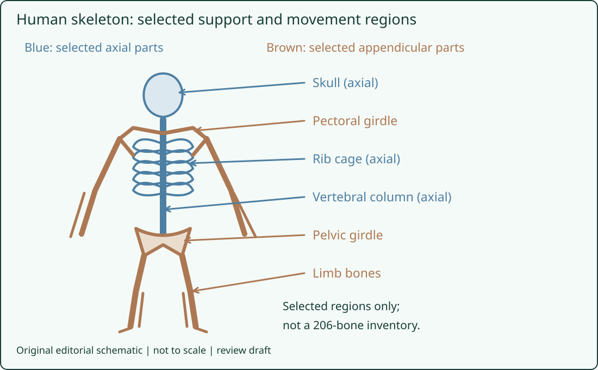
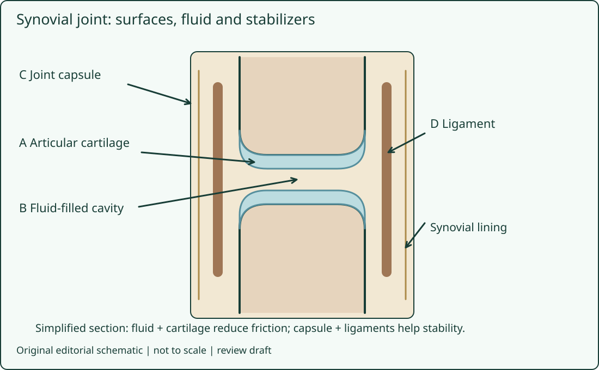
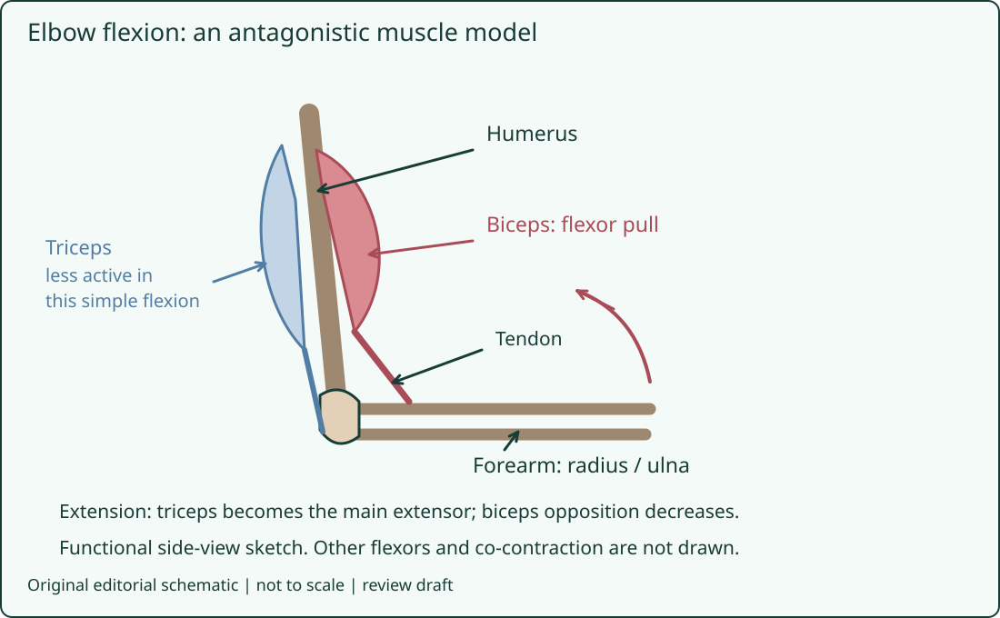

# ৯ম অধ্যায়: দৃঢ়তা প্রদান ও চলন

> উত্তরসহ পর্যালোচনাধীন খসড়া; নির্ধারিত সংখ্যার উত্তরসহ খসড়া সম্পূর্ণ; বিষয়বস্তু পর্যালোচনা বাকি।
> মূল বই ও বিষয়বিশেষজ্ঞের পূর্ণ যাচাই বাকি। বোর্ড/স্কুল/সাল দাবি নেই।

## rebuild-mcq.json

### MCQ 1

কঙ্কালপেশির সাধারণ নিয়ন্ত্রণ কেমন?

A. কেবল হৃৎপিণ্ডের ছন্দ
B. সম্পূর্ণ উদ্দীপনাহীন
C. ঐচ্ছিক, তবে প্রতিফলনেও অংশ নেয়
D. শুধুই অন্ত্রের স্বয়ংক্রিয়

উত্তর: C — ঐচ্ছিক, তবে প্রতিফলনেও অংশ নেয়
সব কঙ্কালপেশির কাজ প্রতিমুহূর্তে সচেতন সিদ্ধান্তে হয় না।

### MCQ 2

কঙ্কালপেশিকোষ সাধারণত কেমন?

A. লম্বা, ডোরাযুক্ত ও বহু নিউক্লিয়াসবিশিষ্ট
B. শুধু চাকতির মতো নিউক্লিয়াসহীন
C. খাটো, দ্বিপ্রান্ত সরু ও ডোরাহীন
D. সর্বদা শাখাযুক্ত একক পর্দাবিহীন

উত্তর: A — লম্বা, ডোরাযুক্ত ও বহু নিউক্লিয়াসবিশিষ্ট
পেশির গঠনভেদ কাজের বিশেষায়নের সঙ্গে যুক্ত।

### MCQ 3

মসৃণ পেশির সাধারণ বৈশিষ্ট্য কোনটি?

A. ডোরাহীন ও অনৈচ্ছিক
B. শুধু অস্থির সঙ্গে সংযুক্ত
C. বহুনিউক্লিয়াসযুক্ত দীর্ঘ ডোরাকাটা
D. ইন্টারক্যালেটেড ডিস্কযুক্ত

উত্তর: A — ডোরাহীন ও অনৈচ্ছিক
আন্ত্রিক প্রাচীর ও রক্তনালিতে এ ধরনের পেশি থাকে।

### MCQ 4

হৃৎপেশিকে কঙ্কালপেশি থেকে আলাদা করে কোন বৈশিষ্ট্য?

A. শুধু বাহুতে থাকা
B. প্রতিটি কোষে শত নিউক্লিয়াস
C. সবসময় ডোরাহীনতা
D. শাখাযুক্ত ও অনৈচ্ছিক ছন্দময় কাজ

উত্তর: D — শাখাযুক্ত ও অনৈচ্ছিক ছন্দময় কাজ
হৃৎপেশি ডোরাযুক্ত হলেও ঐচ্ছিক নয়।

### MCQ 5

অন্ত্রে খাদ্য এগোনোর পেশি প্রধানত কোনটি?

A. কঙ্কালপেশি
B. টেনডন
C. মসৃণ পেশি
D. অস্থিকলা

উত্তর: C — মসৃণ পেশি
অভ্যন্তরীণ অঙ্গের প্রাচীরের সংকোচন স্বয়ংক্রিয় চলনে সহায়ক।

### MCQ 6

পেশির কোন কাজ হাঁটা ছাড়াও স্থির অবস্থায় জরুরি?

A. অঙ্গবিন্যাস বজায় রাখা
B. সরাসরি অস্থিকোষে রূপান্তর
C. অস্থির সব খনিজ তৈরি
D. সব সন্ধিতরল ছাঁকন

উত্তর: A — অঙ্গবিন্যাস বজায় রাখা
দাঁড়িয়ে থাকতেও পেশির নিয়ন্ত্রিত টান প্রয়োজন হতে পারে।

### MCQ 7

পেশিতে গ্লাইকোজেন থাকার গুরুত্ব কী?

A. শক্তি সরবরাহের সঞ্চিত উপাদান
B. প্রধান অস্থিবন্ধনী
C. সন্ধির খনিজ আবরণ
D. রক্তের O2-বাহী রঞ্জক

উত্তর: A — শক্তি সরবরাহের সঞ্চিত উপাদান
বিপাকে এ সঞ্চয় থেকে ATP সরবরাহে সহায়তা পাওয়া যায়।

### MCQ 8

পেশিসংকোচনের সরাসরি ব্যবহারযোগ্য শক্তির বাহক কী?

A. DNA
B. কোলাজেন
C. ATP
D. হাইড্রক্সিঅ্যাপাটাইট

উত্তর: C — ATP
খাদ্যের শক্তি ATP-সংযুক্ত কাজে ব্যবহৃত হয়।

### MCQ 9

পেশিতন্তুর কোষঝিল্লির নাম কী?

A. পেরিওস্টিয়াম
B. পেরিকন্ড্রিয়াম
C. সাইনোভিয়াম
D. সারকোলেমা

উত্তর: D — সারকোলেমা
মাংসপেশিকোষের আবরণে উদ্দীপনা ছড়াতে পারে।

### MCQ 10

পেশিকোষের ভেতরের দীর্ঘ সংকোচনযন্ত্রের নাম কী?

A. অস্টিওন
B. মায়োফাইব্রিল
C. ট্রাবেকুলা
D. নেফ্রন

উত্তর: B — মায়োফাইব্রিল
মায়োফাইব্রিলে সারকোমিয়ারের পুনরাবৃত্ত বিন্যাস থাকে।

### MCQ 11

সারকোমিয়ার কোন সীমার মধ্যবর্তী অংশ?

A. দুটি নিউরনের সম্পূর্ণ দৈর্ঘ্য
B. শুধু দুটি টেনডনের মাঝখান
C. দুটি অস্থির মধ্যে ফাঁক
D. পরপর দুটি Z-রেখা

উত্তর: D — পরপর দুটি Z-রেখা
এটি ডোরাকাটা পেশির আণবিক সংকোচন-একক।

### MCQ 12

সরু মায়োফিলামেন্টের প্রধান প্রোটিন কী?

A. ইলাস্টিন
B. অ্যাক্টিন
C. মায়োসিন
D. কোলাজেন

উত্তর: B — অ্যাক্টিন
সরু ও মোটা তন্তুর প্রধান প্রোটিন পৃথক।

### MCQ 13

মোটা মায়োফিলামেন্টের প্রধান প্রোটিন কী?

A. মায়োসিন
B. অ্যাক্টিন
C. কেরাটিন
D. হিমোগ্লোবিন

উত্তর: A — মায়োসিন
মায়োসিনের মাথা অ্যাক্টিনের সঙ্গে আন্তঃক্রিয়া করে।

### MCQ 14

sliding filament মডেলে আসলে কী ছোট হয়?

A. সারকোমিয়ারের দৈর্ঘ্য
B. প্রতিটি প্রোটিনের পরমাণু
C. মায়োসিন তন্তুর দৈর্ঘ্য অবশ্যই
D. অ্যাক্টিন অণুর দৈর্ঘ্য সবসময়

উত্তর: A — সারকোমিয়ারের দৈর্ঘ্য
তন্তু সরার ফলে overlap বাড়ে, তন্তু নিজে গুটিয়ে ছোট হওয়া নয়।

### MCQ 15

সারকোমিয়ার সংকুচিত হলে Z-রেখার দূরত্ব কী হয়?

A. কমে
B. সবসময় অপরিবর্তিত
C. বাড়ে
D. সর্বদা শূন্য

উত্তর: A — কমে
স্বাভাবিক shortening-এ দুই সীমা কাছে আসে; শূন্যে নেমে যায় না।

### MCQ 16

স্বাভাবিক sliding মডেলে A-band-এর দৈর্ঘ্য কী হয়?

A. প্রায় অপরিবর্তিত থাকে
B. প্রতিবার দ্বিগুণ হয়
C. অবশ্যই শূন্য হয়
D. I-band-এর সঙ্গে অদৃশ্য হয়

উত্তর: A — প্রায় অপরিবর্তিত থাকে
এটি মোটা তন্তুর দৈর্ঘ্য-সম্পর্কিত অঞ্চল; A-band উধাও হয় না।

### MCQ 17

shortening-এ I-band-এর সাধারণ পরিবর্তন কী?

A. সংকুচিত হয়
B. প্রথমবারেই অদৃশ্য বাধ্যতামূলক
C. সবসময় বাড়ে
D. অ্যাক্টিনে পরিণত হয়

উত্তর: A — সংকুচিত হয়
কম overlap-যুক্ত সরু-তন্তুমাত্র অঞ্চল ছোট হতে পারে।

### MCQ 18

কঙ্কালপেশিতে Ca2+ কোন নিয়ন্ত্রক প্রোটিনে বাঁধে?

A. অস্টিওক্যালসিন
B. ট্রোপোনিন
C. কোলাজেন
D. হিমোগ্লোবিন

উত্তর: B — ট্রোপোনিন
এতে ট্রোপোমায়োসিন সরে অ্যাক্টিনে মায়োসিন-বাঁধার সুযোগ বাড়ে।

### MCQ 19

বিশ্রামে অ্যাক্টিনের কিছু মায়োসিন-বাঁধার স্থান ঢেকে রাখে কী?

A. ট্রোপোমায়োসিন
B. মায়োগ্লোবিন
C. ইলাস্টিন
D. পেপসিন

উত্তর: A — ট্রোপোমায়োসিন
নিয়ন্ত্রক অবস্থান বদলে cross-bridge গঠন নিয়ন্ত্রিত হয়।

### MCQ 20

পেশিকোষে Ca2+ সঞ্চয় ও মুক্তিতে কোন অঙ্গাণু বিশেষায়িত?

A. গলজি বস্তু একমাত্র
B. লাইসোসোম
C. কোষপ্রাচীর
D. সারকোপ্লাজমিক রেটিকুলাম

উত্তর: D — সারকোপ্লাজমিক রেটিকুলাম
সাইটোপ্লাজমে Ca2+ ওঠানামা সংকোচন-শিথিলনের সংকেতে ভূমিকা রাখে।

### MCQ 21

ATP মায়োসিনে বাঁধার একটি সরাসরি ফল কী?

A. টেনডন লম্বা হয় বাধ্যতামূলক
B. অ্যাক্টিন থেকে মায়োসিন বিচ্ছিন্ন হতে পারে
C. অ্যাক্টিনে স্থায়ী আঠা লাগে
D. সব Ca2+ অস্থিতে যায়

উত্তর: B — অ্যাক্টিন থেকে মায়োসিন বিচ্ছিন্ন হতে পারে
ATP cross-bridge চক্রে বিচ্ছেদসহ পুনরাবৃত্ত কাজ সম্ভব করে।

### MCQ 22

শিথিলনে Ca2+ ফেরত নেওয়াও শক্তিনির্ভর কেন?

A. সক্রিয় পাম্পে সঞ্চয়স্থলে ফেরানো হয়
B. অস্থি টেনে নেয় মাত্র
C. সব Ca2+ বায়ুতে উড়ে
D. পানি নিজেই ATP হয়

উত্তর: A — সক্রিয় পাম্পে সঞ্চয়স্থলে ফেরানো হয়
শিথিলন মানেই কোষের শক্তিব্যবহার সম্পূর্ণ শূন্য নয়।

### MCQ 23

স্নায়ু থেকে কঙ্কালপেশিতে সংকেতের বিশেষ সংযোগ কী?

A. মজ্জাগহ্বর
B. অস্থির ল্যাকুনা
C. নিউরোমাসকুলার জংশন
D. সন্ধির কোটর

উত্তর: C — নিউরোমাসকুলার জংশন
মোটর নিউরনের শেষাংশ ও পেশির বিশেষ ঝিল্লিঅঞ্চল এখানে যুক্ত।

### MCQ 24

নিউরোমাসকুলার জংশনের সাধারণ রাসায়নিক বার্তাবাহক কোনটি?

A. ক্যালসিয়াম ফসফেট
B. অ্যাসিটাইলকোলিন
C. ইউরিয়া
D. গ্লাইকোজেন

উত্তর: B — অ্যাসিটাইলকোলিন
ACh রিসেপ্টরে সংকেত দিয়ে পেশিঝিল্লির বৈদ্যুতিক প্রতিক্রিয়া শুরু করতে সহায়তা করে।

### MCQ 25

একটি মোটর নিউরন ও তার নিয়ন্ত্রিত পেশিতন্তুগুলো মিলে কী?

A. সারকোমিয়ারমাত্র
B. রেনাল করপাসল
C. মোটর ইউনিট
D. অস্টিওন

উত্তর: C — মোটর ইউনিট
স্নায়বিক নিয়ন্ত্রণের দল এবং আণবিক একক আলাদা।

### MCQ 26

আরও মোটর ইউনিট কাজে লাগানো কী বাড়াতে পারে?

A. প্রতিটি ATP-র আকার
B. প্রতিটি অস্থির সংখ্যা
C. সমগ্র পেশির বল
D. প্রতিটি নিউরনের নিউক্লিয়াস

উত্তর: C — সমগ্র পেশির বল
recruitment-এ বেশি তন্তু সম্মিলিতভাবে বল দেয়।

### MCQ 27

বাইসেপস সংকোচনের সরল উদাহরণে কনুই কী করে?

A. বাধ্যতামূলক সম্পূর্ণ সোজা হয়
B. কাঁধ থেকে খুলে যায়
C. অস্থি নিজে ছোট হয়
D. ভাঁজ হয়

উত্তর: D — ভাঁজ হয়
বাইসেপস টেনডনের মাধ্যমে অগ্রবাহুতে টান দেয়।

### MCQ 28

কনুই সক্রিয়ভাবে সোজা করতে প্রধান প্রসারক কোনটি?

A. স্টার্নাম
B. ট্রাইসেপস
C. কারপাল
D. বাইসেপসমাত্র

উত্তর: B — ট্রাইসেপস
ট্রাইসেপস সংকোচন extension-এ সহায়ক।

### MCQ 29

বাইসেপস-ট্রাইসেপসকে antagonistic জোড়া বলা হয় কেন?

A. উভয় পরস্পরকে স্নায়ু দেয়
B. একটি অস্থি অন্যটি তরুণাস্থি
C. একই সন্ধিতে বিপরীত চলনে ভূমিকা
D. উভয় কেবল একই দিকে টানে

উত্তর: C — একই সন্ধিতে বিপরীত চলনে ভূমিকা
ভাঁজ ও সোজা করার জন্য বিপরীত কার্যক্ষমতা দরকার।

### MCQ 30

পেশি সাধারণত অস্থিকে ঠেলে নয় টেনে নাড়ায় কেন?

A. এর কোনো টেনডন নেই
B. এটি কঠিন ঠেলাঠেলি দণ্ড
C. সক্রিয় সংকোচনে টান সৃষ্টি করে
D. অস্থি নিজে পেশি প্রসারিত করে মাত্র

উত্তর: C — সক্রিয় সংকোচনে টান সৃষ্টি করে
ফেরত চলনের জন্য অন্য পেশি/বাহ্যিক বল প্রয়োজন হয়।

### MCQ 31

শুধু বাইসেপস থাকলে সক্রিয় extension সীমিত কেন?

A. টেনডনই নিজে বিপরীত সংকোচক
B. বিপরীত টানদাতা প্রসারকের অভাব
C. সন্ধি নিজে শক্তি তৈরি করে
D. বাইসেপস সবদিকে ঠেলে

উত্তর: B — বিপরীত টানদাতা প্রসারকের অভাব
আকৃতিগত টান একদিকে; শিথিল হওয়া সক্রিয় বিপরীত ঠেলা নয়।

### MCQ 32

সহযোগী বা synergist পেশির কাজ কী?

A. সকল সন্ধি নিশ্চল রাখা
B. একই চলনে সহায়তা করা
C. সর্বদা বিপরীত বলই দেওয়া
D. অস্থিতে রক্ত ছাঁকা

উত্তর: B — একই চলনে সহায়তা করা
বাস্তব চলনে একাধিক পেশি অংশ নেয়।

### MCQ 33

দুই বিপরীত পেশির কিছু সহসংকোচন কীতে সহায়ক?

A. অস্থির খনিজ গলানো
B. সব চলন অসম্ভব করা সবসময়
C. স্নায়ু সম্পূর্ণ বন্ধ
D. সন্ধির স্থিতি ও সূক্ষ্ম নিয়ন্ত্রণ

উত্তর: D — সন্ধির স্থিতি ও সূক্ষ্ম নিয়ন্ত্রণ
সরল মডেলে এক সংকুচিত অন্য শিথিল বলা হলেও বাস্তবে co-contraction থাকতে পারে।

### MCQ 34

পেশি টান তৈরি করলেও অঙ্গ না-সরার উদাহরণ কী?

A. হাত তুলে নেওয়া
B. পা এগিয়ে হাঁটা
C. স্থির ভার ধরে রাখা
D. কনুইয়ের কোণ বদলানো

উত্তর: C — স্থির ভার ধরে রাখা
isometric অবস্থায় নিট দৈর্ঘ্য/কোণ না-বদলিয়েও শক্তি লাগে।

### MCQ 35

ভার নামাতে সক্রিয় পেশি ধীরে লম্বা হলে সেটি কী বোঝায়?

A. টেনডন পেশি হয়েছে
B. স্নায়ু ছিঁড়েছে নিশ্চিত
C. টান তৈরির সময়ও দৈর্ঘ্য বাড়তে পারে
D. পেশি একেবারে নিষ্ক্রিয়

উত্তর: C — টান তৈরির সময়ও দৈর্ঘ্য বাড়তে পারে
eccentric কাজে পেশি সক্রিয় থেকে নিয়ন্ত্রিতভাবে লম্বা হয়।

### MCQ 36

পেশির শক্তি সবসময় একই নয় কেন?

A. সক্রিয় তন্তু, দৈর্ঘ্য ও ক্লান্তি প্রভাব ফেলে
B. অস্থিসংখ্যাই একমাত্র কারণ
C. ATP কখনো লাগে না
D. সব পেশির ব্যাস সমান

উত্তর: A — সক্রিয় তন্তু, দৈর্ঘ্য ও ক্লান্তি প্রভাব ফেলে
বহু শারীরবৃত্তীয় শর্ত বল নির্ধারণ করে।

### MCQ 37

পেশিক্লান্তিকে কেবল ল্যাকটিক অ্যাসিড জমা বলা অসম্পূর্ণ কেন?

A. পেশিতে কোনো বিপাক নেই
B. দেহ কখনো ATP ব্যবহার করে না
C. ক্লান্তি সবসময় অস্থিভঙ্গ
D. স্নায়বিক ও বিপাকীয় বহু কারণ আছে

উত্তর: D — স্নায়বিক ও বিপাকীয় বহু কারণ আছে
ক্লান্তির প্রক্রিয়া কাজ ও অবস্থাভেদে ভিন্ন।

### MCQ 38

পেশিসংকোচনে তাপ উৎপাদনের গুরুত্ব কী?

A. সব শক্তি গতিতে রূপ নেয়
B. হাড়ের সংখ্যা বাড়ায়
C. সব কোষ ঠান্ডা করে
D. দেহের তাপসাম্যে অবদান

উত্তর: D — দেহের তাপসাম্যে অবদান
শক্তির সব অংশ যান্ত্রিক কাজে যায় না।

### MCQ 39

শুধু পেশি শক্ত থাকলেই চলন নিশ্চিত নয় কেন?

A. সমন্বয় নিজে হয় সবসময়
B. টেনডনের কাজ নেই
C. স্নায়ু, সন্ধি ও বলসঞ্চারও দরকার
D. অস্থি প্রয়োজন হয় না

উত্তর: C — স্নায়ু, সন্ধি ও বলসঞ্চারও দরকার
ভাঙা বলসঞ্চার বা সংকেতপথে শক্ত পেশিও উদ্দেশ্যপূর্ণ চলন দিতে নাও পারে।

### MCQ 40

এক সরল লিভারে সন্ধি সাধারণত কী হিসেবে কাজ করে?

A. জ্বালানির উৎস
B. সংকোচক প্রোটিন
C. বর্জ্য সংগ্রাহক
D. ঘূর্ণনকেন্দ্র

উত্তর: D — ঘূর্ণনকেন্দ্র
অস্থি দণ্ড, পেশি প্রচেষ্টা ও বাহ্যিক ভার resistance দিতে পারে।

### MCQ 41

ঘূর্ণনপ্রভাবে moment arm কোন দূরত্ব?

A. কেন্দ্র থেকে বলরেখার লম্ব দূরত্ব
B. শুধু অস্থির মোট দৈর্ঘ্য
C. হাতের ত্বকের পুরুত্ব
D. পেশির ঘের

উত্তর: A — কেন্দ্র থেকে বলরেখার লম্ব দূরত্ব
টর্ক=বল×লম্ব বাহু; যেকোনো দূরত্ব নয়।

### MCQ 42

20 N বলের লম্ব বাহু 0.3 m হলে টর্ক কত?

A. 0.06 N m
B. 60 N m
C. 66.7 N m
D. 6 N m

উত্তর: D — 6 N m
20×0.3=6 N m; এটি সরল শিক্ষামূলক মডেল।

### MCQ 43

50 N ভার 0.2 m দূরে ও পেশিবাহু 0.04 m হলে ভারসাম্যে পেশিবল কত?

A. 50 N
B. 250 N
C. 10 N
D. 1000 N

উত্তর: B — 250 N
ভারটর্ক 10 N m; পেশিবল=10/0.04=250 N, অন্য বল উপেক্ষিত।

### MCQ 44

হাতে ভার দেহের কাছে আনলে সাধারণত টর্ক কমে কেন?

A. মাধ্যাকর্ষণ উধাও হয়
B. অস্থির সংখ্যা কমে
C. ভরের একক বদলায়
D. লম্ব moment arm কমতে পারে

উত্তর: D — লম্ব moment arm কমতে পারে
একই বলেও কেন্দ্র থেকে লম্ব দূরত্ব ছোট হলে ঘোরানোর প্রভাব কমে।

### MCQ 45

কনুই-লিভারে পেশি মাঝখানে বল দিলে কী সুবিধা থাকতে পারে?

A. সবসময় বলের যান্ত্রিক লাভ
B. কোনো শক্তি না-লাগা
C. সকল টর্ক শূন্য
D. অগ্রপ্রান্তের পরিসর ও গতির সুবিধা

উত্তর: D — অগ্রপ্রান্তের পরিসর ও গতির সুবিধা
বল বেশি লাগলেও সরণের অনুপাত চলনের কাজে উপযোগী হতে পারে।

### MCQ 46

কোণ 140° থেকে 80° হলে কনুইয়ের পরিবর্তন কত?

A. 60° এক্সটেনশন
B. 60° ফ্লেক্সন
C. 220° ফ্লেক্সন
D. 80° রোটেশন

উত্তর: B — 60° ফ্লেক্সন
কোণ 60° কমেছে; পরিসরের পরিবর্তন ও শেষ কোণ এক নয়।

### MCQ 47

30 cm পেশি 24 cm হলে দৈর্ঘ্য কত শতাংশ কমেছে?

A. 20%
B. 6%
C. 80%
D. 25%

উত্তর: A — 20%
(30−24)/30×100=20%; উদাহরণে shortening ধরা হয়েছে।

### MCQ 48

কঙ্কালপেশির অনুশীলনে উপযুক্ত বিরতির যুক্তি কী?

A. সব ব্যথাকে স্বাভাবিক ধরা
B. অস্থি পুরো মৃত রাখা
C. পুনরুদ্ধার ও অভিযোজনের সুযোগ
D. সকল সংকেত চিরবন্ধ

উত্তর: C — পুনরুদ্ধার ও অভিযোজনের সুযোগ
মাত্রা ক্রমে বাড়ানো ও পুনরুদ্ধার overuse ঝুঁকি কমাতে সহায়ক।

### MCQ 49

হঠাৎ অনুশীলনের ভার অনেক বাড়ালে কী ঝুঁকি বাড়ে?

A. সকল সন্ধিতরল বৃদ্ধি
B. অতিরিক্ত ব্যবহারজনিত আঘাত
C. অবশ্যই সব অস্থি শক্ত হওয়া
D. সবসময় ভিটামিন D পূরণ

উত্তর: B — অতিরিক্ত ব্যবহারজনিত আঘাত
সামর্থ্য ও অভিযোজনের সময় না-মিললে ক্ষতি হতে পারে।

### MCQ 50

আঘাতের পর অঙ্গ বেঁকে গেলে নিরাপদ পদক্ষেপ কী?

A. গরমে চেপে দৌড়ানো
B. নড়াচড়া বন্ধ রেখে দ্রুত চিকিৎসা
C. জোরে টেনে সোজা করা
D. ব্যথা উপেক্ষা করে খেলা

উত্তর: B — নড়াচড়া বন্ধ রেখে দ্রুত চিকিৎসা
ভাঙন/স্থানচ্যুতি সন্দেহে অপ্রশিক্ষিতভাবে বসানো অনুচিত।

### MCQ 51

আঘাতের পর অসাড়তা ও অঙ্গ ঠান্ডা/ফ্যাকাশে হলে কী বোঝায়?

A. দ্রুত জরুরি মূল্যায়নের প্রয়োজন
B. সামান্য ব্যথার নিশ্চয়তা
C. বেশি ক্যালসিয়ামেই তাৎক্ষণিক সমাধান
D. খেলা চালানোর অনুমতি

উত্তর: A — দ্রুত জরুরি মূল্যায়নের প্রয়োজন
স্নায়ু/রক্তপ্রবাহ সমস্যার বিপদলক্ষণ হতে পারে।

### MCQ 52

অস্টিওপোরোসিসের মূল বৈশিষ্ট্য কী?

A. অস্থি অতিরিক্ত ঘন হওয়া
B. সবসময় সন্ধিতে পুঁজ
C. অস্থিভর/গঠন দুর্বল হয়ে ভাঙনের ঝুঁকি বাড়া
D. পেশিতে শুধু পানি বাড়া

উত্তর: C — অস্থিভর/গঠন দুর্বল হয়ে ভাঙনের ঝুঁকি বাড়া
খনিজঘনত্বের পাশাপাশি অণুগঠন ও শক্তিও গুরুত্বপূর্ণ।

### MCQ 53

অস্টিওপোরোসিসকে নীরব রোগ বলা হয় কেন?

A. ব্যথা একমাত্র লক্ষণ
B. সব রোগী অচেতন থাকেন
C. শুধু রাতে ঘটে
D. ভাঙনের আগে লক্ষণ নাও থাকতে পারে

উত্তর: D — ভাঙনের আগে লক্ষণ নাও থাকতে পারে
ব্যথা না-থাকা রোগহীনতার নিশ্চয়তা নয়।

### MCQ 54

অস্টিওপোরোসিস শুধু ক্যালসিয়াম না-খাওয়ার রোগ নয় কেন?

A. সবার একটিই জিন কারণ
B. হরমোন, বয়স, ওষুধসহ বহু কারণ আছে
C. শুধু ব্যাকটেরিয়ার ফল
D. খাদ্য কখনো প্রাসঙ্গিক নয়

উত্তর: B — হরমোন, বয়স, ওষুধসহ বহু কারণ আছে
বহুকারণীয় ঝুঁকিকে এক পুষ্টিঘাটতিতে সীমিত করা ভুল।

### MCQ 55

মেনোপজের পর অস্থিক্ষয়ের ঝুঁকি বাড়ার সঙ্গে কী সম্পর্কিত?

A. সব ক্যালসিয়াম গ্রহণ বন্ধ
B. অস্থিমজ্জা চুলে পরিণত
C. প্রতিটি অস্থি সঙ্গে সঙ্গে ভাঙা
D. ইস্ট্রোজেন কমে যাওয়া

উত্তর: D — ইস্ট্রোজেন কমে যাওয়া
হরমোনীয় পরিবর্তন remodeling-এর ভারসাম্যে প্রভাব ফেলতে পারে।

### MCQ 56

পুরুষদেরও অস্টিওপোরোসিস হতে পারে—এর অর্থ কী?

A. মেনোপজ পুরুষের নিয়ম
B. সকল পুরুষের রোগ হবেই
C. এটি শুধু নারীদের রোগ নয়
D. পুরুষের পুষ্টি লাগে না

উত্তর: C — এটি শুধু নারীদের রোগ নয়
বয়স, ওষুধ ও অন্যান্য কারণ পুরুষদের ঝুঁকিতেও গুরুত্বপূর্ণ।

### MCQ 57

দীর্ঘমেয়াদি কিছু glucocorticoid ব্যবহারে কী দরকার?

A. কখনো follow-up নয়
B. নিজে হঠাৎ সব ওষুধ বন্ধ
C. অস্থিস্বাস্থ্য-ঝুঁকি চিকিৎসকের সঙ্গে মূল্যায়ন
D. সবসময় একই সাপ্লিমেন্ট দ্বিগুণ

উত্তর: C — অস্থিস্বাস্থ্য-ঝুঁকি চিকিৎসকের সঙ্গে মূল্যায়ন
উপকার-ঝুঁকি মিলিয়ে তত্ত্বাবধান দরকার; blanket নিষেধ নয়।

### MCQ 58

DXA প্রধানত কী মূল্যায়নে ব্যবহৃত হয়?

A. অস্থির খনিজঘনত্ব
B. সন্ধির সব রোগের একক কারণ
C. রক্তের ইউরিয়া
D. পেশির তড়িৎ সংকেত

উত্তর: A — অস্থির খনিজঘনত্ব
এটি fracture-risk মূল্যায়নের অংশ, সব তথ্যের বিকল্প নয়।

### MCQ 59

হালকা পতনে ভাঙন বয়স্ক ব্যক্তির ক্ষেত্রে কেন গুরুত্বপূর্ণ?

A. শুধু পেশিক্লান্তি
B. অবশ্যই রিউমাটয়েড আর্থ্রাইটিস
C. অস্থির ভঙ্গুরতা মূল্যায়নের ইঙ্গিত
D. বয়সে সবসময় স্বাভাবিক উপেক্ষাযোগ্য

উত্তর: C — অস্থির ভঙ্গুরতা মূল্যায়নের ইঙ্গিত
উপযুক্ত ইতিহাস ও পরীক্ষা দরকার; একটি ঘটনা নির্দিষ্ট কারণ নিশ্চিত করে না।

### MCQ 60

অস্টিওপোরোসিসে সাধারণ ভঙ্গুরতা-ভাঙনের স্থান কোন সেট?

A. শুধু করোটির সব স্যুচার
B. কেবল দাঁতের এনামেল
C. শুধু নখ
D. নিতম্ব, কবজি ও কশেরুকা

উত্তর: D — নিতম্ব, কবজি ও কশেরুকা
অন্যান্য স্থানেও হতে পারে; এগুলো গুরুত্বপূর্ণ পরিচিত স্থান।

### MCQ 61

উচ্চতা কমা ও পিঠ বাঁকা হওয়ার একটি সম্ভাব্য অস্থিগত কারণ কী?

A. কশেরুকার compression fracture
B. হিউমেরাসের দৈর্ঘ্যবৃদ্ধি
C. শুধু কারপাল বড় হওয়া
D. সবসময় উরু লম্বা হওয়া

উত্তর: A — কশেরুকার compression fracture
অন্য কারণও থাকে; ক্লিনিক্যাল মূল্যায়ন দরকার।

### MCQ 62

অস্থিস্বাস্থ্যে ভিটামিন D-এর গুরুত্বপূর্ণ ভূমিকা কী?

A. ক্যালসিয়াম শোষণ ও সাম্যে সহায়তা
B. সকল অস্থিকোষ তৈরি একাই
C. সব ব্যথা মুহূর্তে সারানো
D. সরাসরি টেনডনকে পেশি করা

উত্তর: A — ক্যালসিয়াম শোষণ ও সাম্যে সহায়তা
এটি পুষ্টি ও হরমোনীয় নিয়ন্ত্রণের অংশ।

### MCQ 63

ভিটামিন D তৈরির প্রাথমিক আলোক-সম্পর্কিত ধাপ কোথায় ঘটে?

A. টেনডনের আঁটিতে
B. ত্বকে
C. অস্থির মাঝের বায়ুতে
D. সাইনোভিয়াল গহ্বরে

উত্তর: B — ত্বকে
যকৃৎ ও বৃক্কের পরবর্তী রূপান্তরও সক্রিয় রূপে ভূমিকা রাখে।

### MCQ 64

সবার জন্য নির্দিষ্ট দীর্ঘক্ষণ রোদে থাকা বলা অনুচিত কেন?

A. সূর্যালোকের কোনো ভূমিকা নেই
B. ত্বক, পরিবেশ ও UV-ঝুঁকি ভিন্ন
C. যত পোড়া তত স্বাস্থ্য
D. সানবার্ন দরকার

উত্তর: B — ত্বক, পরিবেশ ও UV-ঝুঁকি ভিন্ন
রোদে পোড়ার নির্দেশ নয়; পুষ্টি ও প্রয়োজনমতো চিকিৎসা-পরামর্শ নিরাপদ।

### MCQ 65

ক্যালসিয়ামের উপযোগী খাদ্য উৎস কোনটি?

A. পরিশোধিত তেলমাত্র
B. লবণপানি
C. শুধু চিনি
D. কাঁটাসহ খাওয়া ছোট মাছ

উত্তর: D — কাঁটাসহ খাওয়া ছোট মাছ
খাদ্যবৈচিত্র্য ও ব্যক্তিগত প্রয়োজন বিবেচ্য; প্রতিটি মাছ সমান উৎস নয়।

### MCQ 66

সবাইকে একই উচ্চমাত্রার ক্যালসিয়াম-ভিটামিন D বড়ি দেওয়া ঠিক নয় কেন?

A. পুষ্টি কখনো দরকার নেই
B. সাপ্লিমেন্ট সর্বদা নিরীহ
C. সব অস্থির সমস্যা একই
D. চাহিদা, খাদ্য ও রোগভেদে পরিকল্পনা দরকার

উত্তর: D — চাহিদা, খাদ্য ও রোগভেদে পরিকল্পনা দরকার
অতিরিক্ত মাত্রারও ক্ষতি আছে; নিজে prescription নয়।

### MCQ 67

উপযুক্ত ভারবাহী ব্যায়াম অস্থির জন্য সহায়ক কেন?

A. সব fracture সঙ্গে সঙ্গে সারায়
B. অস্থির সব খনিজ ঘামায়
C. যান্ত্রিক উদ্দীপনা ও পেশিসামর্থ্য বাড়াতে সহায়তা
D. হরমোনের প্রয়োজন মুছে দেয়

উত্তর: C — যান্ত্রিক উদ্দীপনা ও পেশিসামর্থ্য বাড়াতে সহায়তা
নিয়ন্ত্রিত ব্যায়াম অস্থি-পেশি স্বাস্থ্যে সহায়ক; ভঙ্গুরতায় পদ্ধতি বাছাই জরুরি।

### MCQ 68

পড়ে যাওয়া ঠেকানো অস্টিওপোরোসিস যত্নের অংশ কেন?

A. এতে ঘনত্ব সঙ্গে সঙ্গে দ্বিগুণ
B. পতন কমালে ভাঙনের সুযোগ কমতে পারে
C. এটি সব ওষুধের বিকল্প
D. শুধু পেশি নিয়ে সম্পর্ক

উত্তর: B — পতন কমালে ভাঙনের সুযোগ কমতে পারে
অস্থির শক্তি ও পড়ে যাওয়ার ঝুঁকি উভয় fracture-risk-এ প্রাসঙ্গিক।

### MCQ 69

ঘরের পতনঝুঁকি কমানোর উপায় কোনটি?

A. অন্ধকার সিঁড়ি রাখা
B. আলো ও চলার পথ বাধামুক্ত রাখা
C. পিচ্ছিল মেঝে বাড়ানো
D. ঢিলা তার ছড়িয়ে রাখা

উত্তর: B — আলো ও চলার পথ বাধামুক্ত রাখা
পরিবেশগত নিরাপত্তাও অস্থিভঙ্গ প্রতিরোধে সহায়ক।

### MCQ 70

arthritis সাধারণভাবে কী বোঝায়?

A. অস্থিসন্ধির প্রদাহ/রোগের বিস্তৃত গোষ্ঠী
B. সকল কোমরব্যথার এক নাম
C. শুধু অস্থিঘনত্ব কমা
D. সব পেশির ভাঙন

উত্তর: A — অস্থিসন্ধির প্রদাহ/রোগের বিস্তৃত গোষ্ঠী
বহু ধরনের joint disease আছে; কারণ ও চিকিৎসা ভিন্ন।

### MCQ 71

রিউমাটয়েড আর্থ্রাইটিসের প্রধান প্রকৃতি কী?

A. সবসময় ব্যাকটেরিয়ার সরাসরি সংক্রমণ
B. অস্থির স্বাভাবিক দৈর্ঘ্যবৃদ্ধি
C. দীর্ঘস্থায়ী অটোইমিউন প্রদাহ
D. কেবল ক্যালসিয়াম ঘাটতি

উত্তর: C — দীর্ঘস্থায়ী অটোইমিউন প্রদাহ
প্রতিরক্ষা ব্যবস্থা নিজের কলার বিরুদ্ধে প্রতিক্রিয়া করে।

### MCQ 72

RA-তে প্রাথমিক গুরুত্বপূর্ণ আক্রান্ত আবরণ কোনটি?

A. পেরিওস্টিয়ামের প্রতিটি অংশমাত্র
B. করোটির সব স্যুচার
C. সাইনোভিয়াম
D. সারকোলেমামাত্র

উত্তর: C — সাইনোভিয়াম
প্রদাহিত synovium পরে তরুণাস্থি-অস্থির ক্ষতিতে অবদান রাখতে পারে।

### MCQ 73

RA-র একটি সম্ভাব্য pattern কোনটি?

A. শুধু দাঁতের ক্ষয়
B. কখনো stiffness নয়
C. দুই পাশের সমজাতীয় সন্ধিতে সমস্যা
D. সর্বদা শুধু এক নখে ব্যথা

উত্তর: C — দুই পাশের সমজাতীয় সন্ধিতে সমস্যা
সমমিত সমস্যা দেখা যায়, কিন্তু অনুপস্থিতি একাই রোগ বাতিল নয়।

### MCQ 74

সকালে দীর্ঘ stiffness ও সন্ধি ফুললে সঠিক পদক্ষেপ কী?

A. চিকিৎসা মূল্যায়ন
B. সকল ব্যায়াম আজীবন বন্ধ
C. নিশ্চিত ক্যালসিয়ামঘাটতি ধরে বড়ি
D. সবসময় উপেক্ষা

উত্তর: A — চিকিৎসা মূল্যায়ন
বিভিন্ন প্রদাহজনিত রোগে এমন হয়; শুধু লক্ষণে নিশ্চিত রোগ নয়।

### MCQ 75

RA-কে শুধু বয়স্কদের অবধারিত রোগ বলা ভুল কেন?

A. সব শিশুর RA হয়
B. শুধু পুরুষের হয়
C. বয়স কখনো কোনো প্রভাব ফেলে না
D. বিভিন্ন বয়সে হতে পারে, সবার হয় না

উত্তর: D — বিভিন্ন বয়সে হতে পারে, সবার হয় না
বয়স ঝুঁকির একটি প্রভাব; একমাত্র সংজ্ঞা নয়।

### MCQ 76

RA ও rheumatic fever একই রোগ নয় কেন?

A. দুটিতে একই ওষুধ অবধারিত
B. কারণ ও রোগপ্রক্রিয়া পৃথক
C. উভয় সবসময় একই জীবাণু
D. উভয় শুধু অস্থিঘনত্বের নাম

উত্তর: B — কারণ ও রোগপ্রক্রিয়া পৃথক
অল্পবয়সীর গিটব্যথারও বিভিন্ন কারণ থাকতে পারে।

### MCQ 77

একটি rheumatoid factor পজিটিভ রিপোর্ট একাই RA নিশ্চিত নয় কেন?

A. শুধু বয়সই পরীক্ষা
B. RA-তে কখনো অ্যান্টিবডি নেই
C. অন্য অবস্থাতেও পজিটিভ হতে পারে
D. সব পজিটিভ মানে একই রোগ

উত্তর: C — অন্য অবস্থাতেও পজিটিভ হতে পারে
ইতিহাস, পরীক্ষা ও অন্যান্য তথ্য মিলিয়ে রোগনির্ণয় হয়।

### MCQ 78

RA-তে আগেভাগে চিকিৎসার লক্ষ্য কী?

A. সব পেশি নিশ্চল করা
B. শুধু ব্যথা লুকানো
C. যেকোনো মূল্যে সব ওষুধ বন্ধ
D. প্রদাহ ও ভবিষ্যৎ ক্ষতি কমানো

উত্তর: D — প্রদাহ ও ভবিষ্যৎ ক্ষতি কমানো
সময়মতো disease control কার্যক্ষমতা রক্ষায় গুরুত্বপূর্ণ।

### MCQ 79

ব্যথা কমানো ও রোগের গতি নিয়ন্ত্রণ এক কথা নয় কেন?

A. লক্ষণ কমলেও ক্ষতি-প্রক্রিয়া চলতে পারে
B. প্রদাহ কখনো ক্ষতি করে না
C. সব ব্যথার ওষুধ একই DMARD
D. ব্যথাই একমাত্র কলা

উত্তর: A — লক্ষণ কমলেও ক্ষতি-প্রক্রিয়া চলতে পারে
লক্ষণ ও রোগপ্রক্রিয়ার জন্য ভিন্ন চিকিৎসাভূমিকা থাকতে পারে।

### MCQ 80

RA-তে DMARD-এর সাধারণ উদ্দেশ্য কী?

A. মাত্র তাৎক্ষণিক গরম সেঁক
B. অস্থি মুছে ফেলা
C. সব টেনডন বড় করা
D. রোগের অগ্রগতি বদলানো/ধীর করা

উত্তর: D — রোগের অগ্রগতি বদলানো/ধীর করা
নির্দিষ্ট ওষুধ ও মাত্রা বিশেষজ্ঞ নির্ধারণ করেন।

### MCQ 81

RA চিকিৎসায় follow-up প্রয়োজন কেন?

A. শুধু উচ্চতা বাড়ানো
B. রোগের কাজ ও ওষুধের নিরাপত্তা দেখা
C. কেবল ব্যথা থাকলেই রক্ত চলে
D. সব পরীক্ষা আজীবন বাদ

উত্তর: B — রোগের কাজ ও ওষুধের নিরাপত্তা দেখা
উন্নতি হলেও নজরদারি ও প্রয়োজনে সমন্বয় থাকে।

### MCQ 82

osteoarthritis ও RA-এর একটি প্রধান পার্থক্য কী?

A. দুটিই কেবল ক্যালসিয়ামশূন্যতা
B. অবক্ষয়ী joint পরিবর্তন বনাম অটোইমিউন প্রদাহ
C. দুটিই শুধুই মজ্জার রোগ
D. দুটিই সবসময় সংক্রামক

উত্তর: B — অবক্ষয়ী joint পরিবর্তন বনাম অটোইমিউন প্রদাহ
OA-ও পুরো joint-এর পরিবর্তন; নিছক নির্জীব ঘষা নয়।

### MCQ 83

osteoarthritis-এ কেবল তরুণাস্থি নয় আর কী বদলাতে পারে?

A. কেবল নখ
B. শুধু ফুসফুসের অ্যালভিওলাস
C. শুধু লোহিতকণিকার জিন
D. অস্থি, synovium ও অন্যান্য joint tissue

উত্তর: D — অস্থি, synovium ও অন্যান্য joint tissue
পুরো সন্ধির প্রক্রিয়া বিবেচনা করা দরকার।

### MCQ 84

আগের সন্ধি-আঘাত OA ঝুঁকিতে কী ভূমিকা রাখতে পারে?

A. সর্বদা পূর্ণ সুরক্ষা দেয়
B. বয়সের ভূমিকা শূন্য করে
C. ঝুঁকি বাড়াতে পারে
D. সব রোগ নিশ্চিত করে

উত্তর: C — ঝুঁকি বাড়াতে পারে
ঝুঁকি বৃদ্ধি অনিবার্য রোগের নিশ্চয়তা নয়।

### MCQ 85

হাঁটুর সব ব্যথা OA ধরে নেওয়া অনির্ভরযোগ্য কেন?

A. সব ব্যথাই ক্ষণস্থায়ী
B. হাঁটুতে কখনো সন্ধি নেই
C. আঘাত, প্রদাহসহ বিভিন্ন কারণ থাকতে পারে
D. সব ব্যথায় একই পরীক্ষা

উত্তর: C — আঘাত, প্রদাহসহ বিভিন্ন কারণ থাকতে পারে
উপসর্গের স্থান এক হলেও রোগপ্রক্রিয়া ভিন্ন।

### MCQ 86

জ্বরসহ হঠাৎ গরম-ফোলা সন্ধি হলে কী দরকার?

A. বন্ধুর ওষুধে মাস কাটানো
B. নিজে টেনে ব্যায়াম
C. দ্রুত চিকিৎসা মূল্যায়ন
D. শুধু গরম সেঁকে অপেক্ষা

উত্তর: C — দ্রুত চিকিৎসা মূল্যায়ন
সংক্রমণসহ জরুরি কারণ থাকতে পারে; একে সাধারণ বাত ধরে বিলম্ব নয়।

### MCQ 87

গরম সেঁক দিয়ে সব arthritis সারে—দাবি সম্পর্কে সঠিকটি কী?

A. সব ভাঙন জোড়া লাগে
B. কিছু উপশম হতে পারে, কারণভিত্তিক চিকিৎসার বিকল্প নয়
C. এতে সব অটোইমিউন প্রতিক্রিয়া শেষ
D. এটি সর্বজনীন নিরাময়

উত্তর: B — কিছু উপশম হতে পারে, কারণভিত্তিক চিকিৎসার বিকল্প নয়
সেঁকের নিরাপত্তা ও উপযোগিতাও অবস্থাভেদে আলাদা।

### MCQ 88

arthritis-এ সব নড়াচড়া চিরতরে বন্ধ করা সাধারণত ভুল কেন?

A. সকল ব্যায়ামই ক্ষতিকর
B. বিশ্রাম কখনো দরকার নেই
C. ব্যথার মধ্যেও সর্বোচ্চ চাপ দিতে হয়
D. নিয়ন্ত্রিত উপযুক্ত ব্যায়াম কার্যক্ষমতা রাখতে সহায়ক

উত্তর: D — নিয়ন্ত্রিত উপযুক্ত ব্যায়াম কার্যক্ষমতা রাখতে সহায়ক
বিশ্রাম ও উপযোগী কার্যকলাপের ভারসাম্য ব্যক্তিভিত্তিক।

### MCQ 89

ব্যথা থাকলে অন্যের steroid নেওয়া কেন অনুচিত?

A. সব steroid শুধু ভিটামিন
B. সব বাত একই
C. একবার নিলেই সব রোগ সারে
D. কারণ, মাত্রা ও ঝুঁকির মূল্যায়ন ছাড়া ক্ষতি হতে পারে

উত্তর: D — কারণ, মাত্রা ও ঝুঁকির মূল্যায়ন ছাড়া ক্ষতি হতে পারে
নির্ধারিত প্রয়োজন থাকলেও স্বেচ্ছা ব্যবহার/বন্ধ নয়।

### MCQ 90

ধূমপান পরিহার অস্থি-সন্ধির জন্যও যুক্তিযুক্ত কেন?

A. সব রোগ নিশ্চিত সারায়
B. শুধু ফুসফুসেই প্রভাব
C. অস্থিস্বাস্থ্য ও RA ঝুঁকির সঙ্গে সম্পর্ক আছে
D. সকল বংশগত কারণ মুছে দেয়

উত্তর: C — অস্থিস্বাস্থ্য ও RA ঝুঁকির সঙ্গে সম্পর্ক আছে
ঝুঁকি কমানোর বার্তা নিরাময়ের নিশ্চয়তা নয়।

### MCQ 91

পুষ্টিকর খাদ্য RA নিশ্চয় প্রতিরোধ করে—কেন অতিরঞ্জন?

A. পুষ্টির কোনো গুরুত্ব নেই
B. বহু জিনগত-পরিবেশগত কারণ থাকে
C. RA কেবল ক্ষুধার নাম
D. সব রোগ খাদ্যে একা সারে

উত্তর: B — বহু জিনগত-পরিবেশগত কারণ থাকে
স্বাস্থ্যকর জীবন সহায়ক, কিন্তু একক নিশ্চয়তা নয়।

### MCQ 92

কম অস্থিঘনত্ব ও সন্ধিপ্রদাহ একসঙ্গে হতে পারে—এতে কী বোঝায়?

A. প্রদাহ মানেই সব খনিজ উধাও
B. দুটি ভিন্ন প্রক্রিয়া একই ব্যক্তিতে থাকতে পারে
C. দুটি রোগ একই সংজ্ঞা
D. ঘনত্ব মানেই কেবল ব্যথা

উত্তর: B — দুটি ভিন্ন প্রক্রিয়া একই ব্যক্তিতে থাকতে পারে
সহাবস্থান অভিন্ন কারণ/চিকিৎসা প্রমাণ করে না।

### MCQ 93

শুধু হাঁটার ভিডিও দেখে osteoporosis নির্ণয় করা যায় না কেন?

A. অস্থিঘনত্ব ও fracture-risk-এর উপযুক্ত মূল্যায়ন দরকার
B. সব খুঁড়িয়ে হাঁটা অস্থিক্ষয়
C. চলনই সব খনিজ মাপে
D. কোনো ইতিহাস লাগে না

উত্তর: A — অস্থিঘনত্ব ও fracture-risk-এর উপযুক্ত মূল্যায়ন দরকার
চলনের অসুবিধার বহু ব্যাখ্যা থাকতে পারে।

### MCQ 94

অস্থির ঘনত্ব ভালো হলেই পতনে ভাঙন অসম্ভব নয় কেন?

A. সব পতন সমান
B. অস্থি কখনো জীবন্ত নয়
C. ঘনত্বের কোনো ভূমিকা নেই
D. আঘাতের বল ও অন্য কারণও গুরুত্বপূর্ণ

উত্তর: D — আঘাতের বল ও অন্য কারণও গুরুত্বপূর্ণ
ঝুঁকি সম্ভাবনা, নিশ্চিত শূন্য বা শতভাগ নয়।

### MCQ 95

স্কুলের তথ্যসংগ্রহে কারও arthritis রিপোর্ট প্রকাশের আগে কী জরুরি?

A. রিপোর্ট সবার সম্পত্তি ধরা
B. রোগ নিয়ে দোষারোপ
C. সম্মতি ও গোপনীয়তা
D. শুধু নাম বড় করে লেখা

উত্তর: C — সম্মতি ও গোপনীয়তা
শিক্ষায় কৃত্রিম/অনামিক ডেটা নিরাপদ বিকল্প।

### MCQ 96

দশজনের পিঠব্যথা দেখে এলাকায় osteoporosis হার ঘোষণা ভুল কেন?

A. রোগসংজ্ঞা ও প্রতিনিধিত্বশীল নমুনা নেই
B. ব্যথা সবসময় নির্ভুল DXA
C. দশজনই সব বয়সের প্রতিনিধি
D. কোনো পরীক্ষা কখনো লাগে না

উত্তর: A — রোগসংজ্ঞা ও প্রতিনিধিত্বশীল নমুনা নেই
উপসর্গ ও রোগনির্ণয় আলাদা, নমুনাপক্ষপাতও বিবেচ্য।

### MCQ 97

কাগজের কবজা-মডেল দিয়ে কী শেখানো সবচেয়ে যুক্তিযুক্ত?

A. সব পেশির ATP হার
B. সব জীবন্ত কলার চিকিৎসা
C. সব ligament-এর আসল প্রসারণসীমা
D. নির্দিষ্ট অক্ষে চলনের ধারণা

উত্তর: D — নির্দিষ্ট অক্ষে চলনের ধারণা
মডেল নির্বাচিত সম্পর্ক দেখায়, সম্পূর্ণ অঙ্গ নয়।

### MCQ 98

সহপাঠীর সন্ধি জোরে বাঁকিয়ে পরিসর মাপা অনুচিত কেন?

A. আঘাতের ঝুঁকি ও সম্মতির প্রশ্ন আছে
B. জোরেই সঠিক মান সবসময়
C. ব্যথা পরীক্ষা অপরিহার্য
D. সকল দেহে একই পরিসর

উত্তর: A — আঘাতের ঝুঁকি ও সম্মতির প্রশ্ন আছে
প্রস্তুত কৃত্রিম কোণ-ডেটা বা অজীব মডেল ভালো।

### MCQ 99

নিরাপদ চলন-সচেতনতায় সবচেয়ে উপযুক্ত বার্তা কোনটি?

A. একই ভার সবার জন্য
B. ব্যথা মানেই আরও জোর দাও
C. নিজের সামর্থ্য অনুযায়ী ধীরে কার্যকলাপ বাড়াও
D. চিরদিন কোনো নড়াচড়া নয়

উত্তর: C — নিজের সামর্থ্য অনুযায়ী ধীরে কার্যকলাপ বাড়াও
সুনির্দিষ্ট রোগ/আঘাতে বিশেষজ্ঞের পরিকল্পনা প্রাসঙ্গিক।

### MCQ 100

অস্থি-পেশির স্বাস্থ্যবার্তায় রোগীকে ‘অলস বলেই অসুস্থ’ বলা ভুল কেন?

A. বংশগত কারণ বলে কিছু নেই
B. অসংখ্য অ-ইচ্ছাধীন ঝুঁকি ও রোগকারণও থাকে
C. সব রোগ নিজে বানানো
D. জীবনধারার কখনো প্রভাব নেই

উত্তর: B — অসংখ্য অ-ইচ্ছাধীন ঝুঁকি ও রোগকারণও থাকে
সহায়ক শিক্ষা দোষারোপের পরিবর্তে নিরাপত্তা ও সেবায় উৎসাহ দেয়।

### MCQ 101

দেহের স্থান পরিবর্তন ছাড়া কোনটি অঙ্গসঞ্চালনের উদাহরণ?

A. হেঁটে বাজারে যাওয়া
B. দৌড়ে মাঠ পার হওয়া
C. সাঁতরে তীর বদলানো
D. বসে কনুই ভাঁজ করা

উত্তর: D — বসে কনুই ভাঁজ করা
অঙ্গের নড়াচড়া ও সমগ্র দেহের এক স্থান থেকে অন্য স্থানে চলন আলাদা করা যায়।

### MCQ 102

মানবদেহের অস্থি-তরুণাস্থির মূল কাঠামো কোন ধরনের?

A. অন্তঃকঙ্কাল
B. আর্থ্রোপডীয় বহিঃকঙ্কাল
C. কোষপ্রাচীর
D. দ্রবচাপীয় কঙ্কাল

উত্তর: A — অন্তঃকঙ্কাল
দেহের ভেতরে থাকা অস্থি ও তরুণাস্থি মানুষের কঙ্কালের ভিত্তি।

### MCQ 103

প্রাপ্তবয়স্ক মানুষের সাধারণ অস্থিসংখ্যা কত?

A. 306
B. 206
C. 406
D. 106

উত্তর: B — 206
206 প্রচলিত মান; ব্যক্তিভেদে অতিরিক্ত ক্ষুদ্র অস্থি বা সংযোজনে ভিন্নতা হতে পারে।

### MCQ 104

শিশু থেকে প্রাপ্তবয়স্কে কিছু অস্থির গণনা কমার প্রধান কারণ কী?

A. প্রতিটি অস্থি ছোট হওয়া
B. সব তরুণাস্থি অদৃশ্য হওয়া
C. কিছু অংশ জোড়া লেগে এক অস্থি হওয়া
D. সমস্ত অস্থিকোষ মারা যাওয়া

উত্তর: C — কিছু অংশ জোড়া লেগে এক অস্থি হওয়া
বিকাশে সংযোজন ঘটে; সংখ্যা কমা মানেই সব অস্থি ক্ষয় নয়।

### MCQ 105

অক্ষীয় কঙ্কালের অংশ কোনটি?

A. ফিমার
B. মেরুদণ্ড
C. হিউমেরাস
D. স্ক্যাপুলা

উত্তর: B — মেরুদণ্ড
অক্ষীয় অংশ দেহের কেন্দ্রীয় অক্ষের সঙ্গে যুক্ত।

### MCQ 106

উপাঙ্গীয় কঙ্কালে কোনটি পড়ে?

A. করোটি
B. স্টার্নাম
C. পাঁজর
D. শ্রোণিচক্র

উত্তর: D — শ্রোণিচক্র
অঙ্গ ও সেগুলোর সংযোজক চক্র উপাঙ্গীয় কঙ্কালের অংশ।

### MCQ 107

মস্তিষ্কের প্রধান অস্থিময় সুরক্ষা কোনটি?

A. করোটি
B. প্যাটেলা
C. ইলিয়াম
D. স্ক্যাপুলা

উত্তর: A — করোটি
করোটির অস্থিগুলো মস্তিষ্ক ঘিরে সুরক্ষিত গহ্বর তৈরি করে।

### MCQ 108

মেরুরজ্জুর সুরক্ষায় কোন গঠন মুখ্য?

A. কশেরুকার ধারাবাহিক নালি
B. রেডিয়াসের মজ্জাগহ্বর
C. বাহুর পেশির আবরণ
D. হাঁটুর তরলগহ্বর

উত্তর: A — কশেরুকার ধারাবাহিক নালি
কশেরুকার রন্ধ্রগুলো মিলে মেরুনালি গঠন করে।

### MCQ 109

হৃৎপিণ্ড ও ফুসফুসকে প্রধানত কোন কাঠামো ঘিরে রক্ষা করে?

A. করোটি
B. কবজির কারপাল
C. বক্ষপিঞ্জর
D. শ্রোণিচক্র

উত্তর: C — বক্ষপিঞ্জর
পাঁজর-স্টার্নাম ও বক্ষকশেরুকা মিলে সুরক্ষা ও শ্বাসচলনে ভূমিকা রাখে।

### MCQ 110

কঙ্কাল পেশির কাজে কী ধরনের যান্ত্রিক ভূমিকা দিতে পারে?

A. স্নায়ু-উদ্দীপনার একমাত্র উৎস
B. রক্তের অক্সিজেনবাহক
C. সরাসরি সংকোচনশীল মোটর
D. লিভার ও সংযোগস্থল

উত্তর: D — লিভার ও সংযোগস্থল
পেশি বল তৈরি করে; অস্থি ও সন্ধি বলের সাহায্যে চলনের ব্যবস্থা দেয়।

### MCQ 111

রক্তকণিকা গঠনের প্রধান কঙ্কাল-সম্পর্কিত স্থান কোনটি?

A. আর্টিকুলার তরুণাস্থি
B. লাল অস্থিমজ্জা
C. হলুদ টেনডন
D. সাইনোভিয়াল গহ্বর

উত্তর: B — লাল অস্থিমজ্জা
লাল মজ্জা hematopoiesis-এ অংশ নেয়; শক্ত অস্থিমাতৃকা নিজে RBC তৈরি করে না।

### MCQ 112

অস্থিতে প্রধানত কোন খনিজ উপাদান সঞ্চিত থাকে?

A. সোডিয়াম ও আয়োডিন
B. আয়োডিন ও ক্লোরিন
C. লোহা ও তামা
D. ক্যালসিয়াম ও ফসফরাস

উত্তর: D — ক্যালসিয়াম ও ফসফরাস
ক্যালসিয়াম-ফসফেটসমৃদ্ধ খনিজ অস্থির দৃঢ়তায় মুখ্য।

### MCQ 113

হলুদ অস্থিমজ্জার সঙ্গে প্রধানত কী যুক্ত?

A. স্নায়ু-তাড়না তৈরি
B. সন্ধিতরল উৎপাদন
C. স্নেহ পদার্থ সঞ্চয়
D. হাড়ের প্রান্তে ঘর্ষণহীনতা

উত্তর: C — স্নেহ পদার্থ সঞ্চয়
হলুদ মজ্জায় চর্বিকোষ বেশি থাকে; লাল মজ্জার কাজ থেকে পৃথক।

### MCQ 114

অস্থিকে জীবন্ত কলা বলার প্রমাণ কোনটি?

A. ক্ষতির পর কখনো বদলায় না
B. শুধু অজৈব লবণ আছে
C. কোষ, রক্তসরবরাহ ও পুনর্গঠন আছে
D. সকল স্থানে কোষবিহীন

উত্তর: C — কোষ, রক্তসরবরাহ ও পুনর্গঠন আছে
অস্থি নিষ্ক্রিয় পাথর নয়; এর বিপাক ও মেরামত চলে।

### MCQ 115

অস্থি কোন মৌলিক কলার বিশেষ রূপ?

A. স্নায়ুকলা
B. যোজক কলা
C. পেশিকলা
D. আবরণী কলা

উত্তর: B — যোজক কলা
কোষের বাইরে বিশেষ মাতৃকা অস্থির বৈশিষ্ট্য নির্ধারণ করে।

### MCQ 116

অস্থিমাতৃকায় কোলাজেনের প্রধান অবদান কী?

A. টান সহ্য ও কিছু নমনীয়তা
B. কেবল কঠিন খনিজ হওয়া
C. রক্তে অক্সিজেন বাঁধা
D. সরাসরি পেশিসংকোচন

উত্তর: A — টান সহ্য ও কিছু নমনীয়তা
জৈব তন্তু ও খনিজের সম্মিলনে অস্থির যান্ত্রিক গুণ আসে।

### MCQ 117

অস্থির চাপসহনশীল দৃঢ়তায় কোনটি মুখ্য?

A. শুধু গ্লাইকোজেন
B. শুধু জলীয় রস
C. শুধু হিমোগ্লোবিন
D. ক্যালসিয়াম-ফসফেটসমৃদ্ধ খনিজ

উত্তর: D — ক্যালসিয়াম-ফসফেটসমৃদ্ধ খনিজ
খনিজ ও জৈব মাতৃকা আলাদা কিন্তু পরিপূরক ভূমিকা রাখে।

### MCQ 118

অস্থি থেকে খনিজ কমলে সরল মডেলে কোন গুণ কমতে পারে?

A. পেশির স্বয়ংসংকোচন
B. সাইনোভিয়াল ক্ষরণ
C. কঠোরতা
D. স্নায়ুর শাখা

উত্তর: C — কঠোরতা
এটি গঠন-গুণের সম্পর্ক; শিক্ষার্থীর জন্য অ্যাসিডে অস্থি ডোবানোর কাজ নয়।

### MCQ 119

অস্থির জৈব তন্তু নষ্ট রেখে খনিজ অবশিষ্ট থাকলে ভঙ্গুরতা কেন বাড়ে?

A. সব খনিজ প্রোটিন হয়
B. মাতৃকায় পানি অসীম হয়
C. টানসহন ও নমনীয় উপাদান কমে
D. রক্তকোষ বেশি তৈরি হয়

উত্তর: C — টানসহন ও নমনীয় উপাদান কমে
কঠিন হলেই ভাঙা প্রতিরোধী নয়; যৌগিক গঠন জরুরি।

### MCQ 120

পূর্ণবয়স্ক অস্থিকোষের নাম কী?

A. কন্ড্রোসাইট
B. লিউকোসাইট
C. অস্টিওসাইট
D. মায়োসাইট

উত্তর: C — অস্টিওসাইট
অস্টিওসাইট মাতৃকায় থেকে অস্থির রক্ষণাবেক্ষণে অংশ নেয়।

### MCQ 121

নতুন অস্থিমাতৃকা গঠনে মুখ্য কোষ কোনটি?

A. অস্টিওক্লাস্ট
B. কন্ড্রোসাইট
C. প্লেটলেট
D. অস্টিওব্লাস্ট

উত্তর: D — অস্টিওব্লাস্ট
গঠন ও ক্ষয়কারী কোষের কাজ পৃথক।

### MCQ 122

অস্থিমাতৃকা ভাঙা বা শোষণে মুখ্য কোষ কোনটি?

A. এরিথ্রোসাইট
B. অস্টিওক্লাস্ট
C. নিউরন
D. অস্টিওব্লাস্ট

উত্তর: B — অস্টিওক্লাস্ট
ক্ষয়ও স্বাভাবিক পুনর্গঠনের অংশ; সব ভাঙন রোগ নয়।

### MCQ 123

অস্থির স্বাভাবিক remodeling বলতে কী বোঝায়?

A. সব সন্ধি জোড়া লেগে যাওয়া
B. শুধু মজ্জা বের হওয়া
C. কেবল অস্থির সংখ্যা বাড়া
D. পুরোনো অংশ শোষণ ও নতুন অংশ গঠন

উত্তর: D — পুরোনো অংশ শোষণ ও নতুন অংশ গঠন
গঠন-শোষণের সমন্বয়ে জীবন্ত অস্থি রক্ষণ ও অভিযোজন করে।

### MCQ 124

গঠনের চেয়ে শোষণ দীর্ঘদিন বেশি হলে কী প্রবণতা হয়?

A. সকল তরুণাস্থি মজ্জা হয়
B. সবসময় অস্থিভর বাড়ে
C. অস্থিভর কমতে পারে
D. অস্থি পেশি হয়

উত্তর: C — অস্থিভর কমতে পারে
নিট ভারসাম্য ঋণাত্মক হলে কাঠামো দুর্বল হতে পারে।

### MCQ 125

দীর্ঘ অস্থির মধ্যবর্তী দণ্ডের নাম কী?

A. সাইনোভিয়াম
B. ডায়াফাইসিস
C. পেরিকন্ড্রিয়াম
D. এপিফাইসিস

উত্তর: B — ডায়াফাইসিস
দণ্ড ও প্রসারিত প্রান্ত আলাদা গঠনগত অঞ্চল।

### MCQ 126

দীর্ঘ অস্থির প্রসারিত প্রান্ত কোন নামে পরিচিত?

A. ডায়াফাইসিস
B. এপিফাইসিস
C. টেনডন
D. লিগামেন্ট

উত্তর: B — এপিফাইসিস
প্রান্তে স্পঞ্জি অস্থি ও সন্ধিসংলগ্ন আবরণ থাকতে পারে।

### MCQ 127

কম্প্যাক্ট অস্থি সাধারণত কোন ভূমিকা দেয়?

A. সরাসরি সাইনোভিয়াল রস
B. পেশির মতো সক্রিয় টান
C. ঘন বহিরাবরণে যান্ত্রিক দৃঢ়তা
D. সব অস্থিতে বায়ুসঞ্চালন

উত্তর: C — ঘন বহিরাবরণে যান্ত্রিক দৃঢ়তা
ঘন অংশের বিন্যাস শক্তি জোগায়; অস্থির ভেতরেও ভিন্ন গঠন থাকে।

### MCQ 128

স্পঞ্জি অস্থির জালিকাকার দণ্ডগুলোর নাম কী?

A. ট্রাবেকুলি
B. মায়োফাইব্রিল
C. সিলিয়া
D. অ্যাক্সন

উত্তর: A — ট্রাবেকুলি
এগুলো ফাঁকসহ সমর্থনকারী অস্থিদণ্ড/পাতের জাল তৈরি করে।

### MCQ 129

স্পঞ্জি অস্থি ‘নরম স্পঞ্জ’ নয় কেন?

A. এতে শুধু তরল
B. এটি শুধু চর্বি
C. এটি জীবন্ত কলা নয়
D. এতেও খনিজযুক্ত অস্থিমাতৃকা আছে

উত্তর: D — এতেও খনিজযুক্ত অস্থিমাতৃকা আছে
নামটি জালিকাকার বিন্যাস বোঝায়, খনিজের সম্পূর্ণ অনুপস্থিতি নয়।

### MCQ 130

কম্প্যাক্ট অস্থির osteon-এর কেন্দ্রে কোনটি থাকে?

A. শুধু বায়ু
B. শুধু সাইনোভিয়াল রস
C. রক্তনালি ও স্নায়ুযুক্ত নালি
D. কেবল বড় পেশিতন্তু

উত্তর: C — রক্তনালি ও স্নায়ুযুক্ত নালি
Haversian canal কোষে সরবরাহের ব্যবস্থার অংশ।

### MCQ 131

ক্যানালিকিউলি কীতে সহায়ক?

A. অস্থিকোষের মধ্যে যোগাযোগ ও পদার্থ বিনিময়
B. ইউরিয়া ছাঁকন
C. পুরো রক্তকোষের প্রধান প্রবাহ
D. সন্ধিতে মোটর সংকোচন

উত্তর: A — অস্থিকোষের মধ্যে যোগাযোগ ও পদার্থ বিনিময়
ক্ষুদ্র নালিকায় কোষপ্রসার ও তরল থাকে; রক্তনালির সমার্থক নয়।

### MCQ 132

অস্থির ল্যাকুনায় কী থাকে?

A. হৃৎপিণ্ডের কপাটিকা
B. অস্টিওসাইট
C. লাল মজ্জার পুরো দলা
D. হাড়ের বড় ধমনি

উত্তর: B — অস্টিওসাইট
ল্যাকুনা মাতৃকার ছোট কোষধারী স্থান।

### MCQ 133

পেরিওস্টিয়াম কী?

A. অস্থির বহিরাংশের যোজক আবরণ
B. মূত্রাশয়ের আবরণ
C. শুধু সন্ধিতরল
D. অ্যাক্টিন তন্তু

উত্তর: A — অস্থির বহিরাংশের যোজক আবরণ
সন্ধিতরুণাস্থিযুক্ত পৃষ্ঠ ছাড়া বহির্ভাগে এই আবরণ থাকে।

### MCQ 134

বর্ধনশীল দীর্ঘ অস্থি দৈর্ঘ্যে বাড়ার সঙ্গে কোন অঞ্চল যুক্ত?

A. শুধু মধ্যের হলুদ মজ্জা
B. শুধু লিগামেন্ট
C. শুধু সাইনোভিয়াল তরল
D. এপিফাইসিয়াল গ্রোথ প্লেট

উত্তর: D — এপিফাইসিয়াল গ্রোথ প্লেট
তরুণাস্থিভিত্তিক বৃদ্ধিফলক গুরুত্বপূর্ণ; বন্ধ হওয়ার সময় ব্যক্তিভেদে ভিন্ন।

### MCQ 135

বৃদ্ধিফলক বন্ধের পরও অস্থির কোন কাজ চলে?

A. সব অস্থির সংখ্যা প্রতিদিন বৃদ্ধি
B. অস্থি থেকে নতুন অঙ্গজন্ম
C. পুনর্গঠন ও মেরামত
D. নিয়মিত একই হারে দৈর্ঘ্য দ্বিগুণ

উত্তর: C — পুনর্গঠন ও মেরামত
দৈর্ঘ্যবৃদ্ধি শেষ হলেও অস্থি মৃত হয় না।

### MCQ 136

দীর্ঘ অস্থির উদাহরণ কোনটি?

A. ফিমার
B. কশেরুকা
C. প্যারাইটাল
D. প্যাটেলা

উত্তর: A — ফিমার
আকৃতিতে দণ্ড ও প্রান্ত থাকা দীর্ঘ অস্থির পরিচায়ক।

### MCQ 137

চ্যাপ্টা অস্থির উদাহরণ কোনটি?

A. টিবিয়া
B. হিউমেরাস
C. রেডিয়াস
D. স্টার্নাম

উত্তর: D — স্টার্নাম
চ্যাপ্টা অস্থি সুরক্ষা ও পেশিসংযোজনের বিস্তৃত পৃষ্ঠ দিতে পারে।

### MCQ 138

অনিয়মিত অস্থির উদাহরণ কোনটি?

A. মেটাকারপাল
B. কশেরুকা
C. হিউমেরাস
D. ফিমার

উত্তর: B — কশেরুকা
কশেরুকার জটিল গঠন সরল দীর্ঘ/চ্যাপ্টা শ্রেণির নয়।

### MCQ 139

প্যাটেলাকে sesamoid বলার কারণ কী?

A. সরাসরি রক্তকোষ
B. বায়ুভরা কশেরুকা
C. করোটির সমতল অস্থি
D. টেনডনের মধ্যে বিকশিত অস্থি

উত্তর: D — টেনডনের মধ্যে বিকশিত অস্থি
অবস্থানভিত্তিক এই বিশেষ শ্রেণি আকারের সরল নামের বাইরে।

### MCQ 140

হিউমেরাস কোথায় থাকে?

A. ঘাড়ের মেরুদণ্ডে
B. কাঁধ থেকে কনুইয়ের বাহুতে
C. উরুতে
D. পায়ের পাতায়

উত্তর: B — কাঁধ থেকে কনুইয়ের বাহুতে
বাহুর অস্থি ও অগ্রবাহুর অস্থি পৃথক।

### MCQ 141

শারীরস্থানিক অবস্থায় অগ্রবাহুর বৃদ্ধাঙ্গুলির দিকে কোন অস্থি?

A. আলনা
B. টিবিয়া
C. রেডিয়াস
D. ফিবুলা

উত্তর: C — রেডিয়াস
হাতের অভিমুখ উল্লেখ করলে অবস্থানের বিভ্রান্তি কমে।

### MCQ 142

কনুইয়ের অগ্রবাহু-অংশে রেডিয়াসের সঙ্গী কোন অস্থি?

A. প্যাটেলা
B. ক্ল্যাভিকল
C. আলনা
D. ফিবুলা

উত্তর: C — আলনা
আলনা ও রেডিয়াস অগ্রবাহুর যুগ্ম অস্থি।

### MCQ 143

উরুর প্রধান অস্থি কোনটি?

A. ফিবুলা
B. ফিমার
C. টিবিয়া
D. হিউমেরাস

উত্তর: B — ফিমার
উরু ও হাঁটুর নিচের পায়ের অংশ আলাদা রাখতে হবে।

### MCQ 144

হাঁটুর নিচে প্রধান ভারবাহী বড় অস্থি কোনটি?

A. স্ক্যাপুলা
B. ফিবুলা
C. আলনা
D. টিবিয়া

উত্তর: D — টিবিয়া
ফিবুলা তুলনায় সরু এবং প্রধান ভারবহন টিবিয়ার মতো নয়।

### MCQ 145

কাঁধচক্রের সঙ্গে কোন জোড়া সম্পর্কিত?

A. রেডিয়াস ও আলনা
B. স্ক্যাপুলা ও ক্ল্যাভিকল
C. টিবিয়া ও ফিবুলা
D. ফিমার ও প্যাটেলা

উত্তর: B — স্ক্যাপুলা ও ক্ল্যাভিকল
চক্র উপরের অঙ্গকে কেন্দ্রীয় কঙ্কালের সঙ্গে যুক্ত করে।

### MCQ 146

শ্রোণিচক্রের প্রধান কার্যগত বৈশিষ্ট্য কী?

A. দেহের ভার নিচের অঙ্গে সঞ্চারণ
B. কেবল চোয়াল খোলা
C. আঙুলের সূক্ষ্ম পেশি সংকোচন
D. শুধু শ্রবণতরঙ্গ বহন

উত্তর: A — দেহের ভার নিচের অঙ্গে সঞ্চারণ
শ্রোণি ভারবহন, অঙ্গসংযোগ ও কিছু অভ্যন্তরীণ অঙ্গের সুরক্ষায় যুক্ত।

### MCQ 147

পাঁজর সাধারণত কয় জোড়া?

A. 5
B. 24
C. 7
D. 12

উত্তর: D — 12
12 জোড়া মানে 24টি; জোড়া ও মোট সংখ্যার একক আলাদা।

### MCQ 148

বক্ষপিঞ্জরে স্টার্নাম কোথায় থাকে?

A. মস্তিষ্কের পেছনে
B. সামনের মধ্যভাগে
C. কনুইয়ের পাশে
D. উরুর ভেতরে

উত্তর: B — সামনের মধ্যভাগে
স্টার্নাম বা বক্ষাস্থি পাঁজরের সামনের সংযোগব্যবস্থায় যুক্ত।

### MCQ 149

ঘাড়ের কশেরুকা সাধারণত কতটি?

A. 7
B. 12
C. 5
D. 9

উত্তর: A — 7
মানব মেরুদণ্ডের cervical অঞ্চলের প্রচলিত সংখ্যা সাত।

### MCQ 150

প্রাপ্তবয়স্কের মেরুদণ্ডে 26 অস্থি ও বিকাশে প্রায় 33 কশেরুকা—পার্থক্য কেন?

A. পাঁজর মেরুদণ্ডে পরিণত
B. সব ঘাড়ের অস্থি দ্বিগুণ
C. স্যাক্রাম-কক্সিক্সে সংযোজন
D. সকল বক্ষকশেরুকা হারানো

উত্তর: C — স্যাক্রাম-কক্সিক্সে সংযোজন
একীভূত অংশকে এক অস্থি গণনা করলে মোট বদলায়।

### MCQ 151

তরুণাস্থির পরিণত কোষের নাম কী?

A. অস্টিওক্লাস্ট
B. কন্ড্রোসাইট
C. নিউরন
D. মায়োব্লাস্ট

উত্তর: B — কন্ড্রোসাইট
তরুণাস্থির কোষ বিশেষ মাতৃকার ল্যাকুনায় থাকে।

### MCQ 152

অস্থির তুলনায় তরুণাস্থির সাধারণ বৈশিষ্ট্য কোনটি?

A. সবসময় বেশি কঠিন
B. প্রতিটি স্থানে রক্তনালিতে পূর্ণ
C. সবসময় মৃত
D. কম খনিজযুক্ত ও বেশি নমনীয়

উত্তর: D — কম খনিজযুক্ত ও বেশি নমনীয়
ধরনভেদে গুণ ভিন্ন; সব তরুণাস্থি হাড়ের মতো দৃঢ় নয়।

### MCQ 153

কানের পিনার নমনীয়তার সঙ্গে কোন কলা যুক্ত?

A. ইলাস্টিক তরুণাস্থি
B. কম্প্যাক্ট অস্থি
C. হলুদ মজ্জা
D. কঙ্কালপেশিমাত্র

উত্তর: A — ইলাস্টিক তরুণাস্থি
এই তরুণাস্থি বাঁকানো ও আকারে ফেরায় সহায়ক।

### MCQ 154

তরুণাস্থি নিজে রক্তনালিবিহীন হওয়ায় পুষ্টি সাধারণত কীভাবে আসে?

A. কেবল বায়ুর সালোকসংশ্লেষণে
B. পারিপার্শ্বিক উৎস থেকে ব্যাপন
C. সরাসরি পেরিস্টালসিসে
D. কোষের ভেতর বড় ধমনিতে

উত্তর: B — পারিপার্শ্বিক উৎস থেকে ব্যাপন
পৃষ্ঠের তরল বা উপযুক্ত আবরণী থেকে দ্রব চলতে পারে।

### MCQ 155

সব তরুণাস্থি perichondrium-এ ঢাকা—কেন সঠিক নয়?

A. প্রতিটি তরুণাস্থি অস্থিমজ্জা
B. কানের তরুণাস্থি পেশি
C. সন্ধিপৃষ্ঠের তরুণাস্থি উল্লেখযোগ্য ব্যতিক্রম
D. কোনো তরুণাস্থির আবরণ নেই

উত্তর: C — সন্ধিপৃষ্ঠের তরুণাস্থি উল্লেখযোগ্য ব্যতিক্রম
তরুণাস্থির ধরন ও অবস্থান অনুযায়ী আবরণের ব্যতিক্রম আছে।

### MCQ 156

অস্থিসন্ধির যথার্থ সংজ্ঞা কোনটি?

A. দুই বা ততোধিক অস্থির মিলনস্থল
B. শুধু যেকোনো পেশির মাঝখান
C. অস্থির সব ল্যাকুনা
D. কেবল রক্তনালির শাখা

উত্তর: A — দুই বা ততোধিক অস্থির মিলনস্থল
সব সন্ধির নড়ার ক্ষমতা এক নয়।

### MCQ 157

করোটির অধিকাংশ স্যুচারের প্রধান গুণ কী?

A. বল-কোটরের মতো সবদিকে চলন
B. দৃঢ় সংযোগে অল্প/প্রায় অনড় সুরক্ষা
C. অবিরাম দৈর্ঘ্যবৃদ্ধি
D. কনুইয়ের মতো বড় ভাঁজ

উত্তর: B — দৃঢ় সংযোগে অল্প/প্রায় অনড় সুরক্ষা
স্যুচারের ভূমিকা স্থিতি; চোয়ালের সচল সন্ধি এর সমার্থক নয়।

### MCQ 158

সন্নিহিত কশেরুকাদেহের মধ্যের সন্ধিকে সাধারণভাবে কী বলা যায়?

A. ঈষৎ সচল
B. কেবল ঘূর্ণনশীল কনুই
C. সম্পূর্ণ স্বাধীন বল-কোটর
D. সর্বদা সম্পূর্ণ নিশ্চল

উত্তর: A — ঈষৎ সচল
সামান্য স্থানীয় নড়াচড়া সমষ্টিতে মেরুদণ্ড বাঁকাতে সাহায্য করে।

### MCQ 159

সাইনোভিয়াল সন্ধির বিশেষ পরিচায়ক কী?

A. তরলযুক্ত সন্ধিগহ্বর
B. কেবল শক্ত লবণভরা ফাঁক
C. কোনো সংযোগাবরণ না-থাকা
D. সব অস্থি একীভূত

উত্তর: A — তরলযুক্ত সন্ধিগহ্বর
গহ্বর, আবরণ ও সন্ধিপৃষ্ঠের তরুণাস্থি সমন্বিত ব্যবস্থা।

### MCQ 160

সাইনোভিয়াল তরলের একটি প্রধান কাজ কী?

A. রক্তকণিকা তৈরি
B. ক্যালসিয়াম একেবারে সরানো
C. অস্থিকে সক্রিয়ভাবে সংকুচিত করা
D. ঘর্ষণ কমানো

উত্তর: D — ঘর্ষণ কমানো
এটি lubrication ও সন্ধিতরুণাস্থির পুষ্টিতে সহায়ক।

### MCQ 161

সন্ধিপৃষ্ঠের তরুণাস্থি কী সুবিধা দেয়?

A. সব সন্ধি শক্ত করে আটকানো
B. মসৃণ পৃষ্ঠ ও চাপ বণ্টন
C. সরাসরি মোটর স্নায়ু তৈরি
D. পেশির শক্তির বদলে ATP তৈরি

উত্তর: B — মসৃণ পৃষ্ঠ ও চাপ বণ্টন
তরল ও তরুণাস্থি মিলে চলনে ঘর্ষণ/ক্ষয় কমায়।

### MCQ 162

সাইনোভিয়াল ঝিল্লির সঙ্গে প্রধানত কী সম্পর্কিত?

A. পেশির প্রধান টেনডন
B. মেরুরজ্জুর আবরণ
C. অস্থির সব RBC উৎপাদন
D. সন্ধিতরল বজায় রাখায় ভূমিকা

উত্তর: D — সন্ধিতরল বজায় রাখায় ভূমিকা
এটি joint capsule-এর ভেতরের আস্তরণের অংশ।

### MCQ 163

সন্ধির capsule-এর যান্ত্রিক ভূমিকা কী?

A. পেশির মতো shortening
B. সব কশেরুকা এক করা
C. সন্ধি ঘিরে স্থিতি ও সংযোগ রক্ষা
D. কেবল গ্লুকোজ সঞ্চয়

উত্তর: C — সন্ধি ঘিরে স্থিতি ও সংযোগ রক্ষা
স্থিতি রক্ষার সঙ্গে অনুমোদিত চলনও সম্ভব হয়।

### MCQ 164

দুটি মাত্র অস্থির সহজ সাইনোভিয়াল সন্ধির তুলনায় দুইয়ের বেশি অস্থিতে কী বাড়ে?

A. গঠনগত জটিলতা
B. নিশ্চিত বেশি ঘর্ষণ
C. অবশ্যই অস্থির সংখ্যা শূন্য
D. তরল সম্পূর্ণ অনুপস্থিতি

উত্তর: A — গঠনগত জটিলতা
simple/compound বর্ণনা অংশগ্রহণকারী অস্থির সংখ্যার সঙ্গে যুক্ত; রোগের নিশ্চয়তা নয়।

### MCQ 165

কনুইয়ের প্রধান ভাঁজ-সোজা সন্ধি কোন ধরনের?

A. বল-কোটর সন্ধি
B. কবজাসন্ধি
C. সম্পূর্ণ স্থির সংযোজন
D. করোটির স্যুচার

উত্তর: B — কবজাসন্ধি
hinge প্রধানত এক অক্ষ ঘিরে flexion-extension হতে দেয়।

### MCQ 166

কাঁধের সন্ধির গঠনে কোন ধরন দেখা যায়?

A. বল ও কোটর
B. শুধু তন্তুর স্থির মিলন
C. করোটির স্যুচার
D. শুধু কবজা

উত্তর: A — বল ও কোটর
গোল অস্থিপ্রান্ত কোটরে বসে বহু অক্ষে চলন সম্ভব করে।

### MCQ 167

নিতম্বের সন্ধি কাঁধের মতো কোন শ্রেণির?

A. সমতল গ্লাইডিংমাত্র
B. সম্পূর্ণ অনড়
C. বল ও কোটর
D. পিভট

উত্তর: C — বল ও কোটর
দুই সন্ধি একই সাধারণ শ্রেণি হলেও স্থিতি-চলনের পরিসর অভিন্ন নয়।

### MCQ 168

কনুই ভাঁজের সময় অস্থিদ্বয়ের মধ্যকার কোণে কী হয়?

A. কমে
B. সবসময় 180° থাকে
C. বাড়তেই থাকে
D. নিশ্চিত 360° হয়

উত্তর: A — কমে
এই চলন flexion; উদ্দীপকে সাধারণ ভাঁজের অবস্থান বোঝানো হয়েছে।

### MCQ 169

ভাঁজ করা কনুই সোজা করার নাম কী?

A. ফ্লেক্সন
B. অ্যাবডাকশন
C. অ্যাডাকশন
D. এক্সটেনশন

উত্তর: D — এক্সটেনশন
সন্ধির কোণ সাধারণত বাড়ে, স্বাভাবিক সীমার বাইরে জোর নয়।

### MCQ 170

দেহের মধ্যরেখা থেকে বাহু পাশে সরানো কী?

A. আঙুল এক্সটেনশন
B. কনুই ফ্লেক্সন
C. অ্যাবডাকশন
D. অ্যাডাকশন

উত্তর: C — অ্যাবডাকশন
চলনের নাম দেহের মধ্যরেখার সাপেক্ষে নির্ধারিত।

### MCQ 171

পাশে তোলা বাহু আবার দেহের কাছে আনা কী?

A. সুপিনেশন
B. প্রোনেশন
C. অ্যাবডাকশন
D. অ্যাডাকশন

উত্তর: D — অ্যাডাকশন
মধ্যরেখার দিকে চলন adduction।

### MCQ 172

দীর্ঘ অক্ষ ঘিরে অস্থির ঘোরার নাম কী?

A. শুধু ফ্লেক্সন
B. শুধু অ্যাবডাকশন
C. রোটেশন
D. শুধু ট্রান্সলেশন

উত্তর: C — রোটেশন
সব চলনকে ভাঁজ বলা ঠিক নয়; ঘূর্ণন পৃথক ধরন।

### MCQ 173

পাশাপাশি কিছু কারপাল অস্থির সন্ধিতে কী চলন মুখ্য?

A. গ্লাইডিং
B. অবাধ গোলকীয় ঘূর্ণন
C. মেরুদণ্ডের সবদিকে একই বড় কোণ
D. সম্পূর্ণ অস্থি-সংযোজন

উত্তর: A — গ্লাইডিং
তুলনামূলক সমতল পৃষ্ঠগুলো সীমিতভাবে সরে।

### MCQ 174

প্রথম দুই ঘাড়কশেরুকার ঘূর্ণনব্যবস্থা কোন সন্ধিধরনের উদাহরণ?

A. শুধু কবজা
B. বল-কোটর
C. নিশ্চল স্যুচার
D. পিভট

উত্তর: D — পিভট
atlas-axis সম্পর্ক মাথা না-সূচক ঘোরাতে সহায়তা করে।

### MCQ 175

হাঁটুকে পরিবর্তিত কবজা বলা যুক্তিযুক্ত কেন?

A. সর্বদিকে কাঁধের সমান ঘোরে
B. ভাঁজ-সোজা মুখ্য, সীমিত বাড়তি চলনও আছে
C. কোনো তরুণাস্থি নেই
D. এটি সম্পূর্ণ অনড়

উত্তর: B — ভাঁজ-সোজা মুখ্য, সীমিত বাড়তি চলনও আছে
শিক্ষামূলক hinge উপমা তার সব জটিলতা প্রকাশ করে না।

### MCQ 176

একই সাধারণ শ্রেণির কাঁধ ও নিতম্বে পরিসর ভিন্ন হয় কেন?

A. অস্থিকোষের কোনো ভূমিকা নেই
B. কোটর, capsule ও আশপাশের সমর্থন ভিন্ন
C. দুটিতেই একই গভীরতা বাধ্যতামূলক
D. একটিতে কখনো পেশি নেই

উত্তর: B — কোটর, capsule ও আশপাশের সমর্থন ভিন্ন
কাঁধে চলন বেশি, নিতম্বে ভারবহনের স্থিতি বেশি গুরুত্বপূর্ণ।

### MCQ 177

একটি সন্ধিকে বেশি সচল বললে কী বোঝায় না?

A. অনুমোদিত পরিসরে চলতে পারে
B. গঠনের ওপর চলন নির্ভর
C. সবদিকে সীমাহীন নড়ানো নিরাপদ
D. স্থিতিদায়ী অংশ থাকে

উত্তর: C — সবদিকে সীমাহীন নড়ানো নিরাপদ
পূর্ণ সচল মানে বাধাহীন বা আঘাত-অযোগ্য নয়।

### MCQ 178

লিগামেন্ট সাধারণত কী যুক্ত করে?

A. অস্থির সঙ্গে অস্থি
B. নিউরনের সঙ্গে নিউরন
C. কঙ্কালপেশির সঙ্গে অস্থি
D. চামড়ার সঙ্গে চুল

উত্তর: A — অস্থির সঙ্গে অস্থি
অস্থিবন্ধনী সন্ধির স্থিতি বজায় রাখতে সহায়তা করে।

### MCQ 179

টেনডনের প্রধান সংযোগ কোনটি?

A. অস্থির সঙ্গে অস্থিমাত্র
B. করোটির সঙ্গে মেরুরজ্জু
C. পেশির সঙ্গে অস্থি
D. রক্তকোষের সঙ্গে প্লাজমা

উত্তর: C — পেশির সঙ্গে অস্থি
পেশির টান টেনডন দিয়ে অস্থিতে পৌঁছায়।

### MCQ 180

টেনডনের প্রধান তন্তু সাধারণত কীভাবে বিন্যস্ত?

A. কেবল আলগা একক স্নায়ুতে
B. শুধু তরলবিন্দুতে
C. শুধু ভাঙা খনিজদানা
D. সমান্তরাল কোলাজেন আঁটিতে

উত্তর: D — সমান্তরাল কোলাজেন আঁটিতে
সমান্তরাল আঁটি টানের দিকের বল বহনে উপযোগী।

### MCQ 181

টেনডনকে নিজে সংকোচনশীল পেশি বলা ভুল কেন?

A. এটি কেবল স্নায়ু
B. এতে কখনো কোলাজেন নেই
C. এটি শুধুই অস্থি
D. এটি বলবাহী যোজক কলা

উত্তর: D — এটি বলবাহী যোজক কলা
বল তৈরি করে পেশি; টেনডন তা পরিবহণ করে।

### MCQ 182

সব লিগামেন্টে ইলাস্টিনই সর্বাধিক—কেন ভুল?

A. অনেক লিগামেন্টে কোলাজেন প্রধান
B. সবগুলো খনিজমাত্র
C. সব লিগামেন্ট পেশি
D. কোনোটিতে তন্তু নেই

উত্তর: A — অনেক লিগামেন্টে কোলাজেন প্রধান
গঠনভেদে স্থিতিস্থাপকতা ভিন্ন; একই তন্তু-অনুপাত সর্বজনীন নয়।

### MCQ 183

লিগামেন্টের নিয়ন্ত্রিত নমনীয়তা কী সুবিধা দেয়?

A. সব ঘর্ষণ শূন্য করা
B. স্থিতি রেখে অনুমোদিত চলন
C. যেকোনো কোণে বিচ্যুতি
D. অস্থিকে পেশি করা

উত্তর: B — স্থিতি রেখে অনুমোদিত চলন
অতিরিক্ত প্রসারণ/ক্ষতি হলে স্থিতি কমতে পারে।

### MCQ 184

মচকানো বা sprain প্রধানত কোন অংশের আঘাত?

A. লোহিত মজ্জা
B. লিগামেন্ট
C. ত্বকের রঞ্জক
D. সন্ধির দুই অস্থির ভাঙনমাত্র

উত্তর: B — লিগামেন্ট
সন্ধিবন্ধনীর প্রসারণ বা ছেঁড়া জড়িত থাকতে পারে।

### MCQ 185

strain সাধারণত কিসের আঘাত বোঝায়?

A. শুধু সাইনোভিয়াল তরল
B. পেশি বা টেনডন
C. শুধু করোটির স্যুচার
D. কেবল মজ্জাগহ্বর

উত্তর: B — পেশি বা টেনডন
sprain ও strain একই কলার নাম নয়।

### MCQ 186

স্থানচ্যুতি ও অস্থিভঙ্গের মূল পার্থক্য কী?

A. দুটিই সবসময় একই ক্ষত
B. দুটিই শুধু লাল মজ্জা বেড়ে যাওয়া
C. কোনোটিতে চিকিৎসা লাগে না
D. সন্ধিপৃষ্ঠের স্বাভাবিক অবস্থান হারানো বনাম অস্থি ভাঙা

উত্তর: D — সন্ধিপৃষ্ঠের স্বাভাবিক অবস্থান হারানো বনাম অস্থি ভাঙা
উভয় একসঙ্গে থাকতে পারে; আলাদা ধারণা হলেও গুরুতর আঘাত মূল্যায়নযোগ্য।

### MCQ 187

দরজার কবজার সঙ্গে কনুইয়ের তুলনার সীমা কী?

A. জীবন্ত সন্ধিতে পেশি-তরুণাস্থি-তরলও আছে
B. কনুইয়ে কোনো অস্থি নেই
C. দরজার মতো ধাতু আছে
D. কনুই কেবল এক অস্থি

উত্তর: A — জীবন্ত সন্ধিতে পেশি-তরুণাস্থি-তরলও আছে
উপমা চলনের দিক বোঝায়, সব গঠন ও নিয়ন্ত্রণ নয়।

### MCQ 188

সন্ধির স্থিতি শুধু লিগামেন্টে নির্ভর করে না কেন?

A. তরুণাস্থি কেবল রক্ত তৈরি করে
B. পেশি কখনো সন্ধি পার হয় না
C. অস্থির আকৃতি, capsule ও পেশিও ভূমিকা রাখে
D. অস্থির পৃষ্ঠ অপ্রাসঙ্গিক

উত্তর: C — অস্থির আকৃতি, capsule ও পেশিও ভূমিকা রাখে
স্থিতি বহু গঠনের সম্মিলিত ফল।

### MCQ 189

সাইনোভিয়াল তরুণাস্থির পুষ্টিতে তরলের ভূমিকা কেন জরুরি?

A. তরুণাস্থির নিজস্ব রক্তনালি নেই
B. তরল সরাসরি RBC বানায়
C. তরুণাস্থির সব কোষ মৃত
D. তরুণাস্থি সম্পূর্ণ কঠিন ধাতু

উত্তর: A — তরুণাস্থির নিজস্ব রক্তনালি নেই
উপাদান তরল থেকে ব্যাপন করতে পারে।

### MCQ 190

অস্থির বড় রক্তনালির পথ ও ক্যানালিকিউলি এক নয় কেন?

A. দুটিতে কেবল পেশিতন্তু
B. নালির আকার ও বহনকৃত উপাদান ভিন্ন
C. দুটিই মূত্রনালি
D. ক্যানালিকিউলি শুধু বায়ুপথ

উত্তর: B — নালির আকার ও বহনকৃত উপাদান ভিন্ন
ক্ষুদ্র কোষসংযোগপথকে সরাসরি রক্তকোষবাহী ধমনি বলা ঠিক নয়।

### MCQ 191

অস্থিতে রক্তনালি ও স্নায়ু থাকায় কোন ধারণা ভুল প্রমাণিত হয়?

A. অস্থি শক্ত হতে পারে
B. অস্থি খনিজ রাখে
C. অস্থি সুরক্ষা দেয়
D. অস্থি পুরোপুরি মৃত পদার্থ

উত্তর: D — অস্থি পুরোপুরি মৃত পদার্থ
কঠিনতা জীবিত কোষ ও সংবেদনের অনুপস্থিতি বোঝায় না।

### MCQ 192

অস্থি ও অস্থিমজ্জা একই কলা নয় কেন?

A. খনিজযুক্ত কাঠামো ও গহ্বরের মজ্জার গঠন-কাজ ভিন্ন
B. মজ্জা সবসময় খনিজদানা
C. অস্থিতে কোনো কোষ নেই
D. সব অস্থি কেবল ফাঁকা

উত্তর: A — খনিজযুক্ত কাঠামো ও গহ্বরের মজ্জার গঠন-কাজ ভিন্ন
একটি অঙ্গের ভেতর বিভিন্ন কলা থাকতে পারে।

### MCQ 193

মানুষের চুল-নখকে অস্থির সঙ্গে একই গণনায় রাখা ভুল কেন?

A. এগুলো ক্যালসিয়াম অস্থি
B. এগুলো সব তরুণাস্থি
C. এগুলো কেরাটিনযুক্ত ত্বকীয় অঙ্গজ অংশ
D. এগুলোই 206 অস্থির অর্ধেক

উত্তর: C — এগুলো কেরাটিনযুক্ত ত্বকীয় অঙ্গজ অংশ
কিছু পুরোনো বর্ণনায় বহিঃকঙ্কাল বলা হলেও মানক অস্থিগণনার অংশ নয়।

### MCQ 194

পরিপূর্ণ অস্থি-অঙ্গ শুধু অস্থিকলা নয় কেন?

A. সব অংশ একই কোষ
B. মজ্জা, রক্তনালি, স্নায়ু ও আবরণও থাকে
C. এতে শুধু পেশি
D. এতে শুধু পানি

উত্তর: B — মজ্জা, রক্তনালি, স্নায়ু ও আবরণও থাকে
অঙ্গ বিভিন্ন কলার সমন্বয়।

### MCQ 195

কাঁধচক্র অঙ্গকে কেন্দ্রীয় কঙ্কালের সঙ্গে যুক্ত করলে কী সুবিধা?

A. শুধু গ্যাস বিনিময়
B. সব সন্ধি নিশ্চল করা
C. পেশি সংকোচন অপ্রয়োজনীয় করা
D. বল সঞ্চারণ ও অঙ্গের অবস্থান রক্ষা

উত্তর: D — বল সঞ্চারণ ও অঙ্গের অবস্থান রক্ষা
কাঠামোগত সংযোগ চলন ও সমর্থনকে সমন্বিত করে।

### MCQ 196

একটি সন্ধি স্থির হলেও তা কার্যকর কেন?

A. সুরক্ষা ও স্থিতি দিতে পারে
B. স্থির মানেই রোগ
C. শুধু নড়লেই কাজ হয়
D. স্থির মানেই মৃত

উত্তর: A — সুরক্ষা ও স্থিতি দিতে পারে
সব সন্ধির লক্ষ্য সর্বাধিক চলন নয়।

### MCQ 197

মেরুদণ্ডের অনেক ক্ষুদ্র নড়াচড়ার সামগ্রিক ফল কী?

A. প্রতিটি কশেরুকার কাঁধসম পরিসর
B. অস্থির তাৎক্ষণিক সংখ্যা বৃদ্ধি
C. কোনো নড়াচড়া নয়
D. দেহকাণ্ডের উল্লেখযোগ্য বাঁক

উত্তর: D — দেহকাণ্ডের উল্লেখযোগ্য বাঁক
সামান্য স্থানীয় চলন যোগ হয়ে মোট পরিসর দেয়।

### MCQ 198

চাপ বণ্টনে সন্ধিতরুণাস্থি নষ্ট হলে কী বাড়তে পারে?

A. স্থানীয় চাপ ও চলনে অসুবিধা
B. অস্থির খনিজ সব গলে যাওয়া
C. স্বয়ংক্রিয় বাড়তি lubrication
D. সবসময় পেশিশক্তি দ্বিগুণ

উত্তর: A — স্থানীয় চাপ ও চলনে অসুবিধা
পৃষ্ঠের গঠন বদলালে যান্ত্রিক কাজ বিঘ্নিত হতে পারে; একে একাই নির্দিষ্ট রোগনির্ণয় নয়।

### MCQ 199

কোন বক্তব্যটি কঙ্কাল-পেশির সমন্বয় সবচেয়ে ভালো প্রকাশ করে?

A. পেশি টানে, অস্থি-সন্ধি চলনের পথ দেয়
B. সন্ধিতরলই সব বল তৈরি করে
C. টেনডন স্নায়ুর বিকল্প
D. অস্থি নিজেই প্রধান সংকোচক

উত্তর: A — পেশি টানে, অস্থি-সন্ধি চলনের পথ দেয়
স্নায়বিক নিয়ন্ত্রণ ও শক্তি সরবরাহসহ অংশগুলো মিলেই চলন ঘটায়।

### MCQ 200

সুরক্ষা ও চলন একই কঙ্কালে একসঙ্গে সম্ভব কীভাবে?

A. সব অস্থি সমান দৈর্ঘ্য
B. অঞ্চলভেদে গঠন ও সংযোগের বিশেষায়ন
C. সব পেশি একদিকে টানে
D. সব সন্ধি সমান অনড়

উত্তর: B — অঞ্চলভেদে গঠন ও সংযোগের বিশেষায়ন
করোটির স্থিতি ও অঙ্গের সচলতা ভিন্ন কাঠামোগত প্রয়োজন পূরণ করে।

## rebuild-cq.json

### CQ 1

এক ব্যক্তি নির্দিষ্ট উচ্চতায় হালকা ভার স্থির ধরে রেখেছেন। কনুইয়ের কোণ বদলায়নি, কিন্তু পেশিতে টান ও বিপাকীয় শক্তিব্যয় আছে।

ক. স্থির দৈর্ঘ্যে টান তৈরির নাম কী? [1]
এ ধরনের কাজকে isometric পেশিকাজ বলা হয়।

খ. দৃশ্যমান চলন না-হলেও শক্তি লাগে কেন? [2]
পেশিতন্তুর বল বজায় রাখা ও কোষীয় নিয়ন্ত্রণে ATP ব্যবহার চলতে পারে।

গ. অস্থি-সন্ধি-পেশির ভারসাম্য ব্যাখ্যা করো। [3]
ভার কনুই ঘিরে একদিকে টর্ক দেয়, পেশির টান বিপরীত টর্ক দেয়। নিট টর্ক প্রায় শূন্য হলে কোণ স্থির থাকে, কিন্তু পৃথক বল শূন্য নয়।

ঘ. ‘কোণ স্থির মানে পেশি নিষ্ক্রিয়’—মূল্যায়ন করো। [4]
ভুল। অবস্থান অপরিবর্তিত থাকা ভারসাম্যের ফলও হতে পারে। সক্রিয় পেশি বিরোধী বল সামলাতে পারে; বাহ্যিক চলন ও কোষীয় কার্যক্রম একই মাপ নয়।

### CQ 2

একটি প্রস্তুত ভিডিও-ডেটায় ভার ওপরে তোলা ও পরে ধীরে নামানোর সময় একই flexor-এ কার্যকলাপ দেখা যায়। নামানোর সময় পেশির মোট দৈর্ঘ্য বাড়ছে।

ক. কনুই সোজা হওয়ার চলনের নাম কী? [1]
ভাঁজ করা কনুই সোজা হওয়া এক্সটেনশন।

খ. সক্রিয় পেশি লম্বাও হতে পারে কেন? [2]
বাহ্যিক ভারের প্রভাবে টান তৈরি করেও নিয়ন্ত্রিতভাবে দৈর্ঘ্য বাড়তে পারে, যাকে eccentric কাজ বলা হয়।

গ. তোলা ও নামানোর দুই পর্যায় তুলনা করো। [3]
তোলায় flexor ভারকে অতিক্রম করে ছোট হতে পারে। নামানোয় একই পেশি সক্রিয় টান দিয়ে মাধ্যাকর্ষণের চলন ধীর করে, নিজে লম্বা হয়; উদ্দেশ্য নিয়ন্ত্রিত গতি।

ঘ. পেশিসংকোচন মানেই সব অবস্থায় shortening কি? [4]
না। বল তৈরির সাধারণ ধারণায় isometric ও eccentric কাজও আছে। বাইসেপস-ট্রাইসেপসের সরল বিপরীত মডেল দরকারি, কিন্তু সব বাস্তব ভারসাম্য/নামানো কাজ সম্পূর্ণ বোঝায় না।

### CQ 3

এক দণ্ড-লিভারে কেন্দ্র O থেকে নিচের বলের লম্ব দূরত্ব 0.30 m, বল 20 N। দণ্ডটি বাহুর সরলীকৃত মডেল, অন্য টর্ক আপাতত বাদ।

ক. লিভারে সন্ধির সমতুল্য অংশ কী? [1]
মডেলের ঘূর্ণনকেন্দ্র O সন্ধির সমতুল্য।

খ. লম্ব দূরত্ব বলা জরুরি কেন? [2]
টর্কে কেন্দ্র থেকে বলরেখার লম্ব বাহু ব্যবহৃত হয়, যেকোনো তির্যক দৈর্ঘ্য নয়।

গ. ভারটর্ক নির্ণয় করো। [3]
টর্ক=বল×লম্ব বাহু=20×0.30=6 N m। বল, দূরত্ব ও একক একই মডেলের; দিক উল্লেখ করলে নিচের ভারের ঘোরানোর প্রবণতা আলাদা বোঝানো যায়।

ঘ. শুধু অস্থির মোট দৈর্ঘ্য দিয়ে সব টর্ক মাপা যায় কি? [4]
না। বলরেখা ও কোণের বদলে কার্যকর লম্ব বাহু বদলায়। অন্য পেশি ও ভারও থাকতে পারে। সরল মডেল সূত্র শেখায়, ব্যক্তির সম্পূর্ণ joint-load বা নিরাপদ ভারের prescription নয়।

### CQ 4

কৃত্রিম কনুই-লিভারে 40 N ভারের বাহু 0.25 m। ভারসাম্যের জন্য পেশির কার্যকর লম্ব বাহু 0.05 m; অগ্রবাহুর নিজস্ব ভার বাদ দেওয়া হয়েছে।

ক. টর্কের একক কী? [1]
টর্কের SI একক নিউটন মিটার বা N m।

খ. পেশিবল ভারের চেয়ে বেশি হতে পারে কেন? [2]
পেশির কার্যকর বাহু ছোট হলে একই বিরোধী টর্ক তুলতে বেশি বল লাগে।

গ. প্রয়োজনীয় পেশিবল নির্ণয় করো। [3]
ভারটর্ক=40×0.25=10 N m। পেশিবল F হলে F×0.05=10, তাই F=200 N। এটি অন্য টর্ক বাদ দেওয়া ভারসাম্যের উদাহরণ।

ঘ. ফলকে মানুষের সব কাজের নির্ভুল বল বলা যায় কি? [4]
না। বাস্তবে অগ্রবাহুর ওজন, একাধিক পেশি, কোণ ও গতিশীল ত্বরণ থাকে। হিসাবের অনুমান উল্লেখ না-করলে অতিরিক্ত নির্ভুলতার দাবি হয়। মডেল ছোট moment arm-এর মূল্য বোঝায়।

### CQ 5

প্রস্তুত কোণ-তালিকায় A পর্যায়ে কনুই 150° থেকে 90°, B পর্যায়ে 90° থেকে 130°। শিক্ষার্থী শেষ কোণকেই চলনের পরিমাণ বলল।

ক. ফ্লেক্সন কী? [1]
সাধারণ কনুই-উদাহরণে অস্থিদ্বয়ের কোণ কমে ভাঁজ হওয়া ফ্লেক্সন।

খ. শেষ কোণ ও পরিবর্তন আলাদা কেন? [2]
শেষ কোণ একটি অবস্থা; পরিবর্তন পেতে প্রাথমিক ও চূড়ান্ত কোণের পার্থক্য নিতে হয়।

গ. দুই পর্যায়ের পরিমাণ ও দিক নির্ণয় করো। [3]
A-তে 150−90=60° ফ্লেক্সন। B-তে 130−90=40° এক্সটেনশন। মোট পথ 100° হলেও প্রাথমিক থেকে চূড়ান্ত নিট কোণ কমেছে 20°।

ঘ. বাস্তবে এ মান পেতে সহপাঠীকে জোরে বাঁকানো উচিত কি? [4]
না। প্রস্তুত তথ্য বা অজীব মডেলই যথেষ্ট। ব্যথা বা ব্যক্তিগত সীমা উপেক্ষায় আঘাত হতে পারে; একটি উদাহরণের কোণকে সবার স্বাভাবিকতার পরীক্ষাও বানানো যাবে না।

### CQ 6

এক কৃত্রিম পেশি-মডেলের দৈর্ঘ্য প্রথমে 25 cm, পরে 20 cm। পৃথক নোটে তন্তুর নিজের দৈর্ঘ্য অপরিবর্তিত রেখে overlap বাড়ার কথা আছে।

ক. সরু তন্তুর প্রধান প্রোটিন কী? [1]
সরু মায়োফিলামেন্টের প্রধান প্রোটিন অ্যাক্টিন।

খ. মডেলের shortening-এ তন্তু ছোট হতেই হবে না কেন? [2]
তন্তুর আপেক্ষিক sliding-এ এককের সীমা কাছে আসে, নিজস্ব তন্তুদৈর্ঘ্য প্রায় একই থাকতে পারে।

গ. দৈর্ঘ্যহ্রাস ও শতাংশ হিসাব করো। [3]
হ্রাস 25−20=5 cm। প্রাথমিক দৈর্ঘ্যের ভিত্তিতে 5/25×100=20% shortening; চূড়ান্ত দৈর্ঘ্য প্রাথমিকের 80%।

ঘ. 20% ফলকে প্রতিটি প্রোটিন অণুর 20% ক্ষয় বলা কি সঠিক? [4]
না। মোট মডেলদৈর্ঘ্যের পরিবর্তন ও উপাদানের ধ্বংস এক নয়। বিন্যাস বদলেই দৈর্ঘ্য বদলাতে পারে। অজীব মডেলের মানকে সব জীবন্ত পেশির নির্দিষ্ট স্থির অনুপাতও বলা যাবে না।

### CQ 7

এক পেশি-কার্যকলাপের নোটে অনুশীলনের শেষে বল কমেছে। কেউ শুধু ‘ল্যাকটিক অ্যাসিডই একমাত্র কারণ’ লিখে ঘুম, পুষ্টি, স্নায়বিক নিয়ন্ত্রণ ও কাজের মাত্রা বাদ দিল।

ক. পেশিতে সঞ্চিত শর্করার প্রধান রূপ কী? [1]
পেশিতে শর্করা প্রধানত গ্লাইকোজেন রূপে সঞ্চিত থাকে।

খ. ATP কেন অব্যাহত সরবরাহ দরকার? [2]
পেশির বলচক্র ও আয়ননিয়ন্ত্রণে শক্তি খরচ হয়, তাই বিপাক থেকে তা পুনরায় তৈরি করতে হয়।

গ. ক্লান্তির বহুমাত্রিক ব্যাখ্যা দাও। [3]
কাজের মাত্রা-সময় অনুযায়ী শক্তিবিপাক, আয়নবিন্যাস, তন্তুর অবস্থা ও স্নায়বিক নিয়ন্ত্রণসহ নানা প্রভাব থাকে। একটি রাসায়নিককে সব পরিস্থিতির একমাত্র কারণ বলা অসম্পূর্ণ।

ঘ. বেশি ক্লান্তি মানেই জোর করে একই ভার চালানো উচিত কি? [4]
না। উপযুক্ত বিরতি, ধীর অগ্রগতি ও পুনরুদ্ধার দরকার। তীব্র ব্যথা, দুর্বলতা বা আঘাতের লক্ষণকে সাধারণ অনুশীলন বলে উপেক্ষা নয়; প্রয়োজনমতো যোগ্য পরামর্শ নিতে হবে।

### CQ 8

তিন কার্ডে লেখা: A লিগামেন্ট প্রসারিত/ছেঁড়া, B পেশি-টেনডনের টান, C সন্ধির অস্থিপৃষ্ঠ স্বাভাবিক অবস্থান হারিয়েছে। এগুলো শিক্ষামূলক বর্ণনা, বাস্তব রোগী নয়।

ক. A-এর আঘাতের সাধারণ নাম কী? [1]
A-এর আঘাতকে sprain বা মচকানো বলা হয়।

খ. C অস্থিভঙ্গের সমার্থক নয় কেন? [2]
এটি সন্ধির অবস্থানগত বিচ্যুতি; অস্থি ভাঙা আলাদা ক্ষতি, যদিও একসঙ্গে ঘটতে পারে।

গ. তিন কার্ড শ্রেণিবিন্যাস করো। [3]
A ligament injury বা sprain; B muscle/tendon strain; C dislocation। কলা ও যান্ত্রিক পরিবর্তন আলাদা করে দেখা চিকিৎসার প্রয়োজন বোঝার ভিত্তি দেয়।

ঘ. শুধু ব্যথার তীব্রতা দিয়ে তিনটি আলাদা করা কতটা নির্ভরযোগ্য? [4]
নির্ভরযোগ্য নয়। লক্ষণে মিল ও সহাবস্থান থাকতে পারে। ইতিহাস, পরীক্ষা ও প্রয়োজনমতো imaging লাগে; শ্রেণিকক্ষের কার্ড বাস্তব স্বনির্ণয়ের লাইসেন্স নয়।

### CQ 9

পড়ে যাওয়ার পর একজনের বাহু বিকৃত, আঙুল অসাড় ও হাত ঠান্ডা লাগছে। বন্ধুরা জোরে টেনে সোজা করে খেলায় ফেরাতে চায়।

ক. টেনডনের একটি কাজ লেখো। [1]
টেনডন পেশির টান অস্থিতে পৌঁছাতে সাহায্য করে।

খ. ঠান্ডা ও অসাড়তা উদ্বেগজনক কেন? [2]
স্নায়ু বা রক্তপ্রবাহের সমস্যার বিপদলক্ষণ হতে পারে, তাই দ্রুত মূল্যায়ন জরুরি।

গ. সুরক্ষিত প্রাথমিক সিদ্ধান্ত ব্যাখ্যা করো। [3]
কার্যকলাপ বন্ধ করে অপ্রয়োজনীয় নড়াচড়া এড়াতে হবে এবং জরুরি চিকিৎসা সহায়তা নিতে হবে। অঙ্গের বিকৃতি ও সংবেদন-তাপ বদলকে সাধারণ টান ধরা নিরাপদ নয়।

ঘ. বন্ধুদের পরিকল্পনা মূল্যায়ন করো। [4]
অপ্রশিক্ষিত টান/reduction-এ বাড়তি স্নায়ু-রক্তনালি ও কলাক্ষতি হতে পারে। খেলায় ফেরা এখন অগ্রাধিকার নয়। ভাঙন বা স্থানচ্যুতি নিশ্চিত করা ও ব্যবস্থা নেওয়া যোগ্য চিকিৎসাদলের কাজ।

### CQ 10

এক বয়স্ক ব্যক্তির আগে ব্যথা ছিল না। সাধারণ পতনের পরে কবজি ভাঙায় চিকিৎসক অস্থিভঙ্গের ইতিহাস ও অস্থিঘনত্ব মূল্যায়ন করতে চাইলেন।

ক. অস্টিওপোরোসিসের একটি প্রধান ফল কী? [1]
অস্থির শক্তি কমে ভঙ্গুরতা-ভাঙনের ঝুঁকি বাড়তে পারে।

খ. নীরব রোগ বলা হয় কেন? [2]
অনেকের ভাঙনের আগে সুস্পষ্ট উপসর্গ থাকে না, তাই কেবল ব্যথার ওপর নির্ভর করা যায় না।

গ. অল্প আঘাতের ঘটনাটি কেন তথ্যবহ? [3]
সাধারণ পতনে ভাঙন অস্থিভঙ্গুরতা মূল্যায়নের ইঙ্গিত দিতে পারে। পূর্বভাঙন, বয়স, ওষুধ ও অন্যান্য ঝুঁকি মিলিয়ে দেখা দরকার; এক ঘটনার একটিমাত্র কারণ ধরে নয়।

ঘ. ব্যথা নেই মানেই অস্থি সম্পূর্ণ সুস্থ—দাবি খণ্ডন করো। [4]
উপসর্গ না-থাকলেও ঘনত্ব/গঠন দুর্বল হতে পারে। তবে সবাইকে রোগী ঘোষণাও নয়; ঝুঁকিভিত্তিক উপযুক্ত পরীক্ষা ও ব্যাখ্যা দরকার। নীরবতার ধারণা সতর্কতা, নিশ্চয়তামূলক রোগনির্ণয় নয়।

### CQ 11

এক তালিকায় বয়স, মেনোপজ-পরবর্তী হরমোন পরিবর্তন, দীর্ঘমেয়াদি কিছু ওষুধ, পরিবারে ভাঙন ও অপর্যাপ্ত পুষ্টি আছে। বক্তা এগুলো বাদ দিয়ে শুধু ক্যালসিয়াম না-খাওয়াকে osteoporosis-এর কারণ বললেন।

ক. অস্থির প্রধান খনিজের একটি উপাদান কী? [1]
ক্যালসিয়াম অস্থির প্রধান খনিজ উপাদানগুলোর একটি।

খ. হরমোনীয় পরিবর্তন প্রাসঙ্গিক কেন? [2]
হরমোন অস্থিগঠন-শোষণের ভারসাম্যে প্রভাব ফেলতে পারে; ইস্ট্রোজেন কমলে ক্ষয়ঝুঁকি বাড়তে পারে।

গ. তালিকার পরিবর্তনযোগ্য ও অপরিবর্তনীয় দিক সাজাও। [3]
পুষ্টি, কিছু আচরণ ও নিরাপত্তায় পরিবর্তনের সুযোগ থাকে। বয়স ও পারিবারিক ইতিহাস নিজে বদলানো যায় না; ওষুধ-সম্পর্কিত সিদ্ধান্ত চিকিৎসকের সঙ্গে উপকার-ঝুঁকি মিলিয়ে করতে হয়।

ঘ. একক কারণের বক্তব্যে কী সমস্যা? [4]
বহুকারণীয় ঝুঁকি আড়াল হয় ও রোগীকে অযথা দায়ী করা হতে পারে। ক্যালসিয়াম জরুরি হলেও সবার রোগ শুধু তার ঘাটতি নয়। স্বাস্থ্যশিক্ষায় সমন্বিত ঝুঁকি ও সেবার বার্তা দরকার।

### CQ 12

এক কৃত্রিম রিপোর্টে DXA-তে অস্থিঘনত্বের তথ্য আছে। অন্য নোটে আগের ভাঙন, পড়ে যাওয়ার ইতিহাস ও ওষুধের তালিকা রয়েছে। শিক্ষার্থী বলল, DXA একাই ভবিষ্যৎ সব ভাঙন বলে দেয়।

ক. BMD কী বোঝায়? [1]
BMD অস্থির খনিজঘনত্ব বোঝায়।

খ. DXA কী ধরনের তথ্য দেয়? [2]
নির্দিষ্ট স্থানে অস্থির খনিজঘনত্ব মূল্যায়নে সহায়ক তথ্য দেয়।

গ. অন্য নোটের গুরুত্ব ব্যাখ্যা করো। [3]
পূর্বভাঙন, বয়স, পতন ও ওষুধ fracture-risk-এ প্রভাব ফেলে। ঘনত্ব একটি গুরুত্বপূর্ণ দিক হলেও আঘাতের সুযোগ ও অন্যান্য কারণ যোগ করে সামগ্রিক ঝুঁকি মূল্যায়ন হয়।

ঘ. ভবিষ্যতের নিশ্চয়তা সম্পর্কে বক্তব্য মূল্যায়ন করো। [4]
একটি পরীক্ষা সম্ভাব্য ঝুঁকিতে সহায়তা করে, প্রতিটি ভবিষ্যৎ ঘটনা নিশ্চিত ঘোষণা নয়। ভালো ঘনত্বেও বড় আঘাতে ভাঙতে পারে; কম ঘনত্বেও সবাই একই সময়ে ভাঙবেন না। ক্লিনিক্যাল প্রসঙ্গ জরুরি।

### CQ 13

এক পোস্টারে দুধ, কাঁটাসহ ছোট মাছ ও বৈচিত্র্যময় খাদ্যের কথা আছে। খসড়াকারী যোগ করল, ‘সব বয়সে একই উচ্চমাত্রার বড়ি এবং যতক্ষণ রোদে পোড়া যায় তত ভালো।’

ক. ভিটামিন D কিসে সহায়ক? [1]
ভিটামিন D ক্যালসিয়াম শোষণ ও দেহে তার সাম্যে সহায়ক।

খ. খাদ্য উৎসে বৈচিত্র্য কেন দরকার? [2]
ক্যালসিয়াম ছাড়াও প্রোটিন ও অন্যান্য পুষ্টি অস্থি-পেশিস্বাস্থ্যে দরকার; এক খাবার সব প্রয়োজন মেটায় না।

গ. পোস্টারের নিরাপদ সংশোধন লেখো। [3]
বয়স-খাদ্য-রোগ অনুযায়ী যথেষ্ট পুষ্টি ও প্রয়োজনমতো চিকিৎসা-পরামর্শ বলবে। ভিটামিন D-তে সূর্যালোকের ভূমিকা থাকলেও রোদে পোড়া বা সবার একই exposure নির্ধারণ নয়।

ঘ. বড়ি-রোদ সর্বাধিক করার ধারণা কেন ভুল? [4]
প্রয়োজনের অতিরিক্ত মাত্রারও ক্ষতি থাকতে পারে এবং UV-ঝুঁকি, ত্বক, পরিবেশ ভিন্ন। পুষ্টি শিক্ষা ব্যক্তিগত prescription নয়; ঘাটতি বা বিশেষ রোগে পরীক্ষা/পরামর্শভিত্তিক পরিকল্পনা দরকার।

### CQ 14

এক বাড়িতে পিচ্ছিল মেঝে, কম আলো ও চলার পথে ঢিলা তার আছে। একজনের অস্থিভঙ্গুরতার ঝুঁকি থাকায় শুধু খাদ্য বদল নয়, পরিবেশও বদলাতে বলা হলো।

ক. কঙ্কালের একটি যান্ত্রিক কাজ কী? [1]
কঙ্কাল দেহের ভার বহন ও সমর্থন দিতে সাহায্য করে।

খ. পতন কমানো কেন অস্থির যত্নে প্রাসঙ্গিক? [2]
ভঙ্গুর অস্থিতে পতন আঘাতের সুযোগ তৈরি করে; পতন কমলে কিছু ভাঙনের ঝুঁকি কমতে পারে।

গ. তিনটি পরিবেশগত পরিবর্তন প্রস্তাব করো। [3]
চলার পথ তার ও বাধামুক্ত রাখা, পর্যাপ্ত আলো এবং মেঝের পিচ্ছিলতা কমানো দরকার। ব্যক্তিভিত্তিক ভারসাম্য/নিরাপদ চলনের পরিকল্পনাও সহায়ক হতে পারে।

ঘ. এতে কি অস্থির সব চিকিৎসা অপ্রয়োজনীয় হয়? [4]
না। পরিবেশ আঘাতের সুযোগ কমায়, অস্থির অন্তর্নিহিত গঠন সরাসরি সম্পূর্ণ সারায় না। পুষ্টি, প্রয়োজনীয় ওষুধ ও নিরাপত্তা পরিপূরক; একটি ব্যবস্থাকে সকলটির বিকল্প বলা ভুল।

### CQ 15

দীর্ঘদিনের প্রদাহজনিত রোগে একজনের নির্ধারিত glucocorticoid আছে। অস্থিক্ষয়ের কথা শুনে তিনি নিজে হঠাৎ ওষুধ বন্ধ করতে চান।

ক. অস্থি পুনর্গঠনে শোষণকারী কোষ কী? [1]
অস্থিশোষণে মুখ্য কোষ অস্টিওক্লাস্ট।

খ. ওষুধের ইতিহাস জানা জরুরি কেন? [2]
কিছু দীর্ঘমেয়াদি ওষুধ অস্থিস্বাস্থ্যের ঝুঁকিতে অবদান রাখে; মাত্রা-সময় ও মূল রোগ প্রাসঙ্গিক।

গ. চিকিৎসকের সঙ্গে কী মূল্যায়ন দরকার? [3]
মূল রোগে উপকার, ওষুধের প্রয়োজন-মাত্রা, অস্থিভঙ্গের ঝুঁকি ও প্রয়োজনীয় প্রতিরোধ/নজরদারি আলোচনা দরকার। রোগীর অন্য ওষুধ ও পূর্বভাঙনের তথ্যও দিতে হবে।

ঘ. নিজে হঠাৎ বন্ধের সিদ্ধান্ত মূল্যায়ন করো। [4]
অনির্দেশিত বন্ধে মূল রোগ ও অন্যান্য স্বাস্থ্যঝুঁকি বাড়তে পারে। সব steroid সব পরিস্থিতিতে নিষিদ্ধ নয়; তত্ত্বাবধানে উপকার-ঝুঁকি মেলানো জরুরি। সচেতনতা যেন প্রয়োজনীয় চিকিৎসা বন্ধের ভয় না-তৈরি করে।

### CQ 16

দুই হাতের কিছু সন্ধিতে দীর্ঘ সকালের stiffness ও ফোলা দেখা গেছে। মূল্যায়নে synovium-এর দীর্ঘস্থায়ী অটোইমিউন প্রদাহ নিয়ে আলোচনা হলো।

ক. RA-এর পূর্ণ নাম কী? [1]
RA হলো রিউমাটয়েড আর্থ্রাইটিস।

খ. অটোইমিউন বলতে কী বোঝায়? [2]
প্রতিরক্ষা ব্যবস্থা নিজের কলার বিরুদ্ধে অনুপযুক্ত প্রতিক্রিয়া করে।

গ. synovium থেকে কার্যক্ষমতা হ্রাসের যোগ ব্যাখ্যা করো। [3]
দীর্ঘ প্রদাহে আবরণ মোটা ও অস্বাভাবিক হয়ে তরুণাস্থি-অস্থির ক্ষতিতে অবদান রাখতে পারে। ব্যথা, ফোলা ও গতি কমায় দৈনন্দিন কাজ বাধাগ্রস্ত হয়; ফল ব্যক্তি ও চিকিৎসাভেদে ভিন্ন।

ঘ. একে শুধু বয়সের স্বাভাবিক ক্ষয় বলা যায় কি? [4]
না। RA-র অটোইমিউন প্রক্রিয়া ভিন্ন এবং বিভিন্ন বয়সে হতে পারে। লক্ষণসমষ্টি উদ্বেগ দিলেও চূড়ান্ত রোগনির্ণয় ইতিহাস, পরীক্ষা ও প্রয়োজনীয় তথ্য মিলিয়ে করতে হয়।

### CQ 17

কৃত্রিম রিপোর্টে একজনের RF পজিটিভ, অন্যজনের নেগেটিভ। উভয়েরই ভিন্ন ধরনের joint উপসর্গ আছে। ছাত্র প্রথমজনকে নিশ্চিত RA ও দ্বিতীয়জনকে সম্পূর্ণ মুক্ত ঘোষণা করল।

ক. RF কী ধরনের পরীক্ষার তথ্য? [1]
RF একটি অ্যান্টিবডি-সম্পর্কিত রক্তপরীক্ষার তথ্য।

খ. একটি পজিটিভ ফল যথেষ্ট নয় কেন? [2]
অন্য অবস্থাতেও পজিটিভ হতে পারে; সব পজিটিভ ব্যক্তির RA থাকে না।

গ. নেগেটিভ ফল ও উপসর্গ কীভাবে একসঙ্গে বিচার হবে? [3]
কিছু RA রোগীর নির্দিষ্ট অ্যান্টিবডি নাও পাওয়া যেতে পারে। তাই ইতিহাস, physical exam ও নির্বাচিত অন্য পরীক্ষা/imaging মিলিয়ে সম্ভাব্য রোগ পৃথক করা হয়।

ঘ. ছাত্রের দুই ঘোষণার ত্রুটি বিশ্লেষণ করো। [4]
এক পরীক্ষাকে নিখুঁত নিশ্চিত/বাতিল যন্ত্র ধরা হয়েছে। পরীক্ষার ক্ষমতা-সীমা ও রোগের সময়কাল গুরুত্বপূর্ণ। শ্রেণিকক্ষের রিপোর্ট দিয়ে ব্যক্তিকে রোগী ঘোষণা নয়; প্রসঙ্গভিত্তিক যোগ্য মূল্যায়ন দরকার।

### CQ 18

joint-প্রদাহে ব্যথা কিছুটা কমেছে বলে একজন নিয়মিত follow-up বাদ দিতে চান। দল বোঝাল, লক্ষণ কমানো ও দীর্ঘমেয়াদি ক্ষতি নিয়ন্ত্রণ আলাদা লক্ষ্য।

ক. DMARD-এর সাধারণ উদ্দেশ্য কী? [1]
DMARD রোগের অগ্রগতি বদলানো বা ধীর করতে ব্যবহৃত হয়।

খ. ব্যথা কমা মানেই সব প্রক্রিয়া থামে না কেন? [2]
উপশম সাময়িক হতে পারে, অন্তর্নিহিত প্রদাহ ও ক্ষতির ঝুঁকি থেকে যেতে পারে।

গ. সময়মতো সমন্বিত চিকিৎসার যুক্তি দাও। [3]
প্রদাহ নিয়ন্ত্রণ, অঙ্গ/সন্ধিক্ষতি কমানো, কার্যক্ষমতা রাখা ও ওষুধের নিরাপত্তা দেখা প্রয়োজন। ওষুধ, উপযোগী ব্যায়াম ও দৈনন্দিন অভিযোজন ব্যক্তিভিত্তিকভাবে যুক্ত হতে পারে।

ঘ. follow-up বাদ বা নিজে ওষুধ বদল কতটা যুক্তিযুক্ত? [4]
নিরাপদ নয়। ভালো বোধ করলেও রোগের কাজ ও পার্শ্বপ্রতিক্রিয়া পর্যবেক্ষণ দরকার। পরিবর্তন চিকিৎসকের সঙ্গে নির্ধারণ করা উচিত; সচেতনতামূলক প্রশ্ন নির্দিষ্ট ওষুধ বা মাত্রার নির্দেশ নয়।

### CQ 19

একজনের হাঁটুতে ধীরে ধীরে কাজের সময় ব্যথা ও বিশ্রামের পরে অল্প stiffness। মূল্যায়নে cartilage ছাড়াও bone, synovium ও ligament-এর পরিবর্তনের কথা বলা হলো।

ক. OA-এর পূর্ণ নাম কী? [1]
OA হলো অস্টিওআর্থ্রাইটিস।

খ. শুধু তরুণাস্থির নির্জীব ঘষা বলা অসম্পূর্ণ কেন? [2]
পুরো joint-এর একাধিক কলায় গঠনগত পরিবর্তন ও জৈব প্রক্রিয়া জড়িত থাকতে পারে।

গ. RA-এর সঙ্গে মৌলিক পার্থক্য দেখাও। [3]
OA অবক্ষয়ী joint পরিবর্তনের রোগ; RA প্রধানত অটোইমিউন প্রদাহ। উপসর্গে মিল থাকতে পারে, কিন্তু প্রক্রিয়া ও চিকিৎসা এক নয়; উদ্দীপক একাই চূড়ান্ত নির্ণয় নয়।

ঘ. সব হাঁটুব্যথায় একই বড়ি কেন নয়? [4]
আঘাত, সংক্রমণ, প্রদাহসহ ভিন্ন কারণ থাকতে পারে; রোগীভেদে ওষুধঝুঁকিও আলাদা। ইতিহাস-পরীক্ষা অনুযায়ী পরিকল্পনা দরকার; ব্যথার স্থান দিয়ে কারণ নিশ্চিত নয়।

### CQ 20

এক বয়স্ক ব্যক্তির osteoporosis এবং প্রদাহজনিত joint disease দুটোই মূল্যায়নে এসেছে। শিক্ষার্থী একটিকে অন্যটির শুধু নতুন নাম মনে করল।

ক. অস্টিওপোরোসিসে মূল উদ্বেগ কী? [1]
অস্থির ভর/গঠন দুর্বল হয়ে ভাঙনের ঝুঁকি বৃদ্ধি মূল উদ্বেগ।

খ. joint inflammation আলাদা ধারণা কেন? [2]
এটি সন্ধির কলার প্রদাহ ও কার্যহানি; খনিজঘনত্ব কমার সংজ্ঞার সমার্থক নয়।

গ. একই ব্যক্তিতে দুই প্রক্রিয়ার প্রভাব বোঝাও। [3]
ভঙ্গুর অস্থি পতনে ভাঙার ঝুঁকি বাড়াতে পারে; প্রদাহে ব্যথা-ফোলা ও চলন কমতে পারে। কিছু রোগ/ওষুধ অস্থিস্বাস্থ্যেও প্রভাব ফেলে, তাই সামগ্রিক যত্নে দুটো বিবেচ্য।

ঘ. সহাবস্থান মানেই অভিন্ন চিকিৎসা কি? [4]
না। রোগসমূহের সংযোগ থাকলেও লক্ষ্য, পরীক্ষা ও চিকিৎসার উপাদান ভিন্ন। একদিকে অস্থিশক্তি/পতন, অন্যদিকে প্রদাহ ও joint function দেখা হয়। একক নাম দিয়ে সব ঢেকে দিলে প্রয়োজন মিস হতে পারে।

### CQ 21

হঠাৎ একটি সন্ধি খুব গরম, ফুলে গেছে এবং সঙ্গে জ্বর। আশপাশের লোক একে সাধারণ পুরোনো বাত ধরে শুধু গরম সেঁক দিতে চান।

ক. অস্থিসন্ধির একটি উপাদানের নাম লেখো। [1]
সাইনোভিয়াল সন্ধির গুরুত্বপূর্ণ উপাদান সন্ধিপৃষ্ঠের তরুণাস্থি।

খ. জ্বর ও দ্রুত ফোলা কেন সতর্কসংকেত? [2]
সংক্রমণসহ জরুরি কারণ থাকতে পারে; কেবল পুরোনো arthritis ধরে নেওয়া নিরাপদ নয়।

গ. উপযুক্ত পদক্ষেপ ব্যাখ্যা করো। [3]
দ্রুত যোগ্য চিকিৎসা মূল্যায়ন প্রয়োজন। শুরু, জ্বর, আঘাত ও অন্যান্য তথ্য জানাতে হবে; নিজে রোগ নির্ধারণ, সবার ওষুধ অনুলিপি বা জোর ব্যায়াম নয়।

ঘ. শুধু সেঁকে অপেক্ষা করার সীমা কী? [4]
উপশম হলেও গুরুতর কারণ অনির্ণীত থেকে যেতে পারে এবং প্রয়োজনীয় চিকিৎসা দেরি হয়। সেঁক সব রোগের নিরাময় নয়; acute hot joint-এর মূল্যায়নের বিকল্প করা অনুচিত।

### CQ 22

অনুশীলন শুরু করা ব্যক্তি একদিনেই অনেক ভার বাড়ালেন। অন্যদিকে joint রোগের ভয়ে আরেকজন সব চলন চিরতরে বাদ দিলেন। শিক্ষক দুটো চরম অবস্থানই আলোচনা করলেন।

ক. পেশির একটি স্থির অবস্থার কাজ কী? [1]
পেশি অঙ্গবিন্যাস ও ভারসাম্য রক্ষায় টান বজায় রাখে।

খ. হঠাৎ ভার বাড়ালে ঝুঁকি কেন? [2]
কলার সামর্থ্য ও অভিযোজনের সময় না-মিললে overuse বা acute injury হতে পারে।

গ. ভারসাম্যপূর্ণ কার্যকলাপের নীতি লেখো। [3]
সামর্থ্য অনুযায়ী ধীরে অগ্রগতি, উপযুক্ত বিশ্রাম ও নিরাপদ কৌশল দরকার। নির্দিষ্ট রোগ/আঘাতে যোগ্য বিশেষজ্ঞের পরিকল্পনায় পেশিশক্তি ও চলন রক্ষা করা যায়।

ঘ. সম্পূর্ণ নিষ্ক্রিয়তা বনাম সর্বোচ্চ চাপ—কোনোটিই সর্বজনীন কেন নয়? [4]
দীর্ঘ নিষ্ক্রিয়তায় দুর্বলতা বাড়তে পারে; অতিরিক্ত চাপে ক্ষতি হতে পারে। ব্যক্তির রোগ, ব্যথার ধরন ও ঝুঁকি অনুযায়ী মাত্রা ঠিক করতে হয়। একই রুটিন সবার জন্য বা ব্যথা উপেক্ষার নির্দেশ নয়।

### CQ 23

শিক্ষার্থীরা দশজন স্বেচ্ছাসেবীর গিটব্যথার নোট পেয়ে এলাকার সব পঞ্চাশোর্ধ মানুষের osteoporosis হার ও খাদ্যকেই একমাত্র কারণ ঘোষণা করতে চায়। কোনো BMD বা মানসম্মত diagnosis নেই।

ক. জরিপে নমুনা কী? [1]
বৃহৎ দলের যে নির্বাচিত অংশের তথ্য নেওয়া হয় সেটি নমুনা।

খ. ব্যথা দিয়ে রোগসংজ্ঞা তৈরি দুর্বল কেন? [2]
ব্যথা বহু কারণে হয়; osteoporosis নীরবও হতে পারে, তাই এটি নির্দিষ্ট রোগনির্ণয় নয়।

গ. ঘোষণার দুই প্রমাণগত ঘাটতি দেখাও। [3]
স্বেচ্ছা দশজন গোটা এলাকার প্রতিনিধিত্ব নাও করতে পারেন। রোগের মানসম্মত যাচাই ও কারণ নির্ণয়ের নকশা নেই; একসঙ্গে খাদ্য-ব্যথা থাকলেই একমাত্র কারণ প্রমাণ হয় না।

ঘ. প্রকল্পটি নৈতিক ও কার্যকরভাবে কীভাবে বদলাবে? [4]
সম্মতি ও গোপনীয়তা রেখে অনামিক/কৃত্রিম ডেটায় সচেতনতা ও সীমা শেখানো ভালো। ব্যক্তিকে দোষ বা রোগ ঘোষণা নয়; ঝুঁকিলক্ষণে সেবার বার্তা ও উপযুক্ত প্রমাণের প্রয়োজন তুলে ধরা উচিত।

### CQ 24

কাগজের কবজা, সুতো-দণ্ড ও রঙিন চার্ট দিয়ে স্কুলে চলন শেখানো হচ্ছে। একজন সহপাঠীর কনুই জোরে বাঁকিয়ে ‘আসল সীমা’ দেখাতে চাইল।

ক. লিভারে প্রচেষ্টা কী থেকে আসতে পারে? [1]
জীবন্ত বাহুর উদাহরণে পেশির টান প্রচেষ্টা হিসেবে কাজ করে।

খ. অজীব মডেলের নিরাপত্তালাভ কী? [2]
জীবন্ত সন্ধিতে চাপ বা ব্যথা না-দিয়েই সম্পর্ক পরীক্ষা ও আলোচনা করা যায়।

গ. তিন উপকরণে কী শেখানো যাবে? [3]
কাগজের কবজা নির্দিষ্ট অক্ষ, সুতো-দণ্ড বলসঞ্চার ও টর্ক, চার্ট অস্থি-পেশি-সন্ধির পরিচয় শেখায়। প্রতিটির পর্যবেক্ষণযোগ্য লক্ষ্য আলাদা রাখতে হবে।

ঘ. বাস্তব অঙ্গ জোরে বাঁকানোর প্রস্তাব মূল্যায়ন করো। [4]
আঘাতের ঝুঁকি ও সম্মতির সমস্যা আছে; শিক্ষা-উদ্দেশ্যে প্রয়োজন নেই। মডেল ও প্রস্তুত কোণ-ডেটা ব্যবহার করে সীমা বোঝানো উচিত। মডেলের ফলকে সব ব্যক্তির নিরাপদ প্রসারণসীমা বলা যাবে না।

### CQ 25

এক সমন্বিত চার্টে মোটর সংকেত→পেশির বল→টেনডন→অস্থি→সন্ধি ঘিরে চলন দেখানো। আলাদা শাখায় শক্তি, স্থিতি এবং ভারসাম্য রাখা হয়েছে।

ক. টেনডন কী ধরনের কলা? [1]
টেনডন ঘন তন্তুময় যোজক কলা।

খ. সন্ধি নিজেই মোটর নয় কেন? [2]
এটি চলনের গঠনগত পথ ও সীমা দেয়; সক্রিয় বল প্রধানত পেশি তৈরি করে।

গ. চার্টে লিগামেন্ট, ATP ও স্নায়ুর ভূমিকা বসাও। [3]
স্নায়ু পেশির সক্রিয়তা সমন্বয় করে; ATP বলচক্র ও আয়ননিয়ন্ত্রণের শক্তি দেয়। লিগামেন্ট ও capsule স্থিতিতে সহায়তা করে; টেনডন বল পৌঁছায় এবং অস্থি-সন্ধি যান্ত্রিক চলন দেয়।

ঘ. কোনো একটি অংশ শক্তিশালী হলেই সব চলন ঠিক হবে কি? [4]
না। সংকেত, শক্তি, বলসঞ্চার বা সন্ধিপথের যেকোনো বিঘ্নে ফল বদলায়। বাস্তবে বহু পেশি ও অনুভূতির feedback-ও যুক্ত। চার্ট কার্যযোগ শেখায়, সম্পূর্ণ ক্লিনিক্যাল রোগনির্ণয়-মডেল নয়।

### CQ 26

এক শিক্ষার্থী চেয়ারে বসে হাত ভাঁজ করল, পরে উঠে ঘরের অন্য প্রান্তে হাঁটল। সে দুটি ঘটনাকেই সমগ্র দেহের একই ধরনের স্থানপরিবর্তন বলল।

ক. কঙ্কালের একটি কাজ লেখো। [1]
কঙ্কাল দেহকে সমর্থন ও কাঠামোগত আকৃতি দেয়।

খ. প্রথম ঘটনাটি দ্বিতীয়টি থেকে আলাদা কেন? [2]
প্রথমটিতে অঙ্গের অবস্থান বদলেছে, কিন্তু সমগ্র দেহ অন্য স্থানে যায়নি; দ্বিতীয়টিতে স্থানিক চলন হয়েছে।

গ. দুটি ঘটনায় অস্থি-পেশি-সন্ধির ভূমিকা দেখাও। [3]
হাত ভাঁজে পেশির টান টেনডন হয়ে অস্থিতে যায় ও সন্ধি ঘিরে নড়াচড়া হয়। হাঁটায় বহু অঙ্গের একই ধরনের বলসঞ্চার ও ভারসাম্য সমন্বিত হয়ে দেহকে অন্য স্থানে নেয়।

ঘ. সব অঙ্গসঞ্চালনকে স্থানিক চলন বলা কতটা যুক্তিযুক্ত? [4]
যুক্তিযুক্ত নয়। সঞ্চালন অপেক্ষাকৃত বিস্তৃত ধারণা; স্থির দেহেও হয়। স্থানিক চলনে সমগ্র দেহের অবস্থান বদল গুরুত্বপূর্ণ। উদাহরণ আলাদা করে সংজ্ঞা দিলে অপ্রয়োজনীয় একইকরণ এড়ানো যায়।

### CQ 27

 লিখিত সমতুল্য: মানবকঙ্কালের আঞ্চলিক মানচিত্রে কেন্দ্রীয় অক্ষে করোটি, মেরুদণ্ড ও বক্ষপিঞ্জর; পাশে চক্রসহ হাত-পা দেখানো হলো। রঙ দিয়ে দুই বিভাগ আলাদা করা হয়েছে।

ক. মানুষের অভ্যন্তরীণ কঙ্কাল কোন ধরনের? [1]
মানুষের অস্থি-তরুণাস্থির অভ্যন্তরীণ কাঠামো অন্তঃকঙ্কাল।

খ. চক্রের প্রয়োজন কী? [2]
চক্র অঙ্গকে মূল কাঠামোর সঙ্গে যুক্ত করে, বল সঞ্চারণ ও অবস্থান রক্ষায় সাহায্য করে।

গ. মানচিত্রে অক্ষীয় ও উপাঙ্গীয় অংশ সাজাও। [3]
করোটি, মেরুদণ্ড ও বক্ষপিঞ্জর কেন্দ্রীয় অক্ষীয় কঙ্কালে। কাঁধ-শ্রোণিচক্র এবং হাত-পায়ের অস্থি উপাঙ্গীয় অংশে; এগুলো অঙ্গসংযোগ ও চলনে বিশেষ ভূমিকা রাখে।

ঘ. একই কাঠামো কীভাবে স্থিতি ও চলন দুটো দেয়? [4]
অঞ্চলভেদে শক্ত আবরণ ও সংযোগের বিশেষায়ন আছে। করোটির অধিকাংশ স্যুচার সুরক্ষায় প্রায় অনড়; অঙ্গসন্ধিগুলো পেশিবলে নির্দিষ্ট পরিসরে নড়ে। সব অংশে সর্বাধিক চলন নয়, প্রয়োজনমতো স্থিতি-সচলতার সমন্বয় জরুরি।

### CQ 28

জাদুঘরে প্রাপ্তবয়স্ক কঙ্কালের পাশে 206 লেখা। আরেক নোটে শিশুর অস্থির সংখ্যা বেশি এবং মেরুদণ্ডে বিকাশগত প্রায় 33 অংশ বনাম পূর্ণবয়স্কে 26 অস্থির কথা আছে।

ক. প্রাপ্তবয়স্কের প্রচলিত মোট অস্থিসংখ্যা কত? [1]
প্রাপ্তবয়স্ক মানুষের প্রচলিত মোট অস্থিসংখ্যা 206টি।

খ. বয়সের সঙ্গে গণনা কমা মানেই ক্ষয় নয় কেন? [2]
বিকাশে কয়েকটি পৃথক অস্থি যুক্ত হয়ে একটি হয়; এতে একক গণনা কমে, কাঠামো হারাতেই হবে না।

গ. মেরুদণ্ডের দুই সংখ্যার যোগসূত্র ব্যাখ্যা করো। [3]
প্রচলিত হিসাবে 24টি পৃথক কশেরুকা এবং একীভূত স্যাক্রাম ও কক্সিক্স মিলিয়ে 26 অস্থি। বিকাশগত অংশগুলো আলাদা ধরলে প্রায় 33 হয়; সংযোজন ও গণনাভিত্তি ভিন্ন।

ঘ. প্রত্যেক মানুষের সব বয়সে ঠিক 206—দাবি মূল্যায়ন করো। [4]
দাবি অতিরিক্ত। বয়সভেদে সংযোজন এবং ব্যক্তিভেদে অতিরিক্ত ছোট অস্থি/বিন্যাসের ভিন্নতা থাকে। 206 একটি মানক প্রাপ্তবয়স্ক পরিচয়, ব্যক্তিগত অপরিবর্তনীয় শারীরিক পরীক্ষা নয়।

### CQ 29

নিরাপত্তা-পোস্টারে মস্তিষ্ক, মেরুরজ্জু, হৃৎপিণ্ড ও ফুসফুসের পাশে উপযুক্ত অস্থিময় সুরক্ষার নাম বসাতে বলা হলো। কেউ পাকস্থলীও সম্পূর্ণ শক্ত অস্থিবাক্সে আবদ্ধ লিখল।

ক. করোটি কী রক্ষা করে? [1]
করোটি প্রধানত মস্তিষ্ককে অস্থিময় সুরক্ষা দেয়।

খ. বক্ষপিঞ্জর শ্বাসচলনেও যুক্ত কেন? [2]
পাঁজরের অবস্থান বদলে বক্ষের আয়তন পরিবর্তনে সহায়তা হয়; এটি শুধু অনড় বাক্স নয়।

গ. বাকি অঙ্গগুলোর সুরক্ষার মানচিত্র পূরণ করো। [3]
মেরুরজ্জু কশেরুকার ধারাবাহিক নালিতে সুরক্ষিত থাকে। হৃৎপিণ্ড ও ফুসফুস বক্ষপিঞ্জরে ঘেরা; পাঁজর, স্টার্নাম ও বক্ষকশেরুকা এর অংশ।

ঘ. সব কোমল অঙ্গ সম্পূর্ণ অস্থিবাক্সে আছে—সিদ্ধান্ত সংশোধন করো। [4]
দেহের সব অংশ সমান অস্থিআবরণে ঘেরা নয়। উদরেও পেশি ও অন্যান্য কলার সমর্থন আছে; পাকস্থলী-অন্ত্রকে করোটির মতো বন্ধ অস্থিবাক্স বলা ভুল। সুরক্ষা ও নমনীয়তার প্রয়োজন অঞ্চলভেদে ভিন্ন।

### CQ 30

অস্থির একটি প্রস্তুত ছবিতে খনিজযুক্ত প্রাচীর, ভেতরে লাল মজ্জা ও হলুদ মজ্জা চিহ্নিত। শিক্ষার্থী লিখল, কঠিন প্রাচীরের খনিজ থেকেই RBC বেরোয়।

ক. অস্থি কোন মৌলিক কলার বিশেষ রূপ? [1]
অস্থি বিশেষ খনিজযুক্ত যোজক কলার রূপ।

খ. লাল ও হলুদ মজ্জার প্রধান পার্থক্য কী? [2]
লাল মজ্জা রক্তকণিকা গঠনে, হলুদ মজ্জা স্নেহসঞ্চয়ে বেশি যুক্ত।

গ. কঙ্কালের তিন ভিন্ন কাজ ছবির সঙ্গে যুক্ত করো। [3]
খনিজযুক্ত প্রাচীর সমর্থন ও দৃঢ়তা দেয়; লাল মজ্জা রক্তকণিকা তৈরি করে; অস্থির খনিজসঞ্চয় ক্যালসিয়াম-ফসফরাসের ভাণ্ডার হিসেবে কাজ করে। অঞ্চল ও কলা অনুযায়ী ভূমিকা পৃথক।

ঘ. RBC সরাসরি খনিজ থেকে বেরোনোর ধারণা খণ্ডন করো। [4]
রক্তকণিকা জীবন্ত পূর্বসূরি কোষের বিভাজন-বিকাশে তৈরি হয়, খনিজদানা ভেঙে নয়। অস্থি-অঙ্গে মজ্জা ও কাঠামোগত কলা পাশাপাশি থাকলেও এক পদার্থ নয়। অঙ্গের ভিতরের বিভিন্ন কলা আলাদা করে বোঝা দরকার।

### CQ 31

কৃত্রিম উপকরণের তিন মডেল: A-তে শক্ত খনিজ ও তন্তু দুটো, B-তে তন্তু আছে কিন্তু খনিজ কম, C-তে খনিজ আছে কিন্তু জৈব তন্তু দুর্বল। কোনো বাস্তব অস্থিতে রাসায়নিক প্রয়োগ হয়নি।

ক. অস্থির প্রধান জৈব তন্তু কী? [1]
অস্থিমাতৃকার প্রধান জৈব তন্তু কোলাজেন।

খ. B তুলনামূলক কম কঠিন হতে পারে কেন? [2]
খনিজ কম থাকলে চাপসহনশীল কঠোরতার অবদান কমে যেতে পারে।

গ. A ও C-এর সম্ভাব্য যান্ত্রিক পার্থক্য ব্যাখ্যা করো। [3]
A-তে খনিজের দৃঢ়তা ও তন্তুর টানসহন-নমনীয়তা মিলে যৌগিক গুণ থাকে। C শক্ত হলেও তন্তু দুর্বল হওয়ায় ভঙ্গুর হতে পারে; কঠিনতা ও ভাঙনপ্রতিরোধ এক নয়।

ঘ. এই মডেলকে বাস্তব রোগের সম্পূর্ণ পরীক্ষা বলা যায় কি? [4]
না। জীবন্ত কোষ, সূক্ষ্ম বিন্যাস, মেরামত ও বিভিন্ন বল মডেলে সম্পূর্ণ নেই। এটি গঠন-গুণের সম্পর্ক শেখায়, কোনো ব্যক্তির osteoporosis নিশ্চিত করে না। অ্যাসিড/আগুনে অস্থি পরীক্ষার নিরাপত্তাহীন অনুকরণও নয়।

### CQ 32

এক প্রস্তুত ডেটায় গঠন-সূচক 8 ও শোষণ-সূচক 8; পরে একই একক-সময়ে গঠন 6 ও শোষণ 9 হলো। কোষ A গঠন ও কোষ B শোষণে কাজ করে।

ক. অস্থির পূর্ণবয়স্ক রক্ষণকারী কোষ কী? [1]
অস্থির পরিণত রক্ষণকারী কোষ অস্টিওসাইট।

খ. স্বাভাবিক শোষণ মানেই রোগ নয় কেন? [2]
পুরোনো অংশ সরিয়ে নতুন অংশ গড়ার remodeling-এ শোষণ স্বাভাবিক অংশ।

গ. A ও B শনাক্ত করে নিট পরিবর্তন বোঝাও। [3]
A অস্টিওব্লাস্ট, B অস্টিওক্লাস্ট। প্রথমে গঠন-শোষণ সমান; পরে 6−9=−3 সূচক-একক/সময়, অর্থাৎ মডেলে নিট ক্ষয় প্রবণতা। এগুলো কৃত্রিম হার, ব্যক্তির রিপোর্ট নয়।

ঘ. স্বল্প পর্যবেক্ষণেই lifelong রোগ নিশ্চিত কি? [4]
না। সময়ের স্থায়িত্ব, পূর্বঅবস্থা ও অন্যান্য মূল্যায়ন দরকার। কেবল একবার ভারসাম্য বদল সামগ্রিক অস্থিশক্তি নির্ধারণ করে না; দীর্ঘস্থায়ী নিট ক্ষয় উদ্বেগজনক হলেও পরীক্ষা-প্রসঙ্গ জরুরি।

### CQ 33

অণুচিত্রে একটি ঘন অস্থিঅঞ্চলে কেন্দ্রীয় বড় নালি এবং চারদিকে কোষধারী ছোট স্থান ও ক্ষুদ্র সংযোগপথ দেখা গেল। পাশের স্পঞ্জি অঞ্চলে দণ্ডাকার জাল আছে।

ক. কোষধারী ছোট স্থানকে কী বলে? [1]
মাতৃকার ছোট কোষধারী স্থান ল্যাকুনা।

খ. কেন্দ্রীয় নালিতে কী থাকে? [2]
Haversian নালিতে রক্তনালি ও স্নায়ু থাকে; এটি কেবল ফাঁকা বায়ুপথ নয়।

গ. দুই অঞ্চলের গঠনগত পার্থক্য ব্যাখ্যা করো। [3]
ঘন কম্প্যাক্ট অঞ্চলে osteon-সংগঠিত স্তর থাকে। স্পঞ্জি অংশে ট্রাবেকুলার দণ্ড/পাতের জাল ও ফাঁকে মজ্জা থাকে; উভয়েই খনিজযুক্ত অস্থিকলা।

ঘ. ক্ষুদ্র সংযোগপথ দিয়ে পুরো রক্ত চলে—বক্তব্য মূল্যায়ন করো। [4]
ক্যানালিকিউলির মধ্যে কোষপ্রসার ও তরলযোগে বিনিময় হয়, বড় রক্তনালির মতো পুরো রক্তকোষের প্রধান প্রবাহ নয়। বড় নালি ও অণু-যোগাযোগপথ আলাদা স্তর; ছবি বড় করে দেখালেই বাস্তব আকার সমান হয় না।

### CQ 34

এক দীর্ঘ অস্থির মডেলে দণ্ড A, প্রসারিত প্রান্ত B ও প্রান্তের সন্ধিপৃষ্ঠে নীল স্তর C। ভেতরের ফাঁককে কেউ পুরো অস্থির দুর্বলতার প্রমাণ বলল।

ক. A-এর নাম কী? [1]
দীর্ঘ অস্থির দণ্ড A হলো ডায়াফাইসিস।

খ. C-এর কাজ কী? [2]
সন্ধিপৃষ্ঠের তরুণাস্থি মসৃণ চলন ও চাপ বণ্টনে সহায়তা করে।

গ. B ও ভেতরের গঠনসহ মডেল ব্যাখ্যা করো। [3]
B এপিফাইসিস; এখানে স্পঞ্জি অস্থি থাকতে পারে। দণ্ডে ঘন প্রাচীর ও মজ্জাগহ্বর থাকে। গহ্বর মানে সবখানে নিষ্ক্রিয় শূন্য নয়—মজ্জা ও রক্তসরবরাহের যোগ আছে।

ঘ. ফাঁক থাকলেই সবসময় দুর্বল—এ দাবি কেন অসম্পূর্ণ? [4]
শক্তি নির্ভর করে উপাদান, প্রাচীর, আকৃতি ও বলের দিকের ওপর। ট্রাবেকুলার জাল ও নলাকার দণ্ড কম ভরেও উপযুক্ত সমর্থন দিতে পারে। কেবল ভেতর ফাঁকা দেখে রোগ বা ভাঙনের নিশ্চয়তা নয়।

### CQ 35

এক কিশোরের বর্ধনশীল দীর্ঘ অস্থির প্রান্তের কাছে তরুণাস্থির প্লেট দেখা যায়। অন্য পূর্ণবয়স্কে সেই প্রধান দৈর্ঘ্যবৃদ্ধি আর হচ্ছে না, কিন্তু ভাঙা অস্থির মেরামত চলছে।

ক. অস্থিগঠন প্রক্রিয়ার নাম কী? [1]
অস্থিগঠন প্রক্রিয়াকে ossification বা osteogenesis বলে।

খ. প্লেটটির সঙ্গে দৈর্ঘ্যবৃদ্ধির যোগ কী? [2]
এপিফাইসিয়াল বৃদ্ধিফলকের তরুণাস্থিভিত্তিক বৃদ্ধির সঙ্গে দীর্ঘ অস্থির দৈর্ঘ্যবৃদ্ধি যুক্ত।

গ. পূর্ণবয়স্কের পরিবর্তনকে অস্থির সজীবতার সঙ্গে যুক্ত করো। [3]
প্লেট বন্ধে প্রধান দৈর্ঘ্যবৃদ্ধি থামতে পারে, কিন্তু কোষীয় গঠন-শোষণ ও মেরামত অব্যাহত থাকে। তাই দৈর্ঘ্য স্থির হওয়া মানে অস্থি মৃত নয়।

ঘ. সব মানুষের সব অস্থি একই জন্মদিনে বাড়া থামায় কি? [4]
না। বিকাশ, হরমোন, অস্থির ধরন ও ব্যক্তিভেদে সময় ভিন্ন। একটি আনুমানিক বয়সকে অবধারিত সীমা করা ভুল। বৃদ্ধি-সংক্রান্ত উদ্বেগে উপযুক্ত চিকিৎসা মূল্যায়ন দরকার, বিজ্ঞাপনী ‘উচ্চতা-বড়ি’ নয়।

### CQ 36

কানের পিনা নমনীয়, অথচ ফিমার শক্ত। প্রস্তুত নোটে দুই কলার কোষ ল্যাকুনায় আছে, কিন্তু তরুণাস্থির নিজস্ব রক্তনালি নেই বলা হয়েছে।

ক. তরুণাস্থির পরিণত কোষ কী? [1]
তরুণাস্থির পরিণত কোষ কন্ড্রোসাইট।

খ. দুই কলার গুণ আলাদা কেন? [2]
খনিজের পরিমাণ ও তন্তু-মাতৃকার বিন্যাস ভিন্ন; অস্থি বেশি দৃঢ়, কিছু তরুণাস্থি বেশি নমনীয়।

গ. রক্তনালিহীন তরুণাস্থির পুষ্টি ও মেরামত ব্যাখ্যা করো। [3]
উপযুক্ত পারিপার্শ্বিক উৎস বা সন্ধিতরল থেকে দ্রব ব্যাপন করে পৌঁছাতে পারে। সরাসরি রক্তসরবরাহ না-থাকায় মেরামত সীমিত/ধীর হতে পারে; ধরনভেদে পার্থক্য আছে।

ঘ. সব তরুণাস্থির গঠন-কাজ এক বলা যায় কি? [4]
না। পিনার ইলাস্টিক তরুণাস্থি ও সন্ধিপৃষ্ঠের হায়ালিন তরুণাস্থির গুণ-অবস্থান পৃথক। সবগুলিতে perichondrium-ও নেই। সাধারণ বৈশিষ্ট্য শেখার সঙ্গে গুরুত্বপূর্ণ ব্যতিক্রম রাখতে হবে।

### CQ 37

এক টেবিলে করোটির স্যুচার, কশেরুকাদেহের সংযোগ ও কাঁধের সন্ধি রাখা হয়েছে। শিক্ষার্থী লিখল, যেটি নড়ে না সেটি সন্ধি নয়।

ক. অস্থিসন্ধি কী? [1]
দুই বা ততোধিক অস্থির মিলনস্থল অস্থিসন্ধি।

খ. চলনক্ষমতা সংজ্ঞার একমাত্র শর্ত নয় কেন? [2]
সংযোগের কাজ স্থিতি ও সুরক্ষাও হতে পারে; প্রতিটি সন্ধি বড় পরিসরে নড়বে না।

গ. তিন সংযোগকে চলনভিত্তিক সাজাও। [3]
করোটির অধিকাংশ স্যুচার প্রায় অনড়, কশেরুকাদেহের সংযোগ ঈষৎ সচল এবং কাঁধের সাইনোভিয়াল সন্ধি পূর্ণ সচল। গঠন ও প্রয়োজন অনুযায়ী পরিসর পৃথক।

ঘ. শিক্ষার্থীর বক্তব্যের জৈবিক ফল কী হবে? [4]
এতে করোটির গুরুত্বপূর্ণ সংযোগ বাদ পড়ে যাবে। সন্ধি চেনার জন্য আগে মিলনস্থল, পরে গঠন ও চলনভিত্তিক শ্রেণি দেখতে হয়। স্থির সংযোগকে অকার্যকর বলা সুরক্ষার ভূমিকা অস্বীকার করা।

### CQ 38

 লিখিত সমতুল্য: সন্ধির ছেদমডেলে দুই অস্থিপ্রান্তে তরুণাস্থি A, মাঝখানে তরল B, বাইরে capsule C এবং অস্থি-অস্থি যুক্ত D দেখা গেল।

ক. D-এর নাম কী? [1]
অস্থিকে অস্থির সঙ্গে যুক্ত করা D হলো লিগামেন্ট।

খ. B চলনে সহায়ক কেন? [2]
সাইনোভিয়াল তরল ঘর্ষণ কমায় এবং সন্ধিতরুণাস্থির পুষ্টিতে সহায়তা করে।

গ. A ও C-এর কাজ মিলিয়ে মডেল ব্যাখ্যা করো। [3]
A মসৃণ পৃষ্ঠ ও চাপ বণ্টন দেয়; C joint-কে ঘিরে নিয়ন্ত্রিত স্থিতি বজায় রাখতে সহায়ক। ভেতরের তরলগহ্বরসহ এটি সাইনোভিয়াল সন্ধির সরল মডেল।

ঘ. তরল থাকলেই স্থিতিদায়ী অংশ অপ্রয়োজনীয় কি? [4]
না। lubrication বল তৈরি বা সবদিকে বিচ্যুতি আটকানোর সমার্থক নয়। অস্থির আকৃতি, capsule, লিগামেন্ট ও পেশি মিলিয়ে স্থিতি দেয়; তরুণাস্থি-তরল ভিন্ন কাজ করে। কোনো এক অংশই সম্পূর্ণ ব্যবস্থা নয়।

### CQ 39

একটি খেলনা কবজা প্রধানত এক অক্ষে ভাঁজ হয়; অন্য গোলমাথা-কোটরের মডেল বহু অক্ষে ঘোরে। শিক্ষক কনুই, কাঁধ ও নিতম্বের সঙ্গে তুলনা করতে বললেন।

ক. কনুইয়ের প্রধান ভাঁজ-সোজা সন্ধিধরন কী? [1]
এটি প্রধানত কবজাসন্ধির উদাহরণ।

খ. গোলমাথা-কোটর বেশি দিকের চলন দেয় কেন? [2]
গোল পৃষ্ঠ কোটরে বসে একাধিক অক্ষের সাপেক্ষে অবস্থান বদলাতে পারে।

গ. মডেল দুটির সঙ্গে তিন অঙ্গ মেলাও। [3]
কবজা কনুইয়ের প্রধান flexion-extension বোঝায়। বল-কোটর কাঁধ ও নিতম্বের সাধারণ গঠন; তবে দুটি জীবন্ত সন্ধির স্থিতি-পরিসর এক নয়।

ঘ. কোটরের মডেল যতদূর ঘোরে মানুষেরও ততদূর নিরাপদ কি? [4]
না। capsule, লিগামেন্ট, পেশি ও অস্থিপৃষ্ঠ প্রকৃত সীমা নির্ধারণ করে। খেলনা জীবন্ত কলা, ব্যথা ও আঘাত দেখায় না। তাই মডেল দিয়ে ধারণা শেখা যাবে, কারও অঙ্গ জোরে সীমা ছাড়ানো নয়।

### CQ 40

একাধিক ছোট চলনযুক্ত ব্লক ও কুশন দিয়ে মেরুদণ্ডের মডেল বানানো হলো। একেক জোড়ার চলন কম হলেও পুরো মডেল বাঁকতে পারে।

ক. কশেরুকার মাঝের ডিস্কে কোন ধরনের কলা মুখ্য? [1]
আন্তঃকশেরুকা ডিস্কের বাইরের বলয়ে তন্তুময় তরুণাস্থি গুরুত্বপূর্ণ।

খ. ডিস্কের যান্ত্রিক সুবিধা কী? [2]
এটি চাপ বণ্টন ও ধাক্কা শোষণে সহায়তা করে, পাশাপাশি সীমিত চলন সম্ভব হয়।

গ. স্থানীয় ও সামগ্রিক চলনের সম্পর্ক দেখাও। [3]
প্রতিটি সংযোগে অল্প কোণ বদল অনেক জোড়ায় যোগ হয়। ফলে দেহকাণ্ড সামনে-পেছনে/পাশে বাঁকতে পারে; সব অস্থির মাঝে সম্পূর্ণ স্থির সংযোজন থাকলে এমন হতো না।

ঘ. ‘সব আন্তঃকশেরুকীয় সন্ধি অনড়’ বক্তব্য মূল্যায়ন করো। [4]
এটি অতিসরল ও ভুল। কশেরুকাদেহের সংযোগ ঈষৎ সচল এবং facet-সহ অন্য সংযোগও চলনে ভূমিকা রাখে। নিরাপদ পরিসর অবশ্য সীমিত; বহু ছোট চলন মানে অসীম নমনীয়তা নয়।

### CQ 41

দুটি নকশায় কাঁধের অঙ্গসংযোগে বিস্তৃত চলনের সুবিধা ও শ্রোণিতে দেহের ভার নিচে পাঠানোর ব্যবস্থা দেখানো হয়েছে। উভয়কে কেউ একই কাজের সমান কপি বলল।

ক. কাঁধচক্রের দুটি প্রধান অস্থি কী? [1]
স্ক্যাপুলা ও ক্ল্যাভিকল কাঁধচক্রের প্রধান অস্থি।

খ. শ্রোণিচক্র ভারবহনে গুরুত্বপূর্ণ কেন? [2]
দেহকাণ্ডের ভার নিচের অঙ্গে সঞ্চারণ ও স্থিতির সঙ্গে এর সংযোগ যুক্ত।

গ. মিল ও বিশেষায়ন বিশ্লেষণ করো। [3]
উভয় চক্র অঙ্গকে মূল কঙ্কালে যুক্ত ও বল সঞ্চার করে। উপরের অঙ্গে পৌঁছানো-ধরা ও চলনের পরিসর, নিচের অঙ্গে দাঁড়ানো-হাঁটায় ভারবহন বিশেষ প্রয়োজন সৃষ্টি করে।

ঘ. শুধু অস্থির নাম মুখস্থে নকশার উদ্দেশ্য বোঝা যায় কি? [4]
আংশিক পরিচয় হয়, কিন্তু গঠন-কাজের সম্পর্ক বাদ পড়ে। সংযোগ, ভারের পথ ও চলনের সীমা বুঝলে বিশেষায়ন বোঝা যায়। একই অঙ্গশ্রেণি হলেও সব joint-এর স্থিতি ও পরিসর সমান নয়।

### CQ 42

কাগজের বাহু-মডেলে সংকুচিত অংশের টান সুতোর মাধ্যমে দণ্ডে পৌঁছায়। বাস্তব দেহে পেশির শেষে সমান্তরাল কোলাজেন আঁটি A অস্থিতে লাগানো থাকে।

ক. A-এর নাম কী? [1]
পেশি থেকে অস্থিতে টান সঞ্চারকারী A হলো টেনডন।

খ. সমান্তরাল তন্তু উপযোগী কেন? [2]
প্রধান টানের দিক বরাবর বল সহ্য ও পরিবহণে শক্ত আঁটি কার্যকর।

গ. পেশি থেকে দণ্ড নড়া পর্যন্ত কার্যধারা লেখো। [3]
পেশি সক্রিয় বল তৈরি করে; টেনডন টান অস্থিতে পৌঁছায়। সন্ধি ঘিরে যথাযথ টর্ক হলে অস্থি ঘোরে; সুতো-মডেল ওই বলসঞ্চারের কিছু ধারণা দেয়।

ঘ. টেনডন নিজেই আরেকটি পেশি—দাবি খণ্ডন করো। [4]
টেনডন ঘন যোজক কলা, প্রধানত বলবাহী। পেশির মতো একই সক্রিয় সংকোচনযন্ত্র নয়। টেনডন ক্ষতিগ্রস্ত হলে পেশি সংকুচিত হলেও প্রত্যাশিত বল অস্থিতে নাও পৌঁছাতে পারে।

### CQ 43

দুটি অস্থির মাঝে লিগামেন্ট B রয়েছে। একটি পুরোনো নোটে সব B-তে ইলাস্টিনই বেশি এবং যত বেশি টানা যায় তত ভালো লেখা আছে।

ক. লিগামেন্ট কী যুক্ত করে? [1]
লিগামেন্ট সাধারণত অস্থিকে অস্থির সঙ্গে যুক্ত করে।

খ. নমনীয়তার সঙ্গে সীমা দরকার কেন? [2]
নির্ধারিত চলন হতে দিয়ে অতিরিক্ত বিচ্যুতি ঠেকানো স্থিতির জন্য জরুরি।

গ. নোটের তন্তু-সম্পর্কিত বক্তব্য সংশোধন করো। [3]
অনেক লিগামেন্টে কোলাজেন প্রধান; বিশেষ কিছুতে বেশি ইলাস্টিক উপাদান থাকে। তাই সব লিগামেন্টের এক তন্তু-অনুপাত বা প্রসারণক্ষমতা নয়।

ঘ. ইচ্ছামতো টান দিয়ে পরীক্ষা কেন অনুচিত? [4]
অতিরিক্ত টানে প্রসারণ বা ছিঁড়ে যাওয়ায় sprain ও অস্থিতি হতে পারে। সহপাঠীর অঙ্গ ব্যবহার নয়; সুতো/ইলাস্টিকের অজীব মডেলে সীমা আলোচনা করা নিরাপদ। মডেলের ইলাস্টিক মানুষের সব লিগামেন্টের নিখুঁত প্রতিরূপ নয়।

### CQ 44

দৌড়ের পর একজনের গোড়ালি মচকেছে। অন্যজনের পেশি-টেনডনে টান লেগেছে। দুজনকেই বন্ধুরা একই ‘হাড় ভাঙা’ নাম দিল, পরীক্ষা হয়নি।

ক. sprain কোন কলার আঘাত? [1]
sprain প্রধানত লিগামেন্টের প্রসারণ বা ছেঁড়ার আঘাত।

খ. strain থেকে পার্থক্য কী? [2]
strain-এ পেশি, পেশি-টেনডন সংযোগ বা টেনডন ক্ষতিগ্রস্ত হতে পারে।

গ. দুটি ঘটনার সম্ভাব্য ধারণাগত শ্রেণি দাও। [3]
প্রথম বর্ণনায় ligament injury বা sprain-এর উদ্বেগ, দ্বিতীয়তে strain-এর ধারণা মেলে। কিন্তু উপসর্গে overlap ও ভাঙনসহ একাধিক ক্ষতি থাকতে পারে, তাই নিশ্চিত রোগনির্ণয় নয়।

ঘ. সকল আঘাতে একই নাম-চিকিৎসা দেওয়ার সমস্যা কী? [4]
ক্ষতিগ্রস্ত কলা, মাত্রা ও স্থিতির পার্থক্য বাদ যায়। গুরুতর ব্যথা, বিকৃতি বা ভর দিতে না-পারায় মূল্যায়ন প্রয়োজন; জোরে টেনে বসানো বা খেলায় ফেরানো নিরাপদ নয়।

### CQ 45

তিন অণুচিত্রে X লম্বা ডোরাযুক্ত বহুনিউক্লিয়াস কোষ, Y দ্বিপ্রান্ত সরু ডোরাহীন কোষ, Z শাখাযুক্ত ডোরাযুক্ত কোষ ও সংযোগডিস্ক দেখা যায়।

ক. Y কোন পেশি? [1]
Y হলো মসৃণ পেশির সাধারণ কোষ।

খ. ডোরা থাকলেই ঐচ্ছিক নয় কেন? [2]
হৃৎপেশি ডোরাযুক্ত হলেও অনৈচ্ছিক; গঠন ও নিয়ন্ত্রণ আলাদা বৈশিষ্ট্য।

গ. X, Y ও Z-এর অবস্থান-কাজ মেলাও। [3]
X কঙ্কালপেশি, অঙ্গসঞ্চালন ও ভঙ্গিতে; Y অন্ত্র/রক্তনালির প্রাচীরের স্বয়ংক্রিয় কাজে; Z হৃৎপেশি, হৃদ্‌পিণ্ডের ছন্দময় পাম্পে যুক্ত।

ঘ. কঙ্কালপেশির সব কাজ প্রতিবার সচেতন সিদ্ধান্তে হয় কি? [4]
না। সাধারণভাবে ঐচ্ছিক বলা হলেও ভঙ্গির নিয়ন্ত্রণ ও প্রতিফলনে স্বয়ংক্রিয় স্নায়বিক অংশ আছে। শ্রেণির নাম সহজ পরিচয় দেয়, নিয়ন্ত্রণের সব স্তর নয়।

### CQ 46

 লিখিত সমতুল্য: বাহুর রেখাচিত্রে কনুই ভাঁজের সময় বাইসেপস ছোট ও মোটা দেখানো, ট্রাইসেপসের টান তুলনায় কম। পরে ট্রাইসেপস সক্রিয় করে কনুই সোজা করা হলো।

ক. বাইসেপসের প্রধান উদাহরণগত চলন কী? [1]
বাইসেপস কনুই ভাঁজ বা flexion-এ সহায়তা করে।

খ. বিরোধী পেশিজোড়া প্রয়োজন কেন? [2]
পেশি প্রধানত টানে; বিপরীত চলনে অন্য দিকের টানদাতা দরকার।

গ. ভাঁজ ও সোজার ক্রিয়াধারা ব্যাখ্যা করো। [3]
ভাঁজে বাইসেপসের টান টেনডন হয়ে অগ্রবাহুতে যায়। extension-এ ট্রাইসেপসের টান মুখ্য ও বাইসেপসের বিরোধী টান কমে। সন্ধির গঠন নির্দিষ্ট পথে নড়তে দেয়।

ঘ. চিত্রে এক সক্রিয় অন্য একেবারে শূন্য—এটাই কি সব বাস্তব কাজ? [4]
না। অন্য পেশি, ভার ও co-contraction চলনে যুক্ত হতে পারে। স্থিতি ও সূক্ষ্ম নিয়ন্ত্রণে দুই পক্ষের কিছু টানও থাকে। চিত্র মূল antagonistic সম্পর্ক দেখায়, সব বলের সম্পূর্ণ পরিমাপ নয়।

### CQ 47

সারকোমিয়ারের দুটি প্রস্তুত অবস্থায় Z-রেখা কাছাকাছি এসেছে, I-band কমেছে, A-band একই দৈর্ঘ্যে আছে। কেউ লিখল অ্যাক্টিন ও মায়োসিন দুটোই গুটিয়ে ছোট হয়েছে।

ক. সারকোমিয়ারের সীমা কী? [1]
পরপর দুটি Z-রেখার মধ্যবর্তী অংশ সারকোমিয়ার।

খ. A-band একই থাকে কেন? [2]
এটি মোটা তন্তুর দৈর্ঘ্যের অঞ্চল; sliding-এ মোটা তন্তু নিজে ছোট হওয়া প্রয়োজন নেই।

গ. sliding মডেল দিয়ে পরিবর্তন ব্যাখ্যা করো। [3]
সরু ও মোটা তন্তুর আপেক্ষিক সরণে overlap বাড়ে। Z-রেখা কাছে আসে, I-band কমে ও মোট একক ছোট হয়, অথচ তন্তুর নিজস্ব দৈর্ঘ্য প্রায় অপরিবর্তিত থাকে।

ঘ. গুটিয়ে যাওয়ার ব্যাখ্যা পর্যবেক্ষণের সঙ্গে মেলে কি? [4]
মেলে না। উভয় তন্তু একইভাবে ছোট হলে A-band অপরিবর্তিত থাকার ব্যাখ্যা দুর্বল হয়। পর্যবেক্ষিত অঞ্চলভেদ sliding-এর সমর্থন; তবে রেখাচিত্র বাস্তব প্রোটিনের সব গতিবিদ্যা দেখায় না।

### CQ 48

মোটর সংকেতে পেশিকোষের sarcoplasm-এ Ca2+ বাড়ল। ট্রোপোনিনে বাঁধার পর ট্রোপোমায়োসিনের অবস্থান বদলে অ্যাক্টিন-মায়োসিন যোগাযোগ সহজ হলো।

ক. মোটা তন্তুর প্রধান প্রোটিন কী? [1]
মোটা তন্তুর প্রধান প্রোটিন মায়োসিন।

খ. অ্যাক্টিনের স্থান ঢেকে রাখার প্রয়োজন কী? [2]
বিশ্রামে অনিয়ন্ত্রিত cross-bridge গঠন সীমিত করে সংকোচন নিয়ন্ত্রণে সাহায্য করে।

গ. Ca2+ থেকে টান তৈরি পর্যন্ত ধারা লেখো। [3]
Ca2+ ট্রোপোনিনে বাঁধে; নিয়ন্ত্রক বিন্যাস বদলে অ্যাক্টিনে মায়োসিনের প্রবেশ সহজ হয়। ATP-সমর্থিত cross-bridge চক্রে আপেক্ষিক সরণ ও টান তৈরি হয়।

ঘ. প্রতিবার অস্থি গলেই সরাসরি সংকেত আসে—দাবি মূল্যায়ন করো। [4]
এটি ভুল স্তরের ব্যাখ্যা। পেশিকোষে সঞ্চয়স্থল ও নিয়ন্ত্রিত আয়নপরিবর্তন সংকেতে মুখ্য; অস্থির খনিজভাণ্ডার দেহসাম্যের ভিন্ন অংশ। ক্যালসিয়াম নাম এক হলেও অবস্থান ও ভূমিকা আলাদা।

### CQ 49

এক পেশি-মডেলে ATP সরবরাহ বন্ধ করলে cross-bridge বিচ্ছেদ ও Ca2+ ফেরত পাম্প দুই ধাপই বাধা পায়। ছাত্র বলল, শিথিলনে শক্তি লাগে না।

ক. পেশিকাজের সরাসরি শক্তিবাহক কী? [1]
পেশিকাজের সরাসরি ব্যবহারযোগ্য শক্তিবাহক ATP।

খ. ATP শুধু power stroke-এর শব্দ নয় কেন? [2]
চক্রের বিচ্ছেদ-পুনঃপ্রস্তুতি ও আয়নপাম্পেও ATP-সম্পর্কিত কাজ আছে।

গ. দুটি বাধার ফল ব্যাখ্যা করো। [3]
মায়োসিনে ATP বাঁধা অ্যাক্টিন থেকে বিচ্ছেদে সহায়ক। আবার Ca2+ সঞ্চয়স্থলে ফেরানো শক্তিনির্ভর পাম্পের কাজ; দুটো ব্যাহত হলে স্বাভাবিক চক্র ও শিথিলন ঠিকমতো চলে না।

ঘ. শক্তিহীন শিথিলনের বক্তব্য খণ্ডন করো। [4]
শিথিল দেখালেই কোষীয় কাজ শূন্য নয়। সংকেত বন্ধের পরে আয়নবিন্যাস ফেরানো ও সংযোগচক্র সামলাতে শক্তি লাগে। বাহ্যিক অঙ্গচলন না-থাকা ও অভ্যন্তরীণ শক্তিব্যবহার আলাদা করতে হবে।

### CQ 50

এক মোটর নিউরন কয়েকটি পেশিতন্তুতে শাখা দিয়েছে। নিয়ন্ত্রক সংকেতে আরও কয়েকটি মোটর ইউনিট কাজ করায় সমগ্র পেশির টান বাড়ল।

ক. মোটর ইউনিট কী? [1]
এক মোটর নিউরন ও তার নিয়ন্ত্রিত পেশিতন্তুসমষ্টি মোটর ইউনিট।

খ. একটি ইউনিটকে একটি সারকোমিয়ার বলা ভুল কেন? [2]
ইউনিট স্নায়ু-তন্তুর নিয়ন্ত্রণদল; সারকোমিয়ার প্রতিটি তন্তুর ভেতরের বহু আণবিক এককের একটি।

গ. নিয়োগ বাড়িয়ে বল বাড়ার ধারা ব্যাখ্যা করো। [3]
আরও মোটর ইউনিট সক্রিয় হলে বেশি পেশিতন্তু সম্মিলিত টান দেয়। সংকেত ও উপযুক্ত শক্তি সরবরাহে সমগ্র পেশির বল বাড়তে পারে; প্রতিটি অস্থির সংখ্যা বাড়ে না।

ঘ. শুধু তন্তুর সংখ্যা জানলেই বাস্তব বল নির্ণয় সম্ভব কি? [4]
না। তন্তুর আকার, সক্রিয় অবস্থা, দৈর্ঘ্য, ক্লান্তি ও বলসঞ্চারের ব্যবস্থা প্রাসঙ্গিক। নিয়ন্ত্রণদল জানা গুরুত্বপূর্ণ হলেও পূর্ণ যান্ত্রিক হিসাব নয়; এক তথ্য থেকে সব ফল দাবি অনুচিত।

## rebuild-sq.json

### SQ 1

অঙ্গসঞ্চালন ও স্থানিক চলনের পার্থক্য উদাহরণসহ লেখো।

নমুনা উত্তর: বসে হাত ভাঁজে অঙ্গের অবস্থান বদলায়, সমগ্র দেহের স্থান বদলায় না। হেঁটে অন্য স্থানে গেলে দেহের স্থানিক চলন হয়; তাই সব অঙ্গসঞ্চালন স্থানিক চলন নয়।

### SQ 2

মানুষের অন্তঃকঙ্কাল বলতে কী বোঝায়?

নমুনা উত্তর: দেহের অভ্যন্তরে থাকা অস্থি ও তরুণাস্থির কাঠামো অন্তঃকঙ্কাল। এটি দেহকে সমর্থন দেয়, কোমল অঙ্গ রক্ষা করে এবং পেশি-সন্ধির সঙ্গে চলনে অংশ নেয়।

### SQ 3

206 সংখ্যাটিকে সকল বয়স ও ব্যক্তির অপরিবর্তনীয় গণনা বলা যায় না কেন?

নমুনা উত্তর: এটি সাধারণ প্রাপ্তবয়স্ক অস্থিসংখ্যা। বিকাশে কিছু অস্থি যুক্ত হয় এবং ব্যক্তিভেদে ক্ষুদ্র অতিরিক্ত অস্থি বা সংযোজনের ভিন্নতা থাকে; তাই গণনার ভিত্তি উল্লেখ জরুরি।

### SQ 4

অক্ষীয় ও উপাঙ্গীয় কঙ্কালের একটি করে উদাহরণ ও কাজ লেখো।

নমুনা উত্তর: মেরুদণ্ড অক্ষীয় কঙ্কালের অংশ, সমর্থন ও মেরুরজ্জু সুরক্ষায় মুখ্য। ফিমার উপাঙ্গীয় অস্থি, নিচের অঙ্গে ভারবহন ও চলনে অংশ নেয়; চক্রগুলো অঙ্গকে মূল কাঠামোয় যুক্ত করে।

### SQ 5

সুরক্ষার কাজে করোটি, মেরুদণ্ড ও বক্ষপিঞ্জরের ভূমিকা মেলাও।

নমুনা উত্তর: করোটি মস্তিষ্ককে ঘিরে রাখে, কশেরুকার নালি মেরুরজ্জুকে রক্ষা করে। বক্ষপিঞ্জর হৃৎপিণ্ড ও ফুসফুসকে ঘিরে সুরক্ষা দেয় এবং শ্বাসচলনের সঙ্গেও যুক্ত।

### SQ 6

কঙ্কাল শুধু আকার দেওয়ার কাঠামো নয়—দুটি অতিরিক্ত কাজ লেখো।

নমুনা উত্তর: লাল অস্থিমজ্জায় রক্তকণিকা উৎপাদন হয়। অস্থিমাতৃকায় প্রধানত ক্যালসিয়াম-ফসফরাসের খনিজ সঞ্চিত থাকে; প্রয়োজনে নিয়ন্ত্রিত পুনর্গঠনে দেহের খনিজসাম্যের সঙ্গেও যোগ আছে।

### SQ 7

অস্থি, অস্থিমজ্জা ও পেশি একই উপাদান নয় কেন?

নমুনা উত্তর: অস্থি খনিজযুক্ত যোজক কাঠামো, মজ্জা ভেতরের গহ্বরে রক্তগঠন/স্নেহসঞ্চয়ের কলা এবং পেশি সক্রিয় বল তৈরি করে। একটি অঙ্গব্যবস্থায় যুক্ত থাকলেও গঠন ও কাজ পৃথক।

### SQ 8

চুল-নখকে মানুষের 206 অস্থির হিসাবে যোগ করা ভুল কেন?

নমুনা উত্তর: চুল ও নখ কেরাটিনসমৃদ্ধ ত্বকীয় অঙ্গজ গঠন, অস্থি নয়। পুরোনো কোনো বর্ণনায় বহিঃকঙ্কাল বলা হলেও মানক অস্থিগণনা অস্থির একক ধরে করা হয়।

### SQ 9

অস্থিমাতৃকার খনিজ ও কোলাজেন কীভাবে পরিপূরক?

নমুনা উত্তর: খনিজ অস্থির কঠোরতা ও চাপসহনশীলতায় অবদান রাখে। কোলাজেন তন্তু টান সহ্য ও কিছু নমনীয়তা দেয়; শুধু কঠিন হলেই কাঠামো সব ধরনের বল সহ্য করে না।

### SQ 10

অস্থি থেকে খনিজ ও জৈব তন্তু আলাদাভাবে বাদ দেওয়ার কৃত্রিম ফল কী শেখায়?

নমুনা উত্তর: খনিজ কমলে কঠোরতা কমে, জৈব তন্তু হারালে ভঙ্গুরতা বাড়তে পারে। এটি যৌগিক গঠনের গুরুত্ব দেখায়; শিক্ষার্থীর জন্য অ্যাসিড, আগুন বা বাস্তব অস্থি দিয়ে ঝুঁকিপূর্ণ পরীক্ষা নয়।

### SQ 11

অস্টিওব্লাস্ট, অস্টিওক্লাস্ট ও অস্টিওসাইটের ভূমিকা আলাদা করো।

নমুনা উত্তর: অস্টিওব্লাস্ট নতুন মাতৃকা গঠনে, অস্টিওক্লাস্ট পুরোনো অস্থি শোষণে এবং অস্টিওসাইট রক্ষণাবেক্ষণ ও পরিবর্তন শনাক্তকরণে ভূমিকা রাখে। গঠন-শোষণ উভয়ই স্বাভাবিক জীবন্ত প্রক্রিয়া।

### SQ 12

অস্থির remodeling ও শুধু ক্ষয় এক কথা নয় কেন?

নমুনা উত্তর: remodeling-এ পুরোনো অংশ শোষণ ও নতুন অংশ গঠন সমন্বিত থাকে। দীর্ঘদিন শোষণ বেশি হলে নিট অস্থিভর কমে; তবে প্রত্যেক স্বাভাবিক শোষণকে রোগ বলা যায় না।

### SQ 13

কম্প্যাক্ট ও স্পঞ্জি অস্থির প্রধান গঠনগত পার্থক্য কী?

নমুনা উত্তর: কম্প্যাক্ট অংশ ঘন আবরণ ও osteon-ভিত্তিক বিন্যাস দিতে পারে। স্পঞ্জি অংশ খনিজযুক্ত ট্রাবেকুলার জাল, যার ফাঁকে মজ্জা থাকে; স্পঞ্জি মানে নরম চর্বি নয়।

### SQ 14

Haversian canal ও canaliculi-এর পার্থক্য বোঝাও।

নমুনা উত্তর: কেন্দ্রীয় বড় নালিতে রক্তনালি ও স্নায়ু থাকে। ক্ষুদ্র canaliculi-তে অস্থিকোষের প্রসার ও তরলের যোগাযোগে পদার্থ বিনিময় হয়; এগুলোকে পুরো রক্তকোষবাহী বড় নালি বলা ভুল।

### SQ 15

অস্থির নিজস্ব রক্তসরবরাহ কেন প্রয়োজন?

নমুনা উত্তর: জীবন্ত কোষের অক্সিজেন-পুষ্টি, বর্জ্য অপসারণ এবং মেরামতে সরবরাহ দরকার। অস্থি শক্ত ও খনিজযুক্ত হওয়া মানে তা বিপাকহীন মৃত পদার্থ নয়।

### SQ 16

দীর্ঘ অস্থির দণ্ড ও প্রান্তের পরিচয় দাও।

নমুনা উত্তর: মধ্যবর্তী দণ্ড ডায়াফাইসিস, প্রসারিত প্রান্ত এপিফাইসিস। দণ্ডে ঘন আবরণ ও মজ্জাগহ্বর, প্রান্তে স্পঞ্জি গঠন ও সন্ধিপৃষ্ঠে তরুণাস্থি থাকতে পারে; অনুপাত বয়স-স্থানভেদে ভিন্ন।

### SQ 17

দৈর্ঘ্যবৃদ্ধি বন্ধ হলেও অস্থি সজীব থাকে কীভাবে?

নমুনা উত্তর: বৃদ্ধিফলক বন্ধের পর প্রধান দৈর্ঘ্যবৃদ্ধি থামে, কিন্তু গঠন-শোষণ, খনিজ বিনিময় ও আঘাত মেরামত চলে। বন্ধ হওয়ার বয়স সব অস্থি ও ব্যক্তিতে এক নয়।

### SQ 18

দীর্ঘ, চ্যাপ্টা ও অনিয়মিত অস্থির একটি করে উদাহরণ লেখো।

নমুনা উত্তর: ফিমার দীর্ঘ, স্টার্নাম চ্যাপ্টা এবং কশেরুকা অনিয়মিত অস্থি। শ্রেণিবিন্যাস শুধু বড়-ছোট দৈর্ঘ্য নয়; সামগ্রিক আকৃতি ও গঠনের ওপর নির্ভর করে।

### SQ 19

হিউমেরাস-রেডিয়াস-আলনা কোথায় থাকে এবং কেন আলাদা নাম দরকার?

নমুনা উত্তর: হিউমেরাস বাহুর ওপরের অংশে; রেডিয়াস ও আলনা কনুই থেকে কবজি পর্যন্ত অগ্রবাহুতে। কনুইয়ের চলন ও পেশির সংযোগ বুঝতে অংশভেদ স্পষ্ট রাখা প্রয়োজন।

### SQ 20

ফিমার, টিবিয়া ও ফিবুলার অঞ্চল ও ভারবহন সম্পর্ক লেখো।

নমুনা উত্তর: ফিমার উরুতে। টিবিয়া ও ফিবুলা হাঁটুর নিচে; টিবিয়া প্রধান ভারবাহী বড় অস্থি, ফিবুলা তুলনামূলক সরু ও স্থিতি-পেশিসংযোগে ভূমিকা রাখে।

### SQ 21

কাঁধচক্র ও শ্রোণিচক্রের কাজে মিল ও পার্থক্য কী?

নমুনা উত্তর: উভয় অঙ্গকে মূল কঙ্কালের সঙ্গে যুক্ত ও বল সঞ্চারণে সহায়তা করে। কাঁধচক্র উপরের অঙ্গের বহুমুখী চলনে, শ্রোণিচক্র নিচের অঙ্গে দেহের ভার পাঠানো ও স্থিতিতে বিশেষভাবে যুক্ত।

### SQ 22

12 জোড়া পাঁজর মানে 24টি কেন এবং তা কোন গণনাভুল এড়ায়?

নমুনা উত্তর: এক জোড়ায় দুটি থাকে, তাই 12×2=24টি। জোড়ার সংখ্যা ও পৃথক অস্থির মোট সংখ্যা মেশালে গণনা অর্ধেক বা দ্বিগুণ হয়ে যেতে পারে।

### SQ 23

প্রায় 33 বিকাশগত কশেরুকা ও প্রাপ্তবয়স্কের 26 অস্থির ধারণা মিলিয়ে বোঝাও।

নমুনা উত্তর: প্রচলিত হিসাবে 24টি পৃথক কশেরুকা এবং একীভূত স্যাক্রাম-কক্সিক্স মিলিয়ে 26 অস্থি। বিকাশগত অংশগুলো আলাদা ধরে প্রায় 33 বলা হয়; সংযোজিত অংশের গণনাভিত্তি ভিন্ন।

### SQ 24

অস্থি ও তরুণাস্থির মাতৃকা-গুণের সম্পর্ক দেখাও।

নমুনা উত্তর: অস্থিতে অধিক খনিজযুক্ত মাতৃকা দৃঢ়তা দেয়। তরুণাস্থির বিশেষ জৈব মাতৃকা তুলনামূলক নমনীয় ও চাপসহনশীল হতে পারে; পিনার ইলাস্টিক ও সন্ধিপৃষ্ঠের হায়ালিন তরুণাস্থির গুণও অভিন্ন নয়।

### SQ 25

তরুণাস্থির ক্ষতি মেরামত ধীর হতে পারে কেন?

নমুনা উত্তর: তরুণাস্থির নিজস্ব রক্তনালি নেই; পুষ্টি ব্যাপননির্ভর এবং মেরামতের সামর্থ্য সীমিত। ধরন-অবস্থানভেদে ফল ভিন্ন; সব তরুণাস্থিতে একই আবরণ বা আরোগ্যহার নেই।

### SQ 26

সব তরুণাস্থিতে perichondrium আছে—বক্তব্য সংশোধন করো।

নমুনা উত্তর: অনেক তরুণাস্থিতে এই তন্তুময় আবরণ থাকে, কিন্তু সন্ধিপৃষ্ঠের তরুণাস্থি গুরুত্বপূর্ণ ব্যতিক্রম। তাই আবরণকে সব ধরনের অপরিহার্য একই বৈশিষ্ট্য বলা যায় না।

### SQ 27

সকল অস্থিসন্ধি সমানভাবে সচল নয়—তিন উদাহরণ দাও।

নমুনা উত্তর: করোটির অধিকাংশ স্যুচার প্রায় অনড়, সন্নিহিত কশেরুকাদেহের সন্ধি ঈষৎ সচল এবং কাঁধের সাইনোভিয়াল সন্ধি বহুমুখে সচল। নড়াচড়ার মাত্রা গঠন ও ভূমিকার সঙ্গে যুক্ত।

### SQ 28

সাইনোভিয়াল সন্ধির চারটি গুরুত্বপূর্ণ গঠন লেখো।

নমুনা উত্তর: সন্ধিপৃষ্ঠের তরুণাস্থি, তরলযুক্ত সন্ধিগহ্বর, capsule ও সংশ্লিষ্ট স্থিতিদায়ী লিগামেন্ট গুরুত্বপূর্ণ। ভেতরের synovium তরলব্যবস্থায় ভূমিকা রাখে; পেশিও গতিশীল স্থিতি দিতে পারে।

### SQ 29

সাইনোভিয়াল তরল ও তরুণাস্থি ঘর্ষণ ছাড়াও কীতে সহায়ক?

নমুনা উত্তর: তরল তরুণাস্থিতে পুষ্টি পৌঁছাতে সাহায্য করে; তরুণাস্থি চাপ বণ্টন ও মসৃণ সংযোগপৃষ্ঠ দেয়। এগুলো বল তৈরি করা মোটর নয়, নিয়ন্ত্রিত চলনের উপযোগী পরিবেশ দেয়।

### SQ 30

কবজাসন্ধি ও বল-কোটর সন্ধির চলনের মূল পার্থক্য কী?

নমুনা উত্তর: কনুইয়ের কবজা প্রধানত এক অক্ষে ভাঁজ-সোজা হয়। কাঁধ বা নিতম্বের বল-কোটর বহু অক্ষে চলতে পারে; ‘সকল দিকে’ বললেও সীমাহীন নিরাপদ চলন বোঝায় না।

### SQ 31

কনুইকে দরজার কবজা দিয়ে বোঝানোর সুবিধা ও সীমা লেখো।

নমুনা উত্তর: উপমা প্রধান ঘূর্ণনঅক্ষ ও ভাঁজ-সোজার ধারণা দেয়। জীবন্ত কনুইয়ে তরুণাস্থি, তরল, পেশি, টেনডন ও স্নায়ুনিয়ন্ত্রণ আছে, যা সাধারণ ধাতব কবজায় নেই।

### SQ 32

মেরুদণ্ডের সন্ধিগুলো সম্পূর্ণ অনড় বলা ভুল কেন?

নমুনা উত্তর: কশেরুকাদেহের মাঝের সংযোগে সীমিত চলন ও cushioning থাকে; অন্যান্য vertebral joint-ও ভূমিকা রাখে। অনেক ক্ষুদ্র চলনের যোগফলে দেহকাণ্ড বাঁকতে পারে।

### SQ 33

কাঁধ ও নিতম্ব একই সাধারণ সন্ধিধরন হলেও সমান পরিসর নয় কেন?

নমুনা উত্তর: কোটরের গভীরতা, capsule, লিগামেন্ট ও পেশিসমর্থন ভিন্ন। কাঁধে বেশি চলন, নিতম্বে ভারবহনের স্থিতি গুরুত্বপূর্ণ; শ্রেণির নাম এক হওয়া মানে সব বৈশিষ্ট্য এক নয়।

### SQ 34

টেনডন ও লিগামেন্টকে সংযোগ ও কাজ দিয়ে পৃথক করো।

নমুনা উত্তর: টেনডন সাধারণত পেশিকে অস্থিতে যুক্ত করে টান পৌঁছায়। লিগামেন্ট অস্থিকে অস্থির সঙ্গে যুক্ত করে সন্ধির স্থিতি ও অনুমোদিত সীমা রক্ষায় সাহায্য করে।

### SQ 35

টেনডনের সমান্তরাল কোলাজেন আঁটি কাজের সঙ্গে মানানসই কেন?

নমুনা উত্তর: পেশির টানের প্রধান দিক বরাবর বল সহ্য ও সঞ্চার করতে শক্ত তন্তুর আঁটি কার্যকর। টেনডন নিজে পেশির মতো সক্রিয় সংকুচিত না-হলেও বলসঞ্চারের অপরিহার্য অংশ।

### SQ 36

লিগামেন্টকে সর্বত্র খুব বেশি ইলাস্টিনযুক্ত বলা ভুল কেন?

নমুনা উত্তর: অনেক লিগামেন্টে কোলাজেনই প্রধান; কিছুতে বেশি ইলাস্টিক উপাদান থাকে। ধরনভেদে স্থিতিস্থাপকতা বদলায়, কিন্তু স্থিতি রক্ষায় প্রসারণের নিয়ন্ত্রিত সীমা প্রয়োজন।

### SQ 37

sprain, strain ও dislocation আলাদা করো।

নমুনা উত্তর: sprain লিগামেন্টের প্রসারণ/ছেঁড়া; strain পেশি বা টেনডনের আঘাত। dislocation-এ সন্ধির অস্থিপৃষ্ঠ স্বাভাবিক পারস্পরিক অবস্থান হারায়; একই দুর্ঘটনায় একাধিক ক্ষতি হতে পারে।

### SQ 38

সন্দেহজনক ভাঙন বা স্থানচ্যুতিতে জোরে টেনে বসানো অনুচিত কেন?

নমুনা উত্তর: রক্তনালি, স্নায়ু ও আশপাশের কলার বাড়তি ক্ষতি হতে পারে। অঙ্গ নাড়াচাড়া না-করে সুরক্ষিত অবস্থায় সহায়তা এবং দ্রুত চিকিৎসা মূল্যায়ন দরকার; অপ্রশিক্ষিত reduction নয়।

### SQ 39

কঙ্কালপেশি, মসৃণ ও হৃৎপেশির ডোরা ও নিয়ন্ত্রণ তুলনা করো।

নমুনা উত্তর: কঙ্কালপেশি ডোরাযুক্ত ও সাধারণত ঐচ্ছিক; মসৃণ পেশি ডোরাহীন অনৈচ্ছিক। হৃৎপেশি ডোরাযুক্ত হলেও অনৈচ্ছিক, শাখাযুক্ত কোষে ছন্দময় হৃদ্‌কাজে অংশ নেয়।

### SQ 40

দাঁড়িয়ে থাকা অবস্থায়ও পেশি শক্তি ব্যয় করে কেন?

নমুনা উত্তর: দেহের ভার ও ভঙ্গি ধরে রাখতে নিয়ন্ত্রিত টান ও স্থিতিদায়ী কাজ চলে। দৃশ্যমান স্থানান্তর না-হলেও কোষীয় কাজ ও ATP ব্যবহার শূন্য হয় না।

### SQ 41

কনুই ভাঁজে বাইসেপস ও ট্রাইসেপসের সরল কার্যধারা লেখো।

নমুনা উত্তর: বাইসেপস সংকুচিত হয়ে টেনডনে টান দিয়ে অগ্রবাহু তোলে, ট্রাইসেপস তুলনায় শিথিল হয়। বাস্তবে অন্য flexor ও কিছু সহসংকোচন থাকতে পারে; এটি সরল antagonistic মডেল।

### SQ 42

ভাঁজ করা কনুই সক্রিয়ভাবে সোজা হয় কীভাবে?

নমুনা উত্তর: ট্রাইসেপস সংকোচনে প্রসারক টান দেয় এবং বাইসেপসের বিরোধী টান কমে। কেবল বাইসেপস শিথিল হওয়া নিজে বিপরীত দিকে সক্রিয় ঠেলা নয়; অন্য বল থাকলে ফল ভিন্ন হতে পারে।

### SQ 43

একটি পেশি অস্থিকে টেনে আবার বিপরীত দিকে ঠেলে দিতে পারে না কেন?

নমুনা উত্তর: সক্রিয় পেশিবল মূলত টান; সংযোগের এক পাশে shortening একই যান্ত্রিক প্রভাব দেয়। বিপরীত চলনে antagonist বা অন্য বাহ্যিক বল লাগে; টেনডন মোটর নয়।

### SQ 44

দুই বিরোধী পেশির কিছু সহসংকোচন চলনের বিরোধিতা করেও উপকারী কীভাবে?

নমুনা উত্তর: নিট ঘূর্ণন কমাতে পারে, কিন্তু সন্ধির স্থিতি ও সূক্ষ্ম নিয়ন্ত্রণ বাড়াতে সহায়ক। সব কাজকে এক সম্পূর্ণ চালু আর অন্য সম্পূর্ণ বন্ধের মডেলে সীমাবদ্ধ করা ঠিক নয়।

### SQ 45

সরক-তন্তু মডেলে পেশি ছোট হলেও তন্তু নিজে ছোট হয় না—বোঝাও।

নমুনা উত্তর: অ্যাক্টিন ও মায়োসিন আপেক্ষিকভাবে সরে overlap বাড়ায় এবং Z-রেখাগুলো কাছে আসে। এতে সারকোমিয়ার ছোট হয়; একই প্রক্রিয়ায় প্রোটিন তন্তুর দৈর্ঘ্য গলে কমে না।

### SQ 46

সারকোমিয়ারে A-band ও I-band-এর পরিবর্তন আলাদা করো।

নমুনা উত্তর: shortening-এ A-band, অর্থাৎ মোটা তন্তুর দৈর্ঘ্যের অঞ্চল, প্রায় একই থাকে। I-band-এর সরু-তন্তুমাত্র অঞ্চল ছোট হয়; A-band সম্পূর্ণ উধাও হয় বলা ভুল।

### SQ 47

কঙ্কালপেশিতে ক্যালসিয়ামের সংকেত ও অস্থির ক্যালসিয়াম এক কাজ নয় কেন?

নমুনা উত্তর: অস্থির খনিজ ক্যালসিয়াম কাঠামো ও সঞ্চয়ে যুক্ত। পেশিকোষে মুক্ত Ca2+ ট্রোপোনিনে বাঁধা ও নিয়ন্ত্রক অবস্থান বদলে সংকোচনে সংকেত দেয়; সরাসরি অস্থি গলে প্রতিবার সংকেত হয় না।

### SQ 48

সংকোচন ও শিথিলন উভয়েই ATP-এর ভূমিকা লেখো।

নমুনা উত্তর: ATP cross-bridge বিচ্ছেদ ও চক্র চালাতে সহায়তা করে। শিথিলনে Ca2+ সক্রিয়ভাবে সঞ্চয়স্থলে ফেরাতেও শক্তি লাগে; তাই শিথিলনকে সম্পূর্ণ শক্তিহীন অবস্থা বলা যায় না।

### SQ 49

মোটর ইউনিট ও সারকোমিয়ার কীভাবে আলাদা স্তরের ধারণা?

নমুনা উত্তর: মোটর ইউনিট হলো একটি মোটর নিউরন ও তার নিয়ন্ত্রিত পেশিতন্তুসমষ্টি। সারকোমিয়ার একটি তন্তুর ভেতরের পুনরাবৃত্ত আণবিক একক; নিয়ন্ত্রণদল ও কোষীয় যন্ত্র এক নয়।

### SQ 50

নিউরোমাসকুলার জংশন থেকে বল তৈরি পর্যন্ত সংক্ষিপ্ত ধারা লেখো।

নমুনা উত্তর: মোটর নিউরনের রাসায়নিক সংকেত পেশিঝিল্লিতে উদ্দীপনা আনে। Ca2+-সম্পর্কিত নিয়ন্ত্রণে অ্যাক্টিন-মায়োসিন আন্তঃক্রিয়া সক্রিয় হয়; ATP-সমর্থিত টান টেনডন হয়ে অস্থিতে পৌঁছায়।

### SQ 51

টান তৈরি মানেই পেশি সবসময় ছোট হয় না—উদাহরণ দাও।

নমুনা উত্তর: স্থির ভার ধরে রাখায় নিট দৈর্ঘ্য প্রায় না-বদলিয়েও টান হয়। ধীরে ভার নামানোর সময় সক্রিয় পেশি লম্বাও হতে পারে; তাই contraction শব্দটি সব প্রসঙ্গে shortening-এর সমার্থক নয়।

### SQ 52

কঙ্কাল-লিভারে বল, কেন্দ্র ও বাহুর সম্পর্ক কী?

নমুনা উত্তর: সন্ধি ঘূর্ণনকেন্দ্র, অস্থি দণ্ড এবং পেশির টান প্রচেষ্টা হিসেবে কাজ করতে পারে। টর্ক নির্ভর করে বল ও কেন্দ্র থেকে বলরেখার লম্ব দূরত্বের গুণফলে।

### SQ 53

40 N ভারের লম্ব বাহু 0.25 m হলে টর্ক এবং 0.05 m পেশিবাহুতে প্রয়োজনীয় বল কত?

নমুনা উত্তর: ভারটর্ক=40×0.25=10 N m। অন্য সব টর্ক বাদ দিয়ে ভারসাম্যে পেশিবল=10/0.05=200 N। এটি সরল মডেল, বাস্তব joint-এ আরও বল থাকে।

### SQ 54

4 N m টর্কের জন্য 0.02 m ও 0.04 m বাহুতে বল তুলনা করো।

নমুনা উত্তর: বল=টর্ক/লম্ব বাহু। প্রথমে 4/0.02=200 N, দ্বিতীয়তে 4/0.04=100 N। বাহু দ্বিগুণ হলে একই টর্কে প্রয়োজনীয় বল অর্ধেক; অঙ্গের নিরাপদ ব্যবহারসংক্রান্ত prescription নয়।

### SQ 55

এক মডেলের কোণ 150° থেকে 90° হলে পরিসর কত ও কী চলন?

নমুনা উত্তর: কোণ 150−90=60° কমেছে, তাই কনুইয়ের উদাহরণে 60° flexion। শেষ কোণ 90° ও পরিবর্তন 60° আলাদা; সহপাঠীর সন্ধিতে জোর প্রয়োগ করে এ মান বানানো যাবে না।

### SQ 56

25 cm পেশির দৈর্ঘ্য 20 cm হলে শতাংশ পরিবর্তন নির্ণয় করো।

নমুনা উত্তর: কমেছে 5 cm, প্রাথমিক দৈর্ঘ্যের ভিত্তিতে 5/25×100=20% shortening। চূড়ান্ত দৈর্ঘ্য প্রাথমিকের 80%; দুটি শতাংশ আলাদা প্রশ্নের উত্তর।

### SQ 57

অস্টিওপোরোসিস ও আর্থ্রাইটিসের মূল পার্থক্য লেখো।

নমুনা উত্তর: অস্টিওপোরোসিসে অস্থিভর/অণুগঠন দুর্বল হয়ে ভাঙনঝুঁকি বাড়ে। arthritis সন্ধির রোগ/প্রদাহের বিস্তৃত গোষ্ঠী; একই ব্যক্তিতে দুটো থাকতে পারে, কিন্তু সংজ্ঞা ও চিকিৎসা এক নয়।

### SQ 58

অস্টিওপোরোসিসের বহুকারণীয় ঝুঁকির চারটি উদাহরণ দাও।

নমুনা উত্তর: বয়সবৃদ্ধি, হরমোনীয় পরিবর্তন, দীর্ঘমেয়াদি কিছু glucocorticoid ওষুধ এবং অপর্যাপ্ত ক্যালসিয়াম-ভিটামিন D গ্রহণ ঝুঁকিতে অবদান রাখতে পারে। পরিবার/অন্যান্য রোগও গুরুত্বপূর্ণ; রোগীকে এক অভ্যাসের জন্য দোষ দেওয়া ঠিক নয়।

### SQ 59

অস্টিওপোরোসিসে ব্যথা না-থাকলেও কেন সচেতনতা দরকার?

নমুনা উত্তর: অনেক সময় ভাঙনের আগ পর্যন্ত রোগ নীরব থাকে। ঝুঁকি, পূর্বভাঙন ও প্রয়োজনমতো BMD মূল্যায়ন প্রাসঙ্গিক; শুধু ‘ব্যথা নেই’ দিয়ে অস্থির শক্তি নিশ্চিত নয়।

### SQ 60

DXA ফল ও fracture-risk একেবারে সমার্থক নয় কেন?

নমুনা উত্তর: DXA অস্থির খনিজঘনত্বের তথ্য দেয়। বয়স, আগের ভাঙন, পতনের ঝুঁকি, ওষুধ ও অন্য কারণও ভাঙনঝুঁকিতে ভূমিকা রাখে; রিপোর্ট চিকিৎসক প্রসঙ্গসহ দেখেন।

### SQ 61

অস্টিওপোরোসিসে পুষ্টি ও পতন-প্রতিরোধ কীভাবে পরিপূরক?

নমুনা উত্তর: উপযুক্ত পুষ্টি অস্থি রক্ষণে সহায়ক, আর আলো, নিরাপদ পথ ও ভারসাম্যচর্চা পতনের সুযোগ কমাতে পারে। অস্থিশক্তি ও আঘাতের সম্ভাবনা—দুই দিকেই কাজ দরকার।

### SQ 62

সবার জন্য একই সাপ্লিমেন্ট ও রোদে থাকার তালিকা অনুচিত কেন?

নমুনা উত্তর: বয়স, খাদ্য, রোগ, ত্বক, পরিবেশ ও ওষুধে প্রয়োজন/ঝুঁকি বদলায়। বেশি মাত্রা বা রোদে পোড়া স্বাস্থ্যলক্ষ্য নয়; ব্যক্তিভিত্তিক নিরাপদ পুষ্টি ও পরামর্শ দরকার।

### SQ 63

রিউমাটয়েড আর্থ্রাইটিসে অটোইমিউন বলতে কী বোঝায়?

নমুনা উত্তর: প্রতিরক্ষা ব্যবস্থা নিজের কলার বিরুদ্ধে প্রতিক্রিয়া করে। synovium-এ দীর্ঘ প্রদাহ তরুণাস্থি-অস্থির ক্ষতি করতে পারে; এটি শুধু বয়সের সাধারণ ঘষা বা ক্যালসিয়ামঘাটতি নয়।

### SQ 64

সকালের stiffness ও দুই হাতের ফুলে যাওয়া থেকে সরাসরি RA নিশ্চিত করা যায় না কেন?

নমুনা উত্তর: এ pattern RA-র উদ্বেগ তৈরি করলেও অন্য অবস্থাতেও লক্ষণ হতে পারে। ইতিহাস, পরীক্ষা ও নির্বাচিত ল্যাব/imaging মিলিয়ে মূল্যায়ন দরকার; একটি RF ফলও একা যথেষ্ট নয়।

### SQ 65

RA-তে ব্যথা কমা ও রোগ নিয়ন্ত্রণ আলাদা করে দেখা কেন জরুরি?

নমুনা উত্তর: লক্ষণ সাময়িক কমলেও প্রদাহ ও ভবিষ্যৎ ক্ষতি চলতে পারে। উপযুক্ত disease-modifying চিকিৎসা ও follow-up ক্ষতি কমাতে সহায়ক; নিজে ওষুধ বাছা/বন্ধ করা নিরাপদ নয়।

### SQ 66

osteoarthritis-কে কেবল হাড়ে হাড়ে ঘষা বলা অসম্পূর্ণ কেন?

নমুনা উত্তর: তরুণাস্থি, অস্থি, synovium, লিগামেন্ট ও অন্য joint tissue-এর গঠনগত পরিবর্তন যুক্ত হতে পারে। বয়স ও আগের আঘাত ঝুঁকি প্রভাবিত করে; একই হাঁটুব্যথার একমাত্র কারণ নয়।

### SQ 67

জ্বরসহ হঠাৎ গরম-ফোলা সন্ধি কেন জরুরি মূল্যায়নযোগ্য?

নমুনা উত্তর: সংক্রমণসহ গুরুতর কারণ থাকতে পারে; সাধারণ পুরোনো বাত ধরে দেরি করা অনুচিত। গরম সেঁক, অজানা ওষুধ বা জোর ব্যায়াম কারণভিত্তিক মূল্যায়নের বিকল্প নয়।

### SQ 68

স্বাস্থ্যজরিপে গিটব্যথা দিয়ে এলাকার arthritis বা osteoporosis হার বলা ভুল কেন?

নমুনা উত্তর: ব্যথা কোনো এক রোগের নিশ্চিত সংজ্ঞা নয়। প্রতিনিধিত্বশীল নমুনা, মানসম্মত যাচাই ও গোপনীয়তা ছাড়া ফল সাধারণীকরণ অনির্ভরযোগ্য; কৃত্রিম ডেটায় সীমা শেখানো নিরাপদ।

### SQ 69

আঘাত এড়িয়ে অস্থি-পেশিস্বাস্থ্য প্রকল্পে কী ধরনের মডেল ও নীতি ব্যবহার করবে?

নমুনা উত্তর: কাগজের কবজা, সুতো-দণ্ডের লিভার ও প্রস্তুত কোণ-ডেটা ব্যবহার করা যায়। কারও সন্ধিতে জোর নয়; সম্মতি, সামর্থ্যভিত্তিক কার্যকলাপ, ধীর অগ্রগতি এবং গুরুতর লক্ষণে চিকিৎসা—এই নীতি রাখা দরকার।

### SQ 70

ফ্লেক্সন, অ্যাবডাকশন ও রোটেশনকে চলনের রেফারেন্স দিয়ে পৃথক করো।

নমুনা উত্তর: ফ্লেক্সনে সাধারণত সন্ধির কোণ কমে; অ্যাবডাকশনে অঙ্গ দেহের মধ্যরেখা থেকে দূরে যায়। রোটেশনে অস্থি নিজ দীর্ঘ অক্ষ ঘিরে ঘোরে। সব চলনকে শুধু উপরে-নিচে বলা রেফারেন্সের পার্থক্য আড়াল করে।
